[Русский](./README.md) | **English**

# Chapter 42: Fundamentals of Software Engineering

## Introduction

This chapter is a detailed study summary of the textbook **"Fundamentals of Software Engineering: Designed to provide an insight into the software engineering concepts"** by Hitesh Mohapatra and Amiya Kumar Rath (BPB Publications, 1st edition, 2020). Unlike the other chapters, it is not a single system design problem: it is the engineering foundation underneath all of them, from the software life cycle and requirements through project estimation, design, testing, reliability and quality to CASE tools and reuse.

The notes are written in our own words and every diagram is redrawn as Mermaid; no text or figures from the book are reproduced. Where tables were lost in the source or the book contains an obvious error, the notes say so explicitly ("reconstructed", "own check"). The book's final chapter of model questions is not summarised: its substance is folded into the relevant parts.

### Contents
 * [Part 1. Introductory Concepts of Software Engineering](#part-1-introductory-concepts-of-software-engineering)
 * [Part 2. Modelling the Software Development Life Cycle](#part-2-modelling-the-software-development-life-cycle)
 * [Part 3. Software Requirement Analysis and Specification](#part-3-software-requirement-analysis-and-specification)
 * [Part 4. Software Project Management Framework](#part-4-software-project-management-framework)
 * [Part 5. Software Project Analysis and Design](#part-5-software-project-analysis-and-design)
 * [Part 6. Object-Oriented Analysis and Design](#part-6-object-oriented-analysis-and-design)
 * [Part 7. Designing Interfaces and Dialogues, and Database Design](#part-7-designing-interfaces-and-dialogues-and-database-design)
 * [Part 8. Coding and Debugging](#part-8-coding-and-debugging)
 * [Part 9. Software Testing](#part-9-software-testing)
 * [Part 10. System Implementation and Maintenance](#part-10-system-implementation-and-maintenance)
 * [Part 11. Reliability](#part-11-reliability)
 * [Part 12. Software Quality](#part-12-software-quality)
 * [Part 13. CASE and Reuse](#part-13-case-and-reuse)
 * [Part 14. Recent Trends and Development in Software Engineering](#part-14-recent-trends-and-development-in-software-engineering)

---

## Part 1. Introductory Concepts of Software Engineering

### Goals of the discipline

The main purpose of **software engineering (SE)** is threefold:
 * raise the **quality** of software products;
 * raise the **productivity** of the people who build them;
 * raise the **job satisfaction** of software engineers.

SE is a young discipline. It is separate from computer science but stands on several foundations at once: computer science, management science, economics, communication skills and the engineering way of solving problems.

Topics the part covers:
 * building a model of how the user thinks about the system (the **user's conceptual model**) and turning it into a better specification;
 * design languages and **reusable code**;
 * **participatory design** (users take part in design) and interactive debugging;
 * specifying interfaces and building **mock-ups** to confirm the specification;
 * the software development process as part of system development.

### Introduction: what kind of discipline SE is

 * SE is a **pragmatic** discipline. Computer science gives it its scientific base in the same way physics underpins electrical engineering and chemistry underpins chemical engineering.
 * Building software is **labour-intensive**, so it needs both **technical skill** and **management control**. Management science is the base for **software project management**: systems must be delivered and maintained **on time** and **within the cost estimate**.
 * SE happens inside an organization and requires a lot of **communication** between customers, managers, software engineers, hardware engineers and other specialists.
 * Methodologies differ depending on the **size** of the project.
 * The key principle for coping with complexity is **decomposition** ("divide and conquer"): split a large system into smaller, manageable parts with **well-defined interfaces**. In SE those parts are called **modules**. Modules are not fully independent of each other — they interact through their interfaces.
 * Development starts with **defining what the system needs** and ends with a product that performs given tasks with the required **precision and accuracy** within a planned time.
 * Success depends on: the development team, **user involvement from the very start**, and commitment plus cooperation of management on both sides (customer and developer).

### Definition

 * **Software engineering** — applying a **systematic, disciplined and quantifiable** approach to the development, operation and maintenance of software. It brings techniques and procedures (often governed by a **software development process**) that improve **reliability** and **maintainability**. The need for it comes from the complexity of systems that can reach millions of lines of code.
 * **Boehm's definition** (paraphrased): SE is the practical use of scientific knowledge to design and build computer programs **together with the documentation** needed to develop, operate and maintain them. This applies to biological, financial, manufacturing, medical, legal, government and many other kinds of systems.
 * The term was popularized at the **NATO Software Engineering Conference (1968)** (F. L. Bauer).
 * The body of knowledge of SE covers: **requirements, design, construction, testing, maintenance**.
 * Related disciplines: computer science, computer engineering, management, mathematics, project management, quality management, **software ergonomics**, systems engineering.

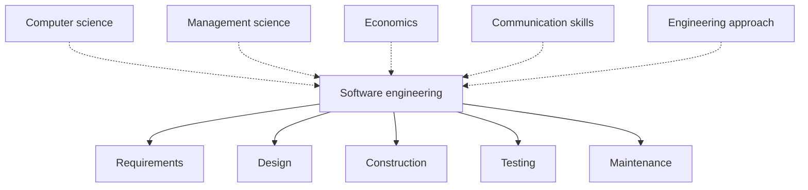

### Evolution and impact of SE

Over the last decades progress happened in every area of SE:
 * **analysis** techniques for finding software requirements;
 * methodical **design** approaches and many design notations;
 * better **implementation** techniques and new programming languages;
 * **validation** techniques and **quality assurance (QA)** procedures;
 * **CASE (Computer-Aided Software Engineering)** tools used during development;
 * **formal methods** for verifying software properties;
 * defined **maintenance** procedures.

This progress has sometimes been read as "the problems of SE are solved". The authors' point is the opposite: the amount of activity in SE shows how many problems are still open.

### Software engineering process

 * **Software process** — the structure imposed on the development of a software product. Organizations and industries use different **process models** (also called **software life cycle** models; see Part 2).

### Software engineering as a field

 * SE studies **complex systems**: systems made of many components with complex relationships. To represent such a system you build separate modules/components and link them together.
 * "Engineering" means building software **methodically**, according to **principles**.
 * To apply principles, the engineer needs **methods** and concrete **techniques** that put the desired properties into both the **process** and the **product**.
 * When methods and techniques are packaged together, the package is called a **methodology**. A methodology promotes one particular way of solving a problem.

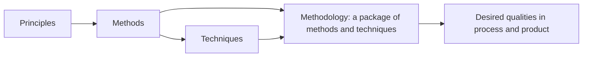

### Levels of software process

The amount of process must match the project. **Too much process** slows down pure research; **too little process** slows down a large project with hard deliverables. Three levels are distinguished:

| Level | Kind of project | Team and releases | Amount of process |
|---|---|---|---|
| **Level 1: R&D** | Pure research, no software product delivered | Small | Minimal |
| **Level 2: Research system** | Research system used by others | Larger team, **informal** releases | Moderate |
| **Level 3: Delivered system** | Product delivered to a customer | Large team, **formal** releases | Most formal |

As a project moves up the levels, its process and practices become more **formal and structured**.

Best practices applied across the three levels:
 * source code control;
 * clean, regular code builds;
 * writing reusable code;
 * different **team models**;
 * commitment to deadlines;
 * **design and code reviews**;
 * **risk management**;
 * **bug tracking**;
 * **software metrics**;
 * **software configuration management (SCM)**;
 * **requirements management**.

**SCM** is one step more formal and reproducible than plain source code control: in addition to versioning source files it **controls and versions software releases**.

### Importance of software construction

 * Once, "developing software" and "coding" were considered the same thing. After other activities (project management, requirements, design, testing) were recognized as separate, they attracted most research attention, and **construction** (coding) became the neglected relative.
 * Treating construction as a distinct **activity** does not mean it must be a distinct **phase**. Activities can be arranged in phases, in iterations or any other way; construction can still be discussed on its own.

Numbers given for construction:

| Project size | Share of total effort spent on construction | Share of errors originating in construction |
|---|---|---|
| Small | about **80%** | about **75%** |
| Medium | about **50%** | **50–75%** |
| Large | — | **50–75%** |

 * Any activity responsible for 50–75% of errors is an obvious place to improve.
 * Construction is the **only activity that is guaranteed to happen**: requirements can be assumed, architecture shortchanged, testing shortened or skipped — but without construction there is no program. That makes it an especially productive place to improve practice.

### Problems in system development

Systems are sometimes abandoned before launch. Causes can lie with the developer or with the user. An experienced, far-sighted developer can foresee problems and act before they surface; developer and user should work as a group to understand each other's problems.

Typical problems of large, complex projects:

 1. **Time schedule overlap (schedule slip).** A long project drifts: what the customer wanted at the start changes drastically, the original concepts no longer match the scope, delivery is delayed, and the user may lose interest in completing the project.
 2. **User interface.** Human–machine interaction is not considered at the start and only shows up during development. Extra controls and displays are then added, and new hardware/software turns out to be necessary.
 3. **Test and integration.** Deficiencies are found only during testing and integration; missing parts are added late because not enough thought was given at the beginning.
 4. **Maintenance.** After hand-over, the user, now working independently, wants additions and changes and runs into technological, functional and performance problems. For this reason a **warranty period** is agreed, during which the developer fixes "teething problems" at no extra cost to the user.

### Solutions to the problems

Most late problems are avoided by proper **analysis and design up front**, which also prevents cost escalation.

| Problem | Remedies |
|---|---|
| **Schedule slip** | Postpone technology decisions as long as possible, or shorten the development cycle. Do detailed analysis and design early, because the financial impact must be known early; base detailed cost estimates on them. Choose technology by maturity. Reuse available hardware and software to shorten the cycle. Use **phased development**: analyze, design, build, test and deploy the system in segments; a problem in one segment is settled at once by referring to the previous phase. |
| **User interface** | Involve the future end users in development; use their views to simplify operation; simplify and streamline interface activities during development. |
| **Test and integration** | Define a **comprehensive test program**; assign it to a team member with strong testing experience; include a user representative in the **acceptance test**; get user sign-off step by step after **module testing, integration testing and system testing**. |
| **Maintenance** | **Design for change**: leave room for extra hardware (accuracy, speed) and software changes (computing power). Keep **proper documentation** so later changes during the life cycle can be made by referring to it. |

### Qualities of software

 * The higher the quality of product and process, the more serviceable the software, the fewer problems it causes and the longer it lives.
 * The **user** wants software that is **reliable, efficient and easy to use**.
 * The **producer** wants software that is **verifiable, maintainable, portable and extensible**.
 * **External qualities** are visible to users; **internal qualities** matter to developers. The qualities are closely interrelated (for example, internal verifiability helps external reliability).

The book's Table 1.1 ("Software Qualities") has no body in the source edition. The table below lists the qualities named in the text plus the classic set they come from:

| Quality | Kind | Meaning |
|---|---|---|
| **Correctness** | External | The software behaves according to its specification |
| **Reliability** | External | Users can depend on it; failures are rare |
| **Robustness** | External | Behaves reasonably even in situations not foreseen by the specification |
| **Efficiency / performance** | External | Uses resources (time, memory) economically |
| **Usability (user friendliness)** | External | Easy to learn and use |
| **Verifiability** | Internal | Its properties can be checked (by testing, review, analysis) |
| **Maintainability** | Internal | Easy to fix (repairability) and to change (evolvability) |
| **Portability** | Internal | Can run in different environments |
| **Extensibility** | Internal | New features can be added without major rework |
| **Reusability** | Internal | Parts can be used in other products |
| **Understandability / readability** | Internal | Its structure and code are easy to understand |

### System analysis and design

The aim of **analysis** is to find the customer's requirements, create a base for development and define the requirements to be developed later. A good analyst breaks the system into modules for development and later integrates them into a working product.

Technical tasks of a **system engineer / system analyst**:
 1. Study the existing system and build a requirements list together with users.
 2. Prepare a **conceptual (logical) design** based on the requirements.
 3. Fix the **system boundary**: inputs, outputs and interfaces.
 4. Define the functions to perform and the **parameters for measuring performance**.
 5. Find the internal structures of the system and their dependencies.
 6. Build **mathematical models** for evaluating system performance.
 7. Produce **alternative solutions** and choose the best one by **weighted evaluation**.
 8. **Decompose** the system into logical subsystems to be integrated later.
 9. Take part in development, testing, integration and implementation.
 10. Work with users, developers and management to steer the project.
 11. Act as a **change agent** and catalyst for process improvement.
 12. Lead in all phases of development.
 13. Prepare the **project plan and schedule** for phase-wise completion.
 14. Determine the system's **reliability, availability and quality**.
 15. Prepare development **cost estimates** and perform **cost–benefit analysis**.

#### System analysis

 * **System analysis** — gathering and interpreting facts, diagnosing problems and using the information to recommend improvements.
 * It means studying the application area until the posed problem is fully understood. Data-gathering methods: **interviews, observation, hands-on experience, consultations** and others.
 * Focus: a full picture of the existing system, its **strengths and weaknesses**, and the reasons why it must be restructured, replaced or automated.
 * The result of this activity is a **problem statement**.
 * The **system analyst** is the person responsible for studying and designing the system. The role combines many hats: investigator, planner, designer, modulator, communicator, implementor, trainer, change agent, architect, psychologist, salesperson, motivator, politician, conflict resolver, persuader and imposer. A strong analyst can carry a project from initiation to implementation.

Analyst's tasks during analysis:
 * understand the existing system, its merits and demerits;
 * plan the new application or the change to the existing one;
 * schedule development activities;
 * consider **alternative candidate solutions**;
 * stress **re-engineering** and **method study**;
 * cover operational procedures: backup, audit, quality checks, security;
 * plan cost-reduction activities;
 * pay attention to system enhancement and recycling (reuse).

#### System architecture and design

 * **System design** develops the **structure (architecture)** of the system. Design is continuous from inception onward and moves from **"what to build"** to **"how to build it"**.
 * The software engineer gets involved by attending user meetings, reading preliminary documents and joining system-level **reviews and walkthroughs**.
 * The engineer then does **process modelling**: designs the software resources (programs and procedures) and produces **detailed specifications of program modules** that satisfy the user-interface and data-design specifications.
 * The engineer should know the **application domain** well: this lets them design software functions and specifications, establish system and subsystem **performance requirements** and take part in architecture development.

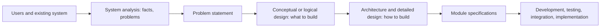

#### What a system is

 * A **system** is an ordered set of interdependent components, linked according to a plan, that together achieve a specific objective.
 * Example business subsystems and their typical functions:

| Subsystem | Typical functions |
|---|---|
| **Production** | Allocation of people and machines, job assignment and completion, scheduling, job costing, incentive schemes, raw-material requirement planning, work-in-progress and finished-goods status |
| **Finance** | Accounts payable and receivable, ledger posting, cash payments and receipts, salaries and wages, trial balance, profit and loss account, balance sheet, bank transactions |
| **Personnel** | Recruitment, training, deployment, retirement, performance appraisal and promotion, employee and skill databases, payroll, provident fund, leave records, administration |

### Summary of the chapter

SE turns the **logical concept** of a system into a working **physical system**. It needs an experienced, committed engineer who drives the team. The system must be delivered on time, meet user requirements and give visible benefits the user accepts. For a long product life it needs proper quality and reliability, and it must be easy to understand and change so that it can be maintained.

### Key takeaways

 * SE = a systematic, disciplined, quantifiable approach to developing, operating and maintaining software; its goals are quality, productivity and engineer satisfaction.
 * Complexity is managed by decomposition into modules with well-defined interfaces.
 * The amount of process must fit the project: R&D (minimal), research system (moderate), delivered system (formal).
 * Construction takes 50–80% of effort and causes 50–75% of errors, and it is the only activity that always happens — so it is the best place to improve.
 * Typical development problems: schedule slip, late UI, test/integration gaps, maintenance load; most are prevented by early analysis and design, phased delivery, user involvement, a test program and design for change.
 * Users care about external qualities (reliability, efficiency, usability), developers about internal ones (verifiability, maintainability, portability, extensibility).
 * The system analyst gathers facts, writes the problem statement, designs the logical system, evaluates alternatives and steers the project; design moves from "what" to "how".

---

## Part 2. Modelling the Software Development Life Cycle

### Why a structured process is needed

When application software grows large and complex, several properties must be managed at once: **readability, reliability, security, repairability (maintainability)** and **usability**. Many analysts, designers and developers take part. So the work is split into clear **phases**, each assigned to a group. Phases depend on each other: the next task can start only when the previous one is finished. Hence a **structured development process** is required.

Topics of this part:
 * software development (life cycle) models;
 * how reliability, performance, safety and security fit into a life cycle model;
 * the activities that make up software development.

### System analysis and design in an organization

 * "Information is power": an organization that has all its information at hand acts more pragmatically. A computerized **information system** not only provides information but helps management decide quickly. Building one is an **organizational improvement process**.
 * Analysis and design of an information system are based on the organization's **objectives, structures and processes**, with the aim of using IT to the organization's advantage.

#### Data and process

An information system consists of three things:
 * **Data** — raw facts that describe an entity (a person, place or object). Relationships among data are described with various modelling techniques.
 * **Data flows** — groups of data that move through the system, including their **source** and **destination**.
 * **Processing logic** — the steps that transform data. The steps are triggered by **events**.

#### Process-oriented approach

 * Focus on the **process**: how data flows, is used and is transformed; how and when data moves from source to destination through intermediate steps; how processes turn data into information. The **sequence** of processes matters.
 * Data files are created **per application**, when a process needs them.
 * Consequences:
   * the same data is **duplicated** across many files;
   * the same data element must be updated in several files;
   * specialized files become cumbersome;
   * the same element may have **different names** in different files;
   * hence the organization needs **data standardization**.

#### Data-oriented approach

 * Focus on **data** rather than process. Techniques deal with **redundancy**, **indexing** and **relationships** among data.
 * The **data model** captures the rules and policies of the business.
 * Processes change over time, but the organization's **data stays relatively stable**; data volumes grow and become more complex. So the emphasis is on data and **normalization**.
 * Process and data are handled **separately**. Data-handling software (a DBMS) answers queries efficiently.
 * A **database** serves every application and can be used by many applications **simultaneously**; database design therefore becomes central. A **data repository** serves current and future systems without data-change problems. Many organizations keep a **central database**.

| Aspect | Process-oriented | Data-oriented |
|---|---|---|
| Focus | What the system must **do** | What **data** the system needs |
| Data files | Designed for a specific application | Designed for the whole organization |
| Redundancy | High, uncontrolled duplication | Controlled (normalization) |
| Stability of design | Lower — business processes change fast | Higher — data changes more slowly |
| Data naming | Inconsistent across files | Standardized |
| Sharing | Each application owns its files | One database shared by many applications |

The two views are **complementary**: a real system needs both a model of its processes and a model of its data.

### Types of information systems

People connected with information systems: system managers, system analysts, programmers, end users, auditors, business managers, top management and support technicians (also testers and QA staff, telecom engineers, software experts). Because their interests differ, different **classes of information systems** exist.

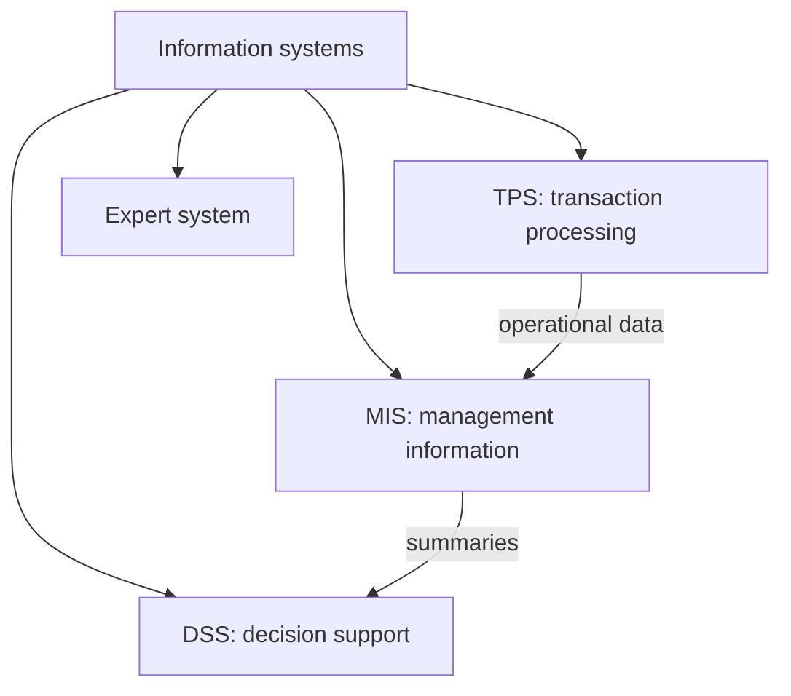

#### Transaction processing system (TPS)

 * A **TPS** processes data **transactions** in a database and monitors them. Its essence: data must always be left in a **consistent state**.
 * Example — electronic payment: money is **either** withdrawn from one account **and** added to the other, **or neither** happens. If a failure prevents completion, the partly executed transaction must be **rolled back**.
 * This integrity matters for batch processing but especially for **online** processing. Example — airline seat reservation with many operators: after an operator finds a free seat, the seat record must be **locked** until booking completes; otherwise another operator sees the seat as free and a **double booking** occurs.
 * Other functions of a **transaction monitor**: **deadlock** detection and resolution; **transaction logging** in journals for **forward recovery** after massive failures.

Features of a TPS:

| Feature | Meaning |
|---|---|
| **Rapid response** | Turnaround from input to output must be a few seconds or less; customers cannot be kept waiting |
| **Reliability** | Very low failure rate; if it fails, recovery must be quick and accurate, so good **backup and recovery** procedures are essential |
| **Inflexibility** | Every transaction is processed the **same way** regardless of user, customer or time of day. Flexibility would allow non-standard operations (e.g., an airline must accept reservations in one format from all travel agents) |
| **Controlled processing** | Processing must support the organization's rules — e.g., enforce the roles and responsibilities assigned to employees |

#### Management information system (MIS)

 * An **MIS** is part of a business's internal controls: people, documents, technologies and procedures used by management accountants to solve business problems such as costing a product, a service or a company-wide strategy.
 * Unlike ordinary information systems, an MIS is used to **analyze other information systems** that support operations. Academically, the term covers methods tied to automating or supporting **human decision making**: decision support systems, expert systems, executive information systems.
 * MIS combines technology and business so people get the information they need to work better, faster and smarter. An MIS often draws data from **several TPSs**.
 * MIS professionals work as systems analysts, project managers, system administrators, communicating with staff and management across the organization.
 * Another definition: a **planned system** for collecting, processing, storing and disseminating data as **information** needed for management functions — in effect, a documented report of what was planned and executed.
 * Distinctions:
   * **MIS vs information system**: information systems also include systems not meant for decision making.
   * MIS in a narrow sense is sometimes called **IT management**; it is not computer science. **IT service management** is a practitioner-oriented discipline.
   * **MIS vs ERP (Enterprise Resource Planning)**: ERP contains elements not focused on decision support.

#### Decision support system (DSS)

 * A **DSS** is a class of computerized information systems supporting business and organizational **decision making**. A well-designed DSS is **interactive** and helps decision makers compile useful information from raw data, documents, personal knowledge and/or business models to identify and solve problems.
 * Typical information a DSS gathers and presents:
   * an inventory of all information assets (legacy and relational sources, **cubes**, **data warehouses**, **data marts**);
   * comparative sales figures week over week;
   * projected revenue based on assumptions about new product sales.
 * History: around **1990**, **data warehousing** and **OLAP (Online Analytical Processing)** broadened DSS; near 2000, **web-based analytical applications** appeared.
 * Foundations: database research, AI, human–computer interaction, simulation, SE, telecommunications. Better reporting technologies made DSS a critical part of management design.

| DSS type | Behaviour |
|---|---|
| **Passive** | Helps the decision process but cannot produce explicit suggestions or solutions |
| **Active** | Can produce explicit decision suggestions or solutions |
| **Cooperative** | The decision maker (or adviser) modifies, completes or refines the system's suggestions and sends them back for validation; the system refines them again and returns them; the loop repeats until a **consolidated solution** emerges |

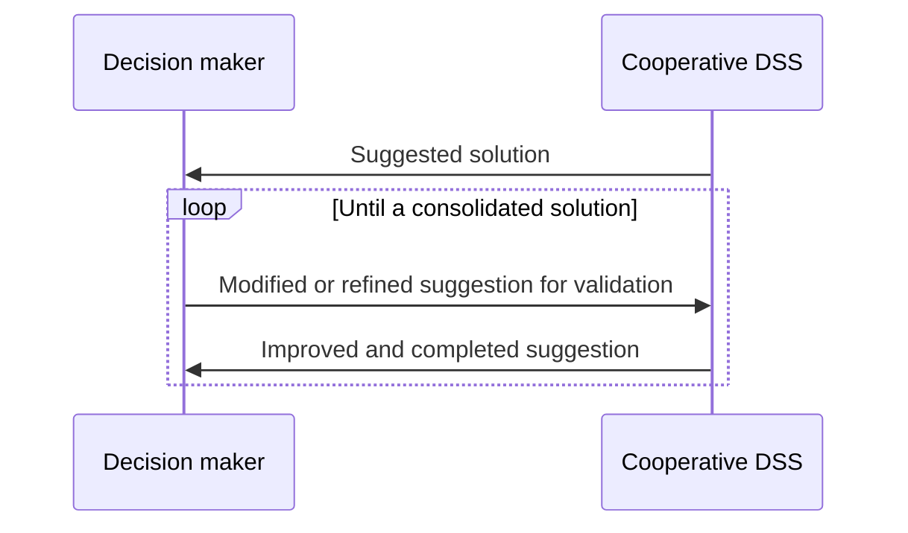

#### Expert system

 * An **expert system** tries to reproduce the performance of one or more **human experts**, usually in a narrow domain; it is a classic application/subfield of **AI**.
 * Common elements:
   * a **knowledge base**, using some **knowledge representation** formalism to capture the knowledge of **subject matter experts (SMEs)**;
   * **knowledge engineering** — the process of gathering knowledge from SMEs and codifying it in that formalism;
   * optionally, a learning component;
   * validation by placing the system in the **same real-world problem situations** as the human expert, usually as an aid to workers or an add-on to an information system.
 * Key idea: problems are solved by applying **specific knowledge**, not a specific technique. Experts don't reason differently from others — they **know different things**. So when an expert system gives poor results, you **expand the knowledge base**, not reprogram the procedures.
 * Typical architecture: a **rule base** plus an **inference engine** simulate the expert's reasoning. The rule base is a large set of interrelated **"if–then"** rules that approximate the sequence of mental steps of the expert.
 * Because rule bases are big, expert systems used to run only on large machines; growing PC storage made simple expert systems feasible on personal computers.
 * Some applications need more knowledge than fits in active memory; in others **not all knowledge is needed** each time. Example: diagnosing a data processing system with many optional components — a single integrated rule base for the minimum configuration contains many rules about optional units that are not present, so most of it is unused.

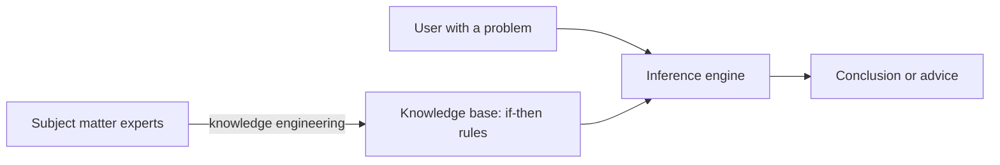

### Overview of the SDLC

 * **SDLC (Systems Development Life Cycle)** — a conceptual project-management model describing the stages of an information system project, from the initial **feasibility study** to **maintenance** of the finished application.
 * Methodologies: **waterfall** (the original SDLC), **RAD (Rapid Application Development)**, **JAD (Joint Application Development)**, the **fountain model**, the **spiral model**. In practice several are often combined into a **hybrid**.
 * **Documentation** is crucial in every model and is usually produced **in parallel** with development.
 * Some methods suit certain projects better, but the decisive success factor is often **how closely the plan was followed**.

Classic waterfall (the first SDLC model):

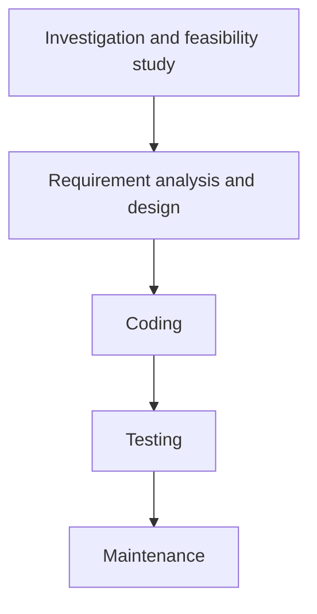

### The phases in brief

These phases appear in every model, regardless of how they are arranged.

#### Feasibility study

 * Decides whether the project gets the **go-ahead** after analyzing business problems and opportunities. If it proceeds, the study produces a **project plan** and **budget estimates** for later stages.
 * Determines whether a new or improved information system is needed; produces a **project management plan** and obtains **management approval**.
 * Crystallizes the problem/opportunity definition, decides which aspects belong in the system, estimates **costs and benefits** and makes a **formal proposal** on the nature and scope of the solution.
 * Contents of the feasibility report:
   1. Statement of the problem.
   2. Summary of findings and recommendations.
   3. Details of findings (methods, procedures, output reports, file structures, cost–benefit analysis).
   4. Recommendations and conclusions (staff assignment, costs, schedule, target dates).

#### Requirement analysis and design

 * **Analysis**: detailed study of the organization's business needs (possibly including changes to business processes). Gather the information needs of end users, the organizational environment and any current system. Define the **logical input, processing, output, storage and control requirements**. Produce specifications for:
   * **hardware** (machines and media);
   * **software** (programs and procedures);
   * **people** (specialists and end users);
   * **data resources**;
   * **information products**.
 * **Design** covers:
   * **high-level design** — which programs are needed and how they interact;
   * **low-level design** — how each program works;
   * **interface design** — what interfaces look like;
   * **data design** — what data is needed.
 * The overall structure of the software and the **logical system** are defined here. A design mistake is very expensive to fix later, so this phase needs great care.

#### Coding

 * Designs are translated into code using a conventional programming language or an **application generator**. Tools: **compilers, interpreters, debuggers**. Languages such as C, C++, Pascal, Java are chosen according to the type of application.

#### Testing

 * Programs are written as **modules** and each is tested separately in detail, then the system is tested **as a whole**:
   * **integration testing** — interfaces between modules work;
   * **volume testing** — the system works on the target platform with the expected data volume;
   * **acceptance / beta testing** — the system does what the user requires.

#### Maintenance

 * A **post-implementation review** monitors, evaluates and modifies the system as needed. Training and documentation are provided before hand-over.
 * Maintenance is inevitable: software changes after delivery — because of unexpected inputs, or because changes in the surrounding system affect software operation. The software should be built to **accommodate post-implementation changes**.

#### Milestones and phase deliverables

A phased life cycle increases project **visibility**: phases serve as **milestones**, and finer phases allow closer monitoring. A good milestone must (1) be tied to real development progress and (2) make it **obvious when it has been reached**.

| Document | Phase where it is produced |
|---|---|
| Statement of work | Feasibility |
| Project plan, cost estimate, SQA (Software Quality Assurance) plan | Project planning |
| Preliminary user manual, test plan | Requirements |
| Architectural design, module specification, detailed design | Design |
| Source code, final user manual, documentation | Implementation |
| Test report | Testing |

Order of tasks in a waterfall project: market analysis → project planning, cost estimating, requirements specification (can run concurrently) → requirements review → high-level design → low-level design → design review → implementation → unit testing → system testing → acceptance testing.

### Types of models

Like any product, software passes through phases from inception to maturity — from investigation to maintenance — each consuming resources. The model is chosen according to the **size**, **complexity** and **user requirements** of the system.

Over the past decades researchers identified these distinct activities of software development:
 1. Problem definition
 2. Requirements development
 3. Construction planning
 4. Software architecture (high-level design)
 5. Detailed design
 6. Coding and debugging
 7. Unit testing
 8. Integration testing
 9. Integration
 10. System testing
 11. Corrective maintenance

Not every model shows all of them explicitly, but all are present to some degree.

### The (iterative) waterfall model

 * The **"classical"** model, also called the **one-shot approach**: a top-to-bottom sequence of activities.
 * Some arrows point **back up**: a later stage may reveal extra work needed at an earlier one — but this should be the **exception**. A waterfall flows down "with just a little splashing back".
 * The **limited iteration is a strength**: in a large project you don't want to reopen tasks thought complete, because that wrecks the promised completion date.

Phases:
 1. **Feasibility study** — the initial study before analysis and design. It is a **decision document** answering three questions: is there a new, better way of doing the job that benefits the user? What are the costs and benefits of the alternatives? What is recommended? Three dimensions of feasibility: **economic, technical, behavioural**. Usually written by a senior person who knows the system and the organization well; depending on the initial investigation it grows into a detailed study. Contents: problem statement; summary of findings and recommendations; details of findings; recommendations and conclusions.
 2. **Requirement analysis and definition** — services, constraints and goals are set in consultation with users, then detailed into a **system specification**. Analysis studies the system's operations and their relations inside and outside the system and answers **what must be done**. System **boundaries** are fixed. Tools: **DFDs (data flow diagrams), ER (entity–relationship) diagrams, interviews, on-site observation, questionnaires**.
 3. **System and software design** — requirements are partitioned between **hardware and software**; overall **system architecture** is established. Software design identifies the fundamental **software abstractions** and their relationships. The most creative and challenging phase. Input/output interfaces and processing are designed and tested along with documentation; information about staff, money, hardware, software, facilities and their costs must be available.
 4. **Coding** — often done by separate programmer groups; each programmer gets one or more modules; analyst/designer integrates them later.
 5. **Implementation and unit testing** — the design becomes a set of programs/units; **unit testing** verifies each unit against its specification. This stage (in the book's wording) also covers **user training, site preparation, file conversion**, linking remote sites and terminals, setting up the telecom network, and handing over all manuals.
 6. **Integration and system testing** — units are integrated and tested as a whole to confirm requirements are met; **system testing** checks readiness and accuracy; then the system is delivered.
 7. **Operation and maintenance** — usually the **longest** phase. The system is installed and used; staff adapt to it. Maintenance = correcting errors not found earlier, improving the implementation of units, and **enhancing** services as new requirements appear.

**Assessment.** There is nothing intrinsically wrong with waterfall. It lets managers **forecast completion dates with more confidence** than iterative approaches, so projects can be **controlled** effectively. Where implementation is **uncertain**, a more flexible, iterative method is preferred.

#### Waterfall with reviews (traditional approach)

Each step can loop back to the previous one, and each phase ends with a formal **review**:

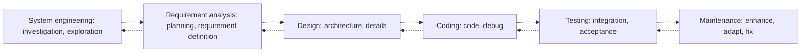

| Review | Expanded name | Where |
|---|---|---|
| **PFR** | Product Feasibility Review | End of system engineering |
| **SRR** | Software Requirement Review | End of requirements analysis |
| **PDR** | Preliminary Design Review | Architecture part of design |
| **CDR** | Critical Design Review | End of detailed design |
| **SCR** | Source Code Review | Coding |
| **ATR** | Acceptance Test Review | Testing |
| **PRR** | Product Release Review | End of testing, before release |
| **PPM** | Project Post-Mortem | Maintenance / after the project |

### The V-process model

 * An elaboration of waterfall that stresses **validation activities matching each development activity**. It can be seen as **expanding the testing activity** of the waterfall.
 * Each step on the left (descending) side has a matching **validation** step on the right (ascending) side. If a defect is found, the process loops back to the corresponding development stage, and the following steps are reworked.

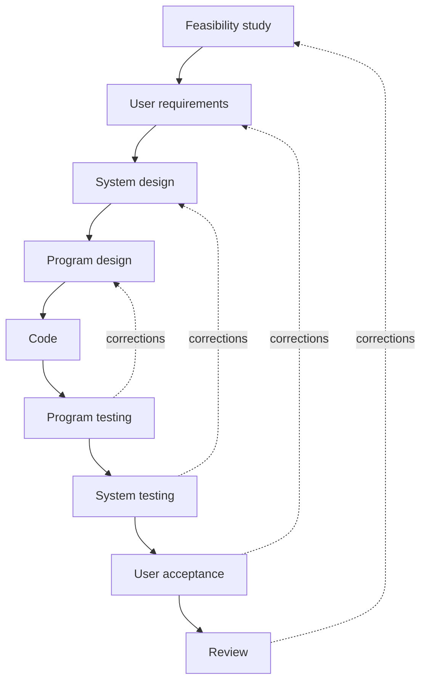

 * Ideally feedback happens only when a **discrepancy** is found between what one level specified and what the next lower level implemented.
 * Example: the system designer specified that a calculation be done a certain way; the program designer misunderstood it. At **system testing** the system designer checks the software against the design document and finds the misreading.
 * Only **corrections** should be fed back — not the designer's **second thoughts**; otherwise the project drifts into **evolutionary prototyping**.

### The spiral model

 * Another way of looking at the waterfall. In waterfall there is a possible **exit after each activity**: e.g., the feasibility study says the system is worthwhile, management authorizes detailed requirements work, but deeper investigation shows costs are higher than estimated and the project is **abandoned**.
 * Each stage adds **more detail** and should give **more confidence** in the project's success. This is drawn as a **spiral**: every sweep considers the system in more detail, and an **evaluation** happens before the next loop. (The book notes that SSADM — Structured Systems Analysis and Design Method — can be interpreted this way.)
 * The radial distance shows **cumulative cost**; the angle shows **progress through steps**. A **review** and **commitment** decision is made at each crossing of the horizontal axis.

Each loop passes through four quadrants:

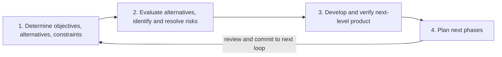

What each loop produces (Boehm's spiral as drawn in the book):

| Loop | Risk work | Prototype / model | Develop and verify | Plan |
|---|---|---|---|---|
| 1 | Risk analysis | Prototype 1 | Concept of operation | Requirements plan, life-cycle plan |
| 2 | Risk analysis | Prototype 2, emulations | Software requirements, requirements validation | Development plan |
| 3 | Risk analysis | Prototype 3, models | Software product design, design validation and verification | Integration and test plan |
| 4 | Risk analysis | Operational prototype, benchmarks | Detailed design → code → unit test → integration and test → acceptance test → implementation | — |

### Software prototyping

 * Before real development, build a **working prototype**: a model functionally equivalent to a **subset** of the product. It is a "toy" implementation — **limited functionality, low reliability, inefficient performance**.
 * It is shown to customers together with input formats, messages, reports and interactive dialogues. Technical issues are examined (e.g., response time of a hardware controller, efficiency of sorting algorithms).
 * Since you rarely get it right the first time, be ready to **throw away the first version** to build a good product.
 * Process: start with **approximate requirements** → **quick design** → build the prototype using **shortcuts** (inefficient, inaccurate or **dummy functions**, e.g., a table look-up instead of real computation) → customer evaluates → requirements refined → repeat until the user **approves** the prototype → build the real system with the **classical waterfall**.

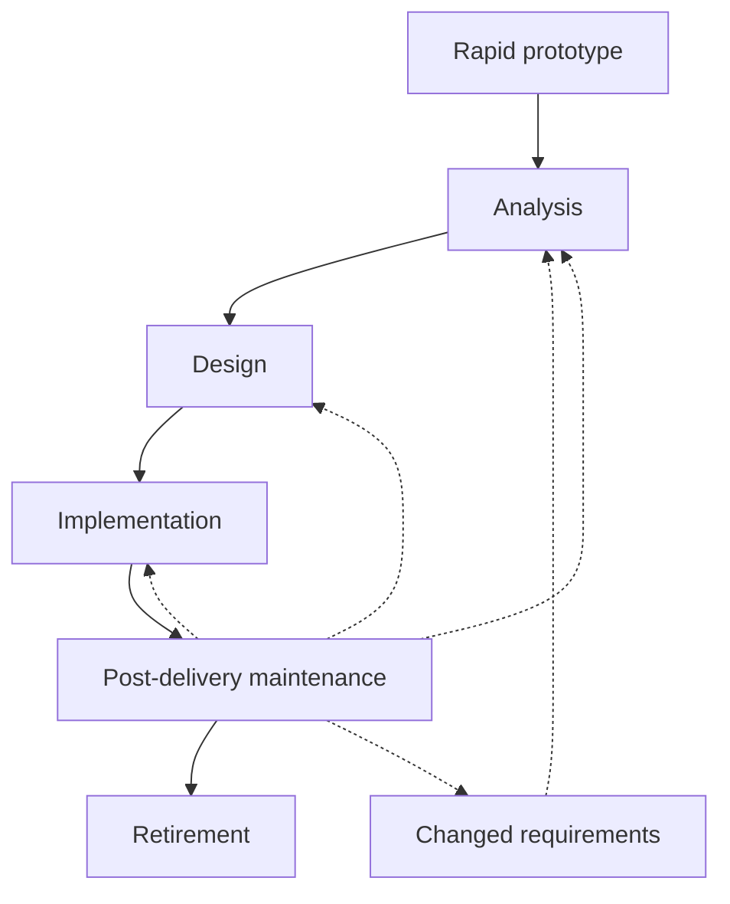

 * Solid arrows are development; dotted arrows are maintenance loops.
 * The separate requirements-specification phase becomes **redundant**: the final approved prototype acts as an **"animated" requirements specification**.
 * Building a prototype costs extra, but for systems with **unclear requirements** and **unresolved technical issues** the **total cost is lower**: requirements get defined and technical issues get resolved early instead of appearing later as **change requests** that force expensive redesign.

Kinds of prototypes:

| Kind | Idea |
|---|---|
| **Throw-away** | Used only to test ideas, then discarded when real development begins. Can be built in a different software environment (where machine efficiency doesn't matter) or even on different hardware |
| **Evolutionary** | Developed and modified until it becomes the operational system; development **standards** must be chosen carefully because the code stays |
| **Incremental** | Strictly speaking **not prototyping**: the operational system is built and delivered in **small stages**, so feedback from early stages shapes later ones — "learning by doing" |

Benefits of prototyping: better communication, user involvement, consistency and completeness of the specification; less documentation needed and lower maintenance cost.

### Incremental approach

 * Advocated by **Tom Gilb** (1988). The system is broken into **small components** implemented and delivered **in sequence**; **each delivered component must benefit the user**.

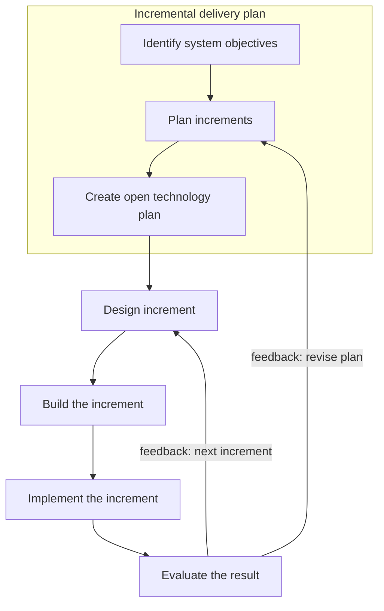

| Advantages | Disadvantages |
|---|---|
| Feedback from early increments influences later ones | **Software breakage**: later increments may force changes to earlier ones |
| Fewer requirement changes than in big monolithic projects, because the time from design to delivery of a component is short | Developers may be more productive on one large system than on many small ones |
| Users get benefits **earlier** | |
| Early useful deliveries improve **cash flow** (early return on investment) | |
| Smaller sub-projects are easier to control and manage | |
| Less **gold plating** (requesting unneeded features): users know a feature missing now can come in the next increment | |

### Evolutionary model

 * The system is developed in **successive versions**. It is split into modules that can be implemented and delivered incrementally. First the **core modules** are built; the initial skeleton is then refined to higher levels of capability by adding functions in each version, each version doing useful work.
 * Many organizations combine **iterative and incremental** development; a release may add new functions or modify existing ones.
 * Example: version 1 = **A**; version 2 = **A + B**; version 3 = **A + B + C**.

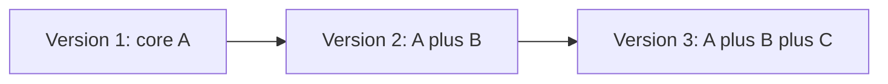

| Advantages | Disadvantages |
|---|---|
| Users experiment with a partial system long before the full version, which helps pin down **exact requirements** | Often hard to divide the problem into functional units that can be delivered incrementally |
| **Core modules are tested** repeatedly, so fewer errors reach the final product | Most useful for **very large** problems, where suitable modules are easier to find |
| Training can start on an early release; customer feedback is taken into account | |
| Frequent releases let developers fix unforeseen problems quickly | |

### Comparison of life cycle models

| Model | Core idea | Best when | Main weakness |
|---|---|---|---|
| **Waterfall** | Sequential phases, little iteration | Requirements stable and well understood; schedule predictability matters | Late discovery of problems; costly rework |
| **Waterfall with reviews** | Formal review gate after each phase | Contract or regulated projects | Heavy process overhead |
| **V-model** | Each development step paired with a validation step | Testing and verification are critical | Still sequential; feedback should be corrections only |
| **Spiral** | Loops with risk analysis and go/no-go review | Large, high-risk projects | Requires risk-assessment expertise; costly |
| **Prototyping** | Build a throw-away model to discover requirements | Unclear requirements, unresolved technical issues | Extra cost of the prototype |
| **Incremental** | Deliver useful parts in sequence | Need for early benefit and cash flow | Software breakage between increments |
| **Evolutionary** | Grow the system from a core through versions | Very large problems that split into modules | Hard to find incremental units |

### The importance of metaphors

 * Science advances by exploiting **metaphors**; they help understand software development too.
 * In his **1973 Turing Award lecture**, **Charles Bachman** used the shift from **Ptolemy's** earth-centred model (unchallenged for about **1400 years**) to **Copernicus's** sun-centred theory (**1543**). The new model led to finding new planets, reclassifying the moon as a satellite, and a new view of humanity's place.
 * Bachman compared it with a change in data processing in the early 1970s: from a **computer-centred** view (all data is a **sequential stream of cards** flowing through the computer) to a **database-centred** view (a **pool of data** on which the computer happens to act).
 * Once the old theory is dropped, it seems absurd that anyone believed it — yet its supporters found the new theory just as absurd at the time.
 * A software metaphor works **more like a searchlight than a roadmap**: it illuminates a problem, it doesn't give step-by-step directions.

### Chapter summary

 * Process orientation focuses on what the system does; data orientation on the data it needs. Process-oriented designs are **less stable**, because business processes change faster than data. Process-oriented files serve one application; data-oriented files serve the whole organization with controlled redundancy.
 * People involved in development: system analysts, programmers, IS managers, key end users, testers and QA staff, telecom engineers, software experts, system auditors.
 * System types: TPS, MIS, DSS, expert systems.
 * Several life cycle models, each with its phases, merits and drawbacks.

### Key takeaways

 * An information system = data + data flows + processing logic; process-oriented and data-oriented approaches are complementary, but data-oriented design is more stable.
 * TPS guarantees consistency (all-or-nothing transactions, locking, deadlock handling, journaling) and is fast, reliable, deliberately inflexible and controlled.
 * MIS turns TPS data into management information; DSS supports decisions (passive, active, cooperative); expert systems encode expert knowledge as if–then rules plus an inference engine.
 * SDLC phases: feasibility → requirements and design → coding → testing → maintenance; maintenance is usually the longest phase.
 * Waterfall is predictable and controllable but weak under uncertainty; the V-model pairs every development step with a validation step.
 * The spiral model adds risk analysis and a review/commit decision on every loop.
 * Prototyping (throw-away, evolutionary) clarifies unclear requirements and lowers total cost despite the prototype's own cost.
 * Incremental and evolutionary delivery give early value and feedback, at the risk of software breakage and difficult decomposition.

---

## Part 3. Software Requirement Analysis and Specification

### What this part covers

 * Why **high-quality specifications** matter and what role requirement specifications play at every level of development.
 * The interfaces between all system elements.
 * Information flow, structure definitions, basic diagrams and major functions.
 * Realistic **design constraints**, **technological risks** and alternative software requirements.
 * Checking for **inconsistencies** and module redundancy, and **validating** the system.
 * Tools and techniques for determining requirements.
 * How **JAD** and **prototyping** are used to establish requirements.

### Introduction to software requirements

Before building a product, the analyst must understand the **information domain** and know the required **functions, behaviour, performance** and **interfaces**. System and software requirements are documented and **reviewed with the customer**.

Requirements analysis consists of three activities:

| Activity | What happens |
|---|---|
| **Eliciting requirements** (requirements gathering) | Communicate with customers and users to find out what they need |
| **Analyzing requirements** | Check whether stated requirements are unclear, incomplete, ambiguous or contradictory, and resolve these issues |
| **Recording requirements** | Document them as natural-language documents, **use cases**, **user stories** or process specifications |

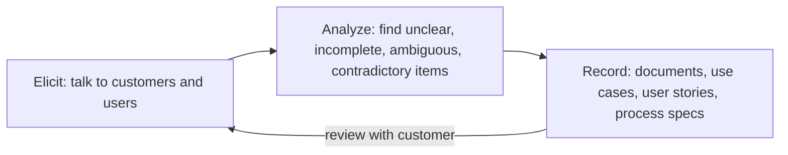

 * Requirements analysis can be long and needs subtle **psychological skills**: a new system changes the environment and relationships between people, so their needs must be taken into account and they must understand the implications.
 * Elicitation techniques: **interviews**, **focus groups**, **requirements lists**; more modern ones are **prototyping** and **use cases**. Analysts combine methods as needed so that the system meets the business needs.

#### What project success depends on

 1. The level of detail with which team activities are recorded.
 2. Quality of the software specification.
 3. Integrity of the specification.
 4. Accuracy of the specification.
 5. Established development processes.
 6. The rigour with which those processes are followed.
 7. Quality and number of reviews and audits.
 8. Accuracy of models used to estimate software attributes.
 9. Effectiveness of the test and integration plan, test specification and test data.
 10. Level of preparation for maintenance.

**Seven of these ten** factors relate directly to **specification**.

### Requirement engineering

 * Systematic requirements analysis is also called **requirements engineering**. It is loosely referred to as requirements gathering, **requirements capture** or **requirements specification**. In a narrow sense, "requirements analysis" means the analysis proper, as opposed to elicitation or documentation.
 * **Requirements engineering** is a sub-discipline of systems engineering and software engineering concerned with determining the **goals, functions and constraints** of hardware and software systems.
 * A fuller definition: the systematic use of **verifiable principles, methods, languages and tools** to analyze and describe the **behavioural and non-behavioural** features of a software system that express user needs. Its main by-product is the **SRS**.
 * Order relative to feasibility:
   * in some life cycle models, RE starts with a **feasibility study** → **feasibility report**; if the product should be built, requirements analysis begins;
   * if requirements analysis comes **before** feasibility (which can encourage "outside the box" thinking), feasibility must still be settled **before requirements are finalized**.
 * **Requirements management** establishes and maintains a shared understanding between the client and the development team about the client's requirements.

#### Requirements in the systems engineering process

In systems engineering, requirements analysis is part of a loop of four activities, with "system analysis and control" balancing all of them:

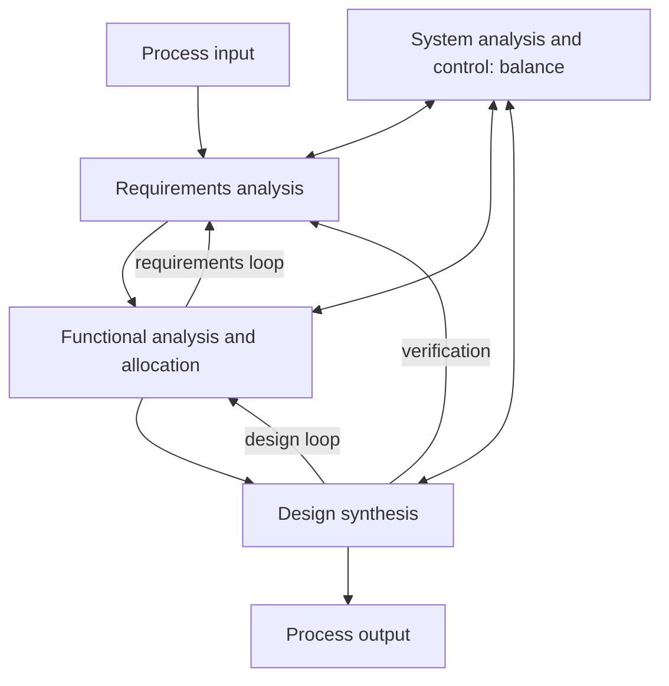

 * **Requirements loop**: functional analysis may reveal gaps that send work back to requirements analysis.
 * **Design loop**: design synthesis may force a revision of the functional allocation.
 * **Verification**: the synthesized design is checked back against the requirements.

### Software requirement specification (SRS)

 * An **SRS (Software Requirements Specification)** is a **complete description of the behaviour** of the system to be built.
 * It contains a set of **use cases** describing all interactions users will have with the software; use cases express **functional requirements**.
 * It also contains **non-functional (supplementary) requirements** — requirements that **constrain the design or implementation**: performance requirements, quality standards, design constraints.

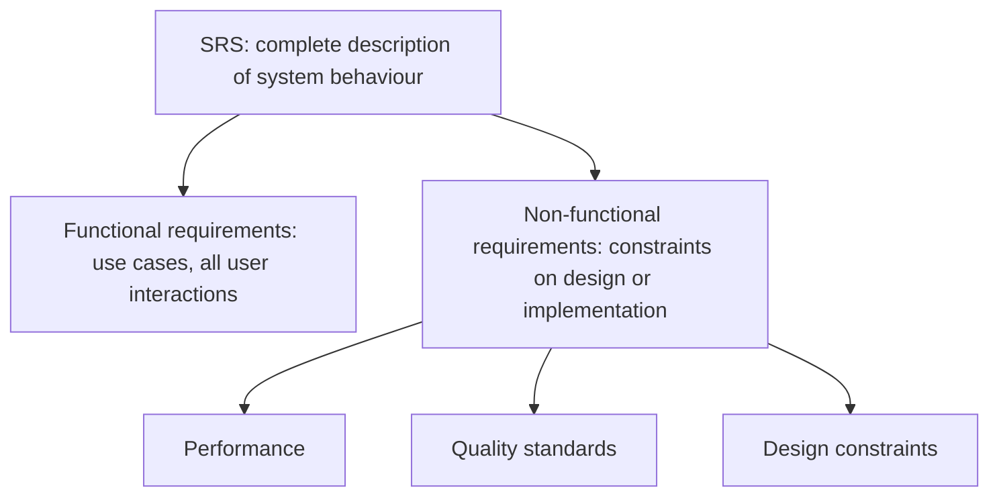

#### Software requirement definition

 * The analysis phase has **two sub-phases**: **planning** and **software requirements definition**.
 * Output of **planning**: the **system definition**, the **project plan** and the **preliminary user's manual**.
 * Output of **requirements definition**: the **software requirements specification**, which states the technical requirements **completely, concisely and unambiguously**. Its size depends on the size and complexity of the problem.

#### Format of an SRS

The book's Table 3.1 has no body in the source edition. The text matches the classic section layout (Fairley), reconstructed below:

| # | Section | Contents |
|---|---|---|
| 1 | Product overview and summary | Overview of product features |
| 2 | Development, operating and maintenance environments | Processing environments for development, operation and maintenance |
| 3 | External interfaces and data flow | User displays and report formats, summary of user commands and report options, high-level **data flow diagrams**, **data dictionary** |
| 4 | Functional requirements | What the software must do |
| 5 | Performance requirements | Response time, throughput, capacity |
| 6 | Exception handling | Behaviour on errors and unexpected events |
| 7 | Early subsets and implementation priorities | What to build first |
| 8 | Foreseeable modifications and enhancements | Expected changes |
| 9 | Acceptance criteria | How the product will be accepted |
| 10 | Design hints and guidelines | Suggestions for designers |
| 11 | Cross-reference index | Traceability |
| 12 | Glossary of terms | Definitions |

 * Sections 1–2 elaborate the product characteristics already given in the **system definition** and the **preliminary user's manual**.
 * Section 3 includes the **DFDs** — they show **data sources**, **data sinks** and **data stores** and the transformations between them — and the **data dictionary**.

#### Attributes of a good SRS

(The book's answer list is lost in the source; these are the standard attributes.) A good SRS is:
 * **correct** — every stated requirement is one the software must meet;
 * **unambiguous** — each requirement has only one interpretation;
 * **complete** — covers all functions, constraints, responses to all inputs;
 * **consistent** — no requirements conflict;
 * **ranked** for importance and/or stability;
 * **verifiable** — each requirement can be checked by a finite, cost-effective process;
 * **modifiable** — easy to change without breaking structure;
 * **traceable** — each requirement's origin is clear and it can be referenced later.

#### Components of requirements

 * **Components of requirements analysis**: interface requirements, functional requirements, performance requirements, design constraints, software system attributes.
 * **Interface requirements**: user interface, hardware interface, software interface, communication interface.
 * **Functional requirements** are described by: information flow, process description, data construct specification, data dictionary.
 * **Five areas of requirements analysis** (requirements analysis bridges system-level allocation of software and software design):
   1. Problem recognition.
   2. Evaluation and synthesis.
   3. Modelling.
   4. Specification.
   5. Review.
 * **Three kinds of requirements by user expectation**: **normal** (explicitly stated), **expected** (implicit, so basic the customer doesn't mention them), **exciting** (beyond expectations, delight the customer).
 * In the **Cleanroom** method, the specification phase includes: requirements analysis, function specification, usage specification, architecture specification and incremental planning.

#### Objectives of system analysis

 * Identify customer needs.
 * Evaluate the system concept for **feasibility**.
 * Perform **economic and technical analysis**.
 * **Allocate functions** to hardware, software, people, database and other system elements.
 * Establish **cost and schedule constraints**.
 * Create a **system definition**.

### Software requirement collection

Gathering requirements is like conducting an investigation. Traits of a good analyst during requirement determination:

| Trait | Meaning |
|---|---|
| **Impertinence** | Question everything — e.g., "Are all transactions processed the same way?" |
| **Impartiality** | Look for the best solution to the business problem, not a justification for a pre-made decision (e.g., not a way to justify buying new hardware) |
| **Relaxed constraints** | Assume anything is possible, then eliminate what's infeasible; reject "we've always done it that way" |
| **Attention to detail** | Every fact must fit every other fact; one element out of place will make the system fail at some point |
| **Reframing** | Analysis is creative: look at the organization in new ways and find better ways of working |

Deliverables of requirement determination:

| Source | Deliverables |
|---|---|
| **Conversations with and observation of users** | Interview transcripts, questionnaire responses, observation notes, meeting minutes |
| **Existing written information** | Business mission and strategy statements, sample business forms, reports and screens, procedure manuals, job descriptions, training manuals, flowcharts and documentation of existing systems, consultants' reports |
| **Computer-based information** | Results of JAD sessions, transcripts/files of group support system sessions, CASE repository contents and reports on existing systems, screens and reports from prototypes |

### Traditional methods for gathering requirements

The basic task is to collect information about current procedures and propose an improved system. Best practice: talk to people who work with the existing system in various roles, and ask about the **constraints** they face and **opportunities** available.

#### Interviewing and listening

 * One of the primary methods. Spend time interviewing people about their work, the information they use, how it is processed and their ideas for removing constraints.
 * Interview **stakeholders** to understand direction, vision, mission, policies and expectations.
 * Gather both **facts and opinions**; watch body language and emotions for signs of what people want and how they judge the current situation.
 * Plan the **mix and sequence** of question types:

| Question type | Form | Use |
|---|---|---|
| **Open-ended** | No precise answer expected | Surfaces unknown information |
| **Close-ended** | Yes/no, true/false, multiple choice | Precise, easy to compare |

#### Questionnaires

 * Interviews are time-consuming and expensive; a questionnaire with a limited set of questions collects information from **many people quickly**.
 * Choose a **representative sample** of respondents.
 * The hard part is designing a questionnaire that covers all requirements. It uses **close-ended questions only**.

#### Other traditional methods

 * **Group discussion**, **brainstorming**, **direct observation** of people at work.
 * All facts and findings must be documented, analyzed and presented to management before proceeding. Results from different methods should be compared and normalized; questions and agendas must be precise to avoid ambiguity.

### Modern methods for gathering requirements

Modern methods: **JAD**, **GSS (Group Support Systems)**, **CASE tools** and **prototyping**.

#### Joint application development (JAD)

 * A **structured process** in which users, managers and analysts design and develop an application together through a series of collaborative workshops called **JAD sessions**.
 * Goal: bring together the key users, managers and analysts of the current system to gather information and discuss business needs. The group defines requirements, designs a solution and **monitors the project to completion**.
 * JAD starts from the idea of a **group interview** and adds structure. Sessions are typically held **off-site** and may last about a week.

JAD participants:

| Role | Responsibility |
|---|---|
| **Session leader (facilitator)** | Organizes and runs the JAD; skilled in group management, facilitation and system analysis; sets the agenda and makes sure it's met; stays **neutral**, does not contribute ideas or opinions; keeps the group on track and resolves conflicts |
| **Key users** | Know what using the system day to day really means |
| **Managers** of user workgroups | Give insight into new organizational directions, motivations and impact of the system; back the requirements agreed in JAD |
| **Sponsor** | A relatively senior person who funds the JAD; usually attends at the start or the end |
| **System analysts** | Attend mainly to **learn** from users and managers; limited active participation |
| **Scribe** | Takes notes, on a computer with a word processor and CASE tools for diagrams |
| **IS staff** | Programmers, database analysts, IS planners, data-centre staff; learn from the discussion and may contribute on technical issues and limitations of the current system |

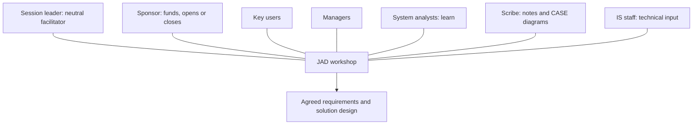

Advantages of JAD:
 * brings business people and IT professionals together in a highly focused workshop;
 * removes many problems of traditional meetings by turning a meeting into a **workshop**;
 * meetings are **less frequent, more structured, more productive**;
 * **faster development** and greater **client satisfaction** thanks to client involvement;
 * improves product quality by catching errors early, before they become expensive to fix;
 * may be **costly but highly effective**.

#### CASE tools in JAD

 * The most useful are **upper CASE** tools — applied to the **early** SDLC phases: planning tools, **diagramming** tools, prototyping tools (screen and report generators).
 * Running a CASE tool during JAD lets analysts enter **system models directly**, giving consistency and reliability to joint model-building. It captures requirements more flexibly and usefully than a scribe's notes.

#### GSS with JAD

 * JAD is a group process, so it can use computer support for groups — **Group Support Systems (GSS)**.
 * Problems of ordinary meetings that GSS addresses: not enough time for everyone; some people **dominate**; others fear criticism or won't challenge their bosses.
 * How GSS helps: members **type** comments instead of speaking; contributions are **anonymous** ("no one knows who typed what"), so even the boss can be criticized; people contribute **in parallel**, so the process takes less time.

#### Prototyping for requirements

 * Prototypes help in analysis because users may not know what a computer could do for them or how they would use it.
 * Prototyping is **iterative**: analysts and users build a rudimentary version, then rebuild it based on user feedback. It **augments** requirement determination: gather a basic set of requirements through interviews, quickly turn them into a limited working version, let users view and test it, then redesign to include their changes.
 * Possible with many **4GLs (fourth-generation languages)** and CASE tools.

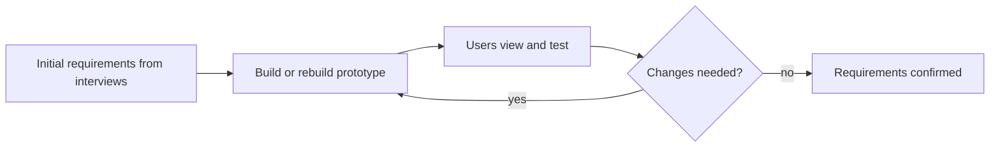

Prototyping is most useful when:
 * the user **cannot state requirements in advance**;
 * users cannot visualize the desired system (e.g., new users with no idea what a system would look like);
 * the environment is **new** and not fully understood by user or analyst.

### Radical methods: business process reengineering (BPR)

 * Some managements want ways of working that are **radically different** from today's, expecting larger payoffs. This is **BPR (Business Process Reengineering)**.
 * BPR is **top-down**: it starts with major business objectives and goals and ends with a detailed specification of the tasks that make up a business process.
 * It is **iterative**, adapting processes to a changing business environment. Six activities:

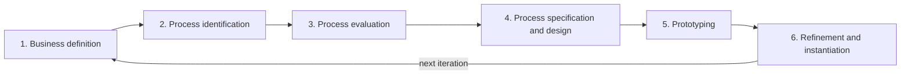

| Activity | What happens |
|---|---|
| **Business definition** | Set business goals guided by four drivers: **cost reduction, time reduction, quality improvement, staff development and empowerment**. Goals may target one part of the business |
| **Process identification** | Identify the processes critical to the goals and **prioritize** them by importance and need for change |
| **Process evaluation** | Analyze and **measure** the existing process in detail; identify its tasks and the cost and time of each |
| **Process specification and design** | Prepare **use cases** for each process with outcomes for a customer; design a new set of tasks |
| **Prototyping** | Prototype the redesigned process before fully integrating it into the business, to test and refine it |
| **Refinement and instantiation** | Refine the process using prototype feedback, then put it into operation within a business system |

 * BPR works only if people are **motivated and trained** and understand that it is a **continuous** activity. Its results appear when the information system is integrated with the business process.

#### Principles of reengineering (Hammer and Champy)

**Michael Hammer** and **James Champy** proposed seven principles to streamline work and achieve big gains in quality, time and cost:
 1. Organize around **outcomes**, not tasks.
 2. Identify all processes and **prioritize** them by urgency of redesign.
 3. Fold information-processing work into the **real work that produces the information**.
 4. Treat **geographically dispersed** resources as if they were centralized.
 5. **Link parallel activities** in the workflow instead of only integrating their results.
 6. Put the **decision point where the work is done** and build **control into the process**.
 7. **Capture information once, at the source**.

### Classification of requirements

Common categories used in technical management:

#### Customer requirements

Statements of fact and assumptions that define what is expected of the system in terms of **mission objectives, environment, constraints** and **measures of effectiveness and suitability (MOE/MOS)**. Customers are those performing the eight primary functions of systems engineering, with the **operator** as the key customer. **Operational requirements** define the basic need and at least answer:

| Question area | Question |
|---|---|
| **Operational distribution or deployment** | Where will the system be used? |
| **Mission profile or scenario** | How will the system accomplish its mission? |
| **Performance and related parameters** | What system parameters are critical to the mission? |
| **Utilization environments** | How will the system components be used? |
| **Effectiveness requirements** | How effective or efficient must the system be? |
| **Operational life cycle** | How long will the system be in use? |
| **Environment** | In what environments must it work effectively? |

#### Other categories

| Category | Definition | Example |
|---|---|---|
| **Functional requirements** | **What** must be done: the tasks, actions or activities to accomplish; they become the top-level functions for functional analysis | "The system shall record a payment" |
| **Performance requirements** | **How well** a function must be done — measured in quantity, quality, coverage, timeliness or readiness; developed across all functions over the life cycle and characterized by certainty of estimate, criticality to success and relation to other requirements | "Process a payment within 2 s" |
| **Design requirements** | "**Build to**", "**code to**", "**buy to**" requirements for products and "**how to execute**" requirements for processes, expressed in technical data packages and manuals | Use a specified component or standard |
| **Derived requirements** | Implied by or transformed from a higher-level requirement | Long range or high speed ⇒ requirement for **low weight** |
| **Allocated requirements** | Created by dividing a high-level requirement among lower-level items | A **100 kg** item made of two subsystems ⇒ weight limits **70 kg** and **30 kg** |

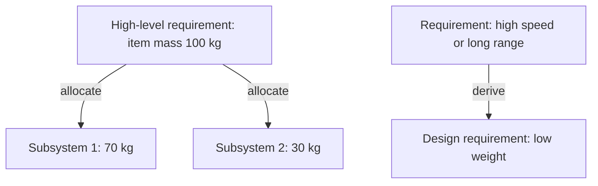

### Software requirement analysis

 * Requirements analysis covers the tasks that determine the **needs or conditions** a new or changed product must meet, taking account of possibly **conflicting requirements** of different stakeholders (beneficiaries, users).
 * It is critical to project success. Requirements must be:
   * **actionable**;
   * **measurable**;
   * **testable**;
   * **related to identified business needs or opportunities**;
   * defined in **enough detail for system design**.

### Software requirement documentation

 * **Requirements documentation** describes what the software does or shall do. It is used throughout development to communicate this and serves as an **agreement** (or the basis for one) about what the software will do.
 * Requirements are produced and used by everyone: end users, customers, product and project managers, sales, marketing, architects, usability experts, interaction designers, developers, testers. Hence documentation has many purposes.
 * Why it is hard:
   * requirements may be **implicit** and hard to uncover;
   * it is hard to know **how much** to document and how much to leave to architecture/design documents;
   * it is hard to write for so many different readers.
 * As a result it is often **incomplete or missing**. Without it, changes become **more error-prone** (lower quality) and **more time-consuming** (more expensive).

How much documentation is needed depends on complexity, impact and expected lifetime:

| Situation | Documentation need |
|---|---|
| Very complex software or built by many people (e.g., mobile phone software) | Requirements help communicate the goal |
| **Safety-critical** software that can harm human life (nuclear power, medical equipment) | More **formal** documentation required |
| Short-lived software (e.g., a small campaign app living a month or two) | Very little |
| A first release that later versions build on | Very helpful for managing change and checking that nothing broke |

 * Traditionally requirements live in word-processor and spreadsheet documents. To handle growing complexity and change, **database-centric** systems and dedicated **requirements management tools** are recommended.

### Architecture and design documentation

 * **Architecture documentation** is a special kind of design document. Relative to code it is the **third derivative** (code documents are the first, design documents the second). It contains little that is specific to the code: it doesn't say how to program a routine or why it has its form, only the general requirements that motivate its existence. A good architecture document is **short on details, thick on explanation**; it may suggest approaches for lower-level design but leaves trade studies to other documents.

```mermaid
flowchart LR
    CODE["Source code"] --> D1["Code documents: 1st derivative"]
    D1 --> D2["Design documents: 2nd derivative"]
    D2 --> D3["Architecture documents: 3rd derivative"]
```

 * **Comparison document / trade study** — often a **white paper**. Focuses on one aspect (UI, code, design or architecture), describes the situation, one or more alternatives and the pros and cons of each.
   * A good trade study is research-heavy, clear and above all **impartial**: it honestly states the costs of the solution it favours.
   * Its aim is the **best solution**, not pushing a viewpoint. It may reach no conclusion, or conclude that no alternative is enough better than the baseline to justify change. It is a **scientific** exercise, not marketing.

#### Database design document (DDD)

 * In enterprise development, the **DDD (Database Design Document)** is a key design document containing **conceptual, logical and physical** design elements. It gives all those who work with the database a **common source** of formal information.
 * Intended readers: database designer, database developer, **DBA (database administrator)**, application designer, application developer.
 * For relational systems it should include:

| Part | Contents |
|---|---|
| **Entity–relationship schema** | Entity sets and their attributes; relationships and their attributes; **candidate keys** for each entity set; attribute- and tuple-based constraints |
| **Relational schema** | Tables, attributes and their properties; views; constraints such as primary and foreign keys; **cardinality** of referential constraints; **cascading policy** for referential constraints; primary keys |

 * Include everything any actor needs, and **update the document whenever the database changes**.

### Technical documentation

 * What most programmers mean by "software documentation". Code alone is not enough; text must describe its intended operation. Code documents should be **thorough but not so verbose** that they become hard to maintain.
 * How-to and overview documents are written by **API (Application Programming Interface) writers** for developers, testers and end customers.
 * Its importance has grown in high-end domains (power, energy, transport, networks, aerospace, safety, security, industrial automation), where information changes as architecture changes.
 * **Auto-generation tools**: Doxygen, NDoc, Javadoc, EiffelStudio, Sandcastle, ROBODoc, POD, TwinText, Universal Report. They extract comments and **software contracts** from source code and produce reference manuals as text or **HTML (HyperText Markup Language)**. Code documents are often organized as a **reference guide** for quick lookup of any function or class.
 * Why programmers like auto-generation: documentation is written next to the code with the same tools, so it is **easier to keep up to date**.
 * **Elucidative programming** grew out of applying **literate programming** in real settings. It stores **source code and documentation separately**, because developers often need annotations that don't belong in the source file — e.g., during code walkthroughs or **porting**, when third-party code is analyzed functionally.

### User documentation

 * Unlike code documents, user documents are mostly independent of the source code; they describe **how the program is used**.
 * For a **software library**, code and user documents can effectively coincide and are worth merging; for a general application they usually differ. Example: the **Lisp machine** tradition attached a **documentation string** to every piece of code; with strong search (a Unix-like **apropos** command) users could look up documentation and paste the function straight into their code — an ease of use rare even in later systems.
 * Good user documentation describes every feature, helps the user apply it, may offer **troubleshooting**, must be **clear and up to date**, needs a **thorough index**, and values **consistency and simplicity**. It is regarded as a **contract** stating what the software will do.

Three ways to organize user documentation:

| Organization | Description | Best for |
|---|---|---|
| **Tutorial** | Guides the user step by step through particular tasks | **New** users |
| **Thematic** | Chapters/sections each focus on one area of interest; includes knowledge-base articles, common in fast-moving IT where troubleshooting demand is high | **Intermediate** users |
| **List / reference** | Commands or tasks listed alphabetically or grouped logically, with cross-referenced indexes | **Advanced** users who know what they're looking for |

 * A common complaint: only one of the three approaches is used. PC software often ships only with online **reference** help on commands and menus; tutoring beginners and helping power users is left to third-party publishers (often helped by the developer).

### Chapter summary

 * System analysis has three sub-phases: **requirement determination**, **requirement structuring**, and **generation of alternatives** (and choice among them). Determination gathers information on the existing system and analyzes the need to replace it.
 * Traditional sources: interviews, questionnaires, observation, group discussions; questions and agendas must be precise; results compared and normalized.
 * JAD = structured group interview with session leader, scribe, key users, managers, sponsor and analysts; often off-site, about a week.
 * Information systems support requirement analysis through CASE tools and prototyping; in prototyping user and analyst refine the model until it meets requirements.
 * BPR radically changes processes by changing traditional business rules, giving a base for later analysis and design.

### Key takeaways

 * Requirements work = elicit, analyze, record; seven of ten success factors of a project depend on the specification.
 * Requirements engineering defines goals, functions and constraints; its main product is the SRS, which holds functional requirements (use cases) and non-functional constraints.
 * A good SRS is correct, unambiguous, complete, consistent, ranked, verifiable, modifiable and traceable; requirements must be actionable, measurable and testable.
 * Traditional gathering: interviews (open vs closed questions), questionnaires (closed only), observation, group work; modern: JAD, CASE, GSS, prototyping.
 * JAD turns meetings into structured workshops led by a neutral facilitator; GSS adds anonymous, parallel input; upper CASE captures models live.
 * BPR is a top-down, iterative six-step redesign; Hammer and Champy's seven principles include organizing around outcomes and capturing data once at the source.
 * Requirement types: customer/operational, functional, performance, design, derived, allocated (100 kg → 70 + 30 kg).
 * Documentation spans requirements, architecture and trade studies, DDD, technical (often auto-generated) and user documentation (tutorial, thematic, reference).

---

## Part 4. Software Project Management Framework

This part covers how a software project is scoped, scheduled, costed and controlled: the PMBOK-style knowledge areas (scope, time, cost, HR, communication, risk), size and effort estimation (LOC, function points, feature points, COCOMO, Halstead, Putnam/SLIM), and network-based scheduling and cost optimisation (PDM/ADM, CPM, crashing, PERT, linear programming, Gantt charts).

### Projects and project management

**Project management** is the discipline of planning, organising and steering resources so that specific project goals are reached. It is related to, and often confused with, **program management** (managing a group of related projects).

A **project** is a **temporary** undertaking with a defined start and finish. The end is usually set by a date, but it can also be set by funding or by deliverables. A project exists to reach particular goals and to bring beneficial change or added value. It differs from **business as usual (operations)**, which is repetitive, permanent or semi-permanent work that keeps producing products or services. The two need different skills and different management approaches.

The book's working definition:
 * A project is a **multitask job done only once**, with explicit requirements for **performance, cost, time and scope**.
 * It has a definite start and end time, a budget, and a clearly defined scope (amount of work).
 * Resources have to be optimised: the goal is to meet the project's complexity, time and resource needs at **least cost**.

**Project management** means applying knowledge, skills, tools and techniques to project activities so that the project meets its requirements. It works through five integrated **process groups**:

```mermaid
flowchart LR
    I["Initiating"] --> P["Planning"]
    P --> E["Executing"]
    E --> C["Closing"]
    M["Monitoring and controlling"] -.-> P
    M -.-> E
    E -.-> M
```

 * The **project manager** is the person accountable for meeting the project objectives.
 * Not every process has to be applied on every project in the same way. The manager and the team decide which processes fit and **how much rigour** each one needs.

Managing a project includes:
 * identifying requirements;
 * setting clear, achievable objectives;
 * balancing the competing demands of **quality, scope, time and cost**;
 * adapting specifications, plans and approach to the concerns and expectations of different **stakeholders**.

#### The triple constraint

Project managers talk about a **triple constraint**: **scope, time and cost**. Quality depends on how well these three are balanced. A high-quality project delivers the required product, service or result **within scope, on time and within budget**. The three are linked: when one of them changes, at least one of the others is likely to change too. Project managers also have to manage **uncertainty**.

```mermaid
flowchart TB
    S["Scope"] --- T["Time"]
    T --- C["Cost"]
    C --- S
    Q(["Quality: the result of balancing all three"])
    S -.-> Q
    T -.-> Q
    C -.-> Q
```

---

### Scope management

**Project Scope Management** covers the processes that make sure the project includes **all the work required, and only the work required**, to finish successfully. Its five processes:

```mermaid
flowchart LR
    SP["Scope planning"] --> SD["Scope definition"]
    SD --> W["Create WBS"]
    W --> SV["Scope verification"]
    SV --> SC["Scope control"]
    SC -.->|"approved changes"| SD
```

 * The processes interact with each other and with the processes of other knowledge areas.
 * Each one may need effort from one or more people or groups.
 * Each one happens **at least once** in every project, and in one or more phases if the project is divided into phases.

Two meanings of **scope**:

| Term | Meaning |
|---|---|
| **Product scope** | The features and functions that characterise the product, service or result |
| **Project scope** | The work needed to deliver that product with the specified features and functions |

The book presents each scope and time process as a table of inputs, tools and techniques, and outputs. Those tables are garbled in the source. The summary below follows the **PMBOK Guide, 3rd edition**, which the chapter is based on.

| Process | Key inputs | Tools and techniques | Key outputs |
|---|---|---|---|
| **Scope planning** | Enterprise environmental factors, organisational process assets, project charter, preliminary scope statement, project management plan | Expert judgement; templates, forms, standards | **Scope management plan** |
| **Scope definition** | Charter, preliminary scope statement, scope management plan, approved change requests | Product analysis, identification of alternatives, expert judgement, stakeholder analysis | **Project scope statement**, requested changes, plan updates |
| **Create WBS** | Scope statement, scope management plan, approved changes | WBS templates, **decomposition** | **WBS**, **WBS dictionary**, **scope baseline**, updates |
| **Scope verification** | Scope statement, WBS dictionary, scope management plan, **deliverables** | **Inspection** | **Accepted deliverables**, requested changes, corrective actions |
| **Scope control** | Scope statement, WBS, WBS dictionary, performance reports, work performance information, approved changes | **Change control system**, variance analysis, replanning, configuration management | Updated scope statement, WBS and baseline; requested changes; corrective actions |

#### Scope planning

How the scope is defined and managed has a large effect on whether the project succeeds. The effort spent on scoping (tools, data sources, methods, procedures) should match the project's **size, complexity and importance**. The output is a **scope management plan**: how scope will be defined, verified and controlled, and how the WBS will be built.

#### Scope definition

 * A detailed **project scope statement** is critical to success.
 * It builds on the major deliverables, assumptions and constraints recorded at initiation in the **preliminary scope statement**.
 * During planning more is known, so the scope can be described more precisely.
 * Stakeholders' needs, wants and expectations are analysed and turned into **requirements**.

#### Create work breakdown structure (WBS)

The **WBS** is a **deliverable-oriented hierarchical decomposition** of the work the team must do to meet the objectives and produce the deliverables.
 * It organises and defines the **total scope** of the project.
 * Each lower level gives a more detailed definition of the work.
 * The lowest-level components are **work packages**. Work packages can be scheduled, cost-estimated, monitored and controlled.

```mermaid
flowchart TB
    P["Payroll system project"] --> R["1 Requirements"]
    P --> D["2 Design"]
    P --> B["3 Build"]
    P --> T["4 Test and deploy"]
    D --> D1["2.1 Database design"]
    D --> D2["2.2 UI design"]
    B --> B1["3.1 DB code and unit test"]
    B --> B2["3.2 UI code and unit test"]
    T --> T1["4.1 Integration and system test"]
    T --> T2["4.2 Rollout and training"]
```

*An illustrative WBS. The leaves are work packages.*

#### Scope verification

**Scope verification** is how stakeholders **formally accept** the completed scope and deliverables.
 * Each deliverable is reviewed to confirm it has been completed satisfactorily.
 * If the project ends early, verification records **how far** the work got.
 * **Scope verification vs quality control.** Verification is about **acceptance** of deliverables. Quality control is about whether deliverables **meet the quality requirements**. QC usually comes first, but the two can run in parallel.

#### Scope control

**Scope control** deals with the factors that cause scope changes and with the impact of those changes.
 * Every requested change and recommended corrective action goes through **Integrated Change Control**.
 * Scope control also manages changes when they actually happen, and it is integrated with the other control processes.
 * Uncontrolled change is called **scope creep**.

---

### Time management

**Project Time Management** covers the processes needed to finish the project on time:

| Process | What it does |
|---|---|
| **Activity definition** | Identify the specific schedule activities needed to produce the deliverables |
| **Activity sequencing** | Identify and document the dependencies between activities |
| **Activity resource estimating** | Estimate the type and quantity of resources each activity needs |
| **Activity duration estimating** | Estimate how many work periods each activity needs |
| **Schedule development** | Analyse sequences, durations, resources and constraints to build the schedule |
| **Schedule control** | Control changes to the schedule |

```mermaid
flowchart LR
    AD["Activity definition"] --> AS["Activity sequencing"]
    AS --> AR["Resource estimating"]
    AR --> DE["Duration estimating"]
    DE --> SD["Schedule development"]
    SD --> SC["Schedule control"]
```

The processes are described as separate steps with clear interfaces, but in practice they **overlap and interact**.

#### Activity definition

 * This process identifies and documents the work that is planned.
 * It starts from the lowest WBS level, the **work packages**, and breaks them down into smaller **schedule activities**. These activities are the basis for estimating, scheduling, executing, monitoring and control.
 * Inputs: scope statement, WBS and WBS dictionary, PM plan, environmental factors, process assets.
 * Techniques: **decomposition**, templates, **rolling wave planning** (near-term work is detailed and later work stays high-level), expert judgement, planning components.
 * Outputs: **activity list**, **activity attributes**, **milestone list**, requested changes.

#### Activity sequencing

 * This process identifies and documents the **logical relationships** between activities, including **precedence relationships**, **leads** and **lags**, so that the schedule is realistic.
 * It can be done with PM software, by hand, or with both.
 * Techniques: **PDM**, **ADM**, schedule network templates, **dependency determination**, applying leads and lags.
 * There are three kinds of dependency:
   * **mandatory** (hard logic);
   * **discretionary** (preferred logic);
   * **external**.
 * Output: **project schedule network diagrams**, plus updates to the activity list and attributes.

#### Activity resource estimating

 * This process decides **which resources** (people, equipment, material), **how many** of each, and **when** each will be available.
 * It is closely tied to **cost estimating**.
 * Domain knowledge matters. A construction team must know local building codes. An automotive design team must know current automated-assembly techniques.
 * Techniques: expert judgement, analysis of alternatives, published estimating data, PM software, **bottom-up estimating**.
 * Outputs: activity resource requirements, **resource breakdown structure**, updated resource calendars.

#### Precedence Diagramming Method (PDM)

In **PDM**, **nodes** (boxes) are activities and **arrows** are dependencies. It is also called **activity-on-node (AON)**, and most PM software uses it.

| Dependency | Rule | Usage |
|---|---|---|
| **Finish-to-Start (FS)** | The successor **starts** only after the predecessor **finishes** | Most common |
| **Finish-to-Finish (FF)** | The successor **finishes** only after the predecessor **finishes** | Occasional |
| **Start-to-Start (SS)** | The successor **starts** only after the predecessor **starts** | Occasional |
| **Start-to-Finish (SF)** | The successor **finishes** only after the predecessor **starts** | Rare |

Figure 4.1 redrawn: 9 activities and 18 logical dependencies in AON form.

```mermaid
flowchart LR
    S["Begin"] --> A["A"]
    S --> C["C"]
    S --> E["E"]
    S --> H["H"]
    A --> B["B"]
    A --> C
    C --> B
    C --> D["D"]
    E --> F["F"]
    E --> H
    H --> D
    F --> G["G"]
    H --> G
    H --> I["I"]
    B --> Z["End"]
    D --> Z
    G --> Z
    I --> Z
```

#### Arrow Diagramming Method (ADM)

In **ADM**, **arrows** are activities and **nodes** (circles) are the events that connect them. It is also called **activity-on-arrow (AOA)**. It is less common than PDM but is still used to teach network theory and in some application areas.
 * It uses **only finish-to-start** dependencies.
 * It may need **dummy activities**, drawn as dashed arrows. A dummy has no work and **zero duration**. It exists only to express the logic correctly.

Figure 4.2 redrawn: 12 activities and 2 dummies. Activity H depends on A and F (through the dummies) as well as on G.

```mermaid
flowchart LR
    S(("Begin"))
    n1(("1"))
    n2(("2"))
    n3(("3"))
    n4(("4"))
    n5(("5"))
    n6(("6"))
    n7(("7"))
    Z(("End"))
    S -->|"A"| n1
    S -->|"G"| n3
    S -->|"F"| n2
    n1 -.->|"dummy"| n3
    n2 -.->|"dummy"| n3
    n1 -->|"B"| Z
    n3 -->|"C"| n4
    n4 -->|"D"| n5
    n5 -->|"E"| Z
    n3 -->|"H"| n6
    n6 -->|"I"| Z
    n3 -->|"K"| n7
    n2 -->|"J"| n7
    n7 -->|"L"| Z
```

#### Activity duration estimating

 * Inputs: the activity's scope of work, the resource types it needs, estimated resource quantities, and **resource calendars** that show availability.
 * The estimate should come from the person or group who **knows the work best**.
 * Duration estimates are **progressively elaborated**. As engineering and design mature, the data becomes more detailed and the estimates become more accurate.

---

### Cost management

**Project Cost Management** covers planning, estimating, budgeting and controlling costs so that the project finishes **within the approved budget**:

| Process | Purpose |
|---|---|
| **Cost estimating** | Approximate the cost of the resources the activities need |
| **Cost budgeting** | Add up activity or work-package estimates into a **cost baseline** |
| **Cost control** | Influence the causes of **cost variances** and control changes to the budget |

What drives the cost of software:
 * **Size**: number of source instructions or number of function points.
 * **Process**: a good process avoids non-value-adding work such as **rework, delays and communication overhead**.
 * **People**: the team's capability and productivity.
 * **Required quality**: features, performance, reliability and adaptability.

Cost management is mainly about the cost of the resources needed for the scheduled activities. It should also consider how project decisions affect the cost of **using, maintaining and supporting** the product. This wider view is **life-cycle costing**. Combined with **value engineering**, it helps reduce cost and execution time and improve quality and performance.

---

### Software measurement and cost estimation

Measurement is standard practice in engineering and management because it deepens understanding (Stan Rifkin). The **business value** of software is hard to measure directly, so the industry uses **surrogates**: **lines of code (LoC)**, **functional size**, **function points**, and so on.

```mermaid
flowchart TB
    CE["Software cost estimation"] --> EMP["Empirical: expert judgement, Delphi"]
    CE --> HEU["Heuristic: COCOMO basic, intermediate, detailed"]
    CE --> ANA["Analytical: Halstead software science"]
    CE --> RS["Resource and schedule: Putnam SLIM, Rayleigh curve"]
```

#### Empirical estimation: expert judgement and Delphi

 * **Expert judgement** is a qualitative approach. Experts draw on similar past projects and adjust the estimate up or down for the differences in the target project.
 * Experts give different numbers, and these have to be reconciled **without a group meeting**. A meeting is avoided because it causes side effects such as dominant personalities and anchoring.
 * The **Delphi technique** works like this:

```mermaid
flowchart TB
    A["Each expert estimates alone and writes a rationale"] --> B["Coordinator collects estimates and rationales"]
    B --> C["All estimates and rationales are sent anonymously to every expert"]
    C --> D["Each expert produces a revised estimate"]
    D --> E{"Agreement within tolerance?"}
    E -->|"no"| B
    E -->|"yes"| F["Final consensus estimate"]
```

#### Heuristic estimation: COCOMO

**COCOMO (COnstructive COst MOdel)** was published by **Barry Boehm in 1981**. It estimates effort, cost, staffing and schedule.
 * It was calibrated on **63 projects** of roughly 2,000 to 10,000 LOC (the book's figure), written in languages from assembly to PL/I.
 * The **basic** model is good for quick, early, rough order-of-magnitude estimates. Its accuracy is limited because it has no **cost drivers** to account for differences between projects.
 * **COCOMO II** was developed from 1997 and released in 2001. It suits modern development processes and uses an updated project database.
 * There are three levels: **basic → intermediate → detailed (advanced)**, each more accurate than the last. The detailed model also accounts for individual project phases.
 * COCOMO is a **static, single-valued** model: effort is a function of estimated size in thousands of delivered source instructions (**KDSI / KLOC**).

General form:
 * `E = a · S^b · M(x)`
 * `T = c · E^d`
 * E is effort in **person-months**. S is size in **KDSI**. M(x) is the **adjustment multiplier**. T is development time in months. a, b, c, d depend on the model and the mode.

**Three development modes:**

| Mode | Characteristics | Typical example |
|---|---|---|
| **Organic** | Small, experienced team; familiar environment; well-understood application | Business data processing, small tools |
| **Semi-detached** | Mixed experience; environment less familiar | New text editor, statistical package |
| **Embedded** | Tightly coupled to complex hardware; strict regulations and operating procedures | New operating system, real-time control |

**Worked example: two managers' estimates.** Use `E = 3.2·S^1.05` and `T = 2.5·E^0.38`, with all multipliers equal to 1. Both sizes are under 50 KDSI, so the project is treated as organic.

| Estimate | S (KDSI) | Effort E (PM) | Schedule T (months) |
|---|---|---|---|
| Manager 1 | 10 | 3.2·10^1.05 ≈ **35.9** | 2.5·35.9^0.38 ≈ **9.75** |
| Manager 2 | 15 | 3.2·15^1.05 ≈ **54.96** | 2.5·54.96^0.38 ≈ **11.46** |

A **50% increase in size** gives about **53% more effort** but only about **18% more calendar time**.

##### Basic COCOMO

 * `E = a · (KLOC)^b` in person-months
 * `T = c · (E)^d` in calendar months

| Mode | a | b | c | d |
|---|---|---|---|---|
| Organic | 2.40 | 1.05 | 2.50 | 0.38 |
| Semi-detached | 3.00 | 1.12 | 2.50 | 0.35 |
| Embedded | 3.60 | 1.20 | 2.50 | 0.32 |

**Worked example.** An organic project has 33,200 LOC.
 * `E = 2.4 · 33.2^1.05 ≈ 95 PM`
 * The book computes `T = 2.5 · 95^0.35 ≈ 12.3 months`. Strictly, the organic exponent is 0.38, which gives about 14.1 months.
 * Recommended staff: `N = E / T = 95 / 12.3 ≈ 8 people`.

##### Intermediate COCOMO

 * The basic model is extended with **15 cost drivers** in four groups: product, hardware (computer), personnel and project.
 * Each driver is rated on a **six-point scale**, from very low to extra high, and each rating maps to an **effort multiplier**.
 * The product of all the multipliers is the **Effort Adjustment Factor (EAF)**. It typically ranges from **0.9 to 1.4**.
 * `E = a · (KLOC)^b · EAF`
 * `T = c · E^d`
 * Only a and b change compared with the basic model. c and d stay the same. EAF affects effort; the schedule formula itself does not change.

| Mode | a | b | c | d |
|---|---|---|---|---|
| Organic | 3.2 | 1.05 | 2.5 | 0.38 |
| Semi-detached | 3.0 | 1.12 | 2.5 | 0.35 |
| Embedded | 2.8 | 1.20 | 2.5 | 0.32 |

##### Effort adjustment factors (cost drivers)

| Group | Code | Driver | Very low | Low | Nominal | High | Very high | Extra high |
|---|---|---|---|---|---|---|---|---|
| Product | RELY | Required software reliability | 0.75 | 0.88 | 1.00 | 1.15 | 1.40 | – |
| Product | DATA | Database size | – | 0.94 | 1.00 | 1.08 | 1.16 | – |
| Product | CPLX | Product complexity | 0.70 | 0.85 | 1.00 | 1.15 | 1.30 | 1.65 |
| Hardware | TIME | Execution-time constraint | – | – | 1.00 | 1.11 | 1.30 | 1.66 |
| Hardware | STOR | Main-storage constraint | – | – | 1.00 | 1.06 | 1.21 | 1.56 |
| Hardware | VIRT | Virtual machine volatility | – | 0.87 | 1.00 | 1.15 | 1.30 | – |
| Hardware | TURN | Computer turnaround time | – | 0.87 | 1.00 | 1.07 | 1.15 | – |
| Personnel | ACAP | Analyst capability | 1.46 | 1.19 | 1.00 | 0.86 | 0.71 | – |
| Personnel | AEXP | Applications experience | 1.29 | 1.13 | 1.00 | 0.91 | 0.82 | – |
| Personnel | PCAP | Programmer capability | 1.42 | 1.17 | 1.00 | 0.86 | 0.70 | – |
| Personnel | VEXP | Virtual machine experience | 1.21 | 1.10 | 1.00 | 0.90 | – | – |
| Personnel | LEXP | Language experience | 1.14 | 1.07 | 1.00 | 0.95 | – | – |
| Project | MODP | Modern programming practices | 1.24 | 1.10 | 1.00 | 0.91 | 0.82 | – |
| Project | TOOL | Software tools | 1.24 | 1.10 | 1.00 | 0.91 | 0.83 | – |
| Project | SCED | Required development schedule | 1.23 | 1.08 | 1.00 | 1.04 | 1.10 | – |

Notes:
 * For product and hardware drivers, a **higher** rating increases effort. For personnel and tool drivers, a **higher** rating decreases effort.
 * SCED raises effort when the schedule is either compressed or stretched.
 * Multiplying the drivers assumes they are **independent**, which is questionable.
 * If every driver is at its extreme, EAF can vary by about two orders of magnitude. Treat any single COCOMO number with caution.

##### Detailed (advanced) COCOMO

 * The intermediate model is applied **per component**, and the cost drivers are **weighted per life-cycle phase**. The results are then rolled up phase by phase.
 * It is more accurate but laborious.
 * Phases:
   * **RPD**: requirements planning and product design;
   * **DD**: detailed design;
   * **CUT**: code and unit test;
   * **IT**: integration and test.
 * Example of phase-sensitive multipliers for **analyst capability (ACAP)**, using the commonly cited Boehm values:

| ACAP rating | RPD | DD | CUT | IT |
|---|---|---|---|---|
| Very low | 1.80 | 1.35 | 1.35 | 1.50 |
| Low | 0.85 | 0.85 | 0.85 | 1.20 |
| Nominal | 1.00 | 1.00 | 1.00 | 1.00 |
| High | 0.75 | 0.90 | 0.90 | 0.85 |
| Very high | 0.55 | 0.75 | 0.75 | 0.70 |

The estimates for each subsystem and module are then combined into the overall project estimate.

#### Analytical estimation: Halstead's software science

 * **Empirical models**, such as COCOMO, take formulas from data on past projects.
 * **Analytical models** start from global assumptions, for example the rate at which developers solve problems and how many problems there are.
 * **Halstead's** metrics:
   * **Program length** `N = N1 + N2`, where N1 is the total count of operator occurrences and N2 is the total count of operand occurrences.
   * **Volume** `V = N · log2(n1 + n2)`, where n1 is the number of **distinct** operators and n2 is the number of distinct operands. Volume reflects the storage needed to represent the program.
 * The theory behind software science is **disputed**, and it has lost support over time.

#### Resource and schedule estimation: Putnam's SLIM

 * **SLIM (Software LIfecycle Management)** is Putnam's constrained model, intended for large projects (over **70,000 LOC**).
 * It assumes effort is spread like a collection of **Rayleigh curves**. Staffing **rises smoothly** and then **drops sharply** during acceptance testing.
 * SLIM uses separate Rayleigh curves for design and code, test and validation, maintenance, and management.
 * Two equations link effort and schedule:
   * the **software equation**: effort is proportional to `1 / td^4`;
   * the **manpower-buildup equation**: effort is proportional to `td^3`.

**Norden–Rayleigh curve.** Staffing over time peaks near the development time **td**.

```mermaid
xychart-beta
    title "Norden-Rayleigh staffing curve"
    x-axis "Time" ["0", "1", "2", "3", "td", "5", "6", "7", "8", "9", "10"]
    y-axis "% of total effort" 0 --> 15
    line [0, 5.3, 9.7, 12.5, 13.4, 12.6, 10.7, 8.4, 5.9, 3.9, 2.4]
```

**Software equation:**
 * `L = C · K^(1/3) · td^(4/3)`
 * L is delivered lines of code. K is effort in person-years. td is development time in years.
 * C is a technology/environment constant: **2,000** for a poor environment, **8,000** for a good one, **11,000** for an excellent one.
 * Cubing both sides gives `K · td^4 = (L/C)^3 = const`. So for a given project, **`K ∝ 1/td^4`** and `K1/K2 = (td2/td1)^4`.

**Effect of changing the schedule:**

| Model | Relation | Character |
|---|---|---|
| **Putnam** | `K ∝ 1 / td^4` | More pessimistic: compressing the schedule is very expensive |
| **Jensen** | `K ∝ 1 / td^2` | More optimistic |

 * td cannot be changed freely. In practice it can only move within about **80% to 120%** of its nominal value.
 * Example: a 10-month project can be squeezed to no less than about 8 months.

**Example 4.1: compressing a schedule.** The original plan is 36.9 PM over 9.85 months, and the new target is 8 months.
 * Putnam: `36.9 · (9.85/8)^4 ≈ 84.8 PM`, about **2.3 times** more effort.
 * Jensen: `36.9 · (9.85/8)^2 ≈ 55.9 PM`, about **1.5 times** more effort.

**Manpower-buildup equation:**
 * `D = E / T^3`
 * D is the **manpower acceleration** constant. E is total effort in person-years. T is elapsed time to delivery in years.

---

### Human resource, communication and risk management

| Knowledge area | Processes |
|---|---|
| **Human Resource Management**: organise and manage the project team | HR planning → acquire project team → develop project team → manage project team |
| **Communications Management**: timely, appropriate generation, collection, distribution, storage and disposal of project information | Communications planning → information distribution → performance reporting → manage stakeholders |
| **Risk Management** | Risk management planning → risk identification → qualitative analysis → quantitative analysis → risk response planning → risk monitoring and control |

Engineers often **ignore risks until something goes wrong** and then fight fires. Risks cause schedule slips and cost overruns, so they have to be identified early. **Predictable generic risk categories:**

| Category | Risk relates to |
|---|---|
| **Product size** | The size of the software |
| **Business impact** | Constraints imposed by management or the market |
| **Customer characteristics** | The customer, and how quickly customer and developer can communicate |
| **Process definition** | How well the software process is defined and followed |
| **Development environment** | Availability and quality of tools |
| **Technology to be built** | System complexity and how new the technology is |
| **Staff size and experience** | The team's overall technical and project experience |

The strategy is **risk avoidance**, **risk monitoring** and **contingency planning**. These are organised in an **RMMM plan (Risk Mitigation, Monitoring and Management)**, and the project manager monitors it.

```mermaid
flowchart LR
    I["Identify risks"] --> A["Analyse probability and impact"]
    A --> M["Mitigate: avoidance actions"]
    M --> Mo["Monitor risk indicators"]
    Mo --> C{"Risk occurred?"}
    C -->|"yes"| Mg["Manage: execute contingency plan"]
    C -->|"no"| Mo
```

---

### Project planning

**Project planning** is the part of project management most concerned with **integration**. The project plan reflects the current status of all activities and is used to **monitor and control** the project. It coordinates the parts of the project and guides execution.

Planning helps by:
 * making communication easier;
 * monitoring and measuring progress;
 * documenting assumptions and planning decisions.

Planning has three phases:
 1. develop the project plan;
 2. execute the project plan;
 3. control changes and take corrective action.

Planning **continues for the whole project**. "If you fail to plan, you plan to fail." Careful planning early avoids costly mistakes and helps deliver on schedule and within budget.

#### Steps in project planning

Broadly, planning means estimating, scheduling and assigning resources so that a product of suitable quality is delivered. It can also play a strategic role in the project's success.

```mermaid
flowchart TB
    S1["1 Scope definition and scope planning"] --> S2["2 Quality planning"]
    S2 --> S3["3 Activity definition and sequencing"]
    S3 --> S4["4 Time, effort and resource estimation"]
    S4 --> S5["5 Risk factor identification"]
    S5 --> S6["6 Schedule development"]
    S6 --> S7["7 Cost estimation and budgeting"]
    S7 --> S8["8 Organisational and resource planning"]
    S8 --> S9["9 Risk management planning"]
    S9 --> S10["10 Project plan development and execution"]
    S10 --> S11["11 Performance reporting"]
    S11 --> S12["12 Planning change management"]
    S12 --> S13["13 Project rollout planning"]
    S12 -.-> S10
```

 1. **Scope definition and planning.** Document the work needed to reach the goal: assumptions, constraints, user expectations, business and technical requirements, deliverables and objectives. This is the foundation for everything else.
 2. **Quality planning.** Choose the relevant quality standards. Use scope, requirements and deliverables to find the factors that affect quality. Define the processes needed to deliver as promised.
 3. **Activity definition and sequencing.** List every specific activity needed to produce the deliverables, and work out how they depend on each other.
 4. **Time, effort and resource estimation.** Estimate effort per activity with techniques such as **function points, LOC, code complexity and benchmarks**. Record the time, effort and resources each activity needs.
 5. **Risk factor identification.** "Expect the unexpected." Record risks that come from assumptions, constraints, user expectations and circumstances.
 6. **Schedule development.** Build the schedule from activities, dependencies and effort. The schedule affects cost estimates and cost-benefit analysis.
    * This is the **most important and most difficult** planning task.
    * In large projects, several teams work in parallel but depend on each other.
    * Tools such as **Gantt charts** are used to build and report the schedule.
 7. **Cost estimation and budgeting.** Estimate costs from the steps above, do a **cost-benefit analysis**, and allocate the budget.
 8. **Organisational and resource planning.** Identify resource types (equipment, people, facilities, money) and keep them **as fully used as possible**.
    * Success depends on predicting resource demand accurately.
    * This step is **iterative** and continues across the life cycle.
 9. **Risk management planning.** Identify, analyse and respond to risk. Create a **risk resolution plan** that analyses each risk factor, its impact and the possible responses. Monitor the risks for the whole project.
 10. **Project plan development and execution.** Combine all the inputs, using a detailed **WBS**. The plan records assumptions, activities, schedules and timelines, and it drives the project.
     * Tasks are monitored periodically and progress is shared with the team and stakeholders.
     * Delays are analysed and the plan is adjusted.
 11. **Performance reporting.** Compare progress with the baseline. Measure with **EVM (Earned Value Management)**. Report with **PERT charts, Gantt charts, logical bar charts, histograms and pie charts**.
 12. **Planning change management.** Analyse each change request and its impact before changing the plan. Also plan how the new product is introduced into **production**, so that it does not harm the environment or other applications that share the same hosting.
 13. **Project rollout planning.** In enterprises, success depends heavily on rollout, which can affect technical systems, business systems and how the business runs.
     * The technical environment must be ready.
     * Users must **accept** the system and use it well, which usually means they need **training**.

---

### Project size estimation

Estimating size, cost, effort and time accurately is one of the industry's biggest challenges. **Size comes first**, because cost and schedule are derived from it. The first size estimate is made from the system requirements and then refined with these techniques:
 * LOC / KLOC;
 * Function Point Analysis;
 * Feature Point Analysis.

#### LOC / KLOC

 * Each **source line counts as one LOC**, however many statements it contains.
 * N lines = N LOC. 1,000 LOC = 1 **KLOC**.

#### Function Point Analysis (FPA)

Functionality cannot be measured directly, so it is derived from countable features of the software's **information domain**, then adjusted for complexity. The core team collects the counts in discussions at the client site.

Five counted elements:

| Element | Meaning |
|---|---|
| **External Inputs (EI)** | Data entered by users into the application |
| **External Outputs (EO)** | Reports, screens, messages produced by the application |
| **External Inquiries (EQ)** | Input request plus immediate output retrieval |
| **Internal Logical Files (ILF)** | Master files maintained and updated by the application |
| **External Interface Files (EIF)** | Files belonging to other applications that this one references |

Weights:

| Measure | Simple | Average | Complex |
|---|---|---|---|
| EI | 3 | 4 | 6 |
| EO | 4 | 5 | 7 |
| EQ | 3 | 4 | 6 |
| ILF | 7 | 10 | 15 |
| EIF | 5 | 7 | 10 |

**Formula:**
 * `FP = Count_total × [0.65 + 0.01 × Σ Fj]`, where j = 1..14.
 * Count_total is the weighted sum of the five counts.
 * Each **Fj** is a complexity adjustment value from 0 to 5:
   * 0 = no influence;
   * 1 = incidental;
   * 2 = moderate;
   * 3 = average;
   * 4 = significant;
   * 5 = essential.
 * Because ΣFj ranges from 0 to 70, the adjustment factor ranges from **0.65 to 1.35**.

The 14 **complexity adjustment questions**:
 1. Is reliable backup and recovery required?
 2. Are data communications required?
 3. Are there distributed processing functions?
 4. Is performance critical?
 5. Will it run in an existing, heavily used operational environment?
 6. Is online data entry required?
 7. Does online entry build transactions over several screens or operations?
 8. Are master files updated online?
 9. Are inputs, outputs, files or inquiries complex?
 10. Is internal processing complex?
 11. Is the code designed to be reusable?
 12. Are conversion and installation included in the design?
 13. Is the system designed for multiple installations in different organisations?
 14. Is it designed to make change easy and to be easy for users?

```mermaid
flowchart LR
    C["Count EI, EO, EQ, ILF, EIF"] --> W["Apply simple, average or complex weights"]
    W --> T["Count_total"]
    Q["Rate 14 adjustment factors 0 to 5"] --> V["VAF = 0.65 + 0.01 x sum Fj"]
    T --> FP["FP = Count_total x VAF"]
    V --> FP
```

**Example 4.2.** The inputs are 12 inputs, 25 outputs, 10 inquiries, 6 files, 4 external interfaces and 8 algorithms. All weights are average.
 * Count_total = 12·4 + 25·5 + 10·4 + 6·10 + 4·7 = 48 + 125 + 40 + 60 + 28 = **301**.
 * The book rates all 14 factors "moderate to average" at 2.5 each, so ΣFj = 35.
 * FP = 301 × (0.65 + 0.35) = **301**.
 * The number of algorithms is **ignored** by FPA. It only matters for feature points.

#### Equivalent LOC per FP (backfiring)

 * Average LOC per function point depends on the **programming language** and on the quality of the design.
 * Lower-level languages need more lines per FP. Published averages are roughly: assembly ~320, C ~128, COBOL/FORTRAN ~106, C++ ~50–64, Ada/Java ~53, Visual Basic ~32, SQL ~12.
 * The book uses **50 LOC/FP for C++**.

**Example 4.3: FP to LOC to COCOMO to staff to cost.** The product has 270 FP and is written in C++, and the project is organic.

| Step | Calculation | Result |
|---|---|---|
| Size | 270 × 50 | 13,500 LOC = **13.5 KLOC** |
| Effort (basic, organic) | 2.4 × 13.5^1.05 | **36.9 PM** |
| Time | 2.5 × 36.9^0.38 | **9.85 ≈ 10 months** |
| Cross-check from productivity | 270 FP / 7 FP per PM | 38.6 PM |
| Staff | 36.9 / 10 | **≈ 4 engineers** |
| Cost | Rs 50,000 × 10 months × 4 | **Rs 20,00,000 (2 million)** |

These numbers assume a **constant team size**. In reality effort is not uniform; it follows a **Rayleigh distribution**.

#### Objects as size proxies

 * An alternative proxy is **object lines of code (OLC)**. The size of the code written as messages to objects correlates with the final code size.
 * Humphrey shows a good regression line between OLC and final LOC.
 * Object size is estimated from the **number of methods** and the **category** of the object.
 * Typical C++ values in **LOC per method** (Humphrey; calibrate them for your own organisation):

| Category | Very small | Small | Medium | Large | Very large |
|---|---|---|---|---|---|
| Calculation | 2.34 | 5.13 | 11.25 | 24.66 | 54.04 |
| Data | 2.60 | 4.79 | 8.84 | 16.31 | 30.09 |
| I/O | 9.01 | 12.06 | 16.15 | 21.62 | 30.09 |
| Logic | 7.55 | 10.98 | 15.98 | 23.25 | 33.83 |
| Set-up | 3.88 | 5.04 | 6.56 | 8.53 | 11.09 |
| Text | 3.75 | 8.00 | 17.07 | 36.41 | 77.66 |

 * The method requires a **design before you estimate size**.
 * Accuracy improves if estimate errors are tracked **statistically**.

#### Feature Point Analysis

 * **Feature points** were introduced by **Capers Jones (1986)**. They are a **superset of function points** aimed at real-time, systems, embedded, communications and process-control software.
 * They add a sixth parameter, **algorithms**, with a default weight of **3**.
 * The weight of **logical files** is reduced from 10 to **7**, which lowers the importance of data storage. Data storage dominates in MIS (management information system) applications.
 * For ordinary MIS systems, feature points and FP give **similar** results, unless the system is dominated by files.
 * For algorithm-heavy systems the feature-point count is clearly higher. For example, it was much higher for a **telephone switching** system.
 * Jones defined **ten rules** for deciding when an algorithm exists. A rigorous taxonomy and weighting scale for algorithms is still a research topic.

---

### The mythical man-month

 * Fred Brooks: cost varies with the product of people and months, **but progress does not**. Using the **man-month** as a unit of job size is a dangerous myth.
 * Projects fail so often because estimation is poor and assumes everything will go well. It confuses **effort with progress** and treats people and months as **interchangeable**.
 * When a slip is noticed, the reflex is to add people, which is "like dousing a fire with gasoline".
 * Programmers are **optimists**. The first false assumption is that every task will take only as long as it "ought to".
 * Avoid **fuzzy milestones** and get the true status.
 * **Sequential** work has a minimum duration that cannot be shortened. "Bearing a child takes nine months, no matter how many women are assigned."
 * **Testing** is the least predictable part of the process. Allow plenty of test time and understand task dependencies.
 * People and time do not trade off linearly. Example for a 12-month job:

| Team | Duration | Total effort | Overhead from communication and splitting |
|---|---|---|---|
| 1 person | 12 months | 12 PM | – |
| 2 persons | 7 months | 14 PM | +2 PM |
| 3 persons | 5 months | 15 PM | +3 PM |

 * **Brooks' law:** *adding manpower to a late software project makes it later.* Estimates based on hunches and guesses amount to "gutless estimating".

---

### Project scheduling with PERT and CPM

Large projects contain many activities that must happen in a technological order. **PERT (Program Evaluation and Review Technique)** and **CPM (Critical Path Method)** help the manager to:
 * **plan** ahead and foresee trouble spots and delays;
 * **schedule** activities at the right times and in the right sequence, so that the project ends as early as possible;
 * **coordinate and control** activities to stay on schedule.

The two methods differ in approach, and the nature of the project decides which one to use.

| Aspect | PERT | CPM |
|---|---|---|
| Origin | US Navy, late 1950s, **Polaris** ballistic missile. It coordinated thousands of contractors, and the project finished two years early | Developed independently at the same time by **E. I. du Pont de Nemours** |
| Activity times | **Probabilistic**: three estimates and a beta distribution | **Deterministic** |
| Focus | Probability of meeting deadlines, expected completion time, bottlenecks | **Time–cost trade-off** (crashing), with time depending on the resources assigned |
| Needs | Nothing beyond the estimates; it handles uncertainty | Prior experience with similar projects to know the resource–time relationships |
| Typical use | **R&D** projects | **Construction** and other repeatable projects |

**Applications:**
 * large integrated software projects;
 * hardware installation, networking and procurement;
 * construction (buildings, highways, bridges);
 * bids and proposals for large projects;
 * maintenance of refineries and ship repairs;
 * building large items such as aircraft, ships and computers;
 * weapons systems, space missions and new products;
 * even home remodelling, moving house and painting.

#### Project network (AOA conventions)

 * **Arcs** are jobs or activities.
 * **Nodes** are **events**: points in time that mark the completion of one or more jobs.
 * The **arrow direction** shows the sequence. Every job entering a node must finish before any job leaving it can start.
 * A **dummy job** has zero duration. It is added when two jobs would otherwise share the same (i, j) arc, or when the logic needs it.

**Example 4.4.** Seven jobs. A precedes B and C. B precedes D. C and D precede E. E and F precede G. Node 1 is the start and node 6 is the finish.

```mermaid
flowchart LR
    n1(("1")) -->|"A"| n2(("2"))
    n2 -->|"B"| n3(("3"))
    n3 -->|"D"| n4(("4"))
    n2 -->|"C"| n4
    n4 -->|"E"| n5(("5"))
    n1 -->|"F"| n5
    n5 -->|"G"| n6(("6"))
```

**Example 4.5.** Five jobs. A precedes C and D. B precedes D. C and D precede E. Durations: A = 3, B = 1, C = 4, D = 2, E = 5 days. The dummy arc (2,3) shows that D needs both A and B to finish, without A and B sharing an arc.

```mermaid
flowchart LR
    n1(("1")) -->|"A = 3"| n2(("2"))
    n1 -->|"B = 1"| n3(("3"))
    n2 -.->|"dummy = 0"| n3
    n2 -->|"C = 4"| n4(("4"))
    n3 -->|"D = 2"| n4
    n4 -->|"E = 5"| n5(("5"))
```

#### Critical path and network analysis

 * A **critical path** runs from the start event to the end event through **critical jobs**. Finding it is equivalent to finding the **longest path** in the network.
 * The **earliest time** of event j is **Uj**. Forward pass with U1 = 0: `Uj = max over i of (Ui + tij)`. Event j can only happen after **all** incoming jobs finish.
 * The **latest time** of event i is **Vi**: the latest it can happen without delaying the project. Backward pass with V_last = U_last: `Vi = min over j of (Vj − tij)`.
 * **Event slack** = Vi − Ui. Events with zero slack are **critical events**.

Example 4.5 solved:

| Event | Earliest U | Latest V | Slack | Status |
|---|---|---|---|---|
| 1 | 0 | 0 | 0 | Critical |
| 2 | 3 | 3 | 0 | Critical |
| 3 | max(3+0, 0+1) = 3 | 7 − 2 = 5 | 2 | Non-critical |
| 4 | max(3+4, 3+2) = 7 | 7 | 0 | Critical |
| 5 | 12 | 12 | 0 | Critical |

The minimum project duration is **12 days**. The critical path is **1 → 2 → 4 → 5**, which is jobs **A, C, E**. The book's text writes "1→2→3→4", but its own tables give A–C–E.

**Activity times.** For job J on arc (i, j) with duration tij:

| Quantity | Formula |
|---|---|
| Earliest start (ES) | Ui |
| Earliest finish (EF) | Ui + tij |
| Latest finish (LF) | Vj |
| Latest start (LS) | Vj − tij |
| Maximum time available | Vj − Ui |
| **Total slack (float)** | Vj − Ui − tij = LS − ES. This is the maximum delay that does not delay the project |
| Critical job | slack = 0 |

| Job | Duration | ES | LS | EF | LF | Slack | Status |
|---|---|---|---|---|---|---|---|
| A | 3 | 0 | 0 | 3 | 3 | 0 | Critical |
| B | 1 | 0 | 4 | 1 | 5 | 4 | Non-critical |
| C | 4 | 3 | 3 | 7 | 7 | 0 | Critical |
| D | 2 | 3 | 5 | 5 | 7 | 2 | Non-critical |
| E | 5 | 7 | 7 | 12 | 12 | 0 | Critical |

#### CPM: crashing and time–cost trade-off

 * CPM assumes an activity's time depends on the **resources** given to it. Extra capital, people, materials or machines can shorten it, up to a limit.
 * Shortening an activity is **crashing**, and the extra money is the **crashing cost**.
 * Each job has two time points:
   * **normal time**: the longest duration, with no extra resources;
   * **crash time**: the shortest duration, with maximum resources.
 * **Cost slope** = (crash cost − normal cost) / (normal time − crash time), the extra cost per day saved.
 * The problem is to decide what to crash so that **total cost = direct (crashing) cost + indirect (overhead) cost** is as small as possible.

**Example 4.6: software project, enumerative method.** Two teams. Overhead is **Rs 500 per day**. Crash cost per day is in Rs 100.

| Job | Description | Predecessor | Normal (days) | Crash (days) | Crash cost per day |
|---|---|---|---|---|---|
| A | Analysis-1 and SRS-1 | – | 10 | 7 | 4 (Rs 400) |
| B | Analysis-2 | – | 5 | 4 | 2 (Rs 200) |
| C | SRS-2 | B | 3 | 2 | 2 (Rs 200) |
| D | GUI design | A, C | 4 | 3 | 3 (Rs 300) |
| E | DB design | A, C | 5 | 3 | 3 (Rs 300) |
| F | GUI coding and unit testing | D | 6 | 3 | 5 (Rs 500) |
| G | DB coding and unit testing | E | 5 | 2 | 1 (Rs 100) |
| H | Integration and system testing | F, G | 5 | 4 | 4 (Rs 400) |

```mermaid
flowchart LR
    n1(("1")) ==>|"A = 10"| n3(("3"))
    n1 -->|"B = 5"| n2(("2"))
    n2 -->|"C = 3"| n3
    n3 ==>|"D = 4"| n4(("4"))
    n3 ==>|"E = 5"| n5(("5"))
    n4 ==>|"F = 6"| n6(("6"))
    n5 ==>|"G = 5"| n6
    n6 ==>|"H = 5"| n7(("7"))
```

At normal times, the events are U1 = 0, U2 = 5, U3 = 10, U4 = 14, U5 = 15, U6 = 20, U7 = 25. There are **two critical paths of 25 days each**: A–D–F–H and A–E–G–H. B has 2 days of slack and C has 3.
 * **Normal cost** = 500 × 25 = **Rs 12,500** (no crashing).
 * **Crashing everything** gives 17 days (A = 7, D = 3, F = 3, H = 4). Total = 500·17 + 1,200 + 200 + 200 + 300 + 600 + 1,500 + 300 + 400 = **Rs 13,200**. Faster, but **more expensive**, and the critical path changes. Crashing blindly is wasteful.

Economic crashing, step by step. Only crash a job when its cost slope is **less than** the overhead saved per day:

| Step | Action | Duration | Crash cost | Overhead | Total |
|---|---|---|---|---|---|
| 0 | All jobs at normal time | 25 | 0 | 12,500 | **12,500** |
| 1 | Crash H by 1 day (400 < 500) | 24 | 400 | 12,000 | **12,400** |
| 2 | Crash A by 2 days (2×400 < 2×500). Beyond 2 days, B+C (5+3 = 8) becomes critical | 22 | 1,200 | 11,000 | **12,200** |
| 3 | Crashing A by 1 more day also requires B or C: 400+200 = 600 > 500, **not worth it** | – | – | – | – |
| 4 | Parallel critical paths 3→4→6 and 3→5→6: one job must be crashed on each | 21 | 1,600 | 10,500 | **12,100** |

Step 4 choices (Table 4.12):

| Combination | Cost per day | Compared with Rs 500 saved |
|---|---|---|
| D + E | 300 + 300 = 600 | Not worth it |
| **D + G** | 300 + 100 = **400** | **Worth it** |
| F + E | 500 + 300 = 800 | Not worth it |
| F + G | 500 + 100 = 600 | Not worth it |

**Optimal schedule:**
 * Crash A to 8, D to 3, G to 4 and H to 4.
 * B, C, E and F run at normal time.
 * The optimal length is **21 days** and the minimum cost is **Rs 12,100**.

```mermaid
flowchart LR
    n1(("1")) ==>|"A = 8"| n3(("3"))
    n1 -->|"B = 5"| n2(("2"))
    n2 -->|"C = 3"| n3
    n3 ==>|"D = 3"| n4(("4"))
    n3 ==>|"E = 5"| n5(("5"))
    n4 ==>|"F = 6"| n6(("6"))
    n5 ==>|"G = 4"| n6
    n6 ==>|"H = 4"| n7(("7"))
```

#### Time–cost curves

 * **Per activity.** Draw a line between two points: **normal** (long time, low direct cost) and **crash** (short time, high direct cost). As an approximation, every intermediate point on the line is assumed to be achievable. The slope of the line is the cost slope.
 * **Per project.** Total **direct cost** against project duration is a **piecewise-linear**, convex, decreasing curve. It runs from **Tmin** (everything crashed) to **Tmax** (everything at normal time).
 * **Indirect cost** (overhead) **grows** with duration.
 * Their sum, the **total project cost**, is **U-shaped**. Its minimum gives the **optimal project duration T\***, and with it the optimal job durations, the crashing cost and the critical path.

```mermaid
xychart-beta
    title "Project cost versus duration"
    x-axis "Project duration" ["Tmin", "t2", "t3", "T*", "t5", "t6", "Tmax"]
    y-axis "Cost" 0 --> 100
    line [80, 60, 45, 36, 30, 27, 25]
    line [10, 14, 19, 26, 36, 50, 70]
    line [90, 74, 64, 62, 66, 77, 95]
```

*The lines are direct cost (falling), indirect cost (rising) and total cost (U-shaped). The minimum is at T\*.*

CPM's basic aim is to choose a time–cost trade-off for every activity so that the scheduled completion date is met at **minimum cost**.

#### Mathematical programming (LP) formulation of crashing

Notation for job (i, j):
 * **kij** is the normal time.
 * **lij** is the crash time.
 * **Cij** is the cost per unit of shortening.
 * **tij** is the actual duration, a variable with lij ≤ tij ≤ kij.
 * **ti** is the occurrence time of event i.
 * The crashing cost is `Σ Cij (kij − tij)`.

| Model | Goal | Objective | Constraints |
|---|---|---|---|
| **I** | Meet deadline T at minimum crashing cost | min `Σ Cij (kij − tij)` | `tj − ti ≥ tij`; `lij ≤ tij ≤ kij`; `tn − t1 ≤ T`; `ti ≥ 0` |
| **II** | With an extra budget B, finish as early as possible | min `tn − t1` | `tj − ti ≥ tij`; `lij ≤ tij ≤ kij`; `Σ Cij (kij − tij) ≤ B`; `ti ≥ 0` |
| **III** | Minimise **total** cost, giving the optimal length T* | min `F·(tn − t1) + Σ Cij (kij − tij)` | `tj − ti ≥ tij`; `lij ≤ tij ≤ kij`; `ti ≥ 0` |

 * In Model III, **F** is the indirect cost per unit time, and `F·(tn − t1)` is the indirect cost.
 * Applied to Example 4.6, in Rs 100 units:
   * the objective is `5(t7 − t1) + 4(10 − t13) + 2(5 − t12) + …`;
   * bounds include `7 ≤ t13 ≤ 10`, `4 ≤ t12 ≤ 5`, `2 ≤ t23 ≤ 3`, `3 ≤ t34 ≤ 4`, `3 ≤ t35 ≤ 5`, `3 ≤ t46 ≤ 6`, `2 ≤ t56 ≤ 5`, `4 ≤ t67 ≤ 5`;
   * the LP has **15 decision variables**.
 * Solving with the **simplex method**, with t1 = 0, gives the same answer as enumeration:
   * **21 days** at a minimum cost of 121 units (Rs 12,100);
   * A is crashed by 2 days, and D, G and H by 1 day each.

#### PERT: three time estimates

PERT is a variant of critical path analysis that is more **sceptical about time estimates**. It is used when activity times are uncertain, to find the **probability of finishing by a given date**. Each activity has three estimates:
 * **to**: optimistic, the shortest possible time;
 * **tm**: most likely;
 * **tp**: pessimistic, the longest time if things go badly.

The book's prose swaps the words "optimistic" and "pessimistic"; the definitions above are the standard ones.

Activity times are modelled by a **beta distribution**: unimodal, possibly skewed, with finite non-negative end points.
 * **Expected time:** `te = (to + 4·tm + tp) / 6`
 * **Variance:** `Ve = ((tp − to) / 6)^2`
 * Project duration T, summed along the critical path, is approximately **normal**:
   * `E(T) = Σ te` along the critical path;
   * `V(T) = Σ Ve` along the critical path;
   * `σ(T) = √V(T)`.
 * The probability of finishing by the scheduled time ST is `P(T ≤ ST) = P(Z ≤ (ST − E(T)) / σ)`.

The weighted mean pulls estimates away from the unrealistically short times people usually assume.

**Example 4.7.** Nine jobs. Average times: A = 5, B = 9, C = 7, D = 4, E = 8, F = 13, G = 12, H = 6, I = 8. There is a dummy arc from 3 to 4. Each node is labelled with its earliest and latest times.

```mermaid
flowchart LR
    n1(("1: 0, 0")) ==>|"A = 5"| n2(("2: 5, 5"))
    n2 -->|"C = 7"| n3(("3: 12, 14"))
    n2 ==>|"B = 9"| n4(("4: 14, 14"))
    n3 -.->|"dummy"| n4
    n4 ==>|"D = 4"| n5(("5: 18, 18"))
    n2 -->|"E = 8"| n5
    n3 -->|"G = 12"| n6(("6: 31, 31"))
    n5 ==>|"F = 13"| n6
    n6 ==>|"H = 6"| n7(("7: 37, 37"))
    n7 ==>|"I = 8"| n8(("8: 45, 45"))
```

 * The critical path is **1→2→4→5→6→7→8**, which is jobs A, B, D, F, H, I.
 * `E(T) = 5 + 9 + 4 + 13 + 6 + 8 = 45 days`.
 * The book reports `V(T) = 9`, so `σ(T) = 3 days`.

**Example 4.8: optimum duration and minimum cost.** Indirect cost is **Rs 300 per day**.
 * At normal times the critical path is **1→2→3→4→6**, the duration is **20 days**, and the direct cost is **Rs 9,200**.
 * Arc (3,4) is a dummy.

```mermaid
flowchart LR
    n1(("1: E0 L0")) ==>|"6"| n2(("2: E6 L6"))
    n1 -->|"8"| n3(("3: E10 L10"))
    n2 ==>|"4"| n3
    n2 -->|"3"| n4(("4: E10 L10"))
    n3 -.->|"dummy"| n4
    n3 -->|"6"| n5(("5: E16 L17"))
    n4 ==>|"10"| n6(("6: E20 L20"))
    n5 -->|"3"| n6
```

Cost slopes in Rs per day:

| Activity | 1-2 | 1-3 | 2-3 | 2-4 | 3-5 | 4-6 | 5-6 |
|---|---|---|---|---|---|---|---|
| Slope | 250 | 267 | 200 | 600 | 233 | 250 | 300 |

Procedure: crash the **critical** activity with the **smallest slope**, and only until a new parallel critical path appears.

| Schedule | Action | Direct cost | Indirect (300/day) | Total |
|---|---|---|---|---|
| 20 days | Normal | 9,200 | 6,000 | 15,200 |
| 19 days | Crash 2-3 by 1 day, cost 200. Path 1-2-4-6 becomes critical too | 9,400 | 5,700 | 15,100 |
| 17 days | Crash 1-2 and/or 4-6 by a total of 2 days, at 250 per day. Three parallel critical paths appear | 9,900 | 5,100 | **15,000** |

The book's cost table (4.16) is lost in the source. The totals above are recomputed from the book's figures, and they give an optimum of **17 days at about Rs 15,000**.

**Example 4.9: PERT with eleven tasks.** Each expected time is `te = (a + 4m + b)/6`, where a is optimistic, m is most likely and b is pessimistic.

| Task | a | m | b | te |
|---|---|---|---|---|
| A | 4 | 5 | 8 | 5.33 |
| B | 5 | 7 | 10 | 7.17 |
| C | 8 | 11 | 12 | 10.67 |
| D | 2 | 3 | 7 | 3.50 |
| E | 4 | 7 | 10 | 7.00 |
| F | 6 | 9 | 15 | 9.50 |
| G | 8 | 12 | 16 | 12.00 |
| H | 5 | 6 | 9 | 6.33 |
| I | 3 | 5 | 7 | 5.00 |
| J | 5 | 8 | 11 | 8.00 |
| K | 6 | 9 | 13 | 9.17 |

```mermaid
flowchart LR
    n1(("1: 0, 0")) ==>|"A 5.33"| n2(("2: 5.33, 5.33"))
    n1 -->|"B 7.17"| n3(("3: 16, 16"))
    n2 ==>|"C 10.67"| n3
    n1 -->|"D 3.5"| n4(("4: 3.5, 13.5"))
    n3 ==>|"E 7"| n5(("5: 23, 23"))
    n4 -->|"F 9.5"| n5
    n4 -->|"G 12"| n6(("6: 28, 30.5"))
    n5 -->|"I 5"| n6
    n5 ==>|"H 6.33"| n7(("7: 29.33, 29.33"))
    n6 -->|"J 8"| n8(("8: 38.5, 38.5"))
    n7 ==>|"K 9.17"| n8
```

| Task | ES | LS | EF | LF | Total float |
|---|---|---|---|---|---|
| A | 0 | 0 | 5.33 | 5.33 | **0** |
| B | 0 | 8.83 | 7.17 | 16 | 8.83 |
| C | 5.33 | 5.33 | 16 | 16 | **0** |
| D | 0 | 10 | 3.5 | 13.5 | 10 |
| E | 16 | 16 | 23 | 23 | **0** |
| F | 3.5 | 13.5 | 13 | 23 | 10 |
| G | 3.5 | 18.5 | 15.5 | 30.5 | 15 |
| H | 23 | 23 | 29.33 | 29.33 | **0** |
| I | 23 | 25.5 | 28 | 30.5 | 2.5 |
| J | 28 | 30.5 | 36 | 38.5 | 2.5 |
| K | 29.33 | 29.33 | 38.5 | 38.5 | **0** |

The critical path is **A → C → E → H → K**, and the expected project length is **38.5**.

**Example 4.10: probability of meeting a deadline.** The contract time is **41.5 weeks**.

| Task | Arc | to | tm | tp | te | Variance |
|---|---|---|---|---|---|---|
| A | 1-2 | 5 | 8 | 10 | 7.83 | 0.69 |
| B | 1-3 | 18 | 20 | 22 | 20.00 | 0.44 |
| C | 1-4 | 26 | 33 | 40 | 33.00 | 5.44 |
| D | 2-5 | 16 | 18 | 20 | 18.00 | 0.44 |
| E | 2-6 | 15 | 20 | 25 | 20.00 | 2.78 |
| F | 3-6 | 6 | 9 | 12 | 9.00 | 1.00 |
| G | 4-7 | 7 | 10 | 12 | 9.83 | 0.69 |
| H | 5-7 | 7 | 8 | 9 | 8.00 | 0.11 |
| I | 6-7 | 3 | 4 | 5 | 4.00 | 0.11 |

```mermaid
flowchart LR
    n1(("1: 0, 0")) -->|"A 7.83"| n2(("2: 7.83, 16.83"))
    n1 -->|"B 20"| n3(("3: 20, 29.83"))
    n1 ==>|"C 33"| n4(("4: 33, 33"))
    n2 -->|"D 18"| n5(("5: 25.83, 34.83"))
    n2 -->|"E 20"| n6(("6: 29, 38.83"))
    n3 -->|"F 9"| n6
    n4 ==>|"G 9.83"| n7(("7: 42.83, 42.83"))
    n5 -->|"H 8"| n7
    n6 -->|"I 4"| n7
```

 * Forward pass: U7 = max(33 + 9.83, 25.83 + 8, 29 + 4) = **42.83 weeks**.
 * The critical path is **1 → 4 → 7**, which is jobs C and G.
 * `σ² = 5.44 + 0.69 ≈ 6.14`, so `σ ≈ 2.48`.
 * `Z = (41.5 − 42.83) / 2.48 ≈ −0.53`. The book gives −0.52.
 * `P(T ≤ 41.5) = 1 − Φ(0.52) ≈ 1 − 0.70 = 0.30`. If the project were run 100 times under the same conditions, it would finish within 41.5 weeks about **30 times**.

---

### Gantt chart (timeline chart)

 * The **Gantt chart** was devised by **Henry Gantt**, and it is also called a **timeline chart**.
 * Each activity is a **bar** on a time axis.
 * The shaded part of the bar is the estimated duration. The white part is **slack**, the extra time before which the activity must finish.
 * The shaded part can be moved within its slack, so the manager can **level resources** (people, hardware, workspace) without affecting other activities.
 * Many activities can run at the same time.

Figure 4.25 redrawn: a software development timeline in weeks.

```mermaid
gantt
    title Software development timeline
    dateFormat YYYY-MM-DD
    axisFormat W%W
    section Analysis
    Requirement analysis        :ra, 2024-01-01, 7d
    section Design
    Design database             :db, after ra, 14d
    Interface design            :ui, after ra, 10d
    Interface design slack      :crit, uis, after ui, 4d
    section Coding
    Write SQL code for database :sql, after db, 14d
    Write interface code        :ic, 2024-01-18, 10d
    Interface code slack        :crit, ics, after ic, 7d
    section Testing
    Integration and testing     :it, after sql, 35d
    section Docs
    Documentation               :doc, after ra, 10d
    Documentation slack         :crit, docs, after doc, 59d
```

*Bars marked as slack, drawn in the critical colour, play the role of the book's "white" portion.*

---

### Points to remember: what critical path analysis gives you

Critical path analysis is an effective way to work out:
 * which tasks must be done;
 * where work can run **in parallel**;
 * the **shortest** possible completion time;
 * the resources needed;
 * the sequence, scheduling and timing of activities;
 * task priorities;
 * the most efficient way to **shorten** an urgent project.

It can decide success or failure on complex projects, and it helps judge how serious a problem met during execution is. **PERT** is the variant of critical path analysis that is more sceptical about time estimates.

**Summary.** To improve the process, managers and practitioners have to **plan, track and control**, and they have to measure the project, the process and the product.
 * Function points measure **problem complexity**.
 * LOC drives **effort** (person-month) estimates.
 * Scheduling combined with estimation and risk analysis gives the manager a **road map**.
 * The work is broken into tasks with precedences, and the **critical path** is found.
 * Resources are reallocated to shorten critical tasks and **reduce cost**.

---

### Further notes on project organisation and control

These notes are taken from the chapter's review material.

**Planning, tracking and coordination**
 * **Software project planning**: a time-based plan covering time, cost, people and the precedence of activities. Its goal is a framework for reasonable estimates of **resources, cost and schedule**. The first activity is **determining the software scope**.
 * **Project tracking (PT)**: visibility into process activities, so that deviations from the plan show up.
 * **Intergroup coordination (IC)**: collaboration between teams of different projects.

**Generic team organisations:**

| Type | Leadership | Communication | Characteristics |
|---|---|---|---|
| **Democratic decentralised (DD)** | No permanent leader. Task coordinators are appointed for short periods | **Horizontal** | Decisions by group consensus; good for hard, long-lived problems; high morale; slower |
| **Controlled decentralised (CD)** | A defined leader coordinates tasks; secondary leaders own subtasks | Horizontal among subgroups and individuals, **vertical** along the hierarchy | Problem-solving in the group, implementation split among subgroups |
| **Controlled centralised (CC)** | The team leader handles top-level problem solving and internal coordination | **Vertical**, leader to member | Fast on simple, well-understood problems; least communication overhead |

```mermaid
flowchart TB
    subgraph DD["Democratic decentralised"]
        d1["Engineer"] --- d2["Engineer"]
        d2 --- d3["Engineer"]
        d3 --- d1
    end
    subgraph CD["Controlled decentralised"]
        cl["Leader"] --> s1["Sub-leader"]
        cl --> s2["Sub-leader"]
        s1 --- s2
        s1 --> m1["Member"]
        s2 --> m2["Member"]
    end
    subgraph CC["Controlled centralised"]
        L["Team leader"] --> c1["Member"]
        L --> c2["Member"]
        L --> c3["Member"]
    end
```

**Coordination techniques:**
 * formal and impersonal;
 * formal and interpersonal;
 * informal and interpersonal;
 * electronic communication;
 * interpersonal networks.

**Resources** for software development:
 * human resources;
 * reusable software resources;
 * environmental resources (hardware and tools).

**Project types:**

| Type | Purpose |
|---|---|
| **Concept development** | Explore a new business concept or technology |
| **New application development** | Built because of a specific customer request |
| **Application enhancement** | Major modification of existing software, visible to the user (function, performance, interface) |
| **Application maintenance** | Correct, adapt or extend existing software, often invisibly to the user |
| **Re-engineering** | Rebuild a legacy system, in part or in whole |

**Planning activities:**
 * estimate effort;
 * break down product functions;
 * select the process model;
 * select the project type and task set.

**Ways to track the schedule:**
 * periodic status meetings;
 * evaluating the results of all reviews;
 * checking whether formal **milestones** have been reached;
 * comparing actual start dates with planned start dates.

**Components of a software project plan:**
 1. purpose;
 2. scope and objectives;
 3. estimates;
 4. risk management strategy;
 5. schedule;
 6. resources;
 7. staff organisation;
 8. tracking and control mechanisms.

**Questions a plan must answer:**
 * What will be delivered?
 * Which tasks are needed, and what activities do they involve?
 * When does each task start and finish, and in what order?
 * What are the acceptance criteria?
 * How is each task done, and who does it?

**Typical formal reviews:**
 * system concept review;
 * system specification review;
 * preliminary design review;
 * critical design review;
 * build design review;
 * system test readiness review;
 * acceptance test readiness review;
 * operational readiness review.

**Roles:**

| Role | Responsibility |
|---|---|
| **Senior manager** | Interface between the market and the engineers; defines the business issues that affect the project |
| **Project manager** | Plans, monitors and controls the team |
| **Software engineer** | Manages day-to-day work; plans, monitors and controls the technical tasks |

**Activities of software project management:**
 * project definition and evaluation;
 * cost estimation;
 * plan development;
 * managing change;
 * measuring and tracking;
 * scheduling;
 * professionalism;
 * use of data;
 * communication mechanisms;
 * causal analysis;
 * managing tools and environments;
 * reliability measures;
 * management practices;
 * human issues.

Before the project starts, the planner must estimate **how long** it will take, **how much effort** it needs and **how many people** it involves.

**Steps of structured project management:**
 1. visualise the goal;
 2. list the jobs;
 3. have **one** leader;
 4. assign people to tasks;
 5. manage expectations, allow a margin of error and keep a fallback;
 6. use a suitable leadership style;
 7. know what is going on;
 8. tell people what is going on;
 9. repeat until the goal is reached.

**Why manage risk systematically**
 * Risk management is the set of processes, methods and tools for **proactive** decisions:
   * keep assessing what could go wrong;
   * decide which risks matter;
   * put strategies in place to deal with them.
 * The pressure to improve performance and time-to-market and to cut costs pushes organisations to avoid expensive problems.
 * The benefit is a cultural shift from **fire-fighting** to prevention, with risk management becoming as routine as configuration management.
 * Without it:
   * there is no insight into what might fail;
   * resources are wasted on avoidable problems;
   * catastrophic surprises happen;
   * decisions are made without complete information;
   * success is less likely;
   * the project is permanently in crisis.

**Categories of estimation techniques:**

| Category | Example |
|---|---|
| Expert judgement, individual or team | Wideband Delphi |
| Theoretical models, formulas or algorithms | Halstead software science, COCOMO |
| Analogy with similar projects | Function point analysis (as the book classifies it) |

**Function points vs LOC:**

| Function points: pros | Function points: cons |
|---|---|
| Available **early**, from requirements | **Hard to compute**: needs a detailed specification; different counters get different numbers |
| Measure **functionality**, which is closer to user value | Cannot be **extracted automatically** |
| **Language-independent** | Mixes functionality with effort prediction; weak from a measurement-theory standpoint |
| Usable as a basis for **contracts** in the requirements phase | Empirical evidence suggests they are unnecessarily complex and do not predict effort well |

 * FP uses: sizing for **effort and cost estimates**, and **normalisation**, for example defects per FP or productivity per FP.
 * FP measures the amount of functionality in any artefact from which a functional specification can be extracted (code, design, specification), and the count should not depend on that representation.

**Productivity and quality metrics:**
 * `Productivity = size / effort`, usually `LOC / person-month`.
 * **Defects per KLOC** is useful to **developers**, provided LOC and defects are counted consistently. It shows:
   * quality differences between modules, systems and teams;
   * trends that help quality control;
   * likely trouble spots;
   * when testing has reached the point of diminishing returns.
 * Defects per KLOC means little to **users and buyers**.

---

### Key takeaways

 * A project is a **temporary, one-off** effort constrained by the **triple constraint** of scope, time and cost. Quality comes from balancing the three, and changing one changes at least one other.
 * **Scope management** runs through planning, definition, **WBS** (down to work packages), verification (formal acceptance, which is not the same as QC) and control (integrated change control against **scope creep**).
 * **Time management** goes from activities to **sequencing** (PDM/AON with FS, FF, SS, SF; ADM/AOA with FS only and dummies), then to resources, durations, schedule and control.
 * Size is estimated with **LOC**, **function points** (`FP = Count_total × (0.65 + 0.01·ΣFj)`, with five weighted elements and 14 factors) or **feature points** (FP plus algorithms). FP can be converted to LOC per language.
 * **COCOMO** has three modes (organic, semi-detached, embedded) and three levels: basic `E = a·KLOC^b`, `T = c·E^d`; intermediate with **15 cost drivers** combined into an EAF; detailed with **phase-sensitive** multipliers.
 * **Putnam/SLIM**: staffing follows a **Rayleigh curve**, and `L = C·K^(1/3)·td^(4/3)` implies effort ∝ 1/td⁴. Jensen's model gives ∝ 1/td². Schedules can realistically move only about ±20%.
 * **Brooks' law**: people and months are not interchangeable, and adding people to a late project makes it later.
 * **CPM** is deterministic. Find the longest path with forward and backward passes; slack = LS − ES. Crash critical activities in order of the cheapest **cost slope**, and only while the slope is below the overhead saved. Total cost against duration is **U-shaped**, with its minimum at **T\***. The same problem can be written as an **LP**.
 * **PERT** is probabilistic: `te = (to + 4tm + tp)/6` and `σ² = ((tp − to)/6)²`. Sum along the critical path and use the normal distribution, `Z = (ST − E(T))/σ`, to get the probability of meeting a deadline.
 * **Gantt charts** show activities and their slack on a timeline. Together with the risk plan (**RMMM**), team organisation (DD, CD, CC) and tracking through milestones and reviews, they turn the plan into a controllable road map.

---

## Part 5. Software Project Analysis and Design

Analysis and design answer two questions: **what** the product must do and **how** it will do it. Both answers are recorded in the **SRS (Software Requirements Specification)** as design-to-specification plus function and performance specifications; by the time design starts, requirements and documentation must be complete. This part covers the fundamental design concepts, design qualities, levels of design, design methodologies, coupling and cohesion, top-down and bottom-up approaches, specification tools (decision tables, decision trees, structured English, data dictionary, DFD) and data-flow-oriented design.

### 5.1 Fundamental design concepts

| Concept | Meaning in own words |
|---|---|
| **Abstraction** | Generalising a concept by dropping details that are irrelevant for the current purpose, keeping only what matters |
| **Refinement** | Stepwise elaboration: a high-level statement of function is decomposed step by step into more detailed instructions until programming-language statements are reached. Abstraction and refinement are complementary |
| **Modularity** | The architecture is split into separately named components called **modules** |
| **Software architecture** | The overall structure of the software and the way it gives the system conceptual integrity; the work product with the highest return on investment in quality, schedule and cost |
| **Control hierarchy** | The program structure that shows how components are organised and who controls whom |
| **Structural partitioning** | **Horizontal**: separate branches of the module hierarchy for each major function. **Vertical**: control and work are distributed top-down (decision-making modules on top, workers below) |
| **Data structure** | Representation of the logical relationships among individual data elements |
| **Software procedure** | The processing performed inside each module, considered individually |
| **Information hiding** | A module's internals are inaccessible to modules that have no need for them |

### 5.2 Design considerations (qualities of a good design)

The weight of each quality depends on the goals of the product.

 * **Compatibility** — works with other products designed to interoperate with it; e.g., backward compatibility with an older version of itself.
 * **Extensibility** — new capabilities can be added without major changes to the architecture.
 * **Testability** — every requirement can be tested; a design that cannot be tested against its requirements is not acceptable.
 * **Fault tolerance** — resists and recovers from component failures.
 * **Maintainability** — can be restored to a specified condition within a specified time (e.g., antivirus receiving periodic definition updates).
 * **Structure** — a hierarchical structure with logical use of control among components.
 * **Modularity** — well-defined independent components that can be implemented and tested in isolation, then integrated; enables division of work.
 * **Discreteness** — data, procedures (functions) and timing concerns are separated as far as possible (they can never be fully isolated).
 * **Packaging** — box, manuals and printed material match the target market, show compatibility information on the outside and list every required component.
 * **Reliability** — performs the required function under stated conditions for a specified period.
 * **Reusability** — each component captures exactly its essential functionality, no more and no less, so it can be reused wherever a similar need arises.
 * **Robustness** — operates under stress and tolerates unpredictable or invalid input (e.g., low-memory conditions).
 * **Security** — withstands hostile acts and influences.
 * **Usability** — intuitive (and often pleasant) UI for the target audience; defaults suit most users; well-designed online help.
 * **Documentation** — an excellent design without good documents degrades into a poor design.

### 5.3 Levels of design

Design proceeds through discrete levels. Each level takes **requirements** as input and produces a **realization** (a solution) as output; the realization of one level becomes the requirements of the next. The process runs top-down until a concrete physical realization in hardware or software is reached; the top level is the **system architecture**, and the **software architecture** is its detailed extension.

```mermaid
flowchart TD
    S["System"] --> SG["Segment"]
    SG --> C["Component"]
    C --> SC["Subcomponent"]
    SC --> M["Module"]
    subgraph Cycle["At every level"]
        R1["Requirements"] --> O1["Operation"] --> D1["Design realization"] --> A1["Confirmation and acceptance"]
    end
    A1 -.->|"output becomes input of next level"| R1
```

A practical five-level view of software design:

| Level | What is designed | Typical activity |
|---|---|---|
| 1. Software system | The whole system | Think through high-level combinations of classes before jumping to classes |
| 2. Subsystems or packages | Major subsystems: database, UI, business logic, command interpreter, report engine… | Decide the partition and **which subsystem may use which** |
| 3. Classes | All classes/components in each subsystem (e.g., DB interface → data-access classes, persistence framework classes, DB metadata) | Define class interfaces |
| 4. Routines | Each class split into routines, including private ones | Often left to the programmer; may be informal but must be done at least mentally on any project longer than a few hours |
| 5. Internal routine design | Detailed logic of each routine (module) | Write pseudo-code, look up algorithms, organise code paragraphs, write code; always done, sometimes poorly and unconsciously |

### 5.4 Low-level versus high-level design

| Aspect | Low-level design | High-level design |
|---|---|---|
| Scope | Detailed logic of routines, often as iterative pseudo-code | Architecture: constraints at subsystem / multi-class level, described in a single **top-level design** document |
| Main benefits | Prevents defects (defensive programming); can be reviewed without source code — easier, faster and cheaper; changes are cheap | Consistent handling of invalid parameters across the program (robustness, correctness); defines inputs/outputs, **pre-conditions and post-conditions** of routines |
| Performance | Small incremental tuning | **Big optimisations come from high-level design**; avoids wasting time on incremental improvements |
| Technique | Successive refinement in small steps lets you check the design as it descends | Sets the system performance goals |

 * Top-down incremental integration lets coding start before all low-level designs are finished, but has the drawback that interface bugs or performance problems may surface late.
 * Software is **validated rather than proven**: it is built and tested iteratively. Design is heuristic, so both high-level and low-level design should be attempted several times; the first working solution is rarely the best, and trying different approaches gives insight.

### 5.5 Software design methodologies

Design starts only after the expected product functions are clearly stated. Although creative work is not fully predictable, design should follow an orderly sequence; the designer builds a model/abstraction based on experience, heuristics, formal synthesis and design principles. Top-down design with stepwise refinement is implicit in all methods. The SRS states **what functions** the software performs and **at what performance level**. The trend has shifted from function-oriented to object-oriented design.

#### Function-oriented design

 * Grew from the structured paradigm (theory of modularity, 1970s–1980s): huge monolithic code became impossible to debug, maintain or understand.
 * The product is split into named, contiguous groups of statements — **functions, procedures, modules** — callable from elsewhere; each may have its own UI and data.
 * Applies **divide and conquer**; small independent blocks are easy to develop, modify, test and integrate.

#### Object-oriented design

 * Benefits: simpler requirements, easier design, faster implementation.
 * Achieved by modelling the problem domain with **objects** representing key entities, **encapsulating** functions with data, **reusing** objects within and across projects, and keeping the solution close to the problem.
 * Only one kind of module exists — the **abstract data type**, called a **class**. A class exports the operations (**methods**) that manipulate its instances.

| | Function-oriented | Object-oriented |
|---|---|---|
| Unit of decomposition | Function / procedure | Class (abstract data type) |
| Data | Shared, passed between functions | Encapsulated with operations |
| Reuse | Library functions | Objects reused within and between projects |
| Closeness to problem | Mirrors processing steps | Mirrors real domain entities |

### 5.6 Coupling and cohesion

**Cohesion** — how strongly the instructions inside one module relate to a single task. **Coupling** — how strongly modules depend on each other. Goal: **maximise cohesion, minimise coupling**; maximally cohesive modules tend to be loosely coupled, because a module doing one job needs to know nothing about the internals of others — it takes its input, acts on it and returns output to its superordinate module.

#### Cohesion types (best to worst)

| # | Type | Instructions are related by… | Order matters? | Example |
|---|---|---|---|---|
| 1 | **Functional** | One single task | — | "Calculate interest rate", "Select supplier", "Maintain furnace temperature" |
| 2 | **Sequential** | Data: output of one step is input of the next | Yes | Cut tree → cut into planks → plane → sand → saw to size → assemble door |
| 3 | **Communicational** | The same input or output data | No | "Find part details" by part number: name, cost, supplier in any order |
| 4 | **Procedural** | Flow of control (steps of a procedure) | Yes | House-sitter list: get newspaper, check mail, put both in box, water plants, feed dogs, lock doors |
| 5 | **Temporal** | Flow of control; grouped only because they run at the same time | No | Initialization module setting many unrelated variables, counters, switches |
| 6 | **Logical** | Hardly related; one set chosen by an external flag | — | "Eat at restaurant / at desk / at home / skip lunch" selected by a flag |
| 7 | **Coincidental** | Nothing at all — haphazard factoring | — | Random statements grouped to "save time" (rare) |

 * A communicational module is easier to maintain when split into functional ones: "Find part details" → "Find part cost" (part number → name, cost) and "Find part supplier" (part number → name, supplier).
 * Procedural, temporal and logical modules become progressively harder to maintain; temporal coupling of initialisation steps makes it hard to change one step without affecting dependent modules.

Decision tree for classifying cohesion:

```mermaid
flowchart LR
    Q["Does the module do one single function?"] -->|"Yes"| F["Functional"]
    Q -->|"No"| R["What relates the activities?"]
    R -->|"Data"| D["Does sequence matter?"]
    R -->|"Flow of control"| C["Does sequence matter?"]
    R -->|"Neither"| N["Are activities in the same category?"]
    D -->|"Yes"| SQ["Sequential"]
    D -->|"No"| CM["Communicational"]
    C -->|"Yes"| PR["Procedural"]
    C -->|"No"| TM["Temporal"]
    N -->|"Yes"| LG["Logical"]
    N -->|"No"| CO["Coincidental"]
```

#### Coupling types (best to worst)

High interdependence means more errors: changing code in one module can cause unexpected changes in dependent ones.

| Type | What is shared | Assessment |
|---|---|---|
| **Data coupling** | Only the elementary data items needed; neither module knows the other's internals | Best. E.g., "Prepare customer bill" passes new charges, amount paid, current balance to "Calculate new balance" and gets back new balance and status |
| **Stamp coupling** | A whole record / data structure, although only part is needed | Worse: changing the structure affects every module using it; modules see more data than they need. E.g., the customer record passed to both "Calculate new balance" and "Format customer bill" |
| **Control coupling** | Control information (flags, commands) | Sender must know a lot about the receiver's internals. E.g., the bill module tells "Calculate amount due" to write "amount is 30 days past due" |
| **Common coupling** | A global data area (FORTRAN COMMON block, COBOL DATA DIVISION) | Undesirable: an error in any module using the area can surface in any other |
| **Content coupling** | One module refers directly to the inside of another — changes its data or even its code | Worst: no independence at all; high-level languages fortunately do not allow it |

The book's Q&A lists a fuller scale: non-direct (no coupling) → data → stamp → control → **external** (dependence on an external format/device/protocol) → common → content.

```mermaid
flowchart LR
    subgraph DataC["Data coupling"]
        PB1["Prepare customer bill"] -->|"new charges, amount paid, current balance"| CNB1["Calculate new balance"]
        CNB1 -->|"new balance, status"| PB1
    end
    subgraph StampC["Stamp coupling"]
        PB2["Prepare customer bill"] -->|"whole customer record"| CNB2["Calculate new balance"]
        PB2 -->|"whole customer record"| FCB["Format customer bill"]
    end
    subgraph CtrlC["Control coupling"]
        PB3["Prepare customer bill"] -->|"flag: write 30 days past due"| CAD["Calculate amount due"]
    end
```

#### Modular programming — pros and cons (from the chapter's Q&A)

| Advantages | Disadvantages |
|---|---|
| Cheaper and easier to change or add features and fix errors | Harder to learn, though principles are clear |
| Easier to write and debug | Requires more design effort |
| Easier to manage the system | Reluctance to buy new modular software |
| Large problem split into modules of manageable complexity | More memory and run time needed |
| Fits top-down design; formal module interfaces help bottom-up design | Documentation is more difficult |

### 5.7 Software design approaches

#### Top-down design

 * The most widely used approach. Starts from a broad analysis of the organisation's **mission, objectives and strategy**, derives the information requirements of each objective, then breaks the problem into major tasks, sub-tasks and so on until each piece is a simple self-contained module.
 * The initial description says **what** must be done, not **how**. Each operation is refined into simpler steps; if a step is not yet an acceptable algorithmic step, it is refined again (**stepwise refinement**) — from most general to most specific.
 * Used throughout analysis and design; each component is "exploded" into finer detail.

Advantages of planning from the top:

| Advantage | Risk avoided |
|---|---|
| Broader perspective | Implementing an IS without understanding the business from the general-management viewpoint |
| Improved integration | Building a brand-new system instead of planning how to evolve the existing one |
| Improved management support | Planners lacking management acceptance of the IS role |
| Better understanding | IS implemented only for individual units instead of the entire business |

Stepwise refinement (each sub-task tested and verified before being expanded) gives:
 * increased intellectual manageability and comprehension;
 * abstraction of unneeded lower-level details;
 * decisions on algorithms and data structures delayed until needed;
 * reduced debugging time.

#### Bottom-up design

 * Starts from concrete business problems and opportunities that define projects. When the problem is too big to decompose, solve easier parts first, gain experience, then tackle harder parts and bolt everything together.
 * Can be faster and cheaper than top-down and highlights pressing organisational problems, but often ignores the information needs of the whole organisation → disparate, redundant or hard-to-integrate IS and databases.
 * Disadvantages: parts may not fit together easily; modules may be inconsistent and need substantial reprogramming.

| | Top-down | Bottom-up |
|---|---|---|
| Starting point | Mission, objectives, whole system | Individual problems/opportunities, smallest parts |
| Direction | General → specific | Specific → general |
| Strength | Integration, consistency, management support | Speed, lower cost, quick wins on urgent problems |
| Weakness | Interface/performance problems can appear late | Parts may not fit; inconsistency; rework |

### 5.8 Software specification tools

Tools for developing and representing the SRS and related specifications. They do not guarantee success on their own but strongly influence it.

#### 5.8.1 Decision support tools

A decision tool is needed when one alternative must be chosen among several. It makes the decision objective and quantitative, and records **why** one alternative is better.

##### Decision table

Suitable when many conditions must be checked to arrive at a set of actions. It is **non-procedural** and language-independent: it specifies *what* to do, and is used to communicate and document complex decision logic. Structure: **condition stub / condition entries** (top) and **action stub / action entries** (bottom); each column is a **rule**.

Example — 5% discount if the customer pays in advance, or if the purchase is Rs 10,000 or more and the customer is regular:

| | Rule 1 | Rule 2 | Rule 3 | Rule 4 |
|---|---|---|---|---|
| C1: Advance payment made? | Y | N | N | N |
| C2: Purchase ≥ Rs 10,000? | – | Y | Y | N |
| C3: Regular customer? | – | Y | N | – |
| A1: Give 5% discount | X | X | | |
| A2: No discount | | | X | X |

Example — university degree with physics main and mathematics subsidiary: (a) physics ≥ 50% and maths ≥ 40% → pass; (b) physics 40–49% requires maths ≥ 50% → pass; (c) maths < 40% but physics ≥ 60% → repeat maths only; (d) otherwise fail.

| | R1 | R2 | R3 | R4 |
|---|---|---|---|---|
| Physics marks | ≥ 50% | ≥ 40% | ≥ 60% | else |
| Mathematics marks | ≥ 40% | ≥ 50% | < 40% | |
| Pass candidate | X | X | | |
| Repeat mathematics | | | X | |
| Fail candidate | | | | X |

Worked example (admission to an extension course): conditions C1 sponsored by employer, C2 minimum qualification, C3 fee paid; actions A1 admission letter, A2 provisional admission letter, A3 regret letter.

| | R1 | R2 | R3 |
|---|---|---|---|
| C1: Sponsored? | Y | Y | else |
| C2: Qualified? | Y | Y | |
| C3: Fee paid? | Y | N | |
| Action | A1 admission | A2 provisional | A3 regret |

Worked example (stores inventory): if the ordered quantity is in stock → ship, then compare remaining stock with the reorder level and reorder if below. If the order exceeds stock → ask about partial shipment: if accepted, ship what is available, set stock to 0, put the rest into the back-order file and reorder; if refused, ship nothing, put the whole order into back-order and reorder.

| | R1 | R2 | R3 | R4 |
|---|---|---|---|---|
| C1: Order ≤ stock? | Y | Y | N | N |
| C2: Remaining stock < reorder level? | Y | N | – | – |
| C3: Partial shipment accepted? | – | – | Y | N |
| Ship ordered quantity | X | X | | |
| Ship available quantity, stock := 0 | | | X | |
| Back-order the shortfall | | | X | |
| Back-order the whole order | | | | X |
| Initiate reorder | X | | X | X |

**Limited, extended and mixed entry decision tables.** Policy: products bulbs (1) and fans (2); customers retailer (A), distributor (B), government (C). Bulbs: retailer ≤ Rs 500 → 5%, distributor ≤ Rs 500 → 7.5%; retailer > Rs 500 → 7.5%, distributor > Rs 500 → 10%; government always 6%. Fans: flat 5% for everyone.

 * **Extended entry** — the question is completed by the entry itself (several values per row), so the table is compact:

| | R1 | R2 | R3 | R4 | R5 | R6 |
|---|---|---|---|---|---|---|
| C1: Product code | 1 | 1 | 1 | 1 | 1 | 2 |
| C2: Customer code | A | B | A | B | C | – |
| C3: Order amount | ≤ 500 | ≤ 500 | > 500 | > 500 | – | – |
| Discount | 5% | 7.5% | 7.5% | 10% | 6% | 5% |

 * **Limited entry** — every condition is a yes/no question in the stub, entries are only Y / N / –:

| | R1 | R2 | R3 | R4 | R5 | R6 |
|---|---|---|---|---|---|---|
| C1: Product = 1? | Y | Y | Y | Y | Y | N |
| C2: Customer = A? | Y | – | Y | – | – | – |
| C3: Customer = B? | – | Y | – | Y | – | – |
| C4: Customer = C? | – | – | – | – | Y | – |
| C5: Amount ≤ 500? | Y | Y | N | N | – | – |
| A1: 5% | X | | | | | X |
| A2: 6% | | | | | X | |
| A3: 7.5% | | X | X | | | |
| A4: 10% | | | | X | | |

 * **Mixed entry** — some conditions limited (C1, C3 as Y/N), others extended (C2 holds A/B/C).
 * The choice depends on the problem, available software, standardisation needs, ease of debugging and communication with non-specialists.

##### Decision tree

Example policy (publisher discount): bookstores get 25% on orders of 6 or more copies per title; libraries and individuals get 5% for 6–19 copies, 10% for 20–49, 15% for 50 or more; fewer than 6 copies → no discount.

```mermaid
flowchart LR
    P["Discount policy"] --> BS["Bookstore"]
    P --> LI["Library or individual"]
    BS -->|"6 or more"| D25["25%"]
    BS -->|"less than 6"| N1["Nil"]
    LI -->|"50 or more"| D15["15%"]
    LI -->|"20 to 49"| D10["10%"]
    LI -->|"6 to 19"| D5["5%"]
    LI -->|"less than 6"| N2["Nil"]
```

 * Has as many branches as there are logical alternatives; easy to build, read and update.
 * Shows only the skeleton of the policy: it does not support calculations or present logic as a sequence of actions.

##### Structured English

Borrows from structured programming: logical constructs and imperative sentences, decisions with IF / THEN / ELSE / SO. Capitalisation and multilevel indentation reflect the logical hierarchy; syntax is relaxed to keep it readable for documentation and maintenance while still disciplining the process description.

The publisher policy in structured English (paraphrased):

```text
COMPUTE_DISCOUNT
    Sum the copies ordered per book title
    IF the order comes from a bookstore
        IF copies per title >= 6        THEN discount = 25%
        ELSE                            SO no discount
    ELSE (library or individual)
        IF copies per title >= 50       THEN discount = 15%
        ELSE IF copies are 20..49       THEN discount = 10%
        ELSE IF copies are 6..19        THEN discount = 5%
        ELSE                            SO no discount
```

With data-dictionary values for ORDER_SIZE: **MINIMUM** = 5 or fewer, **SMALL** = 6–19, **MEDIUM** = 20–49, **LARGE** = 50 or more. The conditions are then written as `IF ORDER_SIZE is LARGE`, etc. (Note: the book's printed version swaps some percentages; the mapping above is the one consistent with the stated policy, with "bookstore and not MINIMUM" → 25%.)

Guidelines:
 * **Imperative sentences** — precise verb + operation on variables: "Multiply gross price by discount rate", "Store result in rebate", "Subtract rebate from gross price to obtain net price".
 * **Arithmetic and relational operators** — `+ - * / =`, `> < >= <= ≠`; logical `and, or, not`; keywords `if, then, else, repeat, until, while, do, case, for, of, end`. Example: receive store issue note → select item record → `cost = quantity * price` → `balance = balance - cost`.
 * **Decision structures** — IF-THEN-ELSE-ENDIF and CASE (alternatives 1…n plus "none of the above" default).
 * **Repetition** — FOR when the number of iterations is fixed; WHILE when it depends on a condition.

```mermaid
flowchart TD
    subgraph IfElse["IF-THEN-ELSE"]
        I1{"condition?"} -->|"yes"| Y1["group Y statements"]
        I1 -->|"no"| X1["group X statements"]
    end
    subgraph Loop["FOR loop"]
        L0["initialise count"] --> L1{"count = final value?"}
        L1 -->|"no"| L2["perform statements"] --> L3["increment"] --> L1
        L1 -->|"yes"| L4["exit"]
    end
```

Example 5.6 (CASE) — three product classes: A → 10% if purchase > Rs 5,000; B → 5% if > Rs 8,000; C → 4% if ≥ Rs 10,000; otherwise 0.

```text
CASE product_class
    A: IF purchase > 5000  THEN discount = 10%
    B: IF purchase > 8000  THEN discount = 5%
    C: IF purchase >= 10000 THEN discount = 4%
    none of the above: discount = 0
ENDCASE
```

Loop example — total marks of each student over 5 subjects:

```text
WHILE more student records DO
    read student record
    total = 0
    FOR subject = 1 TO 5 DO
        total = total + marks(subject)
    ENDFOR
    write roll number, total
ENDWHILE
```

Exercise-style policies worth practising (bank deposit: ≥ Rs 5,000 and ≥ 3 years → 12%, ≥ Rs 5,000 and < 3 years → 10%, < Rs 5,000 → 8%; pay rise: ≤ Rs 1,000 → +15%, Rs 1,000–2,500 → +10%, > Rs 2,500 → +5%; tiered gas billing by consumption slabs) all fit the same structured English / decision table patterns.

#### 5.8.2 Data structure

Names each data structure and its elements (each defined in the data dictionary), marking which are mandatory and which optional.

| Data structure BOOK_DETAILS | Mandatory | Optional |
|---|---|---|
| AUTHOR_NAME | X | |
| BOOK_TITLE | X | |
| EDITION | X | |
| ISBN (International Standard Book Number) | | X |
| LOCN (Library of Congress Number) | | X |
| PUBLISHER_NAME | X | |
| QUANTITY_ORDERED | X | |

Comments may be attached, e.g., EDITION = "recent edition", QUANTITY_ORDERED = "minimum 40 copies".

#### 5.8.3 Data dictionary

A comprehensive, single definition of every data element in the system. It is the source document for designing inputs (protocols, scaling, encryption, max/min/average values, timing), files and records (static and dynamic elements), algorithms and outputs; structure charts, DFDs and process specifications rely on it. Inside a **CASE (Computer-Aided Software Engineering)** repository it enables **cross-referencing**, so one agreed definition of each item is used by everybody. Accuracy is critical precisely because everyone relies on this single definition.

Five sections: **data elements, data flows, data stores, processes, external entities**.

Entry format:

| Field | Content |
|---|---|
| Data type | Data element / data flow / data store |
| Data name | Name of the item |
| Aliases | Alternative names for different users |
| Description | Short description / example |
| Characteristics | Frequency of use, length, value range… |
| Composition | Elements contained in a data store or data flow |
| Control information | Source, access authorisation; for a flow — from which process to which; for a store — incoming and outgoing flows |
| Physical location | Record, file or database |

Sample element entry — **Emp_code**: unique permanent code for each employee; type char; length 4; aliases EC, E_code; range 0001–9999; stored in Employee table and Current Payroll table.

Sample structure entry — **Payslip** (both a data flow and a data structure): pay details of an employee for the month; content Emp_code, Name, Grade, Basic_Pay, Deductions; volume 200 per month; used in process 2.2; data flow "Print Pay_Register and Pay_Slip"; data store Current Payroll table.

#### 5.8.4 Data Flow Diagram (DFD)

A DFD (also called a **bubble chart**) is a logical model showing how data moves through the system:
 * movement of data through the system;
 * processes that transform incoming flows (inputs) into outgoing flows (outputs);
 * entities that send and receive data;
 * supports top-down analysis: a high-level diagram is exploded into lower-level ones.

##### Symbols

| Symbol | Shape | Rules |
|---|---|---|
| **External entity** (source / sink) | Rectangle | A noun: person, place, customer, program, organisation |
| **Data flow** | Arrow | Direction of movement; short meaningful name (e.g., "booking a ticket"); entity → process or process → process |
| **Process** (bubble, transform) | Circle with number | Transforms inputs into outputs; numbered; named with a strong verb + object, e.g., `calculate_net_pay` |
| **Data store** | Open-ended rectangle | File or database; arrow into store = write, out of store = read, double-headed = both; e.g., `master_file`, `pending_documents` |

##### Construction rules

1. Name and number every process.
2. Flow goes top to bottom and left to right — from sources at the upper left to destinations at the lower right.
3. Names of stores, sources and destinations start with a capital letter.
4. Start with a **context diagram** — a single process showing the system boundary.
5. Explode the main process into sub-processes (Level 0, Level 1, …), each one level below its parent.
6. Explode only as far as needed to understand the system — usually when a process has several tasks, each needing its own data flow; draw DFDs only after adequate interaction with users.

##### Example: payroll system

Context diagram:

```mermaid
flowchart LR
    EMP["EMPLOYEES"] <--> PS(("Payroll system"))
    ACC["ACCOUNTS DEPARTMENT"] <--> PS
    PS <--> BANK["BANK"]
```

Level 0:

```mermaid
flowchart TD
    E["EMPLOYEE"] -->|"signed muster or leave application"| P1(("1.0 Prepare attendance and leave record"))
    P1 -->|"verified muster"| S1[("Attendance table")]
    P1 <-->|"leave record"| S2[("Leave record table")]
    P1 -->|"update leave summary"| S3[("Leave summary")]
    P1 --> P2(("2.0 Prepare payroll register"))
    S4[("Employee table")] -->|"old payroll record"| P2
    P2 -->|"new payroll record"| S4
    P2 -->|"current payroll record"| S5[("Current payroll table")]
    P2 -->|"deduction details"| S6[("Deduction summary")]
    P2 -->|"pay slip"| E
    P2 --> P3(("3.0 Prepare bank statement and deduction report"))
    S6 -->|"payment details"| P3
    P3 -->|"pay sheet, bank statement, deduction report"| ACC["ACCOUNTS DEPARTMENT"]
    ACC -->|"employee payroll record"| S4
    P3 -->|"bank statement"| BK["BANK"]
```

Level 1 decomposition:

| Parent process | Sub-processes |
|---|---|
| 1.0 Prepare attendance and leave record | 1.1 Verify muster · 1.2 Verify and sanction leave (unsanctioned leave goes back to the employee) · 1.3 Prepare leave record · 1.4 Prepare leave summary report (feeds 2.1) |
| 2.0 Prepare payroll register | 2.1 Calculate current pay · 2.2 Print pay register and payslip · 2.3 Prepare salary summary book |
| 3.0 Prepare bank statement and deduction report | 3.1 Print payment sheet and deduction report · 3.2 Prepare arrears payment sheet |

```mermaid
flowchart TD
    IN["Attendance and leave info from 1.0"] --> P21(("2.1 Calculate current pay"))
    ET[("Employee table")] -->|"old payroll"| P21
    P21 -->|"updated payroll"| ET
    P21 -->|"current payroll record"| CPT[("Current payroll table")]
    P21 -->|"current payment detail"| P22(("2.2 Print pay register and payslip"))
    P22 -->|"payslip"| EMP["EMPLOYEE"]
    P22 -->|"deduction summary"| DST[("Deduction summary table")]
    P22 -->|"pay register"| PPR[("Printed pay register")]
    P22 -->|"payment detail"| P23(("2.3 Prepare salary summary book"))
    P23 <--> SST[("Salary summary table")]
```

Why the order matters: 2.1 cannot start before the leave record exists (medical, long, maternity leave change the pay). 2.1 combines the old payroll record (basic pay, dearness allowance, house rent allowance, city compensatory allowance, deductions) with current data to produce the updated record; current payment details go to 2.2 for printing. A deduction summary file consolidates amounts owed to agencies (provident fund office, LIC, income tax). 2.3 builds the salary summary book to account for government grants used.

### 5.9 Data-flow-oriented design

Information systems (or their parts) are usually either **transaction-centred** or **transform-centred**.

#### Transaction-centred design

The main job is to route data to the right destination. Data enters a central **transaction center**, is evaluated by type and dispatched along a path to modules that handle that type. In online systems each path is typically a menu choice, and paths often involve user interaction.

```mermaid
flowchart TD
    T["Process transaction"] --> X{"Transaction type?"}
    X --> A["Process checking deposit"]
    X --> B["Process savings deposit"]
    X --> C["Process savings withdrawal"]
    X --> D["Process checking withdrawal"]
    X --> E["Process car loan payment"]
```

#### Transform-centred design

The core function derives new data from existing data (e.g., grades and class hours → GPA; interest rate, period and principal → loan payment). The transformation is often invisible to users.
 * **Central transform** — the core modules (e.g., "calculate interest").
 * **Afferent modules / branches** — bring input into the system (get and validate data).
 * **Efferent modules / branches** — handle output of the transformed data.

```mermaid
flowchart LR
    S1["Source 1"] -->|"A"| GA(("Get valid A"))
    S2["Source 2"] -->|"B"| GB(("Get valid B"))
    GA -->|"valid A"| MC(("Make C: central transform"))
    GB -->|"valid B"| MC
    MC -->|"C"| PC(("Print C report"))
    PC -->|"C report"| SK["Sink"]
```

| | Transaction-centred | Transform-centred |
|---|---|---|
| Core job | Dispatch data by type | Compute new values from existing ones |
| Central element | Transaction center | Central transform |
| Structure | One input, many parallel processing paths | Afferent branches → transform → efferent branches |
| Example | Banking transactions | GPA calculation, loan payment |

### 5.10 Case studies

#### Railway reservation system

Passenger fills in a reservation form (from, to, berths, sex, date, train code). The clerk checks berth availability in the reservation database; if available, prints the ticket, computes charges and composes a booking statement; otherwise returns the form. Booking statement copies: office copy, one pasted on the compartment, one for the conductor. A cash statement is prepared at the end of each shift.

```mermaid
flowchart TD
    PAS["Passenger"] -->|"reservation form"| P11(("1.1 Enquiry process"))
    RR[("Reservation register")] -->|"reservation details"| P11
    P11 -->|"form returned if no seat"| PAS
    P11 -->|"reservation particulars"| P12(("1.2 Compute amount and prepare ticket"))
    RT[("Rates")] -->|"booking rates"| P12
    P12 -->|"update reservation details"| RR
    P12 -->|"ticket"| PAS
    P12 -->|"ticket and cash details"| P13(("1.3 Booking statement preparation"))
    P13 -->|"cash statement"| CR[("Cash register")]
    P13 -->|"booking statements"| CON["Conductor"]
```

#### Inventory control

Context: the inventory system receives invoices from the supplier and sends orders and payments; it uses usage counts from inventory reports and on-hand counts from stock-in-hand.

```mermaid
flowchart TD
    SUP["SUPPLIER"] -->|"invoice"| P1(("1.0 Log invoice"))
    P1 -->|"logged invoice"| IFP[("Invoice for printing")]
    P1 -->|"invoice data"| ILS[("Invoice log sheet")]
    IFP --> P2(("2.0 Log amounts received"))
    P2 -->|"amount received"| SL[("Stock logs")]
    IR["INVENTORY REPORTS"] -->|"usage count"| P3(("3.0 Compare physical count to report count"))
    SOH["STOCK ON HAND"] -->|"on-hand count"| P3
    P3 -->|"inventory amount"| P4(("4.0 Record inventory amount"))
    P4 --> SL
    SL -->|"minimum order quantity, quantity on hand"| P5(("5.0 Place new order"))
    P5 -->|"orders"| SUP
    ILS -->|"invoices"| P6(("6.0 Pay bills due"))
    P6 -->|"invoice paid"| ILS
    P6 -->|"payment"| SUP
```

### 5.11 Supplementary notes (folded from the chapter's Q&A)

 * **Design** — applying techniques and principles to define a device, process or system in enough detail to permit its physical realization; software design is an iterative translation of requirements into a construction blueprint.
 * **Characteristics of a good design**: implements all explicit requirements of the analysis model; accommodates implicit customer needs; is a readable guide for coders, testers and maintainers; gives a complete picture covering data, functional and behavioural domains.
 * **Design principles**: avoid tunnel vision; be traceable to the analysis model; do not reinvent the wheel; minimise the intellectual distance between software and the real problem; show uniformity and integration; be structured to accommodate change; design is not coding and coding is not design; review the design to minimise conceptual errors.
 * **Steps of the design process**: partition the product; define all interfaces; develop operational procedures; develop data structures and access methods; handle components with real-time requirements; represent the design; test design components.
 * **System design is complete when**: the architecture is in place; all functions are defined; performance parameters are set; function and performance are allocated to hardware, software and operators.
 * **Data design** translates data objects of the analysis model into software data structures.
 * **Analysis guidelines**: analysis is independent of implementation environment; the model is application-oriented, described in application terms, and not over-elaborate.
 * **System development** — a gradual transformation through a sequence of models, from customer requirements to a fully tested program.
 * **Software scope** — data and control to be processed, function, performance, constraints, interfaces and reliability.
 * **Developing a design model**: identify the implementation environment; incorporate those conclusions into the model; describe how modules interact in specific cases.
 * **Flowchart vs pseudo-code**: a flowchart is universally known and pictorial, easy for non-programmers, but bulky, clumsy for subroutines/interrupts and hard to change; pseudo-code is easy to learn, flexible, compact, easy to store and update, but not pictorial and not standardised.
 * **System analysis vs system design**: analysis studies the existing system and determines *what* the new one must do (logical model); design specifies *how* it will do it (physical model, architecture, modules, data).

### Key takeaways

 * The SRS fixes *what* and *how*; design proceeds top-down through levels where each level's realization is the next level's requirements.
 * Core concepts: abstraction, refinement, modularity, architecture, control hierarchy, partitioning, data structure, procedure, information hiding.
 * Good design balances compatibility, extensibility, testability, fault tolerance, maintainability, reliability, reusability, robustness, security, usability and documentation.
 * Maximise cohesion (functional best, coincidental worst) and minimise coupling (data best, content worst).
 * Big performance wins come from high-level design; low-level pseudo-code design catches defects cheaply.
 * Top-down gives integration and consistency; bottom-up is faster but risks parts that do not fit.
 * Decision tables (limited, extended, mixed entry), decision trees and structured English express complex policy logic unambiguously.
 * The data dictionary is the single source of truth for every data element, flow, store, process and entity.
 * DFDs model data movement with four symbols, starting from a context diagram and exploding level by level.
 * Data-flow-oriented design splits systems into transaction-centred (dispatch) and transform-centred (afferent → central transform → efferent).

---

## Part 6. Object-Oriented Analysis and Design

The chapter covers the **object-oriented (OO)** approach to building software. It defines the core OO terms and principles, explains how objects and classes are found, shows how analysis and design merge in the OO life cycle, and walks through the main **UML (Unified Modeling Language)** diagrams with worked examples: a washing machine, an elevator controller, a car remote key, a university registration system and a restaurant.

### Introduction: the third approach to systems development

**OOAD (Object-Oriented Analysis and Design)** is often called the **third approach** to systems development, after the **process-oriented** and **data-oriented** approaches.
 * The OO approach puts **data and process (methods)** into one unit, the **object**.
 * Objects usually stand for real things the information system handles: customers, suppliers, contracts, rental agreements.
 * Keeping data and operations together reflects a simple fact: any given data structure has only a limited set of meaningful operations. Traditional development keeps the two apart; OO does not.
 * An OO system is a set of **interacting objects**. Each object keeps a **local state** and offers **operations** on it. The state is **private** and cannot be reached directly from outside.
 * OO design means designing **object classes** and the **relationships** between them. When the program runs, objects are **created dynamically** from the class definitions.
 * The stated goal of OOAD is to make system parts **more reusable**, which improves system quality and the productivity of analysis and design.

OO development applies the OO strategy across the whole process:

| Stage | What it produces | Kind of objects |
|---|---|---|
| **OOA (Object-Oriented Analysis)** | An OO model of the **application domain** | Problem objects: entities and operations of the problem |
| **OOD (Object-Oriented Design)** | An OO model of the **software system** that meets the requirements | Solution objects: some problem objects are kept or changed, and new ones are added |
| **OOP (Object-Oriented Programming)** | The design implemented in an OO language, e.g. Java or C++ | Classes written in the language, objects created by its run-time system |

---

### The Unified Modeling Language: history

 * UML was created by **Grady Booch, James Rumbaugh and Ivar Jacobson**, known as **"the Three Amigos"**. Through the 1980s and early 1990s each of them built his own OO analysis and design method in a different organization. Their methods beat many competitors, and by the mid-1990s they were borrowing from each other, so they decided to merge their work.
 * Rumbaugh joined **Rational Software Corporation** (1994), where Booch already worked; Jacobson joined a year later.
 * Draft versions circulated in industry, and feedback changed them a lot. A **UML consortium** formed: DEC, Hewlett-Packard, Intellicorp, Microsoft, Oracle, Texas Instruments, Rational and others.
 * The consortium produced **UML 1.0** (1997) and submitted it to the **OMG (Object Management Group)** in reply to its request for a standard modeling language.
 * The extended consortium produced **UML 1.1**, which OMG **adopted in late 1997**. OMG then took over maintenance and issued two more revisions in 1998.
 * Versions **1.3, 1.4, 1.5** followed (together called **UML 1.x**, the basis of most existing models), and then **UML 2.0**.
 * UML has become the **de facto standard** modeling language of the software industry.

```mermaid
flowchart LR
    A["Booch method"] --> U["Unified work at Rational"]
    B["Rumbaugh method"] --> U
    C["Jacobson method"] --> U
    U --> D["Drafts and industry feedback"]
    D --> E["UML 1.0: consortium submits to OMG"]
    E --> F["UML 1.1: adopted by OMG"]
    F --> G["UML 1.3, 1.4, 1.5"]
    G --> H["UML 2.0"]
```

---

### Object orientation

Why OO is popular as a way of building programs:
 * It encourages a **component-based** approach: first build a system as a set of classes.
 * Then **extend** the system by adding capabilities to existing components or adding new components.
 * Finally, **reuse** the classes in new systems, which cuts development time considerably.

#### Class and object

 * An **object** is an **instance** of a **class** (a category). You and I are instances of the class `Person`.
 * An object has **structure**: **attributes** (properties) and **behavior** (operations). Attributes and operations together are called **features**.
 * A **class** is a category of things that share the **same attributes and the same behaviors**. It is a **template** for creating new instances.
 * Examples:
   * Pictures on a wall are instances of the class of all pictures in the world.
   * "My Chair" and "Her Chair" are two independent objects of the class `Chair`. They share the same characteristics but have **different values** (position in the room, color).
   * A `Person` has height, weight, age, and can eat(), sleep(), read(), write(), talk(), goToWork(). Each person is unique through the **values** of those attributes. A payroll or HR system would take only some of them.
 * **UML class icon**: a rectangle with **three compartments**: name (top), attributes (middle), operations (bottom).

```mermaid
classDiagram
    class WashingMachine {
        brandName
        modelName
        serialNumber
        capacity
        acceptClothes()
        acceptDetergent()
        turnOn()
        turnOff()
    }
```

 * **Refining the model**: the more attributes and operations you include, the closer the model gets to reality. A second pass on the washing machine adds attributes `drumVolume`, `trap`, `motor`, `motorSpeed` and operations `acceptBleach()`, `controlWaterLevel()`.

```mermaid
classDiagram
    class WashingMachine {
        brandName
        modelName
        serialNumber
        capacity
        drumVolume
        trap
        motor
        motorSpeed
        acceptClothes()
        acceptDetergent()
        acceptBleach()
        controlWaterLevel()
        turnOn()
        turnOff()
    }
```

 * Extra details of the class icon (UML notation shown with the washing machine):
   * An attribute may show its **type** and a **default value**, e.g. `brandName: String = "Laundatorium"`, `capacity: 16/18/20 lbs`.
   * An operation may show its **parameters** and **return type**, e.g. `acceptClothes(c: String)`, `turnOn(): Boolean`.
   * Long lists of attributes or operations can be grouped with **stereotypes** such as `«id info»`, `«machine info»`, `«clothes-related»`, `«machine-related»`.
   * An optional fourth compartment can state the class's **responsibility** in plain words: "takes dirty clothes as input and produces clean clothes as output".

---

### The object-oriented paradigm

**OOP** is a paradigm that uses objects and their interactions to design applications. OO goes beyond attributes and behavior. It adds **modularity, abstraction, encapsulation, inheritance and polymorphism**, plus **message sending, association and aggregation**. OO was not mainstream in application development until the **1990s**; many modern languages support it now.

#### Abstraction

 * **Abstraction** means filtering an object's properties and operations down to **only those you need**.
 * "What you need" depends on the problem, even within one domain:
   * A program that **simulates** how a washing machine works (for design engineers) needs detailed attributes and operations, but can drop `serialNumber`.
   * A program that tracks **transactions in a laundry** with several machines does not need the engineering detail, but probably does need `serialNumber`.
 * Whatever is left after you decide what to keep and what to drop is an **abstraction** of the washing machine.

#### Encapsulation (information hiding)

 * An object **encapsulates** (hides) its data and code. Users cannot see inside it; they use it by calling its operations.
 * Analogies: you drive a car without knowing how the engine, gearbox or fuel injection work; you watch TV without caring about its electronics. The book's TV-ad example sums it up: "How does popcorn pop? Who cares?"
 * **Why it matters**: objects depend on each other. If one malfunctions and has to be changed, hiding its operations means the **other objects probably need no change**. In hardware: if a monitor breaks, you fix or replace the monitor, not the CPU.
 * Encapsulation is also called **information hiding**.
 * An object still needs a **"face"** to the outside world so its operations can be started. The TV's buttons and the washing machine's dials are its **interfaces**.
 * In a class, an **operation** such as `calc-gpa()` of `Student` is a service offered by all instances. Other objects can read or change an object's data **only through such operations**. The operations form the class's **external interface** and do not reveal internal structure or implementation [Booch 1994; Rumbaugh et al. 1991].

#### Inheritance

 * **Inheritance**: instances of a class can use data and code defined in a previously defined class, without restating them.
 * Classes form a **hierarchy (tree)** with a root class. Every class except the root has a **superclass** and possibly **subclasses**. A class acquires methods from its superclass and passes methods to its subclasses.
 * Example: washing machines, refrigerators, microwave ovens, toasters, dishwashers, radios, waffle makers, blenders and irons are all **subclasses of `Appliance`**. `Appliance` has attributes `onOffSwitch`, `electricWire` and operations `turnOn()`, `turnOff()`. Knowing that something is an appliance tells you immediately that it has these features.
 * A superclass can itself be a subclass: `Appliance` can be a subclass of `HouseholdItem`.
 * Inheritance is **transitive**: if `Dog` is a subclass of `Mammal`, and `Mammal` a subclass of `Animal`, then `Dog` inherits from both.
 * Inheritance is also called **generalization/specialization**: the supertype is the **generalization** class (`Furniture`), the subtypes are **specialization** classes (`Chair`, `Table`, `Cupboard`).

```mermaid
classDiagram
    HouseholdItem <|-- Appliance
    Appliance <|-- WashingMachine
    Appliance <|-- Refrigerator
    Appliance <|-- MicrowaveOven
    class Appliance {
        onOffSwitch
        electricWire
        turnOn()
        turnOff()
    }
    Animal <|-- Mammal
    Mammal <|-- Dog
```

#### Polymorphism

 * The **same operation name** can exist in different classes, and **each class knows how to carry it out**. You open a door, a window, a newspaper, a bank account or a conversation: same word, different operations.
 * Polymorphism is the ability to send **the same message to objects of different classes** and get different behavior.
 * Examples: the message `+` means addition for numbers and concatenation for strings; all windows "open" and "close", but some swing shut while others slide down.
 * In short, polymorphism lets one word invoke different methods that share a similar meaning.

```mermaid
classDiagram
    Door : open()
    Window : open()
    Newspaper : open()
    BankAccount : open()
    Conversation : open()
```

#### Messages

 * Objects work together by **sending messages**. A message is a request from the sender to the receiver to perform one of the receiver's operations.
 * Example: pressing "On" on a remote makes the **remote object** send a "turn on" message to the **TV object**, which knows how to perform it. Other messages: change channel, change volume, mute, set up captions. The TV receives messages through its interface, an infrared receiver.

```mermaid
sequenceDiagram
    participant R as :Remote
    participant TV as :TV
    R->>TV: turnOn
    R->>TV: changeChannel
    R->>TV: changeVolume
    R->>TV: mute
```

#### Association

 * Objects are usually **related** to each other. An **association** models that relationship.
 * Direction: "you turn on your TV" is **unidirectional**; "is married to" is **bidirectional**.
 * Two objects may be associated in **more than one way**: a coworker who is also a friend ("is the friend of" and "is the coworker of").
 * One class can associate with **several** classes: a person rides in a car and also rides in a bus.
 * Notation:
   * A **line** between two classes with the **association name** above it, e.g. `Player` "Plays on" `Team`.
   * A small **filled triangle** shows the reading direction. Two associations can be drawn between the same classes: "Player plays on Team" and "Team employs Player".
   * **Roles**: each class plays a role in the association, written near its end of the line. In a professional team, `Team` is the **employer** and `Player` the **employee**.
   * **Many classes to one**: `Guard`, `Forward` and `Center` each associate with `Team`.
   * **Constraint**: a rule on the association, written in curly braces near a class. A `BankTeller` serves `Customer`s `{ordered}`, meaning in order of arrival in the queue.

```mermaid
classDiagram
    Player "*" -- "1" Team : plays on
    Team "employer" -- "employee" Player : employs
    Guard --> Team
    Forward --> Team
    Center --> Team
    BankTeller "1" --> "*" Customer : serves, ordered
```

#### Multiplicity

 * **Multiplicity** is the number of objects of one class that can be related to **one object** of the associated class.
 * Examples: a course taught by one instructor is **one-to-one**; a pro-seminar taught by several instructors is **one-to-many**; a bicycle has 2 tires, a tricycle 3, an 18-wheeler 18. A basketball team has **5** starting players, and a player plays for **1** team.
 * UML notation: `*` means "many"; `..` gives a range (`1..*` = one or more); a comma gives alternatives (`5,10` = 5 or 10).

| Association | Multiplicity on far end | Meaning |
|---|---|---|
| Husband "is married to" Wife | 1 | one-to-one |
| Teacher "teaches" Student | `*` | one-to-many |
| BankTeller "serves" Customer | `1..*` | one to one or more |
| House "has" Chimney | `0..1` | one to zero or one |
| FullTimeStudent "takes" CreditHour | `12..18` | one to 12 through 18 |
| Tricycle — Wheel | 3 | one to exactly three |
| EggBox "holds" Egg | `12,24` | one to 12 or 24 |
| Team "has" StartingPlayer | 5 | one to five |

```mermaid
classDiagram
    Husband "1" -- "1" Wife : is married to
    Teacher "1" -- "*" Student : teaches
    BankTeller "1" -- "1..*" Customer : serves
    House "1" -- "0..1" Chimney : has
    FullTimeStudent "1" -- "12..18" CreditHour : takes
    Tricycle "1" -- "3" Wheel
    EggBox "1" -- "12,24" Egg : holds
```

#### Aggregation and composition

 * **Aggregation** is a kind of association in which one object is **made of** other objects (a whole-part relation). A computer system consists of a system unit, keyboard, mouse, monitor, CD-ROM drive, one or more hard drives, modem, printer, speakers; the system unit in turn holds a CPU, graphics card, sound card and so on.
 * **Composition** is a **strong** form of aggregation: the component exists as a component **only inside the composite**.
   * A shirt is a composite of a body, collar, sleeves, buttons, buttonholes and cuffs. Without the shirt, the collar is useless.
   * A component may die **before** the composite (leaves fall before the tree dies), but when the composite is destroyed its components are destroyed too (destroy the tree and the leaves die).

```mermaid
classDiagram
    Computer o-- SystemUnit
    Computer o-- Keyboard
    Computer o-- Mouse
    Computer o-- Monitor
    Computer o-- "1..*" HardDrive
    Computer o-- Printer
    SystemUnit o-- CPU
    SystemUnit o-- GraphicsCard
    SystemUnit o-- SoundCard
    Shirt *-- Body
    Shirt *-- Collar
    Shirt *-- "2" Sleeve
    Shirt *-- "*" Button
    Shirt *-- "2" Cuff
    Tree *-- "*" Leaf
```

| Relationship | UML symbol | Lifetime of parts | Example |
|---|---|---|---|
| Association | plain line | independent | Player plays on Team |
| Aggregation | hollow diamond at the whole | parts can exist on their own | Computer and its printer |
| Composition | filled diamond at the whole | parts die with the whole | Shirt and its collar, tree and leaves |
| Generalization | hollow triangle at the superclass | not a whole-part relation | Appliance and WashingMachine |

---

### Object-oriented analysis (OOA)

 * **OOA** studies the **problem domain** and builds a **conceptual model** of the information in it.
 * Analysis models **ignore implementation constraints** such as concurrency, distribution, persistence or how the system will be built; these belong to **OOD**. Analysis comes **before** design.
 * **Inputs**: a written requirements statement, a formal vision document, interviews with stakeholders.
 * A large system may be split into several **domains** (business, technical and other areas), analyzed separately.
 * **Output**: a description of **what** the system must do functionally, as a conceptual model: typically **use cases**, one or more **class diagrams** and several **interaction diagrams**, sometimes a **UI mock-up**.

---

### Object-oriented design and the OO development process

#### Roots of objects

 * **Frames** (from AI) and objects both bring **descriptive and behavioral** features together: storage structures and the procedures acting on them are tightly coupled. Frames go further: they are meant to support reasoning, planning and natural-language understanding and generation. Objects in software usually implement better-understood operations.
 * **Simula** is an older programming root. It was built for simulation: procedures attached to a type (a "class" in Simula) defined an instance's behavior. Simula supported **parallelism** through **co-routines**, so many entities could interact in one simulation.
 * Simula's concurrency was **lost** in Smalltalk, Eiffel, Objective-C, C++ and other popular OO languages. Parallelism came back into OO through **OO analysis methods** and **distributed designs**: modeling the real world with **"active" objects** requires giving them a lot of autonomy.
 * Whether objects are treated as parallel is a **main difference between OO analysis and OO programming** today. The authors expect this gap to shrink as OO languages evolve to support distributed, parallel systems.

#### Why the classical (structured) paradigm fell short

 * **Before 1975** most organizations used no particular technique; each person worked in their own way.
 * **About 1975 to 1985**: the **structured (classical) paradigm** appeared, including structured programming and structured testing. Over time it proved less successful, for two reasons:
   1. **It did not scale.** Classical techniques were adequate for products up to about **5,000 lines of code**. Products of **500,000 lines** are now common, and **5 million or more** is not unusual. Delivering large OO systems reliably is still hard too. Ed Yourdon's remark: 100,000 lines of C++ is respectable, but we can build 100,000 lines of COBOL without trouble today; the real test of OOP comes with systems of **1 to 10 million lines**. (To be fair, 100,000 lines of C++ and 1,000,000 lines of COBOL are of similar complexity.)
   2. **It did not meet expectations in post-delivery maintenance.** Maintenance consumed about **two-thirds** of the software budget; many organizations still spend **70 to 80% or more** of their time and effort on it [Yourdon 1992; Hatton 1998].
 * **Root cause**: classical techniques are either **operation-oriented** or **attribute (data)-oriented**, never both. OO treats attributes and operations as **equally important**. An object is a single **artifact** combining both (an artifact is any part of a product: a specification document, a code module, a manual).

#### Class diagram and object diagram (first look)

 * A **class diagram** shows the **static structure** of an OO model: the classes, their internal structure and the relationships they take part in.
 * An **object diagram** (instance diagram) is a graph of **instances** consistent with a class diagram; a static object diagram is an **instance of a class diagram**. An object is a rectangle with **two compartments**: the underlined `objectName : ClassName` on top, and the attributes **with values** below.

```mermaid
classDiagram
    class Student {
        name
        dateOfBirth
        year
        address
        phone
        calcAge()
        calcGpa()
        registerFor(course)
    }
    class Course {
        courseCode
        courseTitle
        creditHours
        enrollment()
    }
```

Object diagram for these classes (two instances):

| `Puspa Panda : Student` | `: Course` (anonymous) |
|---|---|
| name = Puspa Panda | course-code = MIS385 |
| dateOfBirth = 4/15/85 | course-title = RDBMS |
| year = junior | credit-hrs = 3 |

 * **Object** (per Booch 1994): an entity with a well-defined role in the domain that has **state, behavior and identity**.
   * **State**: the object's properties (attributes and relationships) and their current values.
   * **Behavior**: how the object acts and reacts.
   * **Identity**: no two objects are the same. Two `Student` instances with the same name and birth date, even with identical values in every attribute, are still **two different objects**.
 * **Object instance** refers to one object; **object class** (or just class) refers to a set of objects sharing structure and behavior.

#### The OO life cycle: evolutionary, overlapping stages

 * Objects are central at every stage, so development becomes **evolutionary**: work climbs to a higher level, falls back to an earlier one, and climbs again until the project is complete. Objects may be modified at each stage.
 * Objects are decided at three stages:
   1. **OOA**: decide the objects, their behavior and their interactions to meet the requirements.
   2. **OOD**: build the **hierarchies** from which objects are created.
   3. **OOP**: implement the programs in C++ or another OO language; objects are finalized here.
 * A well-defined problem statement helps decide objects during analysis. Refinements may be added, and objects modified so they fit together, during implementation.
 * The three stages work **more closely** than in classical methods because they share **one object model**: problem-domain objects are found first, then solution-specific objects are added, and design is repeated for implementation-level objects.

```mermaid
flowchart BT
    A["OOA: decide objects at the analysis stage"] --> D["OOD: decide objects at the design stage"]
    D --> P["OOP: decide objects at the program stage"]
    P --> R["Project"]
    D -.->|"feedback"| A
    P -.->|"feedback"| D
```

 * **"An onion, not a waterfall."** The **OODLC (OO development life cycle)** builds an object representation through **analysis, design and implementation**, like the classical SDLC. But the early stages (the core) produce an **abstract** model focused on the **external** qualities of the system. As the model grows, it becomes more detailed and shifts to **how** the system will be built: architecture, data structures, algorithms.
 * Modeling effort should focus on **front-end conceptual issues** (analysis and design), not **back-end implementation issues**, which would restrict design choices too early.

```mermaid
flowchart TB
    subgraph M["Model and repeat"]
        OA["Object analysis"] --> OD["Object design"]
    end
    OD --> OI["Object implementation"]
```

#### Object analysis

 * In OOA we identify the **objects**, the building blocks of the project, and analyze with them.
 * Contrast with the **module-oriented** approach of earlier chapters: there we thought of one large system; here we find **independent objects with local goals**, then unite them to achieve the **global goal** of the system.
 * Steps:
   1. Understand the project requirements.
   2. Write the requirements specification for the user and the software.
   3. Decide the objects and their attributes.
   4. Establish the **services** each object must provide, i.e. its **interface**.
   5. Determine the **interconnections** between objects in terms of services required and rendered.
 * Steps 3 to 5 are **interdependent** and need not follow this order.

```mermaid
flowchart TB
    A["Aim of the project"] --> B["Decide requirements"]
    B --> O
    subgraph S["Objects in project space"]
        O["Decide objects"] <--> SV["Decide services"]
        O <--> CL["Decide collaborations"]
        SV <--> CL
    end
    S --> DS(["Design"])
```

**Criteria for accepting a candidate object:**
 1. It must provide some **service** in the system; we can assign it specific **responsibilities**.
 2. It must have **several relevant attributes** whose values are examined and used to perform that service.
 3. It must be **essential** to the system: we need to **remember information** about it.
 4. All occurrences of it share a **common set** of attributes and operations.

**Sources of classes and objects (Shlaer and Mellor):**

| Source | Examples |
|---|---|
| Tangible things | cars, telemetry data, pressure sensors |
| Roles | mother, teacher, politician |
| Events | landing, interrupt, request |
| Interactions | loan, meeting, depositing a form |

 * Example: a financial management system has objects `Investment`, `Account`, `Transaction`, each with its own responsibilities. Once objects are found, find their general properties and **specialize** them: investments in real estate, in shares and so on share some features (such as evaluating return on investment) and also have their own.
 * Next, determine each object's **responsibilities** (operations it can do alone), then the operations done by several objects in **collaboration**.
 * The system becomes a collection of independent objects that communicate by **messages**: a **client object** sends a message requesting a service from a **server object**; the message triggers a method in the receiver, which does the processing and returns a response.

**Three main activities of OOA:**
 1. Study **existing objects** to see whether they can be **reused**.
 2. Define **new or modified objects** to combine with the existing ones.
 3. Define the **responsibilities (operations)** of each object.

#### Object design

 * Object design specifies the **components of each object**. Two routes: **extend the ER (Entity-Relationship) model**, or use modeling techniques designed specially for objects.
 * Just as an ER model has relationships, an OO model has **associations** between classes. Their **degree** can be **unary** (one class), **binary** (two), **ternary** (three) or **n-ary**.

**OOER (Object-Oriented Entity-Relationship) model:**
 * Each entity becomes an **object**; its attributes become object properties; **methods** (services) are added that change properties or compute values.
 * It is described with three models:

| Model | What it shows | Similar to |
|---|---|---|
| **Object diagram** | Object properties | ER diagram |
| **Functional model** | How object properties change | DFD (Data Flow Diagram) |
| **Dynamic model** | The states of an object | State-transition diagram |

**Steps of object design:**
 1. **Refine** the objects found in analysis so they can be implemented in the real environment.
 2. **Model the interactions** among objects and their behavior.
 3. **Update the object model** to reflect the implementation environment.

#### Object implementation

 * The system is built as a set of objects using **OO languages** (e.g. C++) or **OO database management systems** (e.g. Oracle 8i and later).
 * Implementation is **independent of the analysis or design technique**: a system analyzed with DFDs and ER diagrams can still be implemented with objects.

---

### Object modeling using UML

 * UML is used to draw diagrams of the various aspects and uses of an application **before coding**, so that nothing is missed.
 * UML is made of **graphical elements** combined into **diagrams**; as a language, it has **rules** for combining them.
 * **UML is not a development methodology.** It only **documents** OO analysis and design.
 * Advice: **do not use every UML diagram** and element when modeling a system [Rosenberg 2000].

#### Five views of a system (R. Mall)

| View | What it captures | UML diagrams |
|---|---|---|
| **User's view** | Functionality the system offers its users; a **black box** with no internals. The **central** view: all others must conform to it | Use case diagram |
| **Structural view** | The kinds of objects (classes) needed to understand and build the system, and their relationships. **Static**: structure does not change over time | Class diagram, object diagram |
| **Behavioral view** | How objects interact to produce system behavior over **time** (dynamic) | Sequence, collaboration, state chart, activity diagrams |
| **Implementation view** | The main **components** of the system and their dependencies | Component diagram |
| **Environmental view** | How components are placed on **hardware** | Deployment diagram |

```mermaid
flowchart TB
    U["User's view: use case diagram"]
    S["Structural view: class and object diagrams"] --- U
    B["Behavioral view: sequence, collaboration, state chart, activity"] --- U
    I["Implementation view: component diagram"] --- U
    E["Environmental view: deployment diagram"] --- U
```

 * **Why several views?** A system has many **stakeholders** with different interests. For a washing machine, the motor designer, the writer of the operating manual, the designer of the casing and the person who just wants clean clothes each see it differently. Each UML diagram covers one viewpoint; the aim is clear communication with every kind of stakeholder.

**Order of modeling in the chapter:** a **use case model** in requirements analysis, then the **static structure** (class and object diagrams), then **dynamic aspects** (state and interaction diagrams), and finally **component and deployment diagrams**, produced during design and implementation.

#### Static vs dynamic modeling

 * A **static model** describes how data is laid out or stored (data structure) but not what happens to the system's parts. The **ER model** is static.
 * A **dynamic model** represents the **states** of an object and the **transitions** between them during its lifetime.

---

### Dynamic modeling: the state chart

#### Bank loan application

A personal loan application moves through several states. Each state change is triggered by an internal event or a message from another object, and **each transition becomes a method** of the application object (`receiveApplication`, `checkApplication`, `approveApplication`, `rejectApplication`, and so on). For example, `checkApplication` moves the object from "received" to "checked"; what happens after "checked" depends on the result of approve or reject.

```mermaid
stateDiagram-v2
    state "Received application" as Received
    state "Checked application" as Checked
    state "Rejected application" as Rejected
    state "Approved application" as Approved
    state "Refused application" as Refused
    state "Accepted application" as Accepted
    state "Loan paid" as Paid
    [*] --> Received : applicant makes application
    Received --> Checked : check application
    Checked --> Rejected : reject
    Checked --> Approved : approve application
    Approved --> Accepted : applicant takes up loan
    Approved --> Refused : applicant refuses condition
    Accepted --> Accepted : look up balance
    Accepted --> Accepted : make payment
    Accepted --> Paid : cleared
```

#### Elevator controller (case study)

 * Dynamic modeling aims to produce a **state chart** for each class: a description similar to a **finite state machine (FSM)**.
 * The three FSM aspects (**current state, event, predicate → next state**) are spread over the UML diagram. Example: the state "Going to wait state" is entered if the current state is "Elevator event loop" and the event "elevator stopped, no requests pending" is true; on entry, the action "close elevator doors after timeout" runs.
 * The **solid circle** marks the start state, which leads to "Elevator event loop". **Arrows** are the events that move the object between states.
 * A state diagram shows the **life cycle of one object**. Not every object needs one. State diagrams alone are **not a complete** description of the product.

```mermaid
stateDiagram-v2
    state "Elevator event loop" as Loop
    state "Processing new request: turn on button, update requests" as NewReq
    state "Determining if stop requested: check requests" as CheckStop
    state "Continuing moving: move one floor in direction d" as Moving
    state "Stopping at floor: stop, open doors, start timer, update requests" as Stopping
    state "Turning off elevator button" as OffElev
    state "Closing elevator doors after timeout" as Closing
    state "Turning off floor button" as OffFloor
    state "Processing next request: move one floor toward it" as NextReq
    state "Going to wait state: close doors after timeout" as Wait
    [*] --> Loop
    Loop --> Loop : button pushed, button already lit
    Loop --> Loop : no request pending, doors closed
    Loop --> NewReq : button pushed, button unlit
    Loop --> CheckStop : moving in direction d, floor f is next
    Loop --> Closing : stopped, requests pending
    Loop --> Wait : stopped, no request pending
    CheckStop --> Moving : no request to stop at f
    CheckStop --> Stopping : stop requested at f
    Stopping --> OffElev : elevator button lit
    Stopping --> Loop : elevator button unlit
    Closing --> OffFloor : floor button lit
    Closing --> NextReq : floor button unlit
    NewReq --> Loop
    Moving --> Loop
    OffElev --> Loop
    OffFloor --> Loop
    NextReq --> Loop
    Wait --> Loop
```

#### Detailed design: the `elevatorEventLoop` method

The state chart is turned directly into one method that loops forever. For example, the event "button pushed, button unlit" becomes two nested `if` statements at the start of the loop. The logic, in short:

```mermaid
flowchart TB
    S["Loop forever"] --> Q1{"Button pressed?"}
    Q1 -->|"yes, button not on"| A1["updateRequests, button turnOnButton"]
    Q1 -->|"no"| Q2{"Elevator moving up or down?"}
    Q2 -->|"yes, no stop request at floor f"| A2["moveUpOneFloor or moveDownOneFloor"]
    Q2 -->|"yes, stop requested at f"| A3["Stop, openDoors, startTimer, turn off elevator button if on, updateRequests"]
    Q2 -->|"no"| Q3{"Stopped and request pending?"}
    Q3 -->|"yes"| A4["closeDoors, find direction of next request, turn off floor button if on, move one floor"]
    Q3 -->|"no"| Q4{"At rest, nothing pending?"}
    Q4 -->|"yes"| A5["closeDoors"]
    Q4 -->|"otherwise"| A6["Do nothing: stopped with doors closed"]
    A1 --> S
    A2 --> S
    A3 --> S
    A4 --> S
    A5 --> S
    A6 --> S
```

#### Washing machine states

At any moment an object is in some state: a person is a newborn, infant, child, adolescent, teenager or adult; an elevator is moving or stationary; a washing machine is soaking, washing, rinsing, spinning or off.

```mermaid
stateDiagram-v2
    [*] --> Soaking
    Soaking --> Washing
    Washing --> Rinsing
    Rinsing --> Spinning
    Spinning --> [*]
```

---

### Dynamic modeling: the sequence diagram

 * A **sequence diagram** shows the **interactions among objects over a period of time**. Interactions differ per use case, so each sequence diagram covers **one use case**.
 * Two forms:
   * **Generic form**: all possible sequences, i.e. every valid scenario of the use case.
   * **Instance form**: the sequence for **one scenario** only. A **scenario** is one path through a use case [Fowler 1997].

**Notation:**

| Element | Notation | Meaning |
|---|---|---|
| Object | box at the top with underlined name | a participant |
| **Lifeline** | vertical dashed line | the object's existence over time; time grows **downward** |
| **Activation** | thin rectangle on the lifeline | the period when the object is operating |
| **Synchronous message** | solid line, full solid arrowhead | caller **waits** until the receiver finishes; always has a **return** (value or acknowledgment) |
| **Simple message** | arrow with a transverse tick (stick) arrowhead | just **transfers control**, no details of communication; a return is a simple message |
| **Asynchronous message** | half arrowhead | sender **does not wait** and continues at once; common in concurrent, real-time systems |
| Guard | `[condition]` before the message | message is sent only if the condition is true |
| Self-message | arrow back to the same lifeline | object calls its own operation |
| Object destruction | X at the end of the lifeline | object stops existing |

 * Object order across the top follows no rule; arrange it for readability. Messages are normally horizontal but may slope (e.g. at a branch).

#### Example: class registration (instance form)

Scenario: a student registers for a course that has one or more **prerequisites**. Six objects take part, from `:RegistrationWindow` to a new `:Registration`. `checkIfOpen` is synchronous and its return (`true`/`false`) is implicit; the return of `existsPrereqs` is shown explicitly.

```mermaid
sequenceDiagram
    participant W as :RegistrationWindow
    participant E as :RegistrationEntry
    participant O as :CourseOffering
    participant C as :Course
    participant S as :Student
    participant R as aNewRegistration:Registration
    Note left of W: open()
    W->>E: enterClass(stud, class)
    E->>O: checkIfOpen()
    E->>C: [checkIfOpen = true] existsPrereqs()
    C-->>E: prereq
    E->>S: [existsPrereqs = true] checkPrereqs(prereqs)
    E->>R: [checkPrereqs = true] new()
    R->>O: incrementClassSize
    O->>O: isClassFull()
    O->>R: [isClassFull = false]
    R-->>E: done
    E-->>W: confirmed registration
```

#### Example: washing machine "Wash clothes" use case

Objects: `:Timer`, `:WaterPipe` (fresh water input), `:Drum` (holds clothes and water). An object can itself consist of other objects. After "add clothes", "add detergent" and "turn on", the steps are:
 1. Soaking starts: water enters the drum through the pipe; the drum stays still for **5 minutes**; then water stops.
 2. Washing: the drum rotates back and forth for **15 minutes**, pumps out soapy water, stops rotating.
 3. Rinsing: water enters again, the drum rotates back and forth, water stops after **15 minutes**, the drum pumps out rinse water and stops.
 4. Spinning: the drum rotates clockwise for **5 minutes**, then stops. The wash is done.

Operations: **Timer**: time soaking, washing, rinsing, spinning. **WaterPipe**: start flow, stop flow. **Drum**: store water, rotate back and forth, rotate clockwise, stop rotating, pump water.

```mermaid
sequenceDiagram
    participant T as :Timer
    participant P as :WaterPipe
    participant D as :Drum
    T->>T: timeSoak()
    T->>P: sendWater()
    P->>D: storeWater()
    T->>P: stopWater()
    T->>T: timeWash()
    T->>D: rotateBackAndForth()
    T->>D: pumpWater()
    T->>D: stopRotating()
    T->>T: timeRinse()
    T->>P: sendWater()
    P->>D: storeWater()
    T->>D: rotateBackAndForth()
    T->>D: pumpWater()
    T->>D: stopRotating()
    T->>T: timeSpin()
    T->>D: rotateClockwise()
    T->>D: stopRotating()
```

---

### Use case diagram

 * A **use case** describes system behavior **from the user's point of view**. It is a proven technique for gathering requirements as users see them, which matters if real people are to use the system.

#### Use case modeling

 * Done **early** in development to understand the **functional requirements**.
 * A use case model has **actors** and **use cases**.
   * **Actor**: an external entity that interacts with the system. It represents a **role**, i.e. a type or class of users; its name should name the role. An actor need not be human: it can be another system or a hardware device.
   * **User**: a specific person using the system, an **instance** of an actor class. One user can play several roles.
   * **Use case**: a **complete sequence of related actions** carried out by an actor and the system in a dialog, initiated by an actor.
 * Notation: the **system** is a box (rectangle); **actors** are stick figures outside it with the name below; **use cases** are ellipses inside it.
 * **`«extends»`** relationship: a line with an arrowhead pointing at the **extended** use case. It adds new behavior or actions to a base use case.

#### Example: university registration

Four actors (Student, Registration clerk, Instructor, Accounts office) and four use cases. The student performs "submit registration form" (part of Class registration) and "pay tuition" (part of Student billing). "Registration for special class" extends "Class registration" with extra steps for special classes.

```mermaid
flowchart LR
    Student(["Actor: Student"])
    Clerk(["Actor: Registration clerk"])
    Instr(["Actor: Instructor"])
    Acc(["Actor: Accounts office"])
    subgraph SYS["University registration system"]
        CR(("Class registration"))
        SP(("Registration for special class"))
        PR(("Prerequisite courses not completed"))
        SB(("Student billing"))
    end
    Student --- CR
    Student --- SB
    Clerk --- CR
    Instr --- SP
    Acc --- SB
    SP -.->|"extends"| CR
    PR -.->|"extends"| CR
```

#### Example: ordering system with subsystems

Actors are **Customer**, **Marketing** and **Time** (a timer that triggers periodic reports, showing that an actor can be non-human). Use cases are grouped by subsystem boxes.

```mermaid
flowchart LR
    Cu(["Actor: Customer"])
    Mk(["Actor: Marketing"])
    Tm(["Actor: Time"])
    subgraph ORD["Order subsystem"]
        O1(("Place new order"))
        O2(("Make purchase enquiry"))
    end
    subgraph PRO["Promotion subsystem"]
        P1(("Submit new promotion"))
        P2(("Generate quarterly promotion analysis"))
    end
    subgraph OPS["Operations subsystem"]
        S1(("Make account enquiry"))
        S2(("Generate quarterly membership analysis"))
        S3(("Generate annual sales analysis"))
    end
    Cu --- O1
    Cu --- O2
    Cu --- S1
    Mk --- P1
    Mk --- S2
    Tm --- P2
    Tm --- S3
```

---

### Class diagram and class modeling: the elevator case study

#### Problem statement

A product controls **n elevators** in a building with **m floors**:
 1. Each elevator has **m buttons**, one per floor. A button lights when pressed and makes the elevator visit that floor; the light goes off when the floor is visited.
 2. Each floor except the first and top has **two buttons**: one to call an up-elevator, one for a down-elevator. They light when pressed; the light goes off when an elevator visits the floor and then moves in the requested direction.
 3. With no requests, an elevator stays at its current floor with its **doors closed**.

#### Step 1: use cases and scenarios

 * A user can do only two things: press a **floor button** to call an elevator, or press an **elevator button** to choose a floor. So there are two use cases: **Press an Elevator Button** and **Press a Floor Button**.

```mermaid
flowchart LR
    U(["Actor: User"])
    subgraph EL["Elevator system"]
        A(("Press an elevator button"))
        B(("Press a floor button"))
    end
    U --- A
    U --- B
```

 * A use case is generic; a **scenario** is a specific **instance** of a use case, as an object is an instance of a class. There are many scenarios; enough must be studied to understand the system's behavior.
 * **Normal scenario** (the expected way to use an elevator); numbered items are events, unnumbered ones are comments:
   1. User A on floor 3 presses the **Up** floor button, wanting floor 7.
   2. The Up floor button lights.
   3. An elevator reaches floor 3. User B is inside: B got on at floor 1 and pressed the button for floor 9.
   4. The doors open.
   5. The timer starts. *(User A enters.)*
   6. User A presses the elevator button for floor 7.
   7. The floor-7 elevator button lights.
   8. The doors close after the timeout.
   9. The Up floor button goes off.
   10. The elevator travels to floor 7.
   11. The floor-7 elevator button goes off.
   12. The doors open so User A can leave.
   13. The timer starts. *(User A exits.)*
   14. The doors close after the timeout.
   15. The elevator continues to floor 9 with User B.
 * **Exception scenario**: User A on floor 3 presses **Up** but actually wants to go **down** to floor 1. The Up button lights; the elevator with User B (going to 9) arrives; A enters and presses 1; the doors close and the Up button goes off; the elevator first goes **up** to floor 9, where B leaves; only then does it travel down to floor 1, where A exits. Scenarios like this come from watching many real users: someone who never used an elevator would not guess that people press the wrong button.

#### Step 2: entity class modeling

 * Attributes of entity classes are found in **OOA**; **methods are assigned in OOD**.
 * **Approach 1: deduce from scenarios.** Study normal and exception scenarios and list the components that play a role: elevator buttons, floor buttons, elevators, doors, timers. Experienced developers can often find classes this way.
 * **Approach 2: two-stage noun extraction** (useful for developers without domain expertise):
   1. **Describe the product in a single paragraph.** E.g.: buttons in elevators and on floors control the movement of n elevators in a building with m floors; buttons light when pressed to request a stop at a floor, and go off when the request is satisfied; an elevator with no requests stays at its current floor with doors closed.
   2. **Identify the nouns** (ignoring those outside the problem boundary) and use them as candidate classes.
 * Result: eight nouns: **button, elevator, floor, movement, building, illumination, request, door**.
   * **Floor** and **building** lie outside the problem boundary; drop them.
   * **Movement, illumination, request** are **abstract nouns** (no physical existence). Rule of thumb: abstract nouns **rarely become classes**; they usually become **attributes** (illumination is an attribute of a button).
   * **Door** was not kept as a class at this point; the doors' state became the `doorsOpen` attribute of the elevator.
   * Two candidate classes remain: **Elevator** and **Button**, with `Button` specialized into `ElevatorButton` and `FloorButton`.

**First iteration.** Buttons talk directly to elevators: m elevator buttons and 2m−1 floor buttons communicate with n elevators.

```mermaid
classDiagram
    Button <|-- ElevatorButton
    Button <|-- FloorButton
    class Button {
        illuminated : Boolean
    }
    class Elevator {
        doorsOpen : Boolean
    }
    ElevatorButton "m" -- "1" Elevator : communicates with
    FloorButton "2m-1" -- "n" Elevator : communicates with
```

**Second iteration.** This is a poor start: in a real elevator, buttons do not talk to the elevator directly. An **elevator controller** is needed, at least to decide **which elevator** to send for a request. Adding `ElevatorController` replaces many-to-many relations with **one-to-many** ones: mn elevator buttons and 2m−2 floor buttons (m−2 middle floors with two buttons, plus one each at the bottom and top) are controlled by one controller, which controls n elevators.

```mermaid
classDiagram
    Button <|-- ElevatorButton
    Button <|-- FloorButton
    class Button {
        illuminated : Boolean
    }
    class Elevator {
        doorsOpen : Boolean
    }
    ElevatorController "1" -- "mn" ElevatorButton : controls
    ElevatorController "1" -- "2m-2" FloorButton : controls
    ElevatorController "1" -- "n" Elevator : controls
```

 * It is now reasonable to move on, keeping in mind that one can return to entity class modeling **at any time**, even during implementation.

#### Complete (detailed) class diagram

 * For a Java implementation, two more classes are added: **ElevatorApplication** (equivalent to the C++ `main` function) and **ElevatorUtilities** (routines that in C++ would be functions outside any class).
 * **Methods are assigned** following **encapsulation** and **information hiding**:
   * `openDoors` and `closeDoors` go to **ElevatorDoors**. A client sends an `ElevatorDoors` object a message, and that object's method does the work. Everything about these operations is hidden inside the class, so `ElevatorDoors` is truly independent: it can be designed, implemented and later **reused** on its own.
   * `moveUpOneFloor` and `moveDownOneFloor` go to the controller side of the elevator (in the figure they sit with `ElevatorController`, which also has `checkRequests`, `updateRequests`, `startTimer` and the attribute `requests`).
   * `turnOnButton` and `turnOffButton` are declared **abstract** in `Button` and implemented in both `ElevatorButton` and `FloorButton`.

```mermaid
classDiagram
    class ElevatorApplication
    class ElevatorUtilities
    class Button {
        <<abstract>>
        illuminated : Boolean
        turnOnButton()*
        turnOffButton()*
    }
    class ElevatorButton {
        turnOnButton()
        turnOffButton()
    }
    class FloorButton {
        turnOnButton()
        turnOffButton()
    }
    class ElevatorController {
        requests : RequestType
        checkRequests()
        updateRequests()
        startTimer()
        moveUpOneFloor()
        moveDownOneFloor()
    }
    class ElevatorDoors {
        doorsOpen : Boolean
        openDoors()
        closeDoors()
    }
    class Elevator
    Button <|-- ElevatorButton
    Button <|-- FloorButton
    ElevatorController "1" -- "mn" ElevatorButton : controls
    ElevatorController "1" -- "2m-2" FloorButton : controls
    ElevatorController "1" -- "n" ElevatorDoors : controls
    ElevatorController "1" -- "n" Elevator : controls
```

---

### Collaboration / communication diagram

 * A **collaboration diagram** (UML 2: **communication diagram**) has properties of both the **structural** and the **behavioral** views.
 * Objects are drawn as icons and connected by solid **links**; messages are arrows near the links. Objects here are also called **collaborators**; the behavior is the set of messages they exchange.
 * The **order** is shown by **numbering** messages (`1:`, `2:`, ... with a colon between number and message), not by vertical position. This makes the order harder to read than in a sequence diagram.
 * Object naming: `objectName:ClassName`. Either part may be omitted, but if the object name is omitted the **colon must remain** so it is clear the name is a class.
 * Link names are usually omitted to avoid clutter. Arrowheads mean the same as in sequence diagrams.

#### Example: library book renewal

```mermaid
flowchart LR
    B[":LibraryBoundary"]
    C[":LibraryBookRenewalController"]
    M[":LibraryMember"]
    R[":LibraryBookRegistrar"]
    K[":Book"]
    B -->|"1: renewBook"| C
    C -->|"2: findMemberBorrowing"| M
    C -->|"3: displayBorrowings"| B
    B -->|"4: selectBooks"| C
    C -->|"5: bookSelected"| R
    R -->|"6: *find"| K
    R -->|"7: reserved, apology"| C
    C -->|"reserved, apology"| B
    R -->|"9: update"| K
    R -->|"10: confirm"| C
    C -->|"11: updateMemberBorrowing"| M
    C -->|"12: confirm"| B
```

The `*` in `*find` marks an **iteration** (repeated for each selected book); `[reserved]` is a **guard**: the apology is sent only if a book is reserved by someone else.

#### Communication vs sequence diagrams

 * The two are **semantically equivalent**: they hold the same information, and each can be converted into the other.
 * Both are kinds of **interaction diagram**, but they stress different things:

| | Sequence diagram | Communication diagram |
|---|---|---|
| Organized by | **Time** (vertical axis) | **Space** (layout of objects and links) |
| Emphasizes | Time ordering of interactions | Context and overall organization of interacting objects |
| Message order | Position from top to bottom | Numbers on message labels |

 * A communication diagram is an **extension of the object diagram**: besides links, it shows the messages. Analogy: the object diagram is a **snapshot** (how instances are linked at one instant); the communication diagram is a **movie** (how they interact over time).

Washing machine, first messages only:

```mermaid
flowchart LR
    T[":Timer"] -->|"1: timeSoak"| T
    T -->|"2: sendWater"| P[":WaterPipe"]
    P -->|"3: storeWater"| D[":Drum"]
    T --- D
```

#### Example: remote car key, signals and state change

 * Pressing "lock" on a remote key locks the car, after which the car **blinks its lights** and **beeps**. The key can also unlock and open the trunk.
 * Class model:
   * `CarKey` has `getButtonPress(b: ButtonName)`, where `b` is "lock", "unlock" or "openTrunk". It offers a **ButtonPad** interface to the owner and talks to the car through a **WirelessConnection** interface.
   * `Car` (make, model, year, tagNumber) has `processKeyMessage(b: ButtonName)`, `lock()`, `unlock()`, `openTrunk()`.
   * **Signals** `BlinkLights` and `Beep` are modeled as classes with the keyword **`«signal»`**. UML has no "send" symbol, so a **dependency arrow** from `Car` to each signal is labeled **`«send»`**.
   * `CarOwner` (name, dateOfBirth, address, licenseNumber; drive(), park()) lists `«signal» BlinkLights` and `«signal» Beep`, meaning it can **receive** them. A signal does not ask the receiver to do anything, so the sender does not wait: signals use the **asynchronous** message symbol.

```mermaid
classDiagram
    class CarOwner {
        name
        dateOfBirth
        address
        licenseNumber
        drive()
        park()
    }
    class CarKey {
        keyIdNumber
        getButtonPress(b: ButtonName)
    }
    class Car {
        make
        model
        year
        tagNumber
        processKeyMessage(b: ButtonName)
        lock()
        unlock()
        openTrunk()
    }
    class BlinkLights {
        <<signal>>
    }
    class Beep {
        <<signal>>
    }
    CarOwner --> CarKey : ButtonPad
    CarKey --> Car : WirelessConnection
    Car ..> BlinkLights : send
    Car ..> Beep : send
```

 * Communication diagram on the object diagram (`:CarOwner`, `:CarKey`, `:Car`): (1) `getButtonPress(b)` from owner to key; (2) `processKeyMessage(b)` from key to car; (3) `[b = "lock"] lock()` from the car to itself; (4) `[b = "lock"] BlinkLights` and (5) `[b = "lock"] Beep` from car to owner. Messages 4 and 5 travel the same link with **separate labels but one arrow**.
 * The expression in brackets is a **guard condition**: UML's way of saying "if".
 * The **stick arrowhead** has two uses here: the first message (owner transfers control to the key) and the **signals**.

Equivalent sequence diagram:

```mermaid
sequenceDiagram
    participant O as :CarOwner
    participant K as :CarKey
    participant C as :Car
    O->>K: getButtonPress(b)
    K->>C: processKeyMessage(b)
    C->>C: [b = lock] lock()
    C-)O: [b = lock] BlinkLights
    C-)O: [b = lock] Beep
```

**Changing states and nesting messages.** Suppose `Car` has an attribute `locked` (True/False), giving two states.

```mermaid
stateDiagram-v2
    Unlocked --> Locked : lock
    Locked --> Unlocked : unlock
```

To show the change in a communication diagram: draw `:Car` with `locked = false`, draw a **duplicate** `:Car` with `locked = true`, link them, and add a message labeled with the keyword **`«become»`**. It is numbered **3.1** because it is **nested** inside message 3 (`lock()`).

```mermaid
flowchart TB
    O[":CarOwner"] -->|"1: getButtonPress b"| K[":CarKey"]
    K -->|"2: processKeyMessage b"| C1[":Car, locked = false"]
    C1 -->|"b = lock, 3: lock"| C1
    C1 -->|"3.1: become"| C2[":Car, locked = true"]
    C1 -->|"b = lock, 4: BlinkLights"| O
    C1 -->|"b = lock, 5: Beep"| O
```

---

### Activity diagram

 * An **activity diagram** is much like an old **flowchart**: it shows steps (**activities**), **decision points** and **branches**. It is useful for business processes and operations and is a core tool in system analysis: a simplified view of what happens during an operation or process.
 * Notation:
   * **Activity**: a rounded rectangle, narrower and more oval than a state icon. An activity runs **to completion**, then an **automatic transition** moves to the next.
   * **Transition**: an arrow.
   * **Start**: a filled circle; **end**: a bull's-eye.
   * **Decision**: either paths leave the activity directly, or they leave a small **diamond**. Either way, each path carries a bracketed **condition**; the paths are mutually exclusive.
   * **Concurrent paths**: a **fork** (thick bar perpendicular to the transition) splits the flow into parallel paths; a **join** (another thick bar) merges them.
   * **Signals**: sending a signal is a **convex** polygon (an **output event**); receiving one is a **concave** polygon (an **input event**). Receiving a signal triggers an activity.

Washing step as activities:

```mermaid
flowchart TB
    A(["Drum rotates back and forth for 15 minutes"]) --> B(["Drum pumps out soapy water"])
    B --> C(["Drum stops rotating"])
```

Decision, fork/join and signal notation:

```mermaid
stateDiagram-v2
    state decision <<choice>>
    state fork_state <<fork>>
    state join_state <<join>>
    [*] --> Activity1
    Activity1 --> decision
    decision --> PathA : [condition 1]
    decision --> PathB : [condition 2]
    PathA --> fork_state
    PathB --> fork_state
    fork_state --> Parallel1
    fork_state --> Parallel2
    Parallel1 --> join_state
    Parallel2 --> join_state
    join_state --> SendSignal
    SendSignal --> ReceiveSignal : signal
    ReceiveSignal --> [*]
```

#### Example: creating a document

 1. Open the word processor.
 2. Create a file.
 3. Save it under a unique name in its directory.
 4. Type the document.
 5. If graphics are needed: open the graphics package, create the graphics, paste them in.
 6. If a spreadsheet is needed: open the spreadsheet package, create it, paste it in.
 7. Save the file.
 8. Print a hard copy.
 9. Exit the office suite.

```mermaid
flowchart TB
    S((" ")) --> A(["Open word processor"])
    A --> B(["Create a file"])
    B --> C(["Save file with unique name"])
    C --> D(["Type the document"])
    D --> G{"Graphics needed?"}
    G -->|"yes"| G1(["Open graphics package, create and paste graphics"])
    G -->|"no"| X{"Spreadsheet needed?"}
    G1 --> X
    X -->|"yes"| X1(["Open spreadsheet package, create and paste spreadsheet"])
    X -->|"no"| F(["Save the file"])
    X1 --> F
    F --> P(["Print hard copy"])
    P --> Q(["Exit office suite"])
    Q --> Z(("End"))
```

---

### Component diagram

 * Component and deployment diagrams are aimed specifically at **computer systems**. Modern development proceeds through **components**, which matters especially for team work.
 * A **software component** is a **modular part** of a system. It is the software implementation of one or more classes, so it lives **in a computer**, not in an analyst's head. A component **provides interfaces** to other components.
 * **UML 1.x vs UML 2.0 icons:**
   * UML 1.x: a rectangle with **two small rectangles** on its left side. Modelers found it awkward, especially when connecting to the left side.
   * UML 2.0: a rectangle with the keyword **`«component»`**; optionally the 1.x icon is drawn inside it (top-right) for continuity.
 * **Components vs artifacts.** In UML 1.x, data files, tables, executables, documents and DLLs (Dynamic Link Libraries) were all components, classified as **deployment components**, **work product components** and **execution components**. UML 2.0 calls these **artifacts**: pieces of information that a system **uses or produces**. A **component**, by contrast, defines a system's **functionality**.
 * A component's name can be prefixed with its **package** (`tools::Calculator`), and its operations can appear in a separate compartment (`Add()`, `Subtract()`, `Multiply()`, `Divide()`).
 * An **artifact** (e.g. `WordProcessor.exe`, stereotype `«artifact»` or `«executable»` with a document icon) is linked to the component it implements by a dashed arrow labeled **`«implement»`**.
 * **Interfaces** (the object's "face" to the outside world), two notations for **realization**:
   1. A rectangle `«interface»` with its operations, connected to the component by a **dashed line with a large open triangle**.
   2. **Iconic**: a small **circle** (lollipop) on a solid line.
 * **Dependency**: a component that **uses** another component's interface is linked to it by a dashed arrow. Realization and dependency can be shown together, or in **ball-and-socket** form: the **ball** is a **provided** interface, the **socket** a **required** interface.
 * **Black box vs white box**: drawing interfaces outside the component is the external (**black box**) view; listing them inside the icon under keywords such as `«provided interfaces»` and `«required interfaces»` is the internal (**white box**) view.

```mermaid
flowchart LR
    subgraph P["Package tools"]
        CALC["«component» Calculator: Add, Subtract, Multiply, Divide"]
    end
    EXE["«artifact» WordProcessor.exe"] -.->|"«implement»"| WP["«component» WordProcessor"]
    KEY["«interface» Key: stateChanged"]
    CALC -.->|"realizes, provided"| KEY
    ROBOT["«component» Robot"] -.->|"depends on, required"| KEY
```

| Notation | Calculator side | Robot side |
|---|---|---|
| Realization + dependency | dashed line with hollow triangle to `«interface» Key` | dashed dependency arrow to `Key` |
| Ball-and-socket | ball: provides `Key` | socket: requires `Key` |
| White box | `«provided interface» Key` inside the icon | `«required interface» Key` inside the icon |

---

### Deployment diagram

 * Shows the **physical architecture** of a computer-based system: the computers, their connections and the software on each machine.
 * The main hardware item is a **node**, a generic computing resource, drawn as a **cube**. A **connection** is a line between cubes; it need not be a cable: infrared and satellite links count too.
 * UML 1.x practice distinguished a **processor** (a node that can execute a component) from a **device** (peripheral hardware that does not execute components but interfaces with the outside world). UML 2.0 formally defines a **device** as a node that executes **artifacts** (an executable is now an artifact); the keyword `«device»` is optional. The author still finds it useful to separate devices from peripherals.
 * **Three ways to show artifacts on a node**: (1) list artifact names inside the cube; (2) draw `«artifact»` boxes inside the cube; (3) draw artifacts outside, each with a dashed arrow `«deploy»` pointing to the node.
 * **Deployment specification** (UML 2.0): an artifact that supplies **parameters** to another artifact, e.g. the initialization string that configures a modem connection. It is drawn as `«deployment spec»` with a dashed arrow to the artifact; you may label it `«parameterize»` for clarity, though that keyword is not part of the UML 2.0 specification.

```mermaid
flowchart TB
    Q["Node: Cobalt Network Qube Microserver 2700WG"]
    V["Node: Vectra VL Series 7"]
    D["Node: Dell Dimension XPS R450"]
    Q --- V
    Q --- D
    subgraph DB["Node: DBServer"]
        A1["«artifact» Corporate phone directory"]
        A2["«artifact» Search program"]
        A3["«artifact» Search result"]
    end
    subgraph PC["Node: client"]
        A4["«artifact» Presentation program"]
    end
    DB --- PC
    DS["«deployment spec» Initialization command"] -.->|"parameterize"| MC["«artifact» Modem connection"]
```

---

### A conceptual sample project: the Ravana effigy

The building of a **Ravana effigy** for the Dussehra festival (North India) illustrates the OO life cycle informally: parts are designed or bought separately, then assembled, erected and burned.

| Phase | What happens |
|---|---|
| **Specification** | Fix the effigy's **height** and the **budget** for building and burning it |
| **Analysis** | Analyze heights, widths and shapes of the parts, the **number of crackers** and the exact **site** on the ground, so the event succeeds without harm to people or property |
| **Design** | Decide the objects (**hands, legs, head, belly**) and their sizes so total height and cost stay within limits. If parts cannot match the analysis, the spec changes: e.g. specified height **25 ft**, but available parts add up to **27 ft**, so the spec is revised; the budget may also need to grow |
| **Implementation** | Assemble parts designed in-house or bought from vendors. A part may not fit: a **hand holding a sword** may be too weak, so the sword is shortened or the hand reinforced with more **bamboo**. Erect the effigy where spectators cannot get close, then stuff crackers so they cannot hurt viewers. Objects decided in analysis still interact and change even at this last stage |
| **Maintenance** | Paper on a leg or hand tears during erection, so new paper is pasted on |

---

### OO vs module-oriented approach

(The book's comparison table is not legible in the source; the rows below summarize the contrasts the chapter draws.)

| Aspect | Object-oriented (OO) | Module-oriented (MO, classical/structured) |
|---|---|---|
| Unit of decomposition | Objects/classes with local goals | Functions/modules of one large system |
| Data and operations | Encapsulated together, equally important | Kept separate; either operation-oriented or data-oriented |
| Access to data | Only through an object's operations (information hiding) | Data often shared among modules |
| Life cycle | Iterative, overlapping stages ("onion") | Sequential phases ("waterfall") |
| Transition between phases | Seamless: one object model from analysis to code | Change of notation between phases (DFD to structure chart to code) |
| Reuse | High: classes, inheritance, components | Limited |
| Maintenance | Changes stay local to objects | Changes ripple; 2/3 to 80% of effort spent on maintenance |
| Scale | Better suited to large systems | Adequate up to about 5,000 lines of code |
| Modeling tools | UML: use case, class, interaction, state diagrams | DFD, ER diagram, structure chart |

---

### Related concepts (from the chapter's review material)

 * **Object model** (Booch): the principles underlying OO design: **abstraction, encapsulation, modularity, hierarchy, typing, concurrency, persistence**.
 * **Modularity**: decomposing a system into a set of **cohesive and loosely coupled** modules.
 * **Programming paradigms**: procedure-oriented, object-oriented, rule-oriented, logic-oriented, constraint-oriented.
 * **Operation vs method**: an **operation** states **what** is to be done; a **method** specifies the **algorithm** (how).
 * **Kinds of operations**: those that **manipulate data** (add, delete, reformat, select); those that perform a **computation**; those that **monitor** an object for a control event.
 * **Procedural abstraction**: a named sequence of instructions with a specific, limited function ("open" a door). **Data abstraction**: a named collection of data describing a data object ("door").
 * **Data object**: a representation of almost any composite information the software must understand. **Attributes** of a data object can **name** an instance, **describe** it, or **refer** to another instance.
 * **Cardinality**: how many occurrences of one object can relate to how many of another: one-to-one, one-to-many, many-to-many.
 * **Criteria for categorizing classes**: tangibility, inclusiveness, sequentiality, persistence, integrity.
 * **Off-the-shelf components**: existing software bought from a third party or built in-house for an earlier project.
 * **Component system**: a product offering a set of reusable features, built from interconnected components of various types, with packages and documentation. A **facade** is a packaged subset of a component system that exposes publicly only the parts chosen for reuse.
 * **Benefits of OO architecture**: implementation details of data and procedures are hidden; data structures and their operations sit in one named entity; interfaces between encapsulated objects are simple.
 * **An object is selected for modeling** if its attributes **change** during system operation. In a UML class, an object's **state is represented by its attributes**. Objects can act as both **clients and servers**. Inheritance is used to both **generalize and specialize** classes. Claimed OO advantages: easy integration of subsystems and **code reuse**.
 * **UML diagrams covered**: use case, class, object, sequence, collaboration, state chart, activity, component, deployment.
 * **CASE (Computer-Aided Software Engineering) tools** (e.g. Visio, Imagix) help analysts build quality systems on time and on budget:
   * **Consistency checking**: e.g. a message sent in a diagram really is part of the receiver's protocol; a limit like "at most three instances" is enforced.
   * **Completeness checking**: reporting classes or methods that are never used.
   * Advanced tools estimate operation timing or check whether a state is **reachable**.
   * A tool **cannot** tell you that you need a new class to simplify the design; that takes human judgment.
   * **Visual development tools** (Visual Basic, PowerBuilder, Delphi) build UIs and reports by assembling predefined visual objects, cutting development time.

---

### Mini case: computerizing a restaurant

**Current process.** A customer walks in and is asked about a reservation. Customers with reservations are seated quickly; others wait in a waiting room. Before seating, a **busser** cleans and sets the table. Customers call a waiter, who shows the menu and offers drinks, then returns after **5 to 10 minutes** to take the order on a form (**table number, selection, time**; the time lets the chef prioritize). Each waiter covers an area of several tables; waiters rotate between areas. The chef cooks, the waiter serves, customers eat, the waiter asks about anything else, brings the bill, collects cash or card, returns change or receipt; the customer tips and leaves. Management wants to computerize this.

**Activity diagram:**

```mermaid
flowchart TB
    S((" ")) --> W["Customer walks in"]
    W --> R{"Has reservation?"}
    R -->|"no"| WA["Wait in waiting area"]
    WA -->|"table is free"| GT["Get table ready"]
    R -->|"yes"| GT
    GT --> SC["Seat customer"]
    SC --> CW["Call for waiter"]
    CW --> SM["Show menu"]
    SM --> DR{"Wants a drink?"}
    DR -->|"yes"| TD["Take drink order"]
    TD --> SD["Serve drink"]
    DR -->|"no"| SW["Serve water"]
    SD --> J1["Sync bar"]
    SW --> J1
    J1 --> MS["Make selection from menu"]
    MS --> ND["Note down order"]
    ND --> NC["Notify chef"]
    NC --> PM["Prepare meal"]
    PM --> BM["Bring meal"]
    BM --> EM["Eat meal"]
    EM --> AE{"Want anything else?"}
    AE -->|"yes"| MO["Make order"]
    MO --> BO["Bring order"]
    BO --> J2["Sync bar"]
    AE -->|"nothing more"| J2
    J2 --> BB["Bring bill"]
    BB --> CB["Collect payment"]
    CB --> GTip["Give tip"]
    GTip --> LV["Leave"]
    LV --> Z(("End"))
```

**Network and terminals (proposed solution):**
 * A **wireless LAN** is preferred: with wires, waiters would trip over cables.
 * Each **waiter** and **busser** carries a **palmtop**. A desktop PC in the **kitchen** stores the **Order database** and **Recipe database**, with one or more large screens for the chefs; another PC sits in the **manager's office**.
 * Waiter enters orders on the palmtop, and they go straight to the kitchen PC (no walking to the kitchen). The waiter can query a meal's **status**; the chef replies with an estimated time. The chef **notifies** the waiter's palmtop when an order is ready. The waiter can **call a busser** to clean a table when customers leave.
 * Kitchen and manager PCs each have a **printer**; each serving area has a printer for **bills**, so waiters need not walk to the cash counter.
 * A **repeater** sits between the kitchen and the distant manager's office so signals are not attenuated.
 * An **access point** sends and receives messages to and from devices; palmtops connect through built-in wireless LAN adapters (PC cards).

```mermaid
flowchart TB
    PT1["Device: Waiter palmtop + wireless PC card"] -.->|"wireless"| AP["Device: Access point"]
    PT2["Device: Busser palmtop + wireless PC card"] -.->|"wireless"| AP
    subgraph KPC["Node: Kitchen PC"]
        ODB["Order database"]
        RDB["Recipe database"]
    end
    AP --- BUS["Wired LAN backbone with T-connectors and terminators"]
    BUS --- KPC
    KPC --- PR1["Device: Kitchen printer"]
    BUS --- RP["Device: Repeater"]
    RP --- MPC["Node: Manager's PC"]
    MPC --- PR2["Device: Manager printer"]
    BUS --- PR3["Device: Serving area bill printers"]
```

**Class diagram.** Classes: Employee, Manager, Waiter, Chef, Busser, Customer, Bill (plus Order). Manager, Waiter, Busser and Chef are **subclasses of Employee**. Associations: a Customer is served by a Waiter, places an Order and pays a Bill; the Manager operates the restaurant, monitors employees and interacts with customers; the Chef takes orders from the Waiter and notifies the Waiter; the Waiter calls a Busser for service.

```mermaid
classDiagram
    Employee <|-- Waiter
    Employee <|-- Chef
    Employee <|-- Busser
    Employee <|-- Manager
    class Employee {
        code : int
        name : string
        dateOfJoining : Date
        salary : float
    }
    class Waiter {
        takeOrder()
        checkOrderStatus()
        collectPayment()
    }
    class Chef {
        prepareDish()
        prioritise()
        createRecipe()
    }
    class Busser {
        cleanTable()
        replaceTablecloth()
    }
    class Manager {
        monitor()
        operateRestaurant()
        assign()
        rotateArea()
    }
    class Customer {
        name : string
        address : string
        seatNumber : int
        order : Order
        arrivalTime : time
        hasReservation()
        eat()
        order()
        pay()
    }
    class Bill {
        mealTotal : float
        tax : float
        total : float
        computeTotal()
    }
    Waiter "1" -- "*" Customer : takes order and serves
    Chef --> Waiter : notifies
    Waiter --> Busser : calls for service
    Manager --> Customer : interacts with
    Manager "1" -- "*" Employee : monitors
    Customer "1" -- "1" Bill : pays
```

**Use cases by actor:**

| Waiter | Chef | Busser |
|---|---|---|
| Take an order | Store a recipe | Receive a call from the waiter |
| Transmit the order to the kitchen | Retrieve a recipe | Acknowledge the request |
| Receive notification from the kitchen | Receive order from waiter | |
| Track order status | Acknowledge waiter's request | |
| Print bill | Notify the waiter | |
| Call a busser | | |
| Receive acknowledgment | | |

**User interface sketch (waiter's palmtop):** a main screen with a large list area and buttons **Orders**, **Bill**, **Take**, **Track**, **OK** and a **Message** area. **Order entry**: pressing Orders shows a list of dishes with check boxes; the waiter ticks the customer's choices and presses OK to send the order to the kitchen over the wireless LAN. **Bill screen** appears when Bill is pressed. The **chef's screen** in the kitchen shows incoming orders and lets the chef acknowledge and notify waiters.

---

### Key takeaways

 * OOAD is the **third approach** to systems development (after process- and data-oriented): an **object** combines data and operations, has **state, behavior and identity**, and hides its state behind an **interface**.
 * Core OO concepts: **class/object, abstraction, encapsulation (information hiding), inheritance (generalization/specialization, transitive), polymorphism, messages, association (with roles, constraints, multiplicity), aggregation and composition**.
 * The structured paradigm **did not scale** beyond about 5,000 LOC and left **two-thirds or more** of effort in maintenance, because it was either operation-oriented or data-oriented; OO treats both equally.
 * The OO life cycle is **iterative and overlapping** ("an onion, not a waterfall"): objects are decided in OOA, refined into hierarchies in OOD, finalized in OOP, all on **one shared object model**.
 * To find objects: deduce them from **use case scenarios** or use **two-stage noun extraction**; abstract nouns usually become **attributes**. Accept an object only if it provides services, has several relevant attributes, is essential and has common features across occurrences.
 * UML (Booch, Rumbaugh, Jacobson; OMG standard) is a **notation, not a methodology**. Its diagrams map to **five views**: user (use case), structural (class, object), behavioral (sequence, communication, state, activity), implementation (component), environmental (deployment). Use only the diagrams you need.
 * **State charts** model one object's life cycle as an FSM; each transition tends to become a **method**. **Sequence** and **communication** diagrams are semantically equivalent: one organizes messages by **time**, the other by **space**.
 * Messages can be **synchronous** (caller waits, has a return), **simple** (transfers control) or **asynchronous** (sender continues; used for signals and concurrent systems); **guards** in brackets express conditions.
 * **Component diagrams** show components, interfaces (provided ball, required socket) and artifacts; **deployment diagrams** show nodes (cubes), connections and the artifacts deployed on them.

---

## Part 7. Designing Interfaces and Dialogues, and Database Design

This part covers two parallel design activities: the **human-computer interface** (forms, reports, interaction styles, dialogues, data entry and access control) and the **logical database design** (database models, E-R modelling, normalization). Logical data modelling aims at a **stable, minimally redundant** structure that does not change over time, is simple and efficient, and later becomes the physical database. The database considered here is relational; the data model must reflect the real data requirements found in the system's forms and reports.

### 7.1 User interface design

 * Designing forms and reports means designing the human-computer interface; the logical design of files and databases is needed to support those interfaces. Forms, reports, interfaces, dialogues and databases can be designed **in parallel**.
 * A **dialogue** is the sequence of interaction between user and system; an **interface** is the means (screens, devices, styles) through which that interaction takes place.

#### Process of designing interfaces and dialogues

A **user-focused**, **prototyping** activity repeated in cycles:

```mermaid
flowchart LR
    A["Collect information: who, what, when, where, how"] --> B["Build prototype"]
    B --> C["Assess usability"]
    C --> D["Refine"]
    D --> A
```

#### Deliverables and outcomes

The deliverable is a **design specification**, similar to that for forms and reports, with sections: narrative overview, sample design, testing and usability assessment — plus one extra section for dialogues: the **dialogue sequence**, i.e., how the user moves from one display to another (shown with a **dialogue diagram** or **state transition diagram**).

Outline of the specification:

| Section | Contents |
|---|---|
| 1. Narrative overview | Interface/dialogue name; user, task, system and environment characteristics |
| 2. Interface/dialogue design | Form/report design; dialogue sequence with narrative description |
| 3. Testing and usability assessment | Testing objectives; testing procedures; results: time to learn, speed of performance, rate of errors, retention over time, user satisfaction and perceptions |

Illustrative dialogue sequence as a state transition diagram:

```mermaid
stateDiagram-v2
    [*] --> MainMenu
    MainMenu --> CustomerForm: select Customers
    MainMenu --> ReportScreen: select Reports
    CustomerForm --> HelpScreen: press Help
    HelpScreen --> CustomerForm: close Help and return to origin
    CustomerForm --> MainMenu: Save or Cancel
    ReportScreen --> MainMenu: Back
    MainMenu --> [*]: Exit
```

### 7.2 Interaction methods and devices

The most fundamental interface decision is the interaction style. Five widely used styles:

| Style | How it works | Strengths | Weaknesses |
|---|---|---|---|
| **Command language** | User types explicit statements, e.g., `COPY C:LETTER.DOC A:LETTERNEW.DOC` | Powerful and fast for experts | Heavy burden on memory: names, syntax, semantics |
| **Menu** | A list of options; choosing one runs a command or opens another menu; large systems use a **menu hierarchy** | Most widely used; users only need simple signposts | Design complexity grows with system size, developer skill and environment |
| **Form** | User fills in blanks; good forms have a self-explanatory title, field headings in logical groups, clear boundaries | Most common for business data entry and retrieval; works for input and presentation | Less suited to non-data tasks |
| **Object-based** | **Icons** (graphic symbols resembling the operation) or buttons selected with a pointing device: save, edit, cancel… | Takes little space, easily understood | Icons can be ambiguous |
| **Natural language** | AI techniques let the system accept and produce conventional language (English), by keyboard or voice | No syntax to learn | Hard to implement reliably |

Menu variants:
 * **Pop-up menu** (dialogue box) — appears next to the current cursor position, listing commands relevant there (delete, clear, copy…), so the user does not move the cursor.
 * **Drop-down menu** — drops from the top line of the display; popular because location and operation are consistent.

Hardware options: the **keyboard** is the mainstay for alphanumeric entry; graphical environments popularised **pointing devices** (mouse, joystick, trackball); notebooks and pen-based computers added **pens/styluses**.

### 7.3 Interface design guidelines

#### Standard form layout

Computer forms should resemble familiar paper forms and contain:
1. Header information
2. Sequence and time-related information
3. Instructions or formatting information
4. Body or data details
5. Totals or data summary
6. Authorisation or signatures
7. Comments

Layout and navigation rules:
 * Format data-entry screens consistently across applications to speed entry and reduce errors.
 * Navigate left to right, top to bottom (like paper); group fields into labelled logical categories.
 * Allow flexible, consistent movement forward and backward.
 * **Do not save permanently until the user explicitly asks to.**
 * Provide consistent functions for moving the cursor, editing characters and fields, moving among displays and getting help — via keys, mouse clicks, menu selections or buttons.
 * Include data validation and verification in the layout.

#### Structuring data entry

 * Never ask the user to enter data that the system already has.
 * Do not make users type units of measurement — show them on the screen.
 * Automatically format entered values to a standard (date, time, money, phone number).

#### Controlling input data — four types of data errors

| Error | Meaning |
|---|---|
| **Appending** | Extra characters added to a field |
| **Truncating** | Characters lost from a field |
| **Transcripting** | Invalid data entered into a field |
| **Transposing** | Order of one or more characters reversed |

Goal: avoid, detect and correct such errors at entry time to ensure validity.

#### Providing feedback

Give relevant feedback regularly — status information, prompting cues, error and warning messages. Silence is frustrating.

#### Providing help

 * Answer the user's problem immediately without leaving the screen.
 * Keep help short, simple and well organised.
 * After closing help, always return the user to the screen from which help was requested.

#### Controlling user access

| Technique | How it works | Limitation |
|---|---|---|
| **Views** | A customised subset of the database presented to one or more users; often many may read, few may update | Not sufficient alone: someone who learns of or gets a view can access its data |
| **Authentication / authorisation rules** | Controls restricting which data a person may access and what actions they may take; user ID plus password | Depends on credential protection |
| **Encryption** | For very sensitive data (defence, finance): data are encoded by an algorithm with special software/hardware and decoded by complementary routines | Provides adequate security; extra processing |

The chapter's exercises ask for four ways of controlling access: the book's "authentication rules" combine two ideas that are usually listed separately — **authentication** (proving who the user is, e.g., ID + password) and **authorisation rules** (what that user may read or change) — which, together with views and encryption, give four controls.

### 7.4 Database design

 * Logical database design is a conceptual level preceding the physical database — the **blueprint** of the database, specifying the major data features needed to meet the objectives.
 * A **conceptual data model** represents organisational data and aims to capture as many rules about meaning and inter-relationships of data as possible.
 * Information is gathered through interviews, questionnaires and **JAD (Joint Application Design)** sessions; team members share a project dictionary or **repository**, usually maintained by a common **CASE (Computer-Aided Software Engineering)** tool.

### 7.5 Database models

#### Hierarchical model

 * Built to eliminate redundancy; smaller components are added to larger ones until the whole is assembled. Structure is an **upside-down tree** of **segments** (similar to record types): root, parents, children, leaves.
 * Each parent may have many children, but **each child has exactly one parent**.
 * Traversal: start from the root, go down the leftmost path, then proceed right until all segments are visited (preorder).

```mermaid
flowchart TD
    R["Root segment: Department"] --> C1["Child: Employee"]
    R --> C2["Child: Project"]
    C1 --> L1["Leaf: Skill"]
    C1 --> L2["Leaf: Dependent"]
    C2 --> L3["Leaf: Task"]
```

#### Network model

 * Created to represent complex relationships more efficiently than the hierarchical model, improve performance and impose a standard (CODASYL **DBTG — Data Base Task Group**).
 * Introduced the **three-level architecture** and the DDL/DML split:
   * **Subschema** — external view (application programmer's view);
   * **Schema** — conceptual view (database administrator's view);
   * **Data storage definition language** — internal model and physical storage details;
   * **DML (Data Manipulation Language)** — operations to manipulate data and structures.
 * Relationships are expressed as **sets** (owner : member, 1:M). A set has an owner record (parent) and member records (children); unlike the hierarchical model, **a member may have more than one owner**.
 * The network is a directed graph: nodes = record types, arcs = pointers. Record types are described in the schema and contain **data items** (fields) — the smallest unit of data, each with a type; a record corresponds to an entity and a data item to an attribute.

```mermaid
flowchart TD
    CU["Owner: Customer"] -->|"set: places"| OR["Member: Order"]
    PR["Owner: Product"] -->|"set: appears in"| OL["Member: Order line"]
    OR -->|"set: contains"| OL
```

#### Relational model

 * Considers the **relationships** between entities — "the glue that holds components together". A relationship is an association of interest between instances of one or more entity types, usually reflecting an event or natural link.
 * The most widely used model today.

#### Comparison

| Model | Advantages | Disadvantages |
|---|---|---|
| **Hierarchical** | Easy sharing; enforced security; data independence; integrity through parent-child links; very efficient for large volumes with fixed relationships; large installed base | Requires knowledge of physical storage; many-to-many hard to implement; real-world multiple-parent cases not supported; complex, inflexible; heavy application programming, not user-friendly; support tools invoked separately; no common standard |
| **Network** | Supports many-to-many, easier than hierarchical; more flexible, better data access; integrity enforced (owner defined before member); data independence by isolating programs from physical details | Hard to design and use, needs deep record knowledge; hard to change (no structural independence); complex from the program's point of view; still navigational access |
| **Relational** | Data and structural independence; single repository, easier to manage; powerful, flexible ad-hoc queries; **SQL (Structured Query Language)** — standard, less programming; physical complexity hidden from designers and users | Substantial hardware/software overhead; large databases can be slow for operations such as JOIN |

### 7.6 Entity-Relationship (E-R) modelling

Introduced by **P. P. Chen**. An **E-R diagram** expresses the overall logical structure of a database graphically, independent of any DBMS technology. E-R analysis captures as much detail as possible about the data an organisation needs, focusing on **data entities, relationships and their attributes**.

E-R analysis steps:
1. Identify the people, places, things and materials that interact with the business and about which data must be kept → **entities**.
2. Identify each entity's characteristics of interest → **attributes**.
3. Identify a unique feature (e.g., **primary key**) to distinguish each instance.
4. Identify the **relationships** among the entities.

#### Entity, entity type, entity instance

 * **Entity** — a person, place, object, event or concept about which the organisation keeps data; it has its own identity.

| Category | Examples |
|---|---|
| Person | EMPLOYEE, STUDENT, PATIENT |
| Place | STATE, REGION, COUNTRY, BRANCH |
| Object | MACHINE, BUILDING, AUTOMOBILE |
| Event | SALE, REGISTRATION, RENEWAL |
| Concept | ACCOUNTING, COURSE, WORKCENTRE |

 * **Entity type** (entity class) — a collection of entities sharing common properties; named in capitals, drawn in a rectangle.
 * **Entity instance** — a single occurrence of an entity type. A model shows one EMPLOYEE entity type; the database may store thousands of its instances.

#### Basic symbols (Chen notation)

| Symbol | Meaning |
|---|---|
| Rectangle | Entity set |
| Oval (ellipse) | Attribute |
| Diamond | Relationship among entity sets |
| Line | Links attributes to entity sets and entity sets to relationships |

#### Attributes and keys

 * **Attribute** — a property of an entity that interests the organisation. Examples: STUDENT (Student_id, Stud_nm, Addr, Ph_no, Major); AUTOMOBILE (Vehicle_id, Colour, Weight, HP); EMPLOYEE (Emp_id, Emp_name, Address, Skill). Attributes are nouns, drawn in an ellipse connected to the entity, and defined in the repository.
 * **Candidate key / identifier** — an attribute or combination of attributes that uniquely identifies each instance (e.g., Student_id). The chosen one is the **primary key** (underlined).
 * **Multi-valued attribute** — may hold several values per instance (an employee can have several skills); drawn as a **double ellipse**.

```mermaid
flowchart TD
    ST["Student"]
    ST --- A1(["Student_id - key"])
    ST --- A2(["Name"])
    ST --- A3(["Address"])
    ST --- A4(["Phone_no"])
    EM["Employee"]
    EM --- B1(["Emp_id - key"])
    EM --- B2(["Emp_name"])
    EM --- B3(["Address"])
    EM --- B4((("Skill - multi-valued")))
```

#### Degree and cardinality of relationships

 * **Degree** — the number of entity types participating in a relationship; a **binary** (degree 2) relationship involves two entity types.
 * **Cardinality** — shown with **crow's foot notation**: one-to-one (1:1), one-to-many (1:M), many-to-many (M:M).

```mermaid
erDiagram
    DEPARTMENT ||--|| HEAD_OF_DEPARTMENT : "has"
    AUTOMOBILE ||--|| ENGINE : "has"
    FATHER ||--o{ CHILD : "has"
    TEACHER ||--o{ COURSE : "is assigned"
    CUSTOMER }o--o{ ITEM : "supplies"
    STUDENT }o--o{ COURSE : "registers for"
```

| Cardinality | Example |
|---|---|
| 1:1 | Department has one head; automobile has one engine |
| 1:M | Father has many children; teacher is assigned many courses |
| M:M | Customers and items; students register for many courses, each course has many students |

### 7.7 Data normalization

**Normalization** simplifies the relationships among data elements in a record: a complex record structure is replaced by simpler, more predictable and manageable records.

1. Convert the E-R model into tables (relations).
2. Examine the tables for redundancy and change them into non-redundant forms.
3. Convert the non-redundant model into a database definition.

Goal of database design: a set of schemes that store information **without redundancy** and allow **easy and efficient retrieval**; schemes in that form are said to be in a **normal form**.

#### Why normalize

**Redundancy** is unnecessary repetition of data. It causes:
 * **Inconsistencies** — repeated facts are more likely to contain errors;
 * **Update anomalies** — inserting, modifying or deleting data in one place while forgetting the matching change elsewhere.

A fully normalized record has a **primary key** identifying the entity and a set of **attributes describing only that entity**.

#### Normal forms

| Form | Rule | Action |
|---|---|---|
| **1NF** | No repeating groups | Move repeating columns/groups into a separate table whose key includes the parent's key |
| **2NF** | 1NF + every non-key field depends on the **whole** key | Move fields depending on part of a composite key into a table keyed by that part; tables with a single-column key are automatically 2NF |
| **3NF** | 2NF + no non-key field depends on another non-key field (no transitive dependency) | Move the dependent non-key fields into a new table keyed by the field they depend on |

```mermaid
flowchart LR
    U["Unnormalized: Salesperson with repeating Sales group"] -->|"remove repeating group"| N1["1NF: Salesperson + Salesperson-Item"]
    N1 -->|"remove partial dependency"| N2["2NF: Salesperson + Salesperson-Item + Item"]
    N2 -->|"remove transitive dependency"| N3["3NF: Salesperson + Store branch + Salesperson-Item + Item"]
```

#### Worked example: salesperson sales file

**Unnormalized** — one record per salesperson with a repeating group of sales:

| Emp_no | Emp_name | Store_Br | Department | Item_no | Item_desc | Sale_price |
|---|---|---|---|---|---|---|
| 201 | Anand K | Delhi | Production | TR10 / SA51 / PT6 / A16 | Router / Saw / Drill / Lawn mower | 35.00 / 19.00 / 21.00 / 245.00 |
| 301 | Zadoo S | Noida | Research | TT01 / DO10 | Humidifier / Dishwasher | 114.00 / 262.00 |
| 419 | Balwant | Gurgaon | Accounts | C16 / AT146 / BH90 | New tire / Alternator / Battery | 85.00 / 65.00 / 49.50 |
| 612 | Bhagwan | Faridabad | Marketing | S10 | Suit | 215.00 |

**1NF** — the repeating group goes to its own table with the composite key (Emp_no, Item_no):

 * Salesperson (**Emp_no**, Emp_name, Store_Br, Dept)
 * Sales (**Emp_no, Item_no**, Item_desc, Sale_price) — 10 rows: (201, TR10, Router, 35.00), (201, SA51, Saw, 19.00), (201, PT6, Drill, 21.00), (201, A16, Lawnmower, 245.00), (301, TT01, Humidifier, 114.00), (301, DO10, Dishwasher, 262.00), (419, C16, New tire, 85.00), (419, AT146, Alternator, 65.00), (419, BH90, Battery, 49.50), (612, S10, Suit, 215.00)

**2NF** — Item_desc depends only on Item_no (part of the key), so it moves out:

 * Salesperson data file (**Emp_no**, Emp_name, Store_Br, Dept)
 * Salesperson item file (**Emp_no, Item_no**, Sale_price)
 * Item file (**Item_no**, Item_desc)

**3NF** — in the salesperson file, Dept depends on Store_Br (a non-key attribute), not on Emp_no. Store_Br becomes the key of a new table, so branch data can be stored and changed without touching employee records:

| Store_Br | Dept |
|---|---|
| Delhi | Hardware |
| Noida | Home appliance |
| Gurgaon | Auto parts |
| Faridabad | Men's clothing |

Final 3NF schema:

```mermaid
erDiagram
    STORE_BRANCH ||--o{ SALESPERSON : "employs"
    SALESPERSON ||--o{ SALESPERSON_ITEM : "sells"
    ITEM ||--o{ SALESPERSON_ITEM : "is sold as"
    STORE_BRANCH {
        string Store_Br PK
        string Dept
        decimal Total_sales
    }
    SALESPERSON {
        int Emp_no PK
        string Emp_name
        string Store_Br FK
    }
    SALESPERSON_ITEM {
        int Emp_no PK
        string Item_no PK
        decimal Sale_price
    }
    ITEM {
        string Item_no PK
        string Item_desc
    }
```

**Processing cycle for branch totals** (repeated for every salesperson):
1. Compute the salesperson's total sales from the salesperson item file.
2. Look up the salesperson's store branch in the salesperson data file.
3. Add the total to that branch's Total_sales field.

For salesperson 201: 35.00 + 19.00 + 21.00 + 245.00 = **320.00** → Delhi. Resulting branch totals: Delhi 320.00, Noida 376.00 (114 + 262), Gurgaon 199.50 (85 + 65 + 49.50; the book prints 199.00), Faridabad 215.00.

### 7.8 From logical to physical design

 * **Input** to physical file and database design: the normalized relations from logical modelling plus models describing how data will be accessed.
 * **Designing fields**: choose a data type, coding and compression methods (saving space and improving accuracy), the format of primary keys, and data-integrity controls (to ease entry and reduce errors). A **null value** is the absence of a value for a field.
 * **Designing physical records**: group fields sharing a primary key and an affinity of usage; minimise wasted space in secondary-storage units called **pages** (the unit read or written in one I/O operation).
 * **Designing files**: choose a **file organization** (how records are physically arranged — sequential, indexed, hashed) and **indexes** (tables used to locate records quickly by key values).
 * **CASE tools** help by storing design results, generating file or database definition code, and reverse-engineering existing definitions that will be reused.

### Key takeaways

 * Interface and dialogue design is user-focused prototyping; the deliverable is a design specification with a dialogue sequence (dialogue or state transition diagram).
 * Five interaction styles — command language, menu (pop-up, drop-down), form, object-based (icons), natural language — each trading power for ease of learning.
 * Good forms follow a standard layout, flow left-to-right and top-to-bottom, never ask for known data, auto-format values and save only on explicit request.
 * Handle the four data-entry errors (appending, truncating, transcripting, transposing); give feedback and context-sensitive help that returns to the origin screen.
 * Control access with views, authorisation rules (ID + password) and encryption.
 * Hierarchical (tree, one parent), network (graph, owner/member sets, three-level architecture) and relational (tables, SQL) models differ in flexibility and independence.
 * E-R modelling (Chen): entities in rectangles, attributes in ovals, relationships in diamonds; keys, multi-valued attributes, degree and 1:1 / 1:M / M:M cardinality.
 * Normalization removes redundancy and update anomalies: 1NF (no repeating groups) → 2NF (no partial dependency) → 3NF (no transitive dependency).
 * Physical design turns normalized relations into fields, records, pages, files and indexes, with CASE tools generating definitions.

---

## Part 8. Coding and Debugging

**Coding** is the translation of the detailed design into a sequence of statements that a computer can execute (a **program**). This part covers how to choose a language, how languages evolved and are classified, the rules of good coding style, measurable attributes of code quality, and the techniques and process of **debugging**.

### 8.1 Why the coding phase matters

 * Of all SDLC (Software Development Life Cycle) phases, coding takes the **least time**, yet well-structured code:
   * shortens testing and integration;
   * keeps documentation in good shape;
   * makes the product easier to maintain after delivery.
 * The **maintenance** phase is the longest and most expensive in the product's life, so cost, time and size of code should not be "saved" at the expense of quality.
 * Coding accounts for only about **10–15%** of total software cost. According to Behforooz, a **20% increase in coding cost raises total development cost by only 2–3%**. If that extra effort yields better structured, documented and readable code, the savings in testing, integration, deployment and operation outweigh it.
 * Criteria for judging the quality of a program: **size**, **memory utilization**, **readability**, **execution time**, **cyclomatic complexity** and **algorithmic complexity**.

| Fact | Value |
|---|---|
| Share of coding in total software cost | ~10–15% |
| Effect of +20% coding effort on total cost | +2–3% |
| Share of life-cycle cost incurred after initial development (Schach) | ~60–80% |

---

### 8.2 Programming language characteristics

Each characteristic describes **to what extent the inherent features of a language support** a given property. The real outcome still depends on the programmers' skill and discipline.

| Characteristic | What the language supports | Notes |
|---|---|---|
| **Clarity of source code** | Readable, understandable code that mirrors the program's logical structure | 60–80% of life-cycle cost comes after initial development (Schach); every change starts with understanding the code. Readable languages are often more verbose |
| **Complexity management (architecture support)** | Managing data, algorithmic, interface and architectural complexity | The bigger the system, the more important it is; structure from the start plus tools |
| **Concurrency support** | Code with multiple threads of control (parallel processing) | Important for real-time and multiprocessor systems; some languages leave it to the OS, but language support makes it clearer and more controllable |
| **Distributed system support** | Code distributed across several networked platforms | Main motivation is performance; main problem is heterogeneous platforms; often solved by tools rather than the language |
| **Maintainability** | Code easy to modify for new requirements or to fix defects | Clarity, structure, and above all **encapsulation** with well-defined interfaces |
| **Mixed language support** | Interfacing with code written in other languages | Not the same as **bindings** (a product/tool feature). Without language support no checking of exchanged data is done, so reliability suffers |
| **Object-oriented programming support** | Encapsulated classes and objects, inheritance, polymorphism | Improves maintainability and reuse. Languages are either strictly OO or hybrid (OO plus conventional); the degree of support matters, not the mechanism |
| **Portability** | Moving a program to another hardware/software platform | Avoid system-dependent constructs or encapsulate them; **standardization** helps a lot; poor programming practice can ruin portability |
| **Real-time support** | Building systems with hard time (and often space) constraints | Constructs for timing/space constraints, streamlined device control and interrupt handling; closely tied to concurrency |
| **Reliability** | Components that perform their intended function throughout the product's lifetime | Problems appear under stress and at interfaces with external resources (users, especially novices; devices; other systems). Helped by consistency checking of exchanged data, encapsulation, **exception handling**. Poor reliability in safety-relevant code becomes a safety issue |
| **Reusability** | Adapting code for another application | Code is reusable when it depends on others only through well-defined interfaces (e.g. abstract data types: stacks, queues, trees). For larger chunks, interface compatibility is key, eased by a domain **software architecture** |
| **Safety** | Safety-critical systems that are fault-tolerant, fail-safe or robust | Safety protects people and physical resources; failures must have only minor consequences, dangerous ones handled fail-safe. Supported by a rigorous computational model, built-in consistency checking, exception handling |
| **Standardization** | Formal standard (ANSI, ISO) and translators that follow it | Dialects appeared before standardization, so compilers often support non-standard features; a strict-standard mode exists but requires discipline |
| **Support for modern engineering methods** | Code that enforces good software engineering principles | Clarity, encapsulation, consistency checking, complexity management, building large systems/subsystems |

---

### 8.3 Fundamentals and history of computer languages

#### 8.3.1 Early days

 * The first codes were application-specific; numeric calculation was decimal. Later it became clear that logic can be represented by numbers as well as words (e.g. **Alonzo Church** formalised the **lambda calculus**).
 * Precursors with tiny "languages": the **Jacquard loom** and **Charles Babbage's Difference Engine**. Whether they count as programming languages depends on how much power and human readability one requires.
 * Hardware shaped early languages: a **punch card** had 80 columns, some reserved for card sequence numbers. FORTRAN used English-like keywords (IF, GOTO, CONTINUE).
 * **1940s**: first electrically powered computers; slow and small, so programmers hand-tuned **assembly language**, which was intellectually demanding and error-prone.

#### 8.3.2 The 1950s: first high-level languages

 * **FORTRAN** (1955, "FORmula TRANslator") — John W. Backus et al.
 * **LISP** ("LISt Processor") — John McCarthy et al.
 * **COBOL** ("COmmon Business Oriented Language") — Short Range Committee, strongly influenced by Grace Hopper.
 * **Algol 60** report (late 1950s, "ALGOrithmic Language"), by American and European scientists, introduced:
   * **arbitrarily nested block structure** — code can be grouped into blocks without making them named procedures;
   * **lexical scoping** — a block may own variables that outside code cannot see or change;
   * **BNF (Backus–Naur Form)** — an exact notation for syntax; almost all later languages describe their context-free syntax with a BNF variant.
 * Algol 60 strongly influenced later languages; Burroughs large systems were programmed in an extended Algol subset.
 * **Algol 68** had many rarely used features (concurrent and parallel blocks), complex syntactic shortcuts and automatic type coercions, so it was considered hard; **Niklaus Wirth** left the committee and created the simpler **Pascal**.

#### 8.3.3 Late 1960s – late 1970s: the paradigms are born

 * **Simula** (late 1960s, Nygaard and Dahl) — superset of Algol 60, first language designed for **object-oriented programming**.
 * **C** (1969–1973, Dennis Ritchie and Ken Thompson, Bell Labs) — early systems programming language.
 * **Smalltalk** (mid 1970s) — OO language designed from the ground up.
 * **Prolog** (1972, Colmerauer, Roussel, Kowalski) — first **logic programming** language.
 * **ML** — polymorphic type system (Robin Milner, 1973) on top of Lisp; pioneer of **statically typed functional** languages.
 * Each spawned a family; most modern languages descend from at least one of them.
 * The **structured programming** debate ("programming without GOTO"): some languages dropped GOTO altogether. Today it is widely agreed that GOTO is bad style except in rare cases.

#### 8.3.4 The 1980s: consolidation

 * **C++** combined OO and systems programming; the US government standardized **Ada** (for defence contractors).
 * Japan and others invested heavily in **"fifth-generation"** languages with logic-programming constructs; the functional community standardized ML and Lisp.
 * New trend: **modules** for large-scale programming (Modula, Ada, ML), often combined with **generics** (essentially parameterised modules).
 * Ideas adapted to new contexts, e.g. Argus and Emerald brought OO to distributed systems.
 * **RISC** movement: hardware should be designed for compilers, not for assembly programmers — this sparked interest in compiler technology.

#### 8.3.5 The 1990s and later

 * No fundamentally new paradigms, but recombination and maturation; driving goal — **programmer productivity**.
 * **RAD (Rapid Application Development)** languages with IDEs (Integrated Development Environments) and garbage collection, all object-oriented: Object Pascal, Visual Basic, C#. **Java** — more conservative, also garbage-collected.
 * **Scripting languages** — new syntaxes, liberal feature sets; productive for small programs but harder for large ones; became dominant on the Web.
 * Examples: Haskell (1990), Python (1991), Java (1991), Ruby (1993), Lua (1993), ANSI Common Lisp (1994), JavaScript (1995), PHP (1995), C# (2000), JavaFX Script (2008).
 * Current trends:
   * security and reliability verification in the language: extended static checking, information flow control, static thread safety;
   * alternative modularity mechanisms: mixins, delegates, aspects;
   * component-oriented development;
   * meta-programming, reflection, access to the AST (Abstract Syntax Tree);
   * distribution and mobility;
   * integration with databases (XML and relational);
   * **Unicode** in source code (non-Latin scripts, extended punctuation);
   * XML for GUIs (XUL, XAML).

```mermaid
flowchart LR
    A["1940s<br/>Hand-tuned assembly"] --> B["1950s<br/>FORTRAN, LISP, COBOL, Algol 60, BNF"]
    B --> C["1960s-70s<br/>Simula, C, Smalltalk, Prolog, ML<br/>structured programming"]
    C --> D["1980s<br/>C++, Ada, modules, generics, RISC"]
    D --> E["1990s<br/>RAD + IDE, Java, scripting, Web"]
    E --> F["Today<br/>verification, aspects, reflection, Unicode"]
```

---

### 8.4 Categories of computer languages

More than **250 languages** have been used. Categories overlap, and one language may belong to several.

| Category | Key idea | Examples |
|---|---|---|
| **Procedural** | Programmer prescribes each step of *how* to do the task. Average of three numbers: add first two, add the third, divide by 3 | Ada, Algol, BASIC, C, C++, COBOL, FORTRAN, Pascal |
| **Nonprocedural** | Programmer states *what* is needed; the language decides how ("compute average of X, Y, Z"). 4GLs are nonprocedural | SQL, dBase, Paradox |
| **Imperative** | Expressions are computed and stored in variables; control statements fix an exact execution order. Most are high-level | COBOL, FORTRAN, BASIC, Pascal, C, C++, Ada |
| **Declarative** | Meaning of an expression is contained in the expression itself (**declarative semantics**), unlike imperative code where type, data structure and scope definitions are scattered. Most logic languages are declarative | Prolog and other logic languages |
| **Functional** | Every entity is a function in the mathematical sense (name + arguments). Functional and imperative are both mainly procedural | LISP, FP, Miranda, ML, FQL |
| **Logic** | Based on mathematical propositions, predicate calculus, lambda calculus; usually declarative | Prolog, SASL, HASL, LOGLISP |
| **Object-oriented** | Classes, inheritance, polymorphism; goals — **reusability** and **evolvability**. Smalltalk was the first truly OO language | Smalltalk, Ada95, C++, Java |
| **Visual** | Popular thanks to GUI and graphical interaction with the user | Visual Basic, Visual C++, Visual FoxPro, Visual Pascal |
| **Fourth-generation (4GL)** | Early 1980s; easy to learn; nonprocedural; let novice users build applications without professional programmers; with databases formed powerful DBMSs (Microsoft, Oracle) | ADF, ADS, APL, DMS, Focus, Intellect, Natural, SQL |
| **Fifth-generation (5GL)** | No distinct language yet; meant to let people talk to computers as to humans, possibly via voice and vision | — |

```mermaid
flowchart TD
    L["Computer languages"] --> P["Procedural: how"]
    L --> N["Nonprocedural: what"]
    P --> I["Imperative"]
    P --> F["Functional"]
    N --> D["Declarative"]
    D --> LG["Logic"]
    N --> G4["4GL"]
    G4 --> G5["5GL: natural interaction"]
    L --> OO["Object-oriented"]
    OO --> V["Visual"]
```

---

### 8.5 Some important languages

| Language | Essence | Strengths | Weaknesses / notes |
|---|---|---|---|
| **Machine language** | Bit patterns the processor executes directly (e.g. one pattern adds, another subtracts) | Fastest possible | Painful to write; instruction sets incompatible across product lines (Intel x86 vs Motorola PPC); now produced by compilers/interpreters |
| **Assembly** | Human-readable mnemonics (`MOV A,B`), usually one-to-one with machine instructions; translated by an **assembler** | Maximum speed and compactness; once the most cost-efficient choice | Rarely used now |
| **C** | Successor of B; compromise between assembly efficiency and a structured high-level language | Fast code without losing readability; optimizing compilers; tools for nearly every OS | Tempts one to write code "only a machine can follow" — hard to debug and change |
| **C++** | C plus object orientation | Most widely supported; most commercial software; nothing had to be thrown away when adopting it | OO purists dislike the hybrid. **Objective-C** — alternative OO extension of C borrowing from Smalltalk, smaller community |
| **C#** | Microsoft's answer to Java after a licensing dispute with Sun | Java-like features | Effectively tied to Windows and controlled by Microsoft |
| **Java** | Streamlined C++ designed for **portability** | Runs on any OS with a Java virtual machine: browsers, phones, desktops, servers | Slower than compiled languages such as C++ |
| **Pascal** | Designed to teach good programming; spread via Borland's cheap compiler for the IBM PC | Enforces structure, prevents "spaghetti code" | — (BBEdit editor was written in it) |
| **Delphi** | Borland's non-standard OO Pascal for RAD | Drag-and-drop UI building, strong database handling; competitor of Visual Basic | Windows and Linux |
| **BASIC** | First language of most early microcomputer users | Modern versions are structured and compiled | Old interpreters were slow and encouraged sloppy code |
| **Visual Basic** | BASIC + Office macro languages + RAD tools; VBA as an entry point | Easy start | Not portable, depends on Microsoft's changing specs; VB6 code does not run properly in VB.NET; Windows only |
| **Smalltalk** | Pure OO; its graphical environment inspired the Mac OS and Windows interfaces | The language itself is the real gem | — |
| **Squeak** | Open Smalltalk variant by ex-Xerox PARC and Apple people | Interpreter written in itself, highly portable, language can be modified, free | — |
| **Perl** | Practical Extraction and Report Language; older than the Web | Strong text processing, flexibility ("duct tape"), portable, free; used by IMDb and Yahoo | — |
| **Ruby** | Pure OO like Smalltalk with Eiffel-inspired syntax | Text handling like Perl but more consistent; ideas from Lisp | — |
| **Python** | Open-source interpreted OO language | Similar strengths to Ruby; runs everywhere, including on Java platforms | Criticised as not purely OO |
| **Director / Flash** | GUI authoring environments for dynamic web media, with a bit of scripting | Excellent for flashy user interfaces | Need separate back-end programming for data processing |
| **LISP** | "Programmable programming language" built on **recursion** | Adapts to vague specifications, solves problems others cannot | Proliferation of nested parentheses |
| **Prolog** | Logic programming | Natural for tasks such as proving arguments in propositional logic ("A implies B, A is true, therefore B") | — |
| **ToonTalk** | Visual environment teaching children programming via animated toy-like objects | Encourages creating own puzzles | Windows only |
| **COBOL** | Business data processing and reports; English-like, verbose (`ADD SHIPPING-CHARGE TO INVOICE-SUBTOTAL`) | Still widely used; OO version exists | Ridiculed; wrongly blamed for Y2K |
| **FORTRAN** | Oldest language still in use (1957); number crunching | "Put a man on the Moon" | — |
| **dBASE / Xbase** | Command language of Ashton-Tate's first microcomputer DBMS, grew into an application development tool | Standardized, several compilers | Poor transition to Windows ("COBOL of the micro age") |

---

### 8.6 Coding style

Rules and guidelines for good programming style:

1. **Identifiers** should be simple and self-explanatory; comment generously. Avoid names like `SUB1`, `SUB2`, `TOTAL_1`, `TOTAL_2` — a typo `SUB2` for `SUB1` may go unnoticed by both compiler and run time.
2. **Never reuse one name for two variables**; identical global and local names cause disasters and confusion while debugging. Prefer local definitions, types and identifiers; do not clutter the program with globals to save a few lines.
3. **Keep it simple**: shortcuts, tricky code and complicated algorithms hide errors and reduce readability.
4. **Functions** should be simple and compute **one value**. Use value-returning and `void` functions appropriately. As in mathematics, a function takes arguments, returns one value and does **not change its arguments**; do not use arguments to return values; avoid functions without arguments.
5. Use a **procedure** for a simple task (procedures are task-oriented, functions are value-oriented). At the start of each subprogram document the arguments, their initial values and, for output arguments, what they must return.
6. **Control structures**: single entry, single exit. No conditional jumps from the middle of a structure to the outside — it may save time but costs readability. Limit direct **nesting to three levels**; deep nesting of loops, if-then-else and subprograms obscures the logic.
7. `GOTO`, `BREAK` or `EXIT` are acceptable only where they clarify a control structure or split a long one into smaller parts.
8. Avoid subprograms whose behaviour is confusing; describe them clearly. Limit **arguments to five**.
9. A better program is simple, clear, easy to understand and maintain. **The fastest program is not necessarily the shortest** — do not use tricky statements just to shorten code.
10. Use **abstraction** only as far as readability is preserved; it helps produce reusable code.
11. Use **indentation** generously.
12. For **portability**, use as few system utilities as possible.
13. Place **comments** strategically to aid understanding.

---

### 8.7 Coding quality

Coding takes only 10–15% of cost and schedule, but poor code hurts testing and maintenance badly. Good code has **measurable attributes** that can be written into the SRS (Software Requirements Specification), tested during test and integration, and later used as quality assurance parameters:

| Attribute | Meaning |
|---|---|
| **Readability, Understandability, Comprehensibility (RUC)** | The most important property: easy to read and to follow the logic and structure; helps debugging and maintenance |
| **Logical structure** | Structured programming rules; **low coupling, high cohesion** among subprograms; no multiple entry/exit points |
| **Physical layout** | The actual listing: indentation, keywords visually separated from identifiers, meaningful names, plenty of comments, proper start and end of each block |
| **Robustness** | Withstanding incorrect input: do not stop; warn on validation or self-correct. Must be specified in user manual, operations manual and SRS |
| **Memory and execution efficiency** | Fast, efficient algorithms; appropriate files, data structures and access methods; minimise memory without sacrificing speed |
| **Complexity** | Algorithmic and cyclomatic (structural) complexity make code hard to understand; prefer less branching |
| **Human factors** | A well-designed human-computer interface; a hard-to-read, overloaded, badly laid out or error-intolerant input screen gets rejected — an economic failure |
| **Reusable code** | Reuse of library or market code segments lowers cost and time to market; reusability is itself a measure of segment quality |

---

### 8.8 The art of debugging

**Debugging** is locating and correcting the causes of known errors. Main methods: **induction**, **deduction** and **backtracking** (the Q&A also lists **brute force**, backtracking and **cause elimination** as categories).

#### 8.8.1 Debugging by induction

1. **Collect available information** — known facts about the failure and about successful test cases: symptoms, when it occurred, how the failing case differs from successful ones.
2. **Look for patterns** — conditions that separate failing from successful cases.
3. **Form one or more hypotheses** — if none, re-examine or collect more data; if several, rank from most to least likely.
4. **Prove or disprove each hypothesis** — check that it explains *all* aspects of the problem; do not proceed until this step is complete.
5. **Implement corrections** — keep a backup copy of the code in case the fix is wrong.
6. **Verify the correction** — rerun the failing case; if not fixed, go back to step 1.

```mermaid
flowchart TD
    A["1. Collect information"] --> B["2. Look for patterns"]
    B --> C["3. Form hypotheses"]
    C -->|"none apparent"| A
    C --> D["4. Prove or disprove"]
    D -->|"not proven"| C
    D -->|"proven"| E["5. Correct, keep backup"]
    E --> F["6. Verify by rerunning failing case"]
    F -->|"still fails"| A
    F -->|"fixed"| G["Done"]
```

#### 8.8.2 Debugging by deduction

1. List possible causes of the failure.
2. Use available data to eliminate hypotheses.
3. Refine the remaining hypotheses.
4. Prove or disprove each one.
5. Determine the appropriate correction.
6. Verify the correction.

#### 8.8.3 Debugging by backtracking

Work **backwards** through the source code from the point where the error was **observed** to find the point where it actually **occurred**.

| Method | Direction of reasoning | Starting point |
|---|---|---|
| Induction | From particular facts to a general hypothesis | Collected data on failing and passing cases |
| Deduction | From a list of possible causes, eliminating them | Enumerated candidate causes |
| Backtracking | Backwards along the code | Point where the symptom appeared |

---

### 8.9 Debugging tools and techniques

#### 8.9.1 Traditional debugging

 * **Diagnostic output statements** — embedded in source as specially formatted comments, activated by a translator option.
 * **Snapshot dumps** — machine-level representation of the partial or full program state at a given point of execution.
 * **Trace facility** — lists changes of selected state components.
 * **Traditional breakpoint** — stops execution at a specified instruction and hands control to the programmer's terminal.

#### 8.9.2 Modern debugging

 * **Assertion-driven debugging** — **assertions** are logical predicates in source code describing relationships within the current state and between states. A violation can change the execution flow.
   * Violations that hand control to the terminal are **conditional breakpoints** (state-dependent).
   * An always-false assertion (e.g. `0 = 1` or `false`) produces an **unconditional breakpoint** (instruction-dependent).
   * Example tool: **AL ADD IN** (Assembly Language Assertion Driven Debugging INterpreter) for debugging and unit testing.
 * **Execution histories** — a record of execution events, typically stored in a database for **post-mortem** analysis. A **traceback facility** uses it to follow control and data flow both forward and backward in time. Only **state changes** are recorded to avoid the huge overhead of storing the full state at each step. Examples: **EXDAMS** (EXtendable Debugging And Monitoring System) and **ISMS** (Interactive Semantic Modeling System).

| Group | Technique | Gives |
|---|---|---|
| Traditional | Diagnostic output | Values printed at chosen points |
| Traditional | Snapshot dump | Full/partial machine state at a moment |
| Traditional | Trace | Changes of selected variables |
| Traditional | Breakpoint | Stop at an instruction |
| Modern | Assertions | Stop when a state predicate is violated |
| Modern | Execution history | Post-mortem forward/backward navigation |

**Debugging tools** are usually built into the compiler/IDE. They allow a structured walkthrough of a running program, show a visual trace of execution with the faulty statement indicated, and are especially useful for isolating the source of a reported error; an experienced programmer reduces debugging time considerably with them.

---

### 8.10 The debugging process

**Testing vs debugging**: the goal of testing is to **make the software fail** (expose failures caused by faults); the goal of debugging is to **locate and remove** the fault behind a known failure.

```mermaid
flowchart LR
    A["Information gathering"] --> B["Fault isolation"]
    B --> C["Fault confirmation"]
    C --> D["Documentation"]
    D --> E["Fault removal"]
    E --> F["Retesting"]
    F -->|"new failure"| A
```

1. **Information gathering** — collect everything about the failure: test logs, test anomaly reports, hearsay, eyewitness accounts. Knowing the software well makes debugging easier; frequent feedback from debugging improves quality.
2. **Fault isolation** — narrow the failure down to a statement, block or control structure. Four approaches:
   * **binary** — bracket the statements/structures that are the source of failure (halving the search area);
   * **structured question-and-answer** — pose and answer a set of questions;
   * **involving other people** — have others reproduce/induce the failure;
   * **new test cases** designed specifically to isolate the known fault.
3. **Fault confirmation** — verify the suspected unit (function, procedure, block, statement) by additional tests, desk checking, reviews, walkthroughs; the fault must be confirmed as the **sole cause**.
4. **Documentation** — record every correction, update, modification and addition, and abnormal behaviour under new tests. A program may work at the test site but not at the operation site (embedded software gets blamed); documentation lets system, software and hardware engineers and testers resolve it together.
5. **Fixing the fault** — once nature and location are known, apply remedial action. A change may affect other parts immediately or latently; re-run selected portions, e.g. during acceptance testing.
6. **Test after correction** — after each change retest the **whole** software (**regression testing**), run new test cases for the affected area; test and integration teams cooperate on unexecuted parts.

Summary of the essential debugging steps: investigate errors to isolate failure-causing faults → confirm them with additional tests → correct them with the same discipline and control as in original development → run regression tests.

#### 8.10.1 Related definitions

 * **Software error** — observed difference between computed and required values.
 * **Software fault** — an incorrect step, process or data definition in the program.
 * **Software failure** — inability of the software to perform its required function.
 * **Defect removal efficiency (DRE)** — project- and process-level quality metric: `DRE = defects removed / total defects`.
 * **Error tracking** — comparing current work with past efforts; gives a quantitative indication of progress.
 * Useful debugging data to collect: number of faults, number of errors, number of failure-causing errors found, **fault density per 100 lines of code**, time spent debugging.

#### 8.10.2 Categories of faults

| Category | Typical examples |
|---|---|
| **Logic** | Duplicate logic, forgotten steps, neglected extreme conditions, unnecessary functions, missing conditions, wrong variables, wrong loop iteration, computational errors, wrong/insufficient equations, precision loss |
| **Interface / timing** | Interrupts mishandled, wrong I/O timing, subroutine/module mismatch, incorrect data access, wrong units, wrong data scope |
| **Data** | Wrong/missing sensor or operator data, wrong embedded table data, wrong/missing I/O data |
| **Documentation** | Ambiguous, incomplete, incorrect, missing, conflicting, redundant, confusing, illogical, non-verifiable or unachievable items |
| **Document quality** | Standards not met, inconsistency, incompleteness, not traceable |
| **Enhancements** | Changed requirements, better comments, efficiency, usability, software fix of a hardware problem |

### Key takeaways

 * Coding is only ~10–15% of cost, but spending a bit more on it (+20% coding ≈ +2–3% total) pays off in testing and maintenance, which consume 60–80% of life-cycle cost.
 * Choose a language by how well it supports clarity, complexity management, concurrency, distribution, maintainability, mixed-language interfacing, OO, portability, real-time, reliability, reuse, safety, standardization and modern engineering methods.
 * Languages evolved from hand-tuned assembly through FORTRAN/LISP/COBOL/Algol, the paradigm explosion of the 1970s, 1980s modules and generics, to 1990s RAD, Java and scripting.
 * Procedural languages say *how*, nonprocedural say *what*; other categories: imperative, declarative, functional, logic, OO, visual, 4GL, 5GL.
 * Good style: meaningful unique names, simple single-value functions, single-entry/single-exit control structures, nesting ≤ 3, ≤ 5 arguments, indentation, comments, minimal system utilities.
 * Code quality attributes (RUC, logical structure, layout, robustness, efficiency, complexity, human factors, reuse) can be specified in the SRS and tested.
 * Debugging methods: induction, deduction, backtracking (plus brute force and cause elimination); tools range from dumps, traces and breakpoints to assertions and execution histories.
 * Testing makes software fail; debugging finds and removes the fault: gather → isolate → confirm → document → fix → retest (regression).

---

## Part 9. Software Testing

### 9.1 Objectives of testing

 * The aim of testing is to **find all defects** in the software, remove them and achieve **error-free operation under stated conditions for a stated period of time**.
 * System testing rests on a logical assumption: if every part is correct, the whole will achieve its goal.
 * Inadequate testing (or none) leaves errors that may surface only months later, which creates two problems:
   * the **time lag** between cause and symptom — the longer it is, the more tangled the problem becomes;
   * the **effect on files and records** — a small error can grow into a much bigger one.
 * Effective testing **early** translates directly into long-term savings through fewer errors.
 * Testing is also a **user-oriented vehicle** before implementation: even the best program is worthless if it misses user needs. User demands are often sacrificed for processing-time or memory efficiency, and technicians and users have communication barriers (backgrounds, interests, priorities, vocabulary). A tester with some computer mastery (designer, programmer or user) can bridge that gap.
 * In the SWDLC (Software Development Life Cycle) testing is considered the most important phase; it is carried out together with **system integration**, and issues left unresolved in analysis, design and coding surface here.

### 9.2 Introduction: where errors come from and when testing starts

 * Human errors creep in through logic mistakes, carelessness, poor communication and haste caused by time and cost constraints. They must be detected and corrected **as early as possible**. A **successful test** is one that **uncovers an error**.
 * The analyst's specifications go to programmers, who turn charts, tables and instructions into code; this must be tested at intervals.
 * Testing **begins early** even though most test execution happens during implementation:

| SDLC phase | Testing artefact |
|---|---|
| Analysis | **Master test plan** |
| Design | **Unit test plan**, **integration test plan**, **system test plan** |
| Implementation | Plans are executed; actual testing is performed |

---

### 9.3 Test plan

 * Purpose of written test plans: improve **communication** among everyone involved, define each person's **role**, and serve as a **checklist** for whether the master test plan is complete.
 * The **master test plan** is not one document but a **collection** of documents — effectively a project within the development project. *Overall Plan* and *Testing Requirements* act as a baseline plan for testing (schedule, resources, standards); *Procedure Control* explains how tests are run and how fixes are documented.
 * Roles:
   * **Testing managers** — develop test plans, set testing standards, integrate testing with development activities, ensure plans are completed.
   * **Testing specialists** — help develop plans, create test cases and scenarios, execute tests, analyse and report results.

**Contents of a master test plan** (redrawn from Table 9.1):

| # | Section | Items |
|---|---|---|
| 1 | **Introduction** | a) Description of the system under test; b) Objectives of the test plan; c) Method of testing; d) Supporting documents |
| 2 | **Overall plan** | a) Milestones, schedule and locations; b) Test material: test plans, test cases, test scenarios, test log |
| 3 | **Testing requirements** | a) Hardware; b) Software; c) Personnel |
| 4 | **Procedure control** | a) Test initiation; b) Test execution; c) Test failure; d) Access/change control; e) Document control |
| 5 | **Test-specific / component test plans** | a) Objectives; b) Software description; c) Method; d) Milestones, schedule, location; e) Requirements; f) Criteria for passing tests; g) Resulting test material; h) Execution control; i) Attachments |

---

### 9.4 Categorisation of test types

"Application testing" is an umbrella term. **Mosley (1993)** classifies tests along two axes:
 * **Static** — the code is **not executed**; vs **dynamic** — the code **is executed**.
 * **Manual** — people run the test; vs **automated** — the computer runs it.

| | **Manual** | **Automated** |
|---|---|---|
| **Static** | Inspections | Syntax checking |
| **Dynamic** | Walkthroughs, desk checking | Unit test, integration test, system test |

Among the automated techniques only **syntax checking** (normally done by the compiler) is static — syntax errors are found but the code is not run; the other three execute the code.

#### 9.4.1 Inspections

 * Formal group activity: participants **manually examine code** for occurrences of well-known, predictable, language-specific errors.
 * Syntax, grammar and routine errors can be caught by automated tools, so manual inspection targets subtler errors.
 * Detects **60–90% of all software defects** and gives programmers feedback so they avoid the same mistakes later.

#### 9.4.2 Walkthrough

 * A **structured walkthrough** is an effective way of finding errors; used for many deliverables — logical and physical design specifications as well as code.
 * Specification walkthroughs tend to be **formal**; code walkthroughs tend to be **informal**. According to **Yourdon (1989)** code walkthroughs should be **frequent**, on **small** pieces of work, **before** formal testing.

Guidelines for a code walkthrough:

1. The meeting is chaired by the **project manager or chief programmer**, who schedules it, books the room, sets the agenda and invites participants.
2. The **programmer presents** the work; discussion stays general.
3. The programmer then **walks through the code in detail**, focusing on logic rather than specific test cases.
4. **Reviewers ask** to walk through specific cases.
5. The **chair resolves disagreements** and assigns duties — usually to the programmer — for specific changes.
6. A **second walkthrough** is scheduled if needed.

```mermaid
sequenceDiagram
    participant Ch as Chair (PM / chief programmer)
    participant Pr as Programmer
    participant Rv as Reviewers
    Ch->>Rv: Schedule, room, agenda, invitations
    Pr->>Rv: General presentation of the work
    Pr->>Rv: Detailed walk through the code logic
    Rv->>Pr: Walk through specific cases
    Ch->>Pr: Resolve disputes, assign changes
    Ch->>Rv: Schedule second walkthrough if needed
```

#### 9.4.3 Desk checking

 * Informal process: the programmer or someone who understands the logic **works through the code with paper and pencil**, executing each instruction on test cases that may or may not be written down.
 * The reviewer **acts as the computer**, mentally checking each step and its result.

---

### 9.5 Levels of testing

#### 9.5.1 Unit testing

**Unit (module) testing** is an automated technique: **each module is tested alone** to find errors in its own code. Because modules work together, they must later be tested in larger groups.

Except for small programs, a system should not be tested as one monolithic unit. Testing proceeds in four stages, with feedback loops back to earlier stages when errors are found; after acceptance testing, the developer and customer **sign off** and the system is handed over.

```mermaid
flowchart LR
    A["Component testing"] --> B["Integration testing"]
    B --> C["System testing"]
    C --> D["Acceptance testing"]
    B -.->|"errors found"| A
    C -.->|"errors found"| B
    D -.->|"errors found"| C
    D --> E["Sign-off and handover"]
```

#### 9.5.2 Integration testing

 * Modules are **combined and tested together**, gradually.
 * The integration plan follows the **module dependency graph** of the **structure chart**, which shows which modules call which.
 * Classic procedure: test the **coordinating (root) module** with one subordinate → add one or two more subordinates at the same level → once all immediate subordinates are in, add the next level → continue until the whole program is tested as a unit. Modules are usually integrated **top-down, incrementally**.

Example structure chart of a report program (redrawn from Figure 9.2):

```mermaid
flowchart LR
    H["Housekeeping routine"] --> I["Initialization routine"]
    H --> P["Processing routine"]
    H --> T["Termination routine"]
    I --> I1["Initialize column totals"]
    I --> I2["Print report and column titles"]
    I --> I3["Read initial record"]
    P --> P1["Compute pay amount"]
    P --> P2["Increment column footing"]
    P --> P3["Print output file"]
    P --> P4["Read next record"]
    T --> T1["Print column footing"]
    T --> T2["Close files"]
    T --> T3["Stop run"]
```

Integration approaches:

| Approach | How it works | Advantages | Disadvantages |
|---|---|---|---|
| **Top-down** | Start with the root and one or two submodules; then add the next level | Suitable for small systems; major control logic tested early | Problematic when lower-level routines called by top modules do not yet exist (needs **stubs**) |
| **Bottom-up** | Submodules tested separately first, then combined into higher-level modules; tests control and data interfaces between modules | Independent subsystems can be tested **in parallel** | Testing many subsystems at once becomes complex; in the extreme this degenerates into big bang |
| **Big bang** | All modules integrated in **one step** and tested together | Convenient for small systems — errors fixed "in one go" | Hard to pinpoint which module contains an error; fixing errors at this stage is costly and slow |
| **Mixed (sandwich)** | Combination of top-down and bottom-up; testing from both ends wherever modules are available | Reduces the drawbacks of both; the **most common** approach | Needs coordination of both directions |

```mermaid
flowchart TD
    subgraph TD1["Top-down"]
        R1["Root"] --> S1["Stub A"]
        R1 --> S2["Stub B"]
    end
    subgraph BU["Bottom-up"]
        D1["Driver"] --> M1["Leaf module 1"]
        D1 --> M2["Leaf module 2"]
    end
    subgraph BB["Big bang"]
        ALL["All modules at once"]
    end
```

#### 9.5.3 Stub testing

 * Used with **top-down** development: the coordinating module is written and tested first, then the next level, and so on; each module is tested as it is written.
 * Top-level modules call subordinates that do not exist yet, so the programmer writes a **stub** — **two or three lines of code** standing in for the missing module. The coordinating module calls the stub; the stub accepts control and returns it.

```mermaid
sequenceDiagram
    participant C as Coordinating module
    participant S as Stub for missing module
    C->>S: call subordinate
    S-->>C: return control (dummy result)
```

#### 9.5.4 System testing

 * Like integration testing, but **programs are integrated into systems** instead of modules into programs; the same incremental, usually top-down logic applies.
 * Modules and programs are tested many times, and interfaces between them are tested too.
 * By location and data, two kinds are distinguished:
   * **Alpha testing** — at the **developer's site**, before installation in the real environment, using **live data supplied by the organisation** rather than designer test data; sometimes called acceptance testing.
   * **Beta testing** — the system is delivered to a number of **potential users** who use it and give feedback; tests are repeated after every modification made on that feedback (hence it is linked with regression testing).

| | Alpha | Beta |
|---|---|---|
| Where | Developer's site | Users' sites |
| Data | Live data from the customer organisation | Real use by potential users |
| Who | Developers with customer data | Selected users |
| Output | Defects fixed before installation | Feedback; retesting after each change |

#### 9.5.5 Acceptance testing

 * The **final stage** before the client accepts the system for operational use.
 * Uses **data supplied by the user** instead of simulated data. Real data exercise the system differently, so acceptance testing may reveal **errors and omissions in the requirements definition**, facilities that do not meet user needs, or unacceptable performance.
 * Component development and testing are normally **interleaved**: programmers create their own test data and test incrementally — sensible, as they know the component best.

**Testing phases in the software process** (V-model, redrawn from Figure 9.3): each specification stage produces a test plan that is later executed in the matching test stage.

```mermaid
flowchart LR
    RS["Requirement specification"] --> SS["System specification"]
    SS --> SD["System design"]
    SD --> DD["Detailed design"]
    RS --> ATP["Acceptance test plan"]
    SS --> SITP["System integration test plan"]
    SD --> SSITP["Sub-system integration test plan"]
    DD --> MU["Module and unit code test"]
    MU --> SSIT["Sub-system integration test"]
    SSITP --> SSIT
    SSIT --> SIT["System integration test"]
    SITP --> SIT
    SIT --> AT["Acceptance test"]
    ATP --> AT
    AT --> SV["Service"]
```

---

### 9.6 Static and dynamic testing

 * **Static testing** — on non-executable items: requirements analysis, audits, desk checks, inspections, walkthroughs. Verifies correctness of requirements, design and code **before** test cases are executed. Static functions: code auditing, consistency checking, cross-referencing, interface analysis, input/output specification analysis, data flow analysis, error checking, type analysis, unit analysis, walkthroughs, **clean-room** correctness verification.
 * **Dynamic testing** — development and execution of test cases and procedures, use of test logs, etc. Two common ways: **black-box** and **white-box**; both need well-built test cases.
 * Dynamic testing **cannot prove absolute correctness** unless it is **exhaustive**, and exhaustive testing is infeasible even for small systems.

**Worked example — exhaustive test of integer addition:**
 * Two 32-bit integers → `2^32 × 2^32 = 2^64` test executions.
 * At `2^24` operations per second: `2^64 / 2^24 = 2^40` seconds ≈ **35,000 years**.

Two extremes of constructing unit-test data:

| | Testing to specifications | Testing to code |
|---|---|---|
| Also called | **Black-box**, behavioural, data-driven, functional, input/output-driven | **Glass-box / white-box**, structural, logic-driven, path-oriented |
| Basis for test cases | Only the specification; code ignored | Only the code; specification ignored |

---

### 9.7 Black-box testing

 * Concerned with correct execution of the **specification**. Each function/subprogram is identified (e.g. in payroll: `Calc_grosspay()`, `Print_payslips()`), and test cases for each are derived **solely from requirements**, not from code or data structures.
 * **Complementary** to white-box: it finds a different class of errors:
   * interface errors;
   * incorrect or missing functions;
   * errors in external database access (data structures);
   * performance errors;
   * initialization and termination errors.

#### 9.7.1 Feasibility of black-box testing

 * Specification: **5 types of commission** and **7 types of discount** → `5 × 7 = 35` test cases. You cannot argue that they are computed in separate code and can be tested independently — in black-box testing the internal structure is irrelevant.
 * Realistic product: **20 factors × 4 values each** → `4^20 ≈ 1.1 × 10^12` test cases. At one test every **30 seconds** this takes **more than a million years**.
 * Conclusion: exhaustive testing to specifications is impossible because of **combinatorial explosion**.

#### 9.7.2 Black-box unit-testing techniques

The art of testing is to choose a **small, manageable** set of test cases that **maximises** the chance of finding a fault while **minimising** duplicate detection of the same fault. Each test case should aim to find a **previously undetected** fault.

#### 9.7.3 Equivalence testing and boundary value analysis

 * An **equivalence class** is a set of test cases such that any member is as good as any other.
 * Example: a database product must handle **1 to 16,383 records** (`2^14 − 1`). If it works for 34 and 14,870 records it will most likely work for any number in range. The specification defines **three equivalence classes**:

| Class | Range | Expected behaviour |
|---|---|---|
| 1 | Fewer than 1 record | Error message |
| 2 | 1 to 16,383 records | Handled correctly |
| 3 | More than 16,383 records | Error message |

 * **Boundary value analysis**: test cases **on or just beside** a class boundary have a higher probability of detecting a fault. For the database product, **seven test cases**:

| # | Records | Why |
|---|---|---|
| 1 | 0 | Member of class 1, adjacent to boundary |
| 2 | 1 | Boundary value |
| 3 | 2 | Adjacent to boundary |
| 4 | e.g. 723 | Ordinary member of class 2 |
| 5 | 16,382 | Adjacent to boundary |
| 6 | 16,383 | Boundary value |
| 7 | 16,384 | Member of class 3, adjacent to boundary |

 * General rule for a range `R1..R2` in input **or output** specifications — five test cases: `< R1`, `= R1`, `R1 < x < R2`, `= R2`, `> R2`.
 * For "item must be a member of a set" — two classes: a **member** and a **non-member**.
 * Applied to both input and output specifications, equivalence classes plus boundary values give a small test set with high fault-finding power.

```mermaid
flowchart LR
    C1["Class 1: below 1<br/>test 0"] --- B1["Boundary 1<br/>tests 1, 2"]
    B1 --- C2["Class 2: 1..16383<br/>test 723"]
    C2 --- B2["Boundary 16383<br/>tests 16382, 16383"]
    B2 --- C3["Class 3: above 16383<br/>test 16384"]
```

#### 9.7.4 Functional testing

 * Another black-box form (Howden, 1987): test data are based on the **functionality** of a code artefact. Each function is identified — e.g. in a warehouse product `get_next_database_record` or "determine whether quantity_on_hand is below the reorder point"; in a weapon control system "compute trajectory"; in an operating system "determine whether file is empty".
 * Each function is tested separately. If a higher-level function is built from lower-level ones by structured control constructs, testing proceeds **recursively**, e.g.:

```
<higher-level function> ::= if <conditional expression>
                                <lower-level function 1>;
                            else
                                <lower-level function 2>;
```

 * Since the condition and both lower-level functions were already functionally tested, the higher-level function can be tested with **branch coverage** — making this a **hybrid** of black-box and glass-box testing.
 * In practice lower-level functions are intertwined rather than cleanly composed, so a more complex **functional analysis** is needed.

---

### 9.8 White-box testing

 * Concerned with the **implementation**: programming constructs and data structures are tested for correct operation by examining the code. Systems engineers and programmers devise test cases with a high likelihood of finding errors.

#### 9.8.1 Feasibility of white-box testing (testing to code)

 * The most common requirement — execute **each path at least once** — is also infeasible.
 * Example (Figures 9.4–9.5): read `kmax` (1..18); loop `kmax` times; in each iteration read `myChar` ∈ {A, B, C}; `A` → block A, then block C if `cond1`; `B` → block B, then block C if `cond2`; `C` → block C; then block D.

```mermaid
flowchart TD
    S(["Start: read kmax 1..18"]) --> J1(("loop"))
    J1 --> SW{"myChar?"}
    SW -->|"A"| BA["Block A"]
    SW -->|"B"| BB["Block B"]
    SW -->|"C"| BC["Block C"]
    BA --> C1{"cond1"}
    BB --> C2{"cond2"}
    C1 -->|"true"| BC
    C2 -->|"true"| BC
    C1 -->|"false"| J2(("join"))
    C2 -->|"false"| J2
    BC --> J2
    J2 --> BD["Block D"]
    BD --> L{"repeat up to 18 times?"}
    L -->|"yes"| J1
    L -->|"no"| X(["Exit"])
```

 * Each iteration has **5 paths** (A; A+C; B; B+C; C). With 1 to 18 iterations the total number of paths is:
   `5^1 + 5^2 + ... + 5^18 = 5 × (5^18 − 1) / (5 − 1) ≈ 4.77 × 10^12`
 * If a trivial flowchart with one loop has that many paths, real code has far more: exhaustive testing to code is as infeasible as exhaustive testing to specifications.

#### 9.8.2 White-box unit-testing techniques: structural testing

Test cases are chosen by examining code. Forms of **structural testing**: statement, branch and path coverage.

| Technique | Requirement | Strength / weakness |
|---|---|---|
| **Statement coverage** | Every statement executed at least once; a CASE tool counts executions | Simplest; does **not** guarantee all branch outcomes are tested |
| **Branch coverage** | Every branch outcome taken at least once; e.g. **GCT (Generic Coverage Tool)** for C | Stronger than statement coverage |
| **Path coverage** | Every path executed | Most powerful, but with loops the number of paths explodes; research seeks to reduce paths while finding more faults than branch coverage |

**Example — why statement coverage is weak** (Figure 9.6):

```
if (s > 1 && t == 0)      // should have been: s > 1 || t == 0
    x = 9;
Test case: s = 2, t = 0
```

The single test executes `x = 9`, achieving full statement coverage, yet the wrong operator (`&&` instead of `||`) is not revealed. Branch coverage would also need a case where the condition is false (and would compare outcomes against the specification).

#### 9.8.3 Infeasible paths (dead code)

When the tester cannot find any input to exercise a statement, branch or path, there may be an **infeasible path** — code that cannot be executed for any input:

```
if (k < 2) {
    if (k > 3)            // should be k > -3
        x = x * k;        // unreachable
}
```

```
for (j = 0; j < 0; j++)   // should be j < 10
    total = total + value[j];   // unreachable
```

A tester using statement coverage quickly notices these statements can never be reached, so the fault is found.

---

### 9.9 Complexity metrics

 * Another glass-box approach used from the **quality assurance** viewpoint: if artefact m1 is more complex than m2, a manager intuitively expects m1 to contain more faults. Metrics help predict fault-prone modules; a module with very high complexity may be **redesigned and re-implemented** from scratch, which can be cheaper and faster than debugging it.
 * **Lines of code (LOC)** — assumes a constant probability `p` that a line contains a fault.
   * Worked example: `p = 2%`, 100 lines → expected **2 faults**; 200 lines → **4 faults**.
 * **McCabe's cyclomatic complexity** `M = number of binary decisions (predicates) + 1` — essentially the number of branches.
   * Can be used as the **number of test cases needed for branch coverage**; basis of **structured testing**.
   * Almost as easy to compute as LOC; in some studies higher `M` correlates with more faults.
   * Its validity has been seriously **questioned** on theoretical and experimental grounds.

---

### 9.10 Various testing strategies (what we test for)

The first check is whether the system produces **correct output**. Other tests:

| Test | Goal | How |
|---|---|---|
| **Online response** | Response time causes no hardship to the user | Enter transactions on as many screens as at peak hours and time each online function |
| **Volume** | Hardware and software work correctly with realistic record counts | Create as many records as normally expected; user usually supplies data; time is not a factor |
| **Stress** | No malfunction under **peak loads** | High data volume over a **short** time — simulates bursts of online activity |
| **Recovery and security** | Backup/recovery preserves file integrity; data and programs protected | Induce a forced failure; enter inaccurate data to test error detection; test protection from unauthorised access |
| **Usability, documentation and procedures** | System is user-friendly; normal and error-handling procedures work | User runs the system using **only** documentation and procedures as a guide |

#### 9.10.1 The nature of test data

 * Choosing test data is as important as the test itself: if it is not valid or representative, output reliability is doubtful.
 * Test data can be **artificial** or **live**. Well-crafted artificial data should cover all combinations of values and formats and exercise all logic and **transaction paths**.

#### 9.10.2 The test strategy and the psychology of testing

The first step in system testing is to work out a strategy and plan that test every aspect of the system and build **credibility** among future users. Psychology of testing:
 * Programmers do better unit testing when they must **document and report** method and extent of their tests.
 * **Users are involved**, improving communication between users and designers.
 * Programmers learn about user problems and expectations; users learn how complex programming and testing are — producing a more **realistic and cooperative** user.

---

### 9.11 Activity network for system testing

A test strategy involves these activities:

1. Prepare test plan.
2. Specify conditions for user acceptance testing.
3. Prepare test data for program testing.
4. Prepare test data for transaction path testing.
5. Plan user training.
6. Compile/assemble programs.
7. Prepare job performance aids.
8. Prepare operational documents.

Activity network (redrawn from Figure 9.8; TP = test planning activity, T = testing activity):

```mermaid
flowchart LR
    ST(["Start: from detailed system design"]) -->|"TP010 Prepare test plan"| V(("Verify"))
    ST -->|"TP020 Specify acceptance conditions"| V
    V -->|"TP030"| CA(("."))
    CA -->|"TP070 Compile / assemble"| TPn(("."))
    V -->|"TP040 Test data for programs"| TPn
    TPn -->|"T010 Test programs"| N2(("."))
    V -->|"TP050 Test data for transaction paths"| N2
    V -->|"TP060 Prepare user training"| N2
    N2 -->|"T080 Test transaction paths"| N3(("."))
    N2 -->|"T020 Prepare job performance aids"| N3
    N3 -->|"T090 Prepare operational documents"| EN(["End"])
    N3 -->|"T030 Perform total system test"| EN
    N3 -->|"T040 Conclude system"| EN
    N3 -->|"T050 Prepare user acceptance test"| EN
```

#### 9.11.1 Prepare test strategy / test plan

Prepared in line with the design specifications; includes:
 * outputs expected from the system;
 * criteria for evaluating outputs;
 * volume of test data;
 * procedure for using test data;
 * personnel and training requirements.

#### 9.11.2 Specify conditions for user acceptance testing

Analyst and user **agree on the conditions** of the test (many derived from the test plan), plus the schedule, duration, people involved, and the **start and end dates** fixed in advance.

#### 9.11.3 Prepare test data for program testing

As each program is coded, test data are prepared and documented to test all aspects; after testing they are **filed for future reference**.

#### 9.11.4 Prepare test data for transaction path testing

Data for testing **every condition and transaction**; the path of each transaction from origin to destination is tested. The data must be virtually comparable to **live data** used after conversion.

#### 9.11.5 Plan user training

User training prepares users for testing and conversion. It runs **in parallel with programming** because:
 * the systems group has time for training while programs are being written;
 * starting training gives the systems group a clearer picture of user interest in the new system;
 * a trained user participates more effectively in system testing.

A **training checklist** commits personnel, facilities and effort; it is followed by a user training manual and materials, plus documented facility and hardware requirements. Usually **supervisors and department heads are trained first** and then train their staff, because:
 * supervisors know their staff's capabilities and overall preparation;
 * staff accept instructions better from supervisors than from outsiders;
 * users familiar with their own problems are better trainers than the analyst; the analyst collects feedback to make sure training is adequate.

Example checklist (redrawn from Figure 9.9 as a schedule; columns in the original: activity, start date, end date, staff in charge, department in charge):

```mermaid
gantt
    title User training checklist (example)
    dateFormat YYYY-MM-DD
    section Notification
    Announce to officers :2020-10-06, 2020-10-20
    Announce to employees :2020-10-06, 2020-10-20
    Coordinate customer activities :2020-10-06, 2020-10-29
    Coordinate computer service :2020-10-06, 2020-10-29
    section Procedures
    Inter-departmental procedures :2020-10-14, 2020-11-01
    section Forms
    Design :2020-11-01, 2020-11-14
    Printing :2020-11-01, 2020-11-20
    section Equipment
    PCs, printers, UPS, network :2020-11-01, 2020-12-15
    section Training
    Manuals :2020-12-01, 2020-12-16
    Training aids :2020-12-01, 2020-12-16
    Special workshops :2020-12-10, 2020-12-14
    section Other
    Lobby layout :2020-12-10, 2020-12-30
    Supplies :2020-12-10, 2020-12-15
    Personnel transfers :2020-12-10, 2020-12-12
    New hires :2020-12-12, 2020-12-30
```

#### 9.11.6 Compile/assemble programs

All programs are compiled/assembled for testing. Before that, a complete program description and program and system flowcharts must exist; the **run order schedule** (which transactions to test and in what order) and test schemes are finalised. Either **bottom-up** (link small modules into higher ones) or **top-down** (test the general program, then add lower-level programs) can be used.

#### 9.11.7 Prepare job performance aids

Materials used by personnel to run the system: program codes, a list of input codes attached to the screen, posted instructions for loading the disk drive, help menus. They **reduce training time** and allow lower-level staff to operate the system.

#### 9.11.8 Prepare operational documents

All operational documents and formats are finalised during the test plan stage, with experienced, trained and qualified people involved.

#### 9.11.9 Performance criteria checked during system testing

| Criterion | Meaning |
|---|---|
| **Turnaround time** | Elapsed time from receipt of input to availability of output; high-priority online processing at peak hours, low-priority later; evaluate all factors affecting it |
| **Backup** | Procedures when the system is down, e.g. another computer; software must be tested for compatibility with the backup machine; e.g. a server with **RAID** tested for disk failure |
| **File protection** | Storing files separately against fire, flood, natural disaster; strategy for reconstructing files after hardware failure; disaster recovery approaches: **fortress, cold backup, warm backup, mutual backup** |
| **Human factors** | Lighting, air conditioning, noise and other environmental factors; hardware designed for human comfort (ergonomics) |

---

### 9.12 Guidelines for module testing

 * Design module tests so that failing one test case **stops** progression to the next.
 * Test modules at their **performance limit and beyond** under stressful load.
 * Measure performance characteristics for each module: throughput, accuracy, input/output capacities, timings.
 * Keep a **log book** with information for debugging failures.
 * Do not solve many problems at once — handle them **one after another** so error sources can be traced.
 * Do a **critical analysis** after each module test to do better next time.

---

### 9.13 Additional concepts

 * **Error / fault / failure**: error — difference between computed and desired value; fault — an incorrect step in the program; failure — the program cannot perform as required.
 * **Cost of failure**:
   * **internal failure cost** — defects found **before shipment**: rework, repair, failure mode analysis;
   * **external failure cost** — defects found **after shipment**: complaint resolution, returns and replacements, helpline support, warranty work.
 * **Why error-removal cost rises as a project progresses**: testing grows more complex, changes must be documented more often, communicating a problem involves more people, and repeating earlier tests costs more time and staff.
 * **Verification vs validation**: verification — product built according to specifications and development standards ("built right"); validation — product satisfies the customer's needs ("right product").
 * **System acceptance test** — end-users, management and IS operations decide to accept or reject the system; performed by end-users with real data over a period; expensive. Three levels:
   * **verification testing** — simulated environment, simulated data;
   * **validation testing** — live environment, real data (sometimes called beta testing);
   * **audit testing** — certifies the system is error-free and ready for operation.
 * **Role players in system testing**: **system analyst** (communicates testing problems to the team), **system owners and users** (final authority on whether the system works correctly), **system builders** (application programmers, database administrators, networking specialists who fix problems).
 * Other test types: **security testing** (verifies protection mechanisms prevent improper penetration), **performance testing** (run-time performance within an integrated system), **loop testing** (white-box technique focused on validity of loop constructs).
 * Categories of system testing: operation test, full-scale test, negative test, tests based on the requirements specification, test of user documentation.
 * **Auditing around the computer** — checking computer outputs against the corresponding input documents.
 * **When to stop testing?** Complete testing is impossible (too many inputs, outputs and path combinations; specifications are subjective). There is no universal answer — it depends on the project (from a leave-record system to a missile system); typically the product is validated against user requirements.
 * **Exploratory testing** — dynamic black-box testing without a specification, using the software itself as the spec; works in a pinch, but you may not notice missing features.
 * **Static white-box testing** finds bugs early (cheaper to fix), reveals how the software works and where risky areas are, builds relationships with programmers, communicates project status; it can find **missing items** as well as problems.
 * **Dynamic white-box testing vs debugging**: testing finds bugs, debugging fixes them; they overlap in isolating where and why a bug occurs.
 * Testing a product built with the **big-bang development model** is nearly impossible: a needle-in-a-haystack problem where bugs hide one another; integrate and fix incrementally instead.
 * **Ad hoc testing** — testing without a plan: easy but unorganised, untrackable, leaves no proof it was done.
 * A tester may do white-box testing of a **specification** if involved in how it was defined (focus groups, usability studies, marketing meetings), at the risk of being biased into assuming it is correct.
 * Stress and load testing at the same time is never "unfair" — the tester's job is to find bugs; the tester's goal is to find bugs as early as possible and make sure they are fixed.

### Key takeaways

 * Testing aims to find every defect early; late defects cost more because of time lag and spreading effects on data.
 * Test planning starts in analysis (master test plan) and design (unit, integration, system plans); the master test plan is a set of documents with a standard structure.
 * Mosley's matrix: static vs dynamic × manual vs automated — inspections, syntax checking, walkthroughs/desk checking, unit/integration/system tests.
 * Testing levels: unit → integration (top-down with stubs, bottom-up, big bang, mixed) → system (alpha, beta) → acceptance with real user data; the V-model links each specification stage to a test stage.
 * Exhaustive testing is impossible both to specification (`4^20 ≈ 10^12` cases) and to code (`≈ 4.77 × 10^12` paths in one small loop).
 * Black-box: equivalence classes plus boundary values (five cases per range, seven in the 1..16,383 example) and functional testing.
 * White-box: statement < branch < path coverage; statement coverage can miss wrong operators; uncoverable statements reveal infeasible paths.
 * Complexity metrics (LOC with fault probability `p`, McCabe `M = decisions + 1`) predict fault-prone modules and the number of branch-coverage tests.
 * System tests also check online response, volume, stress, recovery/security, usability, plus turnaround, backup, file protection and human factors; a test activity network covers planning, test data, training, job aids and documentation.

---

## Part 10. System Implementation and Maintenance

Once the modules are coded and unit-tested, they still have to be assembled into a working system, installed in the organisation and kept alive for years. This part covers both halves of that story: **implementation** (getting the new system into productive use) and **maintenance** (everything that happens to it afterwards).

### 10.1 Why implementation matters

 * Assembling coded modules into a complete software system is the first step of implementation; successfully bringing the new package into use is often called the most important part of the SDLC (Software Development Life Cycle).
 * Implementation means buying equipment, planning each sub-system and hiring or assigning people to run it.
 * It depends on the resources and hardware available, and gets harder when one piece of equipment is shared by several systems, so it needs a lot of up-front planning.
 * Good implementation does not guarantee that the organisation will improve, but bad implementation guarantees that it won't.

---

### 10.2 Implementation procedures

**System implementation** is the process of making sure the information system works and then handing it to users for operation and evaluation. It includes every activity needed to move from the old system to the new one. The new system may be:
 * completely new, replacing a manual or automated system, or
 * a major modification of an existing system.

Four aspects of implementation:

```mermaid
flowchart LR
    A["1. Equipment installation"] --> B["2. Training the personnel"]
    B --> C["3. Conversion procedures"]
    C --> D["4. Post-implementation evaluation"]
```

#### 10.2.1 Equipment installation

Hardware is chosen before implementation starts and must be ordered early enough to be installed and tested during the implementation phase. An **installation checklist** is drawn up with input from the vendor and the development team. Activities to schedule:

 1. **Site preparation** — find a location that meets the vendor's specifications for temperature, humidity and dust.
    * Saving money on layout and working conditions is false economy after large spending on analysis, design and development; a bad layout lowers the productivity of the data-processing department and of the whole organisation.
    * **Small computer**: little layout work, but check power lines for static and fluctuations; a dedicated, unshared line is preferable.
    * **Medium or large mainframe**: the project manager drafts a rough layout, estimates costs and gets budget approval from top management. Planning must start early because some items have long lead times: air conditioning, electrical earthing, fire and smoke detection.
    * Space planning must account for: space for equipment, space for people, and movement of equipment and people.
    * Leave room to bring equipment in and set it up; respect the vendor's **clearance requirements** for service, maintenance and airflow, otherwise warranties can be voided and maintenance stopped.
    * Avoid carpets (dust, static electricity that can damage magnetic media) and heavily waxed floors.
    * Finish site preparation before delivery: vendors are reluctant to deliver into a construction site.
 2. **Equipment installation** — the manufacturer physically installs the equipment, connects power and, if needed, communication lines.
 3. **Equipment check-out** — the equipment is switched on and tested under normal operating conditions. The vendor runs routine diagnostics, and the implementation team designs and runs its own extensive tests as well.

#### 10.2.2 Training the personnel

A system succeeds or fails depending on how it is operated and used, so the quality of training can help or hinder implementation. New hardware and software usually means both users and IT staff need training, delivered through vendor classes and hands-on practice.

| Audience | What the training covers |
|---|---|
| **System operators** (computer-centre staff, data-entry staff) | Routine and exceptional operations; switching equipment on and normal use; recognising common malfunctions and what to do about them; a **troubleshooting list** of problems and remedies; contact names and phone numbers for unusual problems; **run procedures** — the sequence of activities for everyday use of the system |
| **Users** | Operating the equipment when the user is also the operator (PC case); deciding whether a problem comes from the equipment, the software or their own actions; **data coding** (how to capture data from transactions or prepare it for decisions); data handling — input/output screens, editing, formulating inquiries, deleting records; small housekeeping tasks such as preparing disks, loading paper, changing cartridges or ribbons |

 * Managers often see training as a **necessary evil**: they must release staff from regular work to attend.
 * Managers who help define training needs are more supportive of it, and they often take part in evaluating its effectiveness, because poor training shows up as lower user productivity.

#### 10.2.3 Human factors and resistance to change

Introducing a new system has a psychological impact; staff may resist it because of:
 * an expected change in the nature of their job or job profile;
 * possible loss of self-esteem in the new role;
 * possible loss of the job itself;
 * possible loss of control over the content of their work.

Steps to reduce resistance before conversion starts:
 * discuss the shortcomings of the current system openly with staff;
 * show how the change will improve working life;
 * have users and technical staff work together, answer questions and follow up on problems after implementation;
 * encourage employee participation throughout conversion.

---

### 10.3 Conversion from the old (manual) system to the new one

**Conversion (changeover)** is the move from the old system to the new one. It needs careful planning of the basic approach. There is no single best way; the analyst weighs several organisational factors. Adequate planning, scheduling and security matter more than the choice of strategy itself.

#### 10.3.1 Conversion strategies

```mermaid
flowchart TB
    S["Conversion strategies"] --> D["Direct changeover"]
    S --> P["Parallel conversion"]
    S --> G["Gradual conversion"]
    S --> M["Modular prototype conversion"]
    S --> DC["Distributed conversion"]
    DC -.->|"at the pilot site uses one of"| X["direct / parallel / gradual / modular"]
```

| Strategy | How it works | Advantages | Disadvantages |
|---|---|---|---|
| **Direct changeover** | On a fixed date the old system is switched off and the new one switched on. Works only with extensive prior testing | Users cannot fall back on the old system; they must adopt the new one | Riskiest approach; long delays if errors appear, as there is no alternative way to process; users may resent being forced onto an unfamiliar system; no way to compare new results with old |
| **Parallel conversion** | Old and new systems run side by side for a set period; once results match consistently, the old one is retired. Most widely used, but best suited when a computer system replaces a manual one, so its popularity is declining | New output can be checked against old to catch processing errors; users feel secure because there is no abrupt switch | Cost of running two systems; staff workload roughly doubles; hard to compare outputs unless the old system is manual (the new one is supposed to produce different, better output); staff tend to keep using the familiar old system |
| **Gradual conversion** | Tries to combine the best of direct and parallel without their risks: the volume of transactions on the new system is increased step by step as it is phased in | Users get involved gradually; errors can be detected and recovered from without much downtime | Takes too long to get the new system fully in place; unsuitable for small, simple systems |
| **Modular prototype conversion** | Operational modular prototypes are built; each module is put into use as soon as it is modified and accepted | Each module is thoroughly tested before use; users become familiar with each module as it goes live | Prototyping is often not feasible, which rules this approach out; interfaces need special attention so that modules really work together as one system |
| **Distributed conversion** | Used when many installations of the same system are planned (bank branches, restaurant or retail franchises). One site is converted completely (using any of the four approaches above); after success, the other sites follow | Problems are detected and contained at one site instead of being inflicted on every site in turn | Even after a successful pilot, every site has its own peculiarities that must be worked through |

#### 10.3.2 Activities involved in conversion

 1. **Procedure conversion**
    * Operating procedures for the new system are fully documented, both for computer operations and for the functional areas affected.
    * Before any parallel run or conversion begins, procedures must be clear to staff: inputs, data files, methods, procedures, outputs and internal controls, written in plain, concise language for the average reader.
    * Written procedures are supported by oral explanation during training sessions.
    * During conversion many questions will still arise: hold short meetings to announce changes, keep qualified systems staff on site to coordinate, and issue revised procedures quickly.
    * After the system is fully operational, the implementation group spends several days checking with every supervisor. Minor adjustments are normal; keep communication channels open and put in place a mechanism for making changes rather than locking into a rigid system.
 2. **File conversion**
    * Large files are moved from one medium to another; the conversion programs must be written and tested well in advance.
    * Costs and problems are significant for both on-line and off-line files.
    * Manual files tend to be inaccurate, incomplete and inconsistent in format (kept by inexperienced or indifferent staff); computer files are usually more accurate and consistent.
    * If the old system ran on a different computer configuration, its file formats are usually unusable by the new one.
    * Other reasons for file conversion: character-set translation for the new machine; moving data between storage media to build a common on-line database; rearranging fields for more efficient programs.
    * Conversion programs must be thoroughly tested and must output controls such as **record counts** and **control totals**.
    * Keep the old files for a while as backup, in case files must be rebuilt after a bug in the conversion routine is found later.
 3. **System conversion**
    * Once files are converted and their reliability confirmed for a functional area, daily processing moves to the new system.
    * A **cut-off point** is set: the database is brought up to date to that point, and every transaction after it is processed on the new system.
    * Development team members stay on hand to help.
    * The old system may run a little longer so total results of both can be checked and balanced; all differences are reconciled and the new programs adjusted if needed.
    * The old system is dropped when the data-processing group is satisfied with the new system's performance.
 4. **Scheduling personnel and equipment**
    * Scheduling a new system's operations for the first time is hard; it becomes routine as people get used to it.
    * Equipment must be scheduled before the project ends, when some programs are in production and others are still being compiled and tested. Production tends to crowd out testing, so the manager must reserve time for testing — often a second shift for programmers.
    * The system manager sets schedules together with the departments served. A **monthly master schedule** must provide enough computer time for all processing; **daily schedules** follow it and include reruns, program testing, special one-off reports and other runs. Schedules must be realistic.
    * People must be scheduled like machines, including those who enter input and handle output; otherwise data will not be ready when the equipment needs it. Everyone must follow management's procedures, since non-compliance hurts the whole system.

#### 10.3.3 Typical conversion steps (end to end)

```mermaid
flowchart TB
    A["Review project plan, implementation plan and system test documents<br/>with team, programmers, users and operators"] --> B["Finalise and approve the conversion part of the implementation plan"]
    B --> C["Choose the conversion method"]
    C --> D["Convert the required files"]
    D --> E["Record outputs and operations of the new system on special forms for future reference"]
    E --> F{"Any difficulties?"}
    F -->|"No"| G["New system continues in operation; conversion complete"]
    F -->|"Yes"| E2["Fix and re-check"] --> E
    G --> H["Prepare post-implementation review"]
    H --> I["Declare the system officially operational"]
```

---

### 10.4 Implementation techniques

Two ways to assemble a system from modules: the **traditional** approach and the **incremental** approach.

#### 10.4.1 Traditional approach

 1. Each module (or small group of modules) is coded, tested and debugged.
 2. When all modules are debugged, they are grouped into sub-systems.
 3. Each sub-system is tested and debugged.
 4. Sub-systems are combined into the whole system (**system integration**).
 5. The whole system is tested and debugged.

Why it has fallen out of favour:
 * The system as a whole is tested very late, leaving little time to fix the problems that will inevitably surface, so deadlines slip.
 * Implementers are reluctant to start testing early; as the deadline approaches, testing is rushed and done without all the needed resources.
 * Major defects go unnoticed until whole-system testing, by which time a bug has propagated from one module to another.

#### 10.4.2 Incremental approach

 * The first module is coded, tested and debugged; further modules are added one at a time or in small groups.
 * The system starts small and grows into the complete system.
 * Growth can be **bottom-up, top-down, left-to-right or right-to-left**.
 * Problems surface early, leaving time for major changes.

```mermaid
flowchart LR
    subgraph T["Traditional"]
        direction TB
        T1["Code + test all modules"] --> T2["Group into sub-systems, test"] --> T3["Integrate whole system"] --> T4["Test whole system late"]
    end
    subgraph I["Incremental"]
        direction TB
        I1["Module 1: code, test, debug"] --> I2["Add module 2, test"] --> I3["Add module 3, test"] --> I4["... complete system"]
    end
```

---

### 10.5 System acceptance

 * **System testing** is done after all programs are complete; its purpose is to find and fix bugs.
 * **Acceptance testing** runs the system through a procedure designed to convince the user that it meets the stated requirements. Technically it resembles system testing; politically it is different, because it is done in front of the user, audit representatives or the whole staff.
 * The two can share test cases; system testing is a **dress rehearsal** for acceptance testing. Acceptance criteria and the acceptance plan should be in the structured specification.
 * A **system acceptance test** is the final test, run by end users on real data over a period of time, after which users, management and IS operations either accept or reject the system. It has three levels:

| Level | Environment and data | Purpose |
|---|---|---|
| **Verification testing** | Simulated environment, simulated data | Check the system behaves as specified |
| **Validation testing** (sometimes called beta testing) | Live environment, real data | Check it works in real use |
| **Audit testing** | Independent check | Certify the system is free of errors and ready for operation |

---

### 10.6 System evaluation and performance

Applications can be evaluated by measures of **system value**, and compared against the technical, operational and economic feasibility reports used to justify them originally.

| Evaluation type | What is assessed |
|---|---|
| **System value** | Significance and task relevance; users' willingness to pay; actual system usage; **user information satisfaction** |
| **Technical** | Is data transmission fast enough? Is secondary storage sufficient? Does the CPU respond well to all requests? |
| **Operational** | Is input data supplied properly; is output usable and used appropriately? Look at input handling, error rates, timeliness of output and use of reports |
| **Economic** | Actual costs vs actual benefits (costs are easy to measure, benefits often have to be estimated); identify costs of applications where no economic return was expected; compute **ROI (Return on Investment)**; decide whether to drop an application |
| **Performance monitors** | **Hardware monitors** — sensors measuring e.g. CPU wait time, disk read/write times. **Software monitors** — resident in main memory, consume execution time, interrupt the running program to record data; can pinpoint particular programs or OS modules |
| **System logs and observation** | Small sites keep simple logs of jobs and run times; analysis reveals reruns, variation in run times or excessive machine failures; a distribution of jobs by time can be built; watching operations exposes inefficient scheduling and inefficient applications |

---

### 10.7 System acceptance criteria (quality attributes)

| Attribute | Meaning | How it is measured / example |
|---|---|---|
| **Correctness** | The degree to which the system performs the required functions and meets organisational goals | Most common measure: **defects per KLOC** (thousand lines of code), a defect being any non-conformance to requirements |
| **Reliability** | Users can trust the results; probability of failure-free operation in a given environment for a given time | Reliability 0.90 over 10 h means that out of 100 runs, about 90 complete 10 hours without failure. Simple measure: `MTBF = MTTF + MTTR` |
| **Robustness** | Ability to cope with unanticipated changes in the environment (disk crash, bad input) | E.g. a standby duplicate data file on a backup disk to recover from disk failure |
| **Performance** | Processing speed, response time, resource consumption, throughput and efficiency | A slow system cuts productivity; excessive disk use is costly and can affect other applications |
| **User friendliness** | Without it the system loses user support | Physical/intellectual skill needed to learn it; time to become moderately efficient; user attitude. A windowed GUI with a mouse is friendlier for novices than textual commands |
| **Maintainability** | Effort needed to locate and fix an error; defects can be corrected with limited work | Covers corrective, adaptive and perfective work. Broader definition: ease of correcting errors, adapting to environment changes and accommodating requirement changes |
| **Testability** | Effort needed to test the system to ensure it performs accurately | — |
| **Reusability** | Building blocks are created to be reused, like car engines reused across models | Saves cost, time and labour. Levels: system, sub-system, object/module, function |
| **Interoperability** | Ability to coexist and cooperate with other systems | A word processor embedding a spreadsheet chart; new systems must talk to old ones |

Abbreviations: **MTBF** — Mean Time Between Failures; **MTTF** — Mean Time To Failure; **MTTR** — Mean Time To Repair.

---

### 10.8 Maintenance, reliability and availability

#### 10.8.1 Classical vs modern view of maintenance

 * In the 1970s software production was seen as two sequential activities: **development**, then **maintenance** — the **development-then-maintenance model**. Any change after installation and acceptance at the client's site, whether fixing a residual fault or extending functionality, was "classical maintenance".
 * **Post-delivery maintenance** follows the IEEE 1990 definition: any change made to the software after it has been delivered and installed.
 * **Modern maintenance** follows the ISO/IEC 1995 definition: corrective, perfective or adaptive activities performed **at any time**. Post-delivery maintenance is therefore a subset of modern maintenance.

#### 10.8.2 Reliability vs availability

Both are probabilities and closely related:

| Property | Definition |
|---|---|
| **Reliability** | Probability of failure-free operation for a specified time, in a given environment, for a given purpose (the services are delivered correctly as specified) |
| **Availability** | Probability that the system is up and able to deliver the requested service **at a given point in time** |

---

### 10.9 Maintenance

 * **Maintenance** literally means restoring something to its original condition. In software it covers correcting coding and design errors, updating documentation and test data, and upgrading user support.
 * Many activities called maintenance are really **enhancements**: adding, changing or redeveloping code to meet changed specifications, needed to keep up with changing user needs and environments.
 * Software does not wear out like hardware, but it **ages**: repeated modifications gradually degrade the integrity of the code, test data and documentation, until maintaining the application costs more than rewriting it.

#### 10.9.1 Characteristics

 * Hardware becomes obsolete much faster than software; users want existing software to keep running on new platforms.
 * Software performing low-level functions needs rework to cope with new interfaces.
 * Therefore every software product keeps evolving after development through maintenance.

#### 10.9.2 Types of software maintenance

| Type | Purpose | Urgency / share of effort | Value to the organisation | House analogy |
|---|---|---|---|---|
| **Corrective** | Repair defects in design, code or implementation; most problems appear soon after installation | Usually urgent, as it interrupts business; up to **75 %** of all maintenance effort | Little or none — only removes defects, adds no functionality | Fixing a leaking roof |
| **Adaptive** | Evolve functionality to changing business needs or migrate to a new operating environment | Less urgent (changes happen gradually); a small share of effort | Adds value | Adapting the house to new building codes |
| **Perfective** | Enhancements: better processing performance, interface usability, or desired but not required features | Low priority; many consider it new development rather than maintenance | Adds value | Adding a new room |
| **Preventive** | Reduce the chance of future failure, e.g. handle far more records than needed today, or generalise printer output to adapt to new printer technology | Low priority | Adds value over time | Painting the exterior against bad weather |

 * Corrective maintenance peaks after initial installation and after major changes.
 * Badly designed adaptive, perfective or preventive changes can themselves trigger new corrective maintenance.

```mermaid
flowchart LR
    I["Initial installation"] --> C["Corrective peak"]
    A["Adaptive change"] --> X["Major system change"]
    P["Perfective change"] --> X
    V["Preventive change"] --> X
    X -->|"if poorly designed"| C
```

#### 10.9.3 Maintenance tasks: a maintenance reduction programme

Organisations tackle the ever-growing maintenance burden with a **maintenance reduction** effort in three steps:

```mermaid
flowchart TB
    A["1. Maintenance management audit<br/>interviews and questionnaires"] --> B["2. Software system audit<br/>documentation, data quality, program ranking"]
    B --> C["3. Software rework<br/>rewrites, system-level update, re-audit"]
    C -->|"low-ranking programs"| B
```

 1. **Maintenance management audit** — evaluates the quality of maintenance through interviews and questionnaires, e.g.:
    * Are maintenance requests logged?
    * What percentage of hours goes to error correction, to additions/changes/deletions, and to improvements?
    * Is there a well-defined maintenance reduction programme?
    
    The data feeds a diagnostic study that gives management an assessment of the maintenance function.
 2. **Software system audit**:
    * an overall review of system documentation and of the quality of data files and databases, plus maintainability, reliability and efficiency;
    * functional information on every program to judge how well it does its job; each gets a preliminary **ranking value**;
    * a detailed program audit considering the ranking value, **MTBF** (which determines availability to users) and the size of the **maintenance backlog**.
 3. **Software rework**:
    * **program rewrites** — logic simplification, documentation updates, error correction;
    * **system-level update** — complete system documentation, update DFDs (data flow diagrams) or system flowcharts, cross-reference programs;
    * **re-audit** of low-ranking programs to confirm errors were fixed.

#### 10.9.4 Effects of maintenance reduction

 * More reliable software and a smaller maintenance backlog.
 * Faster response when correcting errors.
 * Higher user satisfaction and better morale among maintenance staff.
 * Note: maintenance needs more orientation and training than any other programming activity, especially for entry-level programmers.

#### 10.9.5 Measuring maintenance effectiveness

Measure three factors:
 * number of failures;
 * time between failures;
 * type of failure.

 * The first two give **MTBF** — average time from one identified failure to the next. After a few months of corrective maintenance MTBF should **rise quickly**; if it doesn't, management should suspect major problems that maintenance is not resolving.
 * Logging **failure types** is even more revealing: it shows where, when and how failures occur. Example: the system keeps failing to save new account data when one particular customer uses it. Questions to ask: Was the user trained adequately? Is there something special about this user or this installation? What was being done at the time of failure?
 * Failure tracking also informs future projects: if a certain development environment produces more errors, that can guide staffing, training and the avoidance of particular packages or languages.

---

### 10.10 Reverse engineering

 * **Reverse engineering** creates design specifications for a system or module from its source code and data definitions.
 * CASE (Computer-Aided Software Engineering) tools that support it read source code, analyse it and extract control structures, data structures, logic and data flow, and often a map between variables and procedures.
 * The resulting design-level view (graphical and textual) helps analysts understand the program quickly and restructure it to current business needs or programming practice.
 * Especially useful for **legacy systems** where only the source code survives and documentation must be recovered to make maintenance productive.

### 10.11 Reengineering

 * **Reengineering tools** resemble reverse-engineering tools but add analysis features that — automatically or interactively with an analyst — **change** the existing system to improve its quality or performance.
 * Their complexity and effort have limited widespread use, and most CASE environments did not yet offer reverse or reengineering features; as they mature, CASE is expected to have more impact.
 * Key difference from new development is the **starting point**: in reengineering the old system serves as the specification. Chikofsky and Cross call conventional development **forward engineering**.

```mermaid
flowchart LR
    subgraph FE["Forward engineering"]
        A1["System specification"] --> A2["Design and implementation"] --> A3["New system"]
    end
    subgraph RE["Software reengineering"]
        B1["Existing software system"] --> B2["Understanding and transformation"] --> B3["Reengineered system"]
    end
```

#### 10.11.1 The reengineering process

Input: a legacy program. Output: a structured, modularised version of the same program; the data may be reengineered too.

```mermaid
flowchart LR
    OP["Original program"] --> SCT(["Source code translation"])
    SCT --> REV(["Reverse engineering"])
    SCT --> PSI(["Program structure improvement"])
    PSI --> SP["Structured program"]
    REV --> DOC["Program documentation"]
    SP --> PM(["Program modularisation"])
    DOC --> PM
    PM --> MP["Modularised program"]
    MP --> DR(["Data reengineering"])
    OD["Original data"] --> DR
    DR --> RD["Reengineered data"]
```

 1. **Source code translation** — convert the program from an old language to a newer version of the same language or to a different language.
 2. **Reverse engineering** — analyse the program and extract information documenting its organisation and functionality.
 3. **Program structure improvement** — analyse and modify the control structure to make it easier to read and understand.
 4. **Program modularisation** — group related parts together and remove redundancy; may involve architectural transformation, e.g. turning a centralised single-computer system into a distributed one.
 5. **Data reengineering** — change the data the program processes to match the program changes.

| | Reverse engineering tool | Reengineering tool |
|---|---|---|
| Input | Source code, data definitions | Source code, data definitions |
| Output | Design-level representations (control structure, logic, data flow) | A changed, improved system |
| Changes the system? | No — only describes it | Yes — automatically or interactively with an analyst |

### 10.12 Business Process Reengineering (BPR)

 * System reengineering and **BPR (Business Process Reengineering)** are sometimes treated as synonyms. BPR is launched to make the organisation more profitable or systematic, and system reengineering follows from it.
 * BPR means re-optimising organisational processes and structures after new information technology is introduced.

Seven principles of Michael Hammer and James Champy for streamlining work to gain big improvements in quality, time and cost:
 1. Organise around outcomes (and cost) — in Hammer's original wording, "outcomes, not tasks".
 2. Identify all processes in the organisation and prioritise them by urgency of redesign.
 3. Integrate information processing into the real work that produces the information.
 4. Treat geographically dispersed resources as if they were centralised.
 5. Link parallel activities in the workflow instead of only integrating their results.
 6. Put the decision point where the work is done and build control into the process.
 7. Capture information once, at its source.

---

### Key takeaways

 * Implementation has four aspects: equipment installation, personnel training, conversion and post-implementation evaluation; site preparation and training are as decisive as the software itself.
 * Five conversion strategies — direct, parallel, gradual, modular prototype, distributed — trade risk against cost and time; conversion itself consists of procedure, file and system conversion plus scheduling of people and machines.
 * Incremental implementation beats the traditional "test everything at the end" approach because integration problems surface early.
 * Acceptance testing is technically like system testing but political in nature; it has verification, validation (beta) and audit levels.
 * Acceptance criteria: correctness (defects/KLOC), reliability (`MTBF = MTTF + MTTR`), robustness, performance, user friendliness, maintainability, testability, reusability, interoperability.
 * Four maintenance types: corrective (up to 75 % of effort, little value), adaptive, perfective, preventive; software does not wear out but ages through accumulated changes.
 * Maintenance effectiveness is tracked through number, timing and type of failures; a rising MTBF signals healthy maintenance.
 * Reverse engineering recovers designs from code; reengineering also transforms the code (translation, restructuring, modularisation, data reengineering); BPR applies the same idea to business processes.

---

## Part 11. Reliability

Software used by the public has to run smoothly for a long time. This part defines reliability formally, shows how errors, faults and failures relate, lists techniques for avoiding and tolerating faults, and builds the mathematical toolkit — R(t), hazard rate, MTTF, MTTR, series/parallel systems, availability — with worked examples.

### 11.1 What reliability is

 * **Reliability**: the probability that a software system performs its specified functions correctly over a long period or across different input sets, in a usage environment similar to that of its target customers (after Musa et al.).
 * **SRE (Software Reliability Engineering)**: the branch of software engineering dealing with measuring, modelling and improving software reliability.
 * Reliability reflects both the **frequency** and the **criticality** of product failures.
 * A **failure** is unacceptable behaviour, under permitted operating conditions, caused by a fault. The product must be stable.

Equivalent ways to define reliability:
 * fitness for purpose over time;
 * the capacity of a device or system to perform as designed;
 * resistance to failure;
 * the ability to perform a required function under stated conditions for a specified period;
 * the probability that a functional unit performs its required function for a specified interval under stated conditions.

 * Paradox: much more effort goes into hardware reliability than software reliability, although a software failure can do more damage than a hardware failure.
 * The main goal of reliability and quality assurance is to identify everything that influences failure rates and to reduce or eliminate those influences.

#### 11.1.1 The bathtub curve

Failure behaviour over a product's life looks like a bathtub:

```mermaid
xychart-beta
    title "Bathtub curve: observed failure rate over time"
    x-axis "Time" ["launch", "t1", "t2", "t3", "t4", "t5", "t6", "t7", "t8", "t9", "t10", "end"]
    y-axis "Failure rate" 0 --> 10
    line [9, 6, 4, 3, 3, 3, 3, 3, 3, 4, 6, 9]
```

| Phase | What happens |
|---|---|
| **Infant mortality** | Right after launch the product fails often; failure rate falls as faults are fixed |
| **Operating (useful-life) period** | Product stabilises at a roughly constant failure rate |
| **Wear-out** | Near end of life, wear and tear, ageing and technology obsolescence push failures up again; the product needs rejuvenation |

---

### 11.2 The myth of stable requirements

 * Stable requirements are the "holy grail": with them a project moves from architecture to design, coding and testing in an orderly, predictable, calm way, with predictable costs and no late features costing many times more because the user only thought of them at the end.
 * In reality customers cannot describe exactly what they need before code exists. This is not their fault: just as developers understand a project better the longer they work on it, customers understand their needs better the more they work with the system.
 * Consequence: plan for changing requirements rather than assuming a frozen specification; changes feed directly into reliability risk.

---

### 11.3 Basic reliability concepts

**Intuition.** If a device has reliability 0.95 for a 100-hour period, it runs 100 hours without failure with probability 0.95. Out of 100 such devices, about 5 are expected to fail within 100 hours — a "95 % chance of surviving 100 hours".

Let `T` be a continuous random variable: the failure-free service life.

| Quantity | Formula | Meaning |
|---|---|---|
| **Reliability** (probability of survival) | `R(t) = P(T > t)` | Decreasing function; `0 <= R(t) <= 1`, `R(0) = 1`, `R(inf) = 0` |
| **Unreliability** (probability of failure) | `F(t) = 1 - R(t) = P(T <= t)` | Increasing function; the cumulative distribution function (CDF) of T |
| **Failure density** | `f(t) = dF(t)/dt = -dR(t)/dt` | Probability density function (PDF) of T |
| **Hazard function** (instantaneous failure rate) | `Z(t) = f(t) / R(t) = -R'(t) / R(t)` | Failure rate at time t given survival up to t |

**Deriving R(t) from the hazard function.** Integrating `Z(t) = -R'(t)/R(t)` gives:

```
integral Z(t) dt = -ln R(t)
R(t) = exp( - integral from 0 to t of Z(u) du )
f(t) = Z(t) * R(t) = Z(t) * exp( - integral from 0 to t of Z(u) du )
```

**Constant failure rate.** Hardware hazard is well approximated by a constant `Z(t) = lambda` (used successfully for system, sub-system and computer hardware reliability). Then `integral from 0 to t of lambda du = lambda*t`, so:

```
R(t) = e^(-lambda*t)
f(t) = lambda * e^(-lambda*t)      (lambda = mean failure rate)
```

```mermaid
flowchart LR
    R["R(t) reliability"] -->|"F = 1 - R"| F["F(t) unreliability, CDF"]
    F -->|"f = dF/dt"| f["f(t) failure density, PDF"]
    f -->|"Z = f / R"| Z["Z(t) hazard rate"]
    Z -->|"R = exp of minus integral of Z"| R
```

#### 11.3.1 How often vs how badly

 * It matters both **how often** a product fails (MTBF) and **how long** recovery takes (MTTR); the second is often forgotten.
 * Example: software on a communication front end fails on average once every 6 months, but each failure wipes out a database. Recovery means restoring the last checkpoint dump and replaying the audit trail, which takes **two days** during which the database and front end are down. Despite a 6-month MTBF, the product's effective reliability is low.

#### 11.3.2 Cost of failure

```
Cf = cf * pf
```
 * `Cf` — total failure cost; `cf` — average cost of a single failure; `pf` — probability of failure.
 * `cf` is fixed by the nature of the application and its environment and can hardly be reduced, so the lever is `pf`: improve reliability. That costs extra development, extra testing time and additional quality-assurance techniques.

#### 11.3.3 Designing for reliability

 * Reliability design starts with a **model**. **Reliability block diagrams** and **fault trees** show graphically how parts of the system relate.
 * Models use **parts-count failure rates** taken from historical data. Absolute predictions are often inaccurate but are valuable for comparing design alternatives.
 * **Redundancy**: if one part fails, an alternative success path exists (backup system). Example: a car brake light with two bulbs keeps working when one burns out. Redundancy greatly raises reliability and is often the only practical way to do so, but it is difficult and expensive, so it is reserved for critical parts.
 * **Physics of failure**: understand stress, strength and failure mechanisms in detail, then redesign the material or component to lower the probability of failure.

---

### 11.4 Errors and user feedback

Errors made while writing programs or handling data surface during testing or operation. Interfaces should give users appropriate **feedback**, of three kinds:

| Feedback type | Purpose | Examples / guidance |
|---|---|---|
| **Status information** | Keep the user informed about what the system is doing | Current customer name or time; meaningful menu/screen titles; "screen 2 of 5" |
| **Prompting cues** | Tell the user exactly what input or action is expected | Avoid vague prompts like `READY FOR INPUT: ____`; be specific, give an example, a default value or the expected format |
| **Error and warning messages** | Report problems | A few simple guidelines (clear, specific, polite, actionable) make them much more useful |

#### 11.4.1 Error tolerance

**Error tolerance** is part of usability: the degree to which the system is designed to prevent and tolerate user input errors. When errors occur, the system should detect them and either fix them automatically or ask the user to re-enter the data.

#### 11.4.2 Error processing as an architectural decision

 * Error processing is one of the thorniest problems in computing. Estimates suggest up to **90 %** of a program's code handles exceptional cases, errors or housekeeping, leaving about 10 % for nominal cases (Shaw, cited in Bentley 1982).
 * Because it has system-wide effects, error handling belongs in the **architecture**, not just in coding conventions.

Questions the architecture should answer:

| Question | Options |
|---|---|
| Is error detection **active or passive**? | Active: anticipate errors, e.g. validate user input. Passive: react only when an error cannot be avoided, e.g. a numeric overflow from a combination of inputs. Either "clear the way" or "clean up the mess"; both affect the UI |
| How are errors **propagated**? | Discard the offending data immediately; switch into an error-processing state; or finish all processing and then report that errors were found |
| What are the **conventions for error messages**? | Without one consistent strategy the UI becomes a patchwork of different styles; the architecture should fix message conventions |
| Is processing **corrective or merely detective**? | Corrective: try to recover. Detective: carry on as if nothing happened, or quit. Either way, notify the user |
| At what **level** are errors handled? | At the point of detection; in a dedicated error-handling class; or passed up the call chain |
| Who is responsible for **validating input**? | Each class validates its own data, or a group of classes validates data for the whole system; can classes at a given level assume clean input? |
| **Built-in or custom** exception handling? | The environment's mechanism is not automatically the best fit for your requirements |

---

### 11.5 System faults

Terminology chain:

```mermaid
flowchart LR
    M["Mistake<br/>human action"] -->|"injects"| F["Fault<br/>defect in the software"]
    F -->|"when executed, produces"| E["Error<br/>incorrect internal state or result"]
    E -->|"if it reaches the user, becomes"| FL["Failure<br/>observed incorrect behaviour"]
```

 * **Fault** — a characteristic of the software that can lead to a system error, e.g. an uninitialised variable that later holds a wrong value.
 * A fault is injected when a person makes a **mistake**. One mistake can produce several faults, and different mistakes can produce the same fault.
 * **Failure** — observed incorrect behaviour of the product caused by a fault.
 * **Error** — the amount by which a result is incorrect.

Three complementary approaches to improve reliability follow from these distinctions:

| Approach | Idea | Examples |
|---|---|---|
| **Fault avoidance** | Development techniques that minimise mistakes or trap them before they become faults | Avoid error-prone constructs such as pointers; static analysis to detect anomalies |
| **Fault detection and removal** | V&V (verification and validation) that raise the chance of finding and removing faults before use | Systematic testing and debugging |
| **Fault tolerance** | Ensure faults do not become errors, or errors do not become failures | Self-checking facilities; redundant modules |

---

### 11.6 Fault tolerance

**Fault tolerance** is a set of techniques that raise reliability by detecting errors, recovering from them when possible and containing their effects when not. The architecture should state what kind of fault tolerance is expected.

Four aspects:

```mermaid
flowchart LR
    D["1. Fault detection<br/>check state consistency"] --> A["2. Damage assessment<br/>find affected state"]
    A --> R["3. Fault recovery<br/>return to a safe state"]
    R --> P["4. Fault repair<br/>change system so fault does not recur"]
    R -.->|"transient fault: no repair needed"| N["Resume normal processing"]
```

 1. **Fault detection** — detect a fault that could lead to failure, usually by checking that the system state is consistent.
 2. **Damage assessment** — determine which parts of the state the fault has corrupted.
 3. **Fault recovery** — restore a known safe state:
    * **forward error recovery** — correct the damaged state;
    * **backward error recovery** — roll back to a previously saved safe state.
 4. **Fault repair** — modify the system so the fault does not recur. Many software faults are **transient** (a peculiar combination of inputs), so no repair is needed and processing resumes after recovery.

 * Even systems built with fault-avoidance techniques benefit from fault tolerance: "no faults" can never be proven, so failures remain possible.

**Example: a fault-tolerant square root.** Ways to make one computation fault tolerant:

| Technique | How it works |
|---|---|
| **Retry from a checkpoint** | On detecting a wrong answer, back up to a point known to be correct and continue from there |
| **Auxiliary (alternate) code** | Switch to a different square-root routine if the primary one seems wrong |
| **Voting** | Three classes compute the root by different methods; compare and take the mean, median or mode |
| **Benign substitute value** | Replace the bad value with a dummy value known to be harmless to the rest of the system |

Other options: move to **partial operation** or **degraded functionality**, shut down, or restart automatically.

---

### 11.7 Reliability models

A **model** represents a real-world problem with mathematical equations and one or more measurable parameters. It takes observed data, analyses it and predicts future behaviour; comparing predictions with actual performance either confirms the model or leads to its revision.

Desirable model characteristics:

| Property | Meaning |
|---|---|
| **Simplicity** | Easy to understand the input data and explain the output; includes the key performance parameters |
| **Completeness** | All parameters important to performance are included; constraints and limits stated |
| **Accuracy** | Matches real-world performance to the required level |
| **Utility** | Predicts the desired future behaviour and improves understanding of reality |
| **Validity** | Confirmed through extensive testing; constraints define where the model may be applied |

#### 11.7.1 Software vs hardware reliability

 * Hardware models rest on an **observed** constant failure rate; software models rest more on **logically or analytically derived** failure rates. Software reliability is still catching up with hardware reliability.

Cumulative failures during testing and after release:

```mermaid
xychart-beta
    title "Cumulative software failures over time"
    x-axis "Time" ["test start", "w2", "w3", "w4", "w5", "w6", "w7", "w8", "w9", "release"]
    y-axis "Cumulative failures" 0 --> 100
    line [10, 10, 12, 20, 40, 65, 82, 90, 93, 94]
```

| Stage | Observed failure rate | Why |
|---|---|---|
| Start of system test | Low | Testers do not yet know the product; hard to tell product failures from operator errors, bad test cases and other sources |
| Main test period | High at first, then declining | Testers learn the product (a learning curve); faults are found and removed |
| Release | Below an agreed threshold | Products ship when failure rate reaches the threshold |
| Shortly after release | Rises again | More users, different environments, new kinds of input |
| Later operation | Declines | Field faults are fixed |

Family of software reliability models, defined through the hazard function `Z(u)`:

```
R(t) = exp( - integral from 0 to t of Z(u) du )
```

The simplest member uses a constant `Z(u) = lambda` equal to the average software failure rate, giving `R(t) = e^(-lambda*t)`.

---

### 11.8 Reliability of system configurations

 * Reliability models are built from **series** and **parallel** structures. Parallel systems are called **redundant**; they cost more than a **simplex** (non-redundant) system. Modelling them is a direct application of probability theory.

#### 11.8.1 Series configuration

Failure of any one component brings down the whole system, so reliabilities multiply:

```mermaid
flowchart LR
    IN(("in")) --> C1["R1"] --> C2["R2"] --> C3["R3"] --> CD["..."] --> CN["Rn"] --> OUT(("out"))
```

```
R(t) = R1 * R2 * ... * Rn = product over i = 1..n of Ri
```

#### 11.8.2 Parallel (redundant) configuration

The system works if at least one branch works; reliability is the probability of the union of the two events:

```mermaid
flowchart LR
    IN(("in")) --> P1["R1"] --> OUT(("out"))
    IN --> P2["R2"] --> OUT
```

```
R(t) = R1 + (1 - R1) * R2  =  1 - (1 - R1) * (1 - R2)
```

#### 11.8.3 Combined configuration

Two parallel pairs connected in series:

```mermaid
flowchart LR
    IN(("in")) --> A1["R1"] --> J(("join"))
    IN --> A2["R2"] --> J
    J --> B1["R3"] --> OUT(("out"))
    J --> B2["R4"] --> OUT
```

```
R(t) = [ R1 + (1 - R1) * R2 ] * [ R3 + (1 - R3) * R4 ]
```

Any complex network can be reduced step by step with the elementary series and parallel rules to a single reliability value.

Illustration (own numbers): with every component at 0.9, series of four gives `0.9^4 = 0.656`, a parallel pair gives `1 - 0.1^2 = 0.99`, and the combined configuration gives `0.99 * 0.99 = 0.980`.

---

### 11.9 Availability

 * **Availability** is often a more meaningful measure than reliability, because it accounts for **repair**: it is the probability that the system is fit for operation at a given time, equivalently the expected downtime over an interval.
 * It depends on two quantities: **MTTF (Mean Time To Failure)** and **MTTR (Mean Time To Repair)**.

```mermaid
stateDiagram-v2
    state "Up - delivering service" as Up
    state "Down - under repair" as Down
    [*] --> Up
    Up --> Down: failure, rate Z = 1/MTTF
    Down --> Up: repair, rate r = 1/MTTR
```

| Quantity | Formula | Notes |
|---|---|---|
| MTTF from R(t) | `MTTF = integral from 0 to inf of R(t) dt` | Area under the reliability curve |
| MTTF from data | `MTTF = (1/n) * sum of ti` | For n observed failures at times t1..tn |
| MTTF as expected value | `E(t) = integral of t * f(t) dt` | Mean of the failure density |
| Failure (hazard) rate | `Z = 1 / MTTF` | For `R(t) = e^(-lambda*t)`: `MTTF = 1/lambda` |
| Repair rate | `r = 1 / MTTR` | MTTR = average time to carry out a maintenance action |
| Availability over time | p(t) — probability system is operational | As t grows, it converges to the steady state |
| **Steady-state availability** | `A = r / (Z + r) = MTTF / (MTTF + MTTR)` | Probability the system is in service |
| Availability in percent | `A% = MTTF / (MTTF + MTTR) * 100` | |
| **MTBF** | `MTBF = MTTF + MTTR` | Average cycle from one failure to the next |

 * Note: the book also describes MTTF as the time m where `F(m) = 1/2`. Strictly, that is the **median** life; for the exponential case the median is `ln 2 / lambda ≈ 0.69 * MTTF`, not MTTF itself.

#### 11.9.1 Example 1: trading MTTF against MTTR

Requirement: availability 0.999 over one year of service, taken as 2000 operating hours; target reliability over that year 0.9; constant failure rate.

 1. `A = r / (Z + r) = 0.999` ⇒ `r = 999 * Z`.
 2. `R(2000) = e^(-lambda*2000) = 0.9` ⇒ `lambda = -ln 0.9 / 2000 = 0.000053 = 5.3E-5` per hour (MTTF ≈ 18,900 h).
 3. `r = 999 * 5.3E-5 = 0.053` per hour ⇒ `MTTR = 1/r ≈ 18.9 h`, i.e. about **19 hours**.
 4. With MTTR ≈ 19 h and one-year reliability 0.9, the system is in service 99.9 % of the time.

 * Many combinations of failure rate and repair rate satisfy the same availability; MTTF and MTTR can be traded to reach a realistic design goal.

#### 11.9.2 Example 2: air traffic control

Requirement: probability 0.975 that no service interruption exceeds 10 seconds; one year of continuous operation = 8766 h; achievable hardware/software reliability over that year = 0.37.

 1. `R(8766) = e^(-lambda*8766) = 0.37` ⇒ `lambda = Z ≈ 0.000113421` per hour.
 2. `MTTF = 1/Z ≈ 8816.68 h`.
 3. With `MTTR = 5 s = 5/3600 h`: `A = 8816.676 / (8816.676 + 5/3600) ≈ 0.999999842`.
 4. Conclusion in the book: an MTTR of about 5–6 seconds is needed so that 97.5 % of interruptions are repaired within 10 seconds.
 5. Repairs in under ~5 s are impossible by hand, so the system needs **automatic error detection and correction** for both hardware and software — redundancy improves both reliability and availability.

 * Note (own check): if repair times were exponentially distributed, `P(repair <= 10 s) = 1 - e^(-10/MTTR) = 0.975` would require MTTR ≈ 2.7 s; the 5–6 s figure should be read as an order-of-magnitude design target.

---

### Key takeaways

 * Reliability is the probability of failure-free operation for a given time in a given environment; SRE measures, models and improves it.
 * Failure rate over a product's life follows the bathtub curve: infant mortality, constant-rate useful life, wear-out.
 * Core relations: `F = 1 - R`, `f = dF/dt`, `Z = f/R`, `R(t) = exp(-∫Z)`; with constant rate λ, `R(t) = e^(-λt)` and `MTTF = 1/λ`.
 * Failure cost `Cf = cf * pf`: since single-failure cost is fixed by the domain, reducing the probability of failure is the only lever.
 * Mistake → fault → error → failure; reliability is improved by fault avoidance, fault detection/removal and fault tolerance.
 * Fault tolerance has four steps — detection, damage assessment, recovery (forward or backward), repair — and techniques such as retry, alternate code, voting and degraded modes.
 * Error handling is an architectural concern (up to 90 % of code), covering detection style, propagation, message conventions, handling level and validation responsibility.
 * Series reliability is the product of component reliabilities; parallel (redundant) reliability is `1 - Π(1 - Ri)`; complex networks reduce to these.
 * Availability `A = MTTF / (MTTF + MTTR)` captures repair; `MTBF = MTTF + MTTR`; MTTF and MTTR can be traded off, and very short MTTR requires automatic detection and recovery.

---

## Part 12. Software Quality

"What is software quality?" has no single answer: it depends on who is asked, in which situation and about which kind of system. A more productive question is **"what characteristics does high-quality software have?"**. The chapter therefore:
 * defines quality through the expected **characteristics (properties)** of good software;
 * looks at quality from the **perspectives** of users and of everyone who develops, manages, sells and maintains the product;
 * examines individual quality characteristics and how they **interact** (help or hurt each other);
 * stresses the central role of **functional correctness**;
 * then covers the organisational side: **SQE, SQA, ISO 9000/9001, SEI CMM and Six Sigma**.

---

### 12.1 Views of quality

#### Five views of quality (Pfleeger et al., 2002)

| View | What "quality" means |
|---|---|
| **Transcendental** | Hard to define in abstract terms, but recognisable when present; linked to intangible properties that "delight" users |
| **User** | **Fitness for purpose** — the software meets the user's needs |
| **Manufacturing** | **Conformance** to process standards |
| **Product** | Focus on **inherent product characteristics**: controlling internal quality indicators (product-internal metrics) is expected to improve external behaviour (quality in use) |
| **Value-based** | Quality is what the **customer is willing to pay** for |

#### Roles: consumers vs producers

From a QA (Quality Assurance) / quality-engineering standpoint, people fall into two broad groups:
 * **Consumers** of software products or services — customers and users, internal or external.
   * Sometimes **customers** (who acquire the software) are distinguished from **users** (who actually use it), although one party often plays both roles.
   * "Users" can be extended to **non-human / "invisible" users**: other software, embedded hardware and the whole operational environment the software interacts with (Whittaker).
 * **Producers** — anyone involved in development, management, maintenance, marketing and service. The definition is broad and also covers **third parties**: add-on products and services, packaging, certification, **IV&V (Independent Verification and Validation)**.

#### Quality expectations on the consumer side

The basic expectation is that the system **performs useful functions as specified**. Two elements:
1. It performs the **right functions** as specified (and, ideally, the specification fits the user's needs) → relates to **validation**.
2. It performs these functions **correctly over repeated use / a long period** — i.e. **reliably** → relates to **verification**.

#### Quality within software engineering — four stages (Musa and Everett, 1990)

Quality is one of the key success factors alongside **cost, schedule and functionality**; their relative weight changes with time and market segment. Musa and Everett split the history of software engineering into four progressive stages by the dominant concern:

```mermaid
flowchart LR
    F["Functional stage:<br/>automate manual work"] --> S["Schedule stage:<br/>deliver key features on time"]
    S --> C["Cost stage:<br/>lower price, PC era competition"]
    C --> R["Reliability stage:<br/>manage quality expectations,<br/>high cost of failures"]
```

 * **Functional** — provide automated functions to replace manual work.
 * **Schedule** — introduce important features and new systems on time to meet urgent needs.
 * **Cost** — reduce price to stay competitive, driven by widespread personal computers.
 * **Reliability** — manage users' quality expectations as dependence on software grows and failures become expensive or dangerous.

The trend shows a steady **rise in the importance of quality**, specifically of **correctness-centred** quality attributes.

#### Software Quality Engineering (SQE)

 * **SQE** is a process that **evaluates, assesses and improves** software quality.
 * Software quality is often defined as the **degree to which software meets requirements for reliability, maintainability, transportability**, etc. — as opposed to functional, performance and interface requirements, which are satisfied by ordinary software engineering.
 * Quality must be **built in during development**. SQE checks that this is done properly and that the product meets its quality requirements.
 * Quality requirements are usually checked **by analysis**, while functional requirements are demonstrated **by testing**.
 * SQE is **complementary to development engineering**; the shared goal is a safe, reliable, quality-engineered product.

---

### 12.2 Software qualities selected for SQE

The qualities to be evaluated must first be **selected**, then **requirements set** for them. Commonly used qualities:

| Quality | Definition | Notes |
|---|---|---|
| **Reliability** | Extent to which a program can be expected to perform intended functions with required precision over a given period | Hardware analogue: **MTTF (Mean Time To Failure)**. Failure mechanisms differ; hardware prediction maths does not transfer well. Reliability engineering covers detecting/correcting errors and **compensating for unknown errors** and for hardware/data-environment problems |
| **Maintainability** | Ease of finding and correcting errors | Hardware analogue: **MTTR (Mean Time To Repair)**. Not directly measurable, but known to be helped by **modularity, self (internal) documentation, readability, structured coding**; the same attributes improve **sustainability** (ability to improve the software) |
| **Transportability** | Ease of moving software to new hardware and/or OS | i.e. portability |
| **Interoperability** | Ability of two or more systems to exchange information and mutually use it | |
| **Efficiency** | Extent to which software uses minimal hardware resources | |

#### Checklist: specific non-functional (quality) requirements

 * Is the **response time** (from the user's viewpoint) specified for every necessary operation?
 * Are other **timing** aspects specified — processing time, data-transfer rate, throughput?
 * Is the **security level** specified?
 * Is **reliability** specified, including consequences of failure, vital information to protect, and the **error detection and recovery** strategy?
 * Are **maximum memory** and **maximum storage** specified?
 * Is **maintainability** specified — ability to adapt to changes in functionality, operating environment and interfaces with other software?
 * Are definitions of **success** and of **failure** included?

#### Checklist: quality of the requirements themselves

 * Written in the **user's language**, and do users agree?
 * Free of **conflicts** with other requirements?
 * Are acceptable **trade-offs** between competing attributes stated (e.g. robustness vs correctness)?
 * Do they **avoid specifying the design**?
 * Is the **level of detail consistent**; does any requirement need more or less detail?
 * Clear enough to be handed to an **independent group** and still understood?
 * Is each item **relevant** and **traceable** to its origin in the problem domain?
 * Is each requirement **testable** by independent testing?
 * Are likely **changes** to requirements listed, with the probability of each?

#### Qualities conflict

Not every quality matters for every system — unimportant ones get no assessment effort. **Maximising one quality can lower another**: e.g. boosting efficiency by writing parts in **assembly language** reduces **transportability and maintainability**.

#### Metrics

**Metrics** are quantitative values, usually computed from design or code, that measure a quality or a related attribute. Many exist and some work well in specific environments, but **none has gained universal acceptance**.

---

### 12.3 An SQE program

The two qualities that get most attention are **reliability** and **maintainability**. Practical programmes exist to improve them even though they cannot be directly measured or predicted; the activities below are described for these two but serve as a **model for other qualities**.

```mermaid
flowchart TD
    A["Select and rank qualities<br/>for the usage context"] --> B["Identify design and code attributes<br/>that raise those qualities"]
    B --> C["Quality evaluations of standards,<br/>designs and code"]
    C --> D["Nonconformance analysis<br/>of error records"]
    D --> E["Fault tolerance engineering<br/>for critical software"]
    E --> F["Tools: simulators, dynamic analyzers,<br/>metric tools, FMEA"]
```

#### A. Qualities and attributes

 * First **select qualities important for the context** of use:
   * **Flight software** — top priorities are **reliability and efficiency**; maintainability matters if software can be **up-linked** in flight; transportability does not drive design.
   * **Science analysis software** — **ease of change and maintainability** matter; reliability is a concern; efficiency is not a driver.
 * Then identify **software attributes** that raise the selected qualities. Example: **modularity** increases both reliability and maintainability:
   * modular code = small, self-contained, functionally unique units;
   * **easier to maintain** — interactions between units are clear, low-level functions live in few units;
   * **more reliable** — a small self-contained unit is easier to test completely.
 * No quality is simple to measure; the idea is to choose **measurable, analysable or testable** attributes that drive the desired qualities: **information hiding, strength, cohesion, coupling**.

#### B. Quality evaluations

 * Goal: measure how effectively a **standard or procedure promotes** the desired attributes.
 * Example: design/coding standards are evaluated — if modularity is desired, the standard must say so and set **limits on unit size**; since internal documentation drives maintainability, documentation standards must demand it.
 * **Designs and code** are evaluated too — during **walkthroughs/inspections** or in a separate **quality audit**: implementation is compared against the standard and good practice, and examples of poor quality are flagged for correction.

#### C. Nonconformance analysis

 * Analyse the project's **nonconformance (defect) records** for unusually high counts in particular sections/modules.
 * If a module has an abnormally high error count (and not merely because it was tested more), examine it. Causes: **poor code, unsuitable design, or poorly understood/defined requirements**.
 * Result: targeted rework that improves final reliability.
 * The analysis can also expose **development or maintenance processes** that let many errors in; an **audit** may show procedures are not being followed.

#### D. Fault tolerance engineering

For high-reliability software: identify the software implementing **critical functions**, then develop techniques guaranteeing the needed reliability/fault tolerance:

| Technique | Idea |
|---|---|
| **Input data checking and error handling** | If out-of-range or missing input threatens reliability, sophisticated checks and **interpolation/extrapolation** of data help |
| **Proof of correctness** | For **small** amounts of code, **formal methods** can show that no errors exist |
| **N-item voting** | Several independent hardware+software sets process the same input; a **voting** scheme picks the output. Good against subtle timing or hardware errors |
| **Independent development** | One or more of the N items are **developed independently**, so a common coding error does not make all of them fail together |

```mermaid
flowchart LR
    IN["Same input"] --> V1["Version 1"]
    IN --> V2["Version 2, independent team"]
    IN --> V3["Version 3, independent team"]
    V1 --> VOTE{"Voter: majority or comparison"}
    V2 --> VOTE
    V3 --> VOTE
    VOTE --> OUT["Selected output"]
```

#### E. Tools and techniques

 * Fault-tolerance techniques (above); **standard statistical techniques** for nonconformance data.
 * **FMEA (Failure Modes and Effects Analysis)**, adapted from hardware reliability engineering: identify failure modes / system states, then analyse the **software that controls the system** in those states.
 * Tools: **system and software simulators** (model behaviour), **dynamic analyzers** (find the most intensively used code), **metric calculators** for code/design, special-purpose tools (e.g. find all **system calls** to estimate portability limits).

---

### 12.4 Characteristics of software quality: external vs internal

#### External characteristics (visible to the user)

| Characteristic | Meaning |
|---|---|
| **Correctness** | Degree to which the system is free of faults in specification, design and implementation |
| **Usability** | Ease of learning and using the system |
| **Efficiency** | Minimal use of resources — memory, execution time |
| **Reliability** | Ability to perform required functions under stated conditions whenever required; long **MTBF (Mean Time Between Failures)** |
| **Integrity** | Prevention of unauthorised or improper access to programs and data; includes **proper data access** — parallel tables updated in parallel, date fields hold only valid dates, etc. |
| **Adaptability** | Extent to which the system can be used **without modification** in applications/environments other than the intended ones |
| **Accuracy** | Degree to which the built system is free of error, especially in **quantitative outputs**. Differs from correctness: accuracy = how well it does its job; correctness = whether it was built right (to spec) |
| **Robustness** | Degree to which the system keeps working with **invalid inputs or stressful conditions** |

Users care **only** about external characteristics — whether the software is easy to use and works correctly, not whether the code is readable or well structured.

#### Internal characteristics (visible to the programmer)

| Characteristic | Meaning |
|---|---|
| **Maintainability** | Ease of modifying the system to add/change capabilities, improve performance or fix defects |
| **Flexibility** | Extent to which the system can be **modified** for uses/environments other than those designed for |
| **Portability** | Ease of modifying the system to run in a **different environment** |
| **Reusability** | Extent and ease of using parts of the system in **other systems** |
| **Readability** | Ease of reading and understanding source code, especially at the **statement level** |
| **Testability** | Degree to which the system can be unit- and system-tested and verified against requirements |
| **Understandability** | Ease of comprehending the system at both **organisational and statement levels**; concerns overall coherence, broader than readability |

#### Internal affects external

The boundary is not clear-cut:
 * software that is not **understandable/maintainable** makes defects hard to fix → hurts **correctness and reliability**;
 * software that is not **flexible** cannot be enhanced on request → hurts **usability**.

```mermaid
flowchart LR
    U["Understandability"] --> M["Maintainability"]
    M --> COR["Correctness"]
    M --> REL["Reliability"]
    FL["Flexibility"] --> USA["Usability"]
```

#### Trade-offs between characteristics

Maximising some characteristics inevitably conflicts with others; finding an optimum among competing objectives is what makes software development an **engineering discipline**. Relationships are of three kinds: one characteristic can **help**, **hurt**, or be **neutral** to another. Examples:
 * **Correctness** (work exactly to spec) vs **Robustness** (keep working under unanticipated conditions) — focusing on one can **hurt** the other.
 * **Adaptability** and **Robustness** — **help** each other.
 * Efficiency vs portability/maintainability — typically **hurt** (see the assembly-language example).

| Focus on → effect on | Robustness | Maintainability / Portability |
|---|---|---|
| **Correctness** | can hurt | — |
| **Adaptability** | helps | — |
| **Efficiency** | — | usually hurts |

---

### 12.5 Techniques for improving software quality

**Software quality assurance** is a **planned, systematic programme of activities** ensuring the system has the desired characteristics. The best lever is not the product itself but the **process**. Elements of a software quality programme:

1. **Software quality objectives** — set explicit objectives chosen among the external characteristics. Without them, programmers optimise different characteristics than you expect.
2. **Explicit quality-assurance activity** — quality is often treated as secondary; "quick and dirty" programmers who "finish" fast are rewarded more than careful ones. The organisation must show quality is a priority — making QA an **independent** activity signals this.
3. **Testing strategy** — execution testing gives a detailed view of reliability. Many teams rely on testing as the **main** means of both assessment and improvement; testing matters, but the test strategy should be developed **together with requirements, architecture and design**.
4. **Software-engineering guidelines** — control the technical character of the software across problem definition, requirements, architecture, construction and system testing.
5. **Informal technical reviews** — desk-checking design/code, walking through code with a few peers before formal review.
6. **Formal technical reviews** — catch problems at the stage where they are **cheapest to fix**. **Quality gates** between stages (requirements → architecture → detailed design → construction → system testing) decide whether to move on. A gate may be a **peer review, customer review, inspection, walkthrough or audit**.
   * A gate does **not** require 100% complete/frozen requirements or architecture — only that they are **good enough** to support downstream work. That may mean the critical 20% sketched, or 95% specified in detail, depending on the project.
7. **External audits** — a review by a team from **outside the organisation** that reports status/quality findings to whoever commissioned it (usually management).
8. **Development process** — processes with QA activities produce better software; even non-QA processes affect quality, notably:
   * **Change-control procedures** — uncontrolled changes are a major obstacle:
     * uncontrolled **requirements** changes disrupt design and coding;
     * uncontrolled **architecture/design** changes → code disagrees with design, inconsistencies, time wasted chasing the design;
     * uncontrolled **code** changes → internal inconsistencies, uncertainty about what has been reviewed and tested.
   * **Measurement of results** — without measuring, you cannot tell whether the QA plan works; measurement also enables controlled process experiments. It has a **motivational effect**: people focus on what is measured and ignore what is not — choose metrics carefully.
   * **Prototyping** — realistic models of key functions: UI parts for usability, critical calculations for execution time, typical data sets for memory needs. A comparison of **16 published and 8 unpublished** case studies (Gordon and Bieman, 1991) found prototyping yields **better designs, better fit to user needs and better maintainability** than traditional specification-based development.
9. **Setting objectives** — simple yet often skipped. Programmers **do** work toward objectives if they **know** them and the objectives are **reasonable**; they cannot respond to objectives that change daily or are impossible.

```mermaid
flowchart LR
    R["Requirements"] -->|"quality gate"| A["Architecture"]
    A -->|"quality gate"| D["Detailed design"]
    D -->|"quality gate"| C["Construction"]
    C -->|"quality gate"| T["System testing"]
```

---

### 12.6 Software Quality Assurance (SQA)

 * **SQA** monitors the software-engineering **processes and methods** used to ensure quality, through **audits of the quality management system**, usually backed by the **ISO 9000** series.
 * **SQA vs SQC (Software Quality Control):**

| | SQC — quality control | SQA — quality assurance |
|---|---|---|
| Controls | **Products** | **Processes** |
| Typical activities | Reviewing requirements documents, testing | Covers the whole process: design, coding, source-code control, code reviews, change, configuration and release management |

#### Software vs manufactured products

 * A manufactured product is **physical and visible**; software is **invisible**, so its functions, benefits and costs are harder to measure.
 * A manufactured product leaving the line is **finished**; software is **never finished** — it lives, grows, evolves.
 * Hence processes to manage and measure software quality are as **fluid and elusive** as the defects they target.

#### Evolution of the quality concept

```mermaid
flowchart LR
    I["Inspection"] --> QC["Quality Control"]
    QC --> QA["Quality Assurance"]
    QA --> TQM["Total Quality Management"]
```

| Stage | Essence |
|---|---|
| **Inspection** | Finished products checked after production; defective ones rejected — **costly** |
| **Quality Control (QC)** | Detect and eliminate defects **and find their causes**; remove the cause from production (error **correction**) — better than inspection |
| **Quality Assurance (QA)** | Emphasis on the **production process** to **prevent** errors: a good, monitored process yields good products (error **prevention**); recognise, define, analyse and improve the process |
| **TQM (Total Quality Management)** | Organisation-wide view instead of process control alone; **continuous process improvement** of the whole organisation |

Throughout, the quality scenario shifts from **product assurance** toward **process assurance**.

#### Inspection as a QA alternative

 * Most often applied to **code**, but also to requirements specs, designs, test plans and test cases, user manuals and other artifacts.
 * Usable **early**, before anything can be executed → effective and economical, since **late defects cost far more** to fix than early ones.
 * **Causal analysis** of inspection results guides **defect prevention** — removing error sources or correcting missing/incorrect human actions.

#### Three classes of QA alternatives by how they deal with defects

| Class | Mechanism | Examples |
|---|---|---|
| **Defect prevention** | Error-source elimination and error blocking | Education and training, formal specification and verification, choosing appropriate technologies, tools, processes, standards |
| **Defect reduction** | Detect and remove faults | Inspection, **testing** (the most important and widespread), other static and dynamic analyses |
| **Defect containment** | Tolerate faults, prevent failures, minimise failure impact | Fault tolerance, failure prevention, safety assurance |

Literature covers defect reduction (testing, inspection) in most detail, prevention less, and **largely ignores containment**.

---

### 12.7 QA in development and maintenance processes

#### QA in maintenance

 * Focus on **defect handling**: every problem reported from the field is **logged, analysed, resolved and tracked** so past problems inform future quality improvement.
 * Defect data also feeds **planning of future releases** or replacement products.
 * **Defect containment** activities matter most in post-release operation and support.

#### QA in the waterfall process

Typical sequence: product planning → requirement analysis → specification → design → coding → testing → release → post-release support (overlaps between neighbours are common). **Testing** is the explicit QA phase; other QA activities run throughout and at **phase transitions** (exit criteria include completed quality plans and standards, confirmed by reviews/inspections).

Why **defect prevention concentrates in early phases**:
 * **Error sources** live there — conceptual mistakes, unfamiliarity with the domain, inexperience with methods — so error-source removal belongs to these phases.
 * The **vast majority of faults** are injected early, especially in **detailed design and implementation**, so error blocking must happen there.
 * Defects **propagate**, and fixing cost **grows** with each phase; inspection can be applied early (requirements, specifications, designs). But some problems only show up at **execution** (dynamic issues) or once **related components exist** (inter-dependencies), so **testing** concentrates in middle-to-late phases.
 * **Failure prevention and containment** (fault tolerance, safety) target the **operational phase**, but must be planned, designed and implemented throughout — like adding necessary features.

```mermaid
flowchart TD
    RS["Requirement specification"] -->|"gate: review, inspection"| DS["Design"]
    DS -->|"gate: review, inspection"| CO["Coding"]
    CO -->|"gate: review, inspection"| TE["Testing - QA focus phase"]
    TE -->|"gate: review plus acceptance testing"| RL["Release and support"]
    P["Focus on defect prevention"] -.-> RS
    P -.-> DS
    RM["Focus on defect removal"] -.-> CO
    RM -.-> TE
    CT["Focus on defect containment"] -.-> RL
```

Three key traits of this distribution:
1. The phase whose focus **is** QA: **testing**.
2. QA at **transitions** between phases (inspections, reviews) acts as **gates/barriers**; between testing and release the review is accompanied by **acceptance testing**.
3. Other QA activities are **spread** across phases: prevention early, removal in coding and testing, containment in operation and support.

---

### 12.8 ISO 9000 / ISO 9001

#### History

 * WWII: quality problems in British industry (e.g. munitions — bombs exploding during assembly).
 * Solution: factories had to **document manufacturing procedures** and **prove by records** that they were followed.
 * The resulting British standard **BS 5750** was a **management standard** — it specified *how* manufacturing was managed, not *what* to make.
 * The British government persuaded ISO to adopt BS 5750 as an international standard → it became **ISO 9000** (Seddon).

#### ISO 9000 family

 * A family of standards for **quality management systems (QMS)**, maintained by **ISO (International Organization for Standardization)**, administered by accreditation and certification bodies; first published **1987**.
 * ISO — a consortium of around 100 countries promoting standardisation. Adopted by the EU members, Canada, Mexico, USA, Australia, New Zealand, the Pacific Rim; interest from Latin/South America.
 * Many countries then allow only **ISO-registered** companies to supply government agencies and public utilities (e.g. **telecom equipment, medical devices**); manufacturers in turn require registration from their suppliers; private firms (automotive, computers) do too.
 * **Registration**: third-party auditors scrutinise the quality system for compliance and effective operation → certificate from the registration body → **semi-annual surveillance audits**.
 * ISO 9000 describes QMS elements in general terms — organisational structure, procedures, processes and resources for quality planning, control, assurance and improvement — but **not how** to implement them. The challenge is a system that fits the company's products, services and culture.

#### Requirements of ISO 9001

 * Procedures covering **all key business processes**.
 * **Monitoring** processes for effectiveness.
 * Keeping **adequate records**.
 * **Checking output for defects**, with corrective action where needed.
 * Regularly **reviewing** individual processes and the quality system itself.
 * Facilitating **continual improvement**.

Notes:
 * A certified organisation may state it is "ISO 9001 certified", but certification **does not guarantee product quality** — it certifies **consistent business processes**. Some firms pursue it as a **marketing tool**.
 * Originating in manufacturing, the standards now apply widely; in ISO terms a **"product"** can be a physical object, a service or software. In 2004 **service sectors** held the largest share of ISO 9001:2000 certificates (about 31%).
 * **ISO 9001:2000 "Quality management systems — Requirements"** applies to any organisation that designs, develops, manufactures, installs or services a product or provides a service; it requires **continual (planned) improvement** of the QMS, with hints in **ISO 9004:2000**. It is the **only** standard of the family against which third parties certify.
 * Former 9001, 9002, 9003 are merged into **9001**; "ISO 9000 registered" usually means ISO 9001.

#### Versions

| Version | Key points |
|---|---|
| **ISO 9000:1987** | Same structure as BS 5750; three models chosen by scope: **ISO 9001** — design, development, production, installation, servicing (creates new products); **ISO 9002** — production, installation, servicing (no new product creation); **ISO 9003** — only final inspection and test. Influenced by US defence standards (MIL SPECS), suited to manufacturing; emphasis on **conformance to procedures** rather than management as a whole |
| **ISO 9000:1994** | Emphasis on **preventive actions** instead of only checking final product; still required evidence of compliance with documented procedures. Downside: **shelf-loads of procedure manuals**, ISO bureaucracy, sometimes hindering process improvement |
| **ISO 9001:2000** | Merged 9001/9002/9003 into one 9001; design procedures required only if the company really creates new products. **Process management** front and centre (monitoring and optimising tasks, not just inspecting output); **top-management involvement**; **process performance metrics**; explicit **continual improvement** and tracking **customer satisfaction** |
| **ISO 9001:2008** | Expected not to change substantially from 2000; organisations get a transition period (those on 9001:1994 had until December 2003 to upgrade) |

#### Certification

 * **ISO does not certify** anyone itself. National **accreditation bodies** authorise **certification bodies (CBs)**, which audit applicants; both charge fees. Mutual agreements make certificates from accredited CBs valid worldwide.
 * Assessment uses an extensive **sample of sites, functions, products, services and processes**; a list of problems (**nonconformities**) goes to management. If there are no major problems, the CB issues a certificate **per visited geographic site** once it receives a satisfactory **improvement plan**.
 * Certificates must be **renewed**, usually about every **three years**.
 * Unlike **CMM**, ISO 9001 has **no grades of competence** — certified or not.

#### Auditing

 * Two types required: **external** audit by the certification body and **internal** audits by trained staff.
 * Aim: continual review — verify the system works, find improvements, correct/prevent problems. Internal auditors should audit **outside their own management line** for independence.
 * **1994** standard: auditing could be done by **checking compliance** — "Are you doing what the manual says?".
 * **2000** standard: **process approach** — auditors judge **risk, status, importance** and effectiveness: "Does this process help you achieve your objectives? Is it a good process, or is there a better way?".
 * **ISO 19011** — auditing standard for ISO 9001 and other management systems such as **EMS (Environmental Management System, ISO 14001)** and **FSMS (Food Safety Management System, ISO 22000)**.

#### Advantages

Good quality management helps investment, market share, sales growth and margins, competitive advantage and avoidance of litigation. Typical benefits of ISO implementation (Providence Business News):
 * more efficient, effective operation;
 * higher customer satisfaction and retention;
 * fewer audits;
 * better marketing;
 * better employee motivation, awareness and morale;
 * promotion of international trade;
 * higher profit;
 * less waste, higher productivity.

Service companies use ISO 9000 as a business tool — quality objectives, customer-satisfaction surveys and continual improvement programmes raise efficiency and profitability.

#### Problems and criticism

 * **Cost, time and paperwork** of registration; critics call it "documentation only" (proponents: if your QMS is documented, most paperwork is already done).
 * Promotes **specification, control and procedures** over **understanding and improvement** (Seddon).
 * Effective as a **guideline**, but promoting it as a standard misleads firms into thinking **certification = quality** (Wade); organisations must set their own quality standards.
 * Fails especially when a company wants the **certificate before quality** — often driven by customer contracts → a **paper system** unrelated to how the business really runs.
 * Certification has become a vehicle for **consulting** services; ISO itself says 9001 can be implemented **without certification**.
 * **Competition among certifying bodies** leads to a softer approach to defects found.

---

### 12.9 ISO 9001 applied to software (quality planning to document control)

#### Quality planning

 * Develop **quality plans** controlling project implementation, schedules, resources, approvals, and phase start/end.
 * Plans define **quality requirements, responsibilities, authorities, life-cycle model, review, testing, verification and validation methods**.
 * Detailed plans/procedures assign responsibility for **configuration management, verification, validation, nonconforming products, corrective actions**.
 * May include or reference generic/project/product/contract procedures; may be a **separate document**, part of a larger one, or several documents.
 * **Update and refine** as the development plan is executed; all participating groups **review and approve** before implementation.

#### Contract review

Documented procedures ensure all **contractual requirements are acceptable** before committing — whether the software is for a customer, a market sector, internal use or embedded in hardware. Cover: data and facilities provided by the customer for joint development, life-cycle processes imposed by the customer, deployment, handling of **changes** during development and maintenance, handling of problems **after acceptance**, user **training**, etc.

#### Design and development control

 * **Software development**: run the project in a disciplined way; use one or more **life-cycle models**; document procedures ensuring products **meet all requirements** and development follows the **quality plan** and **development plan**.
 * **Software design**: systematic design method; **learn from previous projects**; design for easy **testing, installation, use, maintenance**; document rules for **coding, naming, commenting, languages**; put analysis tools, design techniques, compilers and assemblers under **configuration management**; **train** staff in them.
 * **Design and development planning**: plans for each design activity; defined responsibility per plan/activity/phase; **qualified personnel** and **adequate resources**; plans updated and circulated as designs change.
 * **Software development plan**: documented and **approved before use**; controls **technical activities** (requirements analysis, design, coding, integration, testing, installation, acceptance testing) and **management activities** (supervision, progress reviews, reporting); defines the project, related plans, objectives, inputs and outputs.

#### Design input

Ideally specified by the customer; if you must write it:
 * documented procedures for developing it via **interviews, surveys, studies, prototypes, demonstrations**; how you and the customer **formally agree** on the specification and on changes to it; record reviews, evaluations and discussions;
 * work **closely with the customer** to avoid misunderstandings;
 * phrase it so it is easy to **validate during acceptance**;
 * get **formal customer approval**.
 * Content may cover **functionality, reliability, usability, efficiency, maintainability, portability, HW/SW interfaces**, plus **operational, safety, security and statutory** requirements.

#### Design output

 * Usually documents — drawings, parts lists, process specs, servicing procedures, storage instructions — used for purchasing, production, installation, inspection, testing, servicing.
 * Must be **comparable with design input** requirements.
 * Must identify aspects **crucial to safe and effective operation** (operating, storage, handling, maintenance, disposal).
 * **Reviewed and approved** before distribution; accepted only against **official acceptance criteria**.
 * Software design outputs — design specifications, **source code**, user guides, etc. — prepared with **standardised methods**, correct and complete.

#### Design review, verification, validation

| Activity | Content |
|---|---|
| **Design review** | Procedures for planning and performing reviews; methods to ensure rules/conventions are followed; preparation steps; design continues **only after** deficiencies/nonconformities are addressed and risks assessed |
| **Design verification** | Verify outputs at **every stage** via design reviews, demonstrations and tests |
| **Design validation** | Confirm the new product meets **customer needs** under **all real-world operating conditions** and every legitimate expectation; validate **early** where it helps |

#### Document and data control

Procedures (using **configuration management**) to control all internal and external, electronic and hardcopy documents and data of the quality system: communications, specs, requirements, descriptions, instructions, procedures, contracts, standards, manuals, reports, plans — including those tied to customer interactions, periodic evaluations and progress reviews.

---

### 12.10 SEI and the Capability Maturity Model (CMM)

#### SEI

 * **SEI (Software Engineering Institute)** at Carnegie Mellon University, Pittsburgh — a federally funded R&D centre since **1984**; national resource in software engineering, computer security and process improvement; works with defence, government, industry, academia.
 * What it does:
   * researches promising solutions to software-engineering problems;
   * identifies and **codifies** technological and methodological solutions;
   * tests and refines them through **pilot programmes**;
   * **disseminates** proven solutions via training, licensing, publication of best practices.
 * Core purpose: help organisations get the right software, **defect-free, within budget and on time, every time**.

#### CMM

 * **CMM** — a **process capability maturity model** that helps define and understand an organisation's processes. First described in Watts Humphrey's *Managing the Software Process* ("Humphrey's CMM"); active SEI development from **1986**.
 * Originally a tool to **objectively assess government contractors'** ability to perform a software project. Applicable generally: systems engineering, project management, maintenance, risk management, acquisition, IT, personnel management. Widely used for **avionics** and government projects.
 * Superseded by **CMMI (Capability Maturity Model Integration)**; old CMM renamed **SE-CMM** (accreditations expired **31 Dec 2007**). Maturity models are standardised internationally in **ISO 15504**.
 * CMM variants: **SW-CMM** (software), **P-CMM** (people / human resources), **IPD-CMM** (integrated product development), **SA-CMM** (software acquisition).
 * **Maturity** = a measure of the goodness of an organisation's process.

#### What a maturity model provides

 * a place to start;
 * the benefit of a community's prior experience;
 * a common language and shared vision;
 * a framework for prioritising actions;
 * a way to define what **improvement** means for the organisation.

It also serves as a **benchmark** for comparing organisations (for CMM, by their software development processes).

#### Structure of CMM

```mermaid
flowchart TD
    ML["Maturity levels"] --> KPA["Key Process Areas, KPA"]
    KPA --> G["Goals"]
    KPA --> CF["Common features"]
    CF --> KP["Key practices"]
```

 * **Maturity levels** — steps culminating in continuous process improvement and optimisation.
 * **KPA (Key Process Area)** — cluster of related activities that together achieve important goals.
 * **Goals** — states that must exist for the KPA to be implemented effectively and lastingly; their attainment indicates capability at that level; they define scope, boundaries and intent of the KPA.
 * **Common features** — practices that implement and **institutionalise** a KPA; five types: **Commitment to Perform, Ability to Perform, Activities Performed, Measurement and Analysis, Verifying Implementation**.
 * **Key practices** — infrastructure and practice elements contributing most to implementing and institutionalising the KPAs.

#### The five levels

According to SEI, predictability, effectiveness and control improve as an organisation climbs the levels (supported, though not rigorously, by empirical evidence).

```mermaid
flowchart LR
    L1["1 Initial / Ad hoc"] --> L2["2 Repeatable"]
    L2 --> L3["3 Defined"]
    L3 --> L4["4 Managed"]
    L4 --> L5["5 Optimizing"]
```

| Level | Characteristics | Organisational implications |
|---|---|---|
| **1 — Ad hoc (chaotic, Initial)** | Processes undocumented, constantly changing, driven reactively by users or events | Knowledge scattered; everyone follows their own process; performance inconsistent, depends on **heroes**; products still ship but budgets/schedules often overrun; over-commitment, processes abandoned in crisis, past successes **not repeatable**; little planning or executive buy-in |
| **2 — Repeatable** | Some processes repeatable, maybe not across all projects; basic project management tracks **cost and schedule**; estimation with **function point analysis, COCOMO (Constructive Cost Model)** | Status visible to management at milestones; minimum discipline to **repeat earlier successes** on similar projects; still significant risk of overrun |
| **3 — Defined** | Defined, documented **standard processes** for management and development (the AS-IS processes), improved over time; projects **tailor** the organisation's standard set | Management sets and mandates **process objectives** and ensures they are addressed; consistency across the organisation |
| **4 — Managed** | **Process metrics** let management control the process and adapt it to projects without loss of quality; **process capability** established. Example metrics: average defect correction time, productivity, defects found per hour of inspection, failures detected in testing per **LOC (lines of code)** | **Quantitative quality goals** for products and processes; statistical techniques make performance **predictable and controllable**; tools such as **Pareto charts, fishbone (Ishikawa) diagrams** |
| **5 — Optimizing** | **Continuous improvement** through incremental and innovative technological changes; process/product data analysed; **lessons learned** fed back into the process | Improvement driven by quantitative feedback plus innovative ideas and technologies |

#### Focus and KPAs per level

Each level is characterised by KPAs showing what to work on to reach the next level (standard SW-CMM list):

| Level | Focus | Key Process Areas |
|---|---|---|
| 1 Initial | Competent people, heroics | — |
| 2 Repeatable | Project management | Requirements management, software project planning, project tracking and oversight, subcontract management, software quality assurance, software configuration management |
| 3 Defined | Engineering and organisational process | Organisation process focus, organisation process definition, training programme, integrated software management, software product engineering, intergroup coordination, peer reviews |
| 4 Managed | Product and process quality | Quantitative process management, software quality management |
| 5 Optimizing | Continuous process improvement | Defect prevention, technology change management, process change management |

 * CMM gives **gradual** improvement: each stage builds on capability already gained.
 * Main problem: organisations learn **what** to improve but need more guidance on **how**.
 * Exercise insight: **repeatable development** is achieved at **Level 2**.

#### ISO 9001 vs SEI CMM

| | ISO 9001 | SEI CMM |
|---|---|---|
| Scope | Generic QMS for any industry | Software (and related) process capability |
| Result | Pass/fail certificate | Five graded maturity levels |
| Renewal | About every 3 years, semi-annual surveillance | Assessment-based |
| Improvement path | Requires continual improvement, not how | KPAs guide step-by-step improvement |

---

### 12.11 Six Sigma in software engineering

 * Aims to **reduce defects** in a production or engineering process.
 * Originated at **Motorola** in the early **1980s**, aiming at a **10x reduction** in product-failure levels in **5 years**; invented by engineer **Bill Smith** (d. 1993). Built on quality-management theories of **Deming and Juran**.
 * A **business-driven, multi-dimensional structured approach** to improving processes, lowering defects, reducing variability and cost, increasing customer satisfaction and profit.

#### Six Sigma dimensions

```mermaid
flowchart TD
    D["Six Sigma dimensions"] --> G["Goal"]
    D --> B["Business"]
    D --> O["Objectives"]
    D --> M["Methodology"]
    D --> OR["Organisation"]
    D --> MP["Mission and policy"]
    D --> PR["Promise"]
    D --> PC["Process"]
    D --> T["Tools"]
```

#### Mission / policy

Do business smarter and raise profitability; **institute Six Sigma across the organisation**; **train all employees**; provide innovative solutions toward business goals; run every process at its **highest sigma level**.

#### Specification limits and sigma level

 * A product characteristic must fall between the **LSL (Lower Specification Limit)** and **USL (Upper Specification Limit)**; anything outside is a **defect**.
 * At **3 sigma**, the distribution is wide: its tails cross the limits → noticeable defects on both sides.
 * At **6 sigma**, the distribution is so narrow that six standard deviations fit between the mean and each limit → defects practically vanish.

| Sigma level | DPMO (with conventional 1.5σ shift) | Yield |
|---|---|---|
| 1σ | 690 000 | 31% |
| 2σ | 308 537 | 69.1% |
| 3σ | 66 807 | 93.3% |
| 4σ | 6 210 | 99.38% |
| 5σ | 233 | 99.977% |
| 6σ | 3.4 | 99.99966% |

Key formula: `DPMO = defects / (units × opportunities per unit) × 1 000 000`.
Worked example: 25 defects in 500 modules with 10 defect opportunities each → `25 / 5 000 × 1 000 000 = 5 000 DPMO` ≈ 4.1σ.

#### Goal and objectives

 * **Goal**: realise financial objectives — higher profit. Fundamental technical goal: reduce process output variation to **±6σ**, i.e. **3–4 DPMO (Defects Per Million Opportunities)**.
 * **Defect** — anything outside customer specifications; **opportunity** — the total number of chances for a defect.
 * **Objectives**: a measurement-based, **data/fact-driven** approach to continuous improvement with defect and **variation reduction**. As the process sigma rises from 0 to 6, variation shrinks toward zero → customer satisfaction and savings.

#### Organisation (roles)

| Role | Responsibilities |
|---|---|
| **Green Belt** | Trained employee spending **10–50%** of time on Six Sigma projects while keeping regular duties |
| **Black Belt** | Leads quality projects **full time**, coaches Green Belts; the "heart and soul" of the initiative — **change agents** |
| **Master Black Belt** | Works with process owners: objectives and targets set, plans made, progress tracked, education provided; assigned to a specific area/function |
| **Process Owner** | Person responsible for a specific process; found at all levels |
| **Champions** | Embedded in the business; deploy Six Sigma, **remove roadblocks**, select projects, own implementation; reduce deployment risk |
| **Quality Leader / Manager** | Represents customer needs, improves operational effectiveness; sits on the **CEO/President's staff** with authority equal to other direct reports |

```mermaid
flowchart TD
    QL["Quality leader / manager"] --> CH["Champions"]
    CH --> MBB["Master Black Belt"]
    MBB --> BB["Black Belt"]
    BB --> GB["Green Belt"]
    PO["Process owner"] -.-> MBB
```

#### Methodology: DMAIC, DMADV, DFSS

Objectives are met through **6σ projects** following one of three processes:

| Process | Steps | Used for |
|---|---|---|
| **DMAIC** | **D**efine, **M**easure, **A**nalyze, **I**mprove, **C**ontrol | Improving an **existing** process |
| **DMADV** | **D**efine, **M**easure, **A**nalyze, **D**esign, **V**erify | Designing a **new** process, or redesigning when incremental change is not enough |
| **DFSS (Design For Six Sigma)** | Design-centred (e.g. Identify, Design, Optimize, Verify) | Designing the **product** itself for quality and reliability |

```mermaid
flowchart LR
    D1["Define"] --> M1["Measure"] --> A1["Analyze"] --> I1["Improve"] --> C1["Control"]
    C1 -.->|"continuous improvement"| D1
```

 * **DMAIC vs DMADV**: DMAIC improves existing processes; DMADV designs new ones and is used when there is **no defined process** or the whole process must change.
 * **(DMAIC, DMADV) vs DFSS**: the first two improve **process capability**; DFSS focuses on **product design** — higher reliability, response to customer needs → higher profit margin.

#### Promises

 * Cost reduction by **50% or more**; defects down to 6σ; higher profitability; better understanding of customer requirements; better delivery and quality.
 * Six Sigma Academy: a Black Belt saves about **$230 000 per project** and completes **4–6 projects per year**.
 * **General Electric** estimated benefits of about **$10 billion** in the first five years.

---

### 12.12 Related concepts (from the chapter's review material)

 * **Software quality** — conformance to explicitly stated functional and performance requirements, explicitly documented development standards, and **implicit characteristics** expected of all professionally developed software.
 * **Quality management** — quantitative assessment of product quality against its goals.
 * **Quality of conformance** — degree to which design specifications are followed during development.
 * **Quality control** — the series of inspections, reviews and tests across the life cycle ensuring each work product meets its requirements.
 * **Defect prevention** — identify causes of defects and act so they do not recur.
 * **Quality assurance system** — the organisational structure, responsibilities, procedures, processes and resources for implementing quality management. SQA provides an **independent review** that work was done according to plan.
 * **Cost of quality** — all costs of achieving and maintaining quality:

| Category | Examples |
|---|---|
| **Prevention** | Quality planning, formal technical reviews, test equipment, training |
| **Appraisal** | Inspections, equipment calibration and maintenance, testing |
| **Failure — internal** | Rework, repair, failure-mode analysis before release |
| **Failure — external** | Complaint resolution, returns, help-line support, warranty work |

 * **FTR (Formal Technical Review)** — QA activity by software engineers.
   * Objectives: uncover errors in function, logic or implementation; verify requirements are met; ensure representation per predefined standards; achieve uniform development; make projects more manageable.
   * Forms: **walkthrough, inspection, round-robin review**, small-group technical assessment.
   * Guidelines: review the **product, not the producer**; set and keep an agenda; limit debate; **list problems, don't solve them all** in the meeting; take written notes; limit participants and **require advance preparation**; use a **checklist**; allocate resources and schedule; train reviewers; review earlier reviews.
 * **Cleanroom engineering** — scientific application of methods and tools to control the quality of **incrementally developed** software and **certify fitness for use** at delivery ("think before you build"). Processes: **management** (all phases), **specification** (requirements), **development** (design), **certification** (statistical quality control).
 * **McCall's quality factors** — grouped into **product operation** (correctness, reliability, efficiency, integrity, usability), **product revision** (maintainability, flexibility, testability) and **product transition** (portability, reusability, interoperability).
 * Assessing quality attributes: **functionality** (feature set, capabilities), **reliability** (failure frequency, recovery, predictability), **performance** (speed, response time, resource use, throughput, efficiency), **expandability**, **generality** (breadth of possible application of components), **modularity** (functional independence), **operability** (ease of operation), **traceability** (tracing design and code back to requirements).
 * **Integrity** in a security sense — ability to withstand **accidental or intentional attacks**.
 * **Correct but unreliable / correct but low quality?** Correctness is conformance to the spec; a program can match a flawed or incomplete spec yet fail users (low quality), or be correct for specified inputs while crashing under unexpected conditions (not robust/reliable in practice).

---

### Key takeaways

 * Quality has several views — transcendental, user, manufacturing, product, value-based; consumers expect the **right functions** (validation) performed **reliably** (verification).
 * Quality characteristics split into **external** (correctness, usability, efficiency, reliability, integrity, adaptability, accuracy, robustness) and **internal** (maintainability, flexibility, portability, reusability, readability, testability, understandability); internal ones drive external ones.
 * Characteristics **help, hurt or ignore** each other — e.g. correctness vs robustness conflict, adaptability helps robustness; trade-offs make SE an engineering discipline.
 * An SQE programme: select and rank qualities → pick attributes (modularity, cohesion, coupling, information hiding) → evaluate standards/code → analyse nonconformances → fault tolerance (input checks, proofs, N-version voting, independent development) → tools and FMEA.
 * Quality improvement focuses on the **process**: explicit objectives, independent QA, test strategy, reviews and **quality gates**, audits, change control, measurement, prototyping.
 * Quality concept evolved **Inspection → QC → QA → TQM**; QA alternatives are **defect prevention, reduction, containment**, placed early, mid and late in the waterfall.
 * **ISO 9001** certifies **consistent processes**, not product quality; versions 1987/1994/2000/2008, external + internal audits, renewal ~3 years, no grades.
 * **SEI CMM** has five levels — **Initial, Repeatable, Defined, Managed, Optimizing** — each with KPAs; superseded by CMMI.
 * **Six Sigma** targets **3.4 DPMO**, uses DMAIC / DMADV / DFSS and a belt-based organisation.

---

## Part 13. CASE and Reuse

### Introduction: the software engineer's workshop

Any craftsperson (a mechanic, a carpenter, a software engineer) works best in a workshop that has three properties:
 * a **set of useful tools** that support every step of building a product;
 * an **organized layout**, so that the right tool can be found quickly and used efficiently;
 * a **skilled artisan** who knows how to use those tools effectively.

Software engineering needs the same engineering-style discipline as traditional engineering fields: common techniques, standard methodologies and automated tools. Using automated tools to support the information-system development process grew into **CASE (Computer-Aided Software Engineering)**.

### Objectives of CASE

CASE tools **automate and support the system development process** in order to raise productivity and improve the overall quality of the system. They should let the engineer automate manual activities and gain better engineering insight.

Organizations use CASE to:
 * improve the **quality** of the systems they build;
 * increase the **speed** of design and development;
 * make **testing** easier and better through automated checking;
 * **integrate** development activities via common methodologies;
 * improve the quality and completeness of **documentation**;
 * **standardize** the development process;
 * improve **project management**;
 * simplify **program maintenance**;
 * promote **reuse** of modules and documentation;
 * improve **portability** of software across environments.

#### Forces for and against adopting CASE

| Forces driving adoption | Forces resisting adoption |
|---|---|
| Deliver new systems with shorter development time | High cost of buying CASE software |
| Raise productivity of the development process | High cost of training staff |
| Raise quality of the development process | Low confidence that the IS (Information Systems) department can deliver high-quality systems on time and within budget |
| Improve workers' skills | No methodology standards inside the organization |
| Increase the likelihood that the new system succeeds | CASE seen as a threat to job security |
| Better management of the development process | Lack of confidence in CASE products themselves |

### Taxonomy of CASE tools

Classifying CASE tools carries risks:
 * it may suggest that an effective CASE environment needs **every** category of tool, which is false;
 * placing a tool in one category may cause disagreement when others think it belongs elsewhere.

Still, a taxonomy helps to see how broad CASE is and where in the process each tool applies. CASE tools can be classified:
 1. **by function**;
 2. by their role as instruments for **managers or technical staff**;
 3. by their use in the various **steps of the software engineering process**;
 4. by the **environment architecture** (hardware and software) that supports them;
 5. by their **origin or cost**.

The taxonomy below uses **function** as the main criterion.

```mermaid
flowchart TB
    CASE["CASE tools by function"]
    CASE --> M["Business and management"]
    CASE --> A["Analysis, design and construction"]
    CASE --> V["Verification and evolution"]
    CASE --> S["Infrastructure"]
    M --> M1["Business process engineering"]
    M --> M2["Process modeling and management"]
    M --> M3["Project planning"]
    M --> M4["Risk analysis"]
    M --> M5["Project management"]
    M --> M6["Requirements tracing"]
    M --> M7["Metrics and management"]
    A --> A1["Analysis and design"]
    A --> A2["Diagramming"]
    A --> A3["PRO/SIM"]
    A --> A4["Interface design and development"]
    A --> A5["Prototyping"]
    A --> A6["Programming and code generators"]
    A --> A7["Display and report generators"]
    A --> A8["Web development"]
    V --> V1["Integration and testing"]
    V --> V2["Static analysis"]
    V --> V3["Dynamic analysis"]
    V --> V4["Test management"]
    V --> V5["Client/server testing"]
    V --> V6["Reengineering"]
    S --> S1["Documentation"]
    S --> S2["System software"]
    S --> S3["Quality assurance"]
    S --> S4["Database management"]
    S --> S5["Software configuration management"]
```

#### Business and management tools

 * **Business process engineering tools.** Model the organization's strategic information needs and give a **meta-model** from which concrete information systems are derived. Instead of one application's requirements, they model business information as it moves between organizational units. Main goal: represent business data objects, their relationships and how they flow between business areas.
 * **Process modeling and management tools** (process technology tools). To improve a (software) process you must first understand it. These tools represent the key elements of a process, may link to process descriptions explaining required work tasks; process **management** tools link to other tools that support the defined activities.
 * **Project planning tools.** Two focus areas: **software project effort** and **cost estimation plus project scheduling**.
   * Estimation tools compute estimated effort, duration and recommended staff size.
   * Scheduling tools let the manager define all tasks (the **WBS, work breakdown structure**), build a task network (usually graphically) showing dependencies, and model how much parallelism is possible.
 * **Risk analysis tools.** Help identify potential risks and plan their mitigation, monitoring and management; guide the manager in building a **risk table**. Essential for large projects.
 * **Project management tools.** Track and monitor the schedule and plan continuously; collect metrics that indicate product quality. Often extensions of planning tools.
 * **Requirements tracing tools.** In large systems, the delivered product often fails to fully meet customer requirements. These tools give a systematic way to isolate requirements, starting from the customer's RFP (request for proposal) or specification. A typical tool combines interactive human text evaluation with a **DBMS that stores and categorizes every requirement**.
 * **Metrics and management tools.** Help managers control and coordinate the process and help practitioners improve quality. They measure **process and product** characteristics:
   * management-oriented tools capture project metrics such as **LOC/person-month** or **defects per function point** (overall productivity or quality indicators);
   * technically oriented tools compute technical metrics giving insight into design or code quality.

#### Infrastructure tools

 * **Documentation tools** (document production and desktop publishing). Support almost every aspect of SE. Organizations often spend **20 to 30 percent of all development effort on documentation**, frequently inefficiently, so these tools are a big productivity lever. They produce technical and user documentation in standard formats.
 * **System software tools.** CASE is a **workstation technology**, so the environment needs good network system software, object management services, distributed component support, e-mail, bulletin boards and other communication facilities.
 * **Quality assurance tools.** Most tools marketed as QA tools are actually **metrics tools that audit source code** for compliance with language standards.
 * **Database management tools.** The foundation of the **CASE database (repository)**, also called the project database. Because configuration objects matter so much, CASE DBMSs are moving from relational toward **object-oriented DBMSs**. They enable integrated storage of specifications, diagrams, reports and project management information.
 * **Software configuration management (SCM) tools.** SCM is at the **kernel** of every CASE environment. Tools help with all five major SCM tasks:
   1. **identification**;
   2. **version control**;
   3. **change control**;
   4. **auditing**;
   5. **status accounting**.

   The CASE database identifies each configuration item and relates it to others; change control is implemented with specialized tools; easy access to individual items helps auditing; CASE communication tools improve status accounting.

#### Analysis, design and construction tools

 * **Analysis and design tools.** Let the engineer build models of the system: data, function and behavior (analysis level) and data, architectural, component-level and interface design. They check models for **consistency and validity**, so errors are removed before they propagate into design or, worse, implementation. They automatically flag incomplete, inconsistent or incorrect specifications in diagrams, forms and reports.
 * **Diagramming tools.** Represent processes, data and control structures graphically.
 * **PRO/SIM (prototyping and simulation) tools.** Predict the behavior of a **real-time system** before it is built and produce mock-ups so the customer can understand function, operation and response before implementation.
 * **Interface design and development tools.** Originally toolkits of components (classes): menus, buttons, window structures, icons, scrolling mechanisms, device drivers. They are being replaced by **interface prototyping tools** that create sophisticated UIs on screen quickly, conforming to the adopted interface standard.
 * **Prototyping tools.** Several kinds:
   * **screen painters** to lay out screens of interactive applications quickly;
   * more advanced tools that combine a data design with screen and report layouts;
   * prototyping extensions of many analysis and design tools;
   * PRO/SIM tools that generate **skeleton Ada and C code** for real-time applications;
   * fourth-generation (4GL) tools with prototyping features.
 * **Programming tools.** Compilers, editors and debuggers for conventional languages, plus OO environments, **4GLs**, graphical programming environments, **application generators** and database query languages. **Code generators** produce program and database definition code directly from design documents, diagrams, forms and reports.
 * **Computer display and report generators.** Prototype the look and feel of the system for users; display (form) and report generators also help the analyst find data requirements and relationships.
 * **Web development tools.** Help generate text, graphics, forms, scripts, applets and other web-page elements.

#### Verification and evolution tools

 * **Integration and testing tools.** The directory of testing tools by Software Quality Engineering uses these categories:

| Category | What it does |
|---|---|
| Data acquisition | Acquires data to be used in testing |
| Static measurement | Analyzes source code **without executing** test cases |
| Dynamic measurement | Analyzes source code **during execution** |
| Simulation | Simulates hardware or other external functions |
| Test management | Supports planning, development and control of testing |
| Cross-functional | Spans several of the categories above |

   Many real tools span two or more categories.

 * **Static analysis tools.** Help derive test cases. Three types:
   1. **code-based testing tools**: take source code (or PDL, program design language) as input, analyze it and generate test cases;
   2. **specialized testing languages** (e.g. **ATLAS**): let the engineer write detailed test specifications for each test case and the logistics of running it;
   3. **requirements-based testing tools**: isolate specific user requirements and suggest test cases (or test classes) that exercise them.
 * **Dynamic analysis tools.** Interact with a running program: check path coverage, test assertions about variable values, drive execution flow.
   * **Intrusive**: modify the software under test by inserting **probes** (extra instructions).
   * **Non-intrusive**: use a **separate hardware processor** running in parallel with the processor that runs the program under test.
 * **Test management tools.** Control and coordinate testing in each major step: manage **regression testing**, compare actual and expected output, run batch testing of programs with interactive human/computer interfaces. Many also act as generic **test drivers**: a driver reads test cases from a file, formats the data for the software under test and invokes it.
 * **Client/server testing tools.** Exercise the GUI and the network communication between client and server.
 * **Reengineering tools.** For legacy software, where maintenance absorbs a large share of effort. Sub-functions:
   * **reverse engineering to specification**: take source code, produce graphical structured analysis/design models, where-used lists and other design information;
   * **code restructuring and analysis**: analyze syntax, build a control-flow graph and automatically generate a structured program;
   * **on-line system reengineering**: modify on-line database systems (e.g. convert DB2 files to entity-relationship form).

   These tools are tied to a specific language (most major languages are covered) and need some interaction with the engineer.

#### CASE usage across the SDLC

Many organizations do not use CASE in every SDLC (Software Development Life Cycle) phase: some use the diagramming features heavily but never use code generators. Typical usage per phase (the book's Table 13.1, summarized):

| SDLC phase | Typical CASE usage |
|---|---|
| Project identification and selection | Display and structure high-level organizational information, business processes and infrastructure |
| Project initiation and planning | Define project scope, assess feasibility, estimate and schedule |
| Analysis | Model current and target processes, data and logic (DFD, ER and other diagrams); requirements structuring |
| Design | Logical and physical design: forms and reports layouts, database and program specifications, prototypes |
| Implementation | Code generation, testing support, documentation generation |
| Maintenance | Reverse engineering, restructuring, regenerating code and documents from updated models |

In **traditional development** most time goes to coding and testing: when a change is approved, code is changed first, then tested, and only afterwards the documentation and specifications are updated. With CASE the models in the repository drive the change instead.

### Components of CASE

CASE tools support the whole SDLC and are grouped by the phases they serve:
 * **Upper CASE**: project identification and selection, initiation and planning, analysis and design;
 * **Lower CASE**: implementation and maintenance;
 * **Cross life-cycle CASE**: activities that span several phases (e.g. project management, documentation, configuration management).

```mermaid
flowchart TB
    subgraph U["Realm of upper CASE"]
        P1["Project identification and selection<br/>Project initiation and planning"]
        P2["Analysis:<br/>requirements analysis, requirements structuring,<br/>alternative generation and selection"]
        P3["Design:<br/>logical design, physical design"]
    end
    subgraph L["Realm of lower CASE"]
        P4["Implementation:<br/>coding, documentation, testing, training, installation"]
        P5["Maintenance"]
    end
    P1 --> P2 --> P3 --> P4 --> P5
    X["Cross life-cycle CASE"] -.-> U
    X -.-> L
```

#### CASE documentation generator tools

 * Every SDLC phase produces documentation; its content depends on the organization, the methodology and the kind of system.
 * Typical SDLC documentation: textual description of needs, solution trade-offs, data and process diagrams, prototype forms and reports, program specifications, user documentation (application and reference material).
 * A system without adequate documentation is practically impossible to use and maintain.
 * Documentation generators build standard reports from the **repository contents** and let you define **master templates** to verify that each phase's documents follow the standard and that all required documents exist.

#### CASE code generator tools

 * Code generators produce **high-level source code from diagrams and forms** that represent the system.
 * Since target environments differ (hardware, OS), many generators are special-purpose, emitting code for one environment and one language.
 * Most CASE tools take a more flexible path: they generate **standard source code and database definitions**, which, following standard language conventions, compile and run on many platforms with no or minor changes.

### Integrated CASE environment (I-CASE)

Individual tools help, but the **real power of CASE comes from integration**. Benefits of I-CASE:
 * smooth transfer of information (models, programs, documents, data) between tools and between process steps;
 * less effort for **umbrella activities**: SCM, quality assurance, document production;
 * better project control through planning, monitoring and communication;
 * better coordination of staff on large projects.

Challenges: integration requires consistent representations of SE information, standardized interfaces between tools, a uniform way for the engineer to interact with every tool, and the ability to move across hardware platforms and operating systems. Comprehensive I-CASE environments appeared more slowly than expected, but they exist and keep improving.

**Integration** means both **combination** and **closure**: different tools and information are combined so that communication is closed among tools, between people and across the process.
 * **Tools are integrated**: SE information is available to every tool that needs it.
 * **Usage is integrated**: all tools share a common look and feel.
 * **Development philosophy is integrated**: a standardized approach applying modern practice and proven methods.

#### Requirements for an I-CASE environment

An integrated CASE environment should:
 1. provide a mechanism to **share SE information** among all tools;
 2. let a change to one information item be **traced** to related items;
 3. provide **version control and configuration management** for all SE information;
 4. allow **direct, non-sequential access** to any tool;
 5. give automated support for the chosen **process model**, integrating tools and **SCIs (software configuration items)** into a standard WBS;
 6. give users of every tool a **consistent look and feel**;
 7. support **communication** among engineers;
 8. collect **management and technical metrics** to improve process and product.

#### CASE building blocks

All building blocks must fit together seamlessly. The foundation (environment architecture, hardware platform, operating system) is connected through **portability services** to an **integration framework**, on top of which the CASE tools sit.

```mermaid
flowchart TB
    T["CASE tools"]
    I["Integration framework"]
    P["Portability services"]
    O["Operating system"]
    H["Hardware platform"]
    E["Environment architecture"]
    T --- I --- P --- O --- H --- E
```

### The integration architecture

The team uses CASE tools, methods and a process framework to fill a **pool of SE information**; the integration framework moves information into and out of the pool. It requires:
 * a **database** to store the information;
 * an **object management system** to manage changes to it;
 * a **tools control mechanism** to coordinate tool usage;
 * a **user interface** giving a consistent path between user actions and the tools.

```mermaid
flowchart TB
    UI["User interface layer<br/>interface toolkit + presentation protocol"]
    subgraph TL["Tools layer"]
        TMS["Tools management services TMS"]
        T1["CASE tool"]
        T2["CASE tool"]
        T3["CASE tool"]
    end
    OML["Object management layer OML<br/>integration + configuration management services"]
    SR["Shared repository layer<br/>CASE database + access control"]
    UI --> TL
    TMS --- T1
    TMS --- T2
    TMS --- T3
    TL --> OML --> SR
```

| Layer | Contents and responsibility |
|---|---|
| **User interface layer** | **Interface toolkit**: software for human/computer interface management and a library of display objects. **Presentation protocol**: guidelines that give all tools the same look and feel (screen layout, menu names and organization, icons, object names, keyboard and mouse use, tool access mechanism) |
| **Tools layer** | The CASE tools plus **Tools Management Services (TMS)**: control tool behavior, synchronize and coordinate multitasking tools, route information from the repository and OML into tools, perform security and auditing, collect tool-usage metrics |
| **Object management layer (OML)** | Mechanism for tool integration: every tool is "plugged into" the OML. Provides **integration services** (standard modules coupling tools with the repository) and **configuration management services** (identify configuration objects, version control, change control, audits, status accounting) |
| **Shared repository layer** | The CASE database and access-control functions through which the OML talks to it |

**Data integration** is achieved by the object management and shared repository layers together.

### The CASE repository

 * A **repository** is "a thing or person thought of as a center of accumulation or storage". Early on it really was a person: the programmer who had to remember where everything was, recall unwritten facts and reconstruct lost information, which worked badly.
 * Today it is a **database** that is the center of accumulation and storage of SE information; engineers interact with it through integrated CASE tools.
 * It holds everything needed to create, modify and evolve a system, from initiation and planning through code generation and maintenance.
 * Synonyms (with subtle differences): **CASE database, project database, IPSE (Integrated Project Support Environment) database, requirements dictionary** (a limited database), **repository**.

```mermaid
flowchart LR
    R[("CASE repository")]
    D1["Documentation"] <--> R
    D2["Diagrams"] <--> R
    D3["Forms and reports"] <--> R
    D4["Analysis and testing results"] <--> R
    D5["Standard libraries"] <--> R
    D6["Source and object code"] <--> R
    D7["Project information"] <--> R
```

Typical contents (by kind of information): enterprise information, application design, construction, validation and verification, project management information, system documentation.

#### Components of a comprehensive CASE repository

 * **Application development environment**: information specialists or end users use CASE tools, high-level languages and other tools to build new applications.
 * **Production environment**: the same people use the applications to build databases, keep data current and extract data.
 * Both sides connect to a **data dictionary** linked to an **information repository** holding business information and the application portfolio.

```mermaid
flowchart TB
    subgraph DEV["Application development environment"]
        CT["CASE tools"]
    end
    subgraph PROD["Production environment"]
        AP["Application programs"]
    end
    subgraph CORE["Shared core"]
        DD["Data dictionary"]
        IR["Information repository:<br/>business information,<br/>application portfolio"]
        DD <--> IR
    end
    CT <--> DD
    AP <--> DD
```

**Data dictionary**: a software tool that manages and controls access to the information repository. It records, stores and processes descriptions of the organization's significant data and data-processing resources. Its **cross-referencing** lets one definition of a data item be stored and used by everyone (analysts and end users), which avoids duplication and makes development and maintenance more efficient.

### The role of the repository in I-CASE

The I-CASE repository is the set of mechanisms and data structures that achieve **data/tool** and **data/data integration**. Beyond ordinary DBMS functions it performs:

| Function | Meaning |
|---|---|
| **Data integrity** | Validates entries, keeps related objects consistent, automatically cascades modifications when a change to one object requires changes to others |
| **Information sharing** | Shares information among developers and tools, manages multi-user access, locks/unlocks objects so changes are not accidentally overwritten |
| **Data/tool integration** | A data model accessible by all tools, access control, configuration management functions |
| **Data/data integration** | The DBMS relates data objects to each other so other functions become possible |
| **Methodology enforcement** | The ER model stored in the repository implies a specific SE paradigm: at minimum, its objects and relationships define the steps needed to fill the repository |
| **Document standardization** | Definitions of database objects lead directly to a standard way of producing SE documents |

The repository is defined via a **meta-model**, which determines: how information is stored, how tools access it and engineers view it, how well security and integrity are maintained, and how easily the model can be extended for new needs.

### Advantages and disadvantages of CASE tools

| Advantages | Limitations |
|---|---|
| Faster development, shorter time to deliver | Most tools support **structured** methods, while organizations mix structured, modular and object-oriented approaches |
| Producing diagrams such as DFD, Gantt and PERT charts | **No standardization** among CASE tools on the market |
| Consistent look: uniform UI, messaging schemes, standard layouts, documentation plan | They do not produce **narrative** documentation |
| Enforcement of **completeness** as well as consistency | Each tool is strong in some areas (design, analysis, code generation, documentation, security, maintenance); **none is strong in all** |
| Code generation from specifications and standardized program structure: easier maintenance, fewer errors | Limited scope: no support for requirement analysis or feasibility study that need human intellect |
| Easy prototyping: changing screen and report layouts takes little time and effort | A tool does not make a bad analyst good: like a novice driver in a sophisticated car, CASE only helps a skilled developer (modeling, verification, clerical data management, housekeeping) |
| Users wait less, so more powerful systems are built faster and users' expectations grow | |

The biggest benefit of CASE, despite limitations in costing and scheduling, is the **discipline and predefined procedures** it brings to development.

#### Categories of tools in a development platform

| Category | Examples |
|---|---|
| **Essential tools** | Operating systems, programming languages, assemblers, compilers |
| **Very useful tools** | Editors, linkers, program generators, debuggers, program definition languages |
| **Useful tools** = CASE tools | **Workbench (functional) CASE tools**: assist one specific SDLC phase. **Integrated CASE tools**: cover the entire SDLC |

The **CASE repository** is a large database of descriptive and numeric information about the product. It helps build and verify the data dictionary and serves as a cross-reference between the data dictionary and other project documents.

### Component model of software development

Modern systems keep growing in size and complexity and are hard to control: high cost, low productivity, unmanageable quality, high risk when moving to new technology. A cheaper, more efficient paradigm is needed.

**Component-based software development (CBSD)**: build systems by **selecting suitable off-the-shelf components and assembling them** within a well-defined architecture, instead of implementing everything from scratch. **COTS (Commercial Off-The-Shelf)** components may come from different developers, in different languages, on different platforms; they are checked out of a **component repository** and assembled into the target system.

```mermaid
flowchart LR
    REPO[("Component repository<br/>COTS components")]
    REPO --> C1["Select component 1"]
    REPO --> C2["Select component 2"]
    REPO --> CN["Select component n"]
    C1 --> AS["Assemble software system"]
    C2 --> AS
    CN --> AS
```

 * CBSD can significantly **cut cost and time-to-market** and improve maintainability, reliability and overall quality.
 * Its life cycle differs from the traditional one; studying it is the subject of **CBSE (Component-Based Software Engineering)**: a process that emphasizes designing and constructing computer-based systems from **reusable components**.
 * Component technologies are still emerging and far from mature.

**CBSE framework activities**:
 1. **component qualification** (is the component suitable?);
 2. **component adaptation** (fit it to the architecture);
 3. **component composition** (assemble);
 4. **component update** (replace or upgrade versions).

**Certifying a component**: create usage scenarios, specify a usage profile, generate test cases from the profile, run tests and record and analyze failure data, compute and certify reliability.

#### Current component technologies

Approaches like **VBX (Visual Basic Controls), ActiveX controls, class libraries and JavaBeans** let their languages (Visual Basic, C++, Java) and tools share and distribute application pieces, but all rely on underlying services for communication and coordination. The **component model** (component infrastructure) is the "plumbing" that lets components talk. Infrastructures that became more or less standard:
 * OMG's **CORBA** (Common Object Request Broker Architecture);
 * Microsoft's **COM** (Component Object Model);
 * **DCOM** (Distributed COM);
 * Sun's **JavaBeans**;
 * **Enterprise JavaBeans (EJB)**.

#### Life cycle of component-based systems

Since the system is assembled rather than programmed from scratch, the life cycle is:

```mermaid
flowchart LR
    S1["1. Requirements analysis"] --> S2["2. Software architecture selection"]
    S2 --> S3["3. Component identification and customization"]
    S3 --> S4["4. System integration"]
```

### Software reuse

Despite huge growth in computing power and bandwidth, designing and implementing networked applications is still expensive and error-prone, largely because the industry keeps **re-discovering and re-inventing** core patterns and framework components. Hardware heterogeneity, diverse OS and network platforms and global competition make it increasingly infeasible to build from scratch applications that must:
 * run across heterogeneous OS platforms, languages and compilers with little effort;
 * support growing ranges of multimedia data types, traffic patterns and end-to-end **QoS (quality of service)** requirements;
 * absorb a succession of quick updates for new requirements and markets;
 * be **predictable**: low latency for delay-sensitive real-time applications and high throughput for bandwidth-intensive ones;
 * be robust, fault-tolerant and highly available.

Building software with these qualities is hard; systematically building **high-quality reusable** components and frameworks is even harder (Douglas C. Schmidt). Reusable assets are inherently abstract, so their quality and production are hard to manage, and the skills needed have traditionally been locked in the heads of experts. Add non-technical (organizational, economic, administrative, political, psychological) impediments, and organization-wide reuse becomes decidedly non-trivial.

#### Reuse assets

 * **Software reuse (code reuse)**: using existing software or software knowledge to build new software.
 * **Ad hoc** reuse is as old as programming (copying code sections, templates, functions, procedures). As a research area it dates from **1968**, when **Douglas McIlroy** (Bell Labs) proposed basing the software industry on reusable components.
 * Reusable items are **reusable assets**: designs, requirements, test cases, architectures, knowledge, and so on.
 * The best-known asset is **code**: a partial or complete program written once and used in later programs, saving time and effort by avoiding redundant work.

#### How reuse is used in practice

 * **Software libraries** are the classic example; programmers also create internal abstractions or custom libraries.
 * Properties that make software reusable: **modularity, loose coupling, high cohesion, information hiding, separation of concerns**.
 * Common operations needed everywhere (format conversion, external storage access, interfacing with other programs, manipulating numbers, words, names, locations, dates) are taken from libraries instead of reinventing the wheel.
   * Pros: libraries are usually well tested and cover unusual edge cases.
   * Cons: details that affect performance or output cannot be tweaked; acquiring, learning and configuring the library costs time and money.
 * New code uses existing code through an **interface**: a call to a subroutine, object, class or method. Organizations formalize this through **software product line engineering**.
 * Using the **previous version of a program as the starting point** for the next one is also reuse.
 * **Copy-paste reuse** gives quick time-to-market, but brings the code-duplication problems of cut-and-paste programming.
 * Making reuse systematic was a key goal of **object-oriented programming**, later of **generic programming**, and more recently of **generative programming / metaprogramming** (programs that create programs of a given type from user-chosen parameters).

#### Why reuse has historically failed

 * **Opportunistic reuse** (copying snippets) works for individuals and small groups but **does not scale** across business units or enterprises.
 * **Systematic reuse** builds and applies multi-use assets (architectures, patterns, components, frameworks) to cut cycle time and cost and improve quality.
 * Like many promising techniques, it has not universally delivered: successful frameworks exist (GUI frameworks, C++ containers like **STL**), but they cover few domains, and reuse is often limited to **third-party libraries and tools** rather than being part of the organization's own process.
 * Organizations praise reuse in theory, but many factors make it hard in practice, especially with a large installed base of legacy code and developers.

#### Impediments to reuse

| Impediment | Essence | Remedy / note |
|---|---|---|
| **NIH (Not Invented Here) syndrome** [Griss 1993] | Developers prefer rewriting to reusing others' code; top-down reuse may be read as management distrusting their skills | A **management** issue; financial incentives help |
| **No exhaustive testing** | People would reuse if sure the routine introduces no faults | Test candidate reusable routines exhaustively before publishing them |
| **Storage/retrieval problem** | Hundreds of thousands of components are hard to catalog, archive and find, especially outside one's workgroup | Catalogs, repositories |
| **Reuse is expensive** | Three costs: making an asset reusable, reusing it, defining and running a reuse process; corporate reuse groups as cost centers need investment | Economic investment |
| **Political impediments** | App developers distrust middleware groups that take away architectural decisions; rival business units resist each other's assets (job security, influence) | Leadership |
| **Legal issues** | In contract work the product belongs to the client; reusing one client's component for another violates the first client's copyright (not an issue for internal software) | Hard to overcome |
| **Inefficient COTS components** | A COTS component may have limited extensibility and modifiability | Hard to overcome |

The first five can be overcome at least in principle; apart from the last two, nothing fundamental prevents reuse inside an organization.

#### Prerequisites for successful systematic reuse

 1. **Competitive market.** Where time-to-market is crucial (financial services, wireless networking), leveraging existing software pays off; in non-competitive markets organizations tend to reinvent.
 2. **Complex application domain.** Easy components (linked lists, stacks, queues) get rewritten; in complex domains (distributed real-time systems) developers gladly reuse, e.g. dynamic scheduling, because writing it from scratch is too error-prone, costly or slow.
 3. **Supportive corporate culture and process.** Reusable assets need significant **up-front investment** (efficient, flexible, well-documented) before later product generations benefit; the process must allow reuse to flourish.
 4. **Attractive "reuse magnets".** Well-documented, well-maintained and well-supported framework and component repositories that developers trust, with training and mentoring. **Open-source** processes are an effective way to create them (Linux, Apache, GNU, ACE, TAO): users and developers evolve assets together, and the model scales to large communities that help with QA, documentation and support.
 5. **Strong leadership and empowered skilled architects and developers.** Success correlates with the quality and quantity of experienced developers and leaders; without a critical mass of them reuse rarely succeeds, whatever the managerial support.

Organizations lacking these prerequisites fall into NIH and rebuild from scratch, which deregulation, global competition and a shortage of experienced developers make increasingly risky.

#### Types of reuse

```mermaid
flowchart TB
    R["Software reuse"]
    R --> O["Opportunistic reuse:<br/>team notices existing components while starting a project"]
    R --> P["Planned reuse:<br/>components designed strategically for future projects"]
    O --> I["Internal reuse:<br/>team reuses its own components,<br/>keeps control of critical parts"]
    O --> E["External reuse:<br/>team buys a third-party component"]
```

 * **External reuse** typically costs **1 to 20 percent** of developing the component internally [McConnell 1996], but the time to find, learn and integrate it must be added.

### Conclusion: reuse with caution

 * **Software reuse** and **automated software synthesis** are the two ideas used to cut development cost and time; both follow the waterfall flow but either reuse existing products or automate many SDLC steps.
 * Reuse should be approached **skeptically**: an already written and tested element cannot simply be plugged into a new application. You must:
   * analyze whether it really meets the new requirements;
   * document the requirements and the reused product;
   * confirm new interfaces;
   * **test it in the new configuration and operational environment**.

### Key takeaways

 * CASE automates development activities to raise productivity and quality; adoption is pushed by speed and quality needs and resisted by cost, training, missing standards and job-security fears.
 * CASE tools are best classified by function: management, analysis/design/construction, verification/reengineering and infrastructure (documentation, DBMS, SCM with its five tasks).
 * Upper CASE covers planning, analysis and design; lower CASE covers implementation and maintenance; cross life-cycle CASE spans phases.
 * The real power of CASE is integration (I-CASE): four layers (UI, tools with TMS, object management, shared repository) over a stack of environment, hardware, OS, portability services and integration framework.
 * The repository, defined by a meta-model, provides data integrity, sharing, data/tool and data/data integration, methodology enforcement and document standardization; the data dictionary gives one shared definition per data item.
 * CASE is no substitute for skill: tools favor structured methods, are not standardized, and none is strong everywhere.
 * CBSD assembles COTS components over component models (CORBA, COM/DCOM, JavaBeans, EJB); its life cycle is requirements, architecture selection, component identification/customization, integration.
 * Reuse fails mostly for non-technical reasons (NIH, cost, politics, legal issues, retrieval); it succeeds with competitive markets, complex domains, supportive culture, reuse magnets and strong leadership.
 * Reuse is opportunistic (internal or external, external costing 1 to 20 percent of in-house development) or planned, and every reused element must be revalidated in its new environment.

---

## Part 14. Recent Trends and Development in Software Engineering

### Introduction: context-aware, ubiquitous software

 * Progress in **sensors, wireless communication and mobile devices** has produced applications usable **anywhere and anytime** (ubiquitous / pervasive applications).
 * They are **context-aware**: sensitive to the context they run in, hence adaptable and responsive to users' profiles and personal needs. Typical domains: e-commerce, e-learning, e-healthcare.
 * Modeling, capturing and processing contextual information is hard and makes development expensive. Typical sources of overhead: **sensing, localizing, recognizing, profiling, provisioning, discovering** context, and dealing with its **uncertainty and privacy**.
 * Traditional SE techniques and tools have shown their limits here, so new techniques and tools are needed.

#### Barry Boehm's future trends of software engineering

According to Barry Boehm, software engineering is heading toward:
 1. increasing **integration of software engineering and systems engineering**;
 2. greater emphasis on **users and end value**;
 3. increasing **criticality** and the need for **dependability and security**;
 4. increasingly **rapid change**;
 5. increasing **globalization** of software-intensive systems (SIS) and the need for **interoperability**;
 6. increasingly complex **systems of systems**;
 7. increasing need for **COTS, reuse and legacy SIS integration**;
 8. **computational plenty** (abundant computing power).

The book frames its review in "levels": the first level looked at application programming trends (especially quality); this level reviews programmer staffing data and application programming skills; later levels would cover system programming trends and their implications for SE and software engineers.

### Current trends in software engineering

SE is a young discipline that is still developing. Main directions:

| Trend | Essence | Related concepts |
|---|---|---|
| **Aspects** | Help deal with cross-cutting concerns by adding or removing boilerplate code across many places in the source. An aspect describes how all objects or functions should behave in a given circumstance, e.g. adding debugging, logging or locking to all objects of certain types. Research: how to use aspects to design general-purpose code | Generative programming, templates |
| **Agile** | Guides projects that evolve rapidly with changing expectations and competitive markets. Proponents think heavy document-driven processes (**TickIT, CMM, ISO 9000**) are fading; some believe jobs suited to heavyweight processes get exported | Extreme Programming, Lean software |
| **Experimental** | Experimental SE designs experiments on software, collects data and derives laws and theories from them; proponents argue knowledge about software can only advance through experiments | Empirical SE |
| **Model-driven** | Textual and graphical models are the primary development artifacts; part or all of the application is produced by **model transformation and code generation** | MDA |
| **Software product lines** | A systematic way to produce **families** of systems instead of a succession of fully separate products; extensive, systematic, formal code reuse to industrialize development | Reuse, domain engineering |
| **Embedded software** | Increases variability, configurability, extendibility and changeability of every product | See below |

**Embedded software** in more detail:
 * it will be in everything: automated homes, intelligent cars, communication infrastructure, medical implants, ubiquitous control systems;
 * new energy technologies that make power transmission more efficient will rely on it to meet energy and climate demands;
 * an embedded system is **no longer defined by its hardware**: it is designed to achieve multiple, changing objectives on a microcontroller, microprocessor, signal processor, biological assembly or any programmable logic device;
 * the higher the quality of life, living standards, security and safety we demand, the more embedded software we need (Christof Ebert and Jürgen Salecker); the task is to evolve embedded SE to master these challenges.

The **FOSE (Future of Software Engineering)** conference tracks at **ICSE 2000** and **ICSE 2007** documented the state of the art of SE and listed problems to be solved in the following decade.

### Adopting SE trends in artificial intelligence

 * Reliable, robust, well-architected and extensible applications in any field, AI tools included, require sound SE principles.
 * AI has long been a source of ideas that SE later adopted, but many AI "gems" stay buried in labs, known to few practitioners. AI tools should be **integrated with mainstream SE tools** to become widely used.
 * One way: integrate the **AI development environment with model-driven architecture**, which brings AI into mainstream technologies and extends them; the result is a general **modeling and meta-modeling infrastructure** for AI system analysis, design and development.

#### SE trends relevant to AI tools

 * Some SE trends are **general** and span many domains; others are **specific**, e.g. **agent-oriented SE**.
 * A relatively new general trend is development based on **MDA (Model Driven Architecture)**, strongly promoted by the **OMG (Object Management Group)**.
 * MDA interests AI developers because it has much in common with **ontology modeling**. It defines levels of abstraction:
   * **CIM (computation-independent model)**: the system's domain model, similar to a domain ontology; does not show system structure details;
   * **PIM (platform-independent model)**: computationally dependent, but unaware of a specific platform's details;
   * (in MDA the chain continues with a **PSM, platform-specific model**, from which code is generated).

```mermaid
flowchart LR
    CIM["CIM:<br/>computation-independent model<br/>domain model, like an ontology"]
    PIM["PIM:<br/>platform-independent model<br/>computational, no platform details"]
    PSM["PSM:<br/>platform-specific model"]
    CODE["Generated code"]
    CIM -->|"transformation"| PIM -->|"transformation"| PSM -->|"code generation"| CODE
```

### Knowledge-based SE versus inductive methods

 * **KBSE (Knowledge-Based Software Engineering)**: applying AI technology to SE [Lowry and Duran 1989]. Most KBSE systems **explicitly encode** their knowledge [McCartney 1991].
 * KBSE systems help engineers with low-level everyday **maintenance** tasks and can represent and deduce relations among system components, at the cost of a large body of knowledge and sometimes computationally heavy deduction. They are **knowledge-intensive** and typically built on **expert systems or knowledge bases**.
 * **Deductive** methods have been applied to SE a lot; **inductive methods (machine learning)** much less.
 * Learning systems may go **beyond an expert's performance** by discovering new relations from examples of successfully solved cases, incorporating knowledge **without a knowledge engineer**.
 * Expert knowledge can still be added and increases the gain from induction [Weiss and Kulikowski 1991], but it is **not coded as a large knowledge base**.

| Aspect | KBSE (deductive) | Inductive methods (ML) |
|---|---|---|
| Source of knowledge | Explicitly encoded by knowledge engineers | Learned from examples of solved cases |
| Technology | Expert systems, knowledge bases | Machine learning |
| Cost | Large knowledge body, heavy deductions | Needs data; no knowledge engineer required |
| Potential | Bounded by encoded expertise | Can find relations beyond an expert's knowledge |
| Expert input | Central, as a big knowledge base | Optional, improves results |

### Research advancement in SE

Research covered here concentrates on **software maintenance and evolution**, studied from two angles: **automated SE** and **empirical SE**.
 * **Maintenance** is the last part of the life cycle; it starts when the product is first delivered. Maintenance and evolution is the **most expensive and time-consuming** phase.
 * Traditionally studied: technical aspects of the software and attributes of the people maintaining it.
 * Changing source code is the central task. Problems grow with program **size and complexity**, and with **documentation problems** (missing, insufficient, misleading).
 * Mitigations:
   * invest enough during initial development in quality, especially **maintainability and modifiability**;
   * make every change without negative side effects; ideally verified by **complete regression testing**, which is impossible for large software, so **test cases must be selected wisely**;
   * support **program comprehension**: reading and understanding structure, operation and purpose of large programs is central, problematic and time-consuming, and is a precondition for successful maintenance.

### Automated software engineering

Maintaining poorly documented, large or hard-to-handle software needs supporting techniques and tools:
 * **techniques**: reverse engineering, reengineering, restructuring, re-documentation, modernization, renovation, refactoring;
 * **specific methods**: static and dynamic program analysis, program slicing, simulation, systematic configuration management.

Research projects in this area:

| Project | Full name | Idea | Keywords |
|---|---|---|---|
| **HyperSoft** | Automated Hypertext Support for Software Maintenance | Satisfies maintainers' **situation-dependent information needs** using static program analysis and **transient hypertext**. Builds **THASs (Transient Hypertextual Access Structures)** that allow non-linear browsing of code; offers linear, hypertextual, hierarchical and graphical views; graphs are linked back to source. Specialities: transient, fully automated **cross-module** linkage and automatically formed abstracted graphs with links to code (earlier hypertext work did manual cross-document or automated intra-module linkage) | Maintenance, program comprehension, reverse engineering, legacy systems, software hypertext, slicing, impact analysis |
| **GRACE** | Program slicing | Slicing supports many maintenance tasks. **Backward slicing** is useful for **debugging**, **forward slicing** for **impact analysis**. Efficiency improves when program information is stored as **program dependence graphs** | Slicing, PDG, static analysis, impact analysis, Java, Visual Basic |
| **ASLA** | Open Source Software Maintenance Support | Open-source development has specific maintenance traits, e.g. **software licensing**, so specific reverse-engineering capabilities are needed | Open source, reverse engineering, licenses |
| **SwMaster** | Symbolic Evaluation for Program Comprehension Support | A program comprehension tool that applies **symbolic analysis and program simulation** to comprehension, reverse engineering and reengineering | Symbolic analysis, simulation, legacy systems |
| **Data mining** | Data mining for reverse engineering | Data mining = nontrivial extraction of implicit, previously unknown and potentially useful information from data; combined with reverse engineering it is a promising base for sophisticated tools | Data mining, reverse engineering |

```mermaid
flowchart LR
    subgraph BW["Backward slice: debugging"]
        B1["Statements that affect x"] --> B2["Wrong value of x at point P"]
    end
    subgraph FW["Forward slice: impact analysis"]
        F1["Change of variable y at point Q"] --> F2["Statements affected by the change"]
    end
```

### Empirical software engineering

#### Evaluation of software modernizations (ELTIS)

**ELTIS (Extending the Life-Time of Information Systems)** studies decision support for large-scale software evolution choices.
 * Maintenance and evolution typically take **50 to 75 percent** of total life-cycle cost, with a slightly rising trend; for successful long-lived but poorly maintainable systems it can reach **90 percent**.
 * So it is important to **estimate the effort and cost** of maintenance and modernization and to evaluate evolution alternatives.
 * **Legacy systems**: successful, long-lived systems with insufficient maintainability (modifiability). They are big investments with poor flexibility: discarding them is undesirable, but radical modernization is hard to do successfully.

Main evolution options depend on the system's **economic value** and **technical value**:

| | High technical value | Low technical value |
|---|---|---|
| **High economic value** | **Continued conventional maintenance** | **Modernization** |
| **Low economic value** | **Reduced maintenance** | **Replacement** |

```mermaid
flowchart TB
    Q1{"Economic value high?"}
    Q1 -->|"yes"| Q2{"Technical value high?"}
    Q1 -->|"no"| Q3{"Technical value sufficient?"}
    Q2 -->|"yes"| R1["Continued conventional maintenance"]
    Q2 -->|"no"| R2["Modernization"]
    Q3 -->|"yes"| R3["Reduced maintenance"]
    Q3 -->|"no"| R4["Replacement"]
```

Industrial decisions about evolution alternatives should rest on **empirically based methods**. ELTIS includes theoretical comparative studies, empirical industrial case studies, and method development and validation. Keywords: software evolution, maintenance, legacy systems, modernization, software benefits and costs, ROI (return on investment).

#### Software inspections

 * **Inspections** are **peer reviews of software artifacts**.
 * They raise quality **before testing**, reducing corrective effort later.
 * Technical and organizational aspects have been studied since the **1980s**: different inspection techniques and reverse-engineering tools that support inspections; the research included a literature survey and industrial case studies.

#### Software metrics

 * **Software metrics** measure properties of software or its specifications and cover many quality aspects; they are the basis of software evaluation methods.
 * The research collected empirical data on **open-source systems** and statistically studied relations between **internal and external quality attributes**.

#### Software maintenance education (SME)

 * Maintenance rarely gets proper treatment in education because curricula keep subjects that were established earlier.
 * General SE textbooks cover maintenance and evolution shallowly: **5 to 10 percent of text** versus a **50 to 90 percent cost share**.
 * **Seminars** motivate through interactivity and cover a wide range of recent theoretical advances; students need such knowledge to mature enough for large maintenance projects. Seminars and similar teaching forms are needed and should be studied scientifically.

#### Decision-making support

 * **Decision support systems** are computer-based information systems that support decision-making activities.
 * Besides general decision theories and surveys, ELTIS studied decision support for software evolution extensively.
 * **FluidSoft (Fluidity in Software Systems)**: applies fluid information representations and data transformations in the SE context.

### Data modeling

**Data modeling** is the process of creating a data model for the data to be stored in a database. The model is a conceptual representation of:
 * **data objects**;
 * **relationships** between data objects;
 * **rules**.

 * It helps visualize data and enforces business rules, regulatory compliance and government policies on the data.
 * It ensures consistency of naming conventions, default values, semantics and security while ensuring data quality.
 * It focuses on **what data is needed and how it should be organized**, not on what operations are performed on it. It is like an architect's building plan: a conceptual model that sets the relationships between data items.
 * Two common techniques: the **E-R (Entity Relationship) model** and **UML (Unified Modeling Language)**.

#### Goals of using data models

 * Represent **all** data objects the database needs accurately; omitting data leads to faulty reports and wrong results.
 * Help design the database at the **conceptual, logical and physical** levels.
 * The model structure defines relational tables, primary and foreign keys and stored procedures.
 * Gives a clear picture of the base data that database developers can use to build the physical database.
 * Helps find **missing and redundant** data.
 * Building it initially is laborious and time-consuming, but in the long run it makes upgrading and maintaining the IT infrastructure **cheaper and faster**.

#### Types of data models

| Type | Question it answers | Created by | Purpose |
|---|---|---|---|
| **Conceptual** | **WHAT** the system contains | Business stakeholders, data architects | Organize, scope and define business concepts and rules |
| **Logical** | **HOW** the system should be implemented, **regardless of DBMS** | Data architects, business analysts | Develop a technical map of rules and data structures |
| **Physical** | **HOW** the system will be implemented **with a specific DBMS** | DBAs, developers | Actual implementation of the database |

The modeling process (book figure 14.1, redrawn):

```mermaid
flowchart LR
    PM["Process models"] --> LDM["Logical data modeling"]
    DR["Data requirements"] --> LDM
    LDM --> LM["Logical data model"]
    LM --> PDM["Physical data modeling"]
    TR["Technical requirements"] --> PDM
    PR["Performance requirements"] --> PDM
    PDM --> PHM["Physical data model"]
    PHM --> CU["Create or update data"]
    BD["Business data"] --> CU
    CU --> D["Data"]
```

#### Conceptual data model

Goal: establish **entities, their attributes and relationships**; no details of the actual database structure. Three basic elements:
 * **Entity**: a real-world thing;
 * **Attribute**: a characteristic or property of an entity;
 * **Relationship**: a dependency or association between two entities.

Example: *Customer* and *Product* are entities; customer number and name are attributes of Customer; product name and price are attributes of Product; **Sale** is the relationship between them.

```mermaid
flowchart LR
    C["Entity: Customer<br/>customer name<br/>customer number"]
    P["Entity: Product<br/>product name<br/>product price"]
    C <-->|"Sale"| P
```

Characteristics:
 * organization-wide coverage of business concepts;
 * designed and developed for a **business audience**;
 * independent of hardware (storage capacity, location) and software (DBMS vendor, technology); represents data as a user sees it in the real world;
 * conceptual models, also called **domain models**, create a common vocabulary for all stakeholders by establishing basic concepts and scope.

#### Logical data model

Adds information to conceptual elements: defines the **structure of data elements** and the relationships between them. It is the basis for the physical model, but the modeling structure stays generic. At this level **no primary or secondary keys** are defined; connector details set earlier for relationships must be checked and adjusted.

```mermaid
erDiagram
    CUSTOMER }o--o{ PRODUCT : "Sale"
    CUSTOMER {
        string customer_name
        integer customer_number
    }
    PRODUCT {
        string product_name
        integer product_price
    }
```

Characteristics:
 * describes data needs for a **single project**, but can be integrated with other logical models depending on scope;
 * designed and developed **independently of the DBMS**;
 * attributes have **data types with exact precision and length**;
 * **normalization** is usually applied up to **3NF**.

#### Physical data model

Describes the **database-specific implementation**. It offers a database abstraction and helps generate the **schema**, thanks to the richness of its metadata. It shows the database structure: columns, keys, constraints, indexes, triggers and other RDBMS features.

In the book's figure Customer has the primary key *customer number* and Product a unique key *product name*, with VARCHAR and integer types. Below, the many-to-many "Sale" relationship is resolved with a junction table, as a real physical model would do:

```mermaid
erDiagram
    CUSTOMER ||--o{ SALE : "makes"
    PRODUCT ||--o{ SALE : "is sold in"
    CUSTOMER {
        int customer_number PK
        varchar customer_name
    }
    PRODUCT {
        varchar product_name UK
        int product_price
    }
    SALE {
        int customer_number FK
        varchar product_name FK
    }
```

Characteristics:
 * describes data needs for a single project or application, possibly integrated with other physical models depending on scope;
 * contains relationships between tables, addressing **cardinality and nullability**;
 * built for a **specific DBMS version**, location, data storage or technology;
 * columns have exact data types, lengths and default values;
 * **primary and foreign keys, views, indexes, access profiles, authorizations** etc. are defined.

| Feature | Conceptual | Logical | Physical |
|---|---|---|---|
| Entity names | Yes | Yes | Tables |
| Relationships | Yes | Yes | Yes, with cardinality and nullability |
| Attributes | Some | Yes, with types | Columns with DBMS types, lengths, defaults |
| Keys | No | No primary/secondary keys | PK, FK, UK, indexes |
| DBMS-dependent | No | No | Yes |
| Audience | Business | Architects, analysts | DBAs, developers |

#### Advantages and disadvantages of data models

| Advantages | Disadvantages |
|---|---|
| Ensures that data objects provided by the functional team are represented accurately | To design a data model you must know the physical characteristics of how data is stored |
| Detailed enough to build the physical database | It is a **navigational** system, which makes application development and management complex; requires knowledge of real-world facts |
| Its information defines relationships between tables, primary/foreign keys and stored procedures | Even a small change in structure requires modifying the whole application |
| Helps the business communicate within and across organizations | There is no set data manipulation language in the DBMS |
| Documents data mappings in the **ETL** (extract, transform, load) process | |
| Helps identify the right data sources to populate the model | |

### Ontology

 * **Ontologies** formally represent **domain knowledge**; their main use is **knowledge sharing** in knowledge-based applications.
 * Ontology development has mostly targeted AI specialists using AI techniques unknown to much of the software industry.
 * To bridge SE practice and AI, proposals suggest using ontologies in SE and **UML diagrams for ontology development**. **Protégé** (Stanford University) has a tab for using UML diagrams in ontology development and can produce a UML diagram from an ontology.
 * However, SE approaches themselves cannot represent ontology concepts derived from **description logics** and other **Semantic Web** concepts.

#### Tools for ontology development

Applying SE techniques to ontology development led to UML-based tools:

| Tool | Description |
|---|---|
| **Protégé** | A leading open-source ontology engineering tool with an extensible plug-in architecture; many plug-ins interface with other knowledge-based tools (Jess, Argenon, OIL, PAL constraints). Its **meta-model is extensible and adaptable**: new ontology languages are supported by adding meta-classes and meta-slots |
| **DUET** | Imports **DAML** ontologies into **IBM Rational Rose** and **ArgoUML** and exports UML models to DAML; an add-in for Rose and a plug-in for ArgoUML; freely available. Uses a simple UML profile: stereotypes for ontologies (based on a UML package) and properties (based on a UML class). The **first UML tool extension allowing two-way** ontology sharing between an ontology language and a UML tool |
| **XPetal** | Converts IBM Rational Rose models from **.mdl** format into **RDF and RDFS** ontologies; written in Java |
| **VOM (Visual Ontology Modeler)** | Joint work of **Sandpiper Software Inc.** and Stanford's **Knowledge Systems Laboratory**; extends IBM Rational Rose with wizards that automate creating a consistent model and diagrams; based on a UML profile for ontologies close to Protégé's meta-model |

### Data mining in software engineering

**Data mining for SE** means collecting SE data, extracting knowledge from it and, where possible, using that knowledge to improve the SE process. Example: researchers mined usage patterns from millions of lines of the **Linux kernel** to find bugs.

It can be decomposed along **three axes**:

```mermaid
flowchart TB
    DM["Data mining for SE"]
    DM --> G["Goal"]
    DM --> I["Input data"]
    DM --> T["Mining technique"]
    G --> G1["Specification, design, development,<br/>runtime monitoring, code completion..."]
    G --> G2["Technical or people-oriented tasks"]
    I --> I1["Code, specifications, documentation,<br/>design diagrams, runtime logs"]
    I --> I2["Version control history: CVS, SVN, Git"]
    I --> I3["Artifact-specific preprocessing:<br/>NLP for text, static analysis for code"]
    T --> T1["Supervised or unsupervised"]
    T --> T2["Numeric or categorical"]
    T --> T3["Batch or online"]
```

 * **Goal**: SE consists of many tasks (specification, design, development, runtime monitoring), each split into smaller ones; developers constantly switch between navigating code, reading documentation, writing code and debugging. In the last decade most SE tasks, technical or people-oriented, were shown to benefit from data mining (e.g. improving code-completion systems). The community also publishes exploratory results describing phenomena observed in SE data.
 * **Input data**: code, written documents (specifications, documentation), design documents (diagrams, formulas), runtime reports (logs); most are versioned in a **VCS (Version Control System)** such as CVS, SVN or Git. Depending on the goal some artifacts fit better, and mixed approaches combining several artifacts are possible. Substantial artifact-specific preprocessing is usual.
 * **Techniques**: many mature data mining and ML implementations exist and hardware lets them scale to large datasets. There is **no one-size-fits-all** technique: supervised and unsupervised, numeric or categorical, batch or online approaches are all used. Shared datasets and challenges enable scientific comparison of relevance and performance.

### Some facts about the software workforce and market

 * Demand for software engineers is at an **all-time high** and growing: the number of programmers in the USA **doubled from 1986 to 1996**. Most engineering and science professionals now write some software, so the number of people who write, modify, fix and support software is very large; demand for new programmers over a decade may reach **millions**.
 * Trends suggest every industrial organization will need more people with application programming skills and most programming groups will be seriously **understaffed**, which means ample job opportunities.
 * Bringing software-skilled immigrants into the US and other developed countries is an attractive option: **India produces about 100,000 English-speaking software graduates a year**. But US visas are restricted, other groups compete for slots, and growing demand in India itself means fewer will emigrate.
 * **Packaged applications** are gaining popularity: vendors (like **SAP** and **Oracle**) sell prepackaged systems configurable in prescribed ways. Instead of custom-designing each application, the industry will increasingly build **families of tailorable application systems**, and users adjust their business procedures to fit the system's facilities.

### Conclusion: technology landscape (as seen by the book)

Technologies rise and fall according to their efficiency for development and maintenance; each has merits and demerits to be judged carefully. Observations (based on job-market data from indeed.com at the time of writing):

| Area | Observation |
|---|---|
| Languages | **Java** is the most wanted language; **Groovy, Ruby, Scala** show very fast relative growth (hype or languages of tomorrow?); .NET is an alternative |
| Frameworks | Lightweight J2EE (**Spring**) increasingly used; **JSP and Struts** developers still most wanted |
| Application servers | **Oracle Application Server** most wanted, **JBoss** (the open-source server used in production) growing fast |
| Web containers | **Tomcat** dominates |
| Rich clients | **Flash** dominates; **Silverlight** growing impressively; **Swing** for desktop |
| Trend | **Cloud computing** shows strong percentage growth |

The most valuable profile at the time: a Java developer with **Spring and Hibernate**, building web apps with JSP, Struts or Web Flow and deploying on Tomcat or Oracle AS; rich-client developers should know Swing or Flash. For the future: cloud computing, Groovy, Spring, JPA, GlassFish, Jetty, ActiveMQ, perhaps Silverlight.

### Key takeaways

 * Ubiquitous, context-aware applications create new overheads (sensing, profiling, uncertainty, privacy) that traditional SE tools handle poorly.
 * Boehm's trends: SE and systems engineering converge, user value, dependability and security, rapid change, globalization and interoperability, systems of systems, COTS/reuse/legacy integration, computational plenty.
 * Current directions: aspects, agile, experimental SE, model-driven development (MDA: CIM, PIM, PSM), software product lines and embedded software.
 * KBSE encodes expert knowledge deductively; inductive ML methods learn from solved cases and may exceed experts without a knowledge engineer.
 * Maintenance and evolution consume 50 to 75 percent (up to 90 percent) of life-cycle cost; research supports it with hypertext (HyperSoft), slicing (backward for debugging, forward for impact analysis), symbolic evaluation and data mining.
 * Legacy evolution options follow economic and technical value: maintain, reduce maintenance, modernize or replace.
 * Data models come in three levels: conceptual (what, business), logical (how, DBMS-independent, up to 3NF, no keys), physical (how, DBMS-specific, keys, indexes, constraints).
 * Ontologies bring formal domain knowledge to SE; UML-based tools (Protégé, DUET, XPetal, VOM) bridge ontology languages and UML.
 * Data mining for SE is described by goal, input data and technique, with no one-size-fits-all method.

---

## Sources

 * Hitesh Mohapatra, Amiya Kumar Rath. *Fundamentals of Software Engineering: Designed to provide an insight into the software engineering concepts*. BPB Publications, 2020. ISBN 978-93-88511-77-3
 * [Chapter 3: A Framework for System Design Interviews](../03.%20System%20Design%20Framework/Readme.en.md)
