**Русский** | [English](./README.en.md)

# Глава 42: Основы программной инженерии

## Введение

Эта глава — подробный учебный конспект книги **«Fundamentals of Software Engineering: Designed to provide an insight into the software engineering concepts»** Хитеша Мохапатры и Амии Кумара Ратха (BPB Publications, 1-е изд., 2020). В отличие от остальных глав, здесь не одна задача на проектирование систем, а инженерный фундамент под всеми ними: жизненный цикл ПО и требования, оценка и планирование проекта, проектирование, тестирование, надёжность и качество, CASE-средства и повторное использование.

Конспект написан своими словами, все схемы перерисованы в Mermaid; текст и иллюстрации книги не воспроизводятся. Там, где таблицы потерялись в исходнике или в книге есть явная ошибка, это прямо отмечено («восстановлено», «собственная проверка»). Последняя глава книги с контрольными вопросами отдельно не конспектируется: её содержание включено в соответствующие части.

### Содержание
 * [Часть 1. Введение в программную инженерию](#часть-1-введение-в-программную-инженерию)
 * [Часть 2. Моделирование жизненного цикла разработки ПО](#часть-2-моделирование-жизненного-цикла-разработки-по)
 * [Часть 3. Анализ и спецификация требований к ПО](#часть-3-анализ-и-спецификация-требований-к-по)
 * [Часть 4. Основы управления программным проектом](#часть-4-основы-управления-программным-проектом)
 * [Часть 5. Анализ и проектирование программного проекта](#часть-5-анализ-и-проектирование-программного-проекта)
 * [Часть 6. Объектно-ориентированный анализ и проектирование](#часть-6-объектно-ориентированный-анализ-и-проектирование)
 * [Часть 7. Проектирование интерфейсов и диалогов и проектирование баз данных](#часть-7-проектирование-интерфейсов-и-диалогов-и-проектирование-баз-данных)
 * [Часть 8. Кодирование и отладка](#часть-8-кодирование-и-отладка)
 * [Часть 9. Тестирование программного обеспечения](#часть-9-тестирование-программного-обеспечения)
 * [Часть 10. Внедрение и сопровождение системы](#часть-10-внедрение-и-сопровождение-системы)
 * [Часть 11. Надёжность](#часть-11-надёжность)
 * [Часть 12. Качество программного обеспечения](#часть-12-качество-программного-обеспечения)
 * [Часть 13. CASE и повторное использование](#часть-13-case-и-повторное-использование)
 * [Часть 14. Современные тенденции и развитие программной инженерии](#часть-14-современные-тенденции-и-развитие-программной-инженерии)

---

## Часть 1. Введение в программную инженерию

### Цели дисциплины

Главная задача **программной инженерии (software engineering, SE)** состоит из трёх частей:
 * повысить **качество** программных продуктов;
 * повысить **производительность** людей, которые их создают;
 * повысить **удовлетворённость работой** программных инженеров.

SE — молодая дисциплина. Она отделена от информатики (computer science), но опирается сразу на несколько оснований: информатику, науку об управлении (management science), экономику, навыки коммуникации и инженерный подход к решению задач.

Темы части:
 * построение модели того, как пользователь представляет себе систему (**концептуальная модель пользователя, user's conceptual model**), и превращение её в более точную спецификацию;
 * языки проектирования и **повторно используемый код (reusable code)**;
 * **совместное проектирование (participatory design)**, когда пользователи участвуют в проектировании, и интерактивная отладка;
 * спецификация интерфейсов и создание **макетов (mock-ups)** для подтверждения спецификации;
 * процесс разработки ПО как часть разработки системы.

### Введение: что это за дисциплина

 * SE — **прагматичная** дисциплина. Научную базу ей даёт информатика, так же как физика лежит в основе электротехники, а химия — в основе химической технологии.
 * Разработка ПО **трудоёмка**, поэтому требует и **технического мастерства**, и **управленческого контроля**. Наука об управлении — основа **управления программными проектами (software project management)**: системы нужно создавать и сопровождать **в срок** и **в пределах сметы**.
 * SE происходит внутри организации и требует интенсивной **коммуникации** между заказчиками, менеджерами, программными и аппаратными инженерами и другими специалистами.
 * Методологии различаются в зависимости от **размера** проекта.
 * Ключевой принцип борьбы со сложностью — **декомпозиция** («разделяй и властвуй»): большую систему делят на меньшие управляемые части с **чётко определёнными интерфейсами**. В SE такие части называются **модулями (modules)**. Модули не изолированы полностью — они взаимодействуют через интерфейсы.
 * Разработка начинается с **определения потребностей системы** и заканчивается продуктом, который выполняет заданные задачи с нужной **точностью** за запланированное время.
 * Успех зависит от команды разработчиков, **участия пользователей с самого начала**, а также от вовлечённости и сотрудничества руководства обеих сторон (заказчика и исполнителя).

### Определение

 * **Программная инженерия** — применение **систематического, дисциплинированного и измеримого (quantifiable)** подхода к разработке, эксплуатации и сопровождению ПО. Она даёт методы и процедуры (часто закреплённые в **процессе разработки ПО, software development process**), которые повышают **надёжность (reliability)** и **сопровождаемость (maintainability)**. Потребность в ней вызвана сложностью систем, достигающих миллионов строк кода.
 * **Определение Боэма (Boehm)** (в пересказе): SE — практическое применение научных знаний к проектированию и созданию программ **вместе с документацией**, необходимой для их разработки, эксплуатации и сопровождения. Это относится к биологическим, финансовым, производственным, медицинским, юридическим, государственным и многим другим системам.
 * Термин популяризирован на **конференции NATO по программной инженерии (1968)** (Ф. Л. Бауэр, F. L. Bauer).
 * Область знаний SE охватывает **требования, проектирование, конструирование (construction), тестирование, сопровождение**.
 * Смежные дисциплины: информатика, вычислительная техника (computer engineering), менеджмент, математика, управление проектами, управление качеством, **эргономика ПО (software ergonomics)**, системная инженерия.

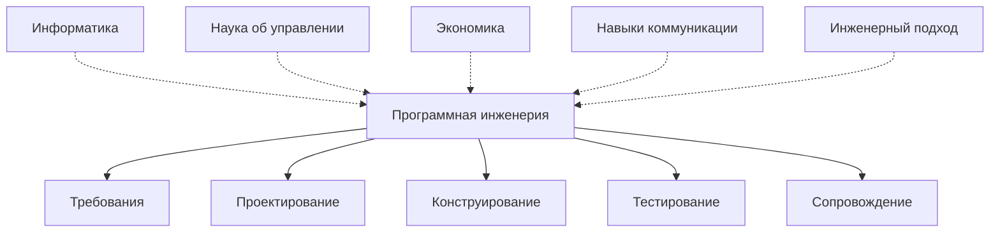

### Эволюция и влияние SE

За последние десятилетия прогресс произошёл во всех областях SE:
 * методы **анализа** для выявления требований к ПО;
 * методичные подходы к **проектированию** и множество нотаций;
 * улучшенные методы **реализации** и новые языки программирования;
 * методы **валидации** и процедуры **обеспечения качества (QA, Quality Assurance)**;
 * инструменты **CASE (Computer-Aided Software Engineering — автоматизированная разработка ПО)**, применяемые в ходе разработки;
 * **формальные методы** верификации свойств ПО;
 * формализованные процедуры **сопровождения**.

Иногда этот прогресс трактуют как «проблемы SE решены». Мысль авторов обратная: объём деятельности в SE показывает, как много проблем ещё открыто.

### Процесс программной инженерии

 * **Программный процесс (software process)** — структура, по которой ведётся разработка программного продукта. Разные организации и отрасли используют разные **модели процесса**, они же модели **жизненного цикла ПО (software life cycle)**; см. часть 2.

### Программная инженерия как область

 * SE изучает **сложные системы** — системы из множества компонентов со сложными связями. Чтобы представить такую систему, строят отдельные модули/компоненты и связывают их.
 * «Инженерия» означает создавать ПО **методично**, по **принципам**.
 * Чтобы применять принципы, инженеру нужны **методы** и конкретные **техники**, которые закладывают нужные свойства и в **процесс**, и в **продукт**.
 * Если методы и техники собраны в пакет, такой пакет называют **методологией (methodology)**. Методология продвигает один определённый способ решения задачи.


### Уровни программного процесса

Объём процесса должен соответствовать проекту. **Избыток процесса** тормозит чисто исследовательскую работу; **недостаток процесса** тормозит крупный проект с жёсткими результатами. Выделяют три уровня:

| Уровень | Тип проекта | Команда и релизы | Объём процесса |
|---|---|---|---|
| **Уровень 1: НИОКР (R&D)** | Чистое исследование, продукт не поставляется | Небольшая | Минимальный |
| **Уровень 2: исследовательская система** | Исследовательская система, которой пользуются другие | Команда больше, **неформальные** релизы | Умеренный |
| **Уровень 3: поставляемая система** | Продукт поставляется заказчику | Большая команда, **формальные** релизы | Наиболее формальный |

По мере перехода проекта на более высокий уровень процесс и практики становятся более **формальными и структурированными**.

Лучшие практики, применяемые на трёх уровнях:
 * контроль исходного кода (source code control);
 * чистые регулярные сборки;
 * написание повторно используемого кода;
 * разные **модели организации команды (team models)**;
 * соблюдение сроков;
 * **ревью проекта и кода (design and code reviews)**;
 * **управление рисками (risk management)**;
 * **отслеживание ошибок (bug tracking)**;
 * **программные метрики (software metrics)**;
 * **управление конфигурацией ПО (SCM, Software Configuration Management)**;
 * **управление требованиями (requirements management)**.

**SCM** на шаг формальнее и воспроизводимее, чем простой контроль исходного кода: помимо версий файлов оно **контролирует и версионирует релизы ПО**.

### Важность конструирования ПО

 * Когда-то «разработку ПО» и «кодирование» считали одним и тем же. После того как другие виды деятельности (управление проектом, требования, проектирование, тестирование) были выделены отдельно, они привлекли основное внимание исследователей, а **конструирование (construction)**, то есть написание кода, стало «бедным родственником».
 * Если считать конструирование отдельной **деятельностью**, это не значит, что оно обязано быть отдельной **фазой**. Деятельности можно выстраивать фазами, итерациями или как-то иначе; конструирование всё равно можно обсуждать само по себе.

Цифры по конструированию:

| Размер проекта | Доля общих трудозатрат на конструирование | Доля ошибок, возникающих при конструировании |
|---|---|---|
| Малый | около **80%** | около **75%** |
| Средний | около **50%** | **50–75%** |
| Крупный | — | **50–75%** |

 * Любая деятельность, порождающая 50–75% ошибок, — очевидное место для улучшений.
 * Конструирование — **единственная деятельность, которая выполняется гарантированно**: требования можно предположить, архитектурой пренебречь, тестирование сократить или пропустить, но без конструирования программы не будет. Поэтому именно здесь улучшения особенно результативны.

### Проблемы при разработке систем

Системы иногда бросают ещё до запуска. Причина может быть как на стороне разработчика, так и на стороне пользователя. Опытный дальновидный разработчик предвидит проблемы и действует до их появления; разработчику и пользователю стоит работать вместе, чтобы понимать трудности друг друга.

Типичные проблемы крупных сложных проектов:

 1. **Срыв графика (time schedule overlap).** Долгий проект «плывёт»: то, чего заказчик хотел в начале, сильно меняется, исходные концепции уже не соответствуют масштабу, сдача задерживается, и пользователь может потерять интерес к завершению.
 2. **Пользовательский интерфейс.** Взаимодействие человека с машиной не продумали в начале, и оно всплывает в ходе разработки. Тогда добавляют новые элементы управления и отображения, оказывается нужным новое оборудование и ПО.
 3. **Тестирование и интеграция.** Недостатки обнаруживаются только на тестировании и интеграции; недостающие части добавляют поздно, потому что в начале об этом мало думали.
 4. **Сопровождение.** После передачи системы пользователь, работая самостоятельно, хочет доработок и сталкивается с технологическими, функциональными и производительными проблемами. Поэтому оговаривают **гарантийный период**, в течение которого разработчик бесплатно устраняет «детские болезни» системы.

### Решения проблем

Большинства поздних проблем можно избежать за счёт тщательного **анализа и проектирования в начале**, что заодно предотвращает рост затрат.

| Проблема | Меры |
|---|---|
| **Срыв графика** | Откладывать технологические решения как можно дольше или сокращать цикл разработки. Делать детальный анализ и проектирование рано, потому что финансовые последствия нужно знать заранее; строить на них детальные сметы. Выбирать технологии по зрелости. Использовать готовое оборудование и ПО, чтобы сократить цикл. Применять **поэтапную разработку (phased development)**: анализировать, проектировать, разрабатывать, тестировать и внедрять систему частями; проблема в одной части сразу решается со ссылкой на предыдущую фазу. |
| **Пользовательский интерфейс** | Вовлекать будущих конечных пользователей в разработку; учитывать их мнение, чтобы упростить работу с системой; упрощать и оптимизировать интерфейсные действия в ходе разработки. |
| **Тестирование и интеграция** | Определить **всеобъемлющую программу тестирования**; поручить её участнику с серьёзным опытом тестирования; включить представителя пользователя в **приёмочное тестирование (acceptance test)**; получать согласие пользователя пошагово после **модульного, интеграционного и системного тестирования**. |
| **Сопровождение** | **Проектировать с расчётом на изменения**: оставлять место для дополнительного оборудования (точность, скорость) и изменений ПО (вычислительная мощность). Вести **полноценную документацию**, чтобы опираться на неё при изменениях в течение жизненного цикла. |

### Качества ПО

 * Чем выше качество продукта и процесса, тем удобнее ПО в обслуживании, тем меньше проблем оно создаёт и тем дольше живёт.
 * **Пользователь** хочет, чтобы ПО было **надёжным, эффективным и простым в использовании**.
 * **Разработчик** хочет, чтобы ПО было **проверяемым (verifiable), сопровождаемым, переносимым (portable) и расширяемым (extensible)**.
 * **Внешние качества** видны пользователям; **внутренние качества** важны разработчикам. Качества тесно связаны (например, внутренняя проверяемость помогает внешней надёжности).

В исходном издании таблица 1.1 («Качества ПО») не содержит тела. Ниже перечислены качества, названные в тексте, а также классический набор, из которого они взяты:

| Качество | Вид | Смысл |
|---|---|---|
| **Корректность (correctness)** | Внешнее | ПО ведёт себя согласно спецификации |
| **Надёжность (reliability)** | Внешнее | На ПО можно положиться; отказы редки |
| **Устойчивость (robustness)** | Внешнее | Ведёт себя разумно даже в ситуациях, не предусмотренных спецификацией |
| **Эффективность / производительность (efficiency / performance)** | Внешнее | Экономно расходует ресурсы (время, память) |
| **Удобство использования (usability)** | Внешнее | Легко освоить и использовать |
| **Проверяемость (verifiability)** | Внутреннее | Свойства можно проверить (тестами, ревью, анализом) |
| **Сопровождаемость (maintainability)** | Внутреннее | Легко исправлять (repairability) и изменять (evolvability) |
| **Переносимость (portability)** | Внутреннее | Может работать в разных средах |
| **Расширяемость (extensibility)** | Внутреннее | Новые функции добавляются без серьёзной переделки |
| **Повторное использование (reusability)** | Внутреннее | Части можно использовать в других продуктах |
| **Понятность / читаемость (understandability / readability)** | Внутреннее | Структуру и код легко понять |

### Системный анализ и проектирование

Цель **анализа** — найти требования заказчика, создать основу для разработки и определить требования, которые будут реализованы позже. Хороший аналитик разбивает систему на модули для разработки и затем интегрирует их в работающий продукт.

Технические задачи **системного инженера / системного аналитика (system analyst)**:
 1. Изучить существующую систему и составить вместе с пользователями список требований.
 2. Подготовить **концептуальный (логический) проект** на основе требований.
 3. Зафиксировать **границу системы**: входы, выходы и интерфейсы.
 4. Определить выполняемые функции и **параметры для измерения производительности**.
 5. Выявить внутренние структуры системы и их зависимости.
 6. Построить **математические модели** для оценки производительности системы.
 7. Подготовить **альтернативные решения** и выбрать лучшее с помощью **взвешенной оценки**.
 8. **Декомпозировать** систему на логические подсистемы для последующей интеграции.
 9. Участвовать в разработке, тестировании, интеграции и внедрении.
 10. Работать с пользователями, разработчиками и руководством, направляя проект.
 11. Быть **агентом изменений (change agent)** и катализатором улучшения процессов.
 12. Руководить на всех фазах разработки.
 13. Подготовить **план проекта и график** поэтапного завершения.
 14. Определить **надёжность, доступность (availability) и качество** системы.
 15. Подготовить **смету** разработки и выполнить **анализ затрат и выгод (cost–benefit analysis)**.

#### Системный анализ

 * **Системный анализ (system analysis)** — сбор и интерпретация фактов, диагностика проблем и использование полученной информации для рекомендаций по улучшению системы.
 * Это изучение прикладной области до полного понимания поставленной задачи. Методы сбора данных: **интервью, наблюдение, практическая работа с системой, консультации** и другие.
 * Фокус: полное представление о существующей системе, её **сильных и слабых сторонах** и о причинах, по которым её нужно перестроить, заменить или автоматизировать.
 * Результат этой деятельности — **постановка задачи (problem statement)**.
 * **Системный аналитик** — человек, отвечающий за изучение и проектирование системы. Он совмещает множество ролей: исследователь, планировщик, проектировщик, модулятор, коммуникатор, внедренец, тренер, агент изменений, архитектор, психолог, продавец, мотиватор, политик, разрешающий конфликты, убеждающий и настаивающий. Сильный аналитик способен провести проект от инициации до внедрения.

Задачи аналитика на этапе анализа:
 * понять существующую систему, её достоинства и недостатки;
 * спланировать новое приложение или изменение существующего;
 * составить график работ по разработке;
 * рассмотреть **альтернативные варианты решений (alternative candidate solutions)**;
 * уделить внимание **реинжинирингу (re-engineering)** и **изучению методов работы (method study)**;
 * охватить эксплуатационные процедуры: резервное копирование, аудит, контроль качества, безопасность;
 * спланировать мероприятия по снижению затрат;
 * уделить внимание развитию системы и повторному использованию.

#### Архитектура и проектирование системы

 * **Проектирование системы (system design)** формирует **структуру (архитектуру)** системы. Проектирование идёт непрерывно с самого начала и движется от **«что строить»** к **«как строить»**.
 * Программный инженер включается в работу, посещая встречи с пользователями, читая предварительные документы и участвуя в системных **ревью и сквозных просмотрах (walkthroughs)**.
 * Затем инженер выполняет **моделирование процессов (process modelling)**: проектирует программные ресурсы (программы и процедуры) и готовит **детальные спецификации программных модулей**, удовлетворяющие спецификациям пользовательского интерфейса и данных.
 * Инженер должен хорошо знать **предметную область**: это позволяет проектировать функции и спецификации ПО, устанавливать **требования к производительности** системы и подсистем и участвовать в разработке архитектуры.


#### Что такое система

 * **Система** — упорядоченное множество взаимозависимых компонентов, связанных по определённому плану для достижения конкретной цели.
 * Примеры бизнес-подсистем и их типичных функций:

| Подсистема | Типичные функции |
|---|---|
| **Производство** | Распределение людей и оборудования, выдача и закрытие заданий, планирование, калькуляция затрат по заказам, системы премирования, планирование потребности в сырье, незавершённое производство и состояние готовой продукции |
| **Финансы** | Кредиторская и дебиторская задолженность, проводки по главной книге, кассовые платежи и поступления, зарплата, оборотно-сальдовая ведомость, отчёт о прибылях и убытках, баланс, банковские операции |
| **Персонал** | Найм, обучение, расстановка, выход на пенсию, оценка и продвижение, базы данных сотрудников и навыков, расчёт зарплаты, пенсионный фонд, учёт отпусков, администрирование |

### Итог главы

SE превращает **логическую концепцию** системы в работающую **физическую систему**. Для этого нужен опытный, увлечённый инженер, ведущий команду. Систему нужно сдать вовремя, она должна отвечать требованиям пользователя и давать видимую пользу, которую он признаёт. Для долгой жизни продукта нужны качество и надёжность, а сама система должна быть понятной и легко изменяемой, чтобы её можно было сопровождать.

### Главное

 * SE — систематический, дисциплинированный, измеримый подход к разработке, эксплуатации и сопровождению ПО; её цели — качество, производительность и удовлетворённость инженеров.
 * Сложность преодолевается декомпозицией на модули с чётко определёнными интерфейсами.
 * Объём процесса должен соответствовать проекту: НИОКР (минимальный), исследовательская система (умеренный), поставляемая система (формальный).
 * Конструирование занимает 50–80% трудозатрат и порождает 50–75% ошибок, и это единственная деятельность, которая выполняется всегда, — поэтому здесь лучше всего вкладываться в улучшения.
 * Типичные проблемы: срыв графика, поздно продуманный интерфейс, пробелы в тестировании и интеграции, нагрузка сопровождения; большинство предотвращается ранним анализом и проектированием, поэтапной поставкой, участием пользователей, программой тестирования и проектированием с расчётом на изменения.
 * Пользователей волнуют внешние качества (надёжность, эффективность, удобство), разработчиков — внутренние (проверяемость, сопровождаемость, переносимость, расширяемость).
 * Системный аналитик собирает факты, формулирует постановку задачи, проектирует логическую систему, оценивает альтернативы и направляет проект; проектирование движется от «что» к «как».

---

## Часть 2. Моделирование жизненного цикла разработки ПО

### Зачем нужен структурированный процесс

Когда прикладное ПО становится большим и сложным, приходится одновременно управлять несколькими свойствами: **читаемостью, надёжностью, безопасностью, ремонтопригодностью (сопровождаемостью)** и **удобством использования**. В работе участвует много аналитиков, проектировщиков и разработчиков. Поэтому работу делят на чёткие **фазы**, каждая поручается своей группе. Фазы зависят друг от друга: следующую задачу можно начать только после завершения предыдущей. Отсюда необходимость **структурированного процесса разработки**.

Темы части:
 * модели разработки ПО (модели жизненного цикла);
 * как надёжность, производительность, безопасность (safety) и защищённость (security) учитываются в модели жизненного цикла;
 * виды деятельности, из которых состоит разработка ПО.

### Системный анализ и проектирование в организации

 * «Информация — это сила»: организация, у которой вся информация под рукой, действует прагматичнее. Компьютерная **информационная система** не только даёт информацию, но и помогает руководству быстро принимать решения. Её создание — **процесс улучшения организации**.
 * Анализ и проектирование информационной системы опираются на **цели, структуры и процессы** организации и направлены на то, чтобы использовать ИТ ей на пользу.

#### Данные и процессы

Информационная система состоит из трёх элементов:
 * **Данные (data)** — сырые факты, описывающие сущность (человека, место или объект). Связи между данными описывают различными методами моделирования.
 * **Потоки данных (data flows)** — группы данных, перемещающиеся по системе, вместе с их **источником** и **приёмником**.
 * **Логика обработки (processing logic)** — шаги преобразования данных. Шаги запускаются **событиями**.

#### Процессно-ориентированный подход (process-oriented approach)

 * В центре внимания — **процесс**: как данные перемещаются, используются и преобразуются; как и когда данные идут от источника к приёмнику через промежуточные шаги; как процессы превращают данные в информацию. Важна **последовательность** процессов.
 * Файлы данных создаются **под каждое приложение**, когда они нужны процессу.
 * Последствия:
   * одни и те же данные **дублируются** во многих файлах;
   * один и тот же элемент данных приходится обновлять в нескольких файлах;
   * специализированные файлы становятся громоздкими;
   * один и тот же элемент может иметь **разные имена** в разных файлах;
   * поэтому организации нужна **стандартизация данных**.

#### Подход, ориентированный на данные (data-oriented approach)

 * В центре внимания — **данные**, а не процесс. Методы направлены на **избыточность**, **индексирование** и **связи** между данными.
 * **Модель данных (data model)** отражает правила и политику бизнеса.
 * Процессы со временем меняются, а **данные организации относительно стабильны**; объёмы данных растут и усложняются. Поэтому акцент на данных и **нормализации**.
 * Процессы и данные обрабатываются **раздельно**. Программы управления данными (СУБД — система управления базами данных) эффективно обрабатывают запросы.
 * **База данных** обслуживает все приложения и может использоваться многими приложениями **одновременно**; поэтому проектирование БД становится центральным. **Репозиторий данных (data repository)** служит текущим и будущим системам без проблем при изменении данных. Многие организации ведут **центральную базу данных**.

| Аспект | Процессно-ориентированный | Ориентированный на данные |
|---|---|---|
| Фокус | Что система должна **делать** | Какие **данные** нужны системе |
| Файлы данных | Проектируются под конкретное приложение | Проектируются для всей организации |
| Избыточность | Высокая, неконтролируемое дублирование | Контролируемая (нормализация) |
| Стабильность проекта | Ниже — бизнес-процессы меняются быстро | Выше — данные меняются медленнее |
| Именование данных | Несогласованное между файлами | Стандартизованное |
| Совместное использование | Каждое приложение владеет своими файлами | Одна БД для многих приложений |

Два взгляда **дополняют** друг друга: реальной системе нужна и модель процессов, и модель данных.

### Типы информационных систем

Люди, связанные с информационными системами: руководители систем, системные аналитики, программисты, конечные пользователи, аудиторы, бизнес-менеджеры, высшее руководство и технический персонал поддержки (а также тестировщики и сотрудники контроля качества, инженеры связи, эксперты по ПО). Так как их интересы различаются, существуют разные **классы информационных систем**.

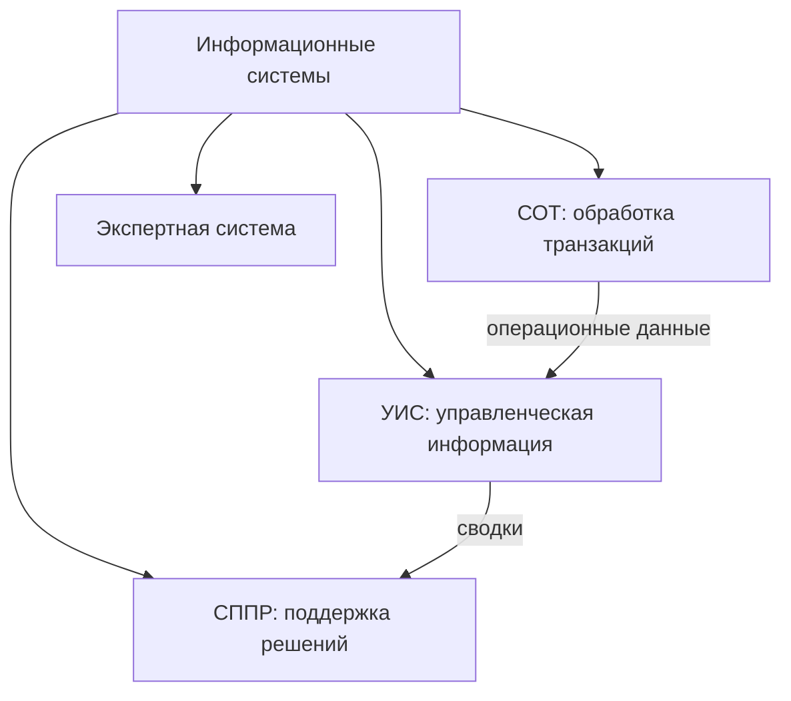

#### Система обработки транзакций (TPS, Transaction Processing System — СОТ)

 * **TPS** обрабатывает **транзакции** с данными в базе данных и контролирует их. Её суть: данные всегда должны оставаться в **согласованном состоянии**.
 * Пример — электронный платёж: деньги **либо** списываются с одного счёта **и** зачисляются на другой, **либо не происходит ничего**. Если сбой мешает завершению, частично выполненную транзакцию нужно **откатить (roll back)**.
 * Такая целостность важна для пакетной обработки, но особенно — для **онлайн**-обработки. Пример — бронирование мест в самолёте многими операторами: после того как оператор нашёл свободное место, запись о месте должна быть **заблокирована** до завершения бронирования; иначе другой оператор увидит место свободным, и произойдёт **двойное бронирование**.
 * Другие функции **монитора транзакций (transaction monitor)**: обнаружение и разрешение **взаимоблокировок (deadlock)**; **журналирование транзакций** для **прямого восстановления (forward recovery)** после крупных сбоев.

Свойства TPS:

| Свойство | Смысл |
|---|---|
| **Быстрый отклик (rapid response)** | От ввода до вывода — несколько секунд или меньше; клиентов нельзя заставлять ждать |
| **Надёжность (reliability)** | Очень низкая частота отказов; при отказе восстановление должно быть быстрым и точным, поэтому необходимы продуманные процедуры **резервного копирования и восстановления** |
| **Негибкость (inflexibility)** | Каждая транзакция обрабатывается **одинаково** независимо от пользователя, клиента и времени суток. Гибкость открыла бы путь нестандартным операциям (например, авиакомпания должна принимать бронирования в едином формате от всех турагентов) |
| **Контролируемая обработка (controlled processing)** | Обработка должна поддерживать правила организации — например, обеспечивать соблюдение ролей и обязанностей, назначенных сотрудникам |

#### Управленческая информационная система (MIS, Management Information System — УИС)

 * **MIS** — часть системы внутреннего контроля бизнеса: люди, документы, технологии и процедуры, с помощью которых управленческие бухгалтеры решают бизнес-задачи, например калькуляцию себестоимости продукта, услуги или стратегии всей компании.
 * В отличие от обычных информационных систем, MIS используется для **анализа других информационных систем**, поддерживающих операционную деятельность. В академическом смысле термин охватывает методы автоматизации или поддержки **принятия решений человеком**: системы поддержки решений, экспертные системы, информационные системы для руководителей (executive information systems).
 * MIS соединяет технологию и бизнес, чтобы люди получали информацию, нужную для лучшей, более быстрой и разумной работы. MIS часто берёт данные из **нескольких TPS**.
 * Специалисты по MIS работают системными аналитиками, руководителями проектов, системными администраторами и общаются с персоналом и руководством всей организации.
 * Другое определение: **плановая система** сбора, обработки, хранения и распространения данных в виде **информации**, необходимой для функций управления, — по сути документированный отчёт о запланированном и выполненном.
 * Различия:
   * **MIS и информационная система**: к информационным системам относятся и системы, не предназначенные для принятия решений.
   * MIS в узком смысле иногда называют **управлением ИТ (IT management)**; это не информатика. **Управление ИТ-услугами (IT service management)** — практико-ориентированная дисциплина.
   * **MIS и ERP (Enterprise Resource Planning — планирование ресурсов предприятия)**: ERP содержит элементы, не нацеленные на поддержку решений.

#### Система поддержки принятия решений (DSS, Decision Support System — СППР)

 * **DSS** — класс компьютерных информационных систем, поддерживающих **принятие решений** в бизнесе и организации. Хорошо спроектированная DSS **интерактивна** и помогает лицу, принимающему решения, извлекать полезную информацию из сырых данных, документов, личных знаний и/или бизнес-моделей, чтобы выявлять и решать проблемы.
 * Типичная информация, которую собирает и показывает DSS:
   * перечень всех информационных активов (унаследованные и реляционные источники, **кубы**, **хранилища данных (data warehouses)**, **витрины данных (data marts)**);
   * сравнение продаж неделя к неделе;
   * прогноз выручки исходя из предположений о продажах нового продукта.
 * История: около **1990** года **хранилища данных** и **OLAP (Online Analytical Processing — оперативная аналитическая обработка)** расширили сферу DSS; ближе к 2000 году появились **веб-приложения для аналитики**.
 * Основания: исследования баз данных, ИИ, человеко-компьютерное взаимодействие, моделирование, SE, телекоммуникации. С развитием технологий отчётности DSS стала важной частью управления.

| Тип DSS | Поведение |
|---|---|
| **Пассивная (passive)** | Помогает в процессе принятия решения, но не может выдать явных предложений или решений |
| **Активная (active)** | Может выдать явные предложения или решения |
| **Кооперативная (cooperative)** | Лицо, принимающее решение (или его советник), изменяет, дополняет или уточняет предложения системы и отправляет их обратно на проверку; система снова их улучшает и возвращает; цикл повторяется до получения **согласованного решения** |

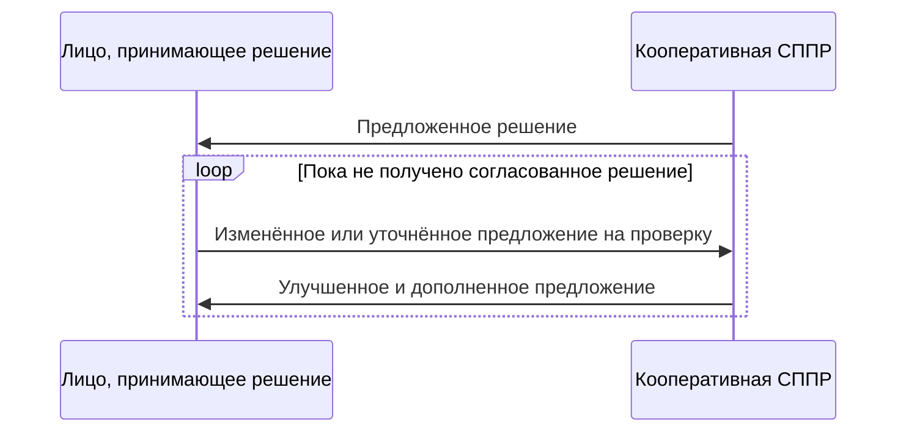

#### Экспертная система (expert system)

 * **Экспертная система** пытается воспроизвести работу одного или нескольких **экспертов-людей**, обычно в узкой области; это классическое приложение/подраздел **ИИ**.
 * Общие элементы:
   * **база знаний (knowledge base)**, использующая формализм **представления знаний (knowledge representation)** для фиксации знаний **экспертов в предметной области (SME, Subject Matter Experts)**;
   * **инженерия знаний (knowledge engineering)** — процесс извлечения знаний у экспертов и их кодирования в этом формализме;
   * возможно, компонент обучения;
   * проверка системы в **тех же реальных ситуациях**, в которых работает эксперт, — обычно как помощника для сотрудников или дополнения к информационной системе.
 * Ключевая идея: задачи решаются применением **конкретных знаний**, а не конкретной техники. Эксперты рассуждают не иначе, чем другие люди, — они **знают другое**. Поэтому когда экспертная система работает плохо, **расширяют базу знаний**, а не перепрограммируют процедуры.
 * Типичная архитектура: **база правил (rule base)** и **машина логического вывода (inference engine)** моделируют рассуждения эксперта. База правил — большое множество взаимосвязанных правил вида **«если — то»**, приближающих последовательность мыслительных шагов эксперта.
 * Из-за большого размера баз правил экспертные системы раньше работали только на крупных машинах; рост объёмов памяти ПК сделал простые экспертные системы возможными на персональных компьютерах.
 * В одних приложениях знаний больше, чем помещается в оперативную память; в других **не все знания нужны** в каждом случае. Пример: диагностика системы обработки данных со множеством необязательных компонентов — единая база правил для минимальной конфигурации содержит много правил о необязательных блоках, которых нет в системе, и большая её часть не используется.


### Обзор SDLC

 * **SDLC (Systems Development Life Cycle — жизненный цикл разработки систем)** — концептуальная модель управления проектами, описывающая стадии проекта информационной системы от начального **технико-экономического обоснования (feasibility study)** до **сопровождения** готового приложения.
 * Методологии: **каскадная (waterfall)** — исходный метод SDLC, **RAD (Rapid Application Development — быстрая разработка приложений)**, **JAD (Joint Application Development — совместная разработка приложений)**, **фонтанная модель (fountain)**, **спиральная модель (spiral)**. На практике несколько моделей часто объединяют в **гибрид**.
 * **Документация** критически важна в любой модели и обычно ведётся **параллельно** с разработкой.
 * Одни методы лучше подходят для определённых проектов, но решающим фактором успеха часто оказывается то, **насколько точно соблюдался план**.

Классическая каскадная модель (первая модель SDLC):

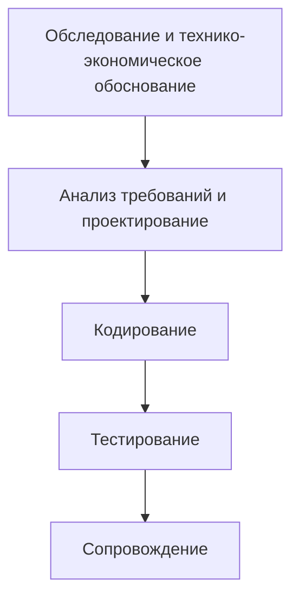

### Кратко о фазах

Эти фазы присутствуют в любой модели, как бы они ни были упорядочены.

#### Технико-экономическое обоснование (feasibility study)

 * Решает, получит ли проект **«зелёный свет»** после анализа бизнес-проблем и возможностей. Если проект продолжается, обоснование даёт **план проекта** и **оценку бюджета** на следующие стадии.
 * Определяет, нужна ли новая или улучшенная информационная система; формирует **план управления проектом** и получает **одобрение руководства**.
 * Уточняет формулировку проблемы/возможности, определяет, какие аспекты войдут в систему, оценивает **затраты и выгоды** и даёт **официальное предложение** о характере и масштабе решения.
 * Содержание отчёта:
   1. Постановка проблемы.
   2. Сводка выводов и рекомендаций.
   3. Подробности выводов (методы, процедуры, выходные отчёты, структуры файлов, анализ затрат и выгод).
   4. Рекомендации и заключения (распределение персонала, затраты, график, целевые даты).

#### Анализ требований и проектирование

 * **Анализ**: детальное изучение бизнес-потребностей организации (в том числе возможных изменений бизнес-процессов). Сбор информационных потребностей конечных пользователей, сведений об организационной среде и текущей системе. Определение **логических требований к вводу, обработке, выводу, хранению и контролю**. Спецификации для:
   * **оборудования** (машины и носители);
   * **ПО** (программы и процедуры);
   * **людей** (специалисты и конечные пользователи);
   * **ресурсов данных**;
   * **информационных продуктов**.
 * **Проектирование** включает:
   * **высокоуровневое проектирование (high-level design)** — какие программы нужны и как они взаимодействуют;
   * **низкоуровневое проектирование (low-level design)** — как работает каждая программа;
   * **проектирование интерфейсов** — как выглядят интерфейсы;
   * **проектирование данных** — какие данные нужны.
 * Здесь определяется общая структура ПО и **логическая система**. Ошибка проектирования очень дорого обходится позже, поэтому эта фаза требует особой тщательности.

#### Кодирование

 * Проектные решения переводятся в код на обычном языке программирования или с помощью **генератора приложений**. Инструменты: **компиляторы, интерпретаторы, отладчики**. Языки (C, C++, Pascal, Java) выбирают по типу приложения.

#### Тестирование

 * Программы пишутся как **модули**, каждый подробно тестируется отдельно, затем система тестируется **целиком**:
   * **интеграционное тестирование (integration testing)** — интерфейсы между модулями работают;
   * **объёмное тестирование (volume testing)** — система работает на целевой платформе с ожидаемым объёмом данных;
   * **приёмочное / бета-тестирование (acceptance / beta testing)** — система делает то, что нужно пользователю.

#### Сопровождение

 * **Послевнедренческий аудит (post-implementation review)** отслеживает, оценивает и при необходимости изменяет систему. Перед передачей проводятся обучение и передаётся документация.
 * Сопровождение неизбежно: ПО меняется после поставки — из-за неожиданных входных данных или из-за изменений в окружающей системе, влияющих на работу ПО. ПО нужно строить так, чтобы оно **выдерживало изменения после внедрения**.

#### Вехи и результаты фаз

Фазовый жизненный цикл повышает **прозрачность** проекта: фазы служат **вехами (milestones)**, а более мелкие фазы позволяют точнее отслеживать прогресс. Хорошая веха должна (1) быть связана с реальным продвижением разработки и (2) **очевидно показывать, что она достигнута**.

| Документ | Фаза, в которой создаётся |
|---|---|
| Техническое задание на работы (statement of work) | ТЭО |
| План проекта, смета, план SQA (Software Quality Assurance — обеспечение качества ПО) | Планирование проекта |
| Предварительное руководство пользователя, план тестирования | Требования |
| Архитектурный проект, спецификации модулей, детальный проект | Проектирование |
| Исходный код, окончательное руководство пользователя, документация | Реализация |
| Отчёт о тестировании | Тестирование |

Порядок задач в каскадном проекте: анализ рынка → планирование проекта, оценка затрат, спецификация требований (можно параллельно) → ревью требований → высокоуровневое проектирование → низкоуровневое проектирование → ревью проекта → реализация → модульное тестирование → системное тестирование → приёмочное тестирование.

### Типы моделей

Как любой продукт, ПО проходит фазы от зарождения до зрелости — от обследования до сопровождения, и каждая потребляет ресурсы. Модель выбирают по **размеру**, **сложности** и **требованиям пользователя**.

За последние десятилетия исследователи выделили следующие отдельные виды деятельности в разработке ПО:
 1. Определение проблемы
 2. Выработка требований
 3. Планирование конструирования
 4. Архитектура ПО (высокоуровневое проектирование)
 5. Детальное проектирование
 6. Кодирование и отладка
 7. Модульное тестирование
 8. Интеграционное тестирование
 9. Интеграция
 10. Системное тестирование
 11. Корректирующее сопровождение

Не каждая модель показывает их все явно, но в той или иной мере присутствуют все.

### (Итеративная) каскадная модель (waterfall model)

 * **«Классическая»** модель, также называемая **подходом «за один проход» (one-shot approach)**: последовательность действий сверху вниз.
 * Некоторые стрелки направлены **назад, вверх**: на поздней стадии может выясниться, что нужна дополнительная работа на ранней, — но это должно быть **исключением**. Водопад течёт вниз, «лишь чуть-чуть разбрызгиваясь назад».
 * **Ограниченность итераций — сильная сторона**: в большом проекте не хочется заново открывать задачи, считавшиеся завершёнными, потому что это рушит обещанный срок сдачи.

Фазы:
 1. **ТЭО** — начальное исследование перед анализом и проектированием. Это **документ для принятия решения**, отвечающий на три вопроса: есть ли новый, лучший способ выполнять работу с выгодой для пользователя? Каковы затраты и выгоды альтернатив? Что рекомендуется? Три аспекта осуществимости: **экономический, технический, поведенческий**. Обычно его пишет опытный сотрудник, хорошо знающий систему и организацию; в зависимости от первичного обследования оно перерастает в подробное исследование. Содержание: постановка проблемы; сводка выводов и рекомендаций; подробности выводов; рекомендации и заключения.
 2. **Анализ и определение требований** — сервисы, ограничения и цели устанавливаются вместе с пользователями, затем детализируются в **спецификацию системы**. Анализ изучает операции системы и их связи внутри и вне системы и отвечает на вопрос, **что нужно сделать**. Фиксируются **границы** системы. Инструменты: **DFD (Data Flow Diagram — диаграммы потоков данных), ER-диаграммы (Entity–Relationship — «сущность–связь»), интервью, наблюдение на месте, анкеты**.
 3. **Проектирование системы и ПО** — требования распределяются между **аппаратурой и ПО**; создаётся общая **архитектура системы**. Проектирование ПО выделяет фундаментальные **программные абстракции** и их связи. Самая творческая и сложная фаза. Интерфейсы ввода-вывода и обработка проектируются и проверяются вместе с документацией; должна быть доступна информация о персонале, деньгах, оборудовании, ПО, помещениях и их стоимости.
 4. **Кодирование** — часто выполняется отдельными группами программистов; каждому достаётся один или несколько модулей; аналитик/проектировщик позже их интегрирует.
 5. **Реализация и модульное тестирование** — проект превращается в набор программ/модулей; **модульное тестирование (unit testing)** проверяет каждый модуль на соответствие спецификации. Эта стадия (в формулировке книги) включает также **обучение пользователей, подготовку площадки, конвертацию файлов**, подключение удалённых площадок и терминалов, создание телекоммуникационной сети и передачу всех руководств.
 6. **Интеграция и системное тестирование** — модули объединяются и тестируются как целое, чтобы подтвердить выполнение требований; **системное тестирование** проверяет готовность и точность; затем система поставляется.
 7. **Эксплуатация и сопровождение** — обычно **самая длинная** фаза. Система устанавливается и используется; персонал адаптируется к ней. Сопровождение = исправление ошибок, не найденных ранее, улучшение реализации модулей и **расширение** сервисов при появлении новых требований.

**Оценка.** В каскадной модели нет ничего изначально плохого. Она позволяет **прогнозировать сроки завершения увереннее**, чем итеративные подходы, и поэтому эффективно **контролировать** проект. Там, где реализация **неопределённа**, предпочтителен более гибкий итеративный метод.

#### Каскадная модель с ревью (традиционный подход)

Каждый шаг может вернуться к предыдущему, а каждая фаза завершается формальным **ревью**:


| Ревью | Расшифровка | Где |
|---|---|---|
| **PFR** | Product Feasibility Review — ревью осуществимости продукта | Конец системной инженерии |
| **SRR** | Software Requirement Review — ревью требований к ПО | Конец анализа требований |
| **PDR** | Preliminary Design Review — предварительное ревью проекта | Архитектурная часть проектирования |
| **CDR** | Critical Design Review — критическое ревью проекта | Конец детального проектирования |
| **SCR** | Source Code Review — ревью исходного кода | Кодирование |
| **ATR** | Acceptance Test Review — ревью приёмочных испытаний | Тестирование |
| **PRR** | Product Release Review — ревью выпуска продукта | Конец тестирования, перед выпуском |
| **PPM** | Project Post-Mortem — разбор проекта по итогам | Сопровождение / после проекта |

### V-образная модель (V-process model)

 * Развитие каскадной модели, подчёркивающее **проверочные действия, соответствующие каждому действию разработки**. Её можно рассматривать как **расширение тестирования** в каскадной модели.
 * Каждому шагу на левой (нисходящей) ветви соответствует шаг **валидации** на правой (восходящей). При обнаружении дефекта процесс возвращается к соответствующей стадии разработки, и последующие шаги переделываются.

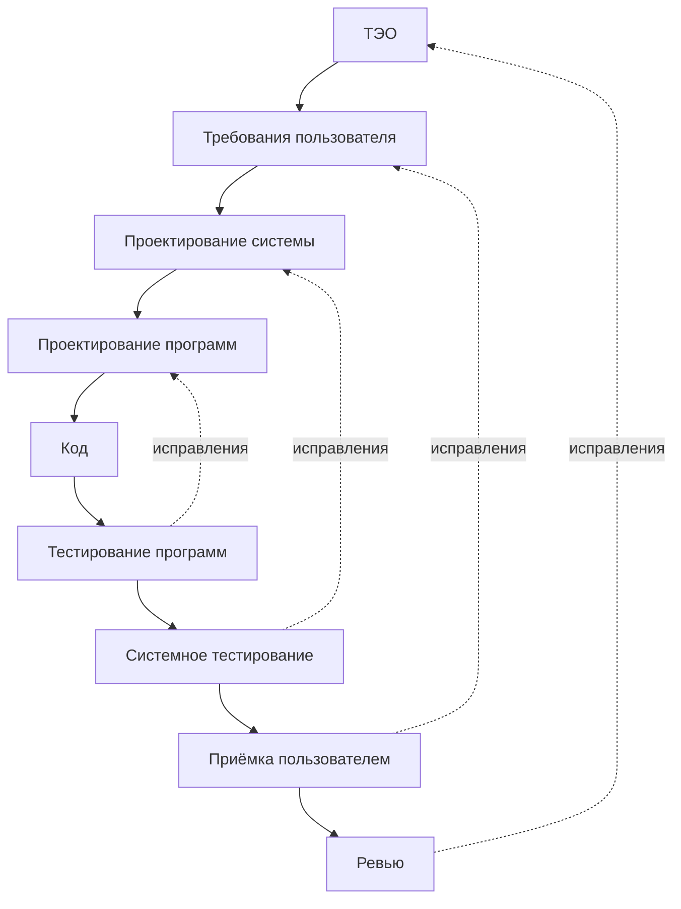

 * В идеале обратная связь возникает только при **расхождении** между тем, что специфицировал один уровень, и тем, что реализовал следующий, более низкий.
 * Пример: системный проектировщик указал, что расчёт выполняется определённым образом; проектировщик программы понял это неверно. На **системном тестировании** системный проектировщик проверяет ПО по проектному документу и обнаруживает ошибку прочтения.
 * Назад передаются только **исправления** — не «**вторые мысли**» проектировщика; иначе проект скатывается в **эволюционное прототипирование**.

### Спиральная модель (spiral model)

 * Ещё один взгляд на каскадную модель. В каскаде после каждого действия есть возможный **выход**: например, ТЭО показало, что система выгодна, руководство разрешило детальную работу над требованиями, но более глубокое обследование выявило, что затраты выше оценки, и проект **прекращают**.
 * Каждая стадия добавляет **больше деталей** и должна давать **больше уверенности** в успехе. Это изображается **спиралью**: каждый виток рассматривает систему подробнее, а перед следующим витком проводится **оценка**. (Книга отмечает, что так можно интерпретировать SSADM — Structured Systems Analysis and Design Method, метод структурного системного анализа и проектирования.)
 * Расстояние от центра показывает **накопленные затраты**; угол — **продвижение по шагам**. При каждом пересечении горизонтальной оси принимается решение о **ревью** и **обязательствах (commitment)** на следующий виток.

Каждый виток проходит четыре квадранта:


Что даёт каждый виток (спираль Боэма в изображении книги):

| Виток | Работа с рисками | Прототип / модель | Разработка и проверка | План |
|---|---|---|---|---|
| 1 | Анализ рисков | Прототип 1 | Концепция эксплуатации | План требований, план жизненного цикла |
| 2 | Анализ рисков | Прототип 2, эмуляции | Требования к ПО, валидация требований | План разработки |
| 3 | Анализ рисков | Прототип 3, модели | Проект программного продукта, валидация и верификация проекта | План интеграции и тестирования |
| 4 | Анализ рисков | Эксплуатационный прототип, бенчмарки | Детальный проект → код → модульное тестирование → интеграция и тестирование → приёмочные испытания → внедрение | — |

### Прототипирование ПО (software prototyping)

 * До настоящей разработки строят **работающий прототип** — модель, функционально эквивалентную **подмножеству** продукта. Это «игрушечная» реализация: **ограниченная функциональность, низкая надёжность, неэффективная работа**.
 * Его показывают заказчикам вместе с форматами ввода, сообщениями, отчётами и интерактивными диалогами. Изучаются технические вопросы (например, время отклика аппаратного контроллера, эффективность алгоритмов сортировки).
 * Поскольку с первого раза редко получается правильно, нужно быть готовым **выбросить первую версию**, чтобы построить хороший продукт.
 * Процесс: **приблизительные требования** → **быстрое проектирование** → прототип с **упрощениями** (неэффективные, неточные или **функции-заглушки**, например поиск по таблице вместо реального вычисления) → оценка заказчиком → уточнение требований → повтор, пока пользователь не **одобрит** прототип → разработка настоящей системы по **классической каскадной модели**.

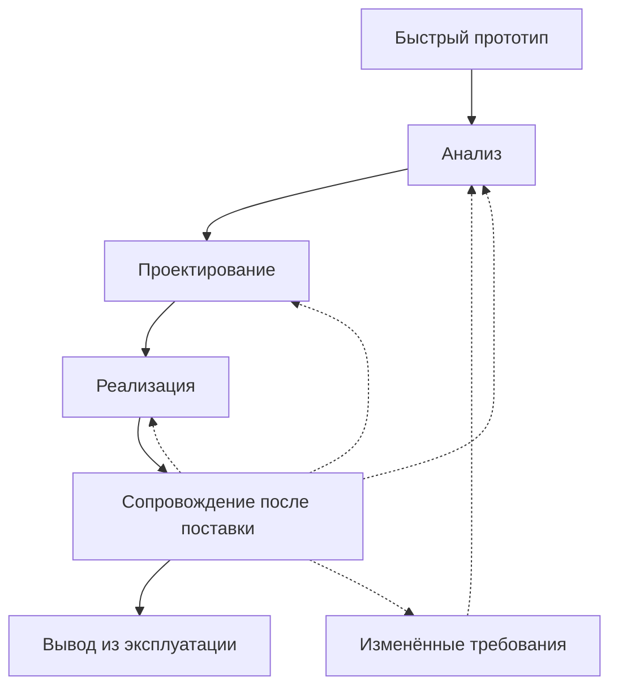

 * Сплошные стрелки — разработка; пунктирные — циклы сопровождения.
 * Отдельная фаза спецификации требований становится **избыточной**: итоговый одобренный прототип служит **«анимированной» спецификацией требований**.
 * Прототип стоит дополнительных денег, но для систем с **неясными требованиями** и **нерешёнными техническими вопросами** **итоговая стоимость ниже**: требования уточняются, а технические вопросы решаются рано, а не всплывают позже как **запросы на изменения (change requests)**, требующие дорогой переделки.

Виды прототипов:

| Вид | Идея |
|---|---|
| **Одноразовый (throw-away)** | Нужен только для проверки идей, затем выбрасывается, когда начинается настоящая разработка. Может создаваться в другой программной среде (где эффективность не важна) или даже на другом оборудовании |
| **Эволюционный (evolutionary)** | Разрабатывается и дорабатывается, пока не станет рабочей системой; **стандарты** разработки нужно выбирать тщательно, потому что код остаётся |
| **Инкрементный (incremental)** | Строго говоря, **не прототипирование**: рабочая система строится и поставляется **небольшими этапами**, и обратная связь с ранних этапов влияет на поздние — «обучение на практике» |

Польза прототипирования: лучше коммуникация, вовлечённость пользователей, согласованность и полнота спецификации; меньше нужно документации, ниже затраты на сопровождение.

### Инкрементный подход (incremental approach)

 * Предложен **Томом Гилбом (Tom Gilb)** (1988). Система делится на **небольшие компоненты**, которые реализуются и поставляются **последовательно**; **каждый поставленный компонент должен приносить пользу пользователю**.

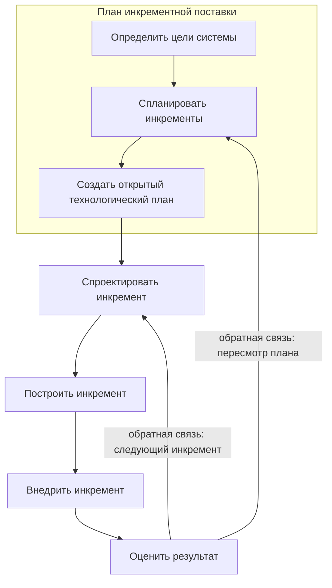

| Достоинства | Недостатки |
|---|---|
| Обратная связь с ранних инкрементов влияет на последующие | **Поломка ПО (software breakage)**: поздние инкременты могут потребовать изменения ранних |
| Меньше изменений требований, чем в больших монолитных проектах, потому что от проектирования компонента до его поставки проходит мало времени | Разработчики могут быть продуктивнее на одной большой системе, чем на серии маленьких |
| Пользователи получают выгоду **раньше** | |
| Ранние полезные поставки улучшают **денежный поток** (ранний возврат инвестиций) | |
| Небольшими подпроектами легче управлять | |
| Меньше **«золотой отделки» (gold plating)** — запросов ненужных функций: пользователи знают, что недостающая функция может войти в следующий инкремент | |

### Эволюционная модель (evolutionary model)

 * Система разрабатывается **последовательными версиями**. Её делят на модули, которые можно реализовать и поставить инкрементно. Сначала строят **ядро (core modules)**; затем начальный «скелет» доводят до всё более высоких уровней возможностей, добавляя функции в каждой версии, и каждая версия выполняет полезную работу.
 * Многие организации совмещают **итеративную и инкрементную** разработку; релиз может добавлять новые функции или изменять существующие.
 * Пример: версия 1 = **A**; версия 2 = **A + B**; версия 3 = **A + B + C**.


| Достоинства | Недостатки |
|---|---|
| Пользователи экспериментируют с частичной системой задолго до полной версии, что помогает уточнить **точные требования** | Часто трудно разделить задачу на функциональные блоки для инкрементной поставки |
| **Ядро многократно тестируется**, поэтому в итоговый продукт попадает меньше ошибок | Наиболее полезна для **очень больших** задач, где подходящие модули найти легче |
| Обучение можно начать на ранней версии; учитывается обратная связь заказчика | |
| Частые релизы позволяют быстро исправлять непредвиденные проблемы | |

### Сравнение моделей жизненного цикла

| Модель | Основная идея | Когда лучше | Главная слабость |
|---|---|---|---|
| **Каскадная** | Последовательные фазы, мало итераций | Требования стабильны и понятны; важна предсказуемость сроков | Позднее обнаружение проблем; дорогая переделка |
| **Каскадная с ревью** | Формальное ревью после каждой фазы | Контрактные или регулируемые проекты | Высокие накладные расходы процесса |
| **V-модель** | Каждому шагу разработки — шаг проверки | Критичны тестирование и верификация | Всё ещё последовательная; обратная связь — только исправления |
| **Спиральная** | Витки с анализом рисков и решением «продолжать / нет» | Крупные проекты с высоким риском | Нужна экспертиза в оценке рисков; дорого |
| **Прототипирование** | Одноразовая модель для выявления требований | Неясные требования, нерешённые технические вопросы | Дополнительная стоимость прототипа |
| **Инкрементная** | Последовательная поставка полезных частей | Нужны ранняя выгода и денежный поток | Поломка ПО между инкрементами |
| **Эволюционная** | Рост системы от ядра через версии | Очень большие задачи, хорошо делящиеся на модули | Трудно выделить инкременты |

### Важность метафор

 * Наука продвигается, используя **метафоры**; они помогают понимать и разработку ПО.
 * В своей **тьюринговской лекции 1973 года** **Чарльз Бахман (Charles Bachman)** использовал переход от геоцентрической модели **Птолемея** (продержавшейся без серьёзных возражений около **1400 лет**) к гелиоцентрической теории **Коперника** (**1543**). Новая модель привела к открытию новых планет, переклассификации Луны как спутника и новому пониманию места человека во Вселенной.
 * Бахман сравнил это со сдвигом в обработке данных в начале 1970-х: от **компьютероцентричного** взгляда (все данные — **последовательный поток перфокарт**, проходящий через компьютер) к **взгляду, ориентированному на базу данных** (**пул данных**, над которым работает компьютер).
 * Когда старая теория отброшена, кажется невероятным, что в неё кто-то верил, — но её сторонники в своё время считали новую теорию столь же нелепой.
 * Программная метафора работает **скорее как прожектор, чем как дорожная карта**: она освещает проблему, но не даёт пошаговых указаний.

### Итог главы

 * Процессная ориентация фокусируется на том, что делает система; ориентация на данные — на данных, которые ей нужны. Процессно-ориентированные проекты **менее стабильны**, потому что бизнес-процессы меняются быстрее данных. Файлы при процессном подходе служат одному приложению; при подходе на основе данных — всей организации с контролируемой избыточностью.
 * Участники разработки: системные аналитики, программисты, руководители ИС, ключевые конечные пользователи, тестировщики и специалисты по качеству, инженеры связи, эксперты по ПО, системные аудиторы.
 * Типы систем: TPS, MIS, DSS, экспертные системы.
 * Несколько моделей жизненного цикла, у каждой — свои фазы, достоинства и недостатки.

### Главное

 * Информационная система = данные + потоки данных + логика обработки; процессный подход и подход на основе данных дополняют друг друга, но проект на основе данных стабильнее.
 * TPS гарантирует согласованность (транзакции «всё или ничего», блокировки, обработка взаимоблокировок, журналирование) и при этом быстра, надёжна, намеренно негибка и контролируема.
 * MIS превращает данные TPS в управленческую информацию; DSS поддерживает решения (пассивная, активная, кооперативная); экспертные системы кодируют знания экспертов как правила «если — то» плюс машину вывода.
 * Фазы SDLC: ТЭО → требования и проектирование → кодирование → тестирование → сопровождение; сопровождение обычно самая длинная фаза.
 * Каскадная модель предсказуема и управляема, но слаба при неопределённости; V-модель сопоставляет каждому шагу разработки шаг проверки.
 * Спиральная модель добавляет анализ рисков и решение о продолжении на каждом витке.
 * Прототипирование (одноразовое, эволюционное) проясняет неясные требования и снижает итоговую стоимость, несмотря на затраты на сам прототип.
 * Инкрементная и эволюционная поставка дают раннюю ценность и обратную связь ценой риска поломки ПО и трудной декомпозиции.

---

## Часть 3. Анализ и спецификация требований к ПО

### О чём эта часть

 * Почему важны **качественные спецификации** и какую роль спецификации требований играют на всех уровнях разработки.
 * Интерфейсы между всеми элементами системы.
 * Информационные потоки, определения структур, базовые диаграммы и основные функции.
 * Реалистичные **проектные ограничения**, **технологические риски** и альтернативные требования к ПО.
 * Поиск **противоречий** и избыточности модулей, **валидация** системы.
 * Инструменты и методы определения требований.
 * Как **JAD** и **прототипирование** используются для выявления требований.

### Введение в требования к ПО

До создания продукта аналитик должен понять **информационную область (information domain)** и знать нужные **функции, поведение, производительность** и **интерфейсы**. Требования к системе и ПО документируются и **согласуются с заказчиком**.

Анализ требований состоит из трёх видов деятельности:

| Деятельность | Что происходит |
|---|---|
| **Выявление требований (eliciting)**, или сбор требований (requirements gathering) | Общение с заказчиками и пользователями, чтобы узнать, что им нужно |
| **Анализ требований (analyzing)** | Проверка, не являются ли требования неясными, неполными, двусмысленными или противоречивыми, и устранение этих проблем |
| **Фиксация требований (recording)** | Документирование в виде текстов на естественном языке, **сценариев использования (use cases)**, **пользовательских историй (user stories)** или спецификаций процессов |


 * Анализ требований может быть долгим и требует тонких **психологических навыков**: новая система меняет среду и отношения между людьми, поэтому нужно учесть их потребности и добиться понимания последствий.
 * Методы выявления: **интервью**, **фокус-группы**, **списки требований**; более современные — **прототипирование** и **сценарии использования**. Аналитики комбинируют методы, чтобы система отвечала потребностям бизнеса.

#### От чего зависит успех проекта

 1. Насколько подробно фиксируется деятельность команды.
 2. Качество спецификации ПО.
 3. Целостность спецификации.
 4. Точность спецификации.
 5. Наличие устоявшихся процессов разработки.
 6. Строгость их соблюдения.
 7. Качество и количество ревью и аудитов.
 8. Точность моделей для оценки характеристик ПО.
 9. Эффективность плана тестирования и интеграции, спецификации тестов и тестовых данных.
 10. Степень подготовки к сопровождению.

**Семь из десяти** факторов напрямую связаны со **спецификацией**.

### Инженерия требований (requirements engineering)

 * Систематический анализ требований называют также **инженерией требований**. В обиходе его называют сбором требований, **фиксацией требований (requirements capture)** или **спецификацией требований (requirements specification)**. В узком смысле «анализ требований» — это собственно анализ, в отличие от выявления и документирования.
 * **Инженерия требований** — подраздел системной и программной инженерии, занимающийся определением **целей, функций и ограничений** аппаратных и программных систем.
 * Более полное определение: систематическое применение **проверяемых принципов, методов, языков и инструментов** для анализа и описания **поведенческих и неповеденческих** характеристик программной системы, выражающих потребности пользователя. Главный побочный продукт — **SRS**.
 * Порядок относительно ТЭО:
   * в некоторых моделях жизненного цикла инженерия требований начинается с **технико-экономического обоснования (feasibility study)** → **отчёт о ТЭО**; если продукт стоит делать, начинается анализ требований;
   * если анализ требований идёт **до** ТЭО (что может поощрять нестандартное мышление), осуществимость всё равно нужно установить **до окончательного утверждения требований**.
 * **Управление требованиями (requirements management)** устанавливает и поддерживает общее понимание требований клиента между клиентом и командой разработки.

#### Требования в процессе системной инженерии

В системной инженерии анализ требований — часть цикла из четырёх видов деятельности, где «системный анализ и контроль» уравновешивает все остальные:

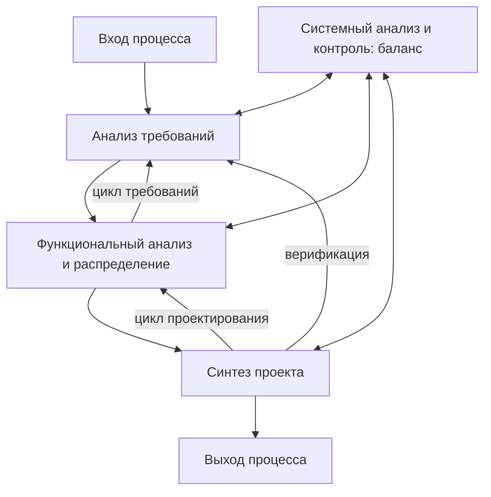

 * **Цикл требований (requirements loop)**: функциональный анализ может выявить пробелы и вернуть работу к анализу требований.
 * **Цикл проектирования (design loop)**: синтез проекта может потребовать пересмотра функционального распределения.
 * **Верификация (verification)**: синтезированный проект проверяется на соответствие требованиям.

### Спецификация требований к ПО (SRS)

 * **SRS (Software Requirements Specification — спецификация требований к ПО)** — **полное описание поведения** создаваемой системы.
 * Она содержит набор **сценариев использования (use cases)**, описывающих все взаимодействия пользователей с ПО; сценарии выражают **функциональные требования**.
 * Также она содержит **нефункциональные (дополнительные, supplementary) требования** — требования, **ограничивающие проектирование или реализацию**: требования к производительности, стандарты качества, проектные ограничения.

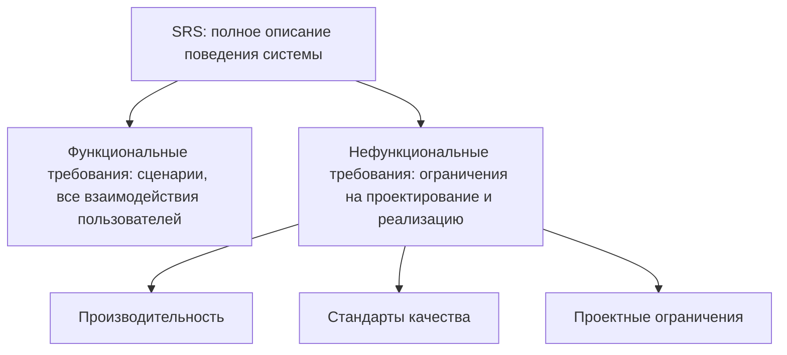

#### Определение требований к ПО

 * Фаза анализа состоит из **двух подфаз**: **планирования** и **определения требований к ПО**.
 * Результат **планирования**: **определение системы (system definition)**, **план проекта** и **предварительное руководство пользователя**.
 * Результат **определения требований**: **спецификация требований к ПО**, излагающая технические требования **полно, кратко и однозначно**. Её объём зависит от размера и сложности задачи.

#### Формат SRS

В исходном издании таблица 3.1 не содержит тела. Текст соответствует классической структуре разделов (по Фэрли, Fairley), восстановленной ниже:

| № | Раздел | Содержание |
|---|---|---|
| 1 | Обзор продукта и сводка | Обзор возможностей продукта |
| 2 | Среды разработки, эксплуатации и сопровождения | Вычислительные среды для разработки, эксплуатации и сопровождения |
| 3 | Внешние интерфейсы и потоки данных | Экранные формы и форматы отчётов, сводка команд пользователя и параметров отчётов, высокоуровневые **диаграммы потоков данных**, **словарь данных** |
| 4 | Функциональные требования | Что должно делать ПО |
| 5 | Требования к производительности | Время отклика, пропускная способность, ёмкость |
| 6 | Обработка исключений | Поведение при ошибках и непредвиденных событиях |
| 7 | Ранние подмножества и приоритеты реализации | Что строить в первую очередь |
| 8 | Предвидимые изменения и улучшения | Ожидаемые изменения |
| 9 | Критерии приёмки | Как будет приниматься продукт |
| 10 | Подсказки и рекомендации по проектированию | Советы проектировщикам |
| 11 | Перекрёстный указатель | Трассируемость |
| 12 | Глоссарий | Определения терминов |

 * Разделы 1–2 развивают характеристики продукта, уже приведённые в **определении системы** и **предварительном руководстве пользователя**.
 * Раздел 3 включает **DFD (Data Flow Diagram — диаграммы потоков данных)** — они показывают **источники данных**, **приёмники данных**, **хранилища данных** и преобразования между ними — и **словарь данных (data dictionary)**.

#### Свойства хорошей SRS

(Список ответов книги в исходнике утрачен; ниже стандартные свойства.) Хорошая SRS:
 * **корректна (correct)** — каждое требование действительно должно выполняться ПО;
 * **однозначна (unambiguous)** — у каждого требования одна интерпретация;
 * **полна (complete)** — охватывает все функции, ограничения, реакции на все входы;
 * **непротиворечива (consistent)** — требования не конфликтуют;
 * **ранжирована (ranked)** по важности и/или стабильности;
 * **проверяема (verifiable)** — каждое требование можно проверить конечным, экономически оправданным способом;
 * **модифицируема (modifiable)** — легко меняется без разрушения структуры;
 * **трассируема (traceable)** — понятно происхождение каждого требования, и на него можно ссылаться позже.

#### Составляющие требований

 * **Составляющие анализа требований**: требования к интерфейсам, функциональные требования, требования к производительности, проектные ограничения, атрибуты программной системы.
 * **Требования к интерфейсам**: пользовательский интерфейс, аппаратный интерфейс, программный интерфейс, коммуникационный интерфейс.
 * **Функциональные требования** описываются через: информационные потоки, описание процессов, спецификацию структур данных, словарь данных.
 * **Пять областей анализа требований** (анализ требований связывает распределение функций ПО на системном уровне с проектированием ПО):
   1. Распознавание проблемы.
   2. Оценка и синтез.
   3. Моделирование.
   4. Спецификация.
   5. Ревью.
 * **Три вида требований по ожиданиям пользователя**: **нормальные (normal)** — явно заявленные; **ожидаемые (expected)** — неявные, настолько базовые, что заказчик о них не говорит; **восхищающие (exciting)** — сверх ожиданий, радуют заказчика.
 * В методе **«чистой комнаты» (Cleanroom)** фаза спецификации включает: анализ требований, спецификацию функций, спецификацию использования, спецификацию архитектуры и инкрементное планирование.

#### Цели системного анализа

 * Выявить потребности заказчика.
 * Оценить концепцию системы на **осуществимость**.
 * Провести **экономический и технический анализ**.
 * **Распределить функции** между оборудованием, ПО, людьми, базой данных и другими элементами системы.
 * Установить **ограничения по стоимости и срокам**.
 * Создать **определение системы**.

### Сбор требований к ПО

Сбор требований похож на расследование. Качества хорошего аналитика при определении требований:

| Качество | Смысл |
|---|---|
| **Дерзость (impertinence)** | Подвергать сомнению всё — например, «Все ли транзакции обрабатываются одинаково?» |
| **Беспристрастность (impartiality)** | Искать лучшее решение бизнес-проблемы, а не обоснование заранее принятого решения (например, не способ оправдать покупку нового оборудования) |
| **Ослабление ограничений (relaxed constraints)** | Считать возможным всё, затем отсеивать неосуществимое; отвергать «мы всегда так делали» |
| **Внимание к деталям (attention to details)** | Каждый факт должен согласовываться со всеми остальными; один элемент не на месте рано или поздно приведёт к отказу системы |
| **Переосмысление (reframing)** | Анализ — творческий процесс: смотреть на организацию по-новому и находить лучшие способы работы |

Результаты определения требований:

| Источник | Результаты |
|---|---|
| **Беседы с пользователями и наблюдение за ними** | Расшифровки интервью, ответы на анкеты, заметки наблюдений, протоколы встреч |
| **Существующая письменная информация** | Формулировки миссии и стратегии, образцы бизнес-форм, отчётов и экранов, руководства по процедурам, должностные инструкции, учебные пособия, блок-схемы и документация существующих систем, отчёты консультантов |
| **Компьютерная информация** | Результаты JAD-сессий, записи и файлы сессий систем групповой поддержки, содержимое CASE-репозитория и отчёты по существующим системам, экраны и отчёты прототипов |

### Традиционные методы сбора требований

Основная задача — собрать сведения о текущих процедурах и предложить улучшенную систему. Лучшая практика — говорить с людьми, работающими с существующей системой в разных ролях, и расспрашивать их об **ограничениях** и доступных **возможностях**.

#### Интервью и слушание

 * Один из основных методов. Нужно много времени уделять интервью о работе людей, используемой информации, способах её обработки и их идеях по снятию ограничений.
 * Опрашивать **заинтересованных лиц (stakeholders)**, чтобы понять направление развития, видение, миссию, политику и ожидания.
 * Собирать и **факты, и мнения**; следить за языком тела и эмоциями — они показывают, чего люди хотят и как оценивают текущую ситуацию.
 * Спланировать **сочетание и порядок** типов вопросов:

| Тип вопроса | Форма | Применение |
|---|---|---|
| **Открытый (open-ended)** | Точного ответа не предполагается | Выявляет неизвестную информацию |
| **Закрытый (close-ended)** | Да/нет, верно/неверно, выбор из вариантов | Точные, легко сравнимые ответы |

#### Анкеты

 * Интервью долги и дороги; анкета с ограниченным набором вопросов позволяет **быстро опросить многих**.
 * Нужно выбрать **репрезентативную выборку** респондентов.
 * Сложнее всего составить анкету, покрывающую все требования. В ней используются **только закрытые вопросы**.

#### Другие традиционные методы

 * **Групповое обсуждение**, **мозговой штурм**, **непосредственное наблюдение** за работой людей.
 * Все факты и выводы нужно задокументировать, проанализировать и представить руководству, прежде чем двигаться дальше. Результаты разных методов сравнивают и нормализуют; вопросы и повестки должны быть точными, чтобы избежать двусмысленности.

### Современные методы сбора требований

Современные методы: **JAD**, **GSS (Group Support Systems — системы поддержки групповой работы)**, **CASE-инструменты** и **прототипирование**.

#### Совместная разработка приложений (JAD, Joint Application Development)

 * **Структурированный процесс**, в котором пользователи, менеджеры и аналитики вместе проектируют и разрабатывают приложение в серии совместных семинаров — **JAD-сессий**.
 * Цель: собрать ключевых пользователей, менеджеров и аналитиков текущей системы, чтобы собрать информацию и обсудить потребности бизнеса. Группа определяет требования, проектирует решение и **сопровождает проект до завершения**.
 * JAD исходит из идеи **группового интервью** и добавляет к ней структуру. Сессии обычно проводятся **на выезде (off-site)** и могут длиться около недели.

Участники JAD:

| Роль | Обязанности |
|---|---|
| **Ведущий сессии (фасилитатор)** | Организует и проводит JAD; владеет управлением группой, фасилитацией и системным анализом; задаёт повестку и следит за её выполнением; остаётся **нейтральным**, не высказывает своих идей и мнений; удерживает группу в рамках и разрешает конфликты |
| **Ключевые пользователи** | Понимают, что значит работать с системой каждый день |
| **Менеджеры** рабочих групп пользователей | Дают представление о новых направлениях организации, мотивах и влиянии системы; поддерживают требования, согласованные на JAD |
| **Спонсор** | Достаточно высокопоставленный человек, финансирующий JAD; обычно присутствует в начале или в конце |
| **Системные аналитики** | Присутствуют главным образом, чтобы **учиться** у пользователей и менеджеров; активное участие ограничено |
| **Секретарь (scribe)** | Ведёт записи на компьютере в текстовом редакторе и CASE-инструментах для диаграмм |
| **Сотрудники ИС** | Программисты, аналитики БД, планировщики ИС, персонал ЦОД; учатся на обсуждении и могут высказаться по техническим вопросам и ограничениям текущей системы |

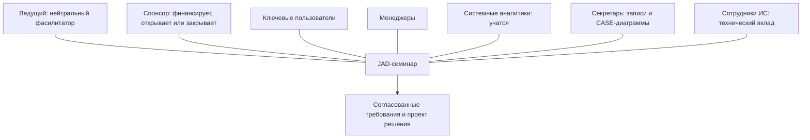

Достоинства JAD:
 * объединяет бизнес и ИТ-специалистов в очень сфокусированном семинаре;
 * снимает многие проблемы обычных совещаний, превращая совещание в **рабочий семинар**;
 * встречи **реже, структурированнее и продуктивнее**;
 * **быстрее разработка** и выше **удовлетворённость клиента** благодаря его участию;
 * повышает качество продукта, выявляя ошибки рано, до того как их исправление станет дорогим;
 * может быть **дорогим, но очень эффективным**.

#### CASE-инструменты в JAD

 * Наиболее полезны **инструменты верхнего уровня (upper CASE)** — для **ранних** фаз SDLC: инструменты планирования, **построения диаграмм**, прототипирования (генераторы экранов и отчётов).
 * CASE-инструмент во время JAD позволяет аналитикам вводить **модели системы напрямую**, обеспечивая согласованность и надёжность совместного моделирования. Он фиксирует требования гибче и полезнее, чем записи секретаря.

#### GSS вместе с JAD

 * JAD — групповой процесс, поэтому к нему применима компьютерная поддержка групп — **системы поддержки групповой работы (GSS)**.
 * Проблемы обычных совещаний, которые решает GSS: не всем хватает времени; некоторые **доминируют**; другие боятся критики или не решаются возражать начальству.
 * Как помогает GSS: участники **печатают** комментарии вместо того, чтобы говорить; вклад **анонимен** («никто не знает, кто что напечатал»), поэтому можно покритиковать и начальника; все пишут **параллельно**, и процесс занимает меньше времени.

#### Прототипирование для выявления требований

 * Прототипы полезны при анализе, потому что пользователи могут не знать, что компьютер способен для них сделать и как они будут им пользоваться.
 * Прототипирование **итеративно**: аналитики и пользователи строят примитивную версию, затем перестраивают её по отзывам. Оно **дополняет** определение требований: базовые требования собирают на интервью, быстро превращают в ограниченную рабочую версию, пользователи её смотрят и тестируют, затем прототип перерабатывают с учётом изменений.
 * Возможно с помощью многих **4GL (fourth-generation languages — языки четвёртого поколения)** и CASE-инструментов.


Прототипирование особенно полезно, когда:
 * пользователь **не может заранее сформулировать требования**;
 * пользователи не могут представить нужную систему (например, новые пользователи, не знающие, как она может выглядеть);
 * среда **новая** и не до конца понятна ни пользователю, ни аналитику.

### Радикальные методы: реинжиниринг бизнес-процессов (BPR)

 * Иногда руководство хочет способов работы, **радикально отличающихся** от нынешних, ожидая большей отдачи. Это **BPR (Business Process Reengineering — реинжиниринг бизнес-процессов)**.
 * BPR идёт **сверху вниз**: от основных бизнес-целей к детальной спецификации задач, составляющих бизнес-процесс.
 * Он **итеративен** и адаптирует процессы к меняющейся бизнес-среде. Шесть видов деятельности:


| Деятельность | Что происходит |
|---|---|
| **Определение бизнеса (business definition)** | Бизнес-цели формулируются по четырём ориентирам: **снижение затрат, сокращение времени, повышение качества, развитие и расширение полномочий персонала**. Цели могут касаться отдельной части бизнеса |
| **Выявление процессов (process identification)** | Определяются процессы, критичные для целей, и **приоритизируются** по важности и необходимости изменений |
| **Оценка процессов (process evaluation)** | Существующий процесс подробно анализируется и **измеряется**; выделяются его задачи, затраты и время каждой |
| **Спецификация и проектирование процессов** | Для каждого процесса готовятся **сценарии использования** с результатами для клиента; проектируется новый набор задач |
| **Прототипирование** | Перепроектированный процесс прототипируется перед полной интеграцией в бизнес, чтобы проверить и доработать его |
| **Доработка и внедрение (refinement and instantiation)** | Процесс дорабатывается по результатам прототипа и вводится в работу в рамках бизнес-системы |

 * BPR работает, только если люди **мотивированы и обучены** и понимают, что это **непрерывная** деятельность. Результат проявляется, когда информационная система интегрирована с бизнес-процессом.

#### Принципы реинжиниринга (Хаммер и Чампи)

**Майкл Хаммер (Michael Hammer)** и **Джеймс Чампи (James Champy)** предложили семь принципов для оптимизации работы и значительного улучшения качества, сроков и затрат:
 1. Организовывать работу вокруг **результатов**, а не задач.
 2. Выявить все процессы и **приоритизировать** их по срочности перепроектирования.
 3. Встраивать обработку информации в **реальную работу, которая эту информацию порождает**.
 4. Обращаться с **географически распределёнными** ресурсами так, будто они централизованы.
 5. **Связывать параллельные работы** в потоке работ, а не только объединять их результаты.
 6. Помещать **точку принятия решения туда, где выполняется работа**, и встраивать **контроль в сам процесс**.
 7. **Фиксировать информацию один раз — в источнике**.

### Классификация требований

Распространённые категории, используемые в техническом управлении:

#### Требования заказчика (customer requirements)

Утверждения о фактах и предположения, определяющие ожидания от системы с точки зрения **целей миссии, среды, ограничений** и **показателей эффективности и пригодности (MOE/MOS — Measures of Effectiveness / Suitability)**. Заказчики — те, кто выполняет восемь основных функций системной инженерии, причём ключевой заказчик — **оператор**. **Эксплуатационные требования** определяют базовую потребность и как минимум отвечают на вопросы:

| Область | Вопрос |
|---|---|
| **Эксплуатационное размещение (operational deployment)** | Где будет использоваться система? |
| **Профиль миссии или сценарий** | Как система выполнит свою задачу? |
| **Производительность и связанные параметры** | Какие параметры системы критичны для миссии? |
| **Среды использования** | Как будут использоваться компоненты системы? |
| **Требования к эффективности** | Насколько результативной или эффективной должна быть система? |
| **Эксплуатационный жизненный цикл** | Как долго система будет использоваться? |
| **Окружающая среда** | В каких условиях она должна эффективно работать? |

#### Другие категории

| Категория | Определение | Пример |
|---|---|---|
| **Функциональные (functional)** | **Что** нужно сделать: задачи, действия, операции; становятся функциями верхнего уровня для функционального анализа | «Система должна регистрировать платёж» |
| **К производительности (performance)** | **Насколько хорошо** выполняется функция — в количестве, качестве, охвате, своевременности или готовности; разрабатываются для всех функций с учётом жизненного цикла и характеризуются достоверностью оценки, критичностью для успеха и связью с другими требованиями | «Обработать платёж за 2 с» |
| **Проектные (design)** | Требования «**строить по**», «**кодировать по**», «**закупать по**» для продуктов и «**как выполнять**» для процессов, изложенные в пакетах техданных и технических руководствах | Использовать заданный компонент или стандарт |
| **Производные (derived)** | Вытекают из требования более высокого уровня или получены его преобразованием | Большая дальность или высокая скорость ⇒ требование **малого веса** |
| **Распределённые (allocated)** | Получены делением требования высокого уровня между элементами более низкого уровня | Изделие массой **100 кг** из двух подсистем ⇒ ограничения **70 кг** и **30 кг** |

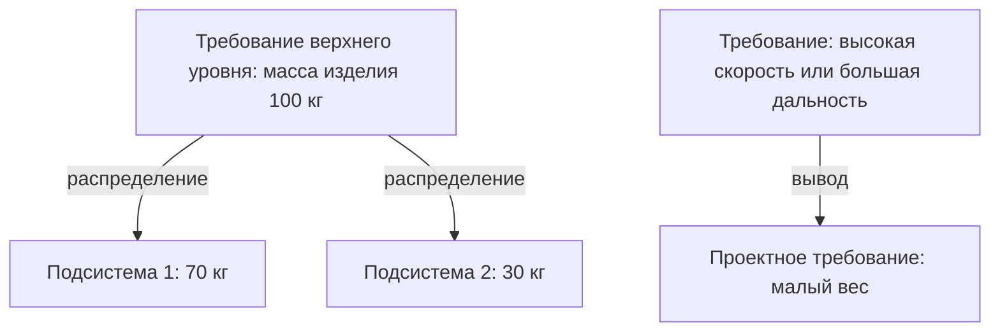

### Анализ требований к ПО

 * Анализ требований охватывает задачи определения **потребностей или условий**, которым должен отвечать новый или изменённый продукт, с учётом возможно **противоречащих требований** разных заинтересованных лиц (выгодоприобретателей, пользователей).
 * Он критичен для успеха проекта. Требования должны быть:
   * **выполнимыми (actionable)**;
   * **измеримыми (measurable)**;
   * **проверяемыми тестами (testable)**;
   * **связанными с выявленными бизнес-потребностями или возможностями**;
   * определёнными **достаточно подробно для проектирования системы**.

### Документирование требований к ПО

 * **Документация требований** описывает, что ПО делает или должно делать. Она используется на протяжении всей разработки для передачи этой информации и служит **соглашением** (или его основой) о том, что будет делать ПО.
 * Требования создают и используют все: конечные пользователи, заказчики, продуктовые и проектные менеджеры, продажи, маркетинг, архитекторы, специалисты по удобству использования, дизайнеры взаимодействия, разработчики, тестировщики. Поэтому у документации много целей.
 * Почему это трудно:
   * требования могут быть **неявными** и плохо выявляемыми;
   * сложно понять, **сколько** документировать и что оставить архитектурным и проектным документам;
   * сложно писать для столь разных читателей.
 * В результате документация часто **неполна или отсутствует**. Без неё изменения становятся **более подверженными ошибкам** (ниже качество) и **более долгими** (дороже).

Сколько документации нужно, зависит от сложности, влияния и ожидаемого срока жизни:

| Ситуация | Потребность в документации |
|---|---|
| Очень сложное ПО или ПО, создаваемое многими людьми (например, ПО мобильных телефонов) | Требования помогают донести цель |
| **Критичное для безопасности** ПО, способное навредить жизни людей (атомная энергетика, медицинское оборудование) | Требуется более **формальная** документация |
| Короткоживущее ПО (например, маленькое приложение для рекламной кампании на месяц-два) | Совсем немного |
| Первый релиз, на котором будут строиться следующие | Очень полезна для управления изменениями и проверки, что ничего не сломалось |

 * Традиционно требования хранят в документах текстовых редакторов и электронных таблицах. Для растущей сложности и изменчивости рекомендуются **системы на основе баз данных** и специализированные **инструменты управления требованиями**.

### Архитектурная и проектная документация

 * **Архитектурная документация** — особый вид проектного документа. Относительно кода это **третья производная** (документация к коду — первая, проектные документы — вторая). В ней мало специфичного для кода: она не говорит, как запрограммировать процедуру или почему процедура имеет такую форму, а лишь излагает общие требования, обусловливающие её существование. Хороший архитектурный документ **скуп на детали, но богат объяснениями**; он может предлагать подходы для низкоуровневого проектирования, но оставляет сравнительный анализ другим документам.

```mermaid
flowchart LR
    CODE["Исходный код"] --> D1["Документация к коду: 1-я производная"]
    D1 --> D2["Проектные документы: 2-я производная"]
    D2 --> D3["Архитектурные документы: 3-я производная"]
```

 * **Сравнительный документ / анализ компромиссов (trade study)** — часто в форме **white paper (аналитической записки)**. Сосредоточен на одном аспекте (UI, код, проект или архитектура), описывает ситуацию, одну или несколько альтернатив и плюсы и минусы каждой.
   * Хороший trade study основан на исследовании, ясен и прежде всего **беспристрастен**: честно указывает издержки предпочитаемого решения.
   * Его цель — **лучшее решение**, а не продвижение точки зрения. Допустимо не сделать вывода или заключить, что ни одна альтернатива не лучше базовой настолько, чтобы оправдать изменения. Это **научная** работа, а не маркетинг.

#### Документ проектирования базы данных (DDD)

 * В корпоративной разработке **DDD (Database Design Document — документ проектирования БД)** — ключевой проектный документ, содержащий **концептуальные, логические и физические** элементы проекта. Он даёт всем, кто работает с базой данных, **общий источник** формальной информации.
 * Целевые читатели: проектировщик БД, разработчик БД, **DBA (Database Administrator — администратор БД)**, проектировщик приложений, разработчик приложений.
 * Для реляционных систем он должен включать:

| Часть | Содержание |
|---|---|
| **ER-схема (entity–relationship)** | Наборы сущностей и их атрибуты; связи и их атрибуты; **потенциальные ключи (candidate keys)** каждого набора сущностей; ограничения на атрибуты и кортежи |
| **Реляционная схема** | Таблицы, атрибуты и их свойства; представления (views); ограничения — первичные и внешние ключи; **кардинальность** ссылочных ограничений; **политика каскадирования** для ссылочных ограничений; первичные ключи |

 * Нужно включать всё, что требуется любому участнику, и **обновлять документ при каждом изменении базы данных**.

### Техническая документация

 * То, что большинство программистов называют «документацией ПО». Одного кода недостаточно: нужен текст, описывающий его предполагаемую работу. Документация к коду должна быть **подробной, но не настолько многословной**, чтобы её стало трудно поддерживать.
 * Руководства «как сделать» и обзорные документы пишут **технические писатели по API (Application Programming Interface — программный интерфейс приложения)** для разработчиков, тестировщиков и конечных заказчиков.
 * Её значимость выросла в высокотехнологичных областях (энергетика, транспорт, сети, авиакосмос, безопасность, промышленная автоматизация), где информация меняется вместе с архитектурой.
 * **Инструменты автогенерации**: Doxygen, NDoc, Javadoc, EiffelStudio, Sandcastle, ROBODoc, POD, TwinText, Universal Report. Они извлекают комментарии и **программные контракты** из исходного кода и создают справочные руководства в текстовом виде или в **HTML (HyperText Markup Language — язык гипертекстовой разметки)**. Документация к коду часто организована как **справочник** для быстрого поиска любой функции или класса.
 * Почему программистам нравится автогенерация: документация пишется рядом с кодом теми же инструментами, поэтому её **проще поддерживать в актуальном состоянии**.
 * **Разъясняющее программирование (elucidative programming)** выросло из применения **грамотного программирования (literate programming)** в реальных условиях. Оно хранит **исходный код и документацию раздельно**, потому что разработчикам часто нужны аннотации, которым не место в исходном файле, — например, при сквозном просмотре кода или **портировании**, когда функционально анализируется сторонний код.

### Пользовательская документация

 * В отличие от документации к коду, пользовательская документация в основном не зависит от исходного кода и описывает, **как пользоваться программой**.
 * Для **программной библиотеки** документация к коду и пользовательская могут фактически совпадать, и их стоит объединить; для обычного приложения это обычно не так. Пример: в традиции **Lisp-машин** к каждому фрагменту кода прилагалась **строка документации**; благодаря мощному поиску (команда наподобие Unix-команды **apropos**) пользователи находили документацию и вставляли функцию прямо в свой код — удобство, редкое даже в более поздних системах.
 * Хорошая пользовательская документация описывает каждую функцию, помогает её применить, может содержать **устранение неполадок**, должна быть **понятной и актуальной**, иметь **подробный указатель** и ценить **согласованность и простоту**. Её рассматривают как **договор**, определяющий, что будет делать ПО.

Три способа организации пользовательской документации:

| Организация | Описание | Для кого |
|---|---|---|
| **Учебная (tutorial)** | Пошагово проводит пользователя через выполнение конкретных задач | **Новые** пользователи |
| **Тематическая (thematic)** | Каждая глава/раздел посвящена одной области; включает статьи базы знаний, типичные для быстро меняющихся ИТ с высоким спросом на устранение неполадок | Пользователи **среднего уровня** |
| **Справочная (list of reference)** | Команды или задачи перечислены по алфавиту или логически сгруппированы, с перекрёстными указателями | **Опытные** пользователи, знающие, что ищут |

 * Частая жалоба: используется только один из трёх подходов. ПО для ПК часто поставляется лишь со **справочной** онлайн-помощью по командам и меню; обучение новичков и помощь опытным пользователям оставляют сторонним издательствам (которым разработчик часто помогает).

### Итог главы

 * Системный анализ имеет три подфазы: **определение требований**, **структурирование требований** и **генерация альтернатив** (с выбором среди них). Определение требований собирает информацию о существующей системе и анализирует необходимость её замены.
 * Традиционные источники: интервью, анкеты, наблюдение, групповые обсуждения; вопросы и повестки должны быть точными; результаты сравниваются и нормализуются.
 * JAD — структурированное групповое интервью с ведущим, секретарём, ключевыми пользователями, менеджерами, спонсором и аналитиками; часто на выезде, около недели.
 * Информационные системы поддерживают анализ требований через CASE-инструменты и прототипирование; при прототипировании пользователь и аналитик дорабатывают модель, пока она не будет отвечать требованиям.
 * BPR радикально меняет процессы, меняя традиционные бизнес-правила, и даёт основу для дальнейшего анализа и проектирования.

### Главное

 * Работа с требованиями = выявить, проанализировать, зафиксировать; семь из десяти факторов успеха проекта зависят от спецификации.
 * Инженерия требований определяет цели, функции и ограничения; её главный продукт — SRS, содержащая функциональные требования (сценарии использования) и нефункциональные ограничения.
 * Хорошая SRS корректна, однозначна, полна, непротиворечива, ранжирована, проверяема, модифицируема и трассируема; требования должны быть выполнимыми, измеримыми и проверяемыми тестами.
 * Традиционный сбор: интервью (открытые и закрытые вопросы), анкеты (только закрытые), наблюдение, групповая работа; современный: JAD, CASE, GSS, прототипирование.
 * JAD превращает совещания в структурированные семинары под руководством нейтрального фасилитатора; GSS добавляет анонимный параллельный ввод; upper CASE фиксирует модели в реальном времени.
 * BPR — нисходящее итеративное перепроектирование из шести шагов; семь принципов Хаммера и Чампи включают организацию вокруг результатов и однократную фиксацию данных в источнике.
 * Виды требований: заказчика/эксплуатационные, функциональные, к производительности, проектные, производные, распределённые (100 кг → 70 + 30 кг).
 * Документация охватывает требования, архитектуру и trade studies, DDD, техническую (часто автогенерируемую) и пользовательскую документацию (учебную, тематическую, справочную).

---

## Часть 4. Основы управления программным проектом

В этой части разбирается, как определяют содержание программного проекта, как его планируют по срокам, оценивают по стоимости и контролируют. Сюда входят области знаний в духе PMBOK (содержание, сроки, стоимость, персонал, коммуникации, риски), оценка размера и трудоёмкости (LOC, функциональные точки, точки свойств, COCOMO, Холстед, Патнэм/SLIM), а также сетевое планирование и оптимизация затрат (PDM/ADM, CPM, сжатие сроков, PERT, линейное программирование, диаграммы Ганта).

### Проекты и управление проектами

**Управление проектами (project management)** — это дисциплина планирования, организации и направления ресурсов ради достижения конкретных целей проекта. Его часто путают с **управлением программой (program management)**, то есть управлением группой связанных проектов.

**Проект (project)** — это **временное** предприятие с определёнными началом и концом. Конец обычно задан датой, но может определяться и финансированием или результатами. Проект существует, чтобы достичь конкретных целей и принести полезное изменение или добавленную ценность. Этим он отличается от **текущей операционной деятельности (business as usual)**, то есть повторяющейся, постоянной или полупостоянной работы по выпуску продуктов и услуг. Для двух этих видов работы нужны разные навыки и разные подходы к управлению.

Рабочее определение из книги:
 * проект — это **многозадачная работа, выполняемая один раз**, с явными требованиями к **производительности, стоимости, срокам и содержанию**;
 * у него есть определённые моменты начала и окончания, бюджет и чётко очерченное содержание (объём работ);
 * ресурсы нужно оптимизировать: цель — покрыть сложность, сроки и потребности в ресурсах при **минимальных затратах**.

**Управление проектом** означает применение знаний, навыков, инструментов и методов к работам проекта, чтобы проект выполнил свои требования. Оно реализуется через пять взаимосвязанных **групп процессов (process groups)**:

```mermaid
flowchart LR
    I["Инициация"] --> P["Планирование"]
    P --> E["Исполнение"]
    E --> C["Закрытие"]
    M["Мониторинг и контроль"] -.-> P
    M -.-> E
    E -.-> M
```

 * **Руководитель проекта (project manager)** отвечает за достижение целей проекта.
 * Не каждый процесс нужно применять одинаково в каждом проекте. Руководитель вместе с командой решает, какие процессы уместны и **насколько строго** выполнять каждый из них.

Управление проектом включает:
 * выявление требований;
 * постановку ясных и достижимых целей;
 * балансирование конкурирующих требований к **качеству, содержанию, срокам и стоимости**;
 * адаптацию спецификаций, планов и подхода к интересам и ожиданиям разных **заинтересованных сторон (stakeholders)**.

#### Тройное ограничение

Руководители проектов говорят о **тройном ограничении (triple constraint)**: **содержание, сроки и стоимость**. Качество зависит от того, насколько хорошо сбалансированы эти три фактора. Качественный проект поставляет нужный продукт, услугу или результат **в рамках содержания, в срок и в пределах бюджета**. Факторы связаны: когда меняется один, скорее всего меняется хотя бы ещё один. Руководителю приходится также управлять **неопределённостью**.

```mermaid
flowchart TB
    S["Содержание"] --- T["Сроки"]
    T --- C["Стоимость"]
    C --- S
    Q(["Качество: результат баланса всех трёх"])
    S -.-> Q
    T -.-> Q
    C -.-> Q
```

---

### Управление содержанием

**Управление содержанием проекта (Project Scope Management)** — это процессы, которые гарантируют, что проект включает **всю необходимую работу и только её**. Процессов пять:

```mermaid
flowchart LR
    SP["Планирование содержания"] --> SD["Определение содержания"]
    SD --> W["Создание ИСР"]
    W --> SV["Подтверждение содержания"]
    SV --> SC["Управление изменениями содержания"]
    SC -.->|"одобренные изменения"| SD
```

 * Процессы взаимодействуют друг с другом и с процессами других областей знаний.
 * Каждый из них может потребовать усилий одного или нескольких людей или групп.
 * Каждый выполняется **хотя бы раз** в любом проекте, а если проект разбит на фазы, то в одной или нескольких фазах.

Два значения слова **«содержание» (scope)**:

| Термин | Смысл |
|---|---|
| **Содержание продукта (product scope)** | Свойства и функции, характеризующие продукт, услугу или результат |
| **Содержание проекта (project scope)** | Работа, необходимая для поставки этого продукта с заданными свойствами и функциями |

В книге каждый процесс управления содержанием и сроками описан таблицей «входы, инструменты и методы, выходы». В исходном тексте эти таблицы повреждены. Сводка ниже следует **PMBOK Guide (Project Management Body of Knowledge — свод знаний по управлению проектами), 3-е издание**, на котором основана глава.

| Процесс | Основные входы | Инструменты и методы | Основные выходы |
|---|---|---|---|
| **Планирование содержания (scope planning)** | Факторы среды предприятия, активы процессов организации, устав проекта, предварительное описание содержания, план управления проектом | Экспертная оценка; шаблоны, формы, стандарты | **План управления содержанием** |
| **Определение содержания (scope definition)** | Устав, предварительное описание содержания, план управления содержанием, одобренные запросы на изменение | Анализ продукта, выявление альтернатив, экспертная оценка, анализ заинтересованных сторон | **Описание содержания проекта**, запросы на изменение, обновления плана |
| **Создание ИСР (create WBS)** | Описание содержания, план управления содержанием, одобренные изменения | Шаблоны ИСР, **декомпозиция** | **ИСР**, **словарь ИСР**, **базовый план по содержанию**, обновления |
| **Подтверждение содержания (scope verification)** | Описание содержания, словарь ИСР, план управления содержанием, **результаты поставки** | **Инспекция** | **Принятые результаты**, запросы на изменение, корректирующие действия |
| **Управление изменениями содержания (scope control)** | Описание содержания, ИСР, словарь ИСР, отчёты об исполнении, информация об исполнении работ, одобренные изменения | **Система управления изменениями**, анализ отклонений, перепланирование, управление конфигурацией | Обновлённые описание содержания, ИСР и базовый план; запросы на изменение; корректирующие действия |

#### Планирование содержания

То, как определяется и контролируется содержание, сильно влияет на успех проекта. Усилия на определение содержания (инструменты, источники данных, методы, процедуры) должны соответствовать **размеру, сложности и важности** проекта. Результат — **план управления содержанием**: как содержание будет определяться, подтверждаться и контролироваться и как будет строиться ИСР.

#### Определение содержания

 * Подробное **описание содержания проекта (project scope statement)** критически важно для успеха.
 * Оно опирается на основные результаты, допущения и ограничения, записанные при инициации в **предварительном описании содержания**.
 * При планировании о проекте известно больше, поэтому содержание можно описать точнее.
 * Потребности, желания и ожидания заинтересованных сторон анализируются и превращаются в **требования**.

#### Создание иерархической структуры работ (ИСР)

**ИСР (WBS, Work Breakdown Structure — иерархическая структура работ)** — это **иерархическая декомпозиция работ, ориентированная на результаты**. Это работа, которую команда должна выполнить, чтобы достичь целей и создать результаты.
 * ИСР упорядочивает и определяет **всё содержание** проекта.
 * Каждый следующий уровень вниз описывает работу подробнее.
 * Компоненты нижнего уровня — **пакеты работ (work packages)**. Их можно планировать по срокам, оценивать по стоимости, отслеживать и контролировать.

```mermaid
flowchart TB
    P["Проект: система расчёта зарплаты"] --> R["1 Требования"]
    P --> D["2 Проектирование"]
    P --> B["3 Разработка"]
    P --> T["4 Тестирование и внедрение"]
    D --> D1["2.1 Проектирование БД"]
    D --> D2["2.2 Проектирование UI"]
    B --> B1["3.1 Код БД и модульные тесты"]
    B --> B2["3.2 Код UI и модульные тесты"]
    T --> T1["4.1 Интеграционное и системное тестирование"]
    T --> T2["4.2 Развёртывание и обучение"]
```

*Пример ИСР. Листья дерева — пакеты работ.*

#### Подтверждение содержания

**Подтверждение содержания (scope verification)** — это **формальная приёмка** завершённого содержания и результатов заинтересованными сторонами.
 * Каждый результат проверяют на удовлетворительное завершение.
 * Если проект прекращается досрочно, подтверждение фиксирует, **насколько далеко** продвинулась работа.
 * **Подтверждение содержания и контроль качества (quality control).** Подтверждение касается **приёмки** результатов. Контроль качества проверяет, **соответствуют ли результаты требованиям к качеству**. Контроль качества обычно идёт первым, но оба процесса могут выполняться параллельно.

#### Управление изменениями содержания

**Управление изменениями содержания (scope control)** работает с факторами, порождающими изменения содержания, и с последствиями этих изменений.
 * Все запросы на изменение и рекомендованные корректирующие действия проходят через **интегрированное управление изменениями (Integrated Change Control)**.
 * Этот процесс управляет и фактическими изменениями, когда они происходят, и интегрирован с другими процессами контроля.
 * Неконтролируемые изменения называют **расползанием содержания (scope creep)**.

---

### Управление сроками

**Управление сроками проекта (Project Time Management)** — это процессы, необходимые для своевременного завершения проекта:

| Процесс | Что делает |
|---|---|
| **Определение операций (activity definition)** | Выявляет конкретные плановые операции, нужные для создания результатов |
| **Определение последовательности операций (activity sequencing)** | Выявляет и документирует зависимости между операциями |
| **Оценка ресурсов операций (activity resource estimating)** | Оценивает тип и количество ресурсов для каждой операции |
| **Оценка длительности операций (activity duration estimating)** | Оценивает число рабочих периодов на каждую операцию |
| **Разработка расписания (schedule development)** | Анализирует последовательности, длительности, ресурсы и ограничения и строит расписание |
| **Управление расписанием (schedule control)** | Контролирует изменения расписания |

```mermaid
flowchart LR
    AD["Определение операций"] --> AS["Последовательность операций"]
    AS --> AR["Оценка ресурсов"]
    AR --> DE["Оценка длительности"]
    DE --> SD["Разработка расписания"]
    SD --> SC["Управление расписанием"]
```

Процессы описаны как отдельные шаги с чёткими интерфейсами, но на практике они **перекрываются и взаимодействуют**.

#### Определение операций

 * Процесс выявляет и документирует запланированную работу.
 * Он начинается с нижнего уровня ИСР, с **пакетов работ**, и разбивает их на более мелкие **плановые операции (schedule activities)**. Эти операции — основа для оценки, планирования, исполнения, мониторинга и контроля.
 * Входы: описание содержания, ИСР и словарь ИСР, план управления проектом, факторы среды, активы процессов.
 * Методы: **декомпозиция**, шаблоны, **планирование по принципу «набегающей волны» (rolling wave planning)** — ближайшая работа детализируется, дальняя остаётся укрупнённой, — экспертная оценка, плановые компоненты.
 * Выходы: **список операций**, **атрибуты операций**, **список контрольных событий (milestones)**, запросы на изменение.

#### Определение последовательности операций

 * Процесс выявляет и документирует **логические связи** между операциями: **отношения предшествования**, **опережения (leads)** и **задержки (lags)**, — чтобы расписание было реалистичным.
 * Его можно выполнять в программе управления проектами, вручную или комбинированно.
 * Методы: **PDM**, **ADM**, шаблоны сетевых графиков, **определение зависимостей**, применение опережений и задержек.
 * Виды зависимостей три:
   * **обязательные (mandatory, «жёсткая логика»)**;
   * **произвольные (discretionary, «предпочтительная логика»)**;
   * **внешние (external)**.
 * Выход: **сетевые графики расписания проекта**, а также обновления списка и атрибутов операций.

#### Оценка ресурсов операций

 * Процесс определяет, **какие ресурсы** (люди, оборудование, материалы) нужны, **в каком количестве** и **когда** каждый будет доступен.
 * Он тесно связан с **оценкой стоимости**.
 * Важно знание предметной области. Строительная команда должна знать местные строительные нормы. Команда автомобильного проектирования должна знать современные методы автоматизированной сборки.
 * Методы: экспертная оценка, анализ альтернатив, опубликованные нормативы, ПО управления проектами, **оценка «снизу вверх» (bottom-up estimating)**.
 * Выходы: потребности операций в ресурсах, **иерархическая структура ресурсов (resource breakdown structure)**, обновлённые календари ресурсов.

#### Метод диаграмм предшествования (PDM)

В **PDM (Precedence Diagramming Method — метод диаграмм предшествования)** **узлы** (прямоугольники) — это операции, а **стрелки** — зависимости. Метод также называют **«операции в узлах» (AON, activity-on-node)**, и его используют почти все программы управления проектами.

| Зависимость | Правило | Применение |
|---|---|---|
| **«Окончание — начало» (Finish-to-Start, FS)** | Последующая операция **начинается** только после **окончания** предшествующей | Самая распространённая |
| **«Окончание — окончание» (Finish-to-Finish, FF)** | Последующая **заканчивается** только после **окончания** предшествующей | Иногда |
| **«Начало — начало» (Start-to-Start, SS)** | Последующая **начинается** только после **начала** предшествующей | Иногда |
| **«Начало — окончание» (Start-to-Finish, SF)** | Последующая **заканчивается** только после **начала** предшествующей | Редко |

Рисунок 4.1 в нашей перерисовке: 9 операций и 18 логических зависимостей в форме AON.

```mermaid
flowchart LR
    S["Начало"] --> A["A"]
    S --> C["C"]
    S --> E["E"]
    S --> H["H"]
    A --> B["B"]
    A --> C
    C --> B
    C --> D["D"]
    E --> F["F"]
    E --> H
    H --> D
    F --> G["G"]
    H --> G
    H --> I["I"]
    B --> Z["Конец"]
    D --> Z
    G --> Z
    I --> Z
```

#### Метод стрелочных диаграмм (ADM)

В **ADM (Arrow Diagramming Method — метод стрелочных диаграмм)** **стрелки** — это операции, а **узлы** (кружки) — события, которые их связывают. Метод также называют **«операции на дугах» (AOA, activity-on-arrow)**. Он распространён меньше, чем PDM, но всё ещё используется при обучении теории сетей и в некоторых прикладных областях.
 * Он использует **только зависимости «окончание — начало»**.
 * Ему могут понадобиться **фиктивные операции (dummy activities)**, которые рисуют пунктиром. Фиктивная операция не содержит работы и имеет **нулевую длительность**. Она нужна только для того, чтобы правильно выразить логику.

Рисунок 4.2 в нашей перерисовке: 12 операций и 2 фиктивные. Операция H зависит не только от G, но и от A и F (через фиктивные операции).

```mermaid
flowchart LR
    S(("Начало"))
    n1(("1"))
    n2(("2"))
    n3(("3"))
    n4(("4"))
    n5(("5"))
    n6(("6"))
    n7(("7"))
    Z(("Конец"))
    S -->|"A"| n1
    S -->|"G"| n3
    S -->|"F"| n2
    n1 -.->|"фиктивная"| n3
    n2 -.->|"фиктивная"| n3
    n1 -->|"B"| Z
    n3 -->|"C"| n4
    n4 -->|"D"| n5
    n5 -->|"E"| Z
    n3 -->|"H"| n6
    n6 -->|"I"| Z
    n3 -->|"K"| n7
    n2 -->|"J"| n7
    n7 -->|"L"| Z
```

#### Оценка длительности операций

 * Входы: объём работы операции, нужные ей типы ресурсов, оценки их количества и **календари ресурсов**, показывающие доступность.
 * Оценку должен давать человек или группа, **лучше всех знающие эту работу**.
 * Оценки длительности **последовательно уточняются (progressively elaborated)**. По мере того как развиваются инженерная проработка и проектирование, данные становятся подробнее, а оценки точнее.

---

### Управление стоимостью

**Управление стоимостью проекта (Project Cost Management)** — это планирование, оценка, бюджетирование и контроль затрат, чтобы проект завершился **в рамках утверждённого бюджета**:

| Процесс | Назначение |
|---|---|
| **Оценка стоимости (cost estimating)** | Приближённо определить стоимость ресурсов, нужных для операций |
| **Разработка бюджета (cost budgeting)** | Сложить оценки операций или пакетов работ в **базовый план по стоимости (cost baseline)** |
| **Управление стоимостью (cost control)** | Влиять на причины **отклонений по стоимости** и контролировать изменения бюджета |

Что определяет стоимость ПО:
 * **размер**: число исходных инструкций или число функциональных точек;
 * **процесс**: хороший процесс избегает работ, не создающих ценности, таких как **переделки, задержки и коммуникационные издержки**;
 * **люди**: квалификация и производительность команды;
 * **требуемое качество**: функции, производительность, надёжность, адаптируемость.

Управление стоимостью в основном касается стоимости ресурсов для плановых операций. Но оно должно учитывать и то, как решения по проекту влияют на стоимость **эксплуатации, сопровождения и поддержки** продукта. Такой широкий взгляд называется **оценкой стоимости жизненного цикла (life-cycle costing)**. Вместе с **функционально-стоимостным анализом (value engineering)** он помогает снижать стоимость и сроки и повышать качество и производительность.

---

### Программные измерения и оценка стоимости

Измерения — стандартная практика в инженерии и менеджменте, потому что они углубляют понимание (Стэн Рифкин). **Бизнес-ценность** ПО трудно измерить напрямую, поэтому отрасль пользуется **суррогатными показателями**: **строками кода (LoC, Lines of Code)**, **функциональным размером**, **функциональными точками** и т. п.

```mermaid
flowchart TB
    CE["Оценка стоимости ПО"] --> EMP["Эмпирические: экспертная оценка, Дельфи"]
    CE --> HEU["Эвристические: COCOMO базовая, промежуточная, детальная"]
    CE --> ANA["Аналитические: метрики Холстеда"]
    CE --> RS["Ресурсы и сроки: SLIM Патнэма, кривая Рэлея"]
```

#### Эмпирическая оценка: экспертное суждение и метод Дельфи

 * **Экспертная оценка (expert judgment)** — качественный подход. Эксперты опираются на похожие прошлые проекты и корректируют оценку вверх или вниз с учётом отличий целевого проекта.
 * Эксперты дают разные числа, и их нужно согласовать **без общего собрания**. Собрания избегают, потому что оно даёт побочные эффекты, например давление сильных личностей и эффект привязки.
 * **Метод Дельфи (Delphi technique)** устроен так:

```mermaid
flowchart TB
    A["Каждый эксперт оценивает отдельно и пишет обоснование"] --> B["Координатор собирает оценки и обоснования"]
    B --> C["Все оценки и обоснования анонимно рассылаются каждому эксперту"]
    C --> D["Каждый эксперт даёт пересмотренную оценку"]
    D --> E{"Согласие в пределах допуска?"}
    E -->|"нет"| B
    E -->|"да"| F["Итоговая согласованная оценка"]
```

#### Эвристическая оценка: COCOMO

**COCOMO (COnstructive COst MOdel — конструктивная модель стоимости)** опубликовал **Барри Боэм в 1981 году**. Модель оценивает трудоёмкость, стоимость, численность персонала и сроки.
 * Она откалибрована на **63 проектах** размером примерно от 2 000 до 10 000 LOC (по данным книги), написанных на языках от ассемблера до PL/I.
 * **Базовая** модель годится для быстрых ранних оценок по порядку величины. Её точность ограничена, потому что в ней нет **факторов стоимости (cost drivers)**, учитывающих различия между проектами.
 * **COCOMO II** разрабатывалась с 1997 года и вышла в 2001-м. Она подходит для современных процессов разработки и использует обновлённую базу проектов.
 * Уровней три: **базовая → промежуточная → детальная (расширенная)**, и каждый точнее предыдущего. Детальная модель учитывает ещё и отдельные фазы проекта.
 * COCOMO — **статическая однозначная** модель: трудоёмкость выражается функцией оценки размера в тысячах поставленных исходных инструкций (**KDSI, Kilo Delivered Source Instructions / KLOC**).

Общий вид:
 * `E = a · S^b · M(x)`
 * `T = c · E^d`
 * E — трудоёмкость в **человеко-месяцах**, S — размер в **KDSI**, M(x) — **корректирующий множитель**, T — срок разработки в месяцах. a, b, c, d зависят от модели и режима.

**Три режима разработки:**

| Режим | Характеристики | Типичный пример |
|---|---|---|
| **Органический (organic)** | Небольшая опытная команда; знакомая среда; хорошо понятная задача | Обработка бизнес-данных, небольшие утилиты |
| **Полуразделённый (semi-detached)** | Смешанный опыт команды; среда менее знакома | Новый текстовый редактор, статистический пакет |
| **Встроенный (embedded)** | Жёсткая связь со сложной аппаратурой; строгие регламенты и процедуры эксплуатации | Новая операционная система, управление в реальном времени |

**Пример: оценки двух менеджеров.** Используем `E = 3,2·S^1,05` и `T = 2,5·E^0,38`, все множители равны 1. Оба размера меньше 50 KDSI, поэтому проект считаем органическим.

| Оценка | S (KDSI) | Трудоёмкость E (чел.-мес.) | Срок T (мес.) |
|---|---|---|---|
| Менеджер 1 | 10 | 3,2·10^1,05 ≈ **35,9** | 2,5·35,9^0,38 ≈ **9,75** |
| Менеджер 2 | 15 | 3,2·15^1,05 ≈ **54,96** | 2,5·54,96^0,38 ≈ **11,46** |

**Рост размера на 50%** даёт примерно **на 53% больше трудоёмкости**, но лишь примерно **на 18% больше календарного срока**.

##### Базовая COCOMO

 * `E = a · (KLOC)^b`, в человеко-месяцах
 * `T = c · (E)^d`, в календарных месяцах

| Режим | a | b | c | d |
|---|---|---|---|---|
| Органический | 2,40 | 1,05 | 2,50 | 0,38 |
| Полуразделённый | 3,00 | 1,12 | 2,50 | 0,35 |
| Встроенный | 3,60 | 1,20 | 2,50 | 0,32 |

**Пример.** Органический проект размером 33 200 LOC.
 * `E = 2,4 · 33,2^1,05 ≈ 95 чел.-мес.`
 * В книге посчитано `T = 2,5 · 95^0,35 ≈ 12,3 мес.` Строго говоря, для органического режима показатель равен 0,38, и тогда получается около 14,1 мес.
 * Рекомендуемая численность: `N = E / T = 95 / 12,3 ≈ 8 человек`.

##### Промежуточная COCOMO

 * Базовая модель дополняется **15 факторами стоимости** в четырёх группах: продукт, аппаратура (компьютер), персонал и проект.
 * Каждый фактор оценивается по **шестибалльной шкале**, от «очень низкий» до «сверхвысокий», и каждой оценке соответствует **множитель трудоёмкости (effort multiplier)**.
 * Произведение всех множителей — **корректирующий коэффициент трудоёмкости (EAF, Effort Adjustment Factor)**. Обычно он лежит в диапазоне **от 0,9 до 1,4**.
 * `E = a · (KLOC)^b · EAF`
 * `T = c · E^d`
 * По сравнению с базовой моделью меняются только a и b; c и d остаются прежними. EAF влияет на трудоёмкость, а сама формула срока не меняется.

| Режим | a | b | c | d |
|---|---|---|---|---|
| Органический | 3,2 | 1,05 | 2,5 | 0,38 |
| Полуразделённый | 3,0 | 1,12 | 2,5 | 0,35 |
| Встроенный | 2,8 | 1,20 | 2,5 | 0,32 |

##### Корректирующие факторы трудоёмкости (факторы стоимости)

| Группа | Код | Фактор | Очень низкий | Низкий | Номинальный | Высокий | Очень высокий | Сверхвысокий |
|---|---|---|---|---|---|---|---|---|
| Продукт | RELY | Требуемая надёжность ПО | 0,75 | 0,88 | 1,00 | 1,15 | 1,40 | – |
| Продукт | DATA | Размер базы данных | – | 0,94 | 1,00 | 1,08 | 1,16 | – |
| Продукт | CPLX | Сложность продукта | 0,70 | 0,85 | 1,00 | 1,15 | 1,30 | 1,65 |
| Аппаратура | TIME | Ограничение времени выполнения | – | – | 1,00 | 1,11 | 1,30 | 1,66 |
| Аппаратура | STOR | Ограничение оперативной памяти | – | – | 1,00 | 1,06 | 1,21 | 1,56 |
| Аппаратура | VIRT | Изменчивость виртуальной машины | – | 0,87 | 1,00 | 1,15 | 1,30 | – |
| Аппаратура | TURN | Время оборота (отклика) компьютера | – | 0,87 | 1,00 | 1,07 | 1,15 | – |
| Персонал | ACAP | Квалификация аналитиков | 1,46 | 1,19 | 1,00 | 0,86 | 0,71 | – |
| Персонал | AEXP | Опыт в прикладной области | 1,29 | 1,13 | 1,00 | 0,91 | 0,82 | – |
| Персонал | PCAP | Квалификация программистов | 1,42 | 1,17 | 1,00 | 0,86 | 0,70 | – |
| Персонал | VEXP | Опыт работы с виртуальной машиной | 1,21 | 1,10 | 1,00 | 0,90 | – | – |
| Персонал | LEXP | Опыт работы с языком | 1,14 | 1,07 | 1,00 | 0,95 | – | – |
| Проект | MODP | Современные методы программирования | 1,24 | 1,10 | 1,00 | 0,91 | 0,82 | – |
| Проект | TOOL | Программные инструменты | 1,24 | 1,10 | 1,00 | 0,91 | 0,83 | – |
| Проект | SCED | Требуемый график разработки | 1,23 | 1,08 | 1,00 | 1,04 | 1,10 | – |

Замечания:
 * У факторов продукта и аппаратуры **более высокая** оценка увеличивает трудоёмкость. У факторов персонала и инструментов **более высокая** оценка её уменьшает.
 * SCED повышает трудоёмкость и при сжатом, и при растянутом графике.
 * Перемножение факторов предполагает, что они **независимы**, а это сомнительно.
 * Если все факторы стоят на крайних значениях, EAF может меняться примерно на два порядка. Поэтому к отдельной оценке по COCOMO стоит относиться осторожно.

##### Детальная (расширенная) COCOMO

 * Промежуточная модель применяется **к каждому компоненту**, а факторы стоимости **взвешиваются по фазам жизненного цикла**. Затем результаты сводятся по фазам.
 * Модель точнее, но трудоёмка.
 * Фазы:
   * **RPD** (Requirements Planning and Product Design) — планирование требований и проектирование продукта;
   * **DD** (Detailed Design) — детальное проектирование;
   * **CUT** (Code and Unit Test) — кодирование и модульное тестирование;
   * **IT** (Integration and Test) — интеграция и тестирование.
 * Пример множителей, зависящих от фазы, для **квалификации аналитиков (ACAP)**, в часто цитируемых значениях Боэма:

| Оценка ACAP | RPD | DD | CUT | IT |
|---|---|---|---|---|
| Очень низкая | 1,80 | 1,35 | 1,35 | 1,50 |
| Низкая | 0,85 | 0,85 | 0,85 | 1,20 |
| Номинальная | 1,00 | 1,00 | 1,00 | 1,00 |
| Высокая | 0,75 | 0,90 | 0,90 | 0,85 |
| Очень высокая | 0,55 | 0,75 | 0,75 | 0,70 |

Затем оценки по подсистемам и модулям объединяются в общую оценку проекта.

#### Аналитическая оценка: «наука о программах» Холстеда

 * **Эмпирические модели**, такие как COCOMO, выводят формулы из данных о прошлых проектах.
 * **Аналитические модели** исходят из глобальных допущений, например о скорости, с которой разработчики решают задачи, и о количестве этих задач.
 * Метрики **Холстеда (Halstead)**:
   * **длина программы** `N = N1 + N2`, где N1 — общее число вхождений операторов, N2 — общее число вхождений операндов;
   * **объём** `V = N · log2(n1 + n2)`, где n1 — число **различных** операторов, n2 — число различных операндов. Объём отражает память, нужную для представления программы.
 * Теоретическая основа «науки о программах» **оспаривается**, и со временем поддержка этого подхода ослабла.

#### Оценка ресурсов и сроков: модель SLIM Патнэма

 * **SLIM (Software LIfecycle Management — управление жизненным циклом ПО)** — ограниченная модель Патнэма для крупных проектов (свыше **70 000 LOC**).
 * Она исходит из того, что трудоёмкость распределена как набор **кривых Рэлея**. Численность персонала **плавно растёт**, а затем **резко падает** на приёмочном тестировании.
 * SLIM использует отдельные кривые Рэлея для проектирования и кодирования, тестирования и валидации, сопровождения и управления.
 * Трудоёмкость и срок связывают два уравнения:
   * **программное уравнение (software equation)**: трудоёмкость пропорциональна `1 / td^4`;
   * **уравнение наращивания персонала (manpower-buildup equation)**: трудоёмкость пропорциональна `td^3`.

**Кривая Нордена — Рэлея.** Численность персонала во времени достигает пика около срока разработки **td**.

```mermaid
xychart-beta
    title "Кривая Нордена-Рэлея: загрузка персонала"
    x-axis "Время" ["0", "1", "2", "3", "td", "5", "6", "7", "8", "9", "10"]
    y-axis "% общей трудоёмкости" 0 --> 15
    line [0, 5.3, 9.7, 12.5, 13.4, 12.6, 10.7, 8.4, 5.9, 3.9, 2.4]
```

**Программное уравнение:**
 * `L = C · K^(1/3) · td^(4/3)`
 * L — поставленные строки кода, K — трудоёмкость в человеко-годах, td — срок разработки в годах.
 * C — технологическая константа среды: **2 000** для плохой среды, **8 000** для хорошей, **11 000** для отличной.
 * Если возвести обе части в куб, получится `K · td^4 = (L/C)^3 = const`. Значит, для данного проекта **`K ∝ 1/td^4`** и `K1/K2 = (td2/td1)^4`.

**Влияние изменения срока:**

| Модель | Зависимость | Характер |
|---|---|---|
| **Патнэма** | `K ∝ 1 / td^4` | Более пессимистична: сжатие срока обходится очень дорого |
| **Дженсена (Jensen)** | `K ∝ 1 / td^2` | Более оптимистична |

 * td нельзя менять произвольно. На практике он сдвигается лишь в пределах **80–120%** от номинала.
 * Пример: 10-месячный проект можно сжать не больше чем примерно до 8 месяцев.

**Пример 4.1: сжатие срока.** Исходный план — 36,9 чел.-мес. за 9,85 мес., новая цель — 8 мес.
 * По Патнэму: `36,9 · (9,85/8)^4 ≈ 84,8 чел.-мес.`, примерно **в 2,3 раза** больше.
 * По Дженсену: `36,9 · (9,85/8)^2 ≈ 55,9 чел.-мес.`, примерно **в 1,5 раза** больше.

**Уравнение наращивания персонала:**
 * `D = E / T^3`
 * D — константа **ускорения наращивания персонала (manpower acceleration)**, E — общая трудоёмкость в человеко-годах, T — время до поставки в годах.

---

### Управление персоналом, коммуникациями и рисками

| Область знаний | Процессы |
|---|---|
| **Управление человеческими ресурсами (Human Resource Management)**: организация команды проекта и руководство ею | Планирование персонала → набор команды → развитие команды → управление командой |
| **Управление коммуникациями (Communications Management)**: своевременные и уместные создание, сбор, распространение, хранение и утилизация информации проекта | Планирование коммуникаций → распространение информации → отчётность об исполнении → управление заинтересованными сторонами |
| **Управление рисками (Risk Management)** | Планирование управления рисками → идентификация рисков → качественный анализ → количественный анализ → планирование реагирования → мониторинг и управление рисками |

Инженеры часто **игнорируют риски, пока что-нибудь не случится**, а потом «тушат пожар». Риски приводят к срыву сроков и перерасходу средств, поэтому их нужно выявлять заранее. **Предсказуемые общие категории рисков:**

| Категория | Риск связан с |
|---|---|
| **Размер продукта** | Размером ПО |
| **Влияние на бизнес** | Ограничениями со стороны руководства или рынка |
| **Характеристики заказчика** | Заказчиком и тем, насколько быстро заказчик и разработчик могут общаться |
| **Определённость процесса** | Тем, насколько процесс разработки определён и соблюдается |
| **Среда разработки** | Доступностью и качеством инструментов |
| **Создаваемая технология** | Сложностью системы и новизной технологии |
| **Численность и опыт персонала** | Общим техническим и проектным опытом команды |

Стратегия складывается из **избегания рисков (risk avoidance)**, **мониторинга рисков** и **планирования на случай непредвиденных обстоятельств (contingency planning)**. Всё это оформляется в **план RMMM (Risk Mitigation, Monitoring and Management — снижение, мониторинг и управление рисками)**, исполнение которого отслеживает руководитель проекта.

```mermaid
flowchart LR
    I["Выявить риски"] --> A["Оценить вероятность и последствия"]
    A --> M["Снижать: меры по избеганию"]
    M --> Mo["Отслеживать индикаторы риска"]
    Mo --> C{"Риск наступил?"}
    C -->|"да"| Mg["Управлять: выполнить резервный план"]
    C -->|"нет"| Mo
```

---

### Планирование проекта

**Планирование проекта (project planning)** — та часть управления проектами, которая сильнее всего связана с **интеграцией**. План отражает текущее состояние всех работ и служит для **мониторинга и контроля**. Он координирует части проекта и направляет исполнение.

Планирование помогает:
 * облегчить коммуникацию;
 * отслеживать и измерять прогресс;
 * документировать допущения и плановые решения.

У планирования три фазы:
 1. разработка плана проекта;
 2. исполнение плана проекта;
 3. управление изменениями и корректирующие действия.

Планирование **продолжается весь проект**. «Если вы не планируете, вы планируете провал». Тщательное планирование с самого начала помогает избежать дорогих ошибок и уложиться в график и бюджет.

#### Шаги планирования проекта

В широком смысле планирование — это оценка, составление расписания и распределение ресурсов, чтобы поставить продукт надлежащего качества. Оно может играть и стратегическую роль в успехе проекта.

```mermaid
flowchart TB
    S1["1 Определение и планирование содержания"] --> S2["2 Планирование качества"]
    S2 --> S3["3 Определение и последовательность операций"]
    S3 --> S4["4 Оценка времени, трудоёмкости и ресурсов"]
    S4 --> S5["5 Выявление факторов риска"]
    S5 --> S6["6 Разработка расписания"]
    S6 --> S7["7 Оценка стоимости и бюджет"]
    S7 --> S8["8 Организационное и ресурсное планирование"]
    S8 --> S9["9 Планирование управления рисками"]
    S9 --> S10["10 Разработка и исполнение плана проекта"]
    S10 --> S11["11 Отчётность об исполнении"]
    S11 --> S12["12 Планирование управления изменениями"]
    S12 --> S13["13 Планирование развёртывания"]
    S12 -.-> S10
```

 1. **Определение и планирование содержания.** Документировать работу, нужную для достижения цели: допущения, ограничения, ожидания пользователей, бизнес- и технические требования, результаты, цели. Это фундамент всего остального.
 2. **Планирование качества.** Выбрать применимые стандарты качества. По содержанию, требованиям и результатам определить факторы, влияющие на качество. Описать процессы, нужные, чтобы поставить продукт так, как обещано.
 3. **Определение и упорядочение операций.** Перечислить все конкретные операции, нужные для создания результатов, и выяснить, как они зависят друг от друга.
 4. **Оценка времени, трудоёмкости и ресурсов.** Оценить трудоёмкость каждой операции такими методами, как **функциональные точки, LOC, сложность кода, эталонные показатели (benchmarks)**. Записать время, трудоёмкость и ресурсы для каждой операции.
 5. **Выявление факторов риска.** «Ожидай неожиданного». Записать риски, вытекающие из допущений, ограничений, ожиданий пользователей и обстоятельств.
 6. **Разработка расписания.** Построить расписание по операциям, зависимостям и трудоёмкости. Расписание влияет на оценку стоимости и анализ «затраты — выгоды».
    * Это **самая важная и самая трудная** задача планирования.
    * В крупных проектах несколько команд работают параллельно, но зависят друг от друга.
    * Для построения расписания и отчётов по нему используют такие инструменты, как **диаграммы Ганта**.
 7. **Оценка стоимости и бюджетирование.** Оценить затраты по итогам предыдущих шагов, провести **анализ «затраты — выгоды» (cost-benefit analysis)** и распределить бюджет.
 8. **Организационное и ресурсное планирование.** Определить типы ресурсов (оборудование, люди, помещения, деньги) и держать их **загруженными как можно полнее**.
    * Успех зависит от точности прогноза потребности в ресурсах.
    * Этот шаг **итеративный** и продолжается весь жизненный цикл.
 9. **Планирование управления рисками.** Выявлять и анализировать риски и реагировать на них. Создать **план разрешения рисков (risk resolution plan)**, в котором разобраны каждый фактор риска, его влияние и возможные ответные меры. Отслеживать риски весь проект.
 10. **Разработка и исполнение плана проекта.** Объединить все входные данные на основе подробной **ИСР**. План фиксирует допущения, операции, расписание и сроки и управляет проектом.
     * Задачи периодически отслеживаются, о ходе работ сообщают команде и заинтересованным сторонам.
     * Задержки анализируются, и план корректируется.
 11. **Отчётность об исполнении.** Сравнивать ход работ с базовым планом. Измерять методом **освоенного объёма (EVM, Earned Value Management)**. Отчитываться с помощью **PERT-диаграмм, диаграмм Ганта, логических столбчатых диаграмм, гистограмм и круговых диаграмм**.
 12. **Планирование управления изменениями.** Анализировать каждый запрос на изменение и его последствия, прежде чем менять план. Также планировать ввод нового продукта в **промышленную эксплуатацию (production)**, чтобы он не навредил среде и другим приложениям на той же платформе.
 13. **Планирование развёртывания (rollout).** В корпоративной среде успех во многом зависит от развёртывания, которое может затронуть технические системы, бизнес-системы и сам способ ведения бизнеса.
     * Техническая среда должна быть готова.
     * Пользователи должны **принять** систему и эффективно ею пользоваться, а для этого их обычно нужно **обучить**.

---

### Оценка размера проекта

Точная оценка размера, стоимости, трудоёмкости и сроков — одна из главных проблем отрасли. **Размер оценивают первым**, потому что стоимость и сроки выводятся из него. Первую оценку размера делают по системным требованиям, а затем уточняют такими методами:
 * LOC / KLOC;
 * анализ функциональных точек (Function Point Analysis);
 * анализ точек свойств (Feature Point Analysis).

#### LOC / KLOC

 * **Каждая строка исходного кода считается за одну LOC**, сколько бы инструкций в ней ни было.
 * N строк = N LOC; 1 000 LOC = 1 **KLOC**.

#### Анализ функциональных точек (FPA)

Функциональность нельзя измерить напрямую, поэтому её выводят из счётных характеристик **информационной области (information domain)** ПО, а затем корректируют с учётом сложности. Основная команда собирает эти данные в обсуждениях на площадке заказчика.

Пять подсчитываемых элементов:

| Элемент | Смысл |
|---|---|
| **Внешние входы (EI, External Inputs)** | Данные, которые пользователи вводят в приложение |
| **Внешние выходы (EO, External Outputs)** | Отчёты, экраны, сообщения, которые выдаёт приложение |
| **Внешние запросы (EQ, External Inquiries)** | Запрос на ввод плюс немедленная выдача результата |
| **Внутренние логические файлы (ILF, Internal Logical Files)** | Основные файлы, которые приложение ведёт и обновляет |
| **Файлы внешних интерфейсов (EIF, External Interface Files)** | Файлы других приложений, на которые ссылается это приложение |

Весовые коэффициенты:

| Элемент | Простой | Средний | Сложный |
|---|---|---|---|
| EI | 3 | 4 | 6 |
| EO | 4 | 5 | 7 |
| EQ | 3 | 4 | 6 |
| ILF | 7 | 10 | 15 |
| EIF | 5 | 7 | 10 |

**Формула:**
 * `FP = Count_total × [0,65 + 0,01 × Σ Fj]`, где j = 1..14.
 * Count_total — взвешенная сумма пяти счётчиков.
 * Каждый **Fj** — коэффициент корректировки сложности от 0 до 5:
   * 0 — не влияет;
   * 1 — случайное влияние;
   * 2 — умеренное;
   * 3 — среднее;
   * 4 — значительное;
   * 5 — существенное.
 * Поскольку ΣFj лежит в пределах от 0 до 70, корректирующий множитель лежит в пределах **от 0,65 до 1,35**.

14 **вопросов корректировки сложности**:
 1. Нужно ли надёжное резервное копирование и восстановление?
 2. Нужна ли передача данных?
 3. Есть ли распределённые функции обработки?
 4. Критична ли производительность?
 5. Будет ли система работать в существующей, сильно загруженной операционной среде?
 6. Нужен ли оперативный (онлайн) ввод данных?
 7. Строит ли онлайн-ввод транзакцию через несколько экранов или операций?
 8. Обновляются ли основные файлы в онлайне?
 9. Сложны ли входы, выходы, файлы или запросы?
 10. Сложна ли внутренняя обработка?
 11. Проектируется ли код для повторного использования?
 12. Включены ли в проект конвертация данных и установка?
 13. Рассчитана ли система на многократную установку в разных организациях?
 14. Спроектирована ли она так, чтобы её было легко изменять и удобно использовать?

```mermaid
flowchart LR
    C["Подсчитать EI, EO, EQ, ILF, EIF"] --> W["Применить веса: простой, средний или сложный"]
    W --> T["Count_total"]
    Q["Оценить 14 факторов от 0 до 5"] --> V["VAF = 0,65 + 0,01 x сумма Fj"]
    T --> FP["FP = Count_total x VAF"]
    V --> FP
```

**Пример 4.2.** Исходные данные: 12 входов, 25 выходов, 10 запросов, 6 файлов, 4 внешних интерфейса и 8 алгоритмов. Все веса средние.
 * Count_total = 12·4 + 25·5 + 10·4 + 6·10 + 4·7 = 48 + 125 + 40 + 60 + 28 = **301**.
 * В книге все 14 факторов оценены как «от умеренного до среднего», по 2,5 каждый, так что ΣFj = 35.
 * FP = 301 × (0,65 + 0,35) = **301**.
 * Число алгоритмов в FPA **не учитывается**; оно важно только для точек свойств.

#### Эквивалент LOC на одну FP (пересчёт)

 * Среднее число LOC на одну функциональную точку зависит от **языка программирования** и от качества проектирования.
 * Языкам низкого уровня нужно больше строк на одну FP. Опубликованные средние значения примерно такие: ассемблер ~320, C ~128, COBOL/FORTRAN ~106, C++ ~50–64, Ada/Java ~53, Visual Basic ~32, SQL ~12.
 * В книге для **C++ взято 50 LOC на FP**.

**Пример 4.3: от FP к LOC, COCOMO, численности и стоимости.** У продукта 270 FP, язык C++, проект органический.

| Шаг | Вычисление | Результат |
|---|---|---|
| Размер | 270 × 50 | 13 500 LOC = **13,5 KLOC** |
| Трудоёмкость (базовая, органический режим) | 2,4 × 13,5^1,05 | **36,9 чел.-мес.** |
| Срок | 2,5 × 36,9^0,38 | **9,85 ≈ 10 мес.** |
| Перекрёстная проверка по производительности | 270 FP / 7 FP на чел.-мес. | 38,6 чел.-мес. |
| Численность | 36,9 / 10 | **≈ 4 инженера** |
| Стоимость | 50 000 рупий × 10 мес. × 4 | **20 00 000 рупий (2 млн)** |

Эти числа предполагают **постоянную численность команды**. На деле трудоёмкость распределена неравномерно и следует **распределению Рэлея**.

#### Объекты как суррогат размера

 * Ещё один суррогатный показатель — **объектные строки кода (OLC, Object Lines of Code)**. Размер кода, записанного как сообщения объектам, коррелирует с итоговым размером кода.
 * Хамфри (Humphrey) показывает хорошую линию регрессии между OLC и итоговым LOC.
 * Размер объекта оценивают по **числу методов** и **категории** объекта.
 * Типичные значения для C++ в **LOC на метод** (по Хамфри; калибруйте их под свою организацию):

| Категория | Очень малый | Малый | Средний | Большой | Очень большой |
|---|---|---|---|---|---|
| Вычисления | 2,34 | 5,13 | 11,25 | 24,66 | 54,04 |
| Данные | 2,60 | 4,79 | 8,84 | 16,31 | 30,09 |
| Ввод-вывод | 9,01 | 12,06 | 16,15 | 21,62 | 30,09 |
| Логика | 7,55 | 10,98 | 15,98 | 23,25 | 33,83 |
| Настройка | 3,88 | 5,04 | 6,56 | 8,53 | 11,09 |
| Текст | 3,75 | 8,00 | 17,07 | 36,41 | 77,66 |

 * Метод требует **спроектировать систему до оценки размера**.
 * Точность растёт, если ошибки оценок отслеживаются **статистически**.

#### Анализ точек свойств

 * **Точки свойств (feature points)** предложил **Каперс Джонс (Capers Jones) в 1986 году**. Это **надмножество функциональных точек** для систем реального времени, системного, встроенного, телекоммуникационного ПО и систем управления процессами.
 * Они добавляют шестой параметр — **алгоритмы**, с весом по умолчанию **3**.
 * Вес **логических файлов** снижен с 10 до **7**, что уменьшает значимость хранения данных. Хранение данных доминирует в приложениях MIS (Management Information Systems — управленческие информационные системы).
 * Для обычных MIS-систем точки свойств и FP дают **близкие** результаты, если только система не перегружена файлами.
 * Для систем с тяжёлыми алгоритмами оценка в точках свойств заметно выше. Например, для **телефонного коммутатора** она оказалась намного выше.
 * Джонс сформулировал **десять правил**, определяющих, когда алгоритм считается существующим. Строгая классификация и шкала весов для алгоритмов всё ещё предмет исследований.

---

### Мифический человеко-месяц

 * Фред Брукс: стоимость растёт как произведение людей на месяцы, **а прогресс так не растёт**. Использовать **человеко-месяц (man-month)** как единицу объёма работы — опасный миф.
 * Проекты так часто проваливаются, потому что методы оценки плохи и предполагают, что всё пойдёт хорошо. Они путают **трудозатраты с прогрессом** и считают людей и месяцы **взаимозаменяемыми**.
 * Когда замечают отставание, рефлекторно добавляют людей, а это всё равно что «тушить огонь бензином».
 * Программисты — **оптимисты**. Первое ложное допущение — что каждая задача займёт ровно столько, сколько «должна».
 * Избегайте **размытых контрольных точек (fuzzy milestones)** и добивайтесь правдивой картины состояния.
 * У **последовательной** работы есть минимальная длительность, которую нельзя сократить. «Ребёнок рождается через девять месяцев, сколько бы женщин ни назначили на эту задачу».
 * **Тестирование** — наименее предсказуемая часть процесса. Закладывайте на него больше времени и учитывайте зависимости задач.
 * Люди и время не обмениваются линейно. Пример для работы на 12 месяцев:

| Команда | Длительность | Суммарная трудоёмкость | Издержки на коммуникацию и разделение |
|---|---|---|---|
| 1 человек | 12 мес. | 12 чел.-мес. | – |
| 2 человека | 7 мес. | 14 чел.-мес. | +2 чел.-мес. |
| 3 человека | 5 мес. | 15 чел.-мес. | +3 чел.-мес. |

 * **Закон Брукса (Brooks' law):** *добавление людей в опаздывающий программный проект задерживает его ещё больше.* Оценки на основе догадок и интуиции — это «малодушные оценки (gutless estimating)».

---

### Планирование проекта методами PERT и CPM

В крупных проектах много операций, которые нужно выполнять в технологическом порядке. **PERT (Program Evaluation and Review Technique — метод оценки и анализа программ)** и **CPM (Critical Path Method — метод критического пути)** помогают руководителю:
 * **планировать** заранее и предвидеть проблемные места и задержки;
 * **составлять расписание** операций в нужное время и в нужной последовательности, чтобы проект закончился как можно раньше;
 * **координировать и контролировать** операции, чтобы не отставать от графика.

Методы различаются подходом, и выбор между ними определяется характером проекта.

| Аспект | PERT | CPM |
|---|---|---|
| Происхождение | ВМС США, конец 1950-х, баллистическая ракета **«Поларис» (Polaris)**. Метод координировал тысячи подрядчиков, и проект завершили на два года раньше срока | Разработан независимо и одновременно в компании **E. I. du Pont de Nemours** |
| Длительности операций | **Вероятностные**: три оценки и бета-распределение | **Детерминированные** |
| Фокус | Вероятность уложиться в срок, ожидаемое время завершения, узкие места | **Компромисс «время — стоимость»** (сжатие), время зависит от выделенных ресурсов |
| Что нужно | Ничего, кроме оценок; метод учитывает неопределённость | Опыт похожих проектов, чтобы знать связь ресурсов и времени |
| Типичное применение | **НИОКР** | **Строительство** и другие повторяющиеся проекты |

**Применения:**
 * крупные интегрированные программные проекты;
 * установка оборудования, сетей и закупка аппаратуры;
 * строительство (здания, дороги, мосты);
 * подготовка заявок и предложений по крупным проектам;
 * обслуживание нефтеперерабатывающих заводов и ремонт судов;
 * производство крупных изделий, таких как самолёты, суда и компьютеры;
 * системы вооружения, космические миссии и новые продукты;
 * даже ремонт дома, переезд и покраска.

#### Сеть проекта (соглашения AOA)

 * **Дуги** — работы (операции).
 * **Узлы** — **события (events)**: моменты времени, отмечающие завершение одной или нескольких работ.
 * **Направление стрелки** задаёт последовательность. Все работы, входящие в узел, должны завершиться, прежде чем может начаться любая выходящая из него.
 * **Фиктивная работа** имеет нулевую длительность. Её добавляют, когда иначе две работы оказались бы на одной дуге (i, j) или когда этого требует логика.

**Пример 4.4.** Семь работ. A предшествует B и C. B предшествует D. C и D предшествуют E. E и F предшествуют G. Узел 1 — начало, узел 6 — завершение.

```mermaid
flowchart LR
    n1(("1")) -->|"A"| n2(("2"))
    n2 -->|"B"| n3(("3"))
    n3 -->|"D"| n4(("4"))
    n2 -->|"C"| n4
    n4 -->|"E"| n5(("5"))
    n1 -->|"F"| n5
    n5 -->|"G"| n6(("6"))
```

**Пример 4.5.** Пять работ. A предшествует C и D. B предшествует D. C и D предшествуют E. Длительности: A = 3, B = 1, C = 4, D = 2, E = 5 дней. Фиктивная дуга (2,3) показывает, что D нужно завершение и A, и B, без того чтобы A и B делили одну дугу.

```mermaid
flowchart LR
    n1(("1")) -->|"A = 3"| n2(("2"))
    n1 -->|"B = 1"| n3(("3"))
    n2 -.->|"фиктивная = 0"| n3
    n2 -->|"C = 4"| n4(("4"))
    n3 -->|"D = 2"| n4
    n4 -->|"E = 5"| n5(("5"))
```

#### Критический путь и анализ сети

 * **Критический путь (critical path)** идёт от начального события к конечному через **критические работы**. Найти его — то же самое, что найти **самый длинный путь** в сети.
 * **Ранний срок** события j обозначается **Uj**. Прямой проход при U1 = 0: `Uj = max по i (Ui + tij)`. Событие j наступает только после завершения **всех** входящих работ.
 * **Поздний срок** события i обозначается **Vi**: это самый поздний момент, при котором проект не задерживается. Обратный проход при V_посл = U_посл: `Vi = min по j (Vj − tij)`.
 * **Резерв события** = Vi − Ui. События с нулевым резервом — **критические события**.

Решение примера 4.5:

| Событие | Ранний U | Поздний V | Резерв | Статус |
|---|---|---|---|---|
| 1 | 0 | 0 | 0 | Критическое |
| 2 | 3 | 3 | 0 | Критическое |
| 3 | max(3+0, 0+1) = 3 | 7 − 2 = 5 | 2 | Некритическое |
| 4 | max(3+4, 3+2) = 7 | 7 | 0 | Критическое |
| 5 | 12 | 12 | 0 | Критическое |

Минимальная длительность проекта — **12 дней**. Критический путь — **1 → 2 → 4 → 5**, то есть работы **A, C, E**. В тексте книги написано «1→2→3→4», но её же таблицы дают A–C–E.

**Временные параметры работ.** Для работы J на дуге (i, j) с длительностью tij:

| Величина | Формула |
|---|---|
| Раннее начало (ES, Earliest Start) | Ui |
| Раннее окончание (EF, Earliest Finish) | Ui + tij |
| Позднее окончание (LF, Latest Finish) | Vj |
| Позднее начало (LS, Latest Start) | Vj − tij |
| Максимально доступное время | Vj − Ui |
| **Полный резерв (total float/slack)** | Vj − Ui − tij = LS − ES. Это максимальная задержка, не сдвигающая проект |
| Критическая работа | резерв = 0 |

| Работа | Длит. | ES | LS | EF | LF | Резерв | Статус |
|---|---|---|---|---|---|---|---|
| A | 3 | 0 | 0 | 3 | 3 | 0 | Критическая |
| B | 1 | 0 | 4 | 1 | 5 | 4 | Некритическая |
| C | 4 | 3 | 3 | 7 | 7 | 0 | Критическая |
| D | 2 | 3 | 5 | 5 | 7 | 2 | Некритическая |
| E | 5 | 7 | 7 | 12 | 12 | 0 | Критическая |

#### CPM: сжатие сроков и компромисс «время — стоимость»

 * CPM исходит из того, что длительность операции зависит от выделенных ей **ресурсов**. Дополнительные деньги, люди, материалы или машины могут её сократить, но только до определённого предела.
 * Сокращение длительности операции называется **сжатием (crashing)**, а дополнительные деньги — **стоимостью сжатия (crashing cost)**.
 * У каждой работы две временные точки:
   * **нормальное время (normal time)**: наибольшая длительность, без дополнительных ресурсов;
   * **время сжатия (crash time)**: наименьшая длительность, при максимуме ресурсов.
 * **Наклон стоимости (cost slope)** = (стоимость при сжатии − нормальная стоимость) / (нормальное время − время сжатия), то есть дополнительные затраты на каждый сэкономленный день.
 * Задача — решить, что сжимать, чтобы **общая стоимость = прямые затраты (на сжатие) + косвенные затраты (накладные)** была минимальной.

**Пример 4.6: программный проект, метод перебора.** Две команды. Накладные расходы — **500 рупий в день**. Стоимость сжатия за день указана в сотнях рупий.

| Работа | Описание | Предшественник | Нормальное (дн.) | Сжатое (дн.) | Стоимость сжатия за день |
|---|---|---|---|---|---|
| A | Анализ-1 и SRS-1 (Software Requirements Specification — спецификация требований к ПО) | – | 10 | 7 | 4 (400 руп.) |
| B | Анализ-2 | – | 5 | 4 | 2 (200 руп.) |
| C | SRS-2 | B | 3 | 2 | 2 (200 руп.) |
| D | Проектирование GUI | A, C | 4 | 3 | 3 (300 руп.) |
| E | Проектирование БД | A, C | 5 | 3 | 3 (300 руп.) |
| F | Кодирование GUI и модульное тестирование | D | 6 | 3 | 5 (500 руп.) |
| G | Кодирование БД и модульное тестирование | E | 5 | 2 | 1 (100 руп.) |
| H | Интеграционное и системное тестирование | F, G | 5 | 4 | 4 (400 руп.) |

```mermaid
flowchart LR
    n1(("1")) ==>|"A = 10"| n3(("3"))
    n1 -->|"B = 5"| n2(("2"))
    n2 -->|"C = 3"| n3
    n3 ==>|"D = 4"| n4(("4"))
    n3 ==>|"E = 5"| n5(("5"))
    n4 ==>|"F = 6"| n6(("6"))
    n5 ==>|"G = 5"| n6
    n6 ==>|"H = 5"| n7(("7"))
```

При нормальных длительностях сроки событий такие: U1 = 0, U2 = 5, U3 = 10, U4 = 14, U5 = 15, U6 = 20, U7 = 25. Есть **два критических пути по 25 дней**: A–D–F–H и A–E–G–H. У B резерв 2 дня, у C — 3.
 * **Нормальная стоимость** = 500 × 25 = **12 500 рупий** (без сжатия).
 * **Сжатие всех работ** даёт 17 дней (A = 7, D = 3, F = 3, H = 4). Итого = 500·17 + 1 200 + 200 + 200 + 300 + 600 + 1 500 + 300 + 400 = **13 200 рупий**. Это быстрее, но **дороже**, и критический путь меняется. Сжимать всё подряд расточительно.

Экономное сжатие по шагам. Работу сжимают, только если её наклон стоимости **меньше** экономии накладных расходов за день:

| Шаг | Действие | Длительность | Сжатие | Накладные | Итого |
|---|---|---|---|---|---|
| 0 | Все работы в нормальное время | 25 | 0 | 12 500 | **12 500** |
| 1 | Сжать H на 1 день (400 < 500) | 24 | 400 | 12 000 | **12 400** |
| 2 | Сжать A на 2 дня (2×400 < 2×500). Дальше станет критическим B+C (5+3 = 8) | 22 | 1 200 | 11 000 | **12 200** |
| 3 | Сжатие A ещё на день требует сжать и B или C: 400+200 = 600 > 500, **невыгодно** | – | – | – | – |
| 4 | Параллельные критические пути 3→4→6 и 3→5→6: нужно сжать по одной работе на каждом | 21 | 1 600 | 10 500 | **12 100** |

Варианты для шага 4 (табл. 4.12):

| Комбинация | Стоимость за день | По сравнению с экономией 500 руп. |
|---|---|---|
| D + E | 300 + 300 = 600 | Невыгодно |
| **D + G** | 300 + 100 = **400** | **Выгодно** |
| F + E | 500 + 300 = 800 | Невыгодно |
| F + G | 500 + 100 = 600 | Невыгодно |

**Оптимальное расписание:**
 * сжать A до 8, D до 3, G до 4 и H до 4;
 * B, C, E и F выполняются в нормальное время;
 * оптимальная длительность — **21 день**, минимальная стоимость — **12 100 рупий**.

```mermaid
flowchart LR
    n1(("1")) ==>|"A = 8"| n3(("3"))
    n1 -->|"B = 5"| n2(("2"))
    n2 -->|"C = 3"| n3
    n3 ==>|"D = 3"| n4(("4"))
    n3 ==>|"E = 5"| n5(("5"))
    n4 ==>|"F = 6"| n6(("6"))
    n5 ==>|"G = 4"| n6
    n6 ==>|"H = 4"| n7(("7"))
```

#### Кривые «время — стоимость»

 * **Для операции.** Проводится прямая между двумя точками: **нормальной** (долго, низкие прямые затраты) и **сжатой** (быстро, высокие прямые затраты). В первом приближении считается, что достижима любая промежуточная точка на этой прямой. Наклон прямой — это наклон стоимости.
 * **Для проекта.** Суммарные **прямые затраты** в зависимости от длительности проекта образуют **кусочно-линейную**, выпуклую, убывающую кривую. Она идёт от **Tmin** (всё сжато) до **Tmax** (всё в нормальное время).
 * **Косвенные затраты** (накладные) **растут** с длительностью.
 * Их сумма, **общая стоимость проекта**, имеет **U-образную** форму. Её минимум даёт **оптимальную длительность проекта T\***, а вместе с ней оптимальные длительности работ, стоимость сжатия и критический путь.

```mermaid
xychart-beta
    title "Стоимость проекта в зависимости от длительности"
    x-axis "Длительность проекта" ["Tmin", "t2", "t3", "T*", "t5", "t6", "Tmax"]
    y-axis "Стоимость" 0 --> 100
    line [80, 60, 45, 36, 30, 27, 25]
    line [10, 14, 19, 26, 36, 50, 70]
    line [90, 74, 64, 62, 66, 77, 95]
```

*Линии: прямые затраты (убывают), косвенные затраты (растут) и общая стоимость (U-образная). Минимум находится в точке T\*.*

Основная цель CPM — выбрать для каждой операции такой компромисс «время — стоимость», чтобы уложиться в плановый срок при **минимальных затратах**.

#### Постановка задачи сжатия как задачи линейного программирования (ЛП)

Обозначения для работы (i, j):
 * **kij** — нормальное время;
 * **lij** — время сжатия;
 * **Cij** — стоимость сокращения на единицу времени;
 * **tij** — фактическая длительность, переменная, lij ≤ tij ≤ kij;
 * **ti** — момент наступления события i;
 * стоимость сжатия равна `Σ Cij (kij − tij)`.

| Модель | Цель | Целевая функция | Ограничения |
|---|---|---|---|
| **I** | Уложиться в срок T с минимальной стоимостью сжатия | min `Σ Cij (kij − tij)` | `tj − ti ≥ tij`; `lij ≤ tij ≤ kij`; `tn − t1 ≤ T`; `ti ≥ 0` |
| **II** | При дополнительном бюджете B закончить как можно раньше | min `tn − t1` | `tj − ti ≥ tij`; `lij ≤ tij ≤ kij`; `Σ Cij (kij − tij) ≤ B`; `ti ≥ 0` |
| **III** | Минимизировать **общую** стоимость, получив оптимальную длительность T* | min `F·(tn − t1) + Σ Cij (kij − tij)` | `tj − ti ≥ tij`; `lij ≤ tij ≤ kij`; `ti ≥ 0` |

 * В модели III **F** — косвенные затраты за единицу времени, а `F·(tn − t1)` — косвенные затраты.
 * В применении к примеру 4.6, в единицах по 100 рупий:
   * целевая функция `5(t7 − t1) + 4(10 − t13) + 2(5 − t12) + …`;
   * границы включают `7 ≤ t13 ≤ 10`, `4 ≤ t12 ≤ 5`, `2 ≤ t23 ≤ 3`, `3 ≤ t34 ≤ 4`, `3 ≤ t35 ≤ 5`, `3 ≤ t46 ≤ 6`, `2 ≤ t56 ≤ 5`, `4 ≤ t67 ≤ 5`;
   * в задаче ЛП **15 переменных решения**.
 * Решение **симплекс-методом** при t1 = 0 совпадает с результатом перебора:
   * **21 день** при минимальной стоимости 121 единица (12 100 рупий);
   * A сжата на 2 дня, а D, G и H — на 1 день каждая.

#### PERT: три оценки времени

PERT — вариант анализа критического пути, который **скептичнее относится к оценкам времени**. Его применяют, когда длительности операций неопределённы, чтобы найти **вероятность завершения к заданному сроку**. Для каждой операции дают три оценки:
 * **to** — оптимистическая, кратчайшее возможное время;
 * **tm** — наиболее вероятная;
 * **tp** — пессимистическая, наибольшее время, если всё пойдёт плохо.

В тексте книги слова «оптимистическая» и «пессимистическая» перепутаны местами; выше приведены стандартные определения.

Длительности операций моделируются **бета-распределением**: одномодальным, возможно асимметричным, с конечными неотрицательными концами.
 * **Ожидаемое время:** `te = (to + 4·tm + tp) / 6`
 * **Дисперсия:** `Ve = ((tp − to) / 6)^2`
 * Длительность проекта T, сложенная по критическому пути, распределена примерно **нормально**:
   * `E(T) = Σ te` по критическому пути;
   * `V(T) = Σ Ve` по критическому пути;
   * `σ(T) = √V(T)`.
 * Вероятность завершения к плановому сроку ST: `P(T ≤ ST) = P(Z ≤ (ST − E(T)) / σ)`.

Взвешенное среднее сдвигает оценки в сторону от нереалистично коротких сроков, которые обычно закладывают.

**Пример 4.7.** Девять работ. Средние длительности: A = 5, B = 9, C = 7, D = 4, E = 8, F = 13, G = 12, H = 6, I = 8. Есть фиктивная дуга из 3 в 4. Каждый узел подписан ранним и поздним сроками.

```mermaid
flowchart LR
    n1(("1: 0, 0")) ==>|"A = 5"| n2(("2: 5, 5"))
    n2 -->|"C = 7"| n3(("3: 12, 14"))
    n2 ==>|"B = 9"| n4(("4: 14, 14"))
    n3 -.->|"фиктивная"| n4
    n4 ==>|"D = 4"| n5(("5: 18, 18"))
    n2 -->|"E = 8"| n5
    n3 -->|"G = 12"| n6(("6: 31, 31"))
    n5 ==>|"F = 13"| n6
    n6 ==>|"H = 6"| n7(("7: 37, 37"))
    n7 ==>|"I = 8"| n8(("8: 45, 45"))
```

 * Критический путь — **1→2→4→5→6→7→8**, то есть работы A, B, D, F, H, I.
 * `E(T) = 5 + 9 + 4 + 13 + 6 + 8 = 45 дней`.
 * В книге указано `V(T) = 9`, откуда `σ(T) = 3 дня`.

**Пример 4.8: оптимальная длительность и минимальная стоимость.** Косвенные затраты — **300 рупий в день**.
 * При нормальных длительностях критический путь — **1→2→3→4→6**, длительность — **20 дней**, прямые затраты — **9 200 рупий**.
 * Дуга (3,4) фиктивная.

```mermaid
flowchart LR
    n1(("1: E0 L0")) ==>|"6"| n2(("2: E6 L6"))
    n1 -->|"8"| n3(("3: E10 L10"))
    n2 ==>|"4"| n3
    n2 -->|"3"| n4(("4: E10 L10"))
    n3 -.->|"фиктивная"| n4
    n3 -->|"6"| n5(("5: E16 L17"))
    n4 ==>|"10"| n6(("6: E20 L20"))
    n5 -->|"3"| n6
```

Наклоны стоимости, рупий в день:

| Операция | 1-2 | 1-3 | 2-3 | 2-4 | 3-5 | 4-6 | 5-6 |
|---|---|---|---|---|---|---|---|
| Наклон | 250 | 267 | 200 | 600 | 233 | 250 | 300 |

Порядок действий: сжимать **критическую** операцию с **наименьшим наклоном**, и только до появления нового параллельного критического пути.

| Расписание | Действие | Прямые затраты | Косвенные (300 в день) | Итого |
|---|---|---|---|---|
| 20 дней | Нормальное | 9 200 | 6 000 | 15 200 |
| 19 дней | Сжать 2-3 на 1 день, стоимость 200. Путь 1-2-4-6 тоже становится критическим | 9 400 | 5 700 | 15 100 |
| 17 дней | Сжать 1-2 и/или 4-6 в сумме на 2 дня, по 250 за день. Появляются три параллельных критических пути | 9 900 | 5 100 | **15 000** |

Таблица стоимостей из книги (4.16) в исходном тексте утрачена. Итоги выше пересчитаны по данным книги и дают оптимум **17 дней при стоимости около 15 000 рупий**.

**Пример 4.9: PERT для одиннадцати задач.** Ожидаемое время каждой задачи `te = (a + 4m + b)/6`, где a — оптимистическая оценка, m — наиболее вероятная, b — пессимистическая.

| Задача | a | m | b | te |
|---|---|---|---|---|
| A | 4 | 5 | 8 | 5,33 |
| B | 5 | 7 | 10 | 7,17 |
| C | 8 | 11 | 12 | 10,67 |
| D | 2 | 3 | 7 | 3,50 |
| E | 4 | 7 | 10 | 7,00 |
| F | 6 | 9 | 15 | 9,50 |
| G | 8 | 12 | 16 | 12,00 |
| H | 5 | 6 | 9 | 6,33 |
| I | 3 | 5 | 7 | 5,00 |
| J | 5 | 8 | 11 | 8,00 |
| K | 6 | 9 | 13 | 9,17 |

```mermaid
flowchart LR
    n1(("1: 0, 0")) ==>|"A 5,33"| n2(("2: 5,33 / 5,33"))
    n1 -->|"B 7,17"| n3(("3: 16, 16"))
    n2 ==>|"C 10,67"| n3
    n1 -->|"D 3,5"| n4(("4: 3,5 / 13,5"))
    n3 ==>|"E 7"| n5(("5: 23, 23"))
    n4 -->|"F 9,5"| n5
    n4 -->|"G 12"| n6(("6: 28 / 30,5"))
    n5 -->|"I 5"| n6
    n5 ==>|"H 6,33"| n7(("7: 29,33 / 29,33"))
    n6 -->|"J 8"| n8(("8: 38,5 / 38,5"))
    n7 ==>|"K 9,17"| n8
```

| Задача | ES | LS | EF | LF | Полный резерв |
|---|---|---|---|---|---|
| A | 0 | 0 | 5,33 | 5,33 | **0** |
| B | 0 | 8,83 | 7,17 | 16 | 8,83 |
| C | 5,33 | 5,33 | 16 | 16 | **0** |
| D | 0 | 10 | 3,5 | 13,5 | 10 |
| E | 16 | 16 | 23 | 23 | **0** |
| F | 3,5 | 13,5 | 13 | 23 | 10 |
| G | 3,5 | 18,5 | 15,5 | 30,5 | 15 |
| H | 23 | 23 | 29,33 | 29,33 | **0** |
| I | 23 | 25,5 | 28 | 30,5 | 2,5 |
| J | 28 | 30,5 | 36 | 38,5 | 2,5 |
| K | 29,33 | 29,33 | 38,5 | 38,5 | **0** |

Критический путь — **A → C → E → H → K**, ожидаемая длительность проекта — **38,5**.

**Пример 4.10: вероятность уложиться в срок.** Срок по контракту — **41,5 недели**.

| Задача | Дуга | to | tm | tp | te | Дисперсия |
|---|---|---|---|---|---|---|
| A | 1-2 | 5 | 8 | 10 | 7,83 | 0,69 |
| B | 1-3 | 18 | 20 | 22 | 20,00 | 0,44 |
| C | 1-4 | 26 | 33 | 40 | 33,00 | 5,44 |
| D | 2-5 | 16 | 18 | 20 | 18,00 | 0,44 |
| E | 2-6 | 15 | 20 | 25 | 20,00 | 2,78 |
| F | 3-6 | 6 | 9 | 12 | 9,00 | 1,00 |
| G | 4-7 | 7 | 10 | 12 | 9,83 | 0,69 |
| H | 5-7 | 7 | 8 | 9 | 8,00 | 0,11 |
| I | 6-7 | 3 | 4 | 5 | 4,00 | 0,11 |

```mermaid
flowchart LR
    n1(("1: 0, 0")) -->|"A 7,83"| n2(("2: 7,83 / 16,83"))
    n1 -->|"B 20"| n3(("3: 20 / 29,83"))
    n1 ==>|"C 33"| n4(("4: 33, 33"))
    n2 -->|"D 18"| n5(("5: 25,83 / 34,83"))
    n2 -->|"E 20"| n6(("6: 29 / 38,83"))
    n3 -->|"F 9"| n6
    n4 ==>|"G 9,83"| n7(("7: 42,83 / 42,83"))
    n5 -->|"H 8"| n7
    n6 -->|"I 4"| n7
```

 * Прямой проход: U7 = max(33 + 9,83; 25,83 + 8; 29 + 4) = **42,83 недели**.
 * Критический путь — **1 → 4 → 7**, то есть работы C и G.
 * `σ² = 5,44 + 0,69 ≈ 6,14`, поэтому `σ ≈ 2,48`.
 * `Z = (41,5 − 42,83) / 2,48 ≈ −0,53`. В книге — −0,52.
 * `P(T ≤ 41,5) = 1 − Φ(0,52) ≈ 1 − 0,70 = 0,30`. Если бы проект выполнялся 100 раз в одинаковых условиях, примерно **в 30 случаях** он завершился бы за 41,5 недели или быстрее.

---

### Диаграмма Ганта (календарный график)

 * **Диаграмму Ганта (Gantt chart)** придумал **Генри Гант (Henry Gantt)**. Её называют также **календарным графиком (timeline chart)**.
 * Каждая операция изображается **полосой** на оси времени.
 * Заштрихованная часть полосы — оценка длительности. Белая часть — **резерв**, дополнительное время, до истечения которого операция должна завершиться.
 * Заштрихованную часть можно сдвигать в пределах резерва, поэтому руководитель может **выравнивать загрузку ресурсов** (люди, аппаратура, рабочие места), не затрагивая другие операции.
 * Многие операции могут идти одновременно.

Рисунок 4.25 в нашей перерисовке: график разработки ПО по неделям.

```mermaid
gantt
    title График разработки ПО
    dateFormat YYYY-MM-DD
    axisFormat W%W
    section Анализ
    Анализ требований            :ra, 2024-01-01, 7d
    section Проектирование
    Проектирование БД            :db, after ra, 14d
    Проектирование интерфейса    :ui, after ra, 10d
    Резерв интерфейса            :crit, uis, after ui, 4d
    section Кодирование
    SQL-код для БД               :sql, after db, 14d
    Код интерфейса               :ic, 2024-01-18, 10d
    Резерв кода интерфейса       :crit, ics, after ic, 7d
    section Тестирование
    Интеграция и тестирование    :it, after sql, 35d
    section Документация
    Документация                 :doc, after ra, 10d
    Резерв документации          :crit, docs, after doc, 59d
```

*Полосы резерва, выделенные «критическим» цветом, играют роль «белой» части полос из книги.*

---

### Что запомнить: что даёт анализ критического пути

Анализ критического пути — эффективный способ выяснить:
 * какие задачи нужно выполнить;
 * где работу можно вести **параллельно**;
 * **кратчайший** возможный срок завершения;
 * нужные ресурсы;
 * последовательность, расписание и сроки операций;
 * приоритеты задач;
 * самый эффективный способ **сократить** срок срочного проекта.

Он может решить судьбу сложного проекта и помогает оценить, насколько серьёзна проблема, возникшая при исполнении. **PERT** — вариант анализа критического пути, более скептичный к оценкам времени.

**Итог главы.** Чтобы улучшить процесс, менеджеры и практики должны **планировать, отслеживать и контролировать** проект, а также измерять проект, процесс и продукт.
 * Функциональные точки измеряют **сложность задачи**.
 * LOC служит основой для оценки **трудоёмкости** (человеко-месяцев).
 * Расписание вместе с оценкой и анализом рисков даёт руководителю **дорожную карту**.
 * Работа разбивается на задачи с отношениями предшествования, и находится **критический путь**.
 * Ресурсы перераспределяются, чтобы сократить критические задачи и **снизить стоимость**.

---

### Дополнительно об организации и контроле проекта

Эти заметки взяты из контрольных материалов главы.

**Планирование, отслеживание и координация**
 * **Планирование программного проекта**: план во времени, охватывающий сроки, стоимость, людей и предшествование операций. Его цель — рамка для разумных оценок **ресурсов, стоимости и сроков**. Первое действие — **определение содержания ПО**.
 * **Отслеживание проекта (PT, Project Tracking)**: прозрачность работ процесса, чтобы были видны отклонения от плана.
 * **Межгрупповая координация (IC, Intergroup Coordination)**: взаимодействие команд разных проектов.

**Типовые организационные структуры команд:**

| Тип | Руководство | Коммуникации | Особенности |
|---|---|---|---|
| **Демократическая децентрализованная (DD, Democratic Decentralized)** | Постоянного лидера нет; координаторы задач назначаются на короткий срок | **Горизонтальные** | Решения принимаются консенсусом; подходит для трудных и долгих задач; высокий моральный дух; медленнее |
| **Контролируемая децентрализованная (CD, Controlled Decentralized)** | Есть назначенный лидер, координирующий задачи; второстепенные лидеры отвечают за подзадачи | Горизонтальные между подгруппами и людьми, **вертикальные** по иерархии | Задачи решаются в группе, реализация делится между подгруппами |
| **Контролируемая централизованная (CC, Controlled Centralized)** | Руководитель команды решает задачи верхнего уровня и координирует команду | **Вертикальные**, от лидера к участнику | Быстро на простых, хорошо понятных задачах; минимальные коммуникационные издержки |

```mermaid
flowchart TB
    subgraph DD["Демократическая децентрализованная"]
        d1["Инженер"] --- d2["Инженер"]
        d2 --- d3["Инженер"]
        d3 --- d1
    end
    subgraph CD["Контролируемая децентрализованная"]
        cl["Лидер"] --> s1["Лидер подгруппы"]
        cl --> s2["Лидер подгруппы"]
        s1 --- s2
        s1 --> m1["Участник"]
        s2 --> m2["Участник"]
    end
    subgraph CC["Контролируемая централизованная"]
        L["Руководитель команды"] --> c1["Участник"]
        L --> c2["Участник"]
        L --> c3["Участник"]
    end
```

**Способы координации:**
 * формальный безличный;
 * формальный межличностный;
 * неформальный межличностный;
 * электронная коммуникация;
 * межличностные сети.

**Ресурсы** разработки ПО:
 * человеческие;
 * повторно используемые программные;
 * ресурсы среды (аппаратура и инструменты).

**Типы проектов:**

| Тип | Назначение |
|---|---|
| **Разработка концепции** | Исследовать новую бизнес-идею или технологию |
| **Разработка нового приложения** | Выполняется по конкретному запросу заказчика |
| **Расширение приложения** | Существенная доработка существующего ПО, заметная пользователю (функции, производительность, интерфейс) |
| **Сопровождение приложения** | Исправление, адаптация или расширение существующего ПО, часто незаметное пользователю |
| **Реинжиниринг** | Перестройка унаследованной системы, частично или полностью |

**Работы по планированию:**
 * оценить трудоёмкость;
 * декомпозировать функции продукта;
 * выбрать модель процесса;
 * выбрать тип проекта и набор задач.

**Способы отслеживать график:**
 * периодические совещания о состоянии;
 * оценка результатов всех ревью;
 * проверка, достигнуты ли формальные **контрольные точки**;
 * сравнение фактических дат начала с плановыми.

**Состав плана программного проекта:**
 1. назначение;
 2. содержание и цели;
 3. оценки;
 4. стратегия управления рисками;
 5. расписание;
 6. ресурсы;
 7. организация персонала;
 8. механизмы отслеживания и контроля.

**Вопросы, на которые должен отвечать план:**
 * Что будет поставлено?
 * Какие задачи нужны и из каких операций они состоят?
 * Когда каждая задача начинается и заканчивается и в каком порядке?
 * Каковы критерии приёмки?
 * Как выполняется каждая задача и кто её выполняет?

**Типичные формальные ревью:**
 * ревью концепции системы;
 * ревью спецификации системы;
 * предварительное ревью проекта;
 * критическое ревью проекта;
 * ревью проекта сборки;
 * ревью готовности к системному тестированию;
 * ревью готовности к приёмочному тестированию;
 * ревью готовности к эксплуатации.

**Роли:**

| Роль | Ответственность |
|---|---|
| **Старший менеджер** | Связывает рынок и инженеров; определяет бизнес-вопросы, влияющие на проект |
| **Руководитель проекта** | Планирует, отслеживает и контролирует работу команды |
| **Инженер-программист** | Ведёт повседневную работу; планирует, отслеживает и контролирует технические задачи |

**Работы по управлению программным проектом:**
 * определение и оценка проекта;
 * оценка стоимости;
 * разработка плана;
 * управление изменениями;
 * измерение и отслеживание;
 * составление расписания;
 * профессионализм;
 * использование данных;
 * механизмы коммуникации;
 * причинно-следственный анализ;
 * управление инструментами и средами;
 * показатели надёжности;
 * управленческие практики;
 * человеческий фактор.

До начала проекта планировщик должен оценить, **сколько времени** займёт проект, **какая трудоёмкость** нужна и **сколько людей** будет задействовано.

**Шаги структурированного управления проектом:**
 1. представить цель;
 2. составить список работ;
 3. иметь **одного** лидера;
 4. распределить людей по задачам;
 5. управлять ожиданиями, закладывать запас на ошибки и иметь запасной вариант;
 6. выбрать подходящий стиль руководства;
 7. знать, что происходит;
 8. сообщать людям, что происходит;
 9. повторять, пока цель не будет достигнута.

**Зачем управлять рисками системно**
 * Управление рисками — это процессы, методы и инструменты для **проактивных** решений:
   * постоянно оценивать, что может пойти не так;
   * решать, какие риски важны;
   * внедрять стратегии работы с ними.
 * Давление в пользу более высокой производительности, меньшего времени выхода на рынок и снижения затрат заставляет организации избегать дорогих проблем.
 * Выгода — культурный сдвиг от **«тушения пожаров»** к предотвращению, когда управление рисками становится таким же рутинным делом, как управление конфигурацией.
 * Без него:
   * нет понимания, что может отказать;
   * ресурсы тратятся на устранимые проблемы;
   * случаются катастрофические сюрпризы;
   * решения принимаются без полной информации;
   * вероятность успеха снижается;
   * проект постоянно находится в кризисе.

**Категории методов оценки:**

| Категория | Пример |
|---|---|
| Экспертная оценка, индивидуальная или командная | Широкополосный Дельфи (Wideband Delphi) |
| Теоретические модели, формулы или алгоритмы | Метрики Холстеда, COCOMO |
| Аналогия с похожими проектами | Анализ функциональных точек (так его классифицирует книга) |

**Функциональные точки против LOC:**

| Функциональные точки: плюсы | Функциональные точки: минусы |
|---|---|
| Доступны **рано**, уже по требованиям | **Трудно вычислять**: нужна подробная спецификация; разные специалисты получают разные значения |
| Измеряют **функциональность**, которая ближе к ценности для пользователя | Не извлекаются **автоматически** |
| **Не зависят от языка** | Смешивают функциональность с прогнозом трудоёмкости; слабы с точки зрения теории измерений |
| Годятся как основа **контрактов** на этапе требований | Эмпирические данные говорят, что они излишне сложны и плохо предсказывают трудоёмкость |

 * Применения FP: оценка размера для **прогноза трудоёмкости и стоимости** и **нормирование**, например дефекты на FP или производительность на FP.
 * FP измеряют объём функциональности в любом артефакте, из которого можно извлечь функциональную спецификацию (код, проект, спецификация), и результат не должен зависеть от формы представления.

**Метрики производительности и качества:**
 * `Производительность = размер / трудоёмкость`, обычно `LOC / человеко-месяц`.
 * **Дефекты на KLOC** полезны **разработчикам**, если LOC и дефекты считаются единообразно. Метрика показывает:
   * различия в качестве между модулями, системами и командами;
   * тенденции, помогающие контролю качества;
   * вероятные проблемные места;
   * момент, когда тестирование перестаёт окупаться.
 * Для **пользователей и покупателей** дефекты на KLOC значат мало.

---

### Главное

 * Проект — **временное, однократное** предприятие, ограниченное **тройным ограничением**: содержание, сроки, стоимость. Качество возникает из баланса трёх факторов, и изменение одного меняет хотя бы ещё один.
 * **Управление содержанием** проходит через планирование, определение, **ИСР** (до пакетов работ), подтверждение (формальная приёмка, а не то же самое, что контроль качества) и управление изменениями (интегрированный контроль изменений против **расползания содержания**).
 * **Управление сроками** ведёт от операций к **последовательности** (PDM/AON со связями FS, FF, SS, SF; ADM/AOA только с FS и фиктивными операциями), затем к ресурсам, длительностям, расписанию и контролю.
 * Размер оценивают в **LOC**, **функциональных точках** (`FP = Count_total × (0,65 + 0,01·ΣFj)`, пять взвешенных элементов и 14 факторов) или **точках свойств** (FP плюс алгоритмы). FP можно пересчитать в LOC для конкретного языка.
 * У **COCOMO** три режима (органический, полуразделённый, встроенный) и три уровня: базовая `E = a·KLOC^b`, `T = c·E^d`; промежуточная с **15 факторами стоимости**, сведёнными в EAF; детальная с множителями, **зависящими от фазы**.
 * **Патнэм/SLIM**: загрузка персонала следует **кривой Рэлея**, а из `L = C·K^(1/3)·td^(4/3)` следует, что трудоёмкость ∝ 1/td⁴. По модели Дженсена ∝ 1/td². Реально срок можно сдвинуть лишь примерно на ±20%.
 * **Закон Брукса**: люди и месяцы не взаимозаменяемы, и добавление людей в опаздывающий проект задерживает его ещё больше.
 * **CPM** детерминирован. Самый длинный путь находят прямым и обратным проходами; резерв = LS − ES. Критические операции сжимают по возрастанию **наклона стоимости** и только пока наклон меньше экономии на накладных. Общая стоимость как функция длительности **U-образна**, её минимум находится в **T\***. Ту же задачу можно поставить как **задачу ЛП**.
 * **PERT** вероятностный: `te = (to + 4tm + tp)/6`, `σ² = ((tp − to)/6)²`. Складывают по критическому пути и используют нормальное распределение, `Z = (ST − E(T))/σ`, чтобы найти вероятность уложиться в срок.
 * **Диаграммы Ганта** показывают операции и их резервы на оси времени. Вместе с планом рисков (**RMMM**), организацией команды (DD, CD, CC) и отслеживанием по контрольным точкам и ревью они превращают план в управляемую дорожную карту.

---

## Часть 5. Анализ и проектирование программного проекта

Анализ и проектирование отвечают на два вопроса: **что** должен делать продукт и **как** он это будет делать. Оба ответа фиксируются в **SRS (Software Requirements Specification — спецификация требований к ПО)** в виде спецификации «проектирование по требованиям» (design-to-specification), а также функциональных и характеристических (производительность) спецификаций; к началу проектирования требования и документация должны быть полными. Эта часть охватывает фундаментальные концепции проектирования, качества хорошего проекта, уровни проектирования, методологии, связанность и связность модулей, нисходящий и восходящий подходы, инструменты спецификации (таблицы решений, деревья решений, структурированный английский, словарь данных, DFD) и проектирование, ориентированное на потоки данных.

### 5.1 Фундаментальные концепции проектирования

| Концепция | Смысл своими словами |
|---|---|
| **Абстракция (abstraction)** | Обобщение понятия за счёт отбрасывания деталей, несущественных для текущей цели; остаётся только важное |
| **Уточнение (refinement)** | Пошаговая детализация: высокоуровневое описание функции шаг за шагом раскладывается на всё более подробные инструкции, пока не дойдёт до операторов языка программирования. Абстракция и уточнение дополняют друг друга |
| **Модульность (modularity)** | Архитектура разбивается на отдельные именованные компоненты — **модули** |
| **Архитектура ПО (software architecture)** | Общая структура ПО и то, как она обеспечивает концептуальную целостность системы; рабочий продукт с наибольшей отдачей по качеству, срокам и стоимости |
| **Иерархия управления (control hierarchy)** | Структура программы, показывающая организацию компонентов и то, кто кем управляет |
| **Структурное разбиение (structural partitioning)** | **Горизонтальное**: отдельные ветви иерархии модулей для каждой крупной функции. **Вертикальное**: управление и работа распределяются сверху вниз (принимающие решения модули наверху, исполнители внизу) |
| **Структура данных (data structure)** | Представление логических связей между отдельными элементами данных |
| **Программная процедура (software procedure)** | Обработка, выполняемая внутри каждого модуля, рассматриваемого по отдельности |
| **Сокрытие информации (information hiding)** | Внутреннее устройство модуля недоступно модулям, которым оно не нужно |

### 5.2 Аспекты проектирования (качества хорошего проекта)

Вес каждого качества зависит от целей продукта.

 * **Совместимость (compatibility)** — работа с другими продуктами, рассчитанными на взаимодействие; например, обратная совместимость со старой версией самого себя.
 * **Расширяемость (extensibility)** — новые возможности добавляются без серьёзной переделки архитектуры.
 * **Тестируемость (testability)** — каждое требование можно проверить; проект, который нельзя протестировать на соответствие требованиям, неприемлем.
 * **Отказоустойчивость (fault tolerance)** — устойчивость к сбоям компонентов и восстановление после них.
 * **Сопровождаемость (maintainability)** — возможность вернуть ПО в заданное состояние за заданное время (например, антивирус с периодическим обновлением сигнатур).
 * **Структурированность (structure)** — иерархическая структура с логичным распределением управления между компонентами.
 * **Модульность (modularity)** — чётко определённые независимые компоненты, которые можно реализовать и протестировать по отдельности, а затем интегрировать; позволяет разделить работу.
 * **Дискретность (discreteness)** — данные, процедуры (функции) и временные аспекты разделены, насколько это возможно (полностью изолировать их нельзя).
 * **Упаковка (packaging)** — коробка, руководства и печатные материалы соответствуют целевому рынку, информация о совместимости видна снаружи, все необходимые компоненты перечислены.
 * **Надёжность (reliability)** — выполнение требуемой функции в заданных условиях в течение заданного времени.
 * **Повторное использование (reusability)** — компонент реализует ровно свою суть, не больше и не меньше, поэтому его можно применить везде, где есть похожая потребность.
 * **Робастность (robustness)** — работа под нагрузкой и устойчивость к непредсказуемому или некорректному вводу (например, при нехватке памяти).
 * **Безопасность (security)** — противостояние враждебным действиям и воздействиям.
 * **Удобство использования (usability)** — интуитивный (и часто приятный) интерфейс для целевой аудитории; значения по умолчанию подходят большинству; продуманная встроенная справка.
 * **Документация (documentation)** — отличный проект без хороших документов превращается в плохой.

### 5.3 Уровни проектирования

Проектирование идёт через дискретные уровни. Каждый уровень получает на вход **требования** и выдаёт **реализацию (realization)** — решение; реализация одного уровня становится требованиями для следующего. Процесс идёт сверху вниз, пока не будет получена конкретная физическая реализация в аппаратуре или ПО; верхний уровень — **системная архитектура**, а **архитектура ПО** — её детализированное продолжение.

```mermaid
flowchart TD
    S["Система"] --> SG["Сегмент"]
    SG --> C["Компонент"]
    C --> SC["Подкомпонент"]
    SC --> M["Модуль"]
    subgraph Cycle["На каждом уровне"]
        R1["Требования"] --> O1["Функционирование"] --> D1["Проектная реализация"] --> A1["Подтверждение и приёмка"]
    end
    A1 -.->|"выход становится входом следующего уровня"| R1
```

Практический взгляд на проектирование ПО в пять уровней:

| Уровень | Что проектируется | Типичная деятельность |
|---|---|---|
| 1. Программная система | Система целиком | Продумать высокоуровневые сочетания классов, а не прыгать сразу к классам |
| 2. Подсистемы или пакеты | Крупные подсистемы: БД, UI (User Interface — пользовательский интерфейс), бизнес-логика, интерпретатор команд, генератор отчётов… | Решить, как разбить программу, и **какой подсистеме можно пользоваться какой** |
| 3. Классы | Все классы/компоненты подсистем (например, интерфейс БД → классы доступа к данным, классы фреймворка персистентности, метаданные БД) | Определить интерфейсы классов |
| 4. Подпрограммы (routines) | Каждый класс делится на подпрограммы, включая закрытые | Часто остаётся на усмотрение программиста; можно неформально, но хотя бы мысленно — на любом проекте длиннее нескольких часов |
| 5. Внутреннее устройство подпрограммы | Детальная логика каждой подпрограммы (модуля) | Псевдокод, поиск алгоритмов в справочниках, организация блоков кода, написание кода; делается всегда, иногда неосознанно и плохо |

### 5.4 Низкоуровневое и высокоуровневое проектирование

| Аспект | Низкоуровневое проектирование (low-level design) | Высокоуровневое проектирование (high-level design) |
|---|---|---|
| Охват | Детальная логика подпрограмм, часто итеративный псевдокод | Архитектура: ограничения на уровне подсистем и групп классов, описанные в едином документе **проекта верхнего уровня (top-level design)** |
| Главная польза | Предотвращает дефекты (защитное программирование); можно рецензировать без исходного кода — проще, быстрее, дешевле; изменения дёшевы | Единообразная обработка некорректных параметров во всей программе (робастность, корректность); определяет входы/выходы, **предусловия и постусловия** подпрограмм |
| Производительность | Мелкая постепенная доводка | **Крупные оптимизации рождаются в высокоуровневом проекте**; экономит время на мелких улучшениях |
| Приём | Последовательное уточнение малыми шагами позволяет проверять проект по мере спуска | Задаёт цели производительности системы |

 * Нисходящая инкрементальная интеграция позволяет начать кодирование до завершения всех низкоуровневых проектов, но есть минус: ошибки интерфейсов или проблемы производительности могут всплыть поздно.
 * ПО **валидируют, а не доказывают**: его строят и тестируют итеративно. Проектирование эвристично, поэтому и высокоуровневое, и низкоуровневое проектирование стоит проделать несколько раз; первое работающее решение редко лучшее, а разные подходы дают понимание задачи.

### 5.5 Методологии проектирования ПО

Проектирование начинается только после чёткой формулировки ожидаемых функций продукта. Хотя творческий процесс не вполне предсказуем, проект должен следовать упорядоченной последовательности шагов; проектировщик строит модель/абстракцию на основе опыта, эвристик, формального синтеза и принципов проектирования. Нисходящее проектирование с пошаговым уточнением неявно присутствует во всех методах. SRS описывает, **какие функции** выполняет ПО и **с какой производительностью**. Акцент сместился от функционально-ориентированного к объектно-ориентированному проектированию.

#### Функционально-ориентированное проектирование (function-oriented design)

 * Выросло из структурной парадигмы (теория модульности, 1970–1980-е): огромный монолитный код стало невозможно отлаживать, сопровождать и понимать.
 * Продукт делится на именованные непрерывные группы операторов — **функции, процедуры, модули**, — вызываемые из других мест; у каждой может быть свой UI и свои данные.
 * Применяется принцип **«разделяй и властвуй»**: небольшие независимые блоки легко разрабатывать, менять, тестировать и интегрировать.

#### Объектно-ориентированное проектирование (object-oriented design)

 * Выгоды: упрощение требований, облегчение проектирования, более быстрая реализация.
 * Достигаются моделированием предметной области **объектами**, представляющими ключевые сущности, **инкапсуляцией** функций вместе с данными, **повторным использованием** объектов внутри проекта и между проектами и близостью решения к задаче.
 * Существует только один вид модуля — **абстрактный тип данных**, называемый **классом**. Класс экспортирует операции (**методы**) для работы со своими экземплярами.

| | Функционально-ориентированное | Объектно-ориентированное |
|---|---|---|
| Единица декомпозиции | Функция / процедура | Класс (абстрактный тип данных) |
| Данные | Общие, передаются между функциями | Инкапсулированы вместе с операциями |
| Повторное использование | Библиотечные функции | Объекты внутри и между проектами |
| Близость к задаче | Отражает шаги обработки | Отражает реальные сущности предметной области |

### 5.6 Связанность и связность

**Связность (cohesion)** — насколько тесно инструкции внутри одного модуля относятся к одной задаче. **Связанность, или сцепление (coupling)**, — насколько модули зависят друг от друга. Цель: **максимизировать связность и минимизировать связанность**; максимально связные модули обычно слабо сцеплены, потому что модулю, выполняющему одну работу, не нужно знать внутренности других — он берёт входные данные, обрабатывает их и возвращает результат вышестоящему модулю.

#### Виды связности (от лучшей к худшей)

| № | Вид | Инструкции связаны через… | Важен порядок? | Пример |
|---|---|---|---|---|
| 1 | **Функциональная (functional)** | Одну-единственную задачу | — | «Рассчитать процентную ставку», «Выбрать поставщика», «Поддерживать температуру печи» |
| 2 | **Последовательная (sequential)** | Данные: выход одного шага — вход следующего | Да | Срубить дерево → распилить на доски → строгать → шлифовать → распилить по размеру → собрать дверь |
| 3 | **Коммуникационная (communicational)** | Одни и те же входные или выходные данные | Нет | «Найти сведения о детали» по номеру: название, цена, поставщик в любом порядке |
| 4 | **Процедурная (procedural)** | Поток управления (шаги процедуры) | Да | Список для присматривающего за домом: забрать газету, проверить почту, сложить в ящик, полить цветы, проверить корм собакам, запереть двери |
| 5 | **Временная (temporal)** | Поток управления; сгруппированы лишь потому, что выполняются в одно время | Нет | Модуль инициализации множества несвязанных переменных, счётчиков, флагов |
| 6 | **Логическая (logical)** | Почти не связаны; нужный набор выбирается внешним флагом | — | «Пообедать в ресторане / за столом / дома / пропустить обед» по флагу |
| 7 | **Случайная (coincidental)** | Ничем — хаотичная декомпозиция | — | Случайные операторы, собранные ради «экономии времени» (редко) |

 * Коммуникационный модуль проще сопровождать, если разбить его на функциональные: «Найти сведения о детали» → «Найти цену детали» (номер → название, цена) и «Найти поставщика детали» (номер → название, поставщик).
 * Модули с процедурной, временной и логической связностью сопровождать всё труднее; во временном модуле инициализации сложно изменить один шаг, не задев зависящие от него модули.

Дерево решений для определения вида связности:

```mermaid
flowchart LR
    Q["Модуль выполняет одну функцию?"] -->|"Да"| F["Функциональная"]
    Q -->|"Нет"| R["Что связывает действия?"]
    R -->|"Данные"| D["Важен порядок?"]
    R -->|"Поток управления"| C["Важен порядок?"]
    R -->|"Ни то ни другое"| N["Действия одной категории?"]
    D -->|"Да"| SQ["Последовательная"]
    D -->|"Нет"| CM["Коммуникационная"]
    C -->|"Да"| PR["Процедурная"]
    C -->|"Нет"| TM["Временная"]
    N -->|"Да"| LG["Логическая"]
    N -->|"Нет"| CO["Случайная"]
```

#### Виды связанности (от лучшей к худшей)

Сильная взаимозависимость означает больше ошибок: изменение кода в одном модуле может неожиданно повлиять на зависимые.

| Вид | Что разделяется | Оценка |
|---|---|---|
| **По данным (data coupling)** | Только нужные элементарные данные; модули не знают внутренностей друг друга | Лучший. Например, «Подготовить счёт клиенту» передаёт новые начисления, оплаченную сумму, текущий баланс в «Рассчитать новый баланс» и получает новый баланс и статус |
| **По образцу (stamp coupling)** | Целая запись / структура данных, хотя нужна лишь часть | Хуже: изменение структуры затрагивает все использующие её модули; модули видят больше данных, чем нужно. Например, запись клиента передаётся и в «Рассчитать новый баланс», и в «Оформить счёт клиенту» |
| **По управлению (control coupling)** | Управляющая информация (флаги, команды) | Отправитель должен много знать о внутренностях получателя. Например, модуль счёта велит «Рассчитать сумму к оплате» вывести «сумма просрочена на 30 дней» |
| **По общей области (common coupling)** | Глобальная область данных (блок COMMON в FORTRAN, DATA DIVISION в COBOL) | Нежелательно: ошибка в любом модуле, использующем область, проявится в любом другом |
| **По содержимому (content coupling)** | Один модуль напрямую обращается к внутренностям другого — меняет его данные или даже код | Худший: никакой независимости; языки высокого уровня, к счастью, этого не допускают |

В разделе вопросов главы приводится полная шкала: отсутствие прямой связи (non-direct) → по данным → по образцу → по управлению → **внешняя (external)** (зависимость от внешнего формата, устройства, протокола) → по общей области → по содержимому.

```mermaid
flowchart LR
    subgraph DataC["Связанность по данным"]
        PB1["Подготовить счёт клиенту"] -->|"новые начисления, оплата, текущий баланс"| CNB1["Рассчитать новый баланс"]
        CNB1 -->|"новый баланс, статус"| PB1
    end
    subgraph StampC["Связанность по образцу"]
        PB2["Подготовить счёт клиенту"] -->|"вся запись клиента"| CNB2["Рассчитать новый баланс"]
        PB2 -->|"вся запись клиента"| FCB["Оформить счёт клиенту"]
    end
    subgraph CtrlC["Связанность по управлению"]
        PB3["Подготовить счёт клиенту"] -->|"флаг: вывести просрочка 30 дней"| CAD["Рассчитать сумму к оплате"]
    end
```

#### Модульное программирование — плюсы и минусы (из вопросов главы)

| Достоинства | Недостатки |
|---|---|
| Проще и дешевле менять и добавлять функции, исправлять ошибки | Сложнее освоить, хотя принципы понятны |
| Проще писать и отлаживать | Требует больше усилий на проектирование |
| Системой проще управлять | Нежелание приобретать новое ПО модульной конструкции |
| Большая задача делится на модули обозримой сложности | Нужно больше памяти и времени выполнения |
| Хорошо сочетается с нисходящим проектированием; формальные интерфейсы модулей помогают восходящему | Документирование сложнее |

### 5.7 Подходы к проектированию ПО

#### Нисходящее проектирование (top-down design)

 * Самый распространённый подход. Начинается с широкого анализа **миссии, целей и стратегии** организации, выводит информационные потребности для каждой цели, затем разбивает задачу на крупные задачи, подзадачи и так далее, пока каждая часть не станет простым самодостаточным модулем.
 * Исходное описание говорит, **что** нужно сделать, а не **как**. Каждая операция уточняется более простыми шагами; если шаг ещё не является приемлемым алгоритмическим, его уточняют снова (**пошаговое уточнение, stepwise refinement**) — от самого общего к самому конкретному.
 * Применяется на всём протяжении анализа и проектирования; каждый компонент «разворачивается» в более мелкие детали.

Преимущества планирования сверху:

| Преимущество | Какого риска позволяет избежать |
|---|---|
| Более широкий взгляд | Внедрения ИС (информационной системы) без понимания бизнеса с точки зрения высшего руководства |
| Лучшая интеграция | Создания совершенно новой системы вместо планирования эволюции существующей |
| Лучшая поддержка руководства | Недостаточного признания руководством роли ИС в достижении бизнес-целей |
| Лучшее понимание | Внедрения ИС лишь в отдельных подразделениях, а не во всём бизнесе |

Пошаговое уточнение (каждая подзадача тестируется и проверяется до дальнейшего развёртывания) даёт:
 * лучшую интеллектуальную управляемость и понятность;
 * абстрагирование от ненужных низкоуровневых деталей;
 * откладывание решений об алгоритмах и структурах данных до момента, когда они нужны;
 * сокращение времени отладки.

#### Восходящее проектирование (bottom-up design)

 * Начинается с конкретных бизнес-проблем и возможностей, определяющих проекты. Если задачу слишком трудно декомпозировать, сначала решают простые части, набираются опыта, затем берутся за сложные и в конце соединяют всё вместе.
 * Может быть быстрее и дешевле нисходящего и выявляет насущные проблемы организации, но часто упускает информационные потребности организации в целом → разрозненные, избыточные или плохо интегрируемые ИС и базы данных.
 * Недостатки: части могут плохо стыковаться; модули несогласованны и требуют значительной переделки.

| | Нисходящее | Восходящее |
|---|---|---|
| Отправная точка | Миссия, цели, система целиком | Отдельные проблемы/возможности, мельчайшие части |
| Направление | Общее → частное | Частное → общее |
| Сильная сторона | Интеграция, согласованность, поддержка руководства | Скорость, меньшая стоимость, быстрые результаты по срочным проблемам |
| Слабая сторона | Проблемы интерфейсов и производительности могут всплыть поздно | Части не стыкуются; несогласованность; переделки |

### 5.8 Инструменты спецификации ПО

Инструменты разработки и представления SRS и связанных спецификаций. Сами по себе они успеха не гарантируют, но сильно на него влияют.

#### 5.8.1 Инструменты поддержки решений (decision support tools)

Нужны, когда из нескольких альтернатив надо выбрать одну. Они делают решение объективным и количественным и фиксируют, **почему** одна альтернатива лучше других.

##### Таблица решений (decision table)

Подходит, когда для выбора набора действий нужно проверить много условий. Она **непроцедурна** и не зависит от языка программирования: описывает, *что* делать, и служит для передачи и документирования сложной логики решений. Структура: **заглушка условий / входы условий (condition stub / condition entries)** сверху и **заглушка действий / входы действий (action stub / action entries)** снизу; каждый столбец — **правило (rule)**.

Пример — скидка 5%, если клиент платит авансом либо если покупка от Rs 10 000 и клиент постоянный:

| | Правило 1 | Правило 2 | Правило 3 | Правило 4 |
|---|---|---|---|---|
| У1: Аванс внесён? | Y | N | N | N |
| У2: Покупка ≥ Rs 10 000? | – | Y | Y | N |
| У3: Постоянный клиент? | – | Y | N | – |
| Д1: Дать скидку 5% | X | X | | |
| Д2: Без скидки | | | X | X |

Пример — степень с физикой как основным предметом и математикой как дополнительным: (а) физика ≥ 50% и математика ≥ 40% → сдал; (б) физика 40–49% требует математики ≥ 50% → сдал; (в) математика < 40%, но физика ≥ 60% → пересдать только математику; (г) иначе — не сдал.

| | П1 | П2 | П3 | П4 |
|---|---|---|---|---|
| Баллы по физике | ≥ 50% | ≥ 40% | ≥ 60% | иначе |
| Баллы по математике | ≥ 40% | ≥ 50% | < 40% | |
| Сдал | X | X | | |
| Пересдать математику | | | X | |
| Не сдал | | | | X |

Разобранный пример (приём на курсы повышения квалификации): условия У1 — направлен работодателем, У2 — есть минимальная квалификация, У3 — плата внесена; действия Д1 — письмо о зачислении, Д2 — письмо об условном зачислении, Д3 — письмо с отказом.

| | П1 | П2 | П3 |
|---|---|---|---|
| У1: Направлен? | Y | Y | иначе |
| У2: Квалификация есть? | Y | Y | |
| У3: Плата внесена? | Y | N | |
| Действие | Д1 зачисление | Д2 условное | Д3 отказ |

Разобранный пример (складской учёт): если заказанное количество есть на складе → отгрузить, затем сравнить остаток с уровнем повторного заказа и при необходимости инициировать дозаказ. Если заказ больше запаса → спросить о частичной отгрузке: если клиент согласен — отгрузить имеющееся, обнулить остаток, недостающее внести в файл отложенных заказов (back-order) и дозаказать; если нет — ничего не отгружать, весь заказ внести в back-order и дозаказать.

| | П1 | П2 | П3 | П4 |
|---|---|---|---|---|
| У1: Заказ ≤ запаса? | Y | Y | N | N |
| У2: Остаток < уровня дозаказа? | Y | N | – | – |
| У3: Частичная отгрузка принята? | – | – | Y | N |
| Отгрузить заказанное | X | X | | |
| Отгрузить имеющееся, запас := 0 | | | X | |
| Недостачу — в back-order | | | X | |
| Весь заказ — в back-order | | | | X |
| Инициировать дозаказ | X | | X | X |

**Таблицы с ограниченными, расширенными и смешанными входами.** Политика: товары — лампы (1) и вентиляторы (2); клиенты — розница (A), дистрибьютор (B), госучреждение (C). Лампы: розница до Rs 500 → 5%, дистрибьютор до Rs 500 → 7,5%; розница свыше Rs 500 → 7,5%, дистрибьютор свыше Rs 500 → 10%; госучреждения всегда 6%. Вентиляторы: единая скидка 5% всем.

 * **Расширенные входы (extended entry)** — вопрос дополняется самим значением во входе (несколько значений в строке), поэтому таблица компактна:

| | П1 | П2 | П3 | П4 | П5 | П6 |
|---|---|---|---|---|---|---|
| У1: Код товара | 1 | 1 | 1 | 1 | 1 | 2 |
| У2: Код клиента | A | B | A | B | C | – |
| У3: Сумма заказа | ≤ 500 | ≤ 500 | > 500 | > 500 | – | – |
| Скидка | 5% | 7,5% | 7,5% | 10% | 6% | 5% |

 * **Ограниченные входы (limited entry)** — каждое условие является вопросом «да/нет» в заглушке, во входах только Y / N / –:

| | П1 | П2 | П3 | П4 | П5 | П6 |
|---|---|---|---|---|---|---|
| У1: Товар = 1? | Y | Y | Y | Y | Y | N |
| У2: Клиент = A? | Y | – | Y | – | – | – |
| У3: Клиент = B? | – | Y | – | Y | – | – |
| У4: Клиент = C? | – | – | – | – | Y | – |
| У5: Сумма ≤ 500? | Y | Y | N | N | – | – |
| Д1: 5% | X | | | | | X |
| Д2: 6% | | | | | X | |
| Д3: 7,5% | | X | X | | | |
| Д4: 10% | | | | X | | |

 * **Смешанные входы (mixed entry)** — часть условий ограниченные (У1, У3 как Y/N), часть расширенные (У2 содержит A/B/C).
 * Выбор формы зависит от задачи, доступного ПО, потребности в стандартизации, удобства отладки и общения с неспециалистами.

##### Дерево решений (decision tree)

Пример политики (скидки издательства): книжные магазины получают 25% при заказе от 6 экземпляров одного названия; библиотеки и частные лица — 5% за 6–19 экземпляров, 10% за 20–49, 15% за 50 и более; меньше 6 экземпляров — без скидки.

```mermaid
flowchart LR
    P["Политика скидок"] --> BS["Книжный магазин"]
    P --> LI["Библиотека или частное лицо"]
    BS -->|"6 и более"| D25["25%"]
    BS -->|"меньше 6"| N1["Нет"]
    LI -->|"50 и более"| D15["15%"]
    LI -->|"от 20 до 49"| D10["10%"]
    LI -->|"от 6 до 19"| D5["5%"]
    LI -->|"меньше 6"| N2["Нет"]
```

 * Ветвей столько, сколько логических альтернатив; дерево легко построить, прочитать и обновить.
 * Показывает лишь каркас политики: не поддерживает вычисления и не представляет логику как последовательность действий.

##### Структурированный английский (structured English)

Заимствует идеи структурного программирования: логические конструкции и повелительные предложения, решения через IF / THEN / ELSE / SO. Заглавные буквы и многоуровневые отступы отражают логическую иерархию; синтаксис нестрогий, чтобы текст оставался читаемым для документации и сопровождения, но при этом дисциплинировал описание процесса.

Политика издательства на структурированном английском (пересказ):

```text
COMPUTE_DISCOUNT
    Сложить число экземпляров по каждому названию
    IF заказ от книжного магазина
        IF экземпляров >= 6           THEN скидка = 25%
        ELSE                          SO скидки нет
    ELSE (библиотека или частное лицо)
        IF экземпляров >= 50          THEN скидка = 15%
        ELSE IF экземпляров 20..49    THEN скидка = 10%
        ELSE IF экземпляров 6..19     THEN скидка = 5%
        ELSE                          SO скидки нет
```

Со значениями из словаря данных для ORDER_SIZE: **MINIMUM** — 5 и меньше, **SMALL** — 6–19, **MEDIUM** — 20–49, **LARGE** — 50 и больше. Условия тогда записываются как `IF ORDER_SIZE is LARGE` и т. п. (Примечание: в печатной версии книги часть процентов перепутана; приведённое соответствие согласовано с исходной политикой, для книжного магазина «не MINIMUM» → 25%.)

Правила:
 * **Повелительные предложения** — точный глагол + операция над переменными: «Умножить цену брутто на ставку скидки», «Сохранить результат в rebate», «Вычесть rebate из цены брутто и получить цену нетто».
 * **Арифметические и отношения** — `+ - * / =`, `> < >= <= ≠`; логические `and, or, not`; ключевые слова `if, then, else, repeat, until, while, do, case, for, of, end`. Пример: получить накладную на выдачу со склада → выбрать запись о выданной позиции → `стоимость = количество * цена` → `баланс = баланс - стоимость`.
 * **Структуры решений** — IF-THEN-ELSE-ENDIF и CASE (альтернативы 1…n плюс вариант по умолчанию «ничего из перечисленного»).
 * **Повторение** — FOR, когда число итераций фиксировано; WHILE, когда оно зависит от условия.

```mermaid
flowchart TD
    subgraph IfElse["IF-THEN-ELSE"]
        I1{"условие?"} -->|"да"| Y1["группа операторов Y"]
        I1 -->|"нет"| X1["группа операторов X"]
    end
    subgraph Loop["Цикл FOR"]
        L0["инициализировать счётчик"] --> L1{"счётчик = конечное значение?"}
        L1 -->|"нет"| L2["выполнить операторы"] --> L3["увеличить счётчик"] --> L1
        L1 -->|"да"| L4["выход"]
    end
```

Пример 5.6 (CASE) — три класса товаров: A → 10% при покупке > Rs 5 000; B → 5% при > Rs 8 000; C → 4% при ≥ Rs 10 000; иначе 0.

```text
CASE product_class
    A: IF purchase > 5000  THEN discount = 10%
    B: IF purchase > 8000  THEN discount = 5%
    C: IF purchase >= 10000 THEN discount = 4%
    none of the above: discount = 0
ENDCASE
```

Пример цикла — сумма баллов каждого студента по 5 предметам:

```text
WHILE есть записи студентов DO
    прочитать запись студента
    total = 0
    FOR subject = 1 TO 5 DO
        total = total + marks(subject)
    ENDFOR
    вывести номер студента, total
ENDWHILE
```

Политики из упражнений, на которых стоит потренироваться (банковский вклад: ≥ Rs 5 000 и ≥ 3 лет → 12%, ≥ Rs 5 000 и < 3 лет → 10%, < Rs 5 000 → 8%; повышение зарплаты: ≤ Rs 1 000 → +15%, Rs 1 000–2 500 → +10%, > Rs 2 500 → +5%; ступенчатый тариф на газ по объёму), укладываются в те же шаблоны структурированного английского и таблиц решений.

#### 5.8.2 Структура данных (data structure)

Задаёт имя каждой структуры данных и её элементы (каждый определён в словаре данных), отмечая обязательные и необязательные.

| Структура данных BOOK_DETAILS | Обязательный | Необязательный |
|---|---|---|
| AUTHOR_NAME | X | |
| BOOK_TITLE | X | |
| EDITION | X | |
| ISBN (International Standard Book Number — международный стандартный книжный номер) | | X |
| LOCN (Library of Congress Number — номер Библиотеки Конгресса) | | X |
| PUBLISHER_NAME | X | |
| QUANTITY_ORDERED | X | |

Можно добавлять комментарии, например EDITION = «последнее издание», QUANTITY_ORDERED = «минимум 40 экземпляров».

#### 5.8.3 Словарь данных (data dictionary)

Исчерпывающее единое определение каждого элемента данных системы. Это исходный документ для проектирования ввода (протоколы, масштабирование, шифрование, максимальные/минимальные/средние значения, временные характеристики), файлов и записей (статические и динамические элементы), алгоритмов и вывода; на него опираются структурные схемы, DFD и спецификации процессов. В репозитории **CASE (Computer-Aided Software Engineering — автоматизированная разработка ПО)** он позволяет делать **перекрёстные ссылки**, чтобы все пользовались одним согласованным определением каждого элемента. Точность критична именно потому, что все опираются на это единственное определение.

Пять разделов: **элементы данных, потоки данных, хранилища данных, процессы, внешние сущности**.

Формат записи:

| Поле | Содержимое |
|---|---|
| Тип данных | Элемент / поток / хранилище данных |
| Имя | Название элемента |
| Псевдонимы (aliases) | Альтернативные имена для разных пользователей |
| Описание | Краткое описание / пример |
| Характеристики | Частота использования, длина, диапазон значений… |
| Состав | Элементы, входящие в хранилище или поток |
| Управляющая информация | Источник, права доступа; для потока — из какого процесса в какой; для хранилища — входящие и исходящие потоки |
| Физическое размещение | Запись, файл или база данных |

Пример записи элемента — **Emp_code**: уникальный постоянный код сотрудника; тип char; длина 4; псевдонимы EC, E_code; диапазон 0001–9999; хранится в таблицах Employee и Current Payroll.

Пример записи структуры — **Payslip** (одновременно поток и структура данных): сведения о зарплате сотрудника за месяц; состав Emp_code, Name, Grade, Basic_Pay, Deductions; объём 200 в месяц; используется в процессе 2.2; поток «Печать платёжной ведомости и расчётного листка»; хранилище — таблица Current Payroll.

#### 5.8.4 Диаграмма потоков данных (Data Flow Diagram, DFD)

DFD (также **пузырьковая диаграмма, bubble chart**) — логическая модель, показывающая движение данных в системе:
 * перемещение данных через систему;
 * процессы, превращающие входящие потоки (входы) в исходящие (выходы);
 * сущности, отправляющие и получающие данные;
 * поддержка нисходящего анализа: диаграмма верхнего уровня раскрывается в диаграммы нижних уровней.

##### Обозначения

| Элемент | Форма | Правила |
|---|---|---|
| **Внешняя сущность** (источник / приёмник, source / sink) | Прямоугольник | Существительное: человек, место, клиент, программа, организация |
| **Поток данных (data flow)** | Стрелка | Направление движения; краткое осмысленное имя (например, «бронирование билета»); сущность → процесс или процесс → процесс |
| **Процесс** (пузырь, преобразование — bubble, transform) | Круг с номером | Превращает входы в выходы; пронумерован; имя — сильный глагол + объект, например `calculate_net_pay` |
| **Хранилище данных (data store)** | Открытый прямоугольник | Файл или БД; стрелка в хранилище — запись, из хранилища — чтение, двусторонняя — оба действия; например `master_file`, `pending_documents` |

##### Правила построения

1. Каждый процесс именуется и нумеруется.
2. Поток идёт сверху вниз и слева направо — от источников в верхнем левом углу к приёмникам в нижнем правом.
3. Названия хранилищ, источников и приёмников начинаются с заглавной буквы.
4. Начинают с **контекстной диаграммы (context diagram)** — одного процесса, показывающего границы системы.
5. Главный процесс раскрывается в подпроцессы (уровень 0, уровень 1, …), каждый на уровень ниже родителя.
6. Раскрывают ровно настолько, насколько нужно для понимания системы — обычно когда у процесса несколько задач со своими потоками; DFD рисуют только после достаточного общения с пользователями.

##### Пример: система расчёта зарплаты

Контекстная диаграмма:

```mermaid
flowchart LR
    EMP["СОТРУДНИКИ"] <--> PS(("Система расчёта зарплаты"))
    ACC["БУХГАЛТЕРИЯ"] <--> PS
    PS <--> BANK["БАНК"]
```

Уровень 0:

```mermaid
flowchart TD
    E["СОТРУДНИК"] -->|"табель или заявление на отпуск"| P1(("1.0 Подготовить учёт посещаемости и отпусков"))
    P1 -->|"проверенный табель"| S1[("Таблица посещаемости")]
    P1 <-->|"запись об отпуске"| S2[("Таблица отпусков")]
    P1 -->|"обновить сводку отпусков"| S3[("Сводка отпусков")]
    P1 --> P2(("2.0 Подготовить платёжную ведомость"))
    S4[("Таблица сотрудников")] -->|"старая запись о зарплате"| P2
    P2 -->|"новая запись о зарплате"| S4
    P2 -->|"текущая запись о зарплате"| S5[("Таблица текущих начислений")]
    P2 -->|"сведения об удержаниях"| S6[("Сводка удержаний")]
    P2 -->|"расчётный листок"| E
    P2 --> P3(("3.0 Подготовить банковскую выписку и отчёт об удержаниях"))
    S6 -->|"сведения о выплатах"| P3
    P3 -->|"платёжная ведомость, выписка, отчёт об удержаниях"| ACC["БУХГАЛТЕРИЯ"]
    ACC -->|"запись о зарплате сотрудника"| S4
    P3 -->|"банковская выписка"| BK["БАНК"]
```

Декомпозиция уровня 1:

| Родительский процесс | Подпроцессы |
|---|---|
| 1.0 Подготовить учёт посещаемости и отпусков | 1.1 Проверить табель · 1.2 Проверить и утвердить отпуск (неутверждённый возвращается сотруднику) · 1.3 Подготовить запись об отпуске · 1.4 Подготовить сводный отчёт по отпускам (передаётся в 2.1) |
| 2.0 Подготовить платёжную ведомость | 2.1 Рассчитать текущую зарплату · 2.2 Напечатать ведомость и расчётные листки · 2.3 Подготовить сводную книгу по зарплате |
| 3.0 Подготовить банковскую выписку и отчёт об удержаниях | 3.1 Напечатать платёжный лист и отчёт об удержаниях · 3.2 Подготовить ведомость выплаты задолженностей |

```mermaid
flowchart TD
    IN["Данные о посещаемости и отпусках из 1.0"] --> P21(("2.1 Рассчитать текущую зарплату"))
    ET[("Таблица сотрудников")] -->|"старые начисления"| P21
    P21 -->|"обновлённые начисления"| ET
    P21 -->|"текущая запись о зарплате"| CPT[("Таблица текущих начислений")]
    P21 -->|"текущие сведения о выплате"| P22(("2.2 Напечатать ведомость и расчётные листки"))
    P22 -->|"расчётный листок"| EMP["СОТРУДНИК"]
    P22 -->|"сводка удержаний"| DST[("Таблица сводки удержаний")]
    P22 -->|"ведомость"| PPR[("Напечатанная ведомость")]
    P22 -->|"сведения о выплате"| P23(("2.3 Подготовить сводную книгу по зарплате"))
    P23 <--> SST[("Таблица сводки по зарплате")]
```

Почему важен порядок: 2.1 не может начаться, пока нет записи об отпусках (больничный, длительный, декретный отпуск меняют начисления). 2.1 объединяет старую запись о зарплате (оклад, надбавка на дороговизну, квартирная надбавка, городская компенсационная надбавка, удержания) с текущими данными и формирует обновлённую запись; текущие сведения о выплате уходят в 2.2 для печати. Файл сводки удержаний консолидирует суммы для внешних организаций (фонд обязательных сбережений, страховая компания LIC, налоговая служба). В 2.3 составляется сводная книга по зарплате для отчёта об использовании государственных субсидий.

### 5.9 Проектирование, ориентированное на потоки данных (data flow oriented design)

Информационные системы (или их части) обычно либо **транзакционно-центрированные**, либо **трансформационно-центрированные**.

#### Проектирование, центрированное на транзакциях (transaction-centered design)

Главная задача — доставить данные по назначению. Данные поступают в центральный модуль — **центр транзакций (transaction center)**, оцениваются по типу и отправляются по пути к модулям, обрабатывающим этот тип. В онлайн-системах каждый путь обычно соответствует пункту меню, а процессы на пути часто взаимодействуют с пользователем.

```mermaid
flowchart TD
    T["Обработать транзакцию"] --> X{"Тип транзакции?"}
    X --> A["Взнос на текущий счёт"]
    X --> B["Взнос на сберегательный счёт"]
    X --> C["Снятие со сберегательного счёта"]
    X --> D["Снятие с текущего счёта"]
    X --> E["Платёж по автокредиту"]
```

#### Проектирование, центрированное на преобразованиях (transform-centered design)

Ядро системы — получение новых данных из существующих (оценки и часы занятий → средний балл GPA, Grade Point Average; ставка, срок и основная сумма → платёж по кредиту). Само преобразование часто незаметно для пользователей.
 * **Центральное преобразование (central transform)** — модули ядра (например, «рассчитать проценты»).
 * **Афферентные модули / ветви (afferent)** — вводят данные в систему (получение и проверка).
 * **Эфферентные модули / ветви (efferent)** — выводят преобразованные данные.

```mermaid
flowchart LR
    S1["Источник 1"] -->|"A"| GA(("Получить корректное A"))
    S2["Источник 2"] -->|"B"| GB(("Получить корректное B"))
    GA -->|"корректное A"| MC(("Построить C: центральное преобразование"))
    GB -->|"корректное B"| MC
    MC -->|"C"| PC(("Напечатать отчёт C"))
    PC -->|"отчёт C"| SK["Приёмник"]
```

| | Транзакционно-центрированное | Трансформационно-центрированное |
|---|---|---|
| Основная работа | Распределение данных по типу | Вычисление новых значений из имеющихся |
| Центральный элемент | Центр транзакций | Центральное преобразование |
| Структура | Один вход, много параллельных путей обработки | Афферентные ветви → преобразование → эфферентные ветви |
| Пример | Банковские операции | Расчёт GPA, платёж по кредиту |

### 5.10 Практические примеры

#### Система бронирования железнодорожных билетов

Пассажир заполняет бланк (откуда, куда, число мест, пол, дата, код поезда). Кассир проверяет наличие мест в базе бронирования; если места есть — печатает билет, рассчитывает стоимость и составляет ведомость бронирования; если нет — возвращает бланк. Копии ведомости: одна остаётся в кассе, одна вывешивается на вагоне, одна передаётся проводнику. В конце смены составляется кассовый отчёт.

```mermaid
flowchart TD
    PAS["Пассажир"] -->|"бланк бронирования"| P11(("1.1 Обработка запроса"))
    RR[("Реестр бронирований")] -->|"сведения о бронировании"| P11
    P11 -->|"бланк возвращён, если мест нет"| PAS
    P11 -->|"данные бронирования"| P12(("1.2 Расчёт стоимости и подготовка билета"))
    RT[("Тарифы")] -->|"тарифы"| P12
    P12 -->|"обновить сведения о бронировании"| RR
    P12 -->|"билет"| PAS
    P12 -->|"билет и кассовые данные"| P13(("1.3 Подготовка ведомости бронирования"))
    P13 -->|"кассовый отчёт"| CR[("Кассовый журнал")]
    P13 -->|"ведомости бронирования"| CON["Проводник"]
```

#### Управление запасами

Контекст: система учёта запасов получает счета от поставщика и отправляет ему заказы и платежи; использует данные о расходе из отчётов о запасах и фактические остатки со склада.

```mermaid
flowchart TD
    SUP["ПОСТАВЩИК"] -->|"счёт"| P1(("1.0 Зарегистрировать счёт"))
    P1 -->|"зарегистрированный счёт"| IFP[("Счета к печати")]
    P1 -->|"данные счёта"| ILS[("Журнал счетов")]
    IFP --> P2(("2.0 Учесть полученные количества"))
    P2 -->|"полученное количество"| SL[("Складские журналы")]
    IR["ОТЧЁТЫ О ЗАПАСАХ"] -->|"расход"| P3(("3.0 Сверить фактический остаток с учётным"))
    SOH["ФАКТИЧЕСКИЙ ОСТАТОК"] -->|"наличие"| P3
    P3 -->|"количество запасов"| P4(("4.0 Записать количество запасов"))
    P4 --> SL
    SL -->|"минимальный заказ, остаток"| P5(("5.0 Разместить новый заказ"))
    P5 -->|"заказы"| SUP
    ILS -->|"счета"| P6(("6.0 Оплатить счета к оплате"))
    P6 -->|"счёт оплачен"| ILS
    P6 -->|"платёж"| SUP
```

### 5.11 Дополнительные заметки (из вопросов главы)

 * **Проектирование** — применение методов и принципов для описания устройства, процесса или системы с детальностью, достаточной для физической реализации; проектирование ПО — итеративный перевод требований в «чертёж» для построения программы.
 * **Характеристики хорошего проекта**: реализует все явные требования модели анализа; учитывает неявные пожелания заказчика; является понятным руководством для программистов, тестировщиков и сопровождающих; даёт полную картину данных, функций и поведения.
 * **Принципы проектирования**: не страдать «туннельным зрением»; быть трассируемым к модели анализа; не изобретать велосипед; минимизировать интеллектуальную дистанцию между ПО и реальной задачей; быть единообразным и цельным; быть структурированным для внесения изменений; проектирование — не кодирование, и наоборот; рецензировать проект, чтобы свести к минимуму концептуальные ошибки.
 * **Шаги процесса проектирования**: разбить продукт; определить все интерфейсы; разработать операционные процедуры; разработать структуры данных и методы доступа; учесть компоненты с требованиями реального времени; представить проект; протестировать компоненты проекта.
 * **Проектирование системы завершено, когда**: есть архитектура; определены все функции; заданы параметры производительности; функции и производительность распределены между аппаратурой, ПО и операторами.
 * **Проектирование данных (data design)** переводит объекты данных модели анализа в структуры данных ПО.
 * **Правила анализа**: анализ не зависит от среды реализации; модель ориентирована на приложение, описана его понятиями и не перегружена.
 * **Разработка системы** — постепенное преобразование через последовательность моделей, от требований заказчика до полностью протестированной программы.
 * **Масштаб ПО (software scope)** — обрабатываемые данные и управление, функции, производительность, ограничения, интерфейсы и надёжность.
 * **Построение модели проекта**: определить среду реализации; учесть выводы в модели; описать взаимодействие модулей в конкретных случаях.
 * **Блок-схема и псевдокод**: блок-схема общеизвестна и наглядна, понятна не-программистам, но громоздка, неудобна для подпрограмм и прерываний и трудно меняется; псевдокод прост в освоении, гибок, компактен, легко хранится и обновляется, но не нагляден и не стандартизирован.
 * **Системный анализ и системное проектирование**: анализ изучает существующую систему и определяет, *что* должна делать новая (логическая модель); проектирование определяет, *как* она это будет делать (физическая модель, архитектура, модули, данные).

### Главное

 * SRS фиксирует *что* и *как*; проектирование идёт сверху вниз по уровням, где реализация одного уровня — требования для следующего.
 * Базовые концепции: абстракция, уточнение, модульность, архитектура, иерархия управления, разбиение, структура данных, процедура, сокрытие информации.
 * Хороший проект уравновешивает совместимость, расширяемость, тестируемость, отказоустойчивость, сопровождаемость, надёжность, повторное использование, робастность, безопасность, удобство и документацию.
 * Максимизируйте связность (функциональная — лучшая, случайная — худшая) и минимизируйте связанность (по данным — лучшая, по содержимому — худшая).
 * Крупный выигрыш в производительности даёт высокоуровневый проект; низкоуровневый проект на псевдокоде дёшево выявляет дефекты.
 * Нисходящий подход даёт интеграцию и согласованность; восходящий быстрее, но части могут не стыковаться.
 * Таблицы решений (ограниченные, расширенные, смешанные входы), деревья решений и структурированный английский однозначно выражают сложную логику политик.
 * Словарь данных — единый источник истины для каждого элемента, потока, хранилища, процесса и сущности.
 * DFD моделирует движение данных четырьмя символами, начиная с контекстной диаграммы и раскрывая уровень за уровнем.
 * Проектирование по потокам данных делит системы на транзакционно-центрированные (распределение) и трансформационно-центрированные (афферентные ветви → центральное преобразование → эфферентные).

---

## Часть 6. Объектно-ориентированный анализ и проектирование

Глава посвящена **объектно-ориентированному (ОО, object-oriented)** подходу к созданию ПО. В ней определены основные термины и принципы ОО, объяснено, как находить объекты и классы, показано, как анализ и проектирование сливаются в ОО-жизненном цикле, и разобраны главные диаграммы **UML (Unified Modeling Language — унифицированный язык моделирования)** на примерах: стиральная машина, контроллер лифта, автомобильный брелок, система регистрации в университете и ресторан.

### Введение: третий подход к разработке систем

**OOAD (Object-Oriented Analysis and Design — объектно-ориентированный анализ и проектирование)** часто называют **третьим подходом** к разработке систем, после **процессно-ориентированного (process-oriented)** и **ориентированного на данные (data-oriented)**.
 * ОО-подход объединяет **данные и процессы (методы)** в одну единицу — **объект (object)**.
 * Объекты обычно соответствуют реальным сущностям, с которыми работает информационная система: клиентам, поставщикам, контрактам, договорам аренды.
 * Хранение данных и операций вместе отражает простой факт: у любой структуры данных есть лишь ограниченный набор осмысленных операций. Традиционная разработка держит их раздельно, ОО — нет.
 * ОО-система — это набор **взаимодействующих объектов**. Каждый объект хранит **локальное состояние** и предоставляет **операции** над ним. Состояние **закрыто (private)**, снаружи к нему нельзя обратиться напрямую.
 * ОО-проектирование — это проектирование **классов объектов** и **связей** между ними. При выполнении программы объекты **создаются динамически** по определениям классов.
 * Заявленная цель OOAD — сделать части системы **более пригодными для повторного использования**, что повышает качество систем и производительность анализа и проектирования.

ОО-разработка применяет ОО-стратегию на протяжении всего процесса:

| Этап | Что получается | Какие объекты |
|---|---|---|
| **OOA (Object-Oriented Analysis — ОО-анализ)** | ОО-модель **предметной области** | Объекты задачи: сущности и операции решаемой проблемы |
| **OOD (Object-Oriented Design — ОО-проектирование)** | ОО-модель **программной системы**, выполняющей требования | Объекты решения: часть объектов задачи сохраняется или меняется, добавляются новые |
| **OOP (Object-Oriented Programming — ОО-программирование)** | Проект, реализованный на ОО-языке, например Java или C++ | Классы, записанные на языке; объекты создаёт его среда выполнения |

---

### Унифицированный язык моделирования: история

 * UML создали **Грейди Буч (Grady Booch), Джеймс Рамбо (James Rumbaugh) и Ивар Якобсон (Ivar Jacobson)**, известные как **«три амигос» (the Three Amigos)**. В 1980-х и начале 1990-х каждый в своей организации разрабатывал собственный метод ОО-анализа и проектирования. Их методы обошли многих конкурентов, а к середине 1990-х они начали заимствовать идеи друг у друга и решили объединить работу.
 * Рамбо перешёл в **Rational Software Corporation** (1994), где уже работал Буч; Якобсон пришёл туда годом позже.
 * Черновые версии разошлись по индустрии, и отзывы сильно их изменили. Образовался **консорциум UML**: DEC, Hewlett-Packard, Intellicorp, Microsoft, Oracle, Texas Instruments, Rational и другие.
 * Консорциум выпустил **UML 1.0** (1997) и подал его в **OMG (Object Management Group — консорциум по объектным технологиям)** в ответ на запрос стандартного языка моделирования.
 * Расширенный консорциум подготовил **UML 1.1**, который OMG **принял в конце 1997 года**. Затем OMG взял сопровождение на себя и выпустил ещё две ревизии в 1998 году.
 * Далее вышли версии **1.3, 1.4, 1.5** (вместе — **UML 1.x**, основа большинства существующих моделей), а затем **UML 2.0**.
 * UML стал **стандартом де-факто** языка моделирования в индустрии ПО.

```mermaid
flowchart LR
    A["Метод Буча"] --> U["Объединение работ в Rational"]
    B["Метод Рамбо"] --> U
    C["Метод Якобсона"] --> U
    U --> D["Черновики и отзывы индустрии"]
    D --> E["UML 1.0: консорциум подаёт в OMG"]
    E --> F["UML 1.1: принят OMG"]
    F --> G["UML 1.3, 1.4, 1.5"]
    G --> H["UML 2.0"]
```

---

### Объектная ориентация

Почему ОО популярен как способ создания программ:
 * Он поощряет **компонентный** подход: сначала система строится как набор классов.
 * Затем систему **расширяют**, добавляя возможности существующим компонентам или добавляя новые компоненты.
 * Наконец, классы **повторно используют** в новых системах, что заметно сокращает время разработки.

#### Класс и объект

 * **Объект** — это **экземпляр (instance)** **класса (class)**, то есть категории. Вы и я — экземпляры класса `Person` (Человек).
 * У объекта есть **структура**: **атрибуты (attributes)** — свойства — и **поведение (behavior)** — операции. Атрибуты и операции вместе называют **свойствами класса (features)**.
 * **Класс** — категория вещей с **одинаковыми атрибутами и одинаковым поведением**. Это **шаблон** для создания новых экземпляров.
 * Примеры:
   * Картины на стене — экземпляры класса всех картин в мире.
   * «Мой стул» и «Её стул» — два независимых объекта класса `Chair` (Стул). У них одни и те же характеристики, но **разные значения** (положение в комнате, цвет).
   * У `Person` есть рост, вес, возраст, он умеет eat(), sleep(), read(), write(), talk(), goToWork(). Каждый человек уникален **значениями** этих атрибутов. Система расчёта зарплаты или кадровая система взяла бы только часть из них.
 * **Значок класса в UML**: прямоугольник из **трёх секций**: имя (вверху), атрибуты (посередине), операции (внизу).

```mermaid
classDiagram
    class WashingMachine["Стиральная машина"] {
        brandName
        modelName
        serialNumber
        capacity
        acceptClothes()
        acceptDetergent()
        turnOn()
        turnOff()
    }
```

 * **Уточнение модели**: чем больше атрибутов и операций учтено, тем ближе модель к реальности. Второй проход по стиральной машине добавляет атрибуты `drumVolume` (объём барабана), `trap` (фильтр), `motor` (двигатель), `motorSpeed` (скорость двигателя) и операции `acceptBleach()` (принять отбеливатель), `controlWaterLevel()` (регулировать уровень воды).

```mermaid
classDiagram
    class WashingMachine["Стиральная машина, второй проход"] {
        brandName
        modelName
        serialNumber
        capacity
        drumVolume
        trap
        motor
        motorSpeed
        acceptClothes()
        acceptDetergent()
        acceptBleach()
        controlWaterLevel()
        turnOn()
        turnOff()
    }
```

 * Дополнительные детали значка класса (нотация UML на примере стиральной машины):
   * Атрибут может показывать **тип** и **значение по умолчанию**, например `brandName: String = "Laundatorium"`, `capacity: 16/18/20 lbs`.
   * Операция может показывать **параметры** и **тип результата**, например `acceptClothes(c: String)`, `turnOn(): Boolean`.
   * Длинные списки атрибутов или операций группируют **стереотипами (stereotypes)**: `«id info»`, `«machine info»`, `«clothes-related»`, `«machine-related»`.
   * Необязательная четвёртая секция описывает **ответственность (responsibility)** класса простыми словами: «принимает грязную одежду и выдаёт чистую».

---

### Объектно-ориентированная парадигма

**OOP** — парадигма, которая использует объекты и их взаимодействия для проектирования приложений. ОО не ограничивается атрибутами и поведением. Она добавляет **модульность (modularity), абстракцию (abstraction), инкапсуляцию (encapsulation), наследование (inheritance) и полиморфизм (polymorphism)**, а также **отправку сообщений (message sending), ассоциацию (association) и агрегацию (aggregation)**. До **1990-х** ОО не был массовым в разработке приложений; сейчас его поддерживают многие современные языки.

#### Абстракция

 * **Абстракция** — отсеивание свойств и операций объекта до **только нужных**.
 * «Нужное» зависит от задачи, даже в пределах одной области:
   * Программе, которая **моделирует** работу стиральной машины (для инженеров-конструкторов), нужны подробные атрибуты и операции, но `serialNumber` можно отбросить.
   * Программе учёта **операций в прачечной** с несколькими машинами инженерные детали не нужны, зато, вероятно, нужен `serialNumber`.
 * То, что остаётся после решения, что оставить и что отбросить, и есть **абстракция** стиральной машины.

#### Инкапсуляция (сокрытие информации)

 * Объект **инкапсулирует** (скрывает) свои данные и код. Пользователь не видит, что внутри, и работает с объектом, вызывая его операции.
 * Аналогии: вы водите машину, не зная, как устроены двигатель, коробка передач и впрыск топлива; смотрите телевизор, не интересуясь его электроникой. Пример книги с телерекламой подытоживает это: «Как лопается попкорн? Какая разница?»
 * **Почему это важно**: объекты зависят друг от друга. Если один из них сломался и его нужно изменить, сокрытие его операций означает, что **остальные объекты, скорее всего, менять не придётся**. В железе так же: сломался монитор — чините или меняете монитор, а не процессор.
 * Инкапсуляцию также называют **сокрытием информации (information hiding)**.
 * Объекту всё же нужно **«лицо»** для внешнего мира, чтобы запускать его операции. Кнопки телевизора и ручки стиральной машины — их **интерфейсы (interfaces)**.
 * В классе **операция**, например `calc-gpa()` у `Student`, — это услуга, которую предоставляют все экземпляры. Другие объекты могут читать или менять данные объекта **только через такие операции**. Операции образуют **внешний интерфейс** класса и не раскрывают внутреннюю структуру и реализацию [Booch 1994; Rumbaugh et al. 1991].

#### Наследование

 * **Наследование**: экземпляры класса могут пользоваться данными и кодом, определёнными в ранее описанном классе, не повторяя их.
 * Классы образуют **иерархию (дерево)** с корневым классом. У каждого класса, кроме корня, есть **суперкласс (superclass)** и, возможно, **подклассы (subclasses)**. Класс получает методы от суперкласса и передаёт методы подклассам.
 * Пример: стиральные машины, холодильники, микроволновки, тостеры, посудомойки, радиоприёмники, вафельницы, блендеры и утюги — **подклассы `Appliance`** (Бытовой прибор). У `Appliance` есть атрибуты `onOffSwitch`, `electricWire` и операции `turnOn()`, `turnOff()`. Зная, что вещь — бытовой прибор, вы сразу знаете, что у неё есть эти свойства.
 * Суперкласс сам может быть подклассом: `Appliance` может быть подклассом `HouseholdItem` (Предмет домашнего обихода).
 * Наследование **транзитивно**: если `Dog` (Собака) — подкласс `Mammal` (Млекопитающее), а `Mammal` — подкласс `Animal` (Животное), то `Dog` наследует от обоих.
 * Наследование называют также **обобщением/специализацией (generalization/specialization)**: супертип — класс **обобщения** (`Furniture`, Мебель), подтипы — классы **специализации** (`Chair`, `Table`, `Cupboard` — стул, стол, шкаф).

```mermaid
classDiagram
    class HouseholdItem["Предмет обихода"]
    class Appliance["Бытовой прибор"] {
        onOffSwitch
        electricWire
        turnOn()
        turnOff()
    }
    class WashingMachine["Стиральная машина"]
    class Refrigerator["Холодильник"]
    class MicrowaveOven["Микроволновка"]
    class Animal["Животное"]
    class Mammal["Млекопитающее"]
    class Dog["Собака"]
    HouseholdItem <|-- Appliance
    Appliance <|-- WashingMachine
    Appliance <|-- Refrigerator
    Appliance <|-- MicrowaveOven
    Animal <|-- Mammal
    Mammal <|-- Dog
```

#### Полиморфизм

 * **Одно и то же имя операции** может встречаться в разных классах, и **каждый класс знает, как её выполнить**. Вы открываете дверь, окно, газету, банковский счёт или разговор: одно слово, разные операции.
 * Полиморфизм — возможность посылать **одно и то же сообщение объектам разных классов** и получать разное поведение.
 * Примеры: сообщение `+` означает сложение для чисел и конкатенацию для строк; все окна «открываются» и «закрываются», но одни распахиваются, а другие сдвигаются вниз.
 * Иначе говоря, полиморфизм позволяет одним словом вызывать разные методы со сходным смыслом.

```mermaid
classDiagram
    class Door["Дверь"]
    class Window["Окно"]
    class Newspaper["Газета"]
    class BankAccount["Банковский счёт"]
    class Conversation["Разговор"]
    Door : open()
    Window : open()
    Newspaper : open()
    BankAccount : open()
    Conversation : open()
```

#### Сообщения

 * Объекты взаимодействуют, **посылая сообщения (messages)**. Сообщение — это запрос отправителя к получателю выполнить одну из операций получателя.
 * Пример: нажатие «Вкл» на пульте заставляет **объект-пульт** послать сообщение «включиться» **объекту-телевизору**, который знает, как это сделать. Другие сообщения: переключить канал, изменить громкость, выключить звук, включить субтитры. Телевизор получает сообщения через свой интерфейс — инфракрасный приёмник.

```mermaid
sequenceDiagram
    participant R as :Пульт
    participant TV as :Телевизор
    R->>TV: включиться
    R->>TV: сменить канал
    R->>TV: изменить громкость
    R->>TV: выключить звук
```

#### Ассоциация

 * Объекты обычно как-то **связаны** друг с другом. Эту связь моделирует **ассоциация**.
 * Направление: «вы включаете телевизор» — **однонаправленная (unidirectional)** связь; «состоит в браке с» — **двунаправленная (bidirectional)**.
 * Два объекта могут быть связаны **несколькими способами**: коллега, который ещё и друг («является другом» и «является коллегой»).
 * Один класс может быть связан с **несколькими** классами: человек ездит в автомобиле и в автобусе.
 * Нотация:
   * **Линия** между классами с **именем ассоциации** над ней, например `Player` (Игрок) «играет в» `Team` (Команда).
   * Маленький **закрашенный треугольник** показывает направление чтения. Между одними и теми же классами можно провести две ассоциации: «Игрок играет в Команде» и «Команда нанимает Игрока».
   * **Роли (roles)**: каждый класс играет в ассоциации роль, которую пишут у его конца линии. В профессиональной команде `Team` — **работодатель (employer)**, `Player` — **работник (employee)**.
   * **Много классов к одному**: `Guard`, `Forward` и `Center` (защитник, нападающий, центровой) связаны с `Team`.
   * **Ограничение (constraint)**: правило для ассоциации в фигурных скобках рядом с классом. `BankTeller` (кассир) обслуживает `Customer` (клиентов) `{ordered}`, то есть в порядке очереди.

```mermaid
classDiagram
    class Player["Игрок"]
    class Team["Команда"]
    class Guard["Защитник"]
    class Forward["Нападающий"]
    class Center["Центровой"]
    class BankTeller["Кассир банка"]
    class Customer["Клиент"]
    Player "*" -- "1" Team : играет в
    Team "работодатель" -- "работник" Player : нанимает
    Guard --> Team
    Forward --> Team
    Center --> Team
    BankTeller "1" --> "*" Customer : обслуживает, ordered
```

#### Кратность

 * **Кратность (multiplicity)** — число объектов одного класса, которые могут быть связаны с **одним объектом** связанного класса.
 * Примеры: курс, который ведёт один преподаватель, — **один-к-одному**; просеминар, который ведут несколько преподавателей, — **один-ко-многим**; у велосипеда 2 колеса, у трёхколёсного — 3, у 18-колёсного грузовика — 18. В баскетбольной команде **5** игроков стартового состава, а игрок играет за **1** команду.
 * Нотация UML: `*` означает «много»; `..` задаёт диапазон (`1..*` — один или больше); запятая задаёт варианты (`5,10` — 5 или 10).

| Ассоциация | Кратность на дальнем конце | Смысл |
|---|---|---|
| Муж «состоит в браке с» Женой | 1 | один-к-одному |
| Преподаватель «учит» Студента | `*` | один-ко-многим |
| Кассир «обслуживает» Клиента | `1..*` | один к одному или более |
| Дом «имеет» Дымоход | `0..1` | один к нулю или одному |
| Студент очной формы «берёт» Кредит-час | `12..18` | один к 12–18 |
| Трёхколёсный велосипед — Колесо | 3 | ровно три |
| Коробка для яиц «вмещает» Яйцо | `12,24` | 12 или 24 |
| Команда «имеет» Игрока стартового состава | 5 | один к пяти |

```mermaid
classDiagram
    class Husband["Муж"]
    class Wife["Жена"]
    class Teacher["Преподаватель"]
    class Student["Студент"]
    class BankTeller["Кассир"]
    class Customer["Клиент"]
    class House["Дом"]
    class Chimney["Дымоход"]
    class FullTimeStudent["Студент очной формы"]
    class CreditHour["Кредит-час"]
    class Tricycle["Трёхколёсный велосипед"]
    class Wheel["Колесо"]
    class EggBox["Коробка для яиц"]
    class Egg["Яйцо"]
    Husband "1" -- "1" Wife : состоит в браке
    Teacher "1" -- "*" Student : учит
    BankTeller "1" -- "1..*" Customer : обслуживает
    House "1" -- "0..1" Chimney : имеет
    FullTimeStudent "1" -- "12..18" CreditHour : берёт
    Tricycle "1" -- "3" Wheel
    EggBox "1" -- "12,24" Egg : вмещает
```

#### Агрегация и композиция

 * **Агрегация (aggregation)** — вид ассоциации, при котором один объект **состоит из** других (отношение «целое — часть»). Компьютер состоит из системного блока, клавиатуры, мыши, монитора, CD-ROM, одного или нескольких жёстких дисков, модема, принтера, колонок; системный блок, в свою очередь, содержит процессор, видеокарту, звуковую карту и т. д.
 * **Композиция (composition)** — **сильная** форма агрегации: компонент существует как компонент **только внутри составного объекта**.
   * Рубашка состоит из основы, воротника, рукавов, пуговиц, петель и манжет. Без рубашки воротник бесполезен.
   * Компонент может погибнуть **раньше** целого (листья опадают раньше, чем умирает дерево), но при уничтожении целого его компоненты уничтожаются тоже (срубите дерево — погибнут и листья).

```mermaid
classDiagram
    class Computer["Компьютер"]
    class SystemUnit["Системный блок"]
    class Keyboard["Клавиатура"]
    class Mouse["Мышь"]
    class Monitor["Монитор"]
    class HardDrive["Жёсткий диск"]
    class Printer["Принтер"]
    class CPU["Процессор"]
    class GraphicsCard["Видеокарта"]
    class SoundCard["Звуковая карта"]
    class Shirt["Рубашка"]
    class Body["Основа"]
    class Collar["Воротник"]
    class Sleeve["Рукав"]
    class Button["Пуговица"]
    class Cuff["Манжета"]
    class Tree["Дерево"]
    class Leaf["Лист"]
    Computer o-- SystemUnit
    Computer o-- Keyboard
    Computer o-- Mouse
    Computer o-- Monitor
    Computer o-- "1..*" HardDrive
    Computer o-- Printer
    SystemUnit o-- CPU
    SystemUnit o-- GraphicsCard
    SystemUnit o-- SoundCard
    Shirt *-- Body
    Shirt *-- Collar
    Shirt *-- "2" Sleeve
    Shirt *-- "*" Button
    Shirt *-- "2" Cuff
    Tree *-- "*" Leaf
```

| Отношение | Символ UML | Время жизни частей | Пример |
|---|---|---|---|
| Ассоциация | простая линия | независимое | Игрок играет в Команде |
| Агрегация | полый ромб у целого | части могут существовать отдельно | Компьютер и его принтер |
| Композиция | закрашенный ромб у целого | части гибнут вместе с целым | Рубашка и воротник, дерево и листья |
| Обобщение | полый треугольник у суперкласса | не отношение «целое — часть» | Бытовой прибор и Стиральная машина |

---

### Объектно-ориентированный анализ (OOA)

 * **OOA** изучает **предметную область** и строит **концептуальную модель** содержащейся в ней информации.
 * Модели анализа **не учитывают ограничения реализации**: параллельность, распределённость, хранение (persistence), способ построения системы. Это задачи **OOD**. Анализ выполняется **до** проектирования.
 * **Входные данные**: письменная постановка требований, формальный документ видения (vision document), интервью с заинтересованными сторонами (stakeholders).
 * Крупную систему можно разделить на несколько **доменов** (бизнес-, технические и иные области), которые анализируют по отдельности.
 * **Результат**: описание того, **что** система должна делать функционально, в виде концептуальной модели: обычно **варианты использования (use cases)**, одна или несколько **диаграмм классов** и несколько **диаграмм взаимодействия**, иногда **макет интерфейса (UI mock-up)**.

---

### Объектно-ориентированное проектирование и процесс ОО-разработки

#### Истоки объектов

 * **Фреймы (frames)** из ИИ и объекты одинаково объединяют **описательные и поведенческие** свойства: структуры хранения и процедуры над ними тесно связаны. Фреймы идут дальше: они должны поддерживать рассуждение, планирование, понимание и порождение естественного языка. Объекты в ПО обычно реализуют более понятные операции.
 * **Simula** — ещё более старый программистский корень. Язык создавался для моделирования: процедуры, прикреплённые к типу («классу» в терминах Simula), задавали поведение экземпляра. Simula поддерживала **параллелизм** через **сопрограммы (co-routines)**, так что в одной модели могли взаимодействовать многие сущности.
 * Параллелизм Simula был **утерян** в Smalltalk, Eiffel, Objective-C, C++ и других популярных ОО-языках. Он вернулся в ОО через **методы ОО-анализа** и **распределённые проекты**: моделирование реального мира **«активными» объектами** требует дать им большую автономию.
 * Считать ли объекты параллельными — сегодня **главное различие между ОО-анализом и ОО-программированием**. Авторы ожидают, что разрыв сократится по мере того, как ОО-языки будут поддерживать распределённые параллельные системы.

#### Почему классическая (структурная) парадигма не справилась

 * **До 1975 года** большинство организаций не применяли особых методик: каждый работал по-своему.
 * **Примерно 1975–1985**: появилась **структурная (классическая) парадигма (structured/classical paradigm)**, включая структурное программирование и структурное тестирование. Со временем она оказалась менее успешной по двум причинам:
   1. **Она не масштабировалась.** Классические методы годились для продуктов примерно до **5 000 строк кода**. Сейчас продукты в **500 000 строк** обычны, а **5 миллионов и более** — не редкость. Надёжно выпускать большие ОО-системы тоже по-прежнему трудно. Замечание Эда Йордона (Ed Yourdon): 100 000 строк на C++ — солидно, но 100 000 строк на COBOL мы сегодня пишем без проблем; настоящая проверка ООП — системы в **1–10 миллионов строк**. (Справедливости ради, 100 000 строк C++ и 1 000 000 строк COBOL примерно равны по сложности.)
   2. **Она не оправдала ожиданий при сопровождении после поставки.** Сопровождение съедало около **двух третей** бюджета ПО; многие организации до сих пор тратят на него **70–80% и более** времени и усилий [Yourdon 1992; Hatton 1998].
 * **Корневая причина**: классические методы ориентированы либо на **операции**, либо на **атрибуты (данные)**, но не на то и другое. ОО считает атрибуты и операции **одинаково важными**. Объект — единый **артефакт (artifact)**, объединяющий и то и другое (артефакт — любая часть продукта: спецификация, модуль кода, руководство).

#### Диаграмма классов и диаграмма объектов (первое знакомство)

 * **Диаграмма классов (class diagram)** показывает **статическую структуру** ОО-модели: классы, их внутреннее устройство и связи, в которых они участвуют.
 * **Диаграмма объектов (object diagram)**, или диаграмма экземпляров, — граф **экземпляров**, согласованный с диаграммой классов; статическая диаграмма объектов — **экземпляр диаграммы классов**. Объект изображают прямоугольником из **двух секций**: сверху подчёркнутое `имяОбъекта : ИмяКласса`, ниже — атрибуты **со значениями**.

```mermaid
classDiagram
    class Student["Студент"] {
        name
        dateOfBirth
        year
        address
        phone
        calcAge()
        calcGpa()
        registerFor(course)
    }
    class Course["Курс"] {
        courseCode
        courseTitle
        creditHours
        enrollment()
    }
```

Диаграмма объектов для этих классов (два экземпляра):

| `Puspa Panda : Student` | `: Course` (анонимный) |
|---|---|
| name = Puspa Panda | course-code = MIS385 |
| dateOfBirth = 4/15/85 | course-title = RDBMS |
| year = junior | credit-hrs = 3 |

 * **Объект** (по Бучу, 1994): сущность с чётко определённой ролью в предметной области, обладающая **состоянием, поведением и идентичностью (state, behavior, identity)**.
   * **Состояние**: свойства объекта (атрибуты и связи) и их текущие значения.
   * **Поведение**: как объект действует и реагирует.
   * **Идентичность**: двух одинаковых объектов не бывает. Два экземпляра `Student` с одинаковыми именем и датой рождения, даже совпадающие во всех атрибутах, — всё равно **два разных объекта**.
 * **Экземпляр объекта (object instance)** — один объект; **класс объектов (object class)**, или просто класс, — множество объектов с общей структурой и поведением.

#### ОО-жизненный цикл: эволюционные, перекрывающиеся этапы

 * Объекты занимают центральное место на каждом этапе, поэтому разработка становится **эволюционной**: работа поднимается на более высокий уровень, откатывается на предыдущий и снова поднимается, пока проект не завершится. Объекты могут меняться на каждом этапе.
 * Объекты определяются на трёх этапах:
   1. **OOA**: определить объекты, их поведение и взаимодействия, отвечающие требованиям.
   2. **OOD**: построить **иерархии**, из которых создаются объекты.
   3. **OOP**: реализовать программы на C++ или другом ОО-языке; здесь объекты окончательно фиксируются.
 * Чёткая постановка задачи помогает выбрать объекты на этапе анализа. При реализации могут добавляться уточнения, а объекты — дорабатываться, чтобы правильно состыковаться.
 * Три этапа работают **теснее**, чем в классических методах, потому что у них **одна объектная модель**: сначала находят объекты предметной области, затем добавляют объекты конкретного решения, а проектирование повторяется для объектов уровня реализации.

```mermaid
flowchart BT
    A["OOA: объекты на этапе анализа"] --> D["OOD: объекты на этапе проектирования"]
    D --> P["OOP: объекты на этапе программирования"]
    P --> R["Проект"]
    D -.->|"обратная связь"| A
    P -.->|"обратная связь"| D
```

 * **«Луковица, а не водопад».** **OODLC (Object-Oriented Development Life Cycle — ОО-жизненный цикл разработки)** строит объектное представление через **анализ, проектирование и реализацию**, как и классический SDLC (Systems Development Life Cycle — жизненный цикл разработки систем). Но на ранних этапах (в ядре) модель **абстрактна** и сосредоточена на **внешних** качествах системы. По мере развития она детализируется и смещается к тому, **как** система будет построена: архитектура, структуры данных, алгоритмы.
 * Усилия по моделированию стоит направлять на **концептуальные вопросы «переднего края»** (анализ и проектирование), а не на **вопросы реализации**, которые слишком рано сужают выбор проектных решений.

```mermaid
flowchart TB
    subgraph M["Моделирование с повторением"]
        OA["Объектный анализ"] --> OD["Объектное проектирование"]
    end
    OD --> OI["Объектная реализация"]
```

#### Объектный анализ

 * В OOA выявляют **объекты** — строительные блоки проекта — и ведут анализ с их помощью.
 * Отличие от **модульно-ориентированного (module-oriented)** подхода из прошлых глав: там мы думали об одной большой системе; здесь находим **независимые объекты с локальными целями**, а затем объединяем их для достижения **глобальной цели** системы.
 * Шаги:
   1. Понять требования проекта.
   2. Написать спецификацию требований пользователя и ПО.
   3. Определить объекты и их атрибуты.
   4. Установить **услуги (services)**, которые должен предоставлять каждый объект, — его **интерфейс**.
   5. Определить **взаимосвязи** объектов: какие услуги требуются и какие оказываются.
 * Шаги 3–5 **взаимозависимы** и не обязаны идти в этом порядке.

```mermaid
flowchart TB
    A["Цель проекта"] --> B["Определить требования"]
    B --> O
    subgraph S["Объекты в пространстве проекта"]
        O["Определить объекты"] <--> SV["Определить услуги"]
        O <--> CL["Определить кооперации"]
        SV <--> CL
    end
    S --> DS(["Проектирование"])
```

**Критерии принятия объекта-кандидата:**
 1. Он должен оказывать в системе какую-то **услугу**; ему можно назначить конкретные **обязанности (responsibilities)**.
 2. У него должно быть **несколько значимых атрибутов**, значения которых проверяются и используются при оказании услуги.
 3. Он должен быть **необходим** системе: о нём нужно **хранить информацию**.
 4. У всех его экземпляров есть **общий набор** атрибутов и операций.

**Источники классов и объектов (по Шлеер и Меллору, Shlaer and Mellor):**

| Источник | Примеры |
|---|---|
| Осязаемые вещи (tangible things) | автомобили, телеметрия, датчики давления |
| Роли (roles) | мать, учитель, политик |
| События (events) | посадка, прерывание, запрос |
| Взаимодействия (interactions) | кредит, встреча, сдача бланка |

 * Пример: в системе управления финансами есть объекты `Investment` (Инвестиция), `Account` (Счёт), `Transaction` (Транзакция), у каждого свои обязанности. Найдя объекты, выделяют их общие свойства и **специализируют**: инвестиции в недвижимость, в акции и т. д. имеют общие черты (например, оценку доходности) и собственные.
 * Затем определяют **обязанности** каждого объекта (операции, которые он выполняет сам), а после — операции, выполняемые несколькими объектами **совместно**.
 * Система становится набором независимых объектов, общающихся **сообщениями**: **объект-клиент** посылает сообщение с запросом услуги **объекту-серверу**; сообщение запускает метод получателя, который выполняет обработку и возвращает ответ.

**Три основных вида деятельности OOA:**
 1. Изучить **существующие объекты**, чтобы понять, можно ли их **повторно использовать**.
 2. Определить **новые или изменённые объекты**, которые будут объединены с существующими.
 3. Определить **обязанности (операции)** каждого объекта.

#### Объектное проектирование

 * Объектное проектирование задаёт **составные части каждого объекта**. Два пути: **расширить ER-модель (Entity-Relationship — «сущность — связь»)** или использовать методы моделирования, созданные специально для объектов.
 * Как в ER-модели есть связи, так в ОО-модели есть **ассоциации** между классами. Их **степень (degree)** бывает **унарной** (один класс), **бинарной** (два), **тернарной** (три) или **n-арной**.

**Модель OOER (Object-Oriented Entity-Relationship — объектно-ориентированная модель «сущность — связь»):**
 * Каждая сущность становится **объектом**, её атрибуты — свойствами объекта; добавляются **методы** (услуги), которые меняют свойства или вычисляют значения.
 * Описывается тремя моделями:

| Модель | Что показывает | На что похожа |
|---|---|---|
| **Диаграмма объектов** | Свойства объекта | ER-диаграмма |
| **Функциональная модель** | Как меняются свойства объекта | DFD (Data Flow Diagram — диаграмма потоков данных) |
| **Динамическая модель** | Состояния объекта | Диаграмма переходов состояний |

**Шаги объектного проектирования:**
 1. **Уточнить** объекты, найденные при анализе, чтобы их можно было реализовать в реальной среде.
 2. **Смоделировать взаимодействия** объектов и их поведение.
 3. **Обновить объектную модель** с учётом среды реализации.

#### Объектная реализация

 * Система строится как набор объектов с помощью **ОО-языков** (например, C++) или **ОО-СУБД** (например, Oracle 8i и новее).
 * Реализация **не зависит от метода анализа или проектирования**: систему, проанализированную с помощью DFD и ER-диаграмм, всё равно можно реализовать объектно.

---

### Объектное моделирование с помощью UML

 * UML используют, чтобы **до начала кодирования** нарисовать диаграммы разных аспектов и способов использования приложения и ничего не упустить.
 * UML состоит из **графических элементов**, которые объединяются в **диаграммы**; как у языка, у него есть **правила** их сочетания.
 * **UML — не методология разработки.** Он лишь **документирует** ОО-анализ и проектирование.
 * Совет: **не используйте все диаграммы** и элементы UML при моделировании системы [Rosenberg 2000].

#### Пять представлений системы (по Р. Маллу, R. Mall)

| Представление | Что фиксирует | Диаграммы UML |
|---|---|---|
| **Пользовательское (user's view)** | Функции, которые система предоставляет пользователям; **чёрный ящик** без внутренностей. **Центральное** представление: остальные должны ему соответствовать | Диаграмма вариантов использования |
| **Структурное (structural view)** | Виды объектов (классы), нужные для понимания и построения системы, и их связи. **Статическое**: структура не меняется со временем | Диаграммы классов и объектов |
| **Поведенческое (behavioral view)** | Как объекты взаимодействуют, создавая поведение системы во **времени** (динамика) | Диаграммы последовательности, кооперации, состояний, деятельности |
| **Реализационное (implementation view)** | Главные **компоненты** системы и их зависимости | Диаграмма компонентов |
| **Средовое (environmental view)** | Как компоненты размещены на **оборудовании** | Диаграмма развёртывания |

```mermaid
flowchart TB
    U["Пользовательское: диаграмма вариантов использования"]
    S["Структурное: диаграммы классов и объектов"] --- U
    B["Поведенческое: последовательности, кооперации, состояний, деятельности"] --- U
    I["Реализационное: диаграмма компонентов"] --- U
    E["Средовое: диаграмма развёртывания"] --- U
```

 * **Зачем несколько представлений?** У системы много **заинтересованных сторон** с разными интересами. Конструктор двигателя стиральной машины, автор инструкции, дизайнер корпуса и человек, которому просто нужна чистая одежда, видят её по-разному. Каждая диаграмма UML охватывает одну точку зрения; цель — ясное общение со всеми видами заинтересованных сторон.

**Порядок моделирования в главе:** **модель вариантов использования** при анализе требований, затем **статическая структура** (диаграммы классов и объектов), затем **динамика** (диаграммы состояний и взаимодействия) и, наконец, **диаграммы компонентов и развёртывания**, которые создаются при проектировании и реализации.

#### Статическое и динамическое моделирование

 * **Статическая модель** описывает размещение или хранение данных (структуру данных), но не то, что происходит с частями системы. **ER-модель** статическая.
 * **Динамическая модель** представляет **состояния** объекта и **переходы** между ними за время его жизни.

---

### Динамическое моделирование: диаграмма состояний

#### Заявка на банковский кредит

Заявка на потребительский кредит проходит через несколько состояний. Каждую смену состояния вызывает внутреннее событие или сообщение от другого объекта, и **каждый переход становится методом** объекта-заявки (`receiveApplication`, `checkApplication`, `approveApplication`, `rejectApplication` и т. д.). Например, `checkApplication` переводит объект из «получена» в «проверена»; что будет после «проверена», зависит от результата одобрения или отказа.

```mermaid
stateDiagram-v2
    state "Заявка получена" as Received
    state "Заявка проверена" as Checked
    state "Заявка отклонена" as Rejected
    state "Заявка одобрена" as Approved
    state "Заявитель отказался" as Refused
    state "Кредит принят" as Accepted
    state "Кредит погашен" as Paid
    [*] --> Received : заявитель подаёт заявку
    Received --> Checked : проверить заявку
    Checked --> Rejected : отклонить
    Checked --> Approved : одобрить заявку
    Approved --> Accepted : заявитель берёт кредит
    Approved --> Refused : заявитель не принимает условия
    Accepted --> Accepted : узнать остаток
    Accepted --> Accepted : внести платёж
    Accepted --> Paid : погашен
```

#### Контроллер лифта (учебный пример)

 * Цель динамического моделирования — получить для каждого класса **диаграмму состояний (state chart)**: описание, подобное **конечному автомату (FSM, finite state machine)**.
 * Три аспекта автомата (**текущее состояние, событие, предикат → следующее состояние**) распределены по диаграмме UML. Пример: состояние «Переход в ожидание» наступает, если текущее состояние — «Цикл событий лифта» и истинно событие «лифт остановлен, запросов нет»; при входе выполняется действие «закрыть двери лифта по таймауту».
 * **Закрашенный круг** — начальное состояние, ведущее в «Цикл событий лифта». **Стрелки** — события, переводящие объект из состояния в состояние.
 * Диаграмма состояний показывает **жизненный цикл одного объекта**. Она нужна не для всех объектов. Одних диаграмм состояний **недостаточно** для полного описания продукта.

```mermaid
stateDiagram-v2
    state "Цикл событий лифта" as Loop
    state "Обработка нового запроса: включить кнопку, обновить запросы" as NewReq
    state "Проверка, нужна ли остановка: проверить запросы" as CheckStop
    state "Продолжение движения: на этаж в направлении d" as Moving
    state "Остановка на этаже: стоп, открыть двери, таймер, обновить запросы" as Stopping
    state "Выключение кнопки в кабине" as OffElev
    state "Закрытие дверей по таймауту" as Closing
    state "Выключение кнопки на этаже" as OffFloor
    state "Обработка следующего запроса: на этаж в его сторону" as NextReq
    state "Переход в ожидание: закрыть двери по таймауту" as Wait
    [*] --> Loop
    Loop --> Loop : кнопка нажата, уже горит
    Loop --> Loop : запросов нет, двери закрыты
    Loop --> NewReq : кнопка нажата, не горит
    Loop --> CheckStop : движется в направлении d, следующий этаж f
    Loop --> Closing : стоит, есть запросы
    Loop --> Wait : стоит, запросов нет
    CheckStop --> Moving : остановка на f не запрошена
    CheckStop --> Stopping : запрошена остановка на f
    Stopping --> OffElev : кнопка в кабине горит
    Stopping --> Loop : кнопка в кабине не горит
    Closing --> OffFloor : кнопка на этаже горит
    Closing --> NextReq : кнопка на этаже не горит
    NewReq --> Loop
    Moving --> Loop
    OffElev --> Loop
    OffFloor --> Loop
    NextReq --> Loop
    Wait --> Loop
```

#### Детальное проектирование: метод `elevatorEventLoop`

Диаграмма состояний напрямую превращается в один метод с бесконечным циклом. Например, событие «кнопка нажата, не горит» становится двумя вложенными `if` в начале цикла. Логика вкратце:

```mermaid
flowchart TB
    S["Бесконечный цикл"] --> Q1{"Нажата кнопка?"}
    Q1 -->|"да, кнопка не горит"| A1["updateRequests, кнопка turnOnButton"]
    Q1 -->|"нет"| Q2{"Лифт едет вверх или вниз?"}
    Q2 -->|"да, на этаже f остановка не нужна"| A2["moveUpOneFloor или moveDownOneFloor"]
    Q2 -->|"да, запрошена остановка на f"| A3["Стоп, openDoors, startTimer, выключить кнопку в кабине, updateRequests"]
    Q2 -->|"нет"| Q3{"Стоит и есть запрос?"}
    Q3 -->|"да"| A4["closeDoors, выбрать направление, выключить кнопку на этаже, сдвинуться на этаж"]
    Q3 -->|"нет"| Q4{"В покое, запросов нет?"}
    Q4 -->|"да"| A5["closeDoors"]
    Q4 -->|"иначе"| A6["Ничего: стоит с закрытыми дверями"]
    A1 --> S
    A2 --> S
    A3 --> S
    A4 --> S
    A5 --> S
    A6 --> S
```

#### Состояния стиральной машины

В любой момент объект находится в каком-то состоянии: человек — новорождённый, младенец, ребёнок, подросток, юноша или взрослый; лифт движется или стоит; стиральная машина замачивает, стирает, полощет, отжимает или выключена.

```mermaid
stateDiagram-v2
    state "Замачивание" as Soaking
    state "Стирка" as Washing
    state "Полоскание" as Rinsing
    state "Отжим" as Spinning
    [*] --> Soaking
    Soaking --> Washing
    Washing --> Rinsing
    Rinsing --> Spinning
    Spinning --> [*]
```

---

### Динамическое моделирование: диаграмма последовательности

 * **Диаграмма последовательности (sequence diagram)** показывает **взаимодействия объектов за период времени**. Взаимодействия различаются по вариантам использования, поэтому каждая такая диаграмма охватывает **один вариант использования**.
 * Две формы:
   * **Обобщённая (generic form)**: все возможные последовательности, то есть все допустимые сценарии варианта использования.
   * **Экземплярная (instance form)**: последовательность только для **одного сценария**. **Сценарий (scenario)** — один путь через вариант использования [Fowler 1997].

**Нотация:**

| Элемент | Изображение | Смысл |
|---|---|---|
| Объект | прямоугольник вверху с подчёркнутым именем | участник |
| **Линия жизни (lifeline)** | вертикальная пунктирная линия | существование объекта во времени; время идёт **вниз** |
| **Активация (activation)** | узкий прямоугольник на линии жизни | период, когда объект работает |
| **Синхронное сообщение** | сплошная линия, полная закрашенная стрелка | вызывающий **ждёт**, пока получатель закончит; всегда есть **возврат** (значение или подтверждение) |
| **Простое сообщение (simple message)** | стрелка с поперечным штрихом (открытая «палочковая») | просто **передаёт управление**, без деталей; возврат — простое сообщение |
| **Асинхронное сообщение** | половинка наконечника | отправитель **не ждёт** и сразу продолжает; типично для параллельных систем реального времени |
| Сторожевое условие (guard) | `[условие]` перед сообщением | сообщение отправляется только при истинном условии |
| Сообщение себе | стрелка обратно на ту же линию жизни | объект вызывает собственную операцию |
| Уничтожение объекта | крестик X в конце линии жизни | объект перестаёт существовать |

 * Порядок объектов вверху не регламентирован; располагайте их для удобства чтения. Сообщения обычно горизонтальны, но могут идти наклонно (например, при ветвлении).

#### Пример: регистрация на курс (экземплярная форма)

Сценарий: студент записывается на курс с одним или несколькими **пререквизитами**. Участвуют шесть объектов — от `:RegistrationWindow` до нового `:Registration`. `checkIfOpen` синхронно, его возврат (`true`/`false`) подразумевается; возврат `existsPrereqs` показан явно.

```mermaid
sequenceDiagram
    participant W as :ОкноРегистрации
    participant E as :ЗаписьРегистрации
    participant O as :ПредложениеКурса
    participant C as :Курс
    participant S as :Студент
    participant R as новаяРегистрация:Регистрация
    Note left of W: open()
    W->>E: enterClass(студент, курс)
    E->>O: checkIfOpen()
    E->>C: [checkIfOpen = true] existsPrereqs()
    C-->>E: пререквизиты
    E->>S: [existsPrereqs = true] checkPrereqs(prereqs)
    E->>R: [checkPrereqs = true] new()
    R->>O: incrementClassSize
    O->>O: isClassFull()
    O->>R: [isClassFull = false]
    R-->>E: готово
    E-->>W: регистрация подтверждена
```

#### Пример: вариант использования «Стирать одежду»

Объекты: `:Timer` (таймер), `:WaterPipe` (подвод чистой воды), `:Drum` (барабан с бельём и водой). Объект может сам состоять из других объектов. После «загрузить бельё», «засыпать порошок» и «включить» шаги таковы:
 1. Замачивание: вода через трубу поступает в барабан; барабан неподвижен **5 минут**; затем подача воды прекращается.
 2. Стирка: барабан вращается туда-обратно **15 минут**, откачивает мыльную воду, останавливается.
 3. Полоскание: вода поступает снова, барабан вращается туда-обратно, подача прекращается через **15 минут**, барабан откачивает воду и останавливается.
 4. Отжим: барабан вращается по часовой стрелке **5 минут**, затем останавливается. Стирка окончена.

Операции: **таймер** — отсчитать замачивание, стирку, полоскание, отжим. **Труба** — начать подачу, прекратить подачу. **Барабан** — набрать воду, вращаться туда-обратно, вращаться по часовой, остановиться, откачать воду.

```mermaid
sequenceDiagram
    participant T as :Таймер
    participant P as :Труба
    participant D as :Барабан
    T->>T: timeSoak()
    T->>P: sendWater()
    P->>D: storeWater()
    T->>P: stopWater()
    T->>T: timeWash()
    T->>D: rotateBackAndForth()
    T->>D: pumpWater()
    T->>D: stopRotating()
    T->>T: timeRinse()
    T->>P: sendWater()
    P->>D: storeWater()
    T->>D: rotateBackAndForth()
    T->>D: pumpWater()
    T->>D: stopRotating()
    T->>T: timeSpin()
    T->>D: rotateClockwise()
    T->>D: stopRotating()
```

---

### Диаграмма вариантов использования

 * **Вариант использования (use case)** описывает поведение системы **с точки зрения пользователя**. Это проверенный способ собирать требования так, как их видят пользователи, — важно, если системой будут пользоваться реальные люди.

#### Моделирование вариантов использования

 * Выполняется **на ранних этапах**, чтобы понять **функциональные требования**.
 * Модель состоит из **актёров (actors)** и **вариантов использования**.
   * **Актёр**: внешняя сущность, взаимодействующая с системой. Он представляет **роль**, то есть тип или класс пользователей; его имя должно называть роль. Актёр не обязательно человек: это может быть другая система или устройство.
   * **Пользователь (user)**: конкретный человек, работающий с системой, — **экземпляр** класса-актёра. Один пользователь может играть несколько ролей.
   * **Вариант использования**: **законченная последовательность связанных действий**, выполняемых актёром и системой в диалоге и инициируемых актёром.
 * Нотация: **система** — рамка (прямоугольник); **актёры** — человечки снаружи с именем внизу; **варианты использования** — эллипсы внутри.
 * Отношение **`«extends»`** (расширение): линия со стрелкой, указывающей на **расширяемый** вариант использования. Добавляет к базовому варианту новое поведение или действия.

#### Пример: регистрация в университете

Четыре актёра (Студент, Сотрудник регистратуры, Преподаватель, Бухгалтерия) и четыре варианта использования. Студент выполняет «подать регистрационную форму» (часть «Записи на курс») и «оплатить обучение» (часть «Выставления счёта студенту»). «Запись на спецкурс» расширяет «Запись на курс» дополнительными шагами.

```mermaid
flowchart LR
    Student(["Актёр: Студент"])
    Clerk(["Актёр: Сотрудник регистратуры"])
    Instr(["Актёр: Преподаватель"])
    Acc(["Актёр: Бухгалтерия"])
    subgraph SYS["Система регистрации университета"]
        CR(("Запись на курс"))
        SP(("Запись на спецкурс"))
        PR(("Пререквизиты не пройдены"))
        SB(("Счёт студенту"))
    end
    Student --- CR
    Student --- SB
    Clerk --- CR
    Instr --- SP
    Acc --- SB
    SP -.->|"extends"| CR
    PR -.->|"extends"| CR
```

#### Пример: система заказов с подсистемами

Актёры — **Клиент**, **Маркетинг** и **Время** (таймер, запускающий периодические отчёты; это показывает, что актёр может быть не человеком). Варианты использования сгруппированы по рамкам подсистем.

```mermaid
flowchart LR
    Cu(["Актёр: Клиент"])
    Mk(["Актёр: Маркетинг"])
    Tm(["Актёр: Время"])
    subgraph ORD["Подсистема заказов"]
        O1(("Оформить новый заказ"))
        O2(("Сделать запрос о покупке"))
    end
    subgraph PRO["Подсистема продвижения"]
        P1(("Подать новую акцию"))
        P2(("Квартальный анализ акций"))
    end
    subgraph OPS["Операционная подсистема"]
        S1(("Запрос по счёту"))
        S2(("Квартальный анализ членства"))
        S3(("Годовой анализ продаж"))
    end
    Cu --- O1
    Cu --- O2
    Cu --- S1
    Mk --- P1
    Mk --- S2
    Tm --- P2
    Tm --- S3
```

---

### Диаграмма классов и моделирование классов: пример с лифтом

#### Постановка задачи

Продукт управляет **n лифтами** в здании с **m этажами**:
 1. В каждом лифте **m кнопок**, по одной на этаж. Кнопка загорается при нажатии и заставляет лифт посетить этот этаж; подсветка гаснет, когда этаж посещён.
 2. На каждом этаже, кроме первого и последнего, **две кнопки**: вызов лифта вверх и вниз. Они загораются при нажатии; подсветка гаснет, когда лифт приходит на этаж и затем едет в нужную сторону.
 3. Без запросов лифт стоит на текущем этаже с **закрытыми дверями**.

#### Шаг 1: варианты использования и сценарии

 * Пользователь может сделать лишь две вещи: нажать **кнопку на этаже**, чтобы вызвать лифт, или нажать **кнопку в кабине**, чтобы выбрать этаж. Отсюда два варианта использования: **«Нажать кнопку в лифте»** и **«Нажать кнопку на этаже»**.

```mermaid
flowchart LR
    U(["Актёр: Пользователь"])
    subgraph EL["Система лифтов"]
        A(("Нажать кнопку в лифте"))
        B(("Нажать кнопку на этаже"))
    end
    U --- A
    U --- B
```

 * Вариант использования обобщён; **сценарий** — конкретный **экземпляр** варианта использования, как объект — экземпляр класса. Сценариев много; изучить нужно достаточно, чтобы понять поведение системы.
 * **Нормальный сценарий (normal scenario)** — ожидаемый способ пользоваться лифтом; пронумерованные пункты — события, ненумерованные — комментарии:
   1. Пользователь A на 3-м этаже нажимает кнопку **«Вверх»**, ему нужно на 7-й.
   2. Кнопка «Вверх» на этаже загорается.
   3. Лифт приходит на 3-й этаж. В нём пользователь B: он сел на 1-м и нажал кнопку 9-го этажа.
   4. Двери открываются.
   5. Запускается таймер. *(Пользователь A входит.)*
   6. Пользователь A нажимает в кабине кнопку 7-го этажа.
   7. Кнопка 7-го этажа в кабине загорается.
   8. Двери закрываются по таймауту.
   9. Кнопка «Вверх» на этаже гаснет.
   10. Лифт едет на 7-й этаж.
   11. Кнопка 7-го этажа в кабине гаснет.
   12. Двери открываются, чтобы A мог выйти.
   13. Запускается таймер. *(Пользователь A выходит.)*
   14. Двери закрываются по таймауту.
   15. Лифт едет дальше на 9-й этаж с пользователем B.
 * **Исключительный сценарий (exception scenario)**: пользователь A на 3-м этаже нажимает **«Вверх»**, хотя на самом деле хочет **вниз**, на 1-й. Кнопка «Вверх» загорается; приходит лифт с B (едет на 9-й); A входит и нажимает 1; двери закрываются, кнопка «Вверх» гаснет; лифт сначала едет **вверх** до 9-го, где выходит B, и только потом спускается на 1-й, где выходит A. Такие сценарии появляются из наблюдения за многими реальными пользователями: человек, никогда не ездивший в лифте, не догадался бы, что люди нажимают не ту кнопку.

#### Шаг 2: моделирование классов-сущностей

 * Атрибуты классов-сущностей (entity classes) определяются в **OOA**; **методы назначаются в OOD**.
 * **Подход 1: вывести из сценариев.** Изучить нормальные и исключительные сценарии и выписать компоненты, играющие в них роль: кнопки в кабине, кнопки на этажах, лифты, двери, таймеры. Опытные разработчики часто находят классы так.
 * **Подход 2: двухэтапное извлечение существительных (noun extraction)** — полезно разработчикам без экспертизы в предметной области:
   1. **Описать продукт одним абзацем.** Например: кнопки в лифтах и на этажах управляют движением n лифтов в здании с m этажами; кнопки загораются при нажатии, запрашивая остановку на этаже, и гаснут, когда запрос выполнен; лифт без запросов стоит на текущем этаже с закрытыми дверями.
   2. **Выделить существительные** (кроме лежащих за границей задачи) и использовать их как кандидаты в классы.
 * Результат: восемь существительных — **кнопка, лифт, этаж, движение, здание, подсветка, запрос, дверь**.
   * **Этаж** и **здание** лежат за границей задачи — отбрасываем.
   * **Движение, подсветка, запрос** — **абстрактные существительные** (без физического воплощения). Эмпирическое правило: абстрактные существительные **редко становятся классами**; обычно это **атрибуты** (подсветка — атрибут кнопки).
   * **Дверь** на этом шаге отдельным классом не стала; состояние дверей превратилось в атрибут лифта `doorsOpen`.
   * Остаются два кандидата: **Лифт** и **Кнопка**, причём `Button` специализируется на `ElevatorButton` (кнопка в кабине) и `FloorButton` (кнопка на этаже).

**Первая итерация.** Кнопки общаются с лифтами напрямую: m кнопок в кабине и 2m−1 кнопок на этажах связаны с n лифтами.

```mermaid
classDiagram
    class Button["Кнопка"] {
        illuminated : Boolean
    }
    class ElevatorButton["Кнопка в кабине"]
    class FloorButton["Кнопка на этаже"]
    class Elevator["Лифт"] {
        doorsOpen : Boolean
    }
    Button <|-- ElevatorButton
    Button <|-- FloorButton
    ElevatorButton "m" -- "1" Elevator : связана с
    FloorButton "2m-1" -- "n" Elevator : связана с
```

**Вторая итерация.** Это плохое начало: в настоящем лифте кнопки не общаются с кабиной напрямую. Нужен **контроллер лифтов**, хотя бы чтобы решать, **какой лифт** послать на запрос. Добавление `ElevatorController` заменяет связи «многие-ко-многим» на **«один-ко-многим»**: mn кнопок в кабинах и 2m−2 кнопок на этажах (m−2 средних этажа по две кнопки плюс по одной внизу и вверху) управляются одним контроллером, который управляет n лифтами.

```mermaid
classDiagram
    class Button["Кнопка"] {
        illuminated : Boolean
    }
    class ElevatorButton["Кнопка в кабине"]
    class FloorButton["Кнопка на этаже"]
    class Elevator["Лифт"] {
        doorsOpen : Boolean
    }
    class ElevatorController["Контроллер лифтов"]
    Button <|-- ElevatorButton
    Button <|-- FloorButton
    ElevatorController "1" -- "mn" ElevatorButton : управляет
    ElevatorController "1" -- "2m-2" FloorButton : управляет
    ElevatorController "1" -- "n" Elevator : управляет
```

 * Теперь разумно двигаться дальше, помня, что к моделированию классов-сущностей можно вернуться **в любой момент**, даже при реализации.

#### Полная (детальная) диаграмма классов

 * Для реализации на Java добавляются два класса: **ElevatorApplication** (аналог функции `main` в C++) и **ElevatorUtilities** (процедуры, которые в C++ были бы функциями вне классов).
 * **Методы назначаются** по принципам **инкапсуляции** и **сокрытия информации**:
   * `openDoors` и `closeDoors` отходят к **ElevatorDoors** (двери лифта). Клиент посылает объекту `ElevatorDoors` сообщение, и работу выполняет метод этого объекта. Всё, что касается этих операций, скрыто внутри класса, поэтому `ElevatorDoors` по-настоящему независим: его можно спроектировать, реализовать и затем **повторно использовать** отдельно.
   * `moveUpOneFloor` и `moveDownOneFloor` отходят к управляющей стороне лифта (на рисунке они находятся у `ElevatorController`, где также есть `checkRequests`, `updateRequests`, `startTimer` и атрибут `requests`).
   * `turnOnButton` и `turnOffButton` объявлены **абстрактными** в `Button` и реализованы и в `ElevatorButton`, и в `FloorButton`.

```mermaid
classDiagram
    class ElevatorApplication["Приложение лифта"]
    class ElevatorUtilities["Утилиты лифта"]
    class Button["Кнопка"] {
        <<abstract>>
        illuminated : Boolean
        turnOnButton()*
        turnOffButton()*
    }
    class ElevatorButton["Кнопка в кабине"] {
        turnOnButton()
        turnOffButton()
    }
    class FloorButton["Кнопка на этаже"] {
        turnOnButton()
        turnOffButton()
    }
    class ElevatorController["Контроллер лифтов"] {
        requests : RequestType
        checkRequests()
        updateRequests()
        startTimer()
        moveUpOneFloor()
        moveDownOneFloor()
    }
    class ElevatorDoors["Двери лифта"] {
        doorsOpen : Boolean
        openDoors()
        closeDoors()
    }
    class Elevator["Лифт"]
    Button <|-- ElevatorButton
    Button <|-- FloorButton
    ElevatorController "1" -- "mn" ElevatorButton : управляет
    ElevatorController "1" -- "2m-2" FloorButton : управляет
    ElevatorController "1" -- "n" ElevatorDoors : управляет
    ElevatorController "1" -- "n" Elevator : управляет
```

---

### Диаграмма кооперации / коммуникации

 * **Диаграмма кооперации (collaboration diagram)** (в UML 2 — **диаграмма коммуникации, communication diagram**) сочетает черты **структурного** и **поведенческого** представлений.
 * Объекты изображаются значками и соединяются сплошными **связями (links)**; сообщения — стрелки рядом со связями. Объекты здесь называют также **участниками кооперации (collaborators)**; поведение — это набор сообщений между ними.
 * **Порядок** показывают **нумерацией** сообщений (`1:`, `2:`, ... с двоеточием между номером и сообщением), а не положением по вертикали. Поэтому порядок читать труднее, чем на диаграмме последовательности.
 * Именование объектов: `имяОбъекта:ИмяКласса`. Любую часть можно опустить, но если опущено имя объекта, **двоеточие должно остаться**, чтобы было ясно, что это имя класса.
 * Имена связей обычно опускают, чтобы не загромождать рисунок. Наконечники стрелок означают то же, что на диаграмме последовательности.

#### Пример: продление книг в библиотеке

```mermaid
flowchart LR
    B[":ГраницаБиблиотеки"]
    C[":КонтроллерПродленияКниг"]
    M[":ЧитательБиблиотеки"]
    R[":РегистраторКниг"]
    K[":Книга"]
    B -->|"1: renewBook"| C
    C -->|"2: findMemberBorrowing"| M
    C -->|"3: displayBorrowings"| B
    B -->|"4: selectBooks"| C
    C -->|"5: bookSelected"| R
    R -->|"6: *find"| K
    R -->|"7: reserved, apology"| C
    C -->|"reserved, apology"| B
    R -->|"9: update"| K
    R -->|"10: confirm"| C
    C -->|"11: updateMemberBorrowing"| M
    C -->|"12: confirm"| B
```

`*` в `*find` обозначает **итерацию** (повтор для каждой выбранной книги); `[reserved]` — **сторожевое условие**: извинение отправляется, только если книгу зарезервировал кто-то другой.

#### Диаграмма коммуникации и диаграмма последовательности

 * Они **семантически эквивалентны**: содержат одну и ту же информацию, и каждую можно преобразовать в другую.
 * Обе — виды **диаграмм взаимодействия (interaction diagrams)**, но акценты разные:

| | Диаграмма последовательности | Диаграмма коммуникации |
|---|---|---|
| Организована по | **Времени** (вертикальная ось) | **Пространству** (расположение объектов и связей) |
| Подчёркивает | Временной порядок взаимодействий | Контекст и общую организацию взаимодействующих объектов |
| Порядок сообщений | Положение сверху вниз | Номера в метках сообщений |

 * Диаграмма коммуникации — **расширение диаграммы объектов**: кроме связей, она показывает сообщения. Аналогия: диаграмма объектов — **снимок** (как экземпляры связаны в один момент), диаграмма коммуникации — **фильм** (как они взаимодействуют во времени).

Стиральная машина, только первые сообщения:

```mermaid
flowchart LR
    T[":Таймер"] -->|"1: timeSoak"| T
    T -->|"2: sendWater"| P[":Труба"]
    P -->|"3: storeWater"| D[":Барабан"]
    T --- D
```

#### Пример: автомобильный брелок, сигналы и смена состояния

 * Нажатие «закрыть» на брелоке запирает машину, после чего она **мигает фарами** и **издаёт сигнал**. Брелок также умеет отпирать и открывать багажник.
 * Модель классов:
   * `CarKey` (брелок) имеет `getButtonPress(b: ButtonName)`, где `b` — «lock», «unlock» или «openTrunk». Он предоставляет владельцу интерфейс **ButtonPad** (кнопочная панель) и связывается с машиной через интерфейс **WirelessConnection** (беспроводное соединение).
   * `Car` (марка, модель, год, номер) имеет `processKeyMessage(b: ButtonName)`, `lock()`, `unlock()`, `openTrunk()`.
   * **Сигналы** `BlinkLights` (мигнуть фарами) и `Beep` (гудок) моделируются как классы с ключевым словом **`«signal»`**. В UML нет символа «отправить», поэтому **стрелка зависимости** от `Car` к каждому сигналу помечается **`«send»`**.
   * `CarOwner` (владелец: имя, дата рождения, адрес, номер прав; drive(), park()) перечисляет `«signal» BlinkLights` и `«signal» Beep` — это значит, что он может их **принимать**. Сигнал ничего не просит у получателя, поэтому отправитель не ждёт: сигналы изображаются символом **асинхронного** сообщения.

```mermaid
classDiagram
    class CarOwner["Владелец"] {
        name
        dateOfBirth
        address
        licenseNumber
        drive()
        park()
    }
    class CarKey["Брелок"] {
        keyIdNumber
        getButtonPress(b: ButtonName)
    }
    class Car["Автомобиль"] {
        make
        model
        year
        tagNumber
        processKeyMessage(b: ButtonName)
        lock()
        unlock()
        openTrunk()
    }
    class BlinkLights["Мигнуть фарами"] {
        <<signal>>
    }
    class Beep["Гудок"] {
        <<signal>>
    }
    CarOwner --> CarKey : ButtonPad
    CarKey --> Car : WirelessConnection
    Car ..> BlinkLights : send
    Car ..> Beep : send
```

 * Диаграмма коммуникации поверх диаграммы объектов (`:CarOwner`, `:CarKey`, `:Car`): (1) `getButtonPress(b)` от владельца к брелоку; (2) `processKeyMessage(b)` от брелока к машине; (3) `[b = "lock"] lock()` — машина самой себе; (4) `[b = "lock"] BlinkLights` и (5) `[b = "lock"] Beep` — от машины к владельцу. Сообщения 4 и 5 идут по одной связи: **метки отдельные, стрелка одна**.
 * Выражение в квадратных скобках — **сторожевое условие (guard condition)**: так UML выражает «если».
 * **Открытый («палочковый») наконечник** здесь используется двояко: для первого сообщения (владелец передаёт управление брелоку) и для **сигналов**.

Эквивалентная диаграмма последовательности:

```mermaid
sequenceDiagram
    participant O as :Владелец
    participant K as :Брелок
    participant C as :Автомобиль
    O->>K: getButtonPress(b)
    K->>C: processKeyMessage(b)
    C->>C: [b = lock] lock()
    C-)O: [b = lock] BlinkLights
    C-)O: [b = lock] Beep
```

**Смена состояний и вложенные сообщения.** Пусть у `Car` есть атрибут `locked` (True/False), что даёт два состояния.

```mermaid
stateDiagram-v2
    state "Не заперт" as Unlocked
    state "Заперт" as Locked
    Unlocked --> Locked : lock
    Locked --> Unlocked : unlock
```

Чтобы показать смену на диаграмме коммуникации, рисуют `:Car` с `locked = false`, рисуют его **дубликат** с `locked = true`, соединяют их и добавляют сообщение с ключевым словом **`«become»`** («становится»). Оно имеет номер **3.1**, потому что **вложено** в сообщение 3 (`lock()`).

```mermaid
flowchart TB
    O[":Владелец"] -->|"1: getButtonPress b"| K[":Брелок"]
    K -->|"2: processKeyMessage b"| C1[":Автомобиль, locked = false"]
    C1 -->|"b = lock, 3: lock"| C1
    C1 -->|"3.1: become"| C2[":Автомобиль, locked = true"]
    C1 -->|"b = lock, 4: BlinkLights"| O
    C1 -->|"b = lock, 5: Beep"| O
```

---

### Диаграмма деятельности

 * **Диаграмма деятельности (activity diagram)** очень похожа на старую **блок-схему**: она показывает шаги (**деятельности, activities**), **точки решения** и **ветвления**. Она полезна для бизнес-процессов и операций и является основным инструментом системного анализа: упрощённым видом того, что происходит в ходе операции или процесса.
 * Нотация:
   * **Деятельность**: скруглённый прямоугольник, уже и «овальнее», чем значок состояния. Деятельность выполняется **до конца**, затем **автоматический переход** ведёт к следующей.
   * **Переход**: стрелка.
   * **Начало**: закрашенный круг; **конец**: «бычий глаз» (круг в кольце).
   * **Решение**: пути выходят либо прямо из деятельности, либо из маленького **ромба**. В обоих случаях на каждом пути пишут **условие** в квадратных скобках; пути взаимоисключающие.
   * **Параллельные пути**: **разветвление (fork)** — толстая черта поперёк перехода — делит поток на параллельные пути; **слияние (join)** — другая толстая черта — сводит их.
   * **Сигналы**: отправка сигнала — **выпуклый** многоугольник (**выходное событие**); приём — **вогнутый** многоугольник (**входное событие**). Полученный сигнал запускает деятельность.

Шаг стирки в виде деятельностей:

```mermaid
flowchart TB
    A(["Барабан вращается туда-обратно 15 минут"]) --> B(["Барабан откачивает мыльную воду"])
    B --> C(["Барабан останавливается"])
```

Нотация решения, разветвления/слияния и сигналов:

```mermaid
stateDiagram-v2
    state decision <<choice>>
    state fork_state <<fork>>
    state join_state <<join>>
    state "Деятельность 1" as Activity1
    state "Путь A" as PathA
    state "Путь B" as PathB
    state "Параллельная 1" as Parallel1
    state "Параллельная 2" as Parallel2
    state "Отправка сигнала" as SendSignal
    state "Приём сигнала" as ReceiveSignal
    [*] --> Activity1
    Activity1 --> decision
    decision --> PathA : [условие 1]
    decision --> PathB : [условие 2]
    PathA --> fork_state
    PathB --> fork_state
    fork_state --> Parallel1
    fork_state --> Parallel2
    Parallel1 --> join_state
    Parallel2 --> join_state
    join_state --> SendSignal
    SendSignal --> ReceiveSignal : сигнал
    ReceiveSignal --> [*]
```

#### Пример: создание документа

 1. Открыть текстовый процессор.
 2. Создать файл.
 3. Сохранить его под уникальным именем в каталоге.
 4. Набрать документ.
 5. Если нужна графика: открыть графический пакет, создать графику, вставить её.
 6. Если нужна таблица: открыть табличный процессор, создать таблицу, вставить её.
 7. Сохранить файл.
 8. Распечатать бумажную копию.
 9. Выйти из офисного пакета.

```mermaid
flowchart TB
    S((" ")) --> A(["Открыть текстовый процессор"])
    A --> B(["Создать файл"])
    B --> C(["Сохранить под уникальным именем"])
    C --> D(["Набрать документ"])
    D --> G{"Нужна графика?"}
    G -->|"да"| G1(["Открыть графический пакет, создать и вставить графику"])
    G -->|"нет"| X{"Нужна таблица?"}
    G1 --> X
    X -->|"да"| X1(["Открыть табличный процессор, создать и вставить таблицу"])
    X -->|"нет"| F(["Сохранить файл"])
    X1 --> F
    F --> P(["Распечатать копию"])
    P --> Q(["Выйти из офисного пакета"])
    Q --> Z(("Конец"))
```

---

### Диаграмма компонентов

 * Диаграммы компонентов и развёртывания нацелены именно на **компьютерные системы**. Современная разработка идёт через **компоненты**, что особенно важно в командной работе.
 * **Программный компонент (software component)** — **модульная часть** системы. Это программная реализация одного или нескольких классов, поэтому он живёт **в компьютере**, а не в голове аналитика. Компонент **предоставляет интерфейсы** другим компонентам.
 * **Значки UML 1.x и UML 2.0:**
   * UML 1.x: прямоугольник с **двумя маленькими прямоугольниками** на левой стороне. Многим он казался неудобным, особенно когда нужно было подключиться к левой стороне.
   * UML 2.0: прямоугольник с ключевым словом **`«component»`**; для преемственности внутри (справа вверху) можно нарисовать значок 1.x.
 * **Компоненты и артефакты.** В UML 1.x файлы данных, таблицы, исполняемые файлы, документы и DLL (Dynamic Link Library — динамически подключаемая библиотека) считались компонентами и делились на **компоненты развёртывания (deployment components)**, **компоненты рабочих продуктов (work product components)** и **компоненты исполнения (execution components)**. UML 2.0 называет их **артефактами (artifacts)** — фрагментами информации, которые система **использует или производит**. **Компонент** же определяет **функциональность** системы.
 * К имени компонента можно добавить имя **пакета** (`tools::Calculator`), а его операции показать в отдельной секции (`Add()`, `Subtract()`, `Multiply()`, `Divide()`).
 * **Артефакт** (например, `WordProcessor.exe`, стереотип `«artifact»` или `«executable»` со значком документа) связывается с реализуемым компонентом пунктирной стрелкой **`«implement»`**.
 * **Интерфейсы** («лицо» объекта для внешнего мира): две нотации **реализации (realization)**:
   1. Прямоугольник `«interface»` с операциями, соединённый с компонентом **пунктирной линией с большим полым треугольником**.
   2. **Значковая**: маленький **кружок** («леденец», lollipop) на сплошной линии.
 * **Зависимость (dependency)**: компонент, который **пользуется** интерфейсом другого компонента, соединяется с ним пунктирной стрелкой. Реализацию и зависимость можно показать вместе или в форме **«шар и гнездо» (ball-and-socket)**: **шар** — **предоставляемый (provided)** интерфейс, **гнездо** — **требуемый (required)** интерфейс.
 * **Чёрный и белый ящик**: интерфейсы снаружи компонента — внешнее представление (**чёрный ящик**); перечисление их внутри значка под ключевыми словами `«provided interfaces»` и `«required interfaces»` — внутреннее представление (**белый ящик**).

```mermaid
flowchart LR
    subgraph P["Пакет tools"]
        CALC["«component» Calculator: Add, Subtract, Multiply, Divide"]
    end
    EXE["«artifact» WordProcessor.exe"] -.->|"«implement»"| WP["«component» WordProcessor"]
    KEY["«interface» Key: stateChanged"]
    CALC -.->|"реализует, предоставляемый"| KEY
    ROBOT["«component» Robot"] -.->|"зависит, требуемый"| KEY
```

| Нотация | Сторона Calculator | Сторона Robot |
|---|---|---|
| Реализация + зависимость | пунктир с полым треугольником к `«interface» Key` | пунктирная стрелка зависимости к `Key` |
| «Шар и гнездо» | шар: предоставляет `Key` | гнездо: требует `Key` |
| Белый ящик | `«provided interface» Key` внутри значка | `«required interface» Key` внутри значка |

---

### Диаграмма развёртывания

 * Показывает **физическую архитектуру** компьютерной системы: компьютеры, их соединения и ПО на каждой машине.
 * Главный аппаратный элемент — **узел (node)**, обобщённый вычислительный ресурс, изображаемый **кубом**. **Соединение** — линия между кубами; это не обязательно кабель: инфракрасные и спутниковые каналы тоже считаются.
 * В практике UML 1.x различали **процессор (processor)** — узел, способный исполнять компонент, — и **устройство (device)** — периферию, которая не исполняет компоненты, а взаимодействует с внешним миром. UML 2.0 формально определяет **устройство** как узел, исполняющий **артефакты** (исполняемый файл теперь — артефакт); ключевое слово `«device»` необязательно. Автор всё же считает полезным отличать устройства от периферии.
 * **Три способа показать артефакты на узле**: (1) перечислить имена артефактов внутри куба; (2) нарисовать прямоугольники `«artifact»` внутри куба; (3) нарисовать артефакты снаружи, каждый с пунктирной стрелкой `«deploy»` к узлу.
 * **Спецификация развёртывания (deployment specification)** (UML 2.0) — артефакт, задающий **параметры** другому артефакту, например строка инициализации модемного соединения. Рисуется как `«deployment spec»` с пунктирной стрелкой к артефакту; для ясности её можно пометить `«parameterize»`, хотя это ключевое слово не входит в спецификацию UML 2.0.

```mermaid
flowchart TB
    Q["Узел: Cobalt Network Qube Microserver 2700WG"]
    V["Узел: Vectra VL Series 7"]
    D["Узел: Dell Dimension XPS R450"]
    Q --- V
    Q --- D
    subgraph DB["Узел: DBServer"]
        A1["«artifact» Корпоративный телефонный справочник"]
        A2["«artifact» Программа поиска"]
        A3["«artifact» Результат поиска"]
    end
    subgraph PC["Узел: клиент"]
        A4["«artifact» Программа представления"]
    end
    DB --- PC
    DS["«deployment spec» Команда инициализации"] -.->|"parameterize"| MC["«artifact» Модемное соединение"]
```

---

### Концептуальный учебный проект: чучело Раваны

Изготовление **чучела Раваны** к празднику Дуссехра (Северная Индия) неформально иллюстрирует ОО-жизненный цикл: части проектируют или покупают по отдельности, затем собирают, устанавливают и сжигают.

| Фаза | Что происходит |
|---|---|
| **Спецификация** | Задать **высоту** чучела и **бюджет** на изготовление и сожжение |
| **Анализ** | Проанализировать высоту, ширину и форму частей, **количество петард** и точное **место** на площадке, чтобы праздник прошёл без вреда людям и имуществу |
| **Проектирование** | Определить объекты (**руки, ноги, голова, живот**) и их размеры так, чтобы общая высота и стоимость уложились в лимиты. Если части не совпадают с анализом, спецификация меняется: например, задана высота **25 футов**, а доступные части в сборе дают **27 футов** — спецификацию пересматривают; бюджет тоже может вырасти |
| **Реализация** | Собрать части, сделанные своими силами или купленные у поставщиков. Часть может не подойти: **рука с мечом** окажется слабой, тогда меч укорачивают или руку усиливают дополнительным **бамбуком**. Установить чучело там, куда зрители не могут подойти, затем начинить петардами так, чтобы они не задели зрителей. Даже на этом последнем этапе объекты, определённые при анализе, продолжают взаимодействовать и меняться |
| **Сопровождение** | При установке рвётся бумага на ноге или руке — подклеивают новую |

---

### ОО-подход и модульно-ориентированный подход

(Сравнительная таблица книги в источнике неразборчива; строки ниже обобщают контрасты, которые проводит глава.)

| Аспект | Объектно-ориентированный (ОО) | Модульно-ориентированный (МО, классический/структурный) |
|---|---|---|
| Единица декомпозиции | Объекты/классы с локальными целями | Функции/модули одной большой системы |
| Данные и операции | Инкапсулированы вместе, одинаково важны | Разделены; подход ориентирован либо на операции, либо на данные |
| Доступ к данным | Только через операции объекта (сокрытие информации) | Данные часто общие для модулей |
| Жизненный цикл | Итеративные, перекрывающиеся этапы («луковица») | Последовательные фазы («водопад») |
| Переход между фазами | Бесшовный: одна объектная модель от анализа до кода | Смена нотации между фазами (DFD → структурная схема → код) |
| Повторное использование | Высокое: классы, наследование, компоненты | Ограниченное |
| Сопровождение | Изменения локализованы в объектах | Изменения расходятся по системе; на сопровождение уходит от 2/3 до 80% усилий |
| Масштаб | Лучше подходит для больших систем | Годится примерно до 5 000 строк кода |
| Средства моделирования | UML: диаграммы вариантов использования, классов, взаимодействия, состояний | DFD, ER-диаграмма, структурная схема |

---

### Смежные понятия (из контрольных материалов главы)

 * **Объектная модель (object model)** (по Бучу): принципы, лежащие в основе ОО-проектирования: **абстракция, инкапсуляция, модульность, иерархия, типизация, параллелизм, сохраняемость (persistence)**.
 * **Модульность**: разбиение системы на набор **связных (cohesive) и слабо сцепленных (loosely coupled)** модулей.
 * **Парадигмы программирования**: процедурно-ориентированная, объектно-ориентированная, ориентированная на правила, логическая, ориентированная на ограничения.
 * **Операция и метод**: **операция** говорит, **что** нужно сделать; **метод** задаёт **алгоритм** (как).
 * **Виды операций**: **обрабатывающие данные** (добавить, удалить, переформатировать, выбрать); выполняющие **вычисление**; **отслеживающие** объект на предмет управляющего события.
 * **Процедурная абстракция (procedural abstraction)**: именованная последовательность инструкций с конкретной ограниченной функцией («открыть» дверь). **Абстракция данных (data abstraction)**: именованный набор данных, описывающий объект данных («дверь»).
 * **Объект данных (data object)**: представление почти любой составной информации, которую должно понимать ПО. **Атрибуты** объекта данных могут **именовать** экземпляр, **описывать** его или **ссылаться** на другой экземпляр.
 * **Мощность связи (cardinality)**: сколько экземпляров одного объекта может быть связано со сколькими экземплярами другого: один-к-одному, один-ко-многим, многие-ко-многим.
 * **Критерии категоризации классов**: осязаемость (tangibility), включённость (inclusiveness), последовательность (sequentiality), сохраняемость (persistence), целостность (integrity).
 * **Готовые компоненты (off-the-shelf components)**: существующее ПО, купленное у третьей стороны или созданное своими силами для прошлого проекта.
 * **Компонентная система (component system)**: продукт с набором повторно используемых функций, построенный из взаимосвязанных компонентов разных типов, с пакетами и документацией. **Фасад (facade)** — упакованное подмножество компонентной системы, открывающее публично только части, выбранные для повторного использования.
 * **Преимущества ОО-архитектуры**: детали реализации данных и процедур скрыты; структуры данных и операции над ними находятся в одной именованной сущности; интерфейсы между инкапсулированными объектами просты.
 * **Объект выбирают для моделирования**, если его атрибуты **меняются** во время работы системы. В классе UML **состояние объекта представлено его атрибутами**. Объекты могут выступать и **клиентами, и серверами**. Наследование служит и **обобщению, и специализации** классов. Заявляемые преимущества ОО: лёгкая интеграция подсистем и **повторное использование кода**.
 * **Рассмотренные диаграммы UML**: вариантов использования, классов, объектов, последовательности, кооперации, состояний, деятельности, компонентов, развёртывания.
 * **CASE-средства (Computer-Aided Software Engineering — автоматизированная разработка ПО)** (например, Visio, Imagix) помогают аналитикам строить качественные системы в срок и в рамках бюджета:
   * **Проверка согласованности**: например, что сообщение на диаграмме действительно входит в протокол получателя; соблюдение ограничения вроде «не более трёх экземпляров».
   * **Проверка полноты**: поиск никогда не используемых классов и методов.
   * Развитые средства оценивают время выполнения операций или проверяют **достижимость** состояния.
   * Средство **не может** подсказать, что нужен новый класс для упрощения структуры, — это требует человеческого суждения.
   * **Средства визуальной разработки** (Visual Basic, PowerBuilder, Delphi) строят интерфейсы и отчёты, собирая готовые визуальные объекты, что сокращает время разработки.

---

### Мини-кейс: автоматизация ресторана

**Текущий процесс.** Гостя у входа спрашивают о брони. Гостей с бронью быстро сажают; остальные ждут в зале ожидания. Перед этим **уборщик (busser)** убирает и сервирует стол. Гости зовут официанта, тот показывает меню и предлагает напитки, а через **5–10 минут** возвращается принять заказ на бланке (**номер стола, выбор, время**; время помогает шеф-повару расставлять приоритеты). У каждого официанта зона из нескольких столов; официанты ротируются между зонами. Повар готовит, официант подаёт, гости едят, официант спрашивает, нужно ли что-то ещё, приносит счёт, принимает наличные или карту, возвращает сдачу или чек; гость оставляет чаевые и уходит. Руководство хочет автоматизировать этот процесс.

**Диаграмма деятельности:**

```mermaid
flowchart TB
    S((" ")) --> W["Гость входит"]
    W --> R{"Есть бронь?"}
    R -->|"нет"| WA["Ждать в зале ожидания"]
    WA -->|"стол свободен"| GT["Подготовить стол"]
    R -->|"да"| GT
    GT --> SC["Усадить гостя"]
    SC --> CW["Позвать официанта"]
    CW --> SM["Показать меню"]
    SM --> DR{"Нужен напиток?"}
    DR -->|"да"| TD["Принять заказ напитка"]
    TD --> SD["Подать напиток"]
    DR -->|"нет"| SW["Подать воду"]
    SD --> J1["Синхронизация"]
    SW --> J1
    J1 --> MS["Выбрать блюда по меню"]
    MS --> ND["Записать заказ"]
    ND --> NC["Уведомить повара"]
    NC --> PM["Приготовить блюдо"]
    PM --> BM["Подать блюдо"]
    BM --> EM["Поесть"]
    EM --> AE{"Что-нибудь ещё?"}
    AE -->|"да"| MO["Сделать заказ"]
    MO --> BO["Подать заказ"]
    BO --> J2["Синхронизация"]
    AE -->|"больше ничего"| J2
    J2 --> BB["Принести счёт"]
    BB --> CB["Получить оплату"]
    CB --> GTip["Оставить чаевые"]
    GTip --> LV["Уйти"]
    LV --> Z(("Конец"))
```

**Сеть и терминалы (предлагаемое решение):**
 * Предпочтительна **беспроводная LAN (Local Area Network — локальная сеть)**: с проводами официанты спотыкались бы о кабели.
 * У каждого **официанта** и **уборщика** — **карманный компьютер (palmtop)**. Настольный ПК на **кухне** хранит **базу заказов** и **базу рецептов**, у поваров один или несколько больших экранов; ещё один ПК — в **кабинете менеджера**.
 * Официант вводит заказ в карманный компьютер, и тот сразу уходит на кухонный ПК (не нужно ходить на кухню). Официант может запросить **статус** блюда; повар отвечает оценкой времени. Повар **уведомляет** карманный компьютер официанта, когда заказ готов. Официант может **вызвать уборщика**, когда гости ушли.
 * У кухонного ПК и ПК менеджера есть **принтеры**; в каждой зоне обслуживания — принтер для **счетов**, чтобы официантам не ходить к кассе.
 * Между кухней и удалённым кабинетом менеджера стоит **повторитель (repeater)**, чтобы сигнал не затухал.
 * **Точка доступа (access point)** принимает и передаёт сообщения устройствам; карманные компьютеры подключаются через встроенные адаптеры беспроводной LAN (PC-карты).

```mermaid
flowchart TB
    PT1["Устройство: КПК официанта + беспроводная PC-карта"] -.->|"беспроводная связь"| AP["Устройство: Точка доступа"]
    PT2["Устройство: КПК уборщика + беспроводная PC-карта"] -.->|"беспроводная связь"| AP
    subgraph KPC["Узел: Кухонный ПК"]
        ODB["База заказов"]
        RDB["База рецептов"]
    end
    AP --- BUS["Проводная магистраль LAN с T-коннекторами и терминаторами"]
    BUS --- KPC
    KPC --- PR1["Устройство: Кухонный принтер"]
    BUS --- RP["Устройство: Повторитель"]
    RP --- MPC["Узел: ПК менеджера"]
    MPC --- PR2["Устройство: Принтер менеджера"]
    BUS --- PR3["Устройство: Принтеры счетов в зонах обслуживания"]
```

**Диаграмма классов.** Классы: Employee (Сотрудник), Manager (Менеджер), Waiter (Официант), Chef (Повар), Busser (Уборщик), Customer (Гость), Bill (Счёт), а также Order (Заказ). Manager, Waiter, Busser и Chef — **подклассы Employee**. Ассоциации: гостя обслуживает официант, гость делает заказ и оплачивает счёт; менеджер управляет рестораном, контролирует сотрудников и общается с гостями; повар принимает заказы от официанта и уведомляет его; официант вызывает уборщика.

```mermaid
classDiagram
    class Employee["Сотрудник"] {
        code : int
        name : string
        dateOfJoining : Date
        salary : float
    }
    class Waiter["Официант"] {
        takeOrder()
        checkOrderStatus()
        collectPayment()
    }
    class Chef["Повар"] {
        prepareDish()
        prioritise()
        createRecipe()
    }
    class Busser["Уборщик"] {
        cleanTable()
        replaceTablecloth()
    }
    class Manager["Менеджер"] {
        monitor()
        operateRestaurant()
        assign()
        rotateArea()
    }
    class Customer["Гость"] {
        name : string
        address : string
        seatNumber : int
        order : Order
        arrivalTime : time
        hasReservation()
        eat()
        order()
        pay()
    }
    class Bill["Счёт"] {
        mealTotal : float
        tax : float
        total : float
        computeTotal()
    }
    Employee <|-- Waiter
    Employee <|-- Chef
    Employee <|-- Busser
    Employee <|-- Manager
    Waiter "1" -- "*" Customer : принимает заказ и обслуживает
    Chef --> Waiter : уведомляет
    Waiter --> Busser : вызывает
    Manager --> Customer : общается
    Manager "1" -- "*" Employee : контролирует
    Customer "1" -- "1" Bill : оплачивает
```

**Варианты использования по актёрам:**

| Официант | Повар | Уборщик |
|---|---|---|
| Принять заказ | Сохранить рецепт | Получить вызов от официанта |
| Передать заказ на кухню | Найти рецепт | Подтвердить запрос |
| Получить уведомление с кухни | Получить заказ от официанта | |
| Отследить статус заказа | Подтвердить запрос официанта | |
| Распечатать счёт | Уведомить официанта | |
| Вызвать уборщика | | |
| Получить подтверждение | | |

**Набросок интерфейса (КПК официанта):** главный экран с большой областью списка и кнопками **Orders** (Заказы), **Bill** (Счёт), **Take** (Принять), **Track** (Отследить), **OK** и областью **Message** (Сообщение). **Ввод заказа**: кнопка Orders показывает список блюд с флажками; официант отмечает выбор гостя и нажимает OK, чтобы отправить заказ на кухню по беспроводной сети. **Экран счёта** открывается по кнопке Bill. **Экран повара** на кухне показывает входящие заказы и позволяет подтверждать их и уведомлять официантов.

---

### Главное

 * OOAD — **третий подход** к разработке систем (после процессно- и данно-ориентированного): **объект** объединяет данные и операции, обладает **состоянием, поведением и идентичностью** и прячет состояние за **интерфейсом**.
 * Базовые понятия ОО: **класс/объект, абстракция, инкапсуляция (сокрытие информации), наследование (обобщение/специализация, транзитивно), полиморфизм, сообщения, ассоциация (с ролями, ограничениями, кратностью), агрегация и композиция**.
 * Структурная парадигма **не масштабировалась** дальше примерно 5 000 строк кода и оставляла **две трети и больше** усилий на сопровождение, потому что была ориентирована либо на операции, либо на данные; ОО считает их равноправными.
 * ОО-жизненный цикл **итеративен и с перекрытием этапов** («луковица, а не водопад»): объекты определяются в OOA, оформляются в иерархии в OOD и окончательно фиксируются в OOP — на **одной общей объектной модели**.
 * Как находить объекты: выводить из **сценариев вариантов использования** или применять **двухэтапное извлечение существительных**; абстрактные существительные обычно становятся **атрибутами**. Объект принимают, только если он оказывает услуги, имеет несколько значимых атрибутов, необходим системе и имеет общие свойства во всех экземплярах.
 * UML (Буч, Рамбо, Якобсон; стандарт OMG) — **нотация, а не методология**. Его диаграммы соответствуют **пяти представлениям**: пользовательскому (варианты использования), структурному (классы, объекты), поведенческому (последовательность, коммуникация, состояния, деятельность), реализационному (компоненты), средовому (развёртывание). Используйте только нужные диаграммы.
 * **Диаграммы состояний** моделируют жизненный цикл одного объекта как конечный автомат; каждый переход обычно становится **методом**. Диаграммы **последовательности** и **коммуникации** семантически эквивалентны: первая упорядочивает сообщения по **времени**, вторая — по **пространству**.
 * Сообщения бывают **синхронными** (вызывающий ждёт, есть возврат), **простыми** (передают управление) и **асинхронными** (отправитель продолжает работу; используются для сигналов и параллельных систем); **сторожевые условия** в квадратных скобках задают условия.
 * **Диаграммы компонентов** показывают компоненты, интерфейсы (предоставляемый — шар, требуемый — гнездо) и артефакты; **диаграммы развёртывания** — узлы (кубы), соединения и размещённые на них артефакты.

---

## Часть 7. Проектирование интерфейсов и диалогов и проектирование баз данных

Эта часть охватывает два параллельных направления проектирования: **человеко-машинный интерфейс** (формы, отчёты, стили взаимодействия, диалоги, ввод данных и контроль доступа) и **логическое проектирование базы данных** (модели БД, моделирование «сущность — связь», нормализация). Логическое моделирование данных стремится к **устойчивой, минимально избыточной** структуре, которая не меняется со временем, проста и эффективна и затем превращается в физическую базу данных. Рассматривается реляционная БД; модель данных должна отражать реальные потребности в данных, видимые в формах и отчётах системы.

### 7.1 Проектирование пользовательского интерфейса

 * Проектирование форм и отчётов — это проектирование человеко-машинного интерфейса; для поддержки этих интерфейсов нужен логический проект файлов и баз данных. Формы, отчёты, интерфейсы, диалоги и базы данных можно проектировать **параллельно**.
 * **Диалог (dialogue)** — последовательность взаимодействия пользователя с системой; **интерфейс (interface)** — средства (экраны, устройства, стили), через которые это взаимодействие происходит.

#### Процесс проектирования интерфейсов и диалогов

Деятельность, **ориентированная на пользователя** и построенная на **прототипировании**, повторяется циклами:

```mermaid
flowchart LR
    A["Собрать сведения: кто, что, когда, где, как"] --> B["Построить прототип"]
    B --> C["Оценить удобство использования"]
    C --> D["Доработать"]
    D --> A
```

#### Результаты и итоги (deliverables and outcomes)

Результат — **проектная спецификация (design specification)**, похожая на спецификацию форм и отчётов, с разделами: описательный обзор, образец проекта, тестирование и оценка удобства — плюс дополнительный раздел для диалогов: **последовательность диалога (dialogue sequence)**, то есть как пользователь переходит от одного экрана к другому (изображается **диаграммой диалога** или **диаграммой переходов состояний, state transition diagram**).

Структура спецификации:

| Раздел | Содержание |
|---|---|
| 1. Описательный обзор | Название интерфейса/диалога; характеристики пользователей, задач, системы и среды |
| 2. Проект интерфейса/диалога | Проект форм/отчётов; последовательность диалога с описанием |
| 3. Тестирование и оценка удобства | Цели тестирования; процедуры; результаты: время обучения, скорость работы, частота ошибок, сохранение навыков со временем, удовлетворённость и восприятие пользователей |

Пример последовательности диалога в виде диаграммы переходов состояний:

```mermaid
stateDiagram-v2
    state "Главное меню" as MainMenu
    state "Форма клиента" as CustomerForm
    state "Экран отчётов" as ReportScreen
    state "Экран справки" as HelpScreen
    [*] --> MainMenu
    MainMenu --> CustomerForm: выбрать Клиенты
    MainMenu --> ReportScreen: выбрать Отчёты
    CustomerForm --> HelpScreen: нажать Справка
    HelpScreen --> CustomerForm: закрыть справку и вернуться
    CustomerForm --> MainMenu: Сохранить или Отмена
    ReportScreen --> MainMenu: Назад
    MainMenu --> [*]: Выход
```

### 7.2 Методы и устройства взаимодействия

Самое фундаментальное решение при проектировании интерфейса — стиль взаимодействия. Пять распространённых стилей:

| Стиль | Как работает | Сильные стороны | Слабые стороны |
|---|---|---|---|
| **Командный язык (command language)** | Пользователь вводит явные команды, например `COPY C:LETTER.DOC A:LETTERNEW.DOC` | Мощно и быстро для экспертов | Большая нагрузка на память: имена, синтаксис, семантика |
| **Меню (menu)** | Список вариантов; выбор запускает команду или открывает другое меню; в больших системах — **иерархия меню** | Самый распространённый; пользователю нужны лишь простые «указатели» | Сложность разработки растёт с размером системы, зависит от квалификации разработчика и среды |
| **Формы (form)** | Пользователь заполняет поля; хорошая форма имеет понятный заголовок, заголовки полей в логических группах, чёткие границы | Самый частый способ ввода и поиска данных в бизнес-системах; годится и для ввода, и для показа | Меньше подходит для задач, не связанных с данными |
| **Объектный (object-based)** | **Значки (icons)** — графические символы, похожие на операцию, — или кнопки, выбираемые указателем: сохранить, редактировать, отменить… | Занимают мало места, легко понимаются | Значки бывают неоднозначны |
| **Естественный язык (natural language)** | Методы ИИ (искусственного интеллекта) позволяют системе понимать и выдавать обычный язык (английский) с клавиатуры или голосом | Не нужно учить синтаксис | Трудно надёжно реализовать |

Разновидности меню:
 * **Всплывающее меню (pop-up menu)**, или диалоговое окно, появляется рядом с текущим положением курсора и содержит команды, уместные в этом месте (удалить, очистить, копировать…), поэтому курсор двигать не нужно.
 * **Выпадающее меню (drop-down menu)** опускается от верхней строки экрана; популярно благодаря постоянному месту и единообразной работе.

Аппаратные средства: **клавиатура** — основа для ввода буквенно-цифровых данных; графические среды сделали популярными **указательные устройства** (мышь, джойстик, трекбол); ноутбуки и перьевые компьютеры добавили **перо/стилус**.

### 7.3 Правила проектирования интерфейса

#### Стандартная структура формы

Компьютерные формы должны напоминать привычные бумажные и содержать:
1. Заголовочную информацию
2. Порядковую и временную информацию
3. Инструкции или сведения о формате
4. Тело формы — детальные данные
5. Итоги или сводку данных
6. Подтверждение полномочий или подписи
7. Комментарии

Правила компоновки и навигации:
 * Единообразно оформлять экраны ввода во всех приложениях — это ускоряет ввод и снижает число ошибок.
 * Навигация слева направо и сверху вниз (как на бумаге); группировать поля в логические категории с подписями.
 * Обеспечивать гибкое и единообразное перемещение вперёд и назад.
 * **Не сохранять данные окончательно, пока пользователь явно этого не запросит.**
 * Давать единообразные функции перемещения курсора, редактирования символов и полей, перехода между экранами и получения справки — клавишами, мышью, пунктами меню или кнопками.
 * Встраивать в форму проверку и верификацию данных.

#### Структурирование ввода данных

 * Никогда не заставлять пользователя вводить данные, которые уже есть в системе.
 * Не требовать ввода единиц измерения — показывать их на экране.
 * Автоматически приводить введённые значения к стандартному формату (дата, время, деньги, телефон).

#### Контроль вводимых данных — четыре типа ошибок

| Ошибка | Смысл |
|---|---|
| **Добавление (appending)** | В поле добавлены лишние символы |
| **Усечение (truncating)** | Из поля потеряны символы |
| **Ошибка переписывания (transcripting)** | В поле введены недопустимые данные |
| **Перестановка (transposing)** | Порядок одного или нескольких символов перепутан |

Цель — предотвращать, обнаруживать и исправлять такие ошибки в момент ввода, обеспечивая корректность данных.

#### Обратная связь

Регулярно давать уместную обратную связь — сведения о состоянии, подсказки, сообщения об ошибках и предупреждения. Молчание системы раздражает.

#### Справка

 * Отвечать на вопрос пользователя сразу, не покидая текущего экрана.
 * Справка должна быть краткой, простой и хорошо организованной.
 * После закрытия справки всегда возвращать пользователя на экран, с которого он её вызвал.

#### Контроль доступа пользователей

| Метод | Как работает | Ограничение |
|---|---|---|
| **Представления (views)** | Настроенное подмножество БД, показываемое одному или нескольким пользователям; часто читать могут многие, изменять — немногие | Само по себе недостаточно: тот, кто узнал о представлении или получил его, получает и данные |
| **Правила аутентификации / авторизации (authentication / authorization rules)** | Механизмы, ограничивающие, к каким данным человек может обратиться и что с ними сделать; идентификатор пользователя (ID) и пароль | Зависит от защиты учётных данных |
| **Шифрование (encryption)** | Для особо чувствительных данных (оборона, финансы): данные кодируются алгоритмом с помощью специального ПО/аппаратуры и декодируются парными процедурами | Даёт достаточную защиту; дополнительные вычисления |

В упражнениях главы требуется назвать четыре способа контроля доступа: «правила аутентификации» в книге объединяют две идеи, которые обычно разделяют, — **аутентификацию** (подтверждение личности пользователя, например ID + пароль) и **правила авторизации** (что этому пользователю разрешено читать или менять); вместе с представлениями и шифрованием получается четыре метода.

### 7.4 Проектирование базы данных

 * Логическое проектирование БД — концептуальный уровень, предшествующий физической базе, её **«чертёж»**, задающий основные характеристики данных, нужные для достижения целей.
 * **Концептуальная модель данных (conceptual data model)** представляет данные организации и стремится зафиксировать как можно больше правил о смысле данных и их взаимосвязях.
 * Сведения собираются через интервью, анкеты и сессии **JAD (Joint Application Design — совместная разработка приложений)**; участники команды пользуются общим словарём проекта или **репозиторием**, который обычно ведётся общим инструментом **CASE (Computer-Aided Software Engineering — автоматизированная разработка ПО)**.

### 7.5 Модели баз данных

#### Иерархическая модель (hierarchical model)

 * Создана для устранения избыточности; меньшие компоненты добавляются к большим, пока не соберётся целое. Структура — **перевёрнутое дерево** **сегментов** (аналог типов записей): корень, родители, потомки, листья.
 * У родителя может быть много потомков, но **у каждого потомка ровно один родитель**.
 * Обход: от корня вниз по самой левой ветви, затем вправо, пока не будут посещены все сегменты (прямой обход).

```mermaid
flowchart TD
    R["Корневой сегмент: Отдел"] --> C1["Потомок: Сотрудник"]
    R --> C2["Потомок: Проект"]
    C1 --> L1["Лист: Навык"]
    C1 --> L2["Лист: Иждивенец"]
    C2 --> L3["Лист: Задача"]
```

#### Сетевая модель (network model)

 * Создана, чтобы эффективнее иерархической представлять сложные связи, повысить производительность и ввести стандарт (CODASYL, **DBTG — Data Base Task Group, рабочая группа по базам данных**).
 * Ввела **трёхуровневую архитектуру** и разделение DDL/DML:
   * **Подсхема (subschema)** — внешнее представление (взгляд прикладного программиста);
   * **Схема (schema)** — концептуальное представление (взгляд администратора БД);
   * **Язык определения хранения данных (data storage definition language)** — внутренняя модель и физические детали хранения;
   * **DML (Data Manipulation Language — язык манипулирования данными)** — операции над данными и структурами.
 * Связи выражаются **наборами (sets)** (владелец : член, 1:M). Набор состоит из записи-владельца (родителя) и записей-членов (потомков); в отличие от иерархической модели, **у члена может быть несколько владельцев**.
 * Сеть — ориентированный граф: узлы — типы записей, дуги — указатели. Типы записей описаны в схеме и содержат **элементы данных (data items)**, то есть поля, — наименьшие единицы данных определённого типа; запись соответствует сущности, элемент данных — атрибуту.

```mermaid
flowchart TD
    CU["Владелец: Клиент"] -->|"набор: размещает"| OR["Член: Заказ"]
    PR["Владелец: Товар"] -->|"набор: входит в"| OL["Член: Строка заказа"]
    OR -->|"набор: содержит"| OL
```

#### Реляционная модель (relational model)

 * Рассматривает **связи** между сущностями — «клей, скрепляющий компоненты». Связь — значимая для организации ассоциация между экземплярами одного или нескольких типов сущностей, обычно отражающая событие или естественную связь.
 * Самая распространённая модель сегодня.

#### Сравнение

| Модель | Достоинства | Недостатки |
|---|---|---|
| **Иерархическая** | Лёгкое совместное использование; обеспечиваемая безопасность; независимость данных; целостность благодаря связям родитель — потомок; очень эффективна на больших объёмах с фиксированными связями; большая установленная база | Требует знания физического уровня хранения; трудно реализовать «многие ко многим»; в реальности бывают несколько родителей; сложна в управлении, негибка; много прикладного программирования, неудобна; вспомогательные средства вызываются отдельно; нет общего стандарта |
| **Сетевая** | Поддерживает «многие ко многим» проще иерархической; гибче, лучше доступ к данным; целостность (владелец определяется раньше члена); независимость данных за счёт изоляции программ от физических деталей | Трудно проектировать и использовать, нужно глубокое знание записей; трудно менять (нет структурной независимости); сложна с точки зрения программ; доступ по-прежнему навигационный |
| **Реляционная** | Независимость данных и структуры; единый репозиторий, проще управлять; мощные гибкие нерегламентированные (ad-hoc) запросы; **SQL (Structured Query Language — язык структурированных запросов)** — стандарт, меньше программирования; физическая сложность скрыта от проектировщиков и пользователей | Значительные накладные расходы аппаратуры и ПО; большие БД могут медленно выполнять операции вроде JOIN |

### 7.6 Моделирование «сущность — связь» (Entity-Relationship, E-R)

Предложено **П. П. Ченом (P. P. Chen)**. **E-R-диаграмма** графически выражает общую логическую структуру БД независимо от технологии СУБД (системы управления базами данных). E-R-анализ собирает максимум сведений о данных, нужных организации, с фокусом на **сущностях, связях и их атрибутах**.

Шаги E-R-анализа:
1. Определить людей, места, предметы и материалы, взаимодействующие с бизнесом, о которых нужно хранить данные, → **сущности**.
2. Определить интересующие характеристики каждой сущности → **атрибуты**.
3. Определить уникальный признак (например, **первичный ключ**), различающий экземпляры.
4. Определить **связи** между сущностями.

#### Сущность, тип сущности, экземпляр сущности

 * **Сущность (entity)** — человек, место, объект, событие или понятие, о котором организация хранит данные; обладает собственной идентичностью.

| Категория | Примеры |
|---|---|
| Человек | EMPLOYEE, STUDENT, PATIENT |
| Место | STATE, REGION, COUNTRY, BRANCH |
| Объект | MACHINE, BUILDING, AUTOMOBILE |
| Событие | SALE, REGISTRATION, RENEWAL |
| Понятие | ACCOUNTING, COURSE, WORKCENTRE |

 * **Тип сущности (entity type)**, или класс сущностей, — совокупность сущностей с общими свойствами; именуется заглавными буквами, изображается прямоугольником.
 * **Экземпляр сущности (entity instance)** — одно вхождение типа сущности. В модели один тип EMPLOYEE, а в БД могут храниться тысячи его экземпляров.

#### Основные обозначения (нотация Чена)

| Символ | Смысл |
|---|---|
| Прямоугольник | Набор сущностей |
| Овал (эллипс) | Атрибут |
| Ромб | Связь между наборами сущностей |
| Линия | Соединяет атрибуты с сущностями и сущности со связями |

#### Атрибуты и ключи

 * **Атрибут (attribute)** — интересующее организацию свойство сущности. Примеры: STUDENT (Student_id, Stud_nm, Addr, Ph_no, Major); AUTOMOBILE (Vehicle_id, Colour, Weight, HP); EMPLOYEE (Emp_id, Emp_name, Address, Skill). Атрибуты — существительные, рисуются в эллипсе, соединённом с сущностью, и описываются в репозитории.
 * **Потенциальный ключ / идентификатор (candidate key / identifier)** — атрибут или их комбинация, однозначно определяющая каждый экземпляр (например, Student_id). Выбранный из них — **первичный ключ (primary key)** (подчёркивается).
 * **Многозначный атрибут (multi-valued attribute)** — может иметь несколько значений у одного экземпляра (у сотрудника несколько навыков); рисуется **двойным эллипсом**.

```mermaid
flowchart TD
    ST["Студент"]
    ST --- A1(["Student_id - ключ"])
    ST --- A2(["Имя"])
    ST --- A3(["Адрес"])
    ST --- A4(["Телефон"])
    EM["Сотрудник"]
    EM --- B1(["Emp_id - ключ"])
    EM --- B2(["Имя сотрудника"])
    EM --- B3(["Адрес"])
    EM --- B4((("Навык - многозначный")))
```

#### Степень и кардинальность связей

 * **Степень (degree)** — число типов сущностей, участвующих в связи; **бинарная** связь (степени 2) объединяет два типа сущностей.
 * **Кардинальность (cardinality)** показывается **нотацией «воронья лапка» (crow's foot)**: один к одному (1:1), один ко многим (1:M), многие ко многим (M:M).

```mermaid
erDiagram
    DEPARTMENT ||--|| HEAD_OF_DEPARTMENT : "имеет"
    AUTOMOBILE ||--|| ENGINE : "имеет"
    FATHER ||--o{ CHILD : "имеет"
    TEACHER ||--o{ COURSE : "назначен на"
    CUSTOMER }o--o{ ITEM : "поставляет"
    STUDENT }o--o{ COURSE : "записан на"
```

| Кардинальность | Пример |
|---|---|
| 1:1 | У отдела один руководитель; у автомобиля один двигатель |
| 1:M | У отца много детей; преподавателю назначено много курсов |
| M:M | Клиенты и товары; студенты записаны на много курсов, на каждом курсе много студентов |

### 7.7 Нормализация данных

**Нормализация (normalization)** упрощает связи между элементами данных в записи: сложная структура записи заменяется более простыми, предсказуемыми и управляемыми записями.

1. Преобразовать E-R-модель в таблицы (отношения).
2. Проверить таблицы на избыточность и привести их к неизбыточной форме.
3. Преобразовать неизбыточную модель в определение базы данных.

Цель проектирования БД — набор схем, позволяющих хранить информацию **без избыточности** и **легко и эффективно** её извлекать; схемы в такой форме находятся в **нормальной форме (normal form)**.

#### Зачем нормализовать

**Избыточность (redundancy)** — ненужное повторение данных. Она приводит к:
 * **несогласованности (inconsistencies)** — в повторяющихся фактах вероятнее ошибки;
 * **аномалиям обновления (update anomalies)** — вставка, изменение или удаление данных в одном месте без соответствующего изменения в другом.

Полностью нормализованная запись имеет **первичный ключ**, идентифицирующий сущность, и набор **атрибутов, описывающих только эту сущность**.

#### Нормальные формы

| Форма | Правило | Действие |
|---|---|---|
| **1НФ (1NF)** | Нет повторяющихся групп | Перенести повторяющиеся столбцы/группы в отдельную таблицу, ключ которой включает ключ родительской |
| **2НФ (2NF)** | 1НФ + каждое неключевое поле зависит от **всего** ключа | Поля, зависящие от части составного ключа, перенести в таблицу с ключом из этой части; таблицы с простым ключом автоматически во 2НФ |
| **3НФ (3NF)** | 2НФ + ни одно неключевое поле не зависит от другого неключевого (нет транзитивной зависимости) | Зависимые неключевые поля вынести в новую таблицу с ключом из поля, от которого они зависят |

```mermaid
flowchart LR
    U["Ненормализованная: продавец с повторяющейся группой продаж"] -->|"убрать повторяющуюся группу"| N1["1НФ: Продавец + Продавец-Товар"]
    N1 -->|"убрать частичную зависимость"| N2["2НФ: Продавец + Продавец-Товар + Товар"]
    N2 -->|"убрать транзитивную зависимость"| N3["3НФ: Продавец + Филиал + Продавец-Товар + Товар"]
```

#### Разобранный пример: файл продаж продавцов

**Ненормализованный** — одна запись на продавца с повторяющейся группой продаж:

| Emp_no | Emp_name | Store_Br | Department | Item_no | Item_desc | Sale_price |
|---|---|---|---|---|---|---|
| 201 | Anand K | Delhi | Production | TR10 / SA51 / PT6 / A16 | Router / Saw / Drill / Lawn mower | 35.00 / 19.00 / 21.00 / 245.00 |
| 301 | Zadoo S | Noida | Research | TT01 / DO10 | Humidifier / Dishwasher | 114.00 / 262.00 |
| 419 | Balwant | Gurgaon | Accounts | C16 / AT146 / BH90 | New tire / Alternator / Battery | 85.00 / 65.00 / 49.50 |
| 612 | Bhagwan | Faridabad | Marketing | S10 | Suit | 215.00 |

**1НФ** — повторяющаяся группа выносится в отдельную таблицу с составным ключом (Emp_no, Item_no):

 * Salesperson (**Emp_no**, Emp_name, Store_Br, Dept)
 * Sales (**Emp_no, Item_no**, Item_desc, Sale_price) — 10 строк: (201, TR10, Router, 35.00), (201, SA51, Saw, 19.00), (201, PT6, Drill, 21.00), (201, A16, Lawnmower, 245.00), (301, TT01, Humidifier, 114.00), (301, DO10, Dishwasher, 262.00), (419, C16, New tire, 85.00), (419, AT146, Alternator, 65.00), (419, BH90, Battery, 49.50), (612, S10, Suit, 215.00)

**2НФ** — Item_desc зависит только от Item_no (части ключа), поэтому выносится:

 * Файл данных продавцов (**Emp_no**, Emp_name, Store_Br, Dept)
 * Файл «продавец — товар» (**Emp_no, Item_no**, Sale_price)
 * Файл товаров (**Item_no**, Item_desc)

**3НФ** — в файле продавцов Dept зависит от Store_Br (неключевого атрибута), а не от Emp_no. Store_Br становится ключом новой таблицы, и сведения о филиале можно хранить и менять, не трогая записи сотрудников:

| Store_Br | Dept |
|---|---|
| Delhi | Hardware (хозтовары) |
| Noida | Home appliance (бытовая техника) |
| Gurgaon | Auto parts (автозапчасти) |
| Faridabad | Men's clothing (мужская одежда) |

Итоговая схема в 3НФ:

```mermaid
erDiagram
    STORE_BRANCH ||--o{ SALESPERSON : "нанимает"
    SALESPERSON ||--o{ SALESPERSON_ITEM : "продаёт"
    ITEM ||--o{ SALESPERSON_ITEM : "продаётся как"
    STORE_BRANCH {
        string Store_Br PK
        string Dept
        decimal Total_sales
    }
    SALESPERSON {
        int Emp_no PK
        string Emp_name
        string Store_Br FK
    }
    SALESPERSON_ITEM {
        int Emp_no PK
        string Item_no PK
        decimal Sale_price
    }
    ITEM {
        string Item_no PK
        string Item_desc
    }
```

**Цикл обработки для итогов по филиалам** (повторяется для каждого продавца):
1. Подсчитать общие продажи продавца по файлу «продавец — товар».
2. Найти филиал продавца в файле данных продавцов.
3. Прибавить сумму к полю Total_sales этого филиала.

Для продавца 201: 35.00 + 19.00 + 21.00 + 245.00 = **320.00** → Delhi. Итоги по филиалам: Delhi 320.00, Noida 376.00 (114 + 262), Gurgaon 199.50 (85 + 65 + 49.50; в книге напечатано 199.00), Faridabad 215.00.

### 7.8 От логического к физическому проекту

 * **Вход** физического проектирования файлов и БД: нормализованные отношения из логического моделирования плюс модели, описывающие, как будет осуществляться доступ к данным.
 * **Проектирование полей**: выбор типа данных, методов кодирования и сжатия (экономия места и повышение точности), формата первичных ключей и средств контроля целостности (облегчают ввод и снижают ошибки). **Неопределённое значение (null value)** — отсутствие значения в поле.
 * **Проектирование физических записей**: группировка полей с общим первичным ключом и сходным характером использования; минимизация потерь места во вторичной памяти, разбитой на **страницы (pages)** — единицы чтения/записи за одну операцию ввода-вывода.
 * **Проектирование файлов**: выбор **организации файла (file organization)** — способа физического размещения записей (последовательная, индексная, хешированная) — и **индексов (indexes)**, таблиц для быстрого поиска записей по значениям ключа.
 * **Инструменты CASE** хранят результаты проектирования, генерируют код определения файлов или БД и выполняют обратное проектирование (reverse engineering) существующих определений, которые будут повторно использованы.

### Главное

 * Проектирование интерфейсов и диалогов — ориентированное на пользователя прототипирование; результат — проектная спецификация с последовательностью диалога (диаграмма диалога или переходов состояний).
 * Пять стилей взаимодействия — командный язык, меню (всплывающее, выпадающее), формы, объектный (значки), естественный язык — по-разному балансируют мощность и простоту освоения.
 * Хорошие формы следуют стандартной структуре, читаются слева направо и сверху вниз, не просят известных данных, сами форматируют значения и сохраняют только по явному запросу.
 * Нужно обрабатывать четыре ошибки ввода (добавление, усечение, ошибка переписывания, перестановка); давать обратную связь и контекстную справку с возвратом на исходный экран.
 * Доступ контролируется представлениями, правилами авторизации (ID + пароль) и шифрованием.
 * Иерархическая (дерево, один родитель), сетевая (граф, наборы владелец/член, трёхуровневая архитектура) и реляционная (таблицы, SQL) модели различаются гибкостью и независимостью.
 * E-R-моделирование (Чен): сущности в прямоугольниках, атрибуты в овалах, связи в ромбах; ключи, многозначные атрибуты, степень и кардинальность 1:1 / 1:M / M:M.
 * Нормализация устраняет избыточность и аномалии обновления: 1НФ (нет повторяющихся групп) → 2НФ (нет частичных зависимостей) → 3НФ (нет транзитивных зависимостей).
 * Физическое проектирование превращает нормализованные отношения в поля, записи, страницы, файлы и индексы; CASE-инструменты генерируют определения.

---

## Часть 8. Кодирование и отладка

**Кодирование (coding)** — это перевод детального проекта в последовательность операторов, которые может выполнить компьютер (то есть в **программу (program)**). В этой части разобраны выбор языка, история и классификация языков, правила хорошего стиля кодирования, измеримые атрибуты качества кода, а также приёмы и процесс **отладки (debugging)**.

### 8.1 Почему фаза кодирования важна

 * Среди всех фаз SDLC (Software Development Life Cycle — жизненный цикл разработки ПО) кодирование занимает **меньше всего времени**, но хорошо структурированный код:
   * сокращает тестирование и интеграцию;
   * поддерживает документацию в порядке;
   * упрощает сопровождение продукта после внедрения.
 * Фаза **сопровождения (maintenance)** — самая длинная и дорогая в жизни продукта, поэтому экономить на стоимости, сроках и объёме кода в ущерб качеству нельзя.
 * Кодирование составляет лишь около **10–15%** общей стоимости ПО. По данным Бехфоруза (Behforooz), **рост затрат на кодирование на 20% увеличивает общую стоимость разработки всего на 2–3%**. Если эти усилия дают лучше структурированный, задокументированный и читаемый код, выигрыш на тестировании, интеграции, внедрении и эксплуатации их перекрывает.
 * Критерии качества программы: **размер**, **использование памяти**, **читаемость**, **время выполнения**, **цикломатическая сложность** и **алгоритмическая сложность**.

| Факт | Значение |
|---|---|
| Доля кодирования в общей стоимости ПО | ~10–15% |
| Влияние +20% затрат на кодирование на общую стоимость | +2–3% |
| Доля затрат жизненного цикла после первоначальной разработки (Schach) | ~60–80% |

---

### 8.2 Характеристики языков программирования

Каждая характеристика описывает, **в какой мере встроенные возможности языка поддерживают** то или иное свойство. Реальный результат всё равно зависит от квалификации и дисциплины программистов.

| Характеристика | Что поддерживает язык | Примечания |
|---|---|---|
| **Ясность исходного кода (clarity of source code)** | Читаемый, понятный код, отражающий логическую структуру программы | 60–80% затрат жизненного цикла приходится на период после первоначальной разработки (Schach); любое изменение начинается с понимания кода. Читаемые языки часто многословнее |
| **Управление сложностью (complexity management, architecture support)** | Управление сложностью данных, алгоритмов, интерфейсов и архитектуры | Чем больше система, тем это важнее; нужна структура с самого начала плюс инструменты |
| **Поддержка параллелизма (concurrency support)** | Код с несколькими потоками управления (параллельная обработка) | Важно для систем реального времени и многопроцессорных машин; некоторые языки отдают это ОС, но поддержка в языке делает параллелизм понятнее и управляемее |
| **Поддержка распределённых систем (distributed system support)** | Код, распределённый по нескольким сетевым платформам | Главный мотив — производительность; главная проблема — неоднородность платформ; часто решается инструментами, а не языком |
| **Сопровождаемость (maintainability)** | Код, который легко изменить под новые требования или для исправления дефектов | Ясность, структура и прежде всего **инкапсуляция (encapsulation)** с чётко определёнными интерфейсами |
| **Поддержка смешанных языков (mixed language support)** | Взаимодействие с кодом на других языках | Не путать с **привязками (bindings)** — это свойство продукта/инструмента. Без поддержки в языке передаваемые данные не проверяются, надёжность страдает |
| **Поддержка ООП (object-oriented programming support)** | Инкапсулированные классы и объекты, наследование, полиморфизм | Улучшает сопровождаемость и повторное использование. Языки бывают строго объектно-ориентированными или гибридными (ООП плюс обычное программирование); важна степень поддержки, а не механизм |
| **Переносимость (portability)** | Перенос программы на другую аппаратную/программную платформу | Избегать системно-зависимых конструкций или инкапсулировать их; сильно помогает **стандартизация**; плохие практики программирования могут свести переносимость на нет |
| **Поддержка реального времени (real-time support)** | Системы с жёсткими ограничениями по времени (и часто по памяти) | Конструкции для задания временных/пространственных ограничений, удобное управление устройствами и обработка прерываний; тесно связана с параллелизмом |
| **Надёжность (reliability)** | Компоненты, выполняющие свои функции в течение всего срока службы продукта | Проблемы проявляются под нагрузкой и на границах с внешними ресурсами (пользователи, особенно новички; устройства; другие системы). Помогают проверка согласованности передаваемых данных, инкапсуляция, **обработка исключений (exception handling)**. Низкая надёжность в критичной для безопасности части становится проблемой безопасности |
| **Повторное использование (reusability)** | Адаптация кода для другого приложения | Код пригоден для повторного использования, если зависит от остального только через чёткие интерфейсы (например, абстрактные типы данных: стеки, очереди, деревья). Для крупных фрагментов ключевое — совместимость интерфейсов, чему помогает **архитектура ПО (software architecture)** предметной области |
| **Безопасность (safety)** | Критичные для безопасности системы: отказоустойчивые (fault-tolerant), безопасные при отказе (fail-safe) или робастные | Безопасность защищает людей и материальные ресурсы; отказы должны иметь лишь незначительные последствия, опасные — обрабатываться по принципу fail-safe. Помогают строгая вычислительная модель, встроенные проверки согласованности, обработка исключений |
| **Стандартизация (standardization)** | Формальный стандарт (ANSI, ISO) и трансляторы, которые ему следуют | Диалекты появились раньше стандартов, поэтому компиляторы часто поддерживают нестандартные расширения; режим строгого соответствия существует, но требует дисциплины |
| **Поддержка современных инженерных методов (support for modern engineering methods)** | Код, принуждающий к хорошим принципам программной инженерии | Ясность, инкапсуляция, проверки согласованности, управление сложностью, построение больших систем и подсистем |

---

### 8.3 Основы и история компьютерных языков

#### 8.3.1 Ранний период

 * Первые коды были специализированы под приложения; вычисления велись в десятичной системе. Позже стало ясно, что логику можно представить числами так же, как словами (например, **Алонзо Чёрч (Alonzo Church)** формализовал **лямбда-исчисление (lambda calculus)**).
 * Предшественники с крошечными «языками»: **ткацкий станок Жаккара (Jacquard loom)** и **разностная машина Чарльза Бэббиджа (Difference Engine)**. Считать ли их языками программирования, зависит от того, сколько выразительности и читаемости для человека требуется.
 * Ранние языки определялись железом: **перфокарта** имела 80 колонок, часть из которых занимал порядковый номер карты. FORTRAN использовал ключевые слова, похожие на английские (IF, GOTO, CONTINUE).
 * **1940-е**: первые электрические компьютеры; медленные и с малой памятью, поэтому программисты вручную оптимизировали программы на **языке ассемблера (assembly language)**, что было интеллектуально трудно и чревато ошибками.

#### 8.3.2 1950-е: первые языки высокого уровня

 * **FORTRAN** (1955, «FORmula TRANslator» — транслятор формул) — Джон Бэкус (John W. Backus) и др.
 * **LISP** («LISt Processor» — обработчик списков) — Джон Маккарти (John McCarthy) и др.
 * **COBOL** («COmmon Business Oriented Language» — общий язык, ориентированный на бизнес) — Short Range Committee при сильном влиянии Грейс Хоппер (Grace Hopper).
 * Отчёт **Algol 60** (конец 1950-х, «ALGOrithmic Language»), подготовленный американскими и европейскими учёными, ввёл:
   * **произвольно вложенную блочную структуру** — код можно группировать в блоки, не превращая их в именованные процедуры;
   * **лексическую область видимости (lexical scoping)** — у блока могут быть свои переменные, которые внешний код не видит и не может изменить;
   * **БНФ (BNF, Backus–Naur Form — форма Бэкуса — Наура)** — точную нотацию синтаксиса; почти все последующие языки описывают свою контекстно-свободную часть синтаксиса вариантом БНФ.
 * Algol 60 сильно повлиял на последующие языки; большие системы Burroughs программировались на расширенном подмножестве Algol.
 * **Algol 68** содержал много редко используемых возможностей (параллельные блоки), сложные синтаксические сокращения и автоматические приведения типов, поэтому считался трудным; **Никлаус Вирт (Niklaus Wirth)** покинул комитет и создал более простой **Pascal**.

#### 8.3.3 Конец 1960-х — конец 1970-х: рождение парадигм

 * **Simula** (конец 1960-х, Нюгор и Даль — Nygaard, Dahl) — надмножество Algol 60, первый язык для **объектно-ориентированного программирования**.
 * **C** (1969–1973, Деннис Ритчи и Кен Томпсон, Bell Labs) — ранний язык системного программирования.
 * **Smalltalk** (середина 1970-х) — объектно-ориентированный язык, спроектированный с нуля.
 * **Prolog** (1972, Кольмероэ, Руссель, Ковальски) — первый язык **логического программирования**.
 * **ML** — полиморфная система типов (Робин Милнер, 1973) поверх Lisp; пионер **статически типизированных функциональных** языков.
 * Каждый породил целое семейство; большинство современных языков происходят хотя бы от одного из них.
 * Дебаты о **структурном программировании (structured programming)** («программирование без GOTO»): некоторые языки вообще отказались от GOTO. Сегодня общепризнано, что GOTO — плохой стиль, кроме редких случаев.

#### 8.3.4 1980-е: консолидация

 * **C++** объединил ООП и системное программирование; правительство США стандартизировало **Ada** (для оборонных подрядчиков).
 * Япония и другие страны вложили огромные средства в языки **«пятого поколения»** с конструкциями логического программирования; функциональное сообщество стандартизировало ML и Lisp.
 * Новый тренд: **модули (modules)** для крупномасштабного программирования (Modula, Ada, ML), часто вместе с **обобщённым программированием (generics)** — по сути, параметризованными модулями.
 * Идеи переносились в новые контексты: Argus и Emerald применили ООП к распределённым системам.
 * Движение **RISC** (Reduced Instruction Set Computer): аппаратуру надо проектировать для компиляторов, а не для программистов на ассемблере — это подстегнуло интерес к технологиям компиляции.

#### 8.3.5 1990-е и позже

 * Принципиально новых парадигм нет, но идеи рекомбинируются и созревают; движущая цель — **продуктивность программиста**.
 * Языки **RAD (Rapid Application Development — быстрая разработка приложений)** с IDE (Integrated Development Environment — интегрированная среда разработки) и сборкой мусора, все объектно-ориентированные: Object Pascal, Visual Basic, C#. **Java** — более консервативный язык, тоже со сборкой мусора.
 * **Скриптовые языки** — новый синтаксис, свободный набор возможностей; продуктивны для малых программ, но усложняют большие; стали доминирующими в вебе.
 * Примеры: Haskell (1990), Python (1991), Java (1991), Ruby (1993), Lua (1993), ANSI Common Lisp (1994), JavaScript (1995), PHP (1995), C# (2000), JavaFX Script (2008).
 * Текущие тренды:
   * верификация безопасности и надёжности в языке: расширенная статическая проверка, контроль информационных потоков, статическая потокобезопасность;
   * альтернативные механизмы модульности: примеси (mixins), делегаты, аспекты;
   * компонентно-ориентированная разработка;
   * метапрограммирование, рефлексия, доступ к AST (Abstract Syntax Tree — абстрактное синтаксическое дерево);
   * распределённость и мобильность;
   * интеграция с базами данных (XML и реляционными);
   * **Unicode** в исходном коде (нелатинские алфавиты, расширенная пунктуация);
   * XML для графических интерфейсов (XUL, XAML).

```mermaid
flowchart LR
    A["1940-е<br/>Ручной ассемблер"] --> B["1950-е<br/>FORTRAN, LISP, COBOL, Algol 60, БНФ"]
    B --> C["1960-70-е<br/>Simula, C, Smalltalk, Prolog, ML<br/>структурное программирование"]
    C --> D["1980-е<br/>C++, Ada, модули, generics, RISC"]
    D --> E["1990-е<br/>RAD + IDE, Java, скрипты, веб"]
    E --> F["Сегодня<br/>верификация, аспекты, рефлексия, Unicode"]
```

---

### 8.4 Категории компьютерных языков

Использовалось более **250 языков**. Категории пересекаются, и один язык может относиться к нескольким.

| Категория | Ключевая идея | Примеры |
|---|---|---|
| **Процедурные (procedural)** | Программист предписывает каждый шаг — *как* решить задачу. Среднее трёх чисел: сложить первые два, прибавить третье, разделить на 3 | Ada, Algol, BASIC, C, C++, COBOL, FORTRAN, Pascal |
| **Непроцедурные (nonprocedural)** | Программист говорит, *что* нужно, а язык решает как («вычислить среднее X, Y, Z»). 4GL — непроцедурные | SQL, dBase, Paradox |
| **Императивные (imperative)** | Выражения вычисляются и сохраняются в переменных; управляющие операторы задают точный порядок выполнения. Большинство — высокоуровневые | COBOL, FORTRAN, BASIC, Pascal, C, C++, Ada |
| **Декларативные (declarative)** | Смысл выражения содержится в самом выражении (**декларативная семантика**), в отличие от императивного кода, где определения типов, структур данных и областей видимости разбросаны. Большинство логических языков декларативны | Prolog и другие логические языки |
| **Функциональные (functional)** | Каждая сущность — функция в математическом смысле (имя + аргументы). Функциональные и императивные языки в основном процедурные | LISP, FP, Miranda, ML, FQL |
| **Логические (logic)** | Основаны на математических высказываниях, исчислении предикатов, лямбда-исчислении; обычно декларативны | Prolog, SASL, HASL, LOGLISP |
| **Объектно-ориентированные (object-oriented)** | Классы, наследование, полиморфизм; цели — **повторное использование** и **эволюционируемость (evolvability)**. Smalltalk — первый по-настоящему ОО-язык | Smalltalk, Ada95, C++, Java |
| **Визуальные (visual)** | Популярны благодаря GUI и графическому взаимодействию с пользователем | Visual Basic, Visual C++, Visual FoxPro, Visual Pascal |
| **Четвёртого поколения (4GL, fourth-generation languages)** | Начало 1980-х; простые в изучении; непроцедурные; позволяют неспециалистам создавать приложения без профессиональных программистов; вместе с БД образовали мощные СУБД (Microsoft, Oracle) | ADF, ADS, APL, DMS, Focus, Intellect, Natural, SQL |
| **Пятого поколения (5GL)** | Отдельного языка пока нет; задуманы для общения с компьютером как с человеком, возможно голосом и зрением | — |

```mermaid
flowchart TD
    L["Компьютерные языки"] --> P["Процедурные: как"]
    L --> N["Непроцедурные: что"]
    P --> I["Императивные"]
    P --> F["Функциональные"]
    N --> D["Декларативные"]
    D --> LG["Логические"]
    N --> G4["4GL"]
    G4 --> G5["5GL: естественное общение"]
    L --> OO["Объектно-ориентированные"]
    OO --> V["Визуальные"]
```

---

### 8.5 Некоторые важные языки

| Язык | Суть | Сильные стороны | Слабые стороны / примечания |
|---|---|---|---|
| **Машинный язык (machine language)** | Битовые шаблоны, которые процессор выполняет напрямую (один шаблон складывает, другой вычитает) | Максимально быстро | Мучительно писать; наборы команд несовместимы между линейками (Intel x86 и Motorola PPC); сегодня его порождают компиляторы и интерпретаторы |
| **Ассемблер (assembly)** | Читаемые мнемоники (`MOV A,B`), обычно один к одному с машинными командами; переводится **ассемблером** | Максимальная скорость и компактность; когда-то самый экономичный выбор | Сейчас используется редко |
| **C** | Преемник B; компромисс между эффективностью ассемблера и структурным языком высокого уровня | Быстрый код без потери читаемости; оптимизирующие компиляторы; инструменты почти для любой ОС | Соблазняет писать код, понятный «только машине», — его трудно отлаживать и менять |
| **C++** | C плюс объектная ориентация | Самая широкая поддержка; на нём написано большинство коммерческого ПО; при переходе ничего не нужно выбрасывать | Пуристы ООП не любят гибрид. **Objective-C** — альтернативное ОО-расширение C с заимствованиями из Smalltalk, сообщество меньше |
| **C#** | Ответ Microsoft на Java после лицензионного спора с Sun | Возможности, похожие на Java | Фактически привязан к Windows и контролируется Microsoft |
| **Java** | Упрощённый C++, спроектированный ради **переносимости** | Работает на любой ОС с виртуальной машиной Java: браузеры, телефоны, настольные ПК, серверы | Медленнее компилируемых языков вроде C++ |
| **Pascal** | Создан для обучения хорошему программированию; распространился благодаря дешёвому компилятору Borland для IBM PC | Принуждает к структурности, не даёт писать «спагетти-код» | — (на нём написан редактор BBEdit) |
| **Delphi** | Нестандартный ОО-Pascal от Borland для RAD | Построение UI перетаскиванием, сильная работа с БД; конкурент Visual Basic | Windows и Linux |
| **BASIC** | Первый язык большинства ранних пользователей микрокомпьютеров | Современные версии структурные и компилируемые | Старые интерпретаторы были медленными и поощряли небрежный код |
| **Visual Basic** | BASIC + макроязыки Office + RAD-инструменты; VBA как точка входа | Лёгкий старт | Непереносим, зависит от меняющихся спецификаций Microsoft; код VB6 некорректно работает в VB.NET; только Windows |
| **Smalltalk** | Чистый ООП; его графическая среда вдохновила интерфейсы Mac OS и Windows | Настоящая ценность — сам язык | — |
| **Squeak** | Открытый вариант Smalltalk от выходцев из Xerox PARC и Apple | Интерпретатор написан на самом себе, высокая переносимость, язык можно изменять, бесплатен | — |
| **Perl** | Practical Extraction and Report Language; старше веба | Сильная обработка текста, гибкость («изолента»), переносимость, бесплатность; использовался IMDb и Yahoo | — |
| **Ruby** | Чистый ООП, как Smalltalk, с синтаксисом в духе Eiffel | Обработка текста как в Perl, но последовательнее; идеи из Lisp | — |
| **Python** | Открытый интерпретируемый ОО-язык | Достоинства, схожие с Ruby; работает везде, в том числе на Java-платформе | Критикуют за то, что он не «чисто» объектный |
| **Director / Flash** | Среды разработки GUI для динамического веб-контента с небольшим скриптингом | Отличны для эффектных интерфейсов | Для обработки данных нужен отдельный бэкенд |
| **LISP** | «Программируемый язык программирования», основанный на **рекурсии** | Подходит для размытых спецификаций, решает задачи, недоступные другим | Изобилие вложенных скобок |
| **Prolog** | Логическое программирование | Естественен для задач вроде доказательства рассуждений логики высказываний («A влечёт B, A истинно, значит B») | — |
| **ToonTalk** | Визуальная среда для обучения детей программированию через «оживающие» игрушечные объекты | Поощряет придумывать собственные задачи | Только Windows |
| **COBOL** | Обработка деловых данных и отчётов; англоподобный и многословный (`ADD SHIPPING-CHARGE TO INVOICE-SUBTOTAL`) | Всё ещё широко используется; есть ОО-версия | Над ним смеются; несправедливо обвинён в проблеме Y2K |
| **FORTRAN** | Старейший используемый язык (1957); «перемалывание чисел» | «Высадил человека на Луну» | — |
| **dBASE / Xbase** | Командный язык первой СУБД для микрокомпьютеров от Ashton-Tate, выросший в средство разработки приложений | Стандартизирован, несколько компиляторов | Плохо перешёл на Windows («COBOL эпохи микрокомпьютеров») |

---

### 8.6 Стиль кодирования

Правила и рекомендации хорошего стиля программирования:

1. **Идентификаторы** должны быть простыми и говорящими сами за себя; комментируйте щедро. Избегайте имён вроде `SUB1`, `SUB2`, `TOTAL_1`, `TOTAL_2` — опечатку `SUB2` вместо `SUB1` могут не заметить ни компилятор, ни среда выполнения.
2. **Не используйте одно имя для двух переменных**; одинаковые имена глобальной и локальной переменной ведут к катастрофам и путанице при отладке. Предпочитайте локальные определения, типы и идентификаторы; не захламляйте программу глобальными переменными ради экономии нескольких строк.
3. **Простота**: трюки, хитрый код и сложные алгоритмы прячут ошибки и снижают читаемость.
4. **Функции** должны быть простыми и вычислять **одно значение**. Уместно используйте функции, возвращающие значение, и `void`-функции. Как в математике, функция принимает аргументы, возвращает одно значение и **не меняет своих аргументов**; не возвращайте значения через аргументы; избегайте функций без аргументов.
5. Для простой задачи используйте **процедуру** (процедура ориентирована на действие, функция — на значение). В начале каждой подпрограммы описывайте аргументы, их начальные значения и, для выходных аргументов, что они должны вернуть.
6. **Управляющие конструкции**: один вход, один выход. Никаких условных переходов из середины конструкции наружу — это может сэкономить время, но стоит читаемости. Ограничивайте прямую **вложенность тремя уровнями**; глубокая вложенность циклов, if-then-else и подпрограмм затемняет логику.
7. `GOTO`, `BREAK` или `EXIT` допустимы только там, где они проясняют конструкцию или разбивают длинную конструкцию на части.
8. Избегайте подпрограмм с запутанным поведением; описывайте их ясно. Ограничивайте число **аргументов пятью**.
9. Лучшая программа — простая, ясная, понятная и сопровождаемая. **Самая быстрая программа не обязательно самая короткая** — не используйте хитрые конструкции ради сокращения кода.
10. Применяйте **абстракцию** лишь до тех пор, пока сохраняется читаемость; она помогает создавать повторно используемый код.
11. Щедро используйте **отступы**.
12. Ради **переносимости** используйте как можно меньше системных утилит.
13. Располагайте **комментарии** стратегически, чтобы облегчить понимание.

---

### 8.7 Качество кода

Кодирование занимает лишь 10–15% стоимости и сроков, но плохой код сильно вредит тестированию и сопровождению. У хорошего кода есть **измеримые атрибуты**, которые можно записать в SRS (Software Requirements Specification — спецификация требований к ПО), проверить при тестировании и интеграции, а затем использовать как параметры обеспечения качества:

| Атрибут | Смысл |
|---|---|
| **Читаемость, понятность, постижимость (RUC — Readability, Understandability, Comprehensibility)** | Важнейшее свойство: код легко читать и прослеживать его логику и структуру; помогает отладке и сопровождению |
| **Логическая структура (logical structure)** | Правила структурного программирования; **слабое зацепление (low coupling), сильная связность (high cohesion)** подпрограмм; никаких множественных точек входа/выхода |
| **Физическая компоновка (physical layout)** | Сам листинг: отступы, визуальное отделение ключевых слов от идентификаторов, осмысленные имена, обилие комментариев, чёткие начало и конец каждого блока |
| **Робастность (robustness)** | Устойчивость к некорректному вводу: не останавливаться, выдавать предупреждение при проверке или исправлять самостоятельно. Должна быть описана в руководстве пользователя, руководстве оператора и SRS |
| **Эффективность по памяти и времени (memory and execution efficiency)** | Быстрые эффективные алгоритмы; подходящие файлы, структуры данных и методы доступа; минимум памяти без потери скорости |
| **Сложность (complexity)** | Алгоритмическая и цикломатическая (структурная) сложность затрудняют понимание; предпочтительно меньше ветвлений |
| **Человеческий фактор (human factors)** | Продуманный интерфейс «человек — компьютер»; плохо читаемый, перегруженный, неудачно скомпонованный или не прощающий ошибок экран ввода пользователи отвергнут — это экономический провал |
| **Повторно используемый код (reusable code)** | Использование готовых фрагментов из библиотек или с рынка снижает стоимость и сроки; сама пригодность к повторному использованию — мера качества фрагмента |

---

### 8.8 Искусство отладки

**Отладка (debugging)** — поиск и устранение причин известных ошибок. Основные методы: **индукция (induction)**, **дедукция (deduction)** и **обратное прослеживание (backtracking)** (в разделе вопросов также названы категории: **грубая сила (brute force)**, обратное прослеживание и **исключение причин (cause elimination)**).

#### 8.8.1 Отладка методом индукции

1. **Собрать доступную информацию** — известные факты об отказе и об успешных тестах: симптомы, когда это произошло, чем отказавший случай отличается от успешных.
2. **Искать закономерности** — условия, отличающие отказавшие случаи от успешных.
3. **Сформулировать одну или несколько гипотез** — если их нет, пересмотреть или собрать больше данных; если несколько, упорядочить от наиболее до наименее вероятной.
4. **Доказать или опровергнуть каждую гипотезу** — проверить, что она объясняет *все* стороны проблемы; не идти дальше, пока этот шаг не завершён.
5. **Внести исправления** — сохранив резервную копию кода на случай, если исправление неверно.
6. **Проверить исправление** — повторно запустить отказавший случай; если не помогло, вернуться к шагу 1.

```mermaid
flowchart TD
    A["1. Сбор информации"] --> B["2. Поиск закономерностей"]
    B --> C["3. Формулировка гипотез"]
    C -->|"гипотез нет"| A
    C --> D["4. Доказать или опровергнуть"]
    D -->|"не доказана"| C
    D -->|"доказана"| E["5. Исправить, сохранив копию"]
    E --> F["6. Проверить повторным запуском"]
    F -->|"всё ещё отказ"| A
    F -->|"исправлено"| G["Готово"]
```

#### 8.8.2 Отладка методом дедукции

1. Перечислить возможные причины отказа.
2. С помощью имеющихся данных исключить часть гипотез.
3. Уточнить оставшиеся гипотезы.
4. Доказать или опровергнуть каждую.
5. Определить нужное исправление.
6. Проверить исправление.

#### 8.8.3 Отладка обратным прослеживанием

Двигаться по исходному коду **назад** от места, где ошибка была **замечена**, чтобы найти место, где она на самом деле **возникла**.

| Метод | Направление рассуждения | Отправная точка |
|---|---|---|
| Индукция | От частных фактов к общей гипотезе | Собранные данные об отказавших и успешных случаях |
| Дедукция | От списка возможных причин к их исключению | Перечень кандидатов в причины |
| Обратное прослеживание | Назад по коду | Место проявления симптома |

---

### 8.9 Инструменты и приёмы отладки

#### 8.9.1 Традиционная отладка

 * **Диагностические операторы вывода (diagnostic output statements)** — встраиваются в исходный код как специально оформленные комментарии и включаются опцией транслятора.
 * **Моментальные дампы (snapshot dumps)** — машинное представление частичного или полного состояния программы в заданной точке выполнения.
 * **Трассировка (trace facility)** — перечисляет изменения выбранных компонентов состояния.
 * **Традиционная точка останова (breakpoint)** — прерывает выполнение на заданной инструкции и передаёт управление терминалу программиста.

#### 8.9.2 Современная отладка

 * **Отладка на основе утверждений (assertion-driven debugging)** — **утверждения (assertions)** — это логические предикаты в исходном коде, описывающие отношения внутри текущего состояния и между состояниями. Нарушение утверждения может изменить ход выполнения.
   * Нарушения, передающие управление терминалу, — это **условные точки останова (conditional breakpoints)**, они зависят от состояния.
   * Всегда ложное утверждение (например, `0 = 1` или `false`) даёт **безусловную точку останова (unconditional breakpoint)**, зависящую от инструкции.
   * Пример инструмента: **AL ADD IN** (Assembly Language Assertion Driven Debugging INterpreter) для отладки и модульного тестирования.
 * **Истории выполнения (execution histories)** — запись событий выполнения, обычно хранимая в базе данных для **посмертного (post-mortem)** анализа. **Средство обратной трассировки (traceback facility)** позволяет по ней следовать потоку управления и данных вперёд и назад во времени. Записываются только **изменения состояния**, чтобы избежать огромных накладных расходов на хранение полного состояния на каждом шаге. Примеры: **EXDAMS** (EXtendable Debugging And Monitoring System) и **ISMS** (Interactive Semantic Modeling System).

| Группа | Приём | Что даёт |
|---|---|---|
| Традиционные | Диагностический вывод | Значения в выбранных точках |
| Традиционные | Моментальный дамп | Полное/частичное машинное состояние в момент времени |
| Традиционные | Трассировка | Изменения выбранных переменных |
| Традиционные | Точка останова | Остановка на инструкции |
| Современные | Утверждения | Остановка при нарушении предиката состояния |
| Современные | История выполнения | Посмертная навигация вперёд и назад |

**Отладчики (debugging tools)** обычно встроены в компилятор/IDE. Они позволяют структурированно «пройти» по работающей программе, показывают визуальную трассу выполнения с указанием ошибочного оператора и особенно полезны для локализации источника сообщённой ошибки; опытный программист с их помощью заметно сокращает время отладки.

---

### 8.10 Процесс отладки

**Тестирование и отладка**: цель тестирования — **заставить ПО отказать** (выявить отказы, вызванные дефектами); цель отладки — **найти и устранить** дефект, стоящий за известным отказом.

```mermaid
flowchart LR
    A["Сбор информации"] --> B["Изоляция дефекта"]
    B --> C["Подтверждение дефекта"]
    C --> D["Документирование"]
    D --> E["Устранение дефекта"]
    E --> F["Повторное тестирование"]
    F -->|"новый отказ"| A
```

1. **Сбор информации (information gathering)** — всё об отказе: журналы тестов, отчёты об аномалиях, слухи, свидетельства очевидцев. Хорошее знание ПО облегчает отладку; частая обратная связь от отладки повышает качество.
2. **Изоляция дефекта (fault isolation)** — сузить отказ до оператора, блока или управляющей конструкции. Четыре подхода:
   * **двоичный (binary)** — «взять в вилку» операторы/конструкции, служащие источником отказа (деление области поиска пополам);
   * **структурированные вопросы и ответы** — задать и ответить на набор вопросов;
   * **привлечение других людей** — дать другим воспроизвести/вызвать отказ;
   * **новые тестовые случаи**, специально созданные для изоляции известного дефекта.
3. **Подтверждение дефекта (fault confirmation)** — проверить подозреваемую единицу (функцию, процедуру, блок, оператор) дополнительными тестами, проверкой «за столом», ревью, сквозным просмотром; дефект должен быть подтверждён как **единственная причина** отказа.
4. **Документирование (documentation)** — фиксировать каждое исправление, обновление, изменение и дополнение, а также аномальное поведение на новых тестах. Программа может работать на тестовой площадке, но не на месте эксплуатации (виноватым объявляют встроенное ПО); документация позволяет системным, программным и аппаратным инженерам и тестировщикам решить проблему вместе.
5. **Исправление дефекта (fixing the fault)** — когда природа и место известны, выполняются корректирующие действия. Изменение может повлиять на другие части сразу или скрыто, в будущем; выбранные части нужно перезапустить, например при приёмочном тестировании.
6. **Тестирование после исправления (test after correction)** — после каждого изменения тестируется **всё** ПО (**регрессионное тестирование (regression testing)**), для затронутой области запускаются новые тесты; команды тестирования и интеграции совместно проверяют невыполнявшиеся части.

Итог — ключевые шаги отладки: исследовать ошибки, чтобы изолировать вызвавшие отказ дефекты → подтвердить их дополнительными тестами → исправить с той же дисциплиной и контролем, что и при исходной разработке → провести регрессионное тестирование.

#### 8.10.1 Связанные определения

 * **Ошибка ПО (software error)** — наблюдаемое расхождение между вычисленными и требуемыми значениями.
 * **Дефект ПО (software fault)** — неверный шаг, процесс или определение данных в программе.
 * **Отказ ПО (software failure)** — неспособность ПО выполнить требуемую функцию.
 * **Эффективность устранения дефектов (DRE, Defect Removal Efficiency)** — метрика качества уровня проекта и процесса: `DRE = устранённые дефекты / все дефекты`.
 * **Отслеживание ошибок (error tracking)** — сравнение текущей работы с прошлыми усилиями; даёт количественную оценку хода работ.
 * Полезные данные отладки: число дефектов, число ошибок, число найденных ошибок, вызвавших отказ, **плотность дефектов на 100 строк кода**, время, затраченное на отладку.

#### 8.10.2 Категории дефектов

| Категория | Типичные примеры |
|---|---|
| **Логические** | Дублирование логики, пропущенные шаги, неучтённые крайние условия, лишние функции, отсутствующие условия, не те переменные, неправильные итерации цикла, вычислительные ошибки, неверные/недостаточные формулы, потеря точности |
| **Интерфейсные / временные** | Неверная обработка прерываний, неверные тайминги ввода-вывода, несоответствие подпрограмм/модулей, неверный доступ к данным, не те единицы измерения, неверная область видимости данных |
| **Данные** | Неверные/отсутствующие данные датчиков или оператора, ошибки во встроенных таблицах, неверные/отсутствующие данные ввода-вывода |
| **Документация** | Двусмысленные, неполные, неверные, отсутствующие, противоречивые, избыточные, запутанные, нелогичные, непроверяемые или недостижимые пункты |
| **Качество документов** | Несоблюдение стандартов, несогласованность, неполнота, отсутствие трассируемости |
| **Улучшения** | Изменённые требования, лучшие комментарии, эффективность, удобство использования, программное исправление аппаратной проблемы |

### Главное

 * Кодирование — лишь ~10–15% стоимости, но небольшие дополнительные затраты на него (+20% на кодирование ≈ +2–3% к общей стоимости) окупаются на тестировании и сопровождении, которые поглощают 60–80% затрат жизненного цикла.
 * Язык выбирают по тому, насколько он поддерживает ясность, управление сложностью, параллелизм, распределённость, сопровождаемость, смешение языков, ООП, переносимость, реальное время, надёжность, повторное использование, безопасность, стандартизацию и современные инженерные методы.
 * Языки эволюционировали от ручного ассемблера через FORTRAN/LISP/COBOL/Algol, взрыв парадигм 1970-х, модули и generics 1980-х к RAD, Java и скриптовым языкам 1990-х.
 * Процедурные языки говорят *как*, непроцедурные — *что*; другие категории: императивные, декларативные, функциональные, логические, ОО, визуальные, 4GL, 5GL.
 * Хороший стиль: осмысленные уникальные имена, простые функции с одним значением, управляющие конструкции с одним входом и одним выходом, вложенность ≤ 3, ≤ 5 аргументов, отступы, комментарии, минимум системных утилит.
 * Атрибуты качества кода (RUC, логическая структура, компоновка, робастность, эффективность, сложность, человеческий фактор, повторное использование) можно задать в SRS и проверить.
 * Методы отладки: индукция, дедукция, обратное прослеживание (а также грубая сила и исключение причин); инструменты — от дампов, трассировки и точек останова до утверждений и историй выполнения.
 * Тестирование заставляет ПО отказать; отладка находит и устраняет дефект: сбор → изоляция → подтверждение → документирование → исправление → повторное (регрессионное) тестирование.

---

## Часть 9. Тестирование программного обеспечения

### 9.1 Цели тестирования

 * Цель тестирования — **найти все дефекты** ПО, устранить их и добиться **безошибочной работы в заданных условиях в течение заданного времени**.
 * Системное тестирование опирается на логическое допущение: если каждая часть верна, то и целое достигнет цели.
 * Недостаточное тестирование (или его отсутствие) оставляет ошибки, которые могут проявиться лишь через месяцы, и это порождает две проблемы:
   * **временной разрыв** между причиной и симптомом — чем он больше, тем запутаннее проблема;
   * **влияние на файлы и записи** — маленькая ошибка может разрастись в гораздо большую.
 * Эффективное тестирование на **ранних** этапах напрямую оборачивается долгосрочной экономией за счёт меньшего числа ошибок.
 * Тестирование — ещё и **инструмент, ориентированный на пользователя**, перед внедрением: даже лучшая программа бесполезна, если не отвечает потребностям пользователя. Требования пользователя часто приносят в жертву эффективности по времени обработки или памяти, а между техническими специалистами и пользователями есть коммуникационные барьеры (образование, интересы, приоритеты, язык). Тестировщик, владеющий компьютером (проектировщик, программист или пользователь), может навести этот мост.
 * В SWDLC (Software Development Life Cycle — жизненный цикл разработки ПО) тестирование считается важнейшей фазой; оно проводится вместе с **системной интеграцией (system integration)**, и здесь всплывают проблемы, не решённые на этапах анализа, проектирования и кодирования.

### 9.2 Введение: откуда берутся ошибки и когда начинается тестирование

 * Человеческие ошибки проникают через логические промахи, небрежность, плохую коммуникацию и спешку из-за ограничений по времени и стоимости. Их нужно обнаруживать и исправлять **как можно раньше**. **Успешный тест** — это тест, который **обнаружил ошибку**.
 * Спецификации аналитика передаются программистам, которые превращают схемы, таблицы и инструкции в код; его нужно проверять через определённые интервалы.
 * Тестирование **начинается рано**, хотя основная часть тестов выполняется на этапе реализации:

| Фаза SDLC | Артефакт тестирования |
|---|---|
| Анализ | **Генеральный план тестирования (master test plan)** |
| Проектирование | **План модульного тестирования (unit test plan)**, **план интеграционного тестирования (integration test plan)**, **план системного тестирования (system test plan)** |
| Реализация | Планы выполняются, проводится фактическое тестирование |

---

### 9.3 План тестирования

 * Назначение письменных планов тестирования: улучшить **коммуникацию** между всеми участниками, определить **роль** каждого и служить **чек-листом** для проверки, выполнен ли генеральный план.
 * **Генеральный план тестирования** — не один документ, а **набор** документов, по сути проект внутри проекта разработки. Разделы *Общий план (Overall Plan)* и *Требования к тестированию (Testing Requirements)* играют роль базового плана тестирования (график, ресурсы, стандарты); *Контроль процедур (Procedure Control)* описывает, как проводятся тесты и как документируются исправления.
 * Роли:
   * **Менеджеры по тестированию (testing managers)** — разрабатывают планы, устанавливают стандарты тестирования, встраивают тестирование в процесс разработки, следят за выполнением планов.
   * **Специалисты по тестированию (testing specialists)** — помогают разрабатывать планы, создают тестовые случаи и сценарии, выполняют тесты, анализируют результаты и отчитываются.

**Содержание генерального плана тестирования** (перерисовано по таблице 9.1):

| № | Раздел | Пункты |
|---|---|---|
| 1 | **Введение** | а) Описание тестируемой системы; б) Цели плана тестирования; в) Метод тестирования; г) Сопроводительные документы |
| 2 | **Общий план** | а) Вехи, график и места проведения; б) Тестовые материалы: планы тестов, тестовые случаи, тестовые сценарии, журнал тестов |
| 3 | **Требования к тестированию** | а) Аппаратное обеспечение; б) Программное обеспечение; в) Персонал |
| 4 | **Контроль процедур** | а) Инициация теста; б) Выполнение теста; в) Сбой теста; г) Контроль доступа и изменений; д) Контроль документов |
| 5 | **Планы для конкретных тестов / компонентов** | а) Цели; б) Описание ПО; в) Метод; г) Вехи, график, место; д) Требования; е) Критерии прохождения тестов; ж) Получаемые тестовые материалы; з) Контроль выполнения; и) Приложения |

---

### 9.4 Классификация видов тестирования

«Тестирование приложений» — общий термин. **Мосли (Mosley, 1993)** классифицирует тесты по двум осям:
 * **Статическое (static)** — код **не выполняется**; **динамическое (dynamic)** — код **выполняется**.
 * **Ручное (manual)** — тест проводят люди; **автоматизированное (automated)** — компьютер.

| | **Ручное** | **Автоматизированное** |
|---|---|---|
| **Статическое** | Инспекции | Проверка синтаксиса |
| **Динамическое** | Сквозной просмотр, проверка «за столом» | Модульное, интеграционное, системное тестирование |

Среди автоматизированных приёмов статическим является только **проверка синтаксиса (syntax checking)**, обычно выполняемая компилятором, — синтаксические ошибки находятся, но код не запускается; три остальных приёма код выполняют.

#### 9.4.1 Инспекции (inspections)

 * Формальная групповая деятельность: участники **вручную изучают код** в поисках типичных, предсказуемых, специфичных для языка ошибок.
 * Синтаксис, грамматику и рутинные ошибки могут ловить автоматические инструменты, поэтому ручная инспекция нацелена на более тонкие ошибки.
 * Выявляет **60–90% всех дефектов ПО** и даёт программистам обратную связь, помогая не повторять тех же ошибок.

#### 9.4.2 Сквозной просмотр (walkthrough)

 * **Структурированный сквозной просмотр (structured walkthrough)** — эффективный способ поиска ошибок; применяется ко многим результатам разработки — логическим и физическим проектным спецификациям и к коду.
 * Просмотры спецификаций обычно **формальные**, просмотры кода — **неформальные**. По **Йордону (Yourdon, 1989)**, просмотры кода надо проводить **часто**, на **небольших** фрагментах работы, **до** формального тестирования.

Рекомендации по проведению просмотра кода:

1. Совещание ведёт **руководитель проекта или ведущий программист**: назначает время, бронирует помещение, составляет повестку, приглашает участников.
2. **Программист представляет** свою работу; обсуждение носит общий характер.
3. Затем программист **подробно проходит по коду**, сосредоточившись на логике, а не на конкретных тестовых случаях.
4. **Рецензенты просят** пройти конкретные случаи.
5. **Председатель разрешает разногласия** и распределяет задачи — обычно программисту — по конкретным изменениям.
6. При необходимости назначается **второй просмотр**.

```mermaid
sequenceDiagram
    participant Ch as Председатель (РП / ведущий программист)
    participant Pr as Программист
    participant Rv as Рецензенты
    Ch->>Rv: Время, помещение, повестка, приглашения
    Pr->>Rv: Общее представление работы
    Pr->>Rv: Подробный проход по логике кода
    Rv->>Pr: Пройти конкретные случаи
    Ch->>Pr: Разрешить споры, назначить изменения
    Ch->>Rv: При необходимости назначить второй просмотр
```

#### 9.4.3 Проверка «за столом» (desk checking)

 * Неформальный процесс: программист или другой человек, понимающий логику, **проходит код с бумагой и карандашом**, выполняя каждую инструкцию на тестовых данных, которые могут быть записаны, а могут и нет.
 * Проверяющий **играет роль компьютера**, мысленно проверяя каждый шаг и его результат.

---

### 9.5 Уровни тестирования

#### 9.5.1 Модульное тестирование (unit testing)

**Модульное тестирование (unit / module testing)** — автоматизированный приём: **каждый модуль проверяется отдельно**, чтобы найти ошибки в его собственном коде. Поскольку модули работают совместно, позже их нужно тестировать более крупными группами.

Кроме маленьких программ, систему не следует тестировать как единый монолит. Тестирование идёт в четыре этапа с возвратами к предыдущим этапам при обнаружении ошибок; после приёмочного тестирования разработчик и заказчик **подписывают акт приёмки**, и система передаётся заказчику.

```mermaid
flowchart LR
    A["Тестирование компонентов"] --> B["Интеграционное тестирование"]
    B --> C["Системное тестирование"]
    C --> D["Приёмочное тестирование"]
    B -.->|"найдены ошибки"| A
    C -.->|"найдены ошибки"| B
    D -.->|"найдены ошибки"| C
    D --> E["Подписание и передача"]
```

#### 9.5.2 Интеграционное тестирование (integration testing)

 * Модули **объединяются и тестируются вместе**, постепенно.
 * План интеграции следует **графу зависимостей модулей** на **структурной схеме (structure chart)**, которая показывает, какой модуль какой вызывает.
 * Классическая процедура: протестировать **координирующий (корневой) модуль** с одним подчинённым → добавить ещё один-два подчинённых того же уровня → когда все непосредственные подчинённые подключены, добавить следующий уровень → продолжать, пока вся программа не будет протестирована как единое целое. Обычно модули интегрируются **сверху вниз, инкрементально**.

Пример структурной схемы программы формирования отчёта (перерисовано по рисунку 9.2):

```mermaid
flowchart LR
    H["Служебная процедура (housekeeping)"] --> I["Процедура инициализации"]
    H --> P["Процедура обработки"]
    H --> T["Процедура завершения"]
    I --> I1["Обнулить итоги по столбцам"]
    I --> I2["Напечатать заголовки отчёта и столбцов"]
    I --> I3["Прочитать первую запись"]
    P --> P1["Вычислить сумму выплаты"]
    P --> P2["Увеличить итог столбца"]
    P --> P3["Вывести в выходной файл"]
    P --> P4["Прочитать следующую запись"]
    T --> T1["Напечатать итоги столбцов"]
    T --> T2["Закрыть файлы"]
    T --> T3["Остановить выполнение"]
```

Подходы к интеграции:

| Подход | Как работает | Преимущества | Недостатки |
|---|---|---|---|
| **Сверху вниз (top-down)** | Начать с корня и одного-двух подмодулей, затем добавлять следующий уровень | Подходит для небольших систем; основная управляющая логика проверяется рано | Проблемы, если вызываемые сверху процедуры нижнего уровня ещё не написаны (нужны **заглушки**) |
| **Снизу вверх (bottom-up)** | Подмодули сначала тестируются отдельно, затем объединяются в модули более высокого уровня; проверяются управляющие интерфейсы и интерфейсы данных между модулями | Независимые подсистемы можно тестировать **параллельно** | Одновременное тестирование многих подсистем усложняет ситуацию; в крайнем случае вырождается в «большой взрыв» |
| **«Большой взрыв» (big bang)** | Все модули интегрируются **за один шаг** и тестируются вместе | Удобно для небольших систем — ошибки исправляются «за один заход» | Трудно определить, в каком модуле ошибка; исправление на этом этапе дорого и долго |
| **Смешанный (mixed, «сэндвич»)** | Сочетание сверху вниз и снизу вверх; тестирование с обоих концов, где модули уже готовы | Сильно сглаживает недостатки обоих подходов; **самый распространённый** | Требует координации двух направлений |

```mermaid
flowchart TD
    subgraph TD1["Сверху вниз"]
        R1["Корень"] --> S1["Заглушка A"]
        R1 --> S2["Заглушка B"]
    end
    subgraph BU["Снизу вверх"]
        D1["Драйвер"] --> M1["Листовой модуль 1"]
        D1 --> M2["Листовой модуль 2"]
    end
    subgraph BB["Большой взрыв"]
        ALL["Все модули сразу"]
    end
```

#### 9.5.3 Тестирование с заглушками (stub testing)

 * Используется при разработке **сверху вниз**: сначала пишется и тестируется координирующий модуль, затем следующий уровень и т. д.; каждый модуль тестируется сразу после написания.
 * Модули верхнего уровня вызывают подчинённые, которых ещё нет, поэтому программист пишет **заглушку (stub)** — **две-три строки кода**, заменяющие недостающий модуль. Координирующий модуль вызывает заглушку, та принимает управление и возвращает его.

```mermaid
sequenceDiagram
    participant C as Координирующий модуль
    participant S as Заглушка вместо недостающего модуля
    C->>S: вызов подчинённого модуля
    S-->>C: возврат управления (фиктивный результат)
```

#### 9.5.4 Системное тестирование (system testing)

 * Похоже на интеграционное, но **в системы объединяются программы**, а не модули в программы; действует та же инкрементальная, обычно нисходящая логика.
 * Модули и программы проверяются многократно, проверяются и интерфейсы между ними.
 * По месту проведения и данным различают два вида:
   * **Альфа-тестирование (alpha testing)** — на **площадке разработчика**, до установки в реальной среде, на **живых данных, предоставленных организацией**, а не на тестовых данных проектировщика; иногда его называют приёмочным.
   * **Бета-тестирование (beta testing)** — система передаётся ряду **потенциальных пользователей**, которые работают с ней и дают обратную связь; после каждого изменения по этим отзывам тесты повторяются (поэтому оно связано с регрессионным тестированием).

| | Альфа | Бета |
|---|---|---|
| Где | У разработчика | У пользователей |
| Данные | Живые данные организации-заказчика | Реальное использование потенциальными пользователями |
| Кто | Разработчики на данных заказчика | Отобранные пользователи |
| Результат | Дефекты исправлены до установки | Отзывы; повторное тестирование после каждого изменения |

#### 9.5.5 Приёмочное тестирование (acceptance testing)

 * **Заключительный этап** перед тем, как заказчик примет систему в эксплуатацию.
 * Используются **данные пользователя**, а не смоделированные. Реальные данные нагружают систему иначе, поэтому приёмочное тестирование может выявить **ошибки и пропуски в определении требований**, функции, не отвечающие потребностям пользователя, или неприемлемую производительность.
 * Разработка и тестирование компонентов обычно **чередуются**: программисты сами готовят тестовые данные и тестируют инкрементально — это разумно, так как они лучше всех знают свой компонент.

**Фазы тестирования в процессе разработки ПО** (V-модель, перерисовано по рисунку 9.3): каждый этап спецификации порождает план тестирования, который затем выполняется на соответствующем этапе тестирования.

```mermaid
flowchart LR
    RS["Спецификация требований"] --> SS["Системная спецификация"]
    SS --> SD["Проектирование системы"]
    SD --> DD["Детальное проектирование"]
    RS --> ATP["План приёмочного тестирования"]
    SS --> SITP["План интеграционного тестирования системы"]
    SD --> SSITP["План интеграционного тестирования подсистем"]
    DD --> MU["Тестирование модулей и кода"]
    MU --> SSIT["Интеграционный тест подсистем"]
    SSITP --> SSIT
    SSIT --> SIT["Интеграционный тест системы"]
    SITP --> SIT
    SIT --> AT["Приёмочный тест"]
    ATP --> AT
    AT --> SV["Эксплуатация"]
```

---

### 9.6 Статическое и динамическое тестирование

 * **Статическое тестирование (static testing)** — над невыполняемыми артефактами: анализ требований, аудиты, проверки «за столом», инспекции, сквозные просмотры. Проверяет правильность требований, проекта и кода **до** выполнения тестовых случаев. Статические функции: аудит кода, проверка согласованности, перекрёстные ссылки, анализ интерфейсов, анализ спецификаций ввода-вывода, анализ потоков данных, поиск ошибок, анализ типов, анализ единиц измерения, сквозные просмотры, проверка правильности по методу **«чистой комнаты» (clean-room)**.
 * **Динамическое тестирование (dynamic testing)** — разработка и выполнение тестовых случаев и процедур, ведение журналов тестов и т. п. Два распространённых способа: **чёрный ящик (black-box)** и **белый ящик (white-box)**; оба требуют хорошо построенных тестовых случаев.
 * Динамическое тестирование **не может доказать абсолютную правильность**, если оно не **исчерпывающее**, а исчерпывающее тестирование невыполнимо даже для небольших систем.

**Пример — исчерпывающий тест сложения целых чисел:**
 * Два 32-битных целых → `2^32 × 2^32 = 2^64` запусков теста.
 * При `2^24` операций в секунду: `2^64 / 2^24 = 2^40` секунд ≈ **35 000 лет**.

Два крайних способа построения данных для модульного тестирования:

| | Тестирование по спецификации | Тестирование по коду |
|---|---|---|
| Другие названия | **Чёрный ящик**, поведенческое, управляемое данными, функциональное, по входам/выходам | **Стеклянный / белый ящик**, структурное, управляемое логикой, ориентированное на пути |
| Основа тестов | Только спецификация; код игнорируется | Только код; спецификация игнорируется |

---

### 9.7 Тестирование методом чёрного ящика (black-box testing)

 * Проверяет правильность выполнения **спецификации**. Выделяется каждая функция/подпрограмма (например, в расчёте зарплаты: `Calc_grosspay()`, `Print_payslips()`), и тестовые случаи для неё строятся **только по требованиям**, а не по коду или структурам данных.
 * **Дополняет** белый ящик: находит другой класс ошибок:
   * ошибки интерфейсов;
   * неверные или отсутствующие функции;
   * ошибки доступа к внешней базе данных (структурам данных);
   * ошибки производительности;
   * ошибки инициализации и завершения.

#### 9.7.1 Выполнимость тестирования чёрным ящиком

 * Спецификация: **5 видов комиссии** и **7 видов скидки** → `5 × 7 = 35` тестовых случаев. Нельзя возразить, что они считаются в разных частях кода и их можно тестировать независимо: при тестировании чёрным ящиком внутренняя структура не имеет значения.
 * Реальный продукт: **20 факторов по 4 значения** → `4^20 ≈ 1,1 × 10^12` тестовых случаев. При одном тесте каждые **30 секунд** это займёт **больше миллиона лет**.
 * Вывод: исчерпывающее тестирование по спецификации невозможно из-за **комбинаторного взрыва**.

#### 9.7.2 Приёмы модульного тестирования чёрным ящиком

Искусство тестирования — выбрать **небольшой, управляемый** набор тестов, который **максимизирует** шанс найти дефект и **минимизирует** повторное обнаружение одного и того же дефекта. Каждый тест должен быть нацелен на **ещё не найденный** дефект.

#### 9.7.3 Классы эквивалентности и анализ граничных значений

 * **Класс эквивалентности (equivalence class)** — множество тестовых случаев, любой элемент которого так же хорош, как любой другой.
 * Пример: продукт БД должен обрабатывать **от 1 до 16 383 записей** (`2^14 − 1`). Если он работает на 34 и 14 870 записях, он, скорее всего, работает на любом числе в диапазоне. Спецификация задаёт **три класса эквивалентности**:

| Класс | Диапазон | Ожидаемое поведение |
|---|---|---|
| 1 | Меньше 1 записи | Сообщение об ошибке |
| 2 | От 1 до 16 383 записей | Корректная обработка |
| 3 | Больше 16 383 записей | Сообщение об ошибке |

 * **Анализ граничных значений (boundary value analysis)**: тесты **на границе класса или рядом с ней** с большей вероятностью находят дефект. Для продукта БД — **семь тестов**:

| № | Записей | Почему |
|---|---|---|
| 1 | 0 | Элемент класса 1, рядом с границей |
| 2 | 1 | Граничное значение |
| 3 | 2 | Рядом с границей |
| 4 | например, 723 | Обычный элемент класса 2 |
| 5 | 16 382 | Рядом с границей |
| 6 | 16 383 | Граничное значение |
| 7 | 16 384 | Элемент класса 3, рядом с границей |

 * Общее правило для диапазона `R1..R2` во входной **или выходной** спецификации — пять тестов: `< R1`, `= R1`, `R1 < x < R2`, `= R2`, `> R2`.
 * Для условия «элемент должен принадлежать множеству» — два класса: **элемент** множества и **не-элемент**.
 * Применённые к спецификациям входа и выхода, классы эквивалентности с граничными значениями дают небольшой набор тестов с высокой способностью находить дефекты.

```mermaid
flowchart LR
    C1["Класс 1: меньше 1<br/>тест 0"] --- B1["Граница 1<br/>тесты 1, 2"]
    B1 --- C2["Класс 2: 1..16383<br/>тест 723"]
    C2 --- B2["Граница 16383<br/>тесты 16382, 16383"]
    B2 --- C3["Класс 3: больше 16383<br/>тест 16384"]
```

#### 9.7.4 Функциональное тестирование (functional testing)

 * Другая форма чёрного ящика (Howden, 1987): тестовые данные строятся по **функциональности** артефакта кода. Выделяется каждая функция — например, в складской системе `get_next_database_record` или «определить, не опустился ли quantity_on_hand ниже точки перезаказа»; в системе управления оружием — «рассчитать траекторию»; в операционной системе — «определить, пуст ли файл».
 * Каждая функция тестируется отдельно. Если функция высокого уровня построена из функций низкого уровня структурными управляющими конструкциями, тестирование идёт **рекурсивно**, например:

```
<функция высокого уровня> ::= if <условное выражение>
                                  <функция низкого уровня 1>;
                              else
                                  <функция низкого уровня 2>;
```

 * Поскольку условие и обе функции низкого уровня уже прошли функциональное тестирование, функцию высокого уровня можно проверить **покрытием ветвей (branch coverage)** — это **гибрид** чёрного и стеклянного ящика.
 * На практике функции низкого уровня переплетены, а не аккуратно скомпонованы, поэтому нужен более сложный **функциональный анализ (functional analysis)**.

---

### 9.8 Тестирование методом белого ящика (white-box testing)

 * Проверяет **реализацию**: программные конструкции и структуры данных тестируются на правильность путём изучения кода. Системные инженеры и программисты придумывают тесты с высокой вероятностью найти ошибки.

#### 9.8.1 Выполнимость тестирования белым ящиком (по коду)

 * Самое распространённое требование — выполнить **каждый путь хотя бы раз** — тоже невыполнимо.
 * Пример (рисунки 9.4–9.5): прочитать `kmax` (1..18); выполнить цикл `kmax` раз; на каждой итерации прочитать `myChar` ∈ {A, B, C}; `A` → блок A, затем блок C, если `cond1`; `B` → блок B, затем блок C, если `cond2`; `C` → блок C; затем блок D.

```mermaid
flowchart TD
    S(["Начало: прочитать kmax 1..18"]) --> J1(("цикл"))
    J1 --> SW{"myChar?"}
    SW -->|"A"| BA["Блок A"]
    SW -->|"B"| BB["Блок B"]
    SW -->|"C"| BC["Блок C"]
    BA --> C1{"cond1"}
    BB --> C2{"cond2"}
    C1 -->|"истина"| BC
    C2 -->|"истина"| BC
    C1 -->|"ложь"| J2(("слияние"))
    C2 -->|"ложь"| J2
    BC --> J2
    J2 --> BD["Блок D"]
    BD --> L{"повторить, до 18 раз?"}
    L -->|"да"| J1
    L -->|"нет"| X(["Выход"])
```

 * На каждой итерации **5 путей** (A; A+C; B; B+C; C). При 1–18 итерациях общее число путей:
   `5^1 + 5^2 + ... + 5^18 = 5 × (5^18 − 1) / (5 − 1) ≈ 4,77 × 10^12`
 * Если у тривиальной блок-схемы с одним циклом столько путей, у реального кода их гораздо больше: исчерпывающее тестирование по коду так же невыполнимо, как по спецификации.

#### 9.8.2 Приёмы модульного тестирования белым ящиком: структурное тестирование

Тесты выбираются по коду. Формы **структурного тестирования (structural testing)**: покрытие операторов, ветвей и путей.

| Приём | Требование | Сила / слабость |
|---|---|---|
| **Покрытие операторов (statement coverage)** | Каждый оператор выполнен хотя бы раз; CASE-инструмент считает выполнения | Самый простой; **не** гарантирует проверку всех исходов ветвлений |
| **Покрытие ветвей (branch coverage)** | Каждый исход ветвления выполнен хотя бы раз; например, **GCT (Generic Coverage Tool)** для C | Сильнее покрытия операторов |
| **Покрытие путей (path coverage)** | Выполнен каждый путь | Самый мощный, но с циклами число путей взрывается; исследователи ищут способы сократить число путей, находя больше дефектов, чем при покрытии ветвей |

**Пример — почему покрытие операторов слабое** (рисунок 9.6):

```
if (s > 1 && t == 0)      // должно было быть: s > 1 || t == 0
    x = 9;
Тест: s = 2, t = 0
```

Единственный тест выполняет `x = 9`, обеспечивая полное покрытие операторов, но неверный оператор (`&&` вместо `||`) не обнаруживается. Покрытие ветвей потребовало бы и случая, где условие ложно (с проверкой результата по спецификации).

#### 9.8.3 Невыполнимые пути (мёртвый код)

Если тестировщик не может подобрать вход, чтобы выполнить оператор, ветвь или путь, возможно, это **невыполнимый путь (infeasible path)** — код, который не выполняется ни при каких входных данных:

```
if (k < 2) {
    if (k > 3)            // должно быть k > -3
        x = x * k;        // недостижимо
}
```

```
for (j = 0; j < 0; j++)   // должно быть j < 10
    total = total + value[j];   // недостижимо
```

Тестировщик, применяющий покрытие операторов, быстро заметит, что эти операторы недостижимы, — и дефект будет найден.

---

### 9.9 Метрики сложности (complexity metrics)

 * Ещё один подход стеклянного ящика, применяемый с точки зрения **обеспечения качества**: если артефакт m1 сложнее m2, менеджер интуитивно ожидает в m1 больше дефектов. Метрики помогают предсказать модули, склонные к дефектам; модуль с очень высокой сложностью можно **перепроектировать и реализовать заново** — это бывает дешевле и быстрее, чем отлаживать его.
 * **Строки кода (LOC, Lines Of Code)** — предполагается постоянная вероятность `p` того, что строка содержит дефект.
   * Пример: `p = 2%`, 100 строк → ожидается **2 дефекта**; 200 строк → **4 дефекта**.
 * **Цикломатическая сложность Маккейба (McCabe's cyclomatic complexity)** `M = число бинарных решений (предикатов) + 1` — по сути число ветвей.
   * Может служить **числом тестов, нужных для покрытия ветвей**; основа **структурированного тестирования (structured testing)**.
   * Вычисляется почти так же легко, как LOC; в ряде исследований большее `M` коррелирует с большим числом дефектов.
   * Её обоснованность серьёзно **оспаривается** как теоретически, так и экспериментально.

---

### 9.10 Различные стратегии тестирования (что проверяем)

Первая проверка — выдаёт ли система **правильный результат**. Другие тесты:

| Тест | Цель | Как |
|---|---|---|
| **Время отклика в онлайне (online response)** | Время отклика не создаёт неудобств пользователю | Вводить транзакции на стольких экранах, сколько используется в час пик, и замерять каждую онлайн-функцию |
| **Объём (volume)** | Аппаратура и ПО корректно работают с реалистичным числом записей | Создать столько записей, сколько обычно ожидается; данные обычно даёт пользователь; время не учитывается |
| **Нагрузка (stress)** | Нет сбоев при **пиковых нагрузках** | Большой объём данных за **короткое** время — имитация всплесков онлайн-активности |
| **Восстановление и защита (recovery and security)** | Резервирование/восстановление сохраняет целостность файлов; данные и программы защищены | Вызвать принудительный сбой; ввести неверные данные для проверки обнаружения ошибок; проверить защиту от несанкционированного доступа |
| **Удобство, документация и процедуры (usability)** | Система дружественна; штатные процедуры и обработка ошибок работают | Пользователь работает с системой, опираясь **только** на документацию и процедуры |

#### 9.10.1 Природа тестовых данных

 * Выбор тестовых данных так же важен, как сам тест: если они невалидны или нерепрезентативны, надёжность результата сомнительна.
 * Тестовые данные бывают **искусственными** и **живыми**. Хорошо подготовленные искусственные данные должны покрывать все комбинации значений и форматов и проходить всю логику и все **пути транзакций**.

#### 9.10.2 Стратегия тестирования и психология тестирования

Первый шаг системного тестирования — выработать стратегию и план, проверяющие все аспекты системы и создающие **доверие** будущих пользователей. Психология тестирования:
 * Программисты лучше выполняют модульное тестирование, когда должны **документировать и отчитываться** о методе и объёме своих тестов.
 * **Вовлечение пользователей** улучшает коммуникацию между пользователями и проектировщиками.
 * Программисты узнают о проблемах и ожиданиях пользователей; пользователи понимают сложность программирования и тестирования — в итоге пользователь становится более **реалистичным и готовым к сотрудничеству**.

---

### 9.11 Сетевой график работ по системному тестированию

Стратегия тестирования включает следующие работы:

1. Подготовить план тестирования.
2. Определить условия пользовательского приёмочного тестирования.
3. Подготовить тестовые данные для тестирования программ.
4. Подготовить тестовые данные для тестирования путей транзакций.
5. Спланировать обучение пользователей.
6. Откомпилировать/ассемблировать программы.
7. Подготовить вспомогательные материалы для работы (job performance aids).
8. Подготовить эксплуатационные документы.

Сетевой график (перерисовано по рисунку 9.8; TP — работа по планированию тестирования, T — работа по тестированию):

```mermaid
flowchart LR
    ST(["Начало: после детального проектирования"]) -->|"TP010 План тестирования"| V(("Проверка"))
    ST -->|"TP020 Условия приёмки"| V
    V -->|"TP030"| CA(("."))
    CA -->|"TP070 Компиляция / ассемблирование"| TPn(("."))
    V -->|"TP040 Тестовые данные для программ"| TPn
    TPn -->|"T010 Тестирование программ"| N2(("."))
    V -->|"TP050 Тестовые данные для путей транзакций"| N2
    V -->|"TP060 Подготовка обучения"| N2
    N2 -->|"T080 Тестирование путей транзакций"| N3(("."))
    N2 -->|"T020 Вспомогательные материалы"| N3
    N3 -->|"T090 Эксплуатационные документы"| EN(["Конец"])
    N3 -->|"T030 Полное системное тестирование"| EN
    N3 -->|"T040 Завершение системы"| EN
    N3 -->|"T050 Подготовка приёмочного теста"| EN
```

#### 9.11.1 Подготовка стратегии / плана тестирования

Готовится в соответствии с проектными спецификациями; включает:
 * ожидаемые выходные данные системы;
 * критерии оценки выходных данных;
 * объём тестовых данных;
 * процедуру использования тестовых данных;
 * требования к персоналу и обучению.

#### 9.11.2 Условия пользовательского приёмочного тестирования

Аналитик и пользователь **согласуют условия** теста (многие выводятся из плана тестирования), а также график, продолжительность, участников и заранее фиксированные **даты начала и окончания**.

#### 9.11.3 Тестовые данные для тестирования программ

По мере написания каждой программы готовятся и документируются тестовые данные, проверяющие все её аспекты; после тестирования они **сохраняются для дальнейшего использования**.

#### 9.11.4 Тестовые данные для тестирования путей транзакций

Данные для проверки **каждого условия и каждой транзакции**; путь каждой транзакции от источника до получателя тщательно тестируется. Данные должны быть практически сопоставимы с **живыми данными**, используемыми после перехода на систему.

#### 9.11.5 Планирование обучения пользователей

Обучение готовит пользователей к тестированию и переходу на систему. Оно идёт **параллельно с программированием**, потому что:
 * у группы разработки есть время на обучение, пока пишутся программы;
 * начало обучения даёт группе разработки более ясную картину интереса пользователей к новой системе;
 * обученный пользователь эффективнее участвует в системном тестировании.

**Чек-лист обучения** закрепляет персонал, помещения и усилия; за ним следуют руководство пользователя и учебные материалы, а также задокументированные требования к помещениям и оборудованию. Обычно **сначала обучают руководителей и начальников отделов**, а они обучают своих сотрудников, потому что:
 * руководители знают возможности своих сотрудников и общий уровень подготовки;
 * сотрудники охотнее принимают указания от руководителей, чем от посторонних;
 * пользователи, знакомые со своими проблемами, лучше подходят на роль обучающих, чем аналитик; аналитик собирает обратную связь, чтобы убедиться в качестве обучения.

Пример чек-листа (перерисовано по рисунку 9.9 в виде графика; в оригинале колонки: работа, дата начала, дата окончания, ответственный сотрудник, ответственный отдел):

```mermaid
gantt
    title Чек-лист обучения пользователей (пример)
    dateFormat YYYY-MM-DD
    section Оповещение
    Объявление руководству :2020-10-06, 2020-10-20
    Объявление сотрудникам :2020-10-06, 2020-10-20
    Координация работы с клиентами :2020-10-06, 2020-10-29
    Координация компьютерного обслуживания :2020-10-06, 2020-10-29
    section Процедуры
    Процедуры взаимодействия отделов :2020-10-14, 2020-11-01
    section Формы
    Разработка :2020-11-01, 2020-11-14
    Печать :2020-11-01, 2020-11-20
    section Оборудование
    ПК, принтеры, ИБП, сеть :2020-11-01, 2020-12-15
    section Обучение
    Руководства :2020-12-01, 2020-12-16
    Учебные пособия :2020-12-01, 2020-12-16
    Специальные семинары :2020-12-10, 2020-12-14
    section Прочее
    Планировка холла :2020-12-10, 2020-12-30
    Расходные материалы :2020-12-10, 2020-12-15
    Перевод персонала :2020-12-10, 2020-12-12
    Новые сотрудники :2020-12-12, 2020-12-30
```

#### 9.11.6 Компиляция/ассемблирование программ

Все программы компилируются/ассемблируются для тестирования. До этого должны быть готовы полное описание программы и блок-схемы программ и системы; окончательно утверждаются **график порядка прогонов (run order schedule)** (какие транзакции тестировать и в каком порядке) и схемы тестов. Можно идти **снизу вверх** (связывать мелкие модули в более крупные) или **сверху вниз** (протестировать общую программу, затем добавлять программы нижнего уровня).

#### 9.11.7 Вспомогательные материалы для работы (job performance aids)

Материалы, которыми персонал пользуется при работе с системой: коды программ, список кодов ввода, прикреплённый к экрану, вывешенные инструкции по загрузке дисковода, меню справки. Они **сокращают время обучения** и позволяют работать с системой сотрудникам более низкой квалификации.

#### 9.11.8 Эксплуатационные документы

Все эксплуатационные документы и формы окончательно оформляются на этапе плана тестирования с участием опытных, обученных и квалифицированных людей.

#### 9.11.9 Критерии производительности, проверяемые при системном тестировании

| Критерий | Смысл |
|---|---|
| **Время оборота (turnaround time)** | Время от получения входа до готовности результата; в онлайне высокоприоритетная обработка идёт в часы пик, низкоприоритетная — позже; нужно оценить все влияющие факторы |
| **Резервирование (backup)** | Процедуры на время простоя системы, например использование другого компьютера; ПО проверяется на совместимость с резервной машиной; например, сервер с **RAID** проверяется на случай отказа диска |
| **Защита файлов (file protection)** | Хранение файлов отдельно на случай пожара, наводнения, стихийного бедствия; стратегия восстановления файлов после аппаратного сбоя; подходы к аварийному восстановлению: **«крепость» (fortress), холодный резерв (cold backup), тёплый резерв (warm backup), взаимный резерв (mutual backup)** |
| **Человеческий фактор (human factors)** | Освещение, кондиционирование, шум и другие факторы среды; оборудование, спроектированное с учётом удобства человека (эргономика) |

---

### 9.12 Рекомендации по тестированию модулей

 * Проектируйте тесты модуля так, чтобы провал одного теста **останавливал** переход к следующему.
 * Тестируйте модули на **пределе производительности и за ним** под стрессовой нагрузкой.
 * Измеряйте для каждого модуля характеристики производительности: пропускную способность, точность, ёмкость ввода и вывода, тайминги.
 * Ведите **журнал (log book)** с информацией для отладки сбоев.
 * Не решайте много проблем одновременно — разбирайте их **по одной**, чтобы можно было отследить источник ошибки.
 * После каждого теста модуля проводите **критический анализ**, чтобы в следующий раз сделать лучше.

---

### 9.13 Дополнительные понятия

 * **Ошибка / дефект / отказ**: ошибка (error) — расхождение между вычисленным и желаемым значением; дефект (fault) — неверный шаг в программе; отказ (failure) — программа не может работать так, как требуется.
 * **Стоимость отказов (cost of failure)**:
   * **внутренние издержки (internal failure cost)** — дефекты найдены **до поставки**: переделка, ремонт, анализ видов отказов;
   * **внешние издержки (external failure cost)** — дефекты найдены **после поставки**: разбор жалоб, возвраты и замены, поддержка по горячей линии, гарантийные работы.
 * **Почему стоимость устранения ошибок растёт по ходу проекта**: тестирование усложняется, изменения приходится документировать всё чаще, в передачу информации о проблеме вовлечено больше людей, а повторение прежних тестов требует больше времени и людей.
 * **Верификация и валидация (verification vs validation)**: верификация — продукт построен в соответствии со спецификациями и стандартами разработки («продукт сделан правильно»); валидация — продукт удовлетворяет потребности заказчика («сделан правильный продукт»).
 * **Системный приёмочный тест (system acceptance test)** — конечные пользователи, руководство и служба эксплуатации ИС решают, принять систему или отклонить; выполняется конечными пользователями на реальных данных в течение некоторого периода; дорогой. Три уровня:
   * **верификационное тестирование** — смоделированная среда, смоделированные данные;
   * **валидационное тестирование** — реальная среда, реальные данные (иногда его называют бета-тестированием);
   * **аудиторское тестирование (audit testing)** — удостоверяет, что система свободна от ошибок и готова к эксплуатации.
 * **Участники системного тестирования**: **системный аналитик** (доводит проблемы тестирования до команды), **владельцы и пользователи системы** (окончательно решают, правильно ли работает система), **разработчики системы (system builders)** (прикладные программисты, администраторы БД, сетевые специалисты, устраняющие проблемы).
 * Другие виды тестов: **тестирование безопасности (security testing)** — проверяет, что механизмы защиты предотвращают несанкционированное проникновение; **тестирование производительности (performance testing)** — производительность во время выполнения в составе интегрированной системы; **тестирование циклов (loop testing)** — приём белого ящика, сосредоточенный на корректности циклических конструкций.
 * Категории системного тестирования: эксплуатационный тест, полномасштабный тест, негативный тест, тесты по спецификации требований, тест пользовательской документации.
 * **Аудит «вокруг компьютера» (auditing around the computer)** — сверка выходных данных компьютера с соответствующими входными документами.
 * **Когда прекращать тестирование?** Полное тестирование невозможно (слишком много входов, выходов и комбинаций путей; спецификации субъективны). Универсального ответа нет — всё зависит от проекта (от системы учёта отпусков до ракетной системы); обычно продукт валидируется по требованиям пользователя.
 * **Исследовательское тестирование (exploratory testing)** — динамическое тестирование чёрным ящиком без спецификации, когда спецификацией служит само ПО; годится в крайнем случае, но можно не заметить отсутствующих функций.
 * **Статическое тестирование белым ящиком** находит ошибки рано (их дешевле исправлять), показывает, как устроено ПО и где рискованные места, налаживает отношения с программистами, информирует команду о состоянии проекта; оно находит не только проблемы, но и **отсутствующие элементы**.
 * **Динамическое тестирование белым ящиком и отладка**: тестирование находит ошибки, отладка их исправляет; они пересекаются в локализации того, где и почему возникает ошибка.
 * Тестировать продукт, созданный по **модели «большого взрыва»**, почти невозможно: это поиск иголки в стоге сена, ошибки маскируют друг друга; вместо этого интегрируйте и исправляйте инкрементально.
 * **Тестирование ad hoc** — тестирование без плана: просто, но неорганизованно, не отслеживается и не оставляет доказательств, что оно вообще проводилось.
 * Тестировщик может применять белый ящик к **спецификации**, если участвует в её создании (фокус-группы, исследования удобства, маркетинговые совещания), рискуя при этом привыкнуть считать её правильной.
 * Нагрузочное и стресс-тестирование одновременно никогда не «нечестно» — работа тестировщика в том, чтобы находить ошибки; его цель — находить их как можно раньше и добиваться их исправления.

### Главное

 * Тестирование стремится найти все дефекты рано; поздние дефекты дороже из-за временного разрыва и распространения последствий на данные.
 * Планирование тестов начинается на анализе (генеральный план) и проектировании (планы модульного, интеграционного, системного тестирования); генеральный план — набор документов со стандартной структурой.
 * Матрица Мосли: статическое/динамическое × ручное/автоматизированное — инспекции, проверка синтаксиса, сквозные просмотры/проверка «за столом», модульные/интеграционные/системные тесты.
 * Уровни тестирования: модульное → интеграционное (сверху вниз с заглушками, снизу вверх, «большой взрыв», смешанное) → системное (альфа, бета) → приёмочное на реальных данных пользователя; V-модель связывает каждый этап спецификации с этапом тестирования.
 * Исчерпывающее тестирование невозможно ни по спецификации (`4^20 ≈ 10^12` случаев), ни по коду (`≈ 4,77 × 10^12` путей в одном небольшом цикле).
 * Чёрный ящик: классы эквивалентности плюс граничные значения (пять тестов на диапазон, семь в примере 1..16 383) и функциональное тестирование.
 * Белый ящик: покрытие операторов < ветвей < путей; покрытие операторов может пропустить неверный оператор; непокрываемые операторы выдают невыполнимые пути.
 * Метрики сложности (LOC с вероятностью дефекта `p`, Маккейб `M = решения + 1`) предсказывают склонные к дефектам модули и число тестов для покрытия ветвей.
 * Системные тесты проверяют также время отклика, объём, нагрузку, восстановление/защиту, удобство, а также время оборота, резервирование, защиту файлов и человеческий фактор; сетевой график охватывает планирование, тестовые данные, обучение, вспомогательные материалы и документацию.

---

## Часть 10. Внедрение и сопровождение системы

Когда модули написаны и протестированы по отдельности, их ещё нужно собрать в работающую систему, установить в организации и поддерживать годами. Эта часть охватывает обе половины истории: **внедрение (implementation)** — ввод новой системы в эксплуатацию — и **сопровождение (maintenance)** — всё, что происходит с ней потом.

### 10.1 Почему внедрение важно

 * Сборка готовых модулей в целостную программную систему — первый шаг внедрения; успешный ввод нового пакета в работу часто называют самой важной частью SDLC (Software Development Life Cycle — жизненный цикл разработки ПО).
 * Внедрение включает закупку оборудования, планирование каждой подсистемы и подбор или назначение людей для её эксплуатации.
 * Оно зависит от доступных ресурсов и оборудования и усложняется, если одно устройство разделяется несколькими системами, поэтому требует большого объёма предварительного планирования.
 * Хорошее внедрение не гарантирует, что работа организации улучшится, но плохое гарантирует, что не улучшится.

---

### 10.2 Процедуры внедрения

**Внедрение системы (system implementation)** — процесс, в ходе которого убеждаются, что информационная система работоспособна, и передают её пользователям для эксплуатации и оценки. Сюда входят все действия по переходу со старой системы на новую. Новая система может быть:
 * полностью новой, заменяющей ручную или автоматизированную систему, либо
 * крупной доработкой существующей системы.

Четыре аспекта внедрения:

```mermaid
flowchart LR
    A["1. Установка оборудования"] --> B["2. Обучение персонала"]
    B --> C["3. Процедуры перехода"]
    C --> D["4. Оценка после внедрения"]
```

#### 10.2.1 Установка оборудования (equipment installation)

Оборудование выбирают до начала внедрения и заказывают заранее, чтобы успеть установить и проверить его на этапе внедрения. Вместе с поставщиком и командой разработки составляют **контрольный список установки (installation checklist)**. Что нужно запланировать:

 1. **Подготовка площадки (site preparation)** — найти помещение, отвечающее требованиям поставщика по температуре, влажности и запылённости.
    * Экономить на планировке и условиях труда после крупных затрат на анализ, проектирование и разработку — ложная экономия; неудачная планировка снижает производительность и отдела обработки данных, и всей организации.
    * **Небольшой компьютер**: работ по планировке мало, но электросеть нужно проверить на статику и скачки напряжения; лучше выделенная линия, не разделяемая с другим оборудованием.
    * **Средний или большой мейнфрейм**: руководитель проекта готовит эскиз планировки, оценивает затраты и получает одобрение бюджета у высшего руководства. Планировать нужно рано, так как у некоторых позиций большой срок поставки: кондиционирование, заземление, системы обнаружения огня и дыма.
    * При планировании пространства учитывают: место под оборудование, место для людей, перемещение оборудования и людей.
    * Оставляют место для заноса и монтажа оборудования; строго соблюдают **требования к зазорам (clearance requirements)** для обслуживания и циркуляции воздуха, иначе гарантия может быть аннулирована, а обслуживание прекращено.
    * Избегают ковров (пыль, статическое электричество, способное повредить магнитные носители) и сильно натёртых воском полов.
    * Подготовку площадки завершают до поставки: поставщики неохотно везут технику на объект, где ещё идёт стройка.
 2. **Монтаж оборудования** — производитель физически устанавливает технику, подключает питание и при необходимости линии связи.
 3. **Проверка оборудования (equipment check-out)** — технику включают и тестируют в штатном режиме. Поставщик выполняет стандартную диагностику, а команда внедрения дополнительно разрабатывает и проводит собственные развёрнутые тесты.

#### 10.2.2 Обучение персонала (training)

Успех системы зависит от того, как её эксплуатируют, поэтому качество обучения может помочь внедрению или помешать ему. Новое оборудование и ПО обычно требуют обучения и пользователей, и ИТ-специалистов — через курсы поставщика и практические занятия.

| Аудитория | Чему учат |
|---|---|
| **Операторы системы** (персонал вычислительного центра, операторы ввода данных) | Штатные и нештатные операции; включение оборудования и обычная работа; распознавание типичных неисправностей и действия при них; **список неисправностей (troubleshooting list)** с причинами и способами устранения; имена и телефоны контактных лиц на случай необычных проблем; **регламенты прогона (run procedures)** — последовательность действий для повседневной работы с системой |
| **Пользователи** | Работа с оборудованием, если пользователь одновременно и оператор (случай ПК); умение определить, вызвана ли проблема оборудованием, ПО или собственными действиями; **кодирование данных (data coding)** — как снимать данные с транзакций или готовить их для принятия решений; работа с данными: экраны ввода-вывода, редактирование, формулирование запросов, удаление записей; мелкие хозяйственные операции — подготовка дисков, заправка бумаги, замена картриджей и лент |

 * Руководители часто считают обучение **неизбежным злом**: приходится отрывать сотрудников от основной работы.
 * Руководители, участвующие в определении потребностей в обучении, охотнее его поддерживают и часто участвуют в оценке его эффективности, ведь недостаток обучения оборачивается падением производительности пользователей.

#### 10.2.3 Человеческий фактор и сопротивление изменениям

Новая система оказывает психологическое воздействие; сотрудники могут сопротивляться ей из-за:
 * ожидаемого изменения характера работы или профиля должности;
 * возможной потери самоуважения в новой роли;
 * возможной потери работы;
 * возможной потери контроля над содержанием своей работы.

Шаги по снижению сопротивления до начала перехода:
 * открыто обсудить с сотрудниками недостатки текущей системы;
 * показать, как переход улучшит условия труда;
 * организовать совместную работу пользователей и технических специалистов: отвечать на вопросы и разбирать трудности после внедрения;
 * поощрять участие сотрудников на всех этапах перехода.

---

### 10.3 Переход со старой (ручной) системы на новую

**Переход (conversion, changeover)** — смена старой системы новой. Он требует тщательного планирования общего подхода. Единственно верного способа нет: аналитик учитывает ряд организационных факторов. Адекватное планирование, график и безопасность важнее выбора конкретной стратегии.

#### 10.3.1 Стратегии перехода

```mermaid
flowchart TB
    S["Стратегии перехода"] --> D["Прямой переход"]
    S --> P["Параллельный переход"]
    S --> G["Постепенный переход"]
    S --> M["Переход через модульный прототип"]
    S --> DC["Распределённый переход"]
    DC -.->|"на пилотной площадке использует одну из"| X["прямой / параллельный / постепенный / модульный"]
```

| Стратегия | Как работает | Преимущества | Недостатки |
|---|---|---|---|
| **Прямой переход (direct changeover)** | В назначенный день старую систему отключают, новую включают. Возможен только при обширном предварительном тестировании | У пользователей нет возможности вернуться к старой системе — они вынуждены осваивать новую | Самый рискованный подход; долгие задержки при ошибках, так как обрабатывать данные больше нечем; пользователи могут возмущаться вынужденным переходом на незнакомую систему; нет способа сравнить новые результаты со старыми |
| **Параллельный переход (parallel conversion)** | Старая и новая системы работают одновременно заданный период; когда результаты стабильно совпадают, старую выводят из эксплуатации. Самый распространённый подход, но лучше всего подходит для замены ручной системы компьютерной, поэтому его популярность снижается | Новые результаты можно сверять со старыми и ловить ошибки обработки; пользователи чувствуют себя спокойнее без резкого переключения | Стоимость работы двух систем; нагрузка на персонал почти удваивается; сравнивать выходные данные трудно, если старая система не ручная (новая и должна давать другой, лучший результат); сотрудники склонны продолжать пользоваться привычной старой системой |
| **Постепенный переход (gradual conversion)** | Пытается объединить лучшее из прямого и параллельного без их рисков: объём транзакций в новой системе наращивают поэтапно | Пользователи вовлекаются постепенно; ошибки можно обнаружить и устранить без длительного простоя | Слишком долгое время до полного ввода системы; не подходит для небольших простых систем |
| **Переход через модульный прототип (modular prototype conversion)** | Строят работающие модульные прототипы; каждый модуль вводят в эксплуатацию, как только он доработан и принят | Каждый модуль тщательно тестируется до использования; пользователи осваивают модули по мере их запуска | Прототипирование часто невозможно, что исключает этот подход; нужно особое внимание к интерфейсам, чтобы модули действительно работали как единая система |
| **Распределённый переход (distributed conversion)** | Применяется, когда планируется много установок одной системы (отделения банка, франшизы ресторанов или магазинов одежды). Одну площадку переводят полностью (любым из четырёх подходов выше); после успеха переходят остальные | Проблемы обнаруживаются и локализуются на одной площадке, а не обрушиваются по очереди на все | Даже после успешного пилота у каждой площадки свои особенности, с которыми придётся разбираться |

#### 10.3.2 Действия при переходе

 1. **Перевод процедур (procedure conversion)**
    * Регламенты работы с новой системой полностью документируются — как для компьютерных операций, так и для затронутых функциональных подразделений.
    * До начала параллельной работы или перехода процедуры должны быть понятны персоналу: входные данные, файлы, методы, процедуры, выходные данные и внутренний контроль — изложенные ясно, кратко и доступно для среднего читателя.
    * Письменные процедуры дополняются устными пояснениями на учебных занятиях.
    * Во время перехода всё равно возникнет много вопросов: проводят короткие совещания для информирования об изменениях, держат на месте квалифицированных системных специалистов для координации и быстро выпускают исправленные процедуры.
    * Когда система полностью заработала, группа внедрения несколько дней обходит всех руководителей участков. Мелкие корректировки нормальны; каналы связи с командой разработки должны оставаться открытыми, а механизм внесения изменений — налаженным, чтобы не застрять в жёсткой системе.
 2. **Конвертация файлов (file conversion)**
    * Большие файлы переносятся с одного носителя на другой; программы конвертации пишут и тестируют задолго до этого.
    * Затраты и проблемы значительны как для оперативных (on-line), так и для автономных (off-line) файлов.
    * Ручные картотеки часто неточны, неполны и непоследовательны по формату (их ведут неопытные или равнодушные сотрудники); компьютерные файлы обычно точнее и единообразнее.
    * Если старая система работала на компьютере другой конфигурации, форматы её файлов, как правило, непригодны для новой.
    * Другие причины конвертации: перекодировка символов под набор символов новой машины; перенос данных между носителями для построения общей оперативной базы данных; перекомпоновка полей для более эффективных программ.
    * Программы конвертации тщательно тестируют; на выходе они обязаны выдавать контрольные показатели — **счётчики записей (record counts)** и **контрольные суммы (control totals)**.
    * Старые файлы хранят какое-то время как резервную копию на случай, если позже в процедуре конвертации найдут ошибку и файлы придётся восстанавливать с нуля.
 3. **Перевод системы (system conversion)**
    * Когда файлы конвертированы и их достоверность подтверждена для функционального участка, ежедневную обработку переводят на новую систему.
    * Устанавливают **точку отсечения (cut-off point)**: базу данных актуализируют до этого момента, а все последующие транзакции обрабатывают уже в новой системе.
    * Члены команды разработки находятся рядом, чтобы помогать и отвечать на вопросы.
    * Старую систему могут ещё некоторое время сохранять, чтобы сверить и сбалансировать итоговые результаты обеих; все расхождения устраняют, при необходимости дорабатывают новые программы.
    * Старую систему отключают, когда группа обработки данных удовлетворена работой новой.
 4. **Планирование персонала и оборудования (scheduling)**
    * Впервые составить график работы новой системы трудно; по мере привыкания это становится рутиной.
    * Оборудование нужно расписать ещё до завершения проекта, когда одни программы уже работают, а другие компилируются и тестируются. Производственные прогоны вытесняют тестирование, поэтому руководитель резервирует время на тесты — обычно вторую смену для программистов.
    * Системный руководитель составляет графики совместно с обслуживаемыми подразделениями. **Месячный сводный график (master schedule)** должен покрывать всю необходимую обработку; **ежедневные графики** строятся на его основе и включают перезапуски, тестирование программ, разовые отчёты и прочие прогоны. Графики должны быть реалистичными.
    * Людей планируют так же, как машины, включая тех, кто вводит данные и обрабатывает результаты, — иначе данные не будут готовы, когда они понадобятся оборудованию. Все обязаны следовать установленным руководством процедурам: их несоблюдение вредит всей системе.

#### 10.3.3 Типовые шаги перехода (от начала до конца)

```mermaid
flowchart TB
    A["Обзор плана проекта, плана внедрения и документов системного тестирования<br/>командой, программистами, пользователями и операторами"] --> B["Доработка и утверждение раздела перехода в плане внедрения"]
    B --> C["Выбор способа перехода"]
    C --> D["Конвертация нужных файлов"]
    D --> E["Фиксация результатов и операций новой системы на специальных формах"]
    E --> F{"Есть трудности?"}
    F -->|"Нет"| G["Новая система продолжает работу, переход завершён"]
    F -->|"Да"| E2["Исправить и перепроверить"] --> E
    G --> H["Подготовка обзора после внедрения"]
    H --> I["Система официально объявляется введённой в эксплуатацию"]
```

---

### 10.4 Техники внедрения

Два способа собрать систему из модулей: **традиционный** и **инкрементный**.

#### 10.4.1 Традиционный подход (traditional approach)

 1. Каждый модуль (или небольшая группа) кодируется, тестируется и отлаживается.
 2. Когда все модули отлажены, их группируют в подсистемы.
 3. Каждую подсистему тестируют и отлаживают.
 4. Подсистемы объединяют в целую систему (**системная интеграция, system integration**).
 5. Систему целиком тестируют и отлаживают.

Почему подход утратил популярность:
 * Система целиком тестируется очень поздно, и на исправление неизбежных проблем остаётся мало времени — сроки срываются.
 * Разработчики неохотно начинают тестирование рано; ближе к сроку тесты проводятся в спешке и без всех нужных ресурсов.
 * Крупные дефекты обнаруживаются только при тестировании всей системы, когда ошибка уже распространилась из модуля в модуль.

#### 10.4.2 Инкрементный подход (incremental approach)

 * Первый модуль кодируют, тестируют и отлаживают; затем добавляют остальные по одному или небольшими группами.
 * Система начинается с малого ядра и разрастается до полной.
 * Наращивать можно **снизу вверх, сверху вниз, слева направо или справа налево**.
 * Проблемы проявляются рано, и остаётся время на крупные изменения.

```mermaid
flowchart LR
    subgraph T["Традиционный"]
        direction TB
        T1["Код и тесты всех модулей"] --> T2["Группировка в подсистемы, тесты"] --> T3["Интеграция всей системы"] --> T4["Поздний тест всей системы"]
    end
    subgraph I["Инкрементный"]
        direction TB
        I1["Модуль 1: код, тест, отладка"] --> I2["Добавить модуль 2, тест"] --> I3["Добавить модуль 3, тест"] --> I4["... полная система"]
    end
```

---

### 10.5 Приёмка системы (system acceptance)

 * **Системное тестирование (system testing)** проводится после завершения всех программ; его цель — найти и исправить ошибки.
 * **Приёмочное тестирование (acceptance testing)** прогоняет систему по процедуре, призванной убедить пользователя, что она отвечает заявленным требованиям. Технически оно похоже на системное тестирование, но политически отличается: проводится в присутствии пользователя, представителей аудита или всего персонала.
 * Оба вида могут использовать общие тестовые сценарии; системное тестирование — это **генеральная репетиция** приёмочного. Критерии и план приёмки должны быть в структурированной спецификации.
 * **Приёмочный тест системы (system acceptance test)** — финальная проверка конечными пользователями на реальных данных в течение некоторого периода, после которой пользователи, руководство и служба эксплуатации ИС принимают или отклоняют систему. У него три уровня:

| Уровень | Среда и данные | Назначение |
|---|---|---|
| **Верификационное тестирование (verification testing)** | Имитируемая среда, имитируемые данные | Проверить, что система ведёт себя по спецификации |
| **Валидационное тестирование (validation testing)**, иногда называемое бета-тестированием | Рабочая среда, реальные данные | Проверить работу в реальном использовании |
| **Аудиторское тестирование (audit testing)** | Независимая проверка | Удостоверить, что система свободна от ошибок и готова к эксплуатации |

---

### 10.6 Оценка системы и её производительности

Прикладные системы оценивают по показателям **ценности системы (system value)** и сравнивают с отчётами о технической, операционной и экономической осуществимости, которыми их изначально обосновывали.

| Вид оценки | Что оценивается |
|---|---|
| **Ценность системы** | Значимость и релевантность задачам; готовность пользователей платить; фактическое использование системы; **удовлетворённость пользователей информацией (user information satisfaction)** |
| **Техническая** | Достаточно ли быстра передача данных? Хватает ли внешней памяти? Хорошо ли процессор отвечает на все запросы? |
| **Операционная** | Корректно ли поступают входные данные, пригодны ли выходные и используются ли по назначению? Смотрят на ввод, уровень ошибок, своевременность вывода и использование отчётов |
| **Экономическая** | Фактические затраты против фактических выгод (затраты считать легко, выгоды часто приходится оценивать); выявление затрат на приложения, от которых экономической отдачи и не ждали; расчёт **ROI (Return on Investment — окупаемость инвестиций)**; решение, не отказаться ли от приложения |
| **Мониторы производительности** | **Аппаратные мониторы** — датчики, измеряющие, например, время ожидания процессора и время чтения/записи на диск. **Программные мониторы** — резидентны в оперативной памяти, потребляют процессорное время, прерывают выполняемую программу для записи данных; позволяют выделить конкретные программы или модули ОС |
| **Системные журналы и наблюдение** | Небольшие установки ведут простые журналы заданий и времени их выполнения; анализ выявляет перезапуски, разброс времени выполнения или частые отказы машин; можно построить распределение заданий по времени; наблюдение за работой выявляет неэффективное планирование ресурсов и неэффективные приложения |

---

### 10.7 Критерии приёмки системы (атрибуты качества)

| Атрибут | Смысл | Как измеряется / пример |
|---|---|---|
| **Корректность (correctness)** | Степень, в которой система выполняет требуемые функции и достигает целей организации | Самая распространённая мера — **дефекты на KLOC** (тысячу строк кода); дефект — любое несоответствие требованиям |
| **Надёжность (reliability)** | Пользователи могут доверять результатам; вероятность безотказной работы в заданной среде в течение заданного времени | Надёжность 0,90 на 10 ч означает, что из 100 запусков около 90 отработают 10 часов без отказа. Простая мера: `MTBF = MTTF + MTTR` |
| **Устойчивость (robustness)** | Способность справляться с непредвиденными изменениями среды (отказ диска, некорректный ввод) | Например, резервная копия файла данных на запасном диске для восстановления после отказа |
| **Производительность (performance)** | Скорость обработки, время отклика, потребление ресурсов, пропускная способность и эффективность | Медленная система снижает производительность труда; чрезмерный расход диска дорог и может мешать другим приложениям |
| **Дружественность к пользователю (user friendliness)** | Без неё система теряет поддержку пользователей | Физические и интеллектуальные навыки, нужные для освоения; время до уверенной работы; отношение пользователя. Оконный интерфейс с мышью дружелюбнее для новичка, чем текстовые команды |
| **Сопровождаемость (maintainability)** | Усилия на поиск и исправление ошибки; дефекты исправляются ограниченным объёмом работы | Охватывает корректирующее, адаптивное и совершенствующее сопровождение. Более широкое определение: лёгкость исправления ошибок, адаптации к изменению среды и внесения изменений в требования |
| **Тестируемость (testability)** | Усилия, нужные для тестирования системы и подтверждения её точной работы | — |
| **Повторная используемость (reusability)** | Строительные блоки создаются для повторного использования, как двигатели в разных моделях автомобилей | Экономит деньги, время и труд. Уровни: система, подсистема, объект/модуль, функция |
| **Интероперабельность (interoperability)** | Способность сосуществовать и взаимодействовать с другими системами | Текстовый процессор встраивает диаграмму из электронной таблицы; новые системы должны общаться со старыми |

Сокращения: **MTBF (Mean Time Between Failures)** — средняя наработка между отказами; **MTTF (Mean Time To Failure)** — средняя наработка до отказа; **MTTR (Mean Time To Repair)** — среднее время восстановления.

---

### 10.8 Сопровождение, надёжность и готовность

#### 10.8.1 Классический и современный взгляд на сопровождение

 * В 1970-х производство ПО рассматривалось как две последовательные деятельности: **разработка**, затем **сопровождение** — **модель «разработка, затем сопровождение» (development-then-maintenance model)**. Любое изменение после установки и приёмки у заказчика — исправление остаточной ошибки или расширение функциональности — считалось «классическим сопровождением».
 * **Сопровождение после поставки (post-delivery maintenance)** соответствует определению IEEE 1990 года: любое изменение ПО после его поставки и установки.
 * **Современное сопровождение** соответствует определению ISO/IEC 1995 года: корректирующие, совершенствующие или адаптивные действия, выполняемые **в любой момент**. Следовательно, сопровождение после поставки — подмножество современного сопровождения.

#### 10.8.2 Надёжность и готовность

Оба свойства выражаются вероятностями и тесно связаны:

| Свойство | Определение |
|---|---|
| **Надёжность (reliability)** | Вероятность безотказной работы в течение заданного времени, в заданной среде, для заданной цели (услуги предоставляются корректно, как специфицировано) |
| **Готовность (availability)** | Вероятность того, что система работает и способна предоставить запрошенную услугу **в заданный момент времени** |

---

### 10.9 Сопровождение

 * **Сопровождение** буквально означает восстановление чего-либо в исходное состояние. В ПО оно включает исправление ошибок кода и проектирования, обновление документации и тестовых данных, развитие поддержки пользователей.
 * Многое из того, что называют сопровождением, на деле — **доработки (enhancements)**: добавление, изменение или переработка кода под изменившиеся спецификации, нужные, чтобы поспевать за потребностями пользователей и средой.
 * ПО не изнашивается, как оборудование, но **стареет**: многократные изменения постепенно разрушают целостность кода, тестовых данных и документации, пока сопровождать приложение не станет дороже, чем переписать.

#### 10.9.1 Характерные черты

 * Оборудование устаревает гораздо быстрее, чем ПО; пользователи хотят, чтобы существующее ПО продолжало работать на новых платформах.
 * ПО, выполняющее низкоуровневые функции, приходится перерабатывать под новые интерфейсы.
 * Поэтому каждый программный продукт продолжает эволюционировать после разработки за счёт сопровождения.

#### 10.9.2 Виды сопровождения ПО

| Вид | Цель | Срочность / доля усилий | Ценность для организации | Аналогия с домом |
|---|---|---|---|---|
| **Корректирующее (corrective)** | Исправление дефектов проектирования, кода или внедрения; большинство проблем проявляется вскоре после установки | Обычно срочное, так как нарушает работу бизнеса; до **75 %** всех усилий на сопровождение | Малая или нулевая — лишь устраняет дефекты, не добавляя функций | Починка протекающей крыши |
| **Адаптивное (adaptive)** | Развитие функциональности под меняющиеся потребности бизнеса или перенос в новую операционную среду | Менее срочное (изменения происходят постепенно); небольшая доля усилий | Добавляет ценность | Приведение дома к новым строительным нормам |
| **Совершенствующее (perfective)** | Улучшения: производительность обработки, удобство интерфейса, желательные, но не обязательные функции | Низкий приоритет; многие считают это новой разработкой, а не сопровождением | Добавляет ценность | Пристройка новой комнаты |
| **Профилактическое (preventive)** | Снижение вероятности будущих отказов: например, обработка гораздо большего числа записей, чем нужно сейчас, или обобщение вывода на принтер под будущие технологии печати | Низкий приоритет | Добавляет ценность в перспективе | Покраска фасада для защиты от непогоды |

 * Корректирующее сопровождение достигает пика после первоначальной установки и после крупных изменений.
 * Плохо спроектированные адаптивные, совершенствующие или профилактические изменения сами порождают новое корректирующее сопровождение.

```mermaid
flowchart LR
    I["Первоначальная установка"] --> C["Пик корректирующего"]
    A["Адаптивное изменение"] --> X["Крупное изменение системы"]
    P["Совершенствующее изменение"] --> X
    V["Профилактическое изменение"] --> X
    X -->|"при плохом проектировании"| C
```

#### 10.9.3 Задачи сопровождения: программа сокращения сопровождения

Организации справляются с растущей нагрузкой сопровождения с помощью **программы сокращения сопровождения (maintenance reduction)** из трёх шагов:

```mermaid
flowchart TB
    A["1. Аудит управления сопровождением<br/>интервью и анкеты"] --> B["2. Аудит программной системы<br/>документация, качество данных, ранжирование программ"]
    B --> C["3. Переработка ПО<br/>переписывание, обновление на уровне системы, повторный аудит"]
    C -->|"программы с низким рангом"| B
```

 1. **Аудит управления сопровождением (maintenance management audit)** — оценка качества сопровождения через интервью и анкеты, например:
    * Регистрируются ли заявки на сопровождение?
    * Какой процент часов уходит на исправление ошибок, на добавления/изменения/удаления и на улучшения?
    * Есть ли в организации чётко определённая программа сокращения сопровождения?
    
    Собранные данные ложатся в основу диагностического исследования, дающего руководству оценку функции сопровождения.
 2. **Аудит программной системы (software system audit)**:
    * общий обзор системной документации и оценка качества файлов данных и баз данных, а также сопровождаемости, надёжности и эффективности;
    * сбор функциональной информации обо всех программах — насколько хорошо они выполняют свою работу; каждой присваивается предварительный **ранг (ranking value)**;
    * детальный аудит программ с учётом ранга, **MTBF** (определяет готовность системы для пользователей) и размера **очереди заявок на сопровождение (maintenance backlog)**.
 3. **Переработка ПО (software rework)**:
    * **переписывание программ** — упрощение логики, обновление документации, исправление ошибок;
    * **обновление на уровне системы** — завершение системной документации, актуализация DFD (Data Flow Diagram — диаграммы потоков данных) или системных блок-схем, перекрёстные ссылки между программами;
    * **повторный аудит** программ с низким рангом, чтобы убедиться, что ошибки исправлены.

#### 10.9.4 Эффекты программы сокращения сопровождения

 * Более надёжное ПО и меньшая очередь заявок.
 * Более быстрая реакция на ошибки.
 * Выше удовлетворённость пользователей и моральный дух персонала сопровождения.
 * Важно: сопровождение требует больше вводного инструктажа и обучения, чем любая другая программистская деятельность, особенно для начинающих программистов.

#### 10.9.5 Измерение эффективности сопровождения

Измеряют три фактора:
 * число отказов;
 * время между отказами;
 * тип отказа.

 * Первые два дают **MTBF** — среднее время от одного выявленного отказа до следующего. После нескольких месяцев корректирующего сопровождения MTBF должен **быстро расти**; если этого нет, руководству стоит подозревать серьёзные проблемы, которые сопровождение не решает.
 * Ещё информативнее учёт **типов отказов**: он показывает, где, когда и как происходят сбои. Пример: система раз за разом не может сохранить данные нового счёта, когда с ней работает конкретный клиент. Вопросы: достаточно ли обучен пользователь? Есть ли что-то особенное в этом пользователе или в этой установке? Что делалось в момент отказа?
 * Учёт отказов полезен и для будущих проектов: если определённая среда разработки даёт больше ошибок, это влияет на распределение персонала, курсы обучения и отказ от отдельных пакетов или языков.

---

### 10.10 Обратная разработка (reverse engineering)

 * **Обратная разработка** — создание проектной спецификации системы или модуля по её исходному коду и описаниям данных.
 * Инструменты CASE (Computer-Aided Software Engineering — автоматизированная разработка ПО) с её поддержкой читают исходный код, анализируют его и извлекают управляющие структуры, структуры данных, логику и потоки данных, а часто и отображение переменных на процедуры.
 * Полученное представление уровня проекта (графическое и текстовое) помогает аналитику быстро понять программу и перестроить её под текущие бизнес-потребности или практики программирования.
 * Особенно полезна для **унаследованных систем (legacy systems)**, от которых остался только исходный код, а документацию нужно восстановить, чтобы сопровождение было продуктивным.

### 10.11 Реинжиниринг (reengineering)

 * **Инструменты реинжиниринга** похожи на инструменты обратной разработки, но добавляют функции анализа, которые — автоматически или в диалоге с аналитиком — **изменяют** существующую систему ради повышения её качества или производительности.
 * Сложность и трудоёмкость ограничили их распространение, а большинство CASE-сред тогда ещё не имели функций обратной разработки и реинжиниринга; по мере их развития влияние CASE должно вырасти.
 * Ключевое отличие от новой разработки — **отправная точка**: при реинжиниринге спецификацией служит старая система. Чикофски (Chikofsky) и Кросс (Cross) называют обычную разработку **прямым проектированием (forward engineering)**.

```mermaid
flowchart LR
    subgraph FE["Прямое проектирование"]
        A1["Спецификация системы"] --> A2["Проектирование и реализация"] --> A3["Новая система"]
    end
    subgraph RE["Реинжиниринг ПО"]
        B1["Существующая программная система"] --> B2["Понимание и преобразование"] --> B3["Реинжиниринговая система"]
    end
```

#### 10.11.1 Процесс реинжиниринга

Вход — унаследованная программа. Выход — структурированная модульная версия той же программы; данные тоже могут подвергаться реинжинирингу.

```mermaid
flowchart LR
    OP["Исходная программа"] --> SCT(["Трансляция исходного кода"])
    SCT --> REV(["Обратная разработка"])
    SCT --> PSI(["Улучшение структуры программы"])
    PSI --> SP["Структурированная программа"]
    REV --> DOC["Документация программы"]
    SP --> PM(["Модуляризация программы"])
    DOC --> PM
    PM --> MP["Модульная программа"]
    MP --> DR(["Реинжиниринг данных"])
    OD["Исходные данные"] --> DR
    DR --> RD["Преобразованные данные"]
```

 1. **Трансляция исходного кода (source code translation)** — перевод программы со старого языка на более новую версию того же языка или на другой язык.
 2. **Обратная разработка** — анализ программы и извлечение сведений, документирующих её организацию и функциональность.
 3. **Улучшение структуры программы (program structure improvement)** — анализ и изменение управляющей структуры, чтобы программу было легче читать и понимать.
 4. **Модуляризация программы (program modularization)** — группировка связанных частей и устранение избыточности; может включать архитектурное преобразование, например перевод централизованной системы для одного компьютера на распределённую платформу.
 5. **Реинжиниринг данных (data reengineering)** — изменение обрабатываемых программой данных в соответствии с изменениями программы.

| | Инструмент обратной разработки | Инструмент реинжиниринга |
|---|---|---|
| Вход | Исходный код, описания данных | Исходный код, описания данных |
| Выход | Представления уровня проекта (управляющая структура, логика, потоки данных) | Изменённая, улучшенная система |
| Меняет систему? | Нет — только описывает | Да — автоматически или в диалоге с аналитиком |

### 10.12 Реинжиниринг бизнес-процессов (BPR)

 * Реинжиниринг систем и **BPR (Business Process Reengineering — реинжиниринг бизнес-процессов)** иногда считают синонимами. BPR запускают, чтобы сделать организацию прибыльнее или упорядоченнее, и вслед за ним автоматически начинается реинжиниринг систем.
 * BPR — это переоптимизация организационных процессов и структур после внедрения в организацию новых информационных технологий.

Семь принципов Майкла Хаммера (Michael Hammer) и Джеймса Чампи (James Champy) для упрощения рабочих процессов и существенного выигрыша в качестве, времени и затратах:
 1. Организовывать работу вокруг результатов (и затрат) — в исходной формулировке Хаммера «вокруг результатов, а не задач».
 2. Выявить все процессы организации и упорядочить их по срочности перепроектирования.
 3. Встраивать обработку информации в ту реальную работу, которая эту информацию порождает.
 4. Относиться к географически распределённым ресурсам так, будто они централизованы.
 5. Связывать параллельные работы в потоке, а не только объединять их результаты.
 6. Принимать решения там, где выполняется работа, и встраивать контроль в сам процесс.
 7. Фиксировать информацию один раз — в её источнике.

---

### Главное

 * У внедрения четыре аспекта: установка оборудования, обучение персонала, переход и оценка после внедрения; подготовка площадки и обучение так же решающи, как само ПО.
 * Пять стратегий перехода — прямой, параллельный, постепенный, через модульный прототип, распределённый — балансируют риск против стоимости и времени; сам переход складывается из перевода процедур, файлов и системы, а также планирования людей и машин.
 * Инкрементное внедрение лучше традиционного «тестируем всё в конце», потому что проблемы интеграции всплывают рано.
 * Приёмочное тестирование технически похоже на системное, но по сути политическое; у него есть уровни верификации, валидации (бета) и аудита.
 * Критерии приёмки: корректность (дефекты на KLOC), надёжность (`MTBF = MTTF + MTTR`), устойчивость, производительность, дружественность, сопровождаемость, тестируемость, повторная используемость, интероперабельность.
 * Четыре вида сопровождения: корректирующее (до 75 % усилий, малая ценность), адаптивное, совершенствующее, профилактическое; ПО не изнашивается, но стареет от накопленных изменений.
 * Эффективность сопровождения отслеживают по числу, времени и типу отказов; растущий MTBF — признак здорового сопровождения.
 * Обратная разработка восстанавливает проект по коду; реинжиниринг ещё и преобразует код (трансляция, реструктуризация, модуляризация, реинжиниринг данных); BPR применяет ту же идею к бизнес-процессам.

---

## Часть 11. Надёжность

ПО, которым пользуется широкая публика, должно долго работать без сбоев. В этой части надёжность определяется формально, показывается связь между ошибками, дефектами и отказами, перечисляются методы предотвращения дефектов и устойчивости к ним, а также строится математический аппарат — R(t), интенсивность отказов, MTTF, MTTR, последовательные и параллельные системы, готовность — с разобранными примерами.

### 11.1 Что такое надёжность

 * **Надёжность (reliability)** — вероятность того, что программная система корректно выполняет заданные функции в течение длительного времени или на разных наборах входных данных в среде эксплуатации, близкой к среде целевых заказчиков (по Musa и соавт.).
 * **SRE (Software Reliability Engineering — инженерия надёжности ПО)** — раздел программной инженерии, изучающий измерение, моделирование и повышение надёжности ПО.
 * Надёжность отражает и **частоту**, и **критичность** отказов продукта.
 * **Отказ (failure)** — недопустимое поведение при разрешённых условиях эксплуатации, вызванное дефектом. Продукт должен быть стабильным.

Равносильные определения надёжности:
 * пригодность к назначению во времени;
 * способность устройства или системы работать так, как задумано;
 * сопротивляемость отказам;
 * способность выполнять требуемую функцию в заданных условиях в течение заданного периода;
 * вероятность того, что функциональный блок выполнит требуемую функцию на заданном интервале в заданных условиях.

 * Парадокс: надёжности оборудования уделяется гораздо больше внимания, чем надёжности ПО, хотя программный отказ может причинить больший ущерб, чем аппаратный.
 * Главная цель обеспечения надёжности и качества — выявить всё, что влияет на интенсивность отказов, и ослабить или устранить эти влияния.

#### 11.1.1 Кривая «ванны» (bathtub curve)

Поведение отказов на протяжении жизни продукта напоминает профиль ванны:

```mermaid
xychart-beta
    title "Кривая ванны: наблюдаемая интенсивность отказов во времени"
    x-axis "Время" ["запуск", "t1", "t2", "t3", "t4", "t5", "t6", "t7", "t8", "t9", "t10", "конец"]
    y-axis "Интенсивность отказов" 0 --> 10
    line [9, 6, 4, 3, 3, 3, 3, 3, 3, 4, 6, 9]
```

| Фаза | Что происходит |
|---|---|
| **Приработка, «детская смертность» (infant mortality)** | Сразу после запуска продукт отказывает часто; по мере исправления дефектов интенсивность падает |
| **Период нормальной эксплуатации (operating period)** | Продукт стабилизируется с примерно постоянной интенсивностью отказов |
| **Износ (wear-out)** | К концу жизни износ, старение и моральное устаревание технологий снова повышают число отказов; продукту нужно «омоложение» |

---

### 11.2 Миф о стабильных требованиях

 * Стабильные требования — «святой Грааль»: с ними проект упорядоченно, предсказуемо и спокойно движется от архитектуры к проектированию, кодированию и тестированию, затраты предсказуемы, и нет поздних функций, которые обходятся во много раз дороже лишь потому, что пользователь вспомнил о них в самом конце.
 * На деле заказчик не может точно описать свои потребности до появления кода. Это не его вина: как разработчики понимают проект тем лучше, чем дольше над ним работают, так и заказчики лучше понимают свои нужды, чем больше работают с системой.
 * Вывод: планировать изменение требований, а не рассчитывать на замороженную спецификацию; изменения напрямую влияют на риски надёжности.

---

### 11.3 Базовые понятия надёжности

**Интуиция.** Если надёжность устройства на интервале 100 часов равна 0,95, оно проработает 100 часов без отказа с вероятностью 0,95. Из 100 таких устройств за 100 часов откажут примерно 5 — «95 % шансов пережить 100 часов работы».

Пусть `T` — непрерывная случайная величина: безотказный срок службы.

| Величина | Формула | Смысл |
|---|---|---|
| **Надёжность** (вероятность безотказной работы, probability of survival) | `R(t) = P(T > t)` | Убывающая функция; `0 <= R(t) <= 1`, `R(0) = 1`, `R(inf) = 0` |
| **Ненадёжность** (вероятность отказа, unreliability) | `F(t) = 1 - R(t) = P(T <= t)` | Возрастающая функция; функция распределения (CDF, cumulative distribution function) величины T |
| **Плотность отказов (failure density)** | `f(t) = dF(t)/dt = -dR(t)/dt` | Плотность распределения (PDF, probability density function) величины T |
| **Функция риска (hazard function)**, мгновенная интенсивность отказов | `Z(t) = f(t) / R(t) = -R'(t) / R(t)` | Интенсивность отказов в момент t при условии работы до t |

**Вывод R(t) из функции риска.** Интегрируя `Z(t) = -R'(t)/R(t)`, получаем:

```
integral Z(t) dt = -ln R(t)
R(t) = exp( - integral from 0 to t of Z(u) du )
f(t) = Z(t) * R(t) = Z(t) * exp( - integral from 0 to t of Z(u) du )
```

**Постоянная интенсивность отказов.** Для оборудования функция риска хорошо аппроксимируется константой `Z(t) = lambda` (это успешно применяется для систем, подсистем и компьютерного оборудования). Тогда `integral from 0 to t of lambda du = lambda*t`, и:

```
R(t) = e^(-lambda*t)
f(t) = lambda * e^(-lambda*t)      (lambda — средняя интенсивность отказов)
```

```mermaid
flowchart LR
    R["R(t) надёжность"] -->|"F = 1 - R"| F["F(t) ненадёжность, CDF"]
    F -->|"f = dF/dt"| f["f(t) плотность отказов, PDF"]
    f -->|"Z = f / R"| Z["Z(t) интенсивность отказов"]
    Z -->|"R = exp от минус интеграла Z"| R
```

#### 11.3.1 Как часто и насколько тяжело

 * Важно и то, **как часто** продукт отказывает (MTBF), и то, **сколько времени** занимает восстановление (MTTR); второе часто упускают.
 * Пример: ПО коммуникационного фронтенда отказывает в среднем раз в 6 месяцев, но каждый отказ уничтожает базу данных. Восстановление — откат к последнему контрольному дампу и повтор журнала аудита — занимает **двое суток**, всё это время база и фронтенд не работают. Несмотря на MTBF в 6 месяцев, фактическая надёжность продукта низка.

#### 11.3.2 Стоимость отказа

```
Cf = cf * pf
```
 * `Cf` — суммарная стоимость отказов; `cf` — средняя стоимость одного отказа; `pf` — вероятность отказа.
 * `cf` определяется характером приложения и среды и почти не поддаётся снижению, поэтому рычаг — `pf`: повышать надёжность. Это требует дополнительных затрат на разработку, времени на тестирование и дополнительных методов обеспечения качества.

#### 11.3.3 Проектирование с учётом надёжности

 * Проектирование надёжности начинается с **модели**. **Структурные схемы надёжности (reliability block diagrams)** и **деревья отказов (fault trees)** графически показывают связи между частями системы.
 * Модели используют **интенсивности отказов по числу элементов (parts-count failure rates)** из исторических данных. Абсолютные прогнозы часто неточны, но полезны для сравнения вариантов проекта.
 * **Резервирование (redundancy)**: при отказе одной части есть альтернативный путь (резервная система). Пример: стоп-сигнал автомобиля с двумя лампами продолжает работать, если одна перегорела. Резервирование резко повышает надёжность и часто является единственным практичным способом, но оно сложно и дорого, поэтому применяется только к критическим частям.
 * **Физика отказов (physics of failure)**: детально изучить механизмы нагрузки, прочности и разрушения, затем перепроектировать материал или компонент, чтобы снизить вероятность отказа.

---

### 11.4 Ошибки и обратная связь с пользователем

Ошибки, допущенные при написании программ или работе с данными, проявляются при тестировании или эксплуатации. Интерфейс должен давать пользователю уместную **обратную связь (feedback)** трёх видов:

| Вид обратной связи | Назначение | Примеры и рекомендации |
|---|---|---|
| **Информация о состоянии (status information)** | Держать пользователя в курсе того, что делает система | Имя текущего клиента или время; осмысленные заголовки меню и экранов; «экран 2 из 5» |
| **Подсказки (prompting cues)** | Точно сообщать, какой ввод или действие ожидается | Избегать расплывчатых приглашений вроде `READY FOR INPUT: ____`; быть конкретным, давать пример, значение по умолчанию или формат |
| **Сообщения об ошибках и предупреждения (error and warning messages)** | Сообщать о проблемах | Несколько простых правил (ясность, конкретность, вежливость, указание действия) заметно повышают их полезность |

#### 11.4.1 Терпимость к ошибкам (error tolerance)

**Терпимость к ошибкам** — часть удобства использования: степень, в которой система спроектирована так, чтобы предотвращать и переносить ошибки ввода пользователя. При ошибке система должна по возможности обнаружить её и либо исправить автоматически, либо попросить ввести данные заново.

#### 11.4.2 Обработка ошибок как архитектурное решение

 * Обработка ошибок — одна из самых трудных проблем информатики. По оценкам, до **90 %** кода программы обслуживает исключительные случаи, ошибки и служебные операции, и лишь около 10 % — штатные сценарии (Shaw, цит. по Bentley 1982).
 * Поскольку последствия охватывают всю систему, обработку ошибок нужно решать на уровне **архитектуры**, а не только соглашений о кодировании.

Вопросы, на которые должна ответить архитектура:

| Вопрос | Варианты |
|---|---|
| Обнаружение ошибок **активное или пассивное**? | Активное: предвидеть ошибки, например проверять ввод. Пассивное: реагировать, только когда ошибки не избежать, например при переполнении из-за сочетания входных данных. Либо «расчищать путь», либо «убирать последствия»; оба варианта влияют на интерфейс |
| Как ошибки **распространяются**? | Сразу отбросить вызвавшие ошибку данные; перейти в состояние обработки ошибки; или завершить всю обработку и затем сообщить, что ошибки были |
| Каковы **соглашения о сообщениях**? | Без единой стратегии интерфейс превращается в лоскутное одеяло разных стилей; архитектура должна закрепить соглашения |
| Обработка **корректирующая или только обнаруживающая**? | Корректирующая: попытка восстановиться. Обнаруживающая: продолжить, будто ничего не случилось, или завершиться. В любом случае уведомить пользователя |
| На каком **уровне** обрабатываются ошибки? | В точке обнаружения; в специальном классе обработки ошибок; передача вверх по цепочке вызовов |
| Кто отвечает за **проверку входных данных**? | Каждый класс проверяет свои данные, либо группа классов проверяет данные всей системы; могут ли классы определённого уровня считать входные данные чистыми? |
| **Встроенный или собственный** механизм исключений? | Механизм среды не обязательно лучше всего подходит под ваши требования |

---

### 11.5 Дефекты системы

Цепочка терминов:

```mermaid
flowchart LR
    M["Промах (mistake)<br/>действие человека"] -->|"вносит"| F["Дефект (fault)<br/>изъян в ПО"]
    F -->|"при исполнении даёт"| E["Ошибка (error)<br/>неверное состояние или результат"]
    E -->|"достигнув пользователя, становится"| FL["Отказ (failure)<br/>наблюдаемое неверное поведение"]
```

 * **Дефект (fault)** — свойство ПО, способное привести к ошибке системы, например неинициализированная переменная, которая затем содержит неверное значение.
 * Дефект вносится, когда человек совершает **промах (mistake)**. Один промах может породить несколько дефектов, а разные промахи — один и тот же дефект.
 * **Отказ (failure)** — наблюдаемое неверное поведение продукта, вызванное дефектом.
 * **Ошибка (error)** — величина, на которую результат отличается от правильного.

Из этих различий следуют три взаимодополняющих подхода к повышению надёжности:

| Подход | Идея | Примеры |
|---|---|---|
| **Предотвращение дефектов (fault avoidance)** | Методы разработки, сводящие промахи к минимуму или перехватывающие их до появления дефектов | Отказ от опасных конструкций вроде указателей; статический анализ для поиска аномалий |
| **Обнаружение и устранение дефектов (fault detection and removal)** | V&V (verification and validation — верификация и валидация), повышающие шанс найти и устранить дефекты до эксплуатации | Систематическое тестирование и отладка |
| **Устойчивость к дефектам (fault tolerance)** | Не допустить, чтобы дефекты стали ошибками, а ошибки — отказами | Средства самопроверки; резервные модули |

---

### 11.6 Отказоустойчивость (fault tolerance)

**Отказоустойчивость** — набор методов, повышающих надёжность за счёт обнаружения ошибок, восстановления после них, когда это возможно, и локализации их последствий, когда нет. Архитектура должна указывать, какой вид отказоустойчивости ожидается.

Четыре аспекта:

```mermaid
flowchart LR
    D["1. Обнаружение дефекта<br/>проверка согласованности состояния"] --> A["2. Оценка ущерба<br/>поиск затронутого состояния"]
    A --> R["3. Восстановление<br/>возврат в безопасное состояние"]
    R --> P["4. Устранение дефекта<br/>изменить систему, чтобы он не повторился"]
    R -.->|"кратковременный дефект: устранение не нужно"| N["Продолжить обычную работу"]
```

 1. **Обнаружение дефекта (fault detection)** — выявить дефект, способный привести к отказу, обычно проверкой согласованности состояния системы.
 2. **Оценка ущерба (damage assessment)** — определить, какие части состояния повреждены.
 3. **Восстановление (fault recovery)** — вернуть систему в известное безопасное состояние:
    * **прямое восстановление (forward error recovery)** — исправить повреждённое состояние;
    * **обратное восстановление (backward error recovery)** — откатиться к ранее сохранённому безопасному состоянию.
 4. **Устранение дефекта (fault repair)** — изменить систему, чтобы дефект не повторялся. Многие программные дефекты **кратковременны (transient)** — вызваны редким сочетанием входных данных, — поэтому после восстановления устранение не требуется и работа продолжается.

 * Даже системам, созданным с применением методов предотвращения дефектов, нужна отказоустойчивость: отсутствие дефектов нельзя доказать, поэтому отказы остаются возможными.

**Пример: отказоустойчивое вычисление квадратного корня.** Способы сделать одно вычисление отказоустойчивым:

| Техника | Как работает |
|---|---|
| **Повтор с контрольной точки** | Обнаружив неверный ответ, вернуться к точке, где всё было верно, и продолжить оттуда |
| **Вспомогательный (альтернативный) код** | Переключиться на другую процедуру вычисления корня, если основная, похоже, ошиблась |
| **Голосование (voting)** | Три класса вычисляют корень разными методами; результаты сравниваются, берётся среднее, медиана или мода |
| **Безвредная подстановка** | Заменить неверное значение фиктивным, заведомо безвредным для остальной системы |

Другие варианты: перейти в режим **частичной работы** или **деградированной функциональности**, завершиться или автоматически перезапуститься.

---

### 11.7 Модели надёжности

**Модель** представляет реальную задачу математическими уравнениями с одним или несколькими измеримыми параметрами. Она принимает наблюдаемые данные, анализирует их и прогнозирует будущее поведение; сравнение прогноза с фактом подтверждает модель или ведёт к её пересмотру.

Желательные свойства модели:

| Свойство | Смысл |
|---|---|
| **Простота (simplicity)** | Легко понять входные данные и объяснить результат; включены ключевые параметры производительности |
| **Полнота (completeness)** | Учтены все важные параметры; ограничения и рамки явно указаны |
| **Точность (accuracy)** | Соответствие реальному поведению с требуемой точностью |
| **Полезность (utility)** | Прогнозирует нужное будущее поведение и улучшает понимание реальности |
| **Обоснованность (validity)** | Подтверждена обширным тестированием; ограничения задают область, где модель применима |

#### 11.7.1 Надёжность ПО и оборудования

 * Модели для оборудования опираются на **наблюдаемую** постоянную интенсивность отказов, а модели для ПО — скорее на **логически или аналитически выведенную**. Надёжность ПО пока отстаёт от надёжности оборудования.

Накопленное число отказов во время тестирования и после выпуска:

```mermaid
xychart-beta
    title "Накопленное число отказов ПО во времени"
    x-axis "Время" ["начало теста", "н2", "н3", "н4", "н5", "н6", "н7", "н8", "н9", "выпуск"]
    y-axis "Накопленные отказы" 0 --> 100
    line [10, 10, 12, 20, 40, 65, 82, 90, 93, 94]
```

| Этап | Наблюдаемая интенсивность отказов | Причина |
|---|---|---|
| Начало системного тестирования | Низкая | Тестировщики ещё не знают продукт; трудно отличить отказы продукта от ошибок оператора, неверных тестов и прочих источников |
| Основной период тестирования | Сначала высокая, затем снижается | Тестировщики осваивают продукт (кривая обучения); дефекты находят и устраняют |
| Выпуск | Ниже согласованного порога | Продукт выпускают, когда интенсивность достигает порога |
| Вскоре после выпуска | Снова растёт | Больше пользователей, другие среды, новые виды входных данных |
| Дальнейшая эксплуатация | Снижается | Дефекты из эксплуатации исправляются |

Семейство моделей надёжности ПО задаётся через функцию риска `Z(u)`:

```
R(t) = exp( - integral from 0 to t of Z(u) du )
```

Простейший член семейства использует постоянную `Z(u) = lambda`, равную средней интенсивности отказов ПО, что даёт `R(t) = e^(-lambda*t)`.

---

### 11.8 Надёжность конфигураций систем

 * Модели надёжности строятся из **последовательных** и **параллельных** структур. Параллельные системы называют **резервированными (redundant)**; они дороже **симплексной** (нерезервированной) системы. Их моделирование — прямое применение теории вероятностей.

#### 11.8.1 Последовательное соединение (series)

Отказ любого компонента выводит из строя всю систему, поэтому надёжности перемножаются:

```mermaid
flowchart LR
    IN(("вход")) --> C1["R1"] --> C2["R2"] --> C3["R3"] --> CD["..."] --> CN["Rn"] --> OUT(("выход"))
```

```
R(t) = R1 * R2 * ... * Rn = произведение по i = 1..n от Ri
```

#### 11.8.2 Параллельное (резервированное) соединение (parallel)

Система работает, если работает хотя бы одна ветвь; надёжность — вероятность объединения двух событий:

```mermaid
flowchart LR
    IN(("вход")) --> P1["R1"] --> OUT(("выход"))
    IN --> P2["R2"] --> OUT
```

```
R(t) = R1 + (1 - R1) * R2  =  1 - (1 - R1) * (1 - R2)
```

#### 11.8.3 Комбинированная конфигурация

Две параллельные пары, соединённые последовательно:

```mermaid
flowchart LR
    IN(("вход")) --> A1["R1"] --> J(("узел"))
    IN --> A2["R2"] --> J
    J --> B1["R3"] --> OUT(("выход"))
    J --> B2["R4"] --> OUT
```

```
R(t) = [ R1 + (1 - R1) * R2 ] * [ R3 + (1 - R3) * R4 ]
```

Любую сложную схему можно последовательно свести элементарными правилами для последовательного и параллельного соединения к одному значению надёжности.

Иллюстрация (собственные числа): при надёжности каждого компонента 0,9 последовательность из четырёх даёт `0.9^4 = 0.656`, параллельная пара — `1 - 0.1^2 = 0.99`, а комбинированная конфигурация — `0.99 * 0.99 = 0.980`.

---

### 11.9 Готовность (availability)

 * **Готовность** часто осмысленнее надёжности, потому что учитывает **восстановление**: это вероятность того, что система пригодна к работе в заданный момент, или, что то же самое, ожидаемый простой на интервале.
 * Она зависит от двух величин: **MTTF (Mean Time To Failure — средняя наработка до отказа)** и **MTTR (Mean Time To Repair — среднее время восстановления)**.

```mermaid
stateDiagram-v2
    state "Работает - предоставляет услугу" as Up
    state "Не работает - ремонт" as Down
    [*] --> Up
    Up --> Down: отказ, интенсивность Z = 1/MTTF
    Down --> Up: восстановление, интенсивность r = 1/MTTR
```

| Величина | Формула | Примечание |
|---|---|---|
| MTTF через R(t) | `MTTF = integral from 0 to inf of R(t) dt` | Площадь под кривой надёжности |
| MTTF по данным | `MTTF = (1/n) * sum of ti` | Для n наблюдённых отказов в моменты t1..tn |
| MTTF как матожидание | `E(t) = integral of t * f(t) dt` | Среднее плотности отказов |
| Интенсивность отказов (функция риска) | `Z = 1 / MTTF` | Для `R(t) = e^(-lambda*t)`: `MTTF = 1/lambda` |
| Интенсивность восстановления (repair rate) | `r = 1 / MTTR` | MTTR — среднее время выполнения действия по обслуживанию |
| Готовность во времени | p(t) — вероятность, что система работает | С ростом t сходится к установившемуся значению |
| **Установившаяся готовность (steady-state availability)** | `A = r / (Z + r) = MTTF / (MTTF + MTTR)` | Вероятность, что система в работе |
| Готовность в процентах | `A% = MTTF / (MTTF + MTTR) * 100` | |
| **MTBF** | `MTBF = MTTF + MTTR` | Средний цикл от одного отказа до следующего |

 * Замечание: в книге MTTF описано также как момент m, при котором `F(m) = 1/2`. Строго говоря, это **медиана** срока службы; для экспоненциального закона медиана равна `ln 2 / lambda ≈ 0.69 * MTTF`, а не самому MTTF.

#### 11.9.1 Пример 1: обмен MTTF на MTTR

Требование: готовность 0,999 за год эксплуатации, принятый равным 2000 часам работы; целевая надёжность за год 0,9; интенсивность отказов постоянна.

 1. `A = r / (Z + r) = 0.999` ⇒ `r = 999 * Z`.
 2. `R(2000) = e^(-lambda*2000) = 0.9` ⇒ `lambda = -ln 0.9 / 2000 = 0.000053 = 5.3E-5` в час (MTTF ≈ 18 900 ч).
 3. `r = 999 * 5.3E-5 = 0.053` в час ⇒ `MTTR = 1/r ≈ 18.9 ч`, то есть около **19 часов**.
 4. При MTTR ≈ 19 ч и годовой надёжности 0,9 система находится в работе 99,9 % времени.

 * Одной и той же готовности удовлетворяет множество сочетаний интенсивностей отказов и восстановления; MTTF и MTTR можно «обменивать» друг на друга для достижения реалистичной проектной цели.

#### 11.9.2 Пример 2: управление воздушным движением

Требование: с вероятностью 0,975 ни один перерыв в обслуживании не превышает 10 секунд; год непрерывной работы = 8766 ч; достижимая надёжность оборудования и ПО за год = 0,37.

 1. `R(8766) = e^(-lambda*8766) = 0.37` ⇒ `lambda = Z ≈ 0.000113421` в час.
 2. `MTTF = 1/Z ≈ 8816.68 ч`.
 3. При `MTTR = 5 с = 5/3600 ч`: `A = 8816.676 / (8816.676 + 5/3600) ≈ 0.999999842`.
 4. Вывод книги: нужен MTTR порядка 5–6 секунд, чтобы 97,5 % перерывов устранялись быстрее 10 секунд.
 5. Восстановление менее чем за ~5 с вручную невозможно, поэтому системе нужны **автоматическое обнаружение и исправление ошибок** как для оборудования, так и для ПО — резервирование повышает и надёжность, и готовность.

 * Замечание (собственная проверка): если бы время восстановления было распределено экспоненциально, условие `P(восстановление <= 10 с) = 1 - e^(-10/MTTR) = 0.975` потребовало бы MTTR ≈ 2,7 с; цифру 5–6 с стоит понимать как ориентир по порядку величины.

---

### Главное

 * Надёжность — вероятность безотказной работы в течение заданного времени в заданной среде; SRE занимается её измерением, моделированием и повышением.
 * Интенсивность отказов на протяжении жизни продукта описывается кривой «ванны»: приработка, нормальная эксплуатация с постоянной интенсивностью, износ.
 * Базовые соотношения: `F = 1 - R`, `f = dF/dt`, `Z = f/R`, `R(t) = exp(-∫Z)`; при постоянной интенсивности λ — `R(t) = e^(-λt)` и `MTTF = 1/λ`.
 * Стоимость отказов `Cf = cf * pf`: стоимость одного отказа задана предметной областью, поэтому единственный рычаг — снижение вероятности отказа.
 * Промах → дефект → ошибка → отказ; надёжность повышают предотвращением дефектов, их обнаружением и устранением и отказоустойчивостью.
 * Отказоустойчивость включает четыре шага — обнаружение, оценку ущерба, восстановление (прямое или обратное), устранение — и техники повтора, альтернативного кода, голосования и деградированных режимов.
 * Обработка ошибок — архитектурный вопрос (до 90 % кода): способ обнаружения, распространение, соглашения о сообщениях, уровень обработки и ответственность за проверку данных.
 * Надёжность последовательной схемы — произведение надёжностей компонентов; параллельной (резервированной) — `1 - Π(1 - Ri)`; сложные схемы сводятся к этим двум.
 * Готовность `A = MTTF / (MTTF + MTTR)` учитывает восстановление; `MTBF = MTTF + MTTR`; MTTF и MTTR можно обменивать, а очень малый MTTR требует автоматического обнаружения и восстановления.

---

## Часть 12. Качество программного обеспечения

На вопрос «что такое качество ПО?» нет единого ответа: всё зависит от того, кого спрашивают, в какой ситуации и о какой системе. Продуктивнее спросить: **«какими характеристиками обладает качественное ПО?»**. Поэтому глава:
 * определяет качество через ожидаемые **характеристики (свойства)** хорошего ПО;
 * рассматривает качество с **точек зрения** пользователей и всех, кто разрабатывает, управляет, продаёт и сопровождает продукт;
 * разбирает отдельные характеристики качества и их **взаимовлияние** (помогают или мешают друг другу);
 * подчёркивает центральную роль **функциональной корректности**;
 * затем переходит к организационной стороне: **SQE, SQA, ISO 9000/9001, SEI CMM и «Шесть сигм»**.

---

### 12.1 Взгляды на качество

#### Пять взглядов на качество (Pfleeger и др., 2002)

| Взгляд | Что означает «качество» |
|---|---|
| **Трансцендентный (transcendental)** | Трудно определить абстрактно, но легко узнать, когда оно есть; связан с неосязаемыми свойствами, которые «восхищают» пользователей |
| **Пользовательский (user)** | **Пригодность для цели (fitness for purpose)** — ПО отвечает потребностям пользователя |
| **Производственный (manufacturing)** | **Соответствие (conformance)** стандартам процесса |
| **Продуктовый (product)** | Акцент на **внутренних свойствах продукта**: управление внутренними показателями (внутренними метриками продукта) должно улучшить внешнее поведение (качество при использовании, quality in use) |
| **Ценностный (value-based)** | Качество — то, **за что заказчик готов платить** |

#### Роли: потребители и производители

С позиции QA (Quality Assurance — обеспечение качества) и инженерии качества люди делятся на две большие группы:
 * **Потребители (consumers)** ПО или услуг — заказчики и пользователи, внутренние или внешние.
   * Иногда различают **заказчиков (customers)**, которые приобретают ПО, и **пользователей (users)**, которые им пользуются, хотя одна сторона часто совмещает обе роли.
   * Понятие «пользователь» можно расширить до **нечеловеческих, «невидимых» пользователей**: другое ПО, встроенное оборудование и вся операционная среда, с которой взаимодействует ПО (Whittaker).
 * **Производители (producers)** — все, кто участвует в разработке, управлении, сопровождении, маркетинге и обслуживании. Определение широкое и включает **третьи стороны**: дополнительные продукты и услуги, упаковку, сертификацию, **IV&V (Independent Verification and Validation — независимая верификация и валидация)**.

#### Ожидания со стороны потребителя

Базовое ожидание — система **выполняет полезные функции так, как специфицировано**. Два элемента:
1. Выполняются **нужные функции** согласно спецификации (и, в идеале, спецификация отвечает потребностям пользователя) → связано с **валидацией (validation)**.
2. Эти функции выполняются **корректно при многократном использовании / в течение долгого времени**, то есть **надёжно** → связано с **верификацией (verification)**.

#### Качество в программной инженерии: четыре стадии (Musa и Everett, 1990)

Качество — один из ключевых факторов успеха наряду со **стоимостью, сроками и функциональностью**; их относительный вес меняется со временем и по сегментам рынка. Musa и Everett делят историю программной инженерии на четыре последовательные стадии по доминирующей заботе:

```mermaid
flowchart LR
    F["Функциональная стадия:<br/>автоматизация ручной работы"] --> S["Стадия сроков:<br/>ключевые функции вовремя"]
    S --> C["Стадия стоимости:<br/>снижение цены, эпоха ПК"]
    C --> R["Стадия надёжности:<br/>управление ожиданиями качества,<br/>высокая цена сбоев"]
```

 * **Функциональная** — предоставить автоматизированные функции вместо ручного труда.
 * **Сроков** — вовремя и упорядоченно выпускать важные функции и новые системы под срочные нужды.
 * **Стоимости** — снижать цену, чтобы оставаться конкурентоспособными на фоне массового распространения ПК.
 * **Надёжности** — управлять ожиданиями пользователей по качеству, когда зависимость от ПО растёт, а сбои становятся дорогими или опасными.

Виден устойчивый **рост важности качества**, причём именно атрибутов, **сосредоточенных на корректности**.

#### Инженерия качества ПО (SQE)

 * **SQE (Software Quality Engineering — инженерия качества ПО)** — процесс, который **оценивает, анализирует и улучшает** качество ПО.
 * Качество ПО часто определяют как **степень соответствия требованиям к надёжности, сопровождаемости, переносимости** и т. п. — в отличие от функциональных требований, требований к производительности и интерфейсам, которые удовлетворяются обычной программной инженерией.
 * Качество нужно **встраивать в процессе разработки**. SQE проверяет, что это делается правильно и что продукт отвечает требованиям к качеству.
 * Требования к качеству обычно проверяются **анализом**, функциональные — демонстрируются **тестированием**.
 * SQE **дополняет инженерию разработки**; общая цель — безопасный, надёжный, качественно спроектированный продукт.

---

### 12.2 Качества ПО, выбираемые для SQE

Качества для оценки сначала нужно **выбрать**, затем **задать для них требования**. Часто используемые качества:

| Качество | Определение | Примечания |
|---|---|---|
| **Надёжность (reliability)** | В какой мере можно ожидать, что программа выполняет нужные функции с требуемой точностью в течение заданного периода | Аппаратный аналог — **MTTF (Mean Time To Failure — средняя наработка до отказа)**. Механизмы отказов иные; аппаратные математические прогнозы плохо переносятся на ПО. Инженерия надёжности занимается поиском и исправлением ошибок, а также **компенсацией неизвестных ошибок** и проблем аппаратной среды и данных |
| **Сопровождаемость (maintainability)** | Лёгкость поиска и исправления ошибок | Аппаратный аналог — **MTTR (Mean Time To Repair — среднее время восстановления)**. Напрямую не измеряется, но известно, что ей способствуют **модульность, самодокументирование (внутренняя документация), читаемость, структурное программирование**; эти же атрибуты повышают **развиваемость (sustainability)** — способность улучшать ПО |
| **Переносимость (transportability)** | Лёгкость переноса ПО на новое оборудование и/или ОС | По сути portability |
| **Интероперабельность (interoperability)** | Способность двух и более систем обмениваться информацией и совместно её использовать | |
| **Эффективность (efficiency)** | В какой мере ПО использует минимум аппаратных ресурсов | |

#### Чек-лист: конкретные нефункциональные требования (требования к качеству)

 * Задано ли **время отклика** (с точки зрения пользователя) для всех нужных операций?
 * Заданы ли другие **временные** параметры — время обработки, скорость передачи данных, пропускная способность?
 * Задан ли **уровень безопасности**?
 * Задана ли **надёжность**, включая последствия сбоя, критичную информацию, которую надо защитить, и стратегию **обнаружения ошибок и восстановления**?
 * Заданы ли **максимальный объём памяти** и **максимальный объём хранилища**?
 * Задана ли **сопровождаемость** — способность адаптироваться к изменениям функциональности, операционной среды и интерфейсов с другим ПО?
 * Включены ли определения **успеха** и **неудачи**?

#### Чек-лист: качество самих требований

 * Написаны ли они **языком пользователя**, и согласны ли с этим пользователи?
 * Нет ли **конфликтов** с другими требованиями?
 * Указаны ли допустимые **компромиссы** между конкурирующими атрибутами (например, робастность против корректности)?
 * **Не диктуют ли они проектное решение**?
 * **Однороден ли уровень детализации**; нужно ли где-то больше или меньше деталей?
 * Достаточно ли они ясны, чтобы передать их **независимой группе** и быть понятыми?
 * Каждый ли пункт **релевантен** и **прослеживаем (traceable)** до источника в предметной области?
 * Каждое ли требование **тестируемо** независимым тестированием?
 * Перечислены ли возможные **изменения** требований с вероятностью каждого?

#### Качества конфликтуют

Не каждое качество важно для каждой системы — неважные не оцениваются. **Максимизация одного качества может снизить другое**: например, повышение эффективности за счёт написания частей на **ассемблере** снижает **переносимость и сопровождаемость**.

#### Метрики

**Метрики (metrics)** — количественные значения, обычно вычисляемые по проекту или коду, которые измеряют качество или связанный с ним атрибут. Их придумано множество, некоторые хорошо работают в конкретных средах, но **ни одна не получила всеобщего признания**.

---

### 12.3 Программа SQE

Больше всего внимания получают два качества — **надёжность** и **сопровождаемость**. Для их улучшения есть практические программы, хотя их нельзя напрямую измерить или предсказать; описанные ниже действия служат **моделью и для других качеств**.

```mermaid
flowchart TD
    A["Выбрать и ранжировать качества<br/>для контекста использования"] --> B["Определить атрибуты проекта и кода,<br/>повышающие эти качества"]
    B --> C["Оценки качества стандартов,<br/>проекта и кода"]
    C --> D["Анализ несоответствий<br/>по записям об ошибках"]
    D --> E["Инженерия отказоустойчивости<br/>для критичного ПО"]
    E --> F["Инструменты: симуляторы, динамические<br/>анализаторы, метрики, FMEA"]
```

#### A. Качества и атрибуты

 * Сначала **выбирают качества, важные для контекста** использования:
   * **бортовое ПО (flight software)** — приоритет **надёжности и эффективности**; сопровождаемость важна, если ПО можно **загрузить на борт** в полёте; переносимость на проект не влияет;
   * **ПО научного анализа** — важны **лёгкость изменения и сопровождаемость**; надёжность — забота; эффективность не определяет решения.
 * Затем определяют **атрибуты ПО**, повышающие выбранные качества. Пример: **модульность** повышает и надёжность, и сопровождаемость:
   * модульный код — маленькие, самодостаточные, функционально уникальные единицы;
   * **легче сопровождать** — взаимодействия между модулями понятны, низкоуровневые функции сосредоточены в немногих модулях;
   * **надёжнее** — небольшой самодостаточный модуль проще протестировать полностью.
 * Ни одно качество не измеряется просто; идея — выбрать **измеримые, анализируемые или тестируемые** атрибуты, влияющие на нужные качества: **сокрытие информации (information hiding), прочность (strength), связность (cohesion), сцепление (coupling)**.

#### B. Оценки качества

 * Цель — измерить, насколько эффективно **стандарт или процедура способствуют** нужным атрибутам.
 * Пример: оценивают стандарты проектирования и кодирования — если нужна модульность, стандарт должен прямо этого требовать и задавать **ограничения на размер модулей**; поскольку внутренняя документация определяет сопровождаемость, стандарты документирования должны её требовать.
 * Оценивают и **проект и код** — на **сквозных просмотрах/инспекциях** или в отдельном **аудите качества**: реализацию сравнивают со стандартом и хорошей практикой, отмечают примеры низкого качества для исправления.

#### C. Анализ несоответствий

 * Анализируют **записи о несоответствиях (дефектах)** проекта на необычно высокое число событий в отдельных разделах/модулях.
 * Если у модуля аномально много ошибок (и не просто потому, что его тестировали тщательнее), его изучают. Причины: **плохой код, неподходящий проект или плохо понятые/определённые требования**.
 * Итог — целевая переработка, повышающая надёжность конечного ПО.
 * Анализ может также выявить **процессы разработки или сопровождения**, допускающие много ошибок; **аудит** может показать, что процедуры не соблюдаются.

#### D. Инженерия отказоустойчивости

Для высоконадёжного ПО: определить ПО, реализующее **критические функции**, и разработать методы, гарантирующие нужную надёжность/отказоустойчивость:

| Метод | Идея |
|---|---|
| **Проверка входных данных и обработка ошибок** | Если выход за диапазон или отсутствие данных угрожают надёжности, помогают сложные проверки и **интерполяция/экстраполяция** данных |
| **Доказательство корректности (proof of correctness)** | Для **небольших** объёмов кода **формальные методы** могут показать отсутствие ошибок |
| **N-кратное голосование (N-item voting)** | Несколько независимых комплектов «оборудование + ПО» обрабатывают один вход; схема **голосования** выбирает результат. Эффективно против тонких временных и аппаратных ошибок |
| **Независимая разработка (independent development)** | Один или несколько из N элементов **разрабатываются независимо**, чтобы общая ошибка кодирования не вывела из строя все сразу |

```mermaid
flowchart LR
    IN["Один и тот же вход"] --> V1["Версия 1"]
    IN --> V2["Версия 2, независимая команда"]
    IN --> V3["Версия 3, независимая команда"]
    V1 --> VOTE{"Голосующий узел: большинство или сравнение"}
    V2 --> VOTE
    V3 --> VOTE
    VOTE --> OUT["Выбранный результат"]
```

#### E. Инструменты и методы

 * Методы отказоустойчивости (см. выше); **стандартные статистические методы** для данных о несоответствиях.
 * **FMEA (Failure Modes and Effects Analysis — анализ видов и последствий отказов)**, заимствованный из аппаратной инженерии надёжности: определить виды отказов / состояния системы, затем проанализировать **ПО, управляющее системой** в этих состояниях.
 * Инструменты: **симуляторы системы и ПО** (моделируют поведение), **динамические анализаторы** (находят наиболее интенсивно используемый код), **калькуляторы метрик** по коду/проекту, специализированные инструменты (например, поиск всех **системных вызовов** для оценки границ переносимости).

---

### 12.4 Характеристики качества ПО: внешние и внутренние

#### Внешние характеристики (видны пользователю)

| Характеристика | Смысл |
|---|---|
| **Корректность (correctness)** | Степень свободы системы от дефектов в спецификации, проекте и реализации |
| **Удобство использования (usability)** | Лёгкость изучения и использования системы |
| **Эффективность (efficiency)** | Минимальное использование ресурсов — памяти, времени выполнения |
| **Надёжность (reliability)** | Способность выполнять требуемые функции в заданных условиях всякий раз, когда нужно; большое **MTBF (Mean Time Between Failures — средняя наработка между отказами)** |
| **Целостность (integrity)** | Предотвращение несанкционированного или неправильного доступа к программам и данным; включает **корректный доступ к данным** — параллельные таблицы изменяются согласованно, поля дат содержат только допустимые даты и т. д. |
| **Адаптируемость (adaptability)** | В какой мере систему можно использовать **без изменений** в других приложениях/средах, чем те, для которых она создавалась |
| **Точность (accuracy)** | Степень свободы построенной системы от ошибок, особенно в **количественных результатах**. Отличается от корректности: точность — насколько хорошо система делает свою работу; корректность — правильно ли она построена (по спецификации) |
| **Робастность (robustness)** | Степень, в которой система продолжает работать при **некорректных входных данных или стрессовых условиях** |

Пользователей волнуют **только** внешние характеристики — легко ли пользоваться ПО и работает ли оно правильно, а не читаем ли код и хорошо ли он структурирован.

#### Внутренние характеристики (видны программисту)

| Характеристика | Смысл |
|---|---|
| **Сопровождаемость (maintainability)** | Лёгкость изменения системы для добавления/изменения возможностей, повышения производительности или исправления дефектов |
| **Гибкость (flexibility)** | В какой мере систему можно **изменить** для других применений/сред, чем те, для которых она проектировалась |
| **Переносимость (portability)** | Лёгкость изменения системы для работы в **другой среде** |
| **Повторная используемость (reusability)** | В какой мере и насколько легко части системы можно использовать **в других системах** |
| **Читаемость (readability)** | Лёгкость чтения и понимания исходного кода, особенно **на уровне операторов** |
| **Тестируемость (testability)** | Степень, в которой систему можно протестировать на уровне модулей и системы и проверить соответствие требованиям |
| **Понятность (understandability)** | Лёгкость понимания системы и **на уровне организации, и на уровне операторов**; касается общей связности, шире читаемости |

#### Внутренние влияют на внешние

Граница нечёткая:
 * непонятное/трудно сопровождаемое ПО мешает исправлять дефекты → страдают **корректность и надёжность**;
 * негибкое ПО нельзя доработать по запросам → страдает **удобство использования**.

```mermaid
flowchart LR
    U["Понятность"] --> M["Сопровождаемость"]
    M --> COR["Корректность"]
    M --> REL["Надёжность"]
    FL["Гибкость"] --> USA["Удобство использования"]
```

#### Компромиссы между характеристиками

Максимизация одних характеристик неизбежно конфликтует с другими; поиск оптимума среди конкурирующих целей и делает разработку ПО **инженерной дисциплиной**. Отношения бывают трёх видов: одна характеристика может **помогать**, **мешать** другой или быть **нейтральной**. Примеры:
 * **Корректность** (работа строго по спецификации) и **робастность** (работа в непредвиденных условиях) — фокус на одной может **навредить** другой.
 * **Адаптируемость** и **робастность** — **помогают** друг другу.
 * Эффективность против переносимости/сопровождаемости — обычно **мешает** (см. пример с ассемблером).

| Фокус на → влияние на | Робастность | Сопровождаемость / переносимость |
|---|---|---|
| **Корректность** | может мешать | — |
| **Адаптируемость** | помогает | — |
| **Эффективность** | — | обычно мешает |

---

### 12.5 Методы повышения качества ПО

**Обеспечение качества ПО** — это **запланированная, систематическая программа действий**, гарантирующая, что система обладает нужными характеристиками. Главный рычаг — не сам продукт, а **процесс**. Элементы программы качества ПО:

1. **Цели качества ПО** — задавать явные цели, выбранные из внешних характеристик. Без них программисты оптимизируют не те характеристики, что вы ожидаете.
2. **Явная деятельность по обеспечению качества** — качество часто считают второстепенным; программистов «на скорую руку», которые быстро «заканчивают», поощряют больше, чем аккуратных. Организация должна показать, что качество в приоритете, — **независимая** служба QA ясно об этом сигнализирует.
3. **Стратегия тестирования** — исполнение тестов даёт детальную оценку надёжности. Многие команды полагаются на тестирование как **основное** средство и оценки, и повышения качества; тестирование важно, но его стратегию следует вырабатывать **вместе с требованиями, архитектурой и проектом**.
4. **Руководства по программной инженерии** — управляют техническим характером ПО на этапах определения задачи, требований, архитектуры, конструирования и системного тестирования.
5. **Неформальные технические ревью** — проверка проекта/кода «за столом» (desk-checking), сквозной просмотр кода с несколькими коллегами до формального ревью.
6. **Формальные технические ревью** — ловят проблемы на этапе, где их **дешевле всего исправить**. **Контрольные точки качества (quality gates)** между этапами (требования → архитектура → детальное проектирование → конструирование → системное тестирование) решают, можно ли двигаться дальше. Такой точкой может быть **рецензирование коллегами, ревью заказчиком, инспекция, сквозной просмотр или аудит**.
   * Контрольная точка **не** требует 100 % завершённых/замороженных требований или архитектуры — лишь того, что они **достаточно хороши** для последующей работы. Это может быть набросок критичных 20 % или 95 %, детально специфицированных, — в зависимости от проекта.
7. **Внешние аудиты** — ревью командой **извне организации**, которая докладывает о состоянии/качестве заказчику аудита (обычно руководству).
8. **Процесс разработки** — процессы с QA-деятельностью дают лучшее ПО; на качество влияют и процессы, не относящиеся к QA явно, в частности:
   * **Процедуры управления изменениями (change control)** — неконтролируемые изменения — серьёзное препятствие:
     * неконтролируемые изменения **требований** нарушают проектирование и кодирование;
     * неконтролируемые изменения **архитектуры/проекта** → код расходится с проектом, несогласованность, время тратится на погоню за проектом;
     * неконтролируемые изменения **кода** → внутренняя несогласованность, неясно, что уже проверено и протестировано.
   * **Измерение результатов** — без измерений не понять, работает ли план QA; измерения позволяют также контролируемо экспериментировать с процессом. Есть и **мотивационный эффект**: люди сосредоточиваются на том, что измеряется, и игнорируют остальное — выбирайте метрики осторожно.
   * **Прототипирование (prototyping)** — реалистичные модели ключевых функций: части UI для проверки удобства, критичные расчёты для оценки времени выполнения, типичные наборы данных для оценки памяти. Сравнение **16 опубликованных и 8 неопубликованных** кейсов (Gordon и Bieman, 1991) показало: прототипирование даёт **лучшие проекты, лучшее соответствие нуждам пользователей и лучшую сопровождаемость**, чем традиционная разработка на основе спецификаций.
9. **Постановка целей** — простой, но часто пропускаемый шаг. Программисты **действительно** стремятся к целям, если **знают** их и цели **разумны**; на цели, меняющиеся ежедневно или недостижимые, они реагировать не могут.

```mermaid
flowchart LR
    R["Требования"] -->|"контрольная точка"| A["Архитектура"]
    A -->|"контрольная точка"| D["Детальное проектирование"]
    D -->|"контрольная точка"| C["Конструирование"]
    C -->|"контрольная точка"| T["Системное тестирование"]
```

---

### 12.6 Обеспечение качества ПО (SQA)

 * **SQA (Software Quality Assurance — обеспечение качества ПО)** отслеживает **процессы и методы** программной инженерии, используемые для обеспечения качества, через **аудиты системы менеджмента качества**, обычно опирающиеся на серию **ISO 9000**.
 * **SQA против SQC (Software Quality Control — контроль качества ПО):**

| | SQC — контроль качества | SQA — обеспечение качества |
|---|---|---|
| Что контролирует | **Продукты** | **Процессы** |
| Типичные действия | Рецензирование документов с требованиями, тестирование | Охватывает весь процесс: проектирование, кодирование, контроль исходного кода, код-ревью, управление изменениями, конфигурациями и релизами |

#### ПО и промышленные изделия

 * Промышленное изделие **физично и видимо**; ПО **невидимо**, поэтому его функции, выгоды и затраты труднее измерить.
 * Изделие, сошедшее с конвейера, **готово**; ПО **никогда не бывает закончено** — оно живёт, растёт, эволюционирует.
 * Поэтому процессы управления и измерения качества ПО так же **текучи и неуловимы**, как дефекты, с которыми они борются.

#### Эволюция понятия качества

```mermaid
flowchart LR
    I["Инспекция"] --> QC["Контроль качества"]
    QC --> QA["Обеспечение качества"]
    QA --> TQM["Всеобщее управление качеством"]
```

| Этап | Суть |
|---|---|
| **Инспекция (inspection)** | Готовые изделия проверяются после производства, брак отбраковывается — **дорого** |
| **Контроль качества (QC, Quality Control)** | Обнаружение и устранение дефектов **и поиск их причин**; причина удаляется из производства (**исправление** ошибок) — лучше инспекции |
| **Обеспечение качества (QA, Quality Assurance)** | Акцент на **производственном процессе** для **предотвращения** ошибок: хороший, контролируемый процесс даёт хорошие изделия (**предотвращение** ошибок); распознавание, определение, анализ и улучшение процесса |
| **TQM (Total Quality Management — всеобщее управление качеством)** | Взгляд на организацию в целом, а не только на управление процессом; **непрерывное улучшение процессов** всей организации |

На всём пути сценарий качества смещается от **гарантии продукта** к **гарантии процесса**.

#### Инспекция как альтернатива QA

 * Чаще всего применяется к **коду**, но также к спецификациям требований, проектам, тест-планам и тест-кейсам, руководствам пользователя и другим артефактам.
 * Применима **рано**, до того как что-либо можно выполнить → эффективна и экономична, ведь **поздние дефекты обходятся гораздо дороже** ранних.
 * **Причинный анализ (causal analysis)** результатов инспекции направляет **предотвращение дефектов** — устранение источников ошибок или исправление отсутствующих/неверных действий людей.

#### Три класса альтернатив QA по способу работы с дефектами

| Класс | Механизм | Примеры |
|---|---|---|
| **Предотвращение дефектов (defect prevention)** | Устранение источников ошибок и блокирование ошибок | Обучение и тренинги, формальная спецификация и верификация, выбор подходящих технологий, инструментов, процессов, стандартов |
| **Сокращение дефектов (defect reduction)** | Обнаружение и удаление дефектов | Инспекция, **тестирование** (важнейшее и самое распространённое), прочие статические и динамические анализы |
| **Сдерживание дефектов (defect containment)** | Терпимость к дефектам, предотвращение отказов, минимизация их последствий | Отказоустойчивость, предотвращение отказов, обеспечение безопасности |

Литература подробнее всего описывает сокращение дефектов (тестирование, инспекции), меньше — предотвращение и **почти игнорирует сдерживание**.

---

### 12.7 QA в процессах разработки и сопровождения

#### QA при сопровождении

 * Фокус на **обработке дефектов**: каждая проблема из эксплуатации **регистрируется, анализируется, устраняется и отслеживается**, чтобы прошлые проблемы помогали будущему улучшению.
 * Данные о дефектах используются и при **планировании будущих релизов** или продуктов-замен.
 * После выпуска важнее всего действия по **сдерживанию дефектов**.

#### QA в каскадном процессе

Типичная последовательность **каскадной модели (waterfall model)**: планирование продукта → анализ требований → спецификация → проектирование → кодирование → тестирование → выпуск → поддержка после выпуска (соседние этапы часто перекрываются). **Тестирование** — явная QA-фаза; остальные QA-действия идут на всех этапах и на **переходах между ними** (критерии выхода включают выполнение планов качества и стандартов, подтверждённое ревью/инспекциями).

Почему **предотвращение дефектов сосредоточено на ранних этапах**:
 * Там находятся **источники ошибок** — концептуальные промахи, незнание предметной области, неопытность в методологиях, — поэтому устранение источников относится к этим этапам.
 * **Подавляющее большинство дефектов** вносится рано, особенно на **детальном проектировании и реализации**, значит, блокировать ошибки нужно там.
 * Дефекты **распространяются**, а стоимость исправления **растёт** с каждым этапом; инспекции применимы рано (требования, спецификации, проекты). Но некоторые проблемы проявляются только **при выполнении** (динамические) или когда **появятся связанные компоненты** (взаимозависимости), поэтому **тестирование** сосредоточено в средних и поздних этапах.
 * **Предотвращение и сдерживание отказов** (отказоустойчивость, безопасность) нацелены на **эксплуатацию**, но планируются, проектируются и реализуются на протяжении всей разработки — как добавление необходимых функций.

```mermaid
flowchart TD
    RS["Спецификация требований"] -->|"контрольная точка: ревью, инспекция"| DS["Проектирование"]
    DS -->|"контрольная точка: ревью, инспекция"| CO["Кодирование"]
    CO -->|"контрольная точка: ревью, инспекция"| TE["Тестирование - фаза с фокусом на QA"]
    TE -->|"контрольная точка: ревью и приёмочное тестирование"| RL["Выпуск и поддержка"]
    P["Фокус на предотвращении дефектов"] -.-> RS
    P -.-> DS
    RM["Фокус на удалении дефектов"] -.-> CO
    RM -.-> TE
    CT["Фокус на сдерживании дефектов"] -.-> RL
```

Три ключевые черты этого распределения:
1. Фаза, фокус которой **и есть** QA, — **тестирование**.
2. QA на **переходах** между фазами (инспекции, ревью) работает как **барьеры/контрольные точки**; между тестированием и выпуском ревью сопровождается **приёмочным тестированием**.
3. Прочие QA-действия **распределены** по фазам: предотвращение — рано, удаление — при кодировании и тестировании, сдерживание — в эксплуатации и поддержке.

---

### 12.8 ISO 9000 / ISO 9001

#### История

 * Вторая мировая война: проблемы качества в британской промышленности (например, боеприпасы — бомбы взрывались на заводах при сборке).
 * Решение: заводы обязали **документировать производственные процедуры** и **доказывать записями**, что они соблюдаются.
 * Британский стандарт **BS 5750** был **управленческим стандартом** — он определял, *как* управлять производством, а не *что* производить.
 * Британское правительство убедило ISO принять BS 5750 как международный стандарт → он стал **ISO 9000** (Seddon).

#### Семейство ISO 9000

 * Семейство стандартов для **систем менеджмента качества (СМК, QMS — Quality Management System)**, поддерживаемое **ISO (International Organization for Standardization — Международная организация по стандартизации)** и администрируемое органами аккредитации и сертификации; впервые опубликовано в **1987** году.
 * ISO — консорциум около 100 стран для развития стандартизации. Стандарты приняли страны ЕС, Канада, Мексика, США, Австралия, Новая Зеландия, Тихоокеанский регион; интерес проявляют Латинская и Южная Америка.
 * Многие страны затем допускают к поставкам госорганам и коммунальным службам только **зарегистрированные по ISO** компании (например, **телекоммуникационное оборудование, медицинские изделия**); производители требуют регистрации от своих поставщиков; частные компании (автомобильные, компьютерные) — тоже.
 * **Регистрация**: сторонние аудиторы проверяют систему качества на соответствие и эффективность → сертификат органа регистрации → **надзорные аудиты раз в полгода**.
 * ISO 9000 описывает элементы СМК в общих чертах — организационную структуру, процедуры, процессы и ресурсы для планирования, контроля, обеспечения и улучшения качества, — но **не то, как** их реализовать. Задача — построить систему, подходящую продуктам, услугам и культуре компании.

#### Требования ISO 9001

 * Процедуры, охватывающие **все ключевые бизнес-процессы**.
 * **Мониторинг** процессов на эффективность.
 * Ведение **надлежащих записей**.
 * **Проверка результатов на дефекты** с корректирующими действиями при необходимости.
 * Регулярный **пересмотр** отдельных процессов и самой системы качества.
 * Содействие **постоянному улучшению**.

Примечания:
 * Сертифицированная организация может заявлять «сертифицирована по ISO 9001», но сертификация **не гарантирует качество продукта** — она удостоверяет **согласованность бизнес-процессов**. Некоторые компании идут на неё как на **маркетинговый инструмент**.
 * Возникнув в промышленности, стандарты сейчас применяются широко; в терминах ISO **«продукт»** — физический объект, услуга или ПО. В 2004 году **сектор услуг** имел наибольшую долю сертификатов ISO 9001:2000 (около 31 %).
 * **ISO 9001:2000 «Системы менеджмента качества — Требования»** применим к любой организации, которая проектирует, разрабатывает, производит, устанавливает или обслуживает продукт либо оказывает услугу; требует **постоянного (планового) улучшения** СМК, подсказки — в **ISO 9004:2000**. Это **единственный** стандарт семейства, по которому третьи стороны сертифицируют.
 * Прежние 9001, 9002, 9003 объединены в **9001**; «зарегистрирована по ISO 9000» обычно означает ISO 9001.

#### Версии

| Версия | Ключевые моменты |
|---|---|
| **ISO 9000:1987** | Структура как у BS 5750; три модели по охвату деятельности: **ISO 9001** — проектирование, разработка, производство, монтаж, обслуживание (создание новых продуктов); **ISO 9002** — производство, монтаж, обслуживание (без создания новых продуктов); **ISO 9003** — только окончательный контроль и испытания. Влияние оборонных стандартов США (MIL SPECS), ориентация на производство; упор на **соблюдение процедур**, а не на управление в целом |
| **ISO 9000:1994** | Упор на **предупреждающие действия** вместо одной лишь проверки конечного продукта; по-прежнему требовались доказательства соблюдения документированных процедур. Минус — **полки томов с процедурами**, ISO-бюрократия, порой мешающая улучшению процессов |
| **ISO 9001:2000** | 9001/9002/9003 объединены в один 9001; процедуры проектирования нужны, только если компания реально создаёт новые продукты. **Управление процессами** в центре (мониторинг и оптимизация задач, а не только проверка результата); **вовлечение высшего руководства**; **метрики результативности процессов**; явные требования **постоянного улучшения** и отслеживания **удовлетворённости заказчиков** |
| **ISO 9001:2008** | Ожидалось без существенных изменений относительно 2000; организациям даётся переходный период (зарегистрированным по 9001:1994 давали время до декабря 2003 года) |

#### Сертификация

 * **ISO сама никого не сертифицирует**. Национальные **органы аккредитации** уполномочивают **органы сертификации (CB, Certification Bodies)**, которые проводят аудит заявителей; и те, и другие берут плату. Взаимные соглашения делают сертификаты аккредитованных CB действительными по всему миру.
 * Оценка идёт по обширной **выборке площадок, функций, продуктов, услуг и процессов**; список проблем (**несоответствий**) передаётся руководству. Если серьёзных проблем нет, CB выдаёт сертификат **на каждую посещённую площадку** после получения удовлетворительного **плана улучшений**.
 * Сертификат нужно **продлевать**, обычно примерно раз в **три года**.
 * В отличие от **CMM**, у ISO 9001 **нет уровней зрелости** — сертифицирован или нет.

#### Аудит

 * Требуются два вида: **внешний** аудит органом сертификации и **внутренние** аудиты обученным персоналом.
 * Цель — непрерывный пересмотр: убедиться, что система работает, найти возможности улучшения, исправить/предотвратить проблемы. Внутренним аудиторам лучше проверять подразделения **вне своей линии подчинения** — ради независимости.
 * Стандарт **1994**: аудит мог сводиться к **проверке соответствия** — «Делаете ли вы то, что написано в руководстве?».
 * Стандарт **2000**: **процессный подход** — аудиторы оценивают **риск, состояние, важность** и результативность: «Помогает ли процесс достичь заявленных целей? Хорош ли он, или есть способ лучше?».
 * **ISO 19011** — стандарт аудита для ISO 9001 и других систем менеджмента, например **EMS (Environmental Management System — система экологического менеджмента, ISO 14001)** и **FSMS (Food Safety Management System — система менеджмента безопасности пищевой продукции, ISO 22000)**.

#### Преимущества

Хороший менеджмент качества положительно влияет на инвестиции, долю рынка, рост продаж и маржу, конкурентное преимущество, снижает риск судебных исков. Типичные выгоды внедрения ISO (Providence Business News):
 * более эффективная и результативная работа;
 * выше удовлетворённость и удержание клиентов;
 * меньше аудитов;
 * лучший маркетинг;
 * выше мотивация, осведомлённость и моральный дух сотрудников;
 * развитие международной торговли;
 * рост прибыли;
 * меньше потерь, выше производительность.

Сервисные компании используют ISO 9000 как бизнес-инструмент: цели качества, опросы удовлетворённости и программы постоянного улучшения повышают эффективность и прибыльность.

#### Проблемы и критика

 * **Деньги, время и бумаги** на регистрацию; критики называют это «одной документацией» (сторонники: если СМК уже задокументирована, большая часть бумаг готова).
 * Продвигает **спецификацию, контроль и процедуры** вместо **понимания и улучшения** (Seddon).
 * Эффективен как **руководство**, но подача его как стандарта вводит в заблуждение, будто **сертификат = качество** (Wade); организация должна сама задавать стандарты качества.
 * Особенно склонен к провалу, когда компании нужен **сертификат раньше качества** — часто из-за договорных требований заказчика → **бумажная система**, не связанная с реальной работой.
 * Сертификация стала каналом продажи **консалтинга**; сама ISO говорит, что 9001 можно внедрять **без сертификации**.
 * **Конкуренция органов сертификации** ведёт к более мягкому отношению к выявленным дефектам.

---

### 12.9 ISO 9001 применительно к ПО (от планирования качества до управления документацией)

#### Планирование качества

 * Разработать **планы качества**, управляющие реализацией проекта, графиками, ресурсами, согласованиями, началом и завершением фаз.
 * Планы определяют **требования к качеству, ответственность, полномочия, модель жизненного цикла, методы ревью, тестирования, верификации и валидации**.
 * Детальные планы/процедуры распределяют ответственность за **управление конфигурацией, верификацию, валидацию, несоответствующую продукцию, корректирующие действия**.
 * Могут включать общие/проектные/продуктовые/договорные процедуры или ссылаться на них; могут быть **отдельным документом**, частью большего или набором документов.
 * **Обновляются и уточняются** по мере выполнения плана разработки; все участвующие группы **рецензируют и утверждают** план до внедрения.

#### Анализ договора (contract review)

Документированные процедуры гарантируют, что все **договорные требования приемлемы**, прежде чем брать обязательства, — будь ПО для заказчика, сегмента рынка, внутреннего использования или встроенным в оборудование. Охватывают: данные и средства, предоставляемые заказчиком для совместной разработки, процессы жизненного цикла, навязанные заказчиком, развёртывание, обработку **изменений** при разработке и сопровождении, обработку проблем **после приёмки**, **обучение** пользователей и т. д.

#### Управление проектированием и разработкой

 * **Разработка ПО**: вести проект дисциплинированно; использовать одну или несколько **моделей жизненного цикла**; документировать процедуры, гарантирующие, что продукты **отвечают всем требованиям**, а разработка следует **плану качества** и **плану разработки**.
 * **Проектирование ПО**: систематический метод проектирования; **учиться на прошлых проектах**; проектировать для лёгкого **тестирования, установки, использования, сопровождения**; документировать правила **кодирования, именования, комментирования, выбора языков**; поставить средства анализа, методы проектирования, компиляторы и ассемблеры под **управление конфигурацией**; **обучать** персонал.
 * **Планирование проектирования и разработки**: планы для каждого вида проектных работ; определённая ответственность за каждый план/вид работ/фазу; **квалифицированный персонал** и **достаточные ресурсы**; планы обновляются и рассылаются при изменении проекта.
 * **План разработки ПО**: документирован и **утверждён до применения**; управляет **техническими работами** (анализ требований, проектирование, кодирование, интеграция, тестирование, установка, приёмочное тестирование) и **управленческими** (надзор, ревью прогресса, отчётность); определяет проект, связанные планы, цели, входы и выходы.

#### Входные данные проектирования (design input)

В идеале задаются заказчиком; если их пишете вы:
 * документированные процедуры их разработки через **интервью, опросы, исследования, прототипы, демонстрации**; как вы и заказчик **формально согласуете** спецификацию и изменения к ней; фиксировать ревью, оценки и обсуждения;
 * работать **тесно с заказчиком**, чтобы избежать недопонимания;
 * формулировать так, чтобы было легко **валидировать при приёмке**;
 * получить **формальное утверждение заказчиком**.
 * Содержание может охватывать **функциональность, надёжность, удобство использования, эффективность, сопровождаемость, переносимость, интерфейсы «аппаратура/ПО»**, а также **эксплуатационные, требования безопасности (safety), защищённости (security) и нормативные (statutory)** требования.

#### Выходные данные проектирования (design output)

 * Обычно документы — чертежи, спецификации деталей, технологические описания, процедуры обслуживания, инструкции по хранению — для закупок, производства, монтажа, контроля, испытаний, обслуживания.
 * Должны быть **сопоставимы с входными требованиями**.
 * Должны выделять аспекты, **критичные для безопасной и эффективной работы** (эксплуатация, хранение, обращение, обслуживание, утилизация).
 * **Рецензируются и утверждаются** до распространения; принимаются только по **официальным критериям приёмки**.
 * Выходы проектирования ПО — проектные спецификации, **исходный код**, руководства пользователя и т. п. — готовятся **стандартизированными методами**, корректно и полно.

#### Ревью, верификация и валидация проекта

| Деятельность | Содержание |
|---|---|
| **Ревью проекта (design review)** | Процедуры планирования и проведения ревью; методы проверки соблюдения правил и соглашений; подготовка; проектирование продолжается **только после** устранения недостатков/несоответствий и оценки рисков |
| **Верификация проекта (design verification)** | Проверка выходов **на каждом этапе** через ревью проекта, демонстрации и тесты |
| **Валидация проекта (design validation)** | Подтверждение, что новый продукт отвечает **нуждам заказчика** во **всех реальных условиях эксплуатации** и всем обоснованным ожиданиям; валидировать **рано**, где это помогает |

#### Управление документами и данными

Процедуры (с использованием **управления конфигурацией**) для контроля всех внутренних и внешних, электронных и бумажных документов и данных системы качества: переписки, спецификаций, требований, описаний, инструкций, процедур, договоров, стандартов, руководств, отчётов, планов — включая связанные с взаимодействием с заказчиком, периодическими оценками и ревью прогресса.

---

### 12.10 SEI и модель зрелости возможностей (CMM)

#### SEI

 * **SEI (Software Engineering Institute — Институт программной инженерии)** при Университете Карнеги — Меллона, Питтсбург, — финансируемый из федерального бюджета центр НИОКР с **1984** года; национальный ресурс в программной инженерии, компьютерной безопасности и улучшении процессов; работает с оборонными и госструктурами, промышленностью, академией.
 * Что делает:
   * исследует перспективные решения проблем программной инженерии;
   * выявляет и **кодифицирует** технологические и методологические решения;
   * испытывает и дорабатывает их в **пилотных программах**;
   * **распространяет** проверенные решения через обучение, лицензирование, публикацию лучших практик.
 * Главная цель — помочь организациям получать нужное ПО **без дефектов, в рамках бюджета и в срок, каждый раз**.

#### CMM

 * **CMM (Capability Maturity Model — модель зрелости возможностей)** — модель зрелости возможностей процессов, помогающая определить и понять процессы организации. Впервые описана в книге Уоттса Хамфри *Managing the Software Process* («CMM Хамфри»); активная разработка в SEI — с **1986** года.
 * Изначально — инструмент **объективной оценки подрядчиков правительства** на способность выполнить программный проект. Применима и шире: системная инженерия, управление проектами, сопровождение, управление рисками, закупки, ИТ, управление персоналом. Широко использовалась в **авионике** и госпроектах.
 * Вытеснена **CMMI (Capability Maturity Model Integration — интегрированная модель зрелости возможностей)**; старая CMM переименована в **SE-CMM** (аккредитации истекли **31 декабря 2007 года**). Модели зрелости стандартизованы международно в **ISO 15504**.
 * Разновидности CMM: **SW-CMM** (ПО), **P-CMM** (люди, управление персоналом), **IPD-CMM** (интегрированная разработка продукта), **SA-CMM** (закупка ПО).
 * **Зрелость (maturity)** — мера качества процесса организации.

#### Что даёт модель зрелости

 * отправную точку;
 * опыт, накопленный сообществом;
 * общий язык и общее видение;
 * основу для расстановки приоритетов;
 * способ определить, что для организации означает **улучшение**.

Она также служит **эталоном (benchmark)** для сравнения организаций (в CMM — по их процессам разработки ПО).

#### Структура CMM

```mermaid
flowchart TD
    ML["Уровни зрелости"] --> KPA["Ключевые области процесса, KPA"]
    KPA --> G["Цели"]
    KPA --> CF["Общие характеристики"]
    CF --> KP["Ключевые практики"]
```

 * **Уровни зрелости (maturity levels)** — ступени, ведущие к непрерывному улучшению и оптимизации процесса.
 * **KPA (Key Process Area — ключевая область процесса)** — группа связанных действий, которые вместе достигают важных целей.
 * **Цели (goals)** — состояния, которые должны существовать, чтобы KPA была внедрена эффективно и надолго; степень их достижения показывает возможности на данном уровне; задают охват, границы и назначение KPA.
 * **Общие характеристики (common features)** — практики, реализующие и **институционализирующие** KPA; пять видов: **обязательство выполнять (Commitment to Perform), способность выполнять (Ability to Perform), выполняемые действия (Activities Performed), измерение и анализ (Measurement and Analysis), проверка реализации (Verifying Implementation)**.
 * **Ключевые практики (key practices)** — элементы инфраструктуры и практики, сильнее всего способствующие внедрению и институционализации KPA.

#### Пять уровней

По SEI, предсказуемость, результативность и управляемость растут по мере подъёма по уровням (эмпирические данные это подтверждают, хотя и не строго).

```mermaid
flowchart LR
    L1["1 Начальный / Ad hoc"] --> L2["2 Повторяемый"]
    L2 --> L3["3 Определённый"]
    L3 --> L4["4 Управляемый"]
    L4 --> L5["5 Оптимизирующий"]
```

| Уровень | Характеристики | Следствия для организации |
|---|---|---|
| **1 — Ad hoc (хаотический, начальный)** | Процессы не документированы, постоянно меняются, реактивно определяются пользователями или событиями | Знания разрознены; каждый работает по-своему; результаты нестабильны, зависят от **героев**; продукты выпускаются, но бюджеты/сроки часто превышаются; избыточные обязательства, отказ от процессов в кризис, прошлые успехи **неповторимы**; мало планирования и поддержки руководства |
| **2 — Повторяемый (repeatable)** | Часть процессов повторяема, возможно не во всех проектах; базовое управление проектами отслеживает **стоимость и сроки**; оценка через **анализ функциональных точек, COCOMO (Constructive Cost Model — конструктивная модель стоимости)** | Состояние видно руководству в контрольных точках; минимальная дисциплина, чтобы **повторить прошлые успехи** на похожих проектах; риск перерасхода всё ещё значителен |
| **3 — Определённый (defined)** | Определённые, документированные **стандартные процессы** управления и разработки (текущие, AS-IS), улучшаемые со временем; проекты **адаптируют (tailor)** стандартный набор организации | Руководство задаёт и закрепляет **цели процессов** и следит за их выполнением; единообразие по организации |
| **4 — Управляемый (managed)** | **Метрики процесса** позволяют управлять им и адаптировать к проектам без потери качества; установлена **способность процесса (process capability)**. Примеры метрик: среднее время исправления дефекта, производительность, дефекты на час инспекции, отказы при тестировании на **LOC (lines of code — строка кода)** | **Количественные цели качества** для продуктов и процессов; статистические методы делают результаты **предсказуемыми и управляемыми**; инструменты — **диаграммы Парето, «рыбья кость» (диаграмма Исикавы)** |
| **5 — Оптимизирующий (optimizing)** | **Непрерывное улучшение** через инкрементальные и инновационные технологические изменения; анализ данных о процессе и продукте; **извлечённые уроки** встраиваются в процесс | Улучшение движется количественной обратной связью и новыми идеями и технологиями |

#### Фокус и KPA по уровням

Каждый уровень характеризуется KPA, показывающими, над чем работать для перехода на следующий (стандартный список SW-CMM):

| Уровень | Фокус | Ключевые области процесса |
|---|---|---|
| 1 Начальный | Компетентные люди, героизм | — |
| 2 Повторяемый | Управление проектами | Управление требованиями, планирование проекта, отслеживание и надзор за проектом, управление субподрядом, обеспечение качества ПО, управление конфигурацией ПО |
| 3 Определённый | Инженерные и организационные процессы | Фокус на процессах организации, определение процессов организации, программа обучения, интегрированное управление ПО, инженерия программного продукта, межгрупповая координация, рецензирование коллегами |
| 4 Управляемый | Качество продукта и процесса | Количественное управление процессом, управление качеством ПО |
| 5 Оптимизирующий | Непрерывное улучшение процессов | Предотвращение дефектов, управление изменением технологий, управление изменением процессов |

 * CMM обеспечивает **постепенное** улучшение: каждая ступень опирается на уже наработанные возможности.
 * Главная проблема: организации понимают, **что** улучшать, но им не хватает указаний, **как**.
 * Вывод из упражнений: **повторяемая разработка** достигается на **уровне 2**.

#### ISO 9001 и SEI CMM

| | ISO 9001 | SEI CMM |
|---|---|---|
| Охват | Общая СМК для любой отрасли | Зрелость процессов ПО (и смежных) |
| Результат | Сертификат «да/нет» | Пять градуированных уровней зрелости |
| Продление | Примерно раз в 3 года, надзор раз в полгода | По результатам оценки |
| Путь улучшения | Требует постоянного улучшения, но не говорит как | KPA направляют пошаговое улучшение |

---

### 12.11 «Шесть сигм» (Six Sigma) в программной инженерии

 * Цель — **сократить дефекты** в производственном или инженерном процессе.
 * Возникла в **Motorola** в начале **1980-х** с целью **десятикратно** снизить уровень отказов продукции за **5 лет**; автор — инженер **Билл Смит** (ум. в 1993). Опирается на теории менеджмента качества **Деминга и Джурана**.
 * **Бизнес-ориентированный, многомерный структурированный подход** к улучшению процессов, снижению дефектов, вариабельности и затрат, повышению удовлетворённости клиентов и прибыли.

#### Измерения «Шести сигм»

```mermaid
flowchart TD
    D["Измерения Шести сигм"] --> G["Цель"]
    D --> B["Бизнес"]
    D --> O["Задачи"]
    D --> M["Методология"]
    D --> OR["Организация"]
    D --> MP["Миссия и политика"]
    D --> PR["Обещания"]
    D --> PC["Процесс"]
    D --> T["Инструменты"]
```

#### Миссия / политика

Вести бизнес умнее и повышать прибыльность; **внедрить «Шесть сигм» во всей организации**; **обучить всех сотрудников**; предлагать инновационные решения для бизнес-целей; держать каждый процесс на **максимальном уровне сигмы**.

#### Границы допуска и уровень сигмы

 * Характеристика продукта должна лежать между **LSL (Lower Specification Limit — нижняя граница допуска)** и **USL (Upper Specification Limit — верхняя граница допуска)**; всё вне границ — **дефект**.
 * При **3 сигмах** распределение широкое: его «хвосты» выходят за границы → заметные дефекты с обеих сторон.
 * При **6 сигмах** распределение настолько узкое, что между средним и каждой границей укладывается шесть стандартных отклонений → дефекты практически исчезают.

| Уровень сигмы | DPMO (с общепринятым сдвигом 1,5σ) | Выход годных |
|---|---|---|
| 1σ | 690 000 | 31 % |
| 2σ | 308 537 | 69,1 % |
| 3σ | 66 807 | 93,3 % |
| 4σ | 6 210 | 99,38 % |
| 5σ | 233 | 99,977 % |
| 6σ | 3,4 | 99,99966 % |

Ключевая формула: `DPMO = дефекты / (единицы × возможности на единицу) × 1 000 000`.
Пример: 25 дефектов в 500 модулях по 10 возможностей дефекта в каждом → `25 / 5 000 × 1 000 000 = 5 000 DPMO` ≈ 4,1σ.

#### Цель и задачи

 * **Цель**: достичь финансовых целей — роста прибыли. Базовая техническая цель — сузить вариацию результата процесса до **±6σ**, то есть **3–4 DPMO (Defects Per Million Opportunities — дефектов на миллион возможностей)**.
 * **Дефект** — всё, что вне спецификаций заказчика; **возможность** — общее число шансов для появления дефекта.
 * **Задачи**: подход, основанный на **измерениях, данных и фактах**, для непрерывного улучшения с сокращением дефектов и **вариации**. С ростом сигмы процесса от 0 до 6 вариация стремится к нулю → удовлетворённость клиентов и экономия.

#### Организация (роли)

| Роль | Обязанности |
|---|---|
| **Зелёный пояс (Green Belt)** | Обученный сотрудник, тратящий **10–50 %** времени на проекты «Шести сигм» при сохранении обычных обязанностей |
| **Чёрный пояс (Black Belt)** | Руководит проектами качества **на полную ставку**, наставляет «зелёных»; «сердце и душа» инициативы — **агенты изменений** |
| **Мастер чёрного пояса (Master Black Belt)** | Работает с владельцами процессов: цели и показатели заданы, планы составлены, прогресс отслеживается, обучение проводится; закреплён за конкретной областью/функцией |
| **Владелец процесса (Process Owner)** | Ответственный за конкретный процесс; есть на всех уровнях организации |
| **Чемпионы (Champions)** | Встроены в бизнес; развёртывают «Шесть сигм», **устраняют препятствия**, отбирают проекты, отвечают за внедрение; снижают риски развёртывания |
| **Руководитель по качеству (Quality Leader / Manager)** | Представляет нужды клиента, повышает операционную эффективность; входит в **штаб CEO/президента** с полномочиями, равными другим прямым подчинённым |

```mermaid
flowchart TD
    QL["Руководитель по качеству"] --> CH["Чемпионы"]
    CH --> MBB["Мастер чёрного пояса"]
    MBB --> BB["Чёрный пояс"]
    BB --> GB["Зелёный пояс"]
    PO["Владелец процесса"] -.-> MBB
```

#### Методология: DMAIC, DMADV, DFSS

Задачи решаются через **6σ-проекты** по одному из трёх процессов:

| Процесс | Шаги | Применение |
|---|---|---|
| **DMAIC** | **D**efine — определить, **M**easure — измерить, **A**nalyze — проанализировать, **I**mprove — улучшить, **C**ontrol — контролировать | Улучшение **существующего** процесса |
| **DMADV** | **D**efine — определить, **M**easure — измерить, **A**nalyze — проанализировать, **D**esign — спроектировать, **V**erify — проверить | Проектирование **нового** процесса или перепроектирование, когда инкрементальных изменений недостаточно |
| **DFSS (Design For Six Sigma — проектирование для «Шести сигм»)** | Ориентирован на проектирование (например, Identify, Design, Optimize, Verify) | Проектирование самого **продукта** с прицелом на качество и надёжность |

```mermaid
flowchart LR
    D1["Определить"] --> M1["Измерить"] --> A1["Проанализировать"] --> I1["Улучшить"] --> C1["Контролировать"]
    C1 -.->|"непрерывное улучшение"| D1
```

 * **DMAIC против DMADV**: DMAIC улучшает существующие процессы; DMADV проектирует новые и применяется, когда **процесса нет** или его нужно менять целиком.
 * **(DMAIC, DMADV) против DFSS**: первые два улучшают **способность процесса**; DFSS сосредоточен на **проектировании продукта** — выше надёжность, лучше отклик на нужды клиента → выше маржа.

#### Обещания

 * Снижение затрат на **50 % и более**; дефекты до уровня 6σ; рост прибыльности; лучшее понимание требований клиента; лучшие сроки поставки и качество.
 * По данным Six Sigma Academy, «чёрный пояс» экономит около **230 000 $ на проект** и выполняет **4–6 проектов в год**.
 * **General Electric** оценила выгоду примерно в **10 млрд $** за первые пять лет.

---

### 12.12 Смежные понятия (из контрольных материалов главы)

 * **Качество ПО** — соответствие явно заявленным функциональным требованиям и требованиям к производительности, явно задокументированным стандартам разработки и **неявным характеристикам**, ожидаемым от любого профессионально разработанного ПО.
 * **Менеджмент качества** — количественная оценка качества продукта относительно поставленных целей.
 * **Качество соответствия (quality of conformance)** — степень соблюдения проектных спецификаций при разработке.
 * **Контроль качества** — серия инспекций, ревью и тестов на протяжении жизненного цикла, гарантирующая, что каждый рабочий продукт отвечает своим требованиям.
 * **Предотвращение дефектов** — выявление причин дефектов и действия, не дающие им повториться.
 * **Система обеспечения качества** — организационная структура, ответственность, процедуры, процессы и ресурсы для реализации менеджмента качества. SQA даёт **независимую проверку** того, что работа выполнена по плану.
 * **Стоимость качества (cost of quality)** — все затраты на достижение и поддержание качества:

| Категория | Примеры |
|---|---|
| **Предупреждение (prevention)** | Планирование качества, формальные технические ревью, тестовое оборудование, обучение |
| **Оценка (appraisal)** | Инспекции, калибровка и обслуживание оборудования, тестирование |
| **Отказы — внутренние** | Переделка, ремонт, анализ видов отказов до выпуска |
| **Отказы — внешние** | Разбор жалоб, возвраты, служба поддержки, гарантийные работы |

 * **FTR (Formal Technical Review — формальное техническое ревью)** — QA-деятельность, выполняемая инженерами ПО.
   * Цели: найти ошибки в функциях, логике или реализации; проверить выполнение требований; обеспечить представление по заранее заданным стандартам; добиться единообразной разработки; сделать проект управляемее.
   * Формы: **сквозной просмотр (walkthrough), инспекция, круговое ревью (round-robin)**, техническая оценка в малой группе.
   * Правила: оценивать **продукт, а не автора**; задать повестку и придерживаться её; ограничивать споры; **перечислять проблемы, не пытаясь решить все** на встрече; вести письменные заметки; ограничить число участников и **требовать предварительной подготовки**; использовать **чек-лист**; выделить ресурсы и время; обучать рецензентов; пересматривать прежние ревью.
 * **Cleanroom-инженерия («чистая комната», cleanroom engineering)** — научное применение методов и инструментов для контроля качества **инкрементально разрабатываемого** ПО и **сертификации пригодности** при поставке («сначала подумай, потом строй»). Процессы: **управление** (все фазы), **спецификация** (требования), **разработка** (проектирование), **сертификация** (статистический контроль качества).
 * **Факторы качества Маккола (McCall's quality factors)** — группы: **эксплуатация продукта (product operation)** — корректность, надёжность, эффективность, целостность, удобство использования; **пересмотр продукта (product revision)** — сопровождаемость, гибкость, тестируемость; **переход продукта (product transition)** — переносимость, повторная используемость, интероперабельность.
 * Оценка атрибутов качества: **функциональность** (набор функций, возможности), **надёжность** (частота отказов, восстановление, предсказуемость), **производительность** (скорость, время отклика, потребление ресурсов, пропускная способность, эффективность), **расширяемость (expandability)**, **общность (generality)** — широта возможного применения компонентов, **модульность** (функциональная независимость), **удобство эксплуатации (operability)**, **прослеживаемость (traceability)** — от проекта и кода назад к требованиям.
 * **Целостность** в смысле безопасности — способность выдерживать **случайные или намеренные атаки**.
 * **Корректна, но ненадёжна / корректна, но некачественна?** Корректность — соответствие спецификации; программа может соответствовать ошибочной или неполной спецификации и не удовлетворять пользователей (низкое качество) или быть корректной на специфицированных входах, но падать в непредвиденных условиях (на практике неробастна/ненадёжна).

---

### Главное

 * У качества несколько взглядов — трансцендентный, пользовательский, производственный, продуктовый, ценностный; потребитель ждёт **нужных функций** (валидация), выполняемых **надёжно** (верификация).
 * Характеристики качества делятся на **внешние** (корректность, удобство использования, эффективность, надёжность, целостность, адаптируемость, точность, робастность) и **внутренние** (сопровождаемость, гибкость, переносимость, повторная используемость, читаемость, тестируемость, понятность); внутренние определяют внешние.
 * Характеристики **помогают, мешают или безразличны** друг другу — корректность конфликтует с робастностью, адаптируемость помогает робастности; компромиссы делают программную инженерию инженерной дисциплиной.
 * Программа SQE: выбрать и ранжировать качества → подобрать атрибуты (модульность, связность, сцепление, сокрытие информации) → оценить стандарты/код → проанализировать несоответствия → отказоустойчивость (проверка входов, доказательства, N-версионное голосование, независимая разработка) → инструменты и FMEA.
 * Улучшение качества сосредоточено на **процессе**: явные цели, независимый QA, стратегия тестирования, ревью и **контрольные точки качества**, аудиты, управление изменениями, измерения, прототипирование.
 * Понятие качества эволюционировало: **инспекция → QC → QA → TQM**; альтернативы QA — **предотвращение, сокращение, сдерживание** дефектов, размещённые в ранних, средних и поздних фазах каскада.
 * **ISO 9001** удостоверяет **согласованность процессов**, а не качество продукта; версии 1987/1994/2000/2008, внешние и внутренние аудиты, продление примерно раз в 3 года, без уровней.
 * **SEI CMM** — пять уровней: **начальный, повторяемый, определённый, управляемый, оптимизирующий**, у каждого свои KPA; вытеснена CMMI.
 * **«Шесть сигм»** нацелены на **3,4 DPMO**, используют DMAIC / DMADV / DFSS и организацию на основе «поясов».

---

## Часть 13. CASE и повторное использование

### Введение: мастерская программного инженера

Любой мастер (механик, плотник, программный инженер) работает лучше всего в мастерской с тремя свойствами:
 * **набор полезных инструментов**, поддерживающих каждый шаг создания продукта;
 * **продуманная организация**, чтобы нужный инструмент быстро находился и эффективно применялся;
 * **квалифицированный мастер**, который умеет этими инструментами пользоваться.

Программной инженерии нужна такая же инженерная дисциплина, как в традиционных отраслях: общие приёмы, стандартные методологии и автоматизированные инструменты. Применение автоматизированных средств для поддержки разработки информационных систем выросло в **CASE (Computer-Aided Software Engineering — автоматизированная разработка ПО)**.

### Цели CASE

CASE-средства **автоматизируют и поддерживают процесс разработки систем**, чтобы повысить производительность и общее качество системы. Они должны позволять инженеру автоматизировать ручную работу и глубже понимать инженерную сторону проекта.

Организации применяют CASE, чтобы:
 * повысить **качество** создаваемых систем;
 * увеличить **скорость** проектирования и разработки;
 * облегчить и улучшить **тестирование** за счёт автоматических проверок;
 * **интегрировать** работы по разработке через общие методологии;
 * повысить качество и полноту **документации**;
 * **стандартизировать** процесс разработки;
 * улучшить **управление проектом**;
 * упростить **сопровождение** программ;
 * способствовать **повторному использованию** модулей и документации;
 * улучшить **переносимость** ПО между средами.

#### Факторы за и против внедрения CASE

| Факторы, побуждающие к внедрению | Факторы, препятствующие внедрению |
|---|---|
| Выпуск новых систем за более короткий срок | Высокая стоимость покупки CASE-средств |
| Рост производительности процесса разработки | Высокая стоимость обучения персонала |
| Рост качества процесса разработки | Низкое доверие к способности ИС-подразделения (IS, Information Systems — информационные системы) сдавать качественные системы в срок и в рамках бюджета |
| Повышение квалификации сотрудников | Отсутствие стандартов методологии в организации |
| Повышение вероятности успеха новой системы | Восприятие CASE как угрозы рабочим местам |
| Лучшее управление процессом разработки | Недоверие к самим CASE-продуктам |

### Таксономия CASE-средств

Классификация CASE-средств связана с рисками:
 * она может навести на мысль, что для эффективной CASE-среды нужны **все** категории инструментов, а это неверно;
 * отнесение инструмента к одной категории может вызвать споры, если другие считают, что он относится к другой.

Тем не менее таксономия помогает увидеть широту CASE и понять, где в процессе применим каждый инструмент. CASE-средства можно классифицировать:
 1. **по функции**;
 2. по роли — как инструменты **менеджеров или технических специалистов**;
 3. по применению на различных **шагах процесса программной инженерии**;
 4. по **архитектуре среды** (аппаратной и программной), которая их поддерживает;
 5. по **происхождению или стоимости**.

Ниже основной критерий — **функция**.

```mermaid
flowchart TB
    CASE["CASE-средства по функции"]
    CASE --> M["Бизнес и управление"]
    CASE --> A["Анализ, проектирование и конструирование"]
    CASE --> V["Проверка и эволюция"]
    CASE --> S["Инфраструктура"]
    M --> M1["Инжиниринг бизнес-процессов"]
    M --> M2["Моделирование и управление процессом"]
    M --> M3["Планирование проекта"]
    M --> M4["Анализ рисков"]
    M --> M5["Управление проектом"]
    M --> M6["Трассировка требований"]
    M --> M7["Метрики и управление"]
    A --> A1["Анализ и проектирование"]
    A --> A2["Построение диаграмм"]
    A --> A3["PRO/SIM"]
    A --> A4["Проектирование и разработка интерфейсов"]
    A --> A5["Прототипирование"]
    A --> A6["Программирование и генераторы кода"]
    A --> A7["Генераторы экранов и отчётов"]
    A --> A8["Веб-разработка"]
    V --> V1["Интеграция и тестирование"]
    V --> V2["Статический анализ"]
    V --> V3["Динамический анализ"]
    V --> V4["Управление тестированием"]
    V --> V5["Тестирование клиент-сервер"]
    V --> V6["Реинжиниринг"]
    S --> S1["Документирование"]
    S --> S2["Системное ПО"]
    S --> S3["Обеспечение качества"]
    S --> S4["Управление базами данных"]
    S --> S5["Управление конфигурацией ПО"]
```

#### Инструменты бизнеса и управления

 * **Инструменты инжиниринга бизнес-процессов (business process engineering tools).** Моделируют стратегические информационные потребности организации и дают **метамодель (meta-model)**, из которой выводятся конкретные информационные системы. Вместо требований одного приложения моделируется бизнес-информация в её движении между подразделениями компании. Главная цель — представить бизнес-объекты данных, их связи и то, как они перемещаются между бизнес-областями.
 * **Инструменты моделирования и управления процессом (process modeling and management tools)**, или инструменты технологии процесса. Чтобы улучшить (программный) процесс, его сначала нужно понять. Эти инструменты представляют ключевые элементы процесса и могут ссылаться на описания процесса, объясняющие необходимые рабочие задачи; инструменты **управления** процессом связывают его с другими инструментами, поддерживающими определённые в нём работы.
 * **Инструменты планирования проекта (project planning tools).** Две области: **трудоёмкость программного проекта** и **оценка стоимости плюс составление расписания**.
   * Инструменты оценки вычисляют ожидаемую трудоёмкость, длительность и рекомендуемую численность команды.
   * Инструменты расписания позволяют менеджеру задать все задачи (**WBS, work breakdown structure — иерархическая структура работ**), построить сеть задач (обычно графически) с их зависимостями и смоделировать возможный параллелизм.
 * **Инструменты анализа рисков (risk analysis tools).** Помогают выявлять потенциальные риски и планировать их снижение, мониторинг и управление; ведут менеджера через построение **таблицы рисков**. Критичны для крупных проектов.
 * **Инструменты управления проектом (project management tools).** Постоянно отслеживают расписание и план; собирают метрики, говорящие о качестве продукта. Часто являются расширениями инструментов планирования.
 * **Инструменты трассировки требований (requirements tracing tools).** В больших системах поставленный продукт часто не полностью соответствует требованиям заказчика. Эти инструменты дают систематический способ выделять требования, начиная с RFP (request for proposal — запрос предложений) или спецификации заказчика. Типичный инструмент сочетает интерактивный анализ текста человеком с **СУБД, которая хранит и классифицирует каждое требование**.
 * **Инструменты метрик и управления (metrics and management tools).** Помогают менеджерам контролировать и координировать процесс, а практикам — повышать качество. Они измеряют характеристики **процесса и продукта**:
   * управленческие инструменты собирают проектные метрики, например **LOC/человеко-месяц** или **дефекты на функциональную точку** (общие показатели производительности или качества);
   * технические инструменты вычисляют технические метрики, дающие представление о качестве проекта или кода.

#### Инфраструктурные инструменты

 * **Инструменты документирования (documentation tools)** — подготовка документов и настольные издательские системы. Поддерживают почти все стороны программной инженерии. Организации часто тратят **20–30 % всех трудозатрат разработки на документацию**, нередко неэффективно, поэтому эти инструменты — крупный рычаг производительности. Они выпускают техническую и пользовательскую документацию в стандартных форматах.
 * **Инструменты системного ПО (system software tools).** CASE — **технология рабочих станций**, поэтому среде нужны качественное сетевое системное ПО, службы управления объектами, поддержка распределённых компонентов, электронная почта, доски объявлений и другие средства связи.
 * **Инструменты обеспечения качества (quality assurance tools).** Большинство инструментов, продаваемых как QA-средства, на деле — **инструменты метрик, проверяющие исходный код** на соответствие стандартам языка.
 * **Инструменты управления базами данных (database management tools).** Основа **CASE-базы данных (репозитория)**, которую также называют базой данных проекта. Поскольку объекты конфигурации очень важны, СУБД для CASE эволюционируют от реляционных к **объектно-ориентированным СУБД**. Они дают интегрированное хранение спецификаций, диаграмм, отчётов и информации управления проектом.
 * **Инструменты управления конфигурацией ПО (SCM, software configuration management).** SCM — **ядро** любой CASE-среды. Инструменты помогают во всех пяти основных задачах SCM:
   1. **идентификация**;
   2. **управление версиями**;
   3. **управление изменениями**;
   4. **аудит**;
   5. **учёт состояния (status accounting)**.

   CASE-база идентифицирует каждый элемент конфигурации и связывает его с другими; управление изменениями реализуется специализированными инструментами; лёгкий доступ к отдельным элементам облегчает аудит; коммуникационные CASE-средства улучшают учёт состояния.

#### Инструменты анализа, проектирования и конструирования

 * **Инструменты анализа и проектирования (analysis and design tools).** Позволяют строить модели системы: данные, функции и поведение (уровень анализа), а также проектные решения по данным, архитектуре, компонентам и интерфейсам. Они проверяют модели на **согласованность и корректность**, чтобы ошибки устранялись до того, как попадут в проект или, хуже, в реализацию. Автоматически выявляют неполные, противоречивые или неверные спецификации в диаграммах, формах и отчётах.
 * **Инструменты построения диаграмм (diagramming tools).** Графически представляют процессы, данные и управляющие структуры.
 * **PRO/SIM-инструменты (prototyping and simulation — прототипирование и имитация).** Предсказывают поведение **системы реального времени** до её создания и строят макеты, чтобы заказчик понял функции, работу и отклик системы ещё до реализации.
 * **Инструменты проектирования и разработки интерфейсов (interface design and development tools).** Исходно — наборы компонентов (классов): меню, кнопки, оконные структуры, значки, механизмы прокрутки, драйверы устройств. Их вытесняют **инструменты прототипирования интерфейсов**, которые быстро создают на экране сложные UI, соответствующие принятому стандарту интерфейса.
 * **Инструменты прототипирования (prototyping tools).** Несколько видов:
   * **экранные редакторы (screen painters)** для быстрой разметки экранов интерактивных приложений;
   * более развитые инструменты, сочетающие проект данных с макетами экранов и отчётов;
   * расширения прототипирования во многих инструментах анализа и проектирования;
   * PRO/SIM-инструменты, генерирующие **каркасный код на Ada и C** для приложений реального времени;
   * инструменты четвёртого поколения (4GL) с функциями прототипирования.
 * **Инструменты программирования (programming tools).** Компиляторы, редакторы и отладчики для традиционных языков, а также ОО-среды, **4GL**, графические среды программирования, **генераторы приложений** и языки запросов к БД. **Генераторы кода** создают код программ и описаний БД прямо из проектных документов, диаграмм, форм и отчётов.
 * **Генераторы экранов и отчётов (computer display and report generators).** Прототипируют внешний вид и поведение системы для пользователей; генераторы экранов (форм) и отчётов также помогают аналитику выявлять требования к данным и связи между ними.
 * **Инструменты веб-разработки (web development tools).** Помогают создавать текст, графику, формы, скрипты, апплеты и другие элементы веб-страниц.

#### Инструменты проверки и эволюции

 * **Инструменты интеграции и тестирования (integration and testing tools).** Каталог средств тестирования компании Software Quality Engineering выделяет категории:

| Категория | Что делает |
|---|---|
| Сбор данных (data acquisition) | Получает данные для использования в тестировании |
| Статическое измерение (static measurement) | Анализирует исходный код **без выполнения** тестов |
| Динамическое измерение (dynamic measurement) | Анализирует исходный код **во время выполнения** |
| Имитация (simulation) | Имитирует аппаратуру или другие внешние функции |
| Управление тестированием (test management) | Помогает планировать, разрабатывать и контролировать тестирование |
| Межфункциональные (cross-functional) | Охватывают несколько из перечисленных категорий |

   Многие реальные инструменты попадают в две и более категорий.

 * **Инструменты статического анализа (static analysis tools).** Помогают выводить тестовые случаи. Три типа:
   1. **инструменты тестирования на основе кода (code-based)**: принимают исходный код (или PDL, program design language — язык проектирования программ), анализируют его и генерируют тесты;
   2. **специализированные языки тестирования** (например, **ATLAS**): позволяют записывать подробные спецификации каждого теста и логистику его выполнения;
   3. **инструменты тестирования на основе требований (requirements-based)**: выделяют конкретные требования пользователя и предлагают тесты (или классы тестов), которые их проверяют.
 * **Инструменты динамического анализа (dynamic analysis tools).** Взаимодействуют с работающей программой: проверяют покрытие путей, проверяют утверждения о значениях переменных, управляют ходом выполнения.
   * **Интрузивные (intrusive)**: изменяют тестируемое ПО, вставляя **зонды (probes)** — дополнительные инструкции.
   * **Неинтрузивные (non-intrusive)**: используют **отдельный аппаратный процессор**, работающий параллельно с процессором, на котором выполняется тестируемая программа.
 * **Инструменты управления тестированием (test management tools).** Контролируют и координируют тестирование на каждом основном шаге: управляют **регрессионным тестированием**, сравнивают фактический и ожидаемый вывод, выполняют пакетное тестирование программ с интерактивным человеко-машинным интерфейсом. Многие служат универсальными **тестовыми драйверами (test drivers)**: драйвер читает тесты из файла, форматирует данные под тестируемое ПО и вызывает его.
 * **Инструменты тестирования клиент-серверных систем (client/server testing tools).** Проверяют GUI и сетевое взаимодействие клиента и сервера.
 * **Инструменты реинжиниринга (reengineering tools).** Для унаследованного ПО, сопровождение которого поглощает значительную долю усилий. Подфункции:
   * **обратное проектирование до спецификации (reverse engineering to specification)**: на входе исходный код, на выходе графические модели структурного анализа и проектирования, списки «где используется» (where-used) и другая проектная информация;
   * **реструктуризация и анализ кода**: анализ синтаксиса, построение графа потока управления и автоматическая генерация структурированной программы;
   * **реинжиниринг онлайн-систем**: изменение онлайн-систем баз данных (например, преобразование файлов DB2 в форму «сущность–связь»).

   Эти инструменты привязаны к конкретному языку (большинство основных языков поддерживается) и требуют определённого участия инженера.

#### Применение CASE по фазам SDLC

Многие организации не используют CASE на всех фазах SDLC (Software Development Life Cycle — жизненный цикл разработки ПО): одни активно пользуются построением диаграмм, но не применяют генераторы кода. Типичное применение по фазам (сводка таблицы 13.1 книги):

| Фаза SDLC | Типичное применение CASE |
|---|---|
| Выявление и отбор проектов | Отображение и структурирование верхнеуровневой информации об организации, бизнес-процессах и инфраструктуре |
| Инициация и планирование проекта | Определение границ проекта, оценка осуществимости, оценки и расписание |
| Анализ | Моделирование текущих и целевых процессов, данных и логики (DFD, ER и другие диаграммы); структурирование требований |
| Проектирование | Логическое и физическое проектирование: макеты форм и отчётов, спецификации БД и программ, прототипы |
| Реализация | Генерация кода, поддержка тестирования, генерация документации |
| Сопровождение | Обратное проектирование, реструктуризация, повторная генерация кода и документов из обновлённых моделей |

В **традиционной разработке** основное время уходит на кодирование и тестирование: после утверждения изменения сначала меняют код, затем тестируют, и только потом обновляют документацию и спецификации. С CASE изменения проводятся через модели в репозитории.

### Компоненты CASE

CASE-средства поддерживают весь SDLC и группируются по фазам, которые обслуживают:
 * **Верхний CASE (upper CASE)**: выявление и отбор проектов, инициация и планирование, анализ и проектирование;
 * **Нижний CASE (lower CASE)**: реализация и сопровождение;
 * **Сквозной CASE (cross life-cycle CASE)**: работы, охватывающие несколько фаз (например, управление проектом, документирование, управление конфигурацией).

```mermaid
flowchart TB
    subgraph U["Область верхнего CASE"]
        P1["Выявление и отбор проектов<br/>Инициация и планирование"]
        P2["Анализ:<br/>анализ требований, структурирование требований,<br/>генерация и выбор альтернатив"]
        P3["Проектирование:<br/>логическое, физическое"]
    end
    subgraph L["Область нижнего CASE"]
        P4["Реализация:<br/>кодирование, документирование, тестирование, обучение, установка"]
        P5["Сопровождение"]
    end
    P1 --> P2 --> P3 --> P4 --> P5
    X["Сквозной CASE"] -.-> U
    X -.-> L
```

#### CASE-генераторы документации

 * Каждая фаза SDLC порождает документацию; её состав зависит от организации, методологии и типа системы.
 * Типичная документация SDLC: текстовое описание потребностей, компромиссы решений, диаграммы данных и процессов, прототипы форм и отчётов, спецификации программ, пользовательская документация (прикладные и справочные материалы).
 * Систему без адекватной документации практически невозможно использовать и сопровождать.
 * Генераторы документации строят стандартные отчёты из **содержимого репозитория** и позволяют задавать **мастер-шаблоны**, по которым проверяется, что документы каждой фазы соответствуют стандарту и все обязательные документы созданы.

#### CASE-генераторы кода

 * Генераторы кода создают **исходный код высокого уровня из диаграмм и форм**, описывающих систему.
 * Поскольку целевые среды различаются (аппаратура, ОС), многие генераторы специализированы: выдают код для одной среды на одном языке.
 * Большинство CASE-средств идут гибче: генерируют **стандартный исходный код и описания БД**, которые при соблюдении стандартных соглашений языка компилируются и работают на многих платформах без изменений или с минимальными правками.

### Интегрированная CASE-среда (I-CASE)

Отдельные инструменты полезны, но **настоящая сила CASE — в интеграции**. Преимущества **I-CASE (integrated CASE — интегрированный CASE)**:
 * плавная передача информации (модели, программы, документы, данные) между инструментами и между шагами процесса;
 * меньше усилий на **сквозные (umbrella) работы**: SCM, обеспечение качества, подготовку документов;
 * лучший контроль проекта за счёт планирования, мониторинга и коммуникации;
 * лучшая координация сотрудников в больших проектах.

Сложности: интеграция требует согласованного представления информации, стандартизированных интерфейсов между инструментами, единого способа взаимодействия инженера с каждым инструментом и возможности переноса между аппаратными платформами и ОС. Полноценные I-CASE-среды появлялись медленнее, чем ожидалось, но они существуют и становятся мощнее.

**Интеграция** означает и **объединение (combination)**, и **замкнутость (closure)**: разные инструменты и данные объединяются так, что коммуникация замыкается между инструментами, между людьми и по всему процессу.
 * **Интеграция инструментов**: информация доступна каждому инструменту, которому она нужна.
 * **Интеграция использования**: у всех инструментов общий внешний вид и поведение (look and feel).
 * **Интеграция философии разработки**: стандартизированный подход с современной практикой и проверенными методами.

#### Требования к I-CASE-среде

Интегрированная CASE-среда должна:
 1. обеспечивать механизм **совместного использования информации** всеми инструментами;
 2. позволять **прослеживать** изменение одного элемента информации до связанных элементов;
 3. обеспечивать **управление версиями и конфигурацией** для всей информации;
 4. давать **прямой, непоследовательный доступ** к любому инструменту;
 5. автоматически поддерживать выбранную **модель процесса**, интегрируя инструменты и **SCI (software configuration items — элементы конфигурации ПО)** в стандартную WBS;
 6. давать пользователям всех инструментов **единый look and feel**;
 7. поддерживать **коммуникацию** между инженерами;
 8. собирать **управленческие и технические метрики** для улучшения процесса и продукта.

#### Строительные блоки CASE

Все строительные блоки должны стыковаться без швов. Основание (архитектура среды, аппаратная платформа, операционная система) через **службы переносимости (portability services)** связано с **интеграционной платформой (integration framework)**, на которой работают CASE-инструменты.

```mermaid
flowchart TB
    T["CASE-инструменты"]
    I["Интеграционная платформа"]
    P["Службы переносимости"]
    O["Операционная система"]
    H["Аппаратная платформа"]
    E["Архитектура среды"]
    T --- I --- P --- O --- H --- E
```

### Интеграционная архитектура

Команда с помощью CASE-инструментов, методов и каркаса процесса наполняет **пул информации программной инженерии**; интеграционная платформа переносит информацию в пул и из него. Для этого нужны:
 * **база данных** для хранения информации;
 * **система управления объектами** для управления изменениями;
 * **механизм управления инструментами** для координации их использования;
 * **пользовательский интерфейс**, дающий единый путь между действиями пользователя и инструментами.

```mermaid
flowchart TB
    UI["Слой пользовательского интерфейса<br/>инструментарий интерфейса + протокол представления"]
    subgraph TL["Слой инструментов"]
        TMS["Службы управления инструментами TMS"]
        T1["CASE-инструмент"]
        T2["CASE-инструмент"]
        T3["CASE-инструмент"]
    end
    OML["Слой управления объектами OML<br/>службы интеграции + управления конфигурацией"]
    SR["Слой общего репозитория<br/>CASE-база данных + контроль доступа"]
    UI --> TL
    TMS --- T1
    TMS --- T2
    TMS --- T3
    TL --> OML --> SR
```

| Слой | Состав и ответственность |
|---|---|
| **Слой пользовательского интерфейса** | **Инструментарий интерфейса (interface toolkit)**: ПО управления человеко-машинным интерфейсом и библиотека отображаемых объектов. **Протокол представления (presentation protocol)**: правила, дающие всем инструментам одинаковый look and feel (разметка экранов, названия и организация меню, значки, имена объектов, использование клавиатуры и мыши, механизм доступа к инструментам) |
| **Слой инструментов** | CASE-инструменты плюс **TMS (Tools Management Services — службы управления инструментами)**: управляют поведением инструментов, синхронизируют и координируют многозадачные инструменты, направляют информацию из репозитория и OML в инструменты, выполняют функции безопасности и аудита, собирают метрики использования инструментов |
| **Слой управления объектами (OML, Object Management Layer)** | Механизм интеграции инструментов: каждый инструмент «подключается» к OML. Предоставляет **службы интеграции** (стандартные модули, связывающие инструменты с репозиторием) и **службы управления конфигурацией** (идентификация объектов конфигурации, управление версиями и изменениями, аудит, учёт состояния) |
| **Слой общего репозитория** | CASE-база данных и функции контроля доступа, через которые OML с ней взаимодействует |

**Интеграция данных** достигается совместно слоем управления объектами и слоем общего репозитория.

### CASE-репозиторий

 * **Репозиторий (repository)** — «вещь или человек, рассматриваемые как центр накопления или хранения». Поначалу это действительно был человек: программист, который помнил, где что лежит, вспоминал незаписанное и восстанавливал утраченное, — и это работало плохо.
 * Сегодня это **база данных** — центр накопления и хранения информации программной инженерии; инженеры работают с ней через интегрированные CASE-инструменты.
 * В нём хранится всё, что нужно для создания, изменения и развития системы — от инициации и планирования до генерации кода и сопровождения.
 * Синонимы (с тонкими различиями): **CASE-база данных, база данных проекта, база IPSE (Integrated Project Support Environment — интегрированная среда поддержки проекта), словарь требований** (ограниченная БД), **репозиторий**.

```mermaid
flowchart LR
    R[("CASE-репозиторий")]
    D1["Документация"] <--> R
    D2["Диаграммы"] <--> R
    D3["Формы и отчёты"] <--> R
    D4["Результаты анализа и тестирования"] <--> R
    D5["Стандартные библиотеки"] <--> R
    D6["Исходный и объектный код"] <--> R
    D7["Информация о проекте"] <--> R
```

Типичное содержимое (по видам информации): информация о предприятии, проект приложения, конструирование, верификация и валидация, информация управления проектом, системная документация.

#### Компоненты комплексного CASE-репозитория

 * **Среда разработки приложений**: специалисты по информационным системам или конечные пользователи применяют CASE-инструменты, языки высокого уровня и другие средства для создания новых приложений.
 * **Производственная среда**: те же люди используют приложения, чтобы строить базы данных, поддерживать актуальность данных и извлекать их.
 * Обе стороны связаны со **словарём данных**, который соединён с **информационным репозиторием**, содержащим бизнес-информацию и портфель приложений.

```mermaid
flowchart TB
    subgraph DEV["Среда разработки приложений"]
        CT["CASE-инструменты"]
    end
    subgraph PROD["Производственная среда"]
        AP["Прикладные программы"]
    end
    subgraph CORE["Общее ядро"]
        DD["Словарь данных"]
        IR["Информационный репозиторий:<br/>бизнес-информация,<br/>портфель приложений"]
        DD <--> IR
    end
    CT <--> DD
    AP <--> DD
```

**Словарь данных (data dictionary)** — программное средство, управляющее информационным репозиторием и доступом к нему. Он записывает, хранит и обрабатывает описания значимых данных организации и ресурсов обработки данных. Его **перекрёстные ссылки (cross-referencing)** позволяют хранить одно определение элемента данных, которым пользуются все (аналитики и конечные пользователи); это исключает дублирование и делает разработку и сопровождение эффективнее.

### Роль репозитория в I-CASE

Репозиторий I-CASE — набор механизмов и структур данных, обеспечивающих интеграцию **«данные–инструмент» (data/tool)** и **«данные–данные» (data/data)**. Помимо обычных функций СУБД он выполняет:

| Функция | Смысл |
|---|---|
| **Целостность данных (data integrity)** | Проверяет вводимые данные, поддерживает согласованность связанных объектов, автоматически распространяет изменения, если изменение одного объекта требует изменения других |
| **Совместное использование информации (information sharing)** | Делит информацию между разработчиками и инструментами, управляет многопользовательским доступом, блокирует и разблокирует объекты, чтобы изменения случайно не затирали друг друга |
| **Интеграция данных и инструментов** | Модель данных, доступная всем инструментам, контроль доступа, функции управления конфигурацией |
| **Интеграция данных между собой** | СУБД связывает объекты данных друг с другом, делая возможными остальные функции |
| **Навязывание методологии (methodology enforcement)** | ER-модель в репозитории подразумевает определённую парадигму программной инженерии: как минимум, её объекты и связи задают шаги, необходимые для наполнения репозитория |
| **Стандартизация документов (document standardization)** | Определения объектов БД напрямую ведут к стандартному способу создания документов |

Репозиторий определяется через **метамодель (meta-model)**, которая задаёт: как хранится информация, как инструменты к ней обращаются и как её видят инженеры, насколько хорошо обеспечиваются безопасность и целостность и насколько легко расширить модель под новые потребности.

### Преимущества и недостатки CASE-средств

| Преимущества | Ограничения |
|---|---|
| Ускорение разработки, сокращение сроков выпуска | Большинство средств поддерживают **структурные** методы, а организации смешивают структурный, модульный и объектно-ориентированный подходы |
| Построение диаграмм: DFD, диаграммы Ганта, PERT | **Нет стандартизации** между CASE-средствами на рынке |
| Единообразие: однородный UI, схемы сообщений, стандартная разметка, план документирования | Не создают **повествовательную** документацию |
| Обеспечение **полноты** наряду с согласованностью | Каждое средство сильно в своих областях (проектирование, анализ, генерация кода, документирование, безопасность, сопровождение); **ни одно не сильно во всех** |
| Генерация кода из спецификаций и стандартизация структуры программ: проще сопровождение, меньше ошибок | Ограниченный охват: нет поддержки анализа требований и технико-экономического обоснования, требующих человеческого интеллекта |
| Лёгкое прототипирование: изменение макетов экранов и отчётов требует мало времени и усилий | Инструмент не сделает плохого аналитика хорошим: как новичок за рулём сложного автомобиля, CASE помогает лишь квалифицированному разработчику (моделирование, проверка, канцелярская работа с данными, «хозяйственные» задачи) |
| Пользователи меньше ждут, поэтому более мощные системы строятся быстрее, и запросы пользователей растут | |

Главная польза CASE, несмотря на ограничения в оценке стоимости и расписания, — **дисциплина и заранее определённые процедуры**, которые он привносит в разработку.

#### Категории инструментов платформы разработки

| Категория | Примеры |
|---|---|
| **Необходимые инструменты** | Операционные системы, языки программирования, ассемблеры, компиляторы |
| **Очень полезные инструменты** | Редакторы, компоновщики, генераторы программ, отладчики, языки описания программ |
| **Полезные инструменты** = CASE-средства | **Workbench (функциональные) CASE-средства**: помогают на одной конкретной фазе SDLC. **Интегрированные CASE-средства**: охватывают весь SDLC |

**CASE-репозиторий** — крупная БД описательной и числовой информации о продукте. Он помогает строить и проверять словарь данных и служит перекрёстной ссылкой между словарём данных и другими документами проекта.

### Компонентная модель разработки ПО

Современные системы становятся всё крупнее, сложнее и хуже управляемыми: высокая стоимость, низкая производительность, неуправляемое качество, высокий риск при переходе на новые технологии. Нужна более дешёвая и эффективная парадигма.

**Компонентная разработка ПО (CBSD, component-based software development)**: системы строятся **выбором подходящих готовых компонентов и их сборкой** в рамках чётко определённой архитектуры, а не реализацией всего с нуля. Компоненты **COTS (Commercial Off-The-Shelf — коммерческие готовые)** могут быть созданы разными разработчиками на разных языках и платформах; их берут из **репозитория компонентов** и собирают в целевую систему.

```mermaid
flowchart LR
    REPO[("Репозиторий компонентов<br/>COTS-компоненты")]
    REPO --> C1["Выбор компонента 1"]
    REPO --> C2["Выбор компонента 2"]
    REPO --> CN["Выбор компонента n"]
    C1 --> AS["Сборка программной системы"]
    C2 --> AS
    CN --> AS
```

 * CBSD может существенно **снизить стоимость и время выхода на рынок**, улучшить сопровождаемость, надёжность и общее качество.
 * Её жизненный цикл отличается от традиционного; его изучает **CBSE (Component-Based Software Engineering — компонентная программная инженерия)** — процесс, делающий упор на проектирование и построение компьютерных систем из **повторно используемых компонентов**.
 * Компонентные технологии ещё формируются и далеки от зрелости.

**Работы каркаса CBSE**:
 1. **квалификация компонента** (подходит ли он?);
 2. **адаптация компонента** (подгонка под архитектуру);
 3. **композиция компонентов** (сборка);
 4. **обновление компонента** (замена или обновление версий).

**Сертификация компонента**: создать сценарии использования, задать профиль использования, сгенерировать тесты по профилю, провести тесты, записать и проанализировать данные об отказах, вычислить и сертифицировать надёжность.

#### Современные компонентные технологии

Подходы **VBX (Visual Basic Controls), элементы ActiveX, библиотеки классов и JavaBeans** позволяют своим языкам (Visual Basic, C++, Java) и инструментам обмениваться частями приложений, но все они опираются на базовые службы связи и координации. **Компонентная модель** (инфраструктура компонентов) — это «водопровод», через который компоненты общаются. Более или менее стандартными стали:
 * **CORBA** (Common Object Request Broker Architecture) от OMG;
 * **COM** (Component Object Model) от Microsoft;
 * **DCOM** (Distributed COM — распределённый COM);
 * **JavaBeans** от Sun;
 * **Enterprise JavaBeans (EJB)**.

#### Жизненный цикл компонентных систем

Поскольку система собирается, а не программируется с нуля, жизненный цикл таков:

```mermaid
flowchart LR
    S1["1. Анализ требований"] --> S2["2. Выбор архитектуры ПО"]
    S2 --> S3["3. Выявление и настройка компонентов"]
    S3 --> S4["4. Интеграция системы"]
```

### Повторное использование ПО

Несмотря на огромный рост вычислительной мощности и пропускной способности, проектирование и реализация сетевых приложений по-прежнему дороги и чреваты ошибками — во многом потому, что индустрия снова и снова **заново открывает и изобретает** базовые паттерны и компоненты каркасов. Разнородность аппаратуры, разнообразие ОС и сетевых платформ и глобальная конкуренция делают всё менее реальным создание с нуля приложений, которые должны:
 * с малыми усилиями работать на разнородных ОС, языках и компиляторах;
 * поддерживать растущий набор мультимедийных типов данных, профилей трафика и сквозных требований **QoS (quality of service — качество обслуживания)**;
 * выдерживать череду быстрых обновлений под новые требования и рынки;
 * быть **предсказуемыми**: низкая задержка для чувствительных к ней приложений реального времени и высокая производительность для приложений, требующих большой полосы;
 * быть надёжными, отказоустойчивыми и высокодоступными.

Создавать ПО с такими качествами трудно; систематически создавать **качественные повторно используемые** компоненты и каркасы — ещё труднее (Дуглас Шмидт, Douglas C. Schmidt). Повторно используемые активы по природе абстрактны, поэтому их качеством и производством трудно управлять, а нужные навыки традиционно «заперты в головах» экспертов. Добавьте нетехнические (организационные, экономические, административные, политические, психологические) препятствия — и повторное использование в масштабах организации становится совсем не тривиальным.

#### Активы повторного использования

 * **Повторное использование ПО (software reuse, code reuse)** — применение существующего ПО или знаний о ПО для создания нового ПО.
 * **Стихийное (ad hoc)** повторное использование старо как программирование (копирование фрагментов кода, шаблонов, функций, процедур). Как область исследований оно ведёт отсчёт с **1968 года**, когда **Дуглас Макилрой (Douglas McIlroy)** из Bell Labs предложил строить программную индустрию на повторно используемых компонентах.
 * Повторно используемые элементы называются **активами (reusable assets)**: проектные решения, требования, тестовые случаи, архитектуры, знания и т. д.
 * Самый известный актив — **код**: частичная или полная программа, написанная однажды и используемая в последующих программах, экономя время и силы за счёт устранения избыточной работы.

#### Как повторное использование применяется на практике

 * Классический пример — **программные библиотеки**; программисты также создают внутренние абстракции или собственные библиотеки.
 * Свойства, облегчающие повторное использование: **модульность, слабая связанность (loose coupling), высокая связность (high cohesion), сокрытие информации, разделение ответственности (separation of concerns)**.
 * Общие операции, нужные повсюду (преобразование форматов, доступ к внешней памяти, взаимодействие с другими программами, обработка чисел, слов, имён, мест, дат), берутся из библиотек, а не изобретаются заново.
   * Плюсы: библиотеки обычно хорошо протестированы и учитывают редкие граничные случаи.
   * Минусы: нельзя подстроить детали, влияющие на производительность или результат; приобретение, изучение и настройка библиотеки стоят времени и денег.
 * Новый код использует существующий через **интерфейс**: вызов подпрограммы, объекта, класса или метода. В организациях это формализуется через **инженерию линеек программных продуктов (software product line engineering)**.
 * Использование **предыдущей версии программы как отправной точки** для следующей — тоже повторное использование.
 * **Повторное использование копированием** даёт быстрый выход на рынок, но приносит проблемы дублирования кода, свойственные программированию «копировать–вставить».
 * Сделать повторное использование систематическим было ключевой целью **объектно-ориентированного программирования**, позднее — **обобщённого программирования (generic programming)**, а ещё позже — **генеративного программирования и метапрограммирования** (программы, создающие программы определённого типа по параметрам, выбранным пользователем).

#### Почему повторное использование исторически не удавалось

 * **Ситуативное (opportunistic) повторное использование** (копирование фрагментов) работает для отдельных людей и малых групп, но **не масштабируется** на подразделения и предприятия.
 * **Систематическое повторное использование** создаёт и применяет многоцелевые активы (архитектуры, паттерны, компоненты, каркасы), сокращая цикл и стоимость и повышая качество.
 * Как и многие многообещающие техники, оно не принесло повсеместного выигрыша: успешные каркасы существуют (GUI-каркасы, контейнеры C++ вроде **STL**), но охватывают мало предметных областей, а повторное использование часто ограничено **сторонними библиотеками и инструментами**, не становясь частью собственного процесса организации.
 * Организации на словах ценят повторное использование, но на практике многое ему мешает, особенно при большом наследии унаследованного кода и разработчиков.

#### Препятствия повторному использованию

| Препятствие | Суть | Решение / примечание |
|---|---|---|
| **Синдром NIH (Not Invented Here — «изобретено не здесь»)** [Griss 1993] | Разработчики предпочитают переписать, а не использовать чужой код; навязываемое сверху повторное использование может восприниматься как недоверие руководства к их квалификации | Это **управленческая** проблема; помогают финансовые стимулы |
| **Нет исчерпывающего тестирования** | Люди использовали бы готовую процедуру, будь они уверены, что она не внесёт ошибок | Исчерпывающе тестировать кандидатов на повторное использование до их публикации |
| **Проблема хранения и поиска** | Сотни тысяч компонентов трудно каталогизировать, архивировать и находить, особенно за пределами своей рабочей группы | Каталоги, репозитории |
| **Повторное использование дорого** | Три вида затрат: сделать актив повторно используемым, использовать его, определить и внедрить процесс повторного использования; корпоративные группы как центры затрат требуют инвестиций | Экономические инвестиции |
| **Политические препятствия** | Прикладные разработчики с подозрением относятся к группам middleware, отнимающим архитектурные решения; соперничающие подразделения отвергают активы друг друга (угроза рабочим местам, влиянию) | Лидерство |
| **Юридические вопросы** | При заказной разработке продукт принадлежит заказчику; использование компонента одного заказчика для другого нарушает авторские права первого (для внутреннего ПО проблемы нет) | Трудно преодолеть |
| **Неэффективные COTS-компоненты** | COTS-компонент может иметь ограниченную расширяемость и модифицируемость | Трудно преодолеть |

Первые пять препятствий в принципе преодолимы; кроме двух последних, ничто принципиально не мешает повторному использованию внутри организации.

#### Предпосылки успешного систематического повторного использования

 1. **Конкурентный рынок.** Где критично время выхода на рынок (финансовые услуги, беспроводные сети), использование существующего ПО окупается; на неконкурентных рынках организации склонны изобретать заново.
 2. **Сложная предметная область.** Простые компоненты (связные списки, стеки, очереди) переписывают; в сложных областях (распределённые системы реального времени) разработчики охотно используют готовое, например динамическое планирование, потому что писать его с нуля слишком рискованно, дорого или долго.
 3. **Поддерживающая корпоративная культура и процесс.** Повторно используемые активы требуют значительных **предварительных инвестиций** (эффективность, гибкость, хорошая документация), прежде чем последующие поколения линейки продуктов получат выгоду; процесс должен позволять повторному использованию процветать.
 4. **Привлекательные «магниты повторного использования» (reuse magnets).** Хорошо документированные, сопровождаемые и поддерживаемые репозитории каркасов и компонентов, которым доверяют разработчики, с обучением и наставничеством. Эффективный способ их создания — процессы **open source** (Linux, Apache, GNU, ACE, TAO): пользователи и разработчики развивают активы вместе, а модель масштабируется на большие сообщества, которые помогают с обеспечением качества, документацией и поддержкой.
 5. **Сильное лидерство и полномочия у опытных архитекторов и разработчиков.** Успех коррелирует с качеством и количеством опытных разработчиков и лидеров; без их критической массы повторное использование редко удаётся, какой бы ни была поддержка руководства.

Организации без этих предпосылок впадают в синдром NIH и строят всё с нуля, что в условиях дерегулирования, глобальной конкуренции и дефицита опытных разработчиков становится всё рискованнее.

#### Виды повторного использования

```mermaid
flowchart TB
    R["Повторное использование ПО"]
    R --> O["Ситуативное:<br/>команда замечает готовые компоненты при старте проекта"]
    R --> P["Плановое:<br/>компоненты стратегически проектируются для будущих проектов"]
    O --> I["Внутреннее:<br/>команда использует свои компоненты,<br/>сохраняя контроль над критичными частями"]
    O --> E["Внешнее:<br/>команда покупает сторонний компонент"]
```

 * **Внешнее** повторное использование обычно стоит **1–20 %** от собственной разработки компонента [McConnell 1996], но нужно добавить время на поиск, изучение и интеграцию.

### Заключение: повторное использование с осторожностью

 * **Повторное использование ПО** и **автоматический синтез ПО** — две идеи для снижения стоимости и сроков разработки; обе следуют каскадному потоку, но либо используют готовые продукты, либо автоматизируют многие шаги SDLC.
 * К повторному использованию стоит подходить **скептически**: уже написанный и протестированный элемент нельзя просто «воткнуть» в новое приложение. Необходимо:
   * проанализировать, действительно ли он удовлетворяет новым требованиям;
   * задокументировать требования и повторно используемый продукт;
   * подтвердить новые интерфейсы;
   * **протестировать его в новой конфигурации и новой операционной среде**.

### Главное

 * CASE автоматизирует работы по разработке ради производительности и качества; внедрение стимулируют потребности в скорости и качестве, а сдерживают стоимость, обучение, отсутствие стандартов и страх за рабочие места.
 * CASE-средства удобнее всего классифицировать по функции: управление, анализ/проектирование/конструирование, проверка/реинжиниринг и инфраструктура (документирование, СУБД, SCM с пятью задачами).
 * Верхний CASE охватывает планирование, анализ и проектирование; нижний — реализацию и сопровождение; сквозной CASE работает поперёк фаз.
 * Настоящая сила CASE — в интеграции (I-CASE): четыре слоя (UI, инструменты с TMS, управление объектами, общий репозиторий) поверх стека «среда, аппаратура, ОС, службы переносимости, интеграционная платформа».
 * Репозиторий, заданный метамоделью, обеспечивает целостность данных, совместное использование, интеграцию «данные–инструмент» и «данные–данные», навязывание методологии и стандартизацию документов; словарь данных даёт одно общее определение каждого элемента данных.
 * CASE не заменяет квалификацию: средства ориентированы на структурные методы, не стандартизированы, и ни одно не сильно во всём.
 * CBSD собирает COTS-компоненты поверх компонентных моделей (CORBA, COM/DCOM, JavaBeans, EJB); её жизненный цикл: требования, выбор архитектуры, выявление и настройка компонентов, интеграция.
 * Повторное использование проваливается в основном по нетехническим причинам (NIH, стоимость, политика, юридические вопросы, поиск); успех дают конкурентный рынок, сложная предметная область, поддерживающая культура, «магниты» и сильное лидерство.
 * Повторное использование бывает ситуативным (внутренним или внешним; внешнее стоит 1–20 % собственной разработки) или плановым, и каждый повторно используемый элемент нужно заново проверить в новой среде.

---

## Часть 14. Современные тенденции и развитие программной инженерии

### Введение: контекстно-зависимое повсеместное ПО

 * Прогресс в **сенсорах, беспроводной связи и мобильных устройствах** породил приложения, которыми можно пользоваться **где угодно и когда угодно** (повсеместные, ubiquitous / pervasive приложения).
 * Они **контекстно-зависимы (context-aware)**: чувствительны к контексту работы, а значит, адаптируются и реагируют на профиль и личные потребности пользователя. Типичные области: электронная коммерция, электронное обучение, электронное здравоохранение.
 * Моделировать, собирать и обрабатывать контекстную информацию трудно, и это удорожает разработку. Типичные источники накладных расходов: **сбор данных с сенсоров, определение местоположения, распознавание, профилирование, предоставление (provisioning), обнаружение** контекста, а также работа с его **неопределённостью и приватностью**.
 * Традиционные методы и инструменты программной инженерии здесь показали свои пределы, поэтому нужны новые.

#### Тенденции будущего программной инженерии по Барри Боэму

По мнению Барри Боэма (Barry Boehm), программная инженерия движется к:
 1. растущей **интеграции программной и системной инженерии**;
 2. большему вниманию к **пользователям и конечной ценности**;
 3. растущей **критичности** и потребности в **надёжности (dependability) и безопасности**;
 4. всё более **быстрым изменениям**;
 5. растущей **глобализации** программно-насыщенных систем (SIS, software-intensive systems) и потребности в **интероперабельности**;
 6. всё более сложным **системам систем (systems of systems)**;
 7. растущей потребности в **COTS, повторном использовании и интеграции унаследованных SIS**;
 8. **вычислительному изобилию (computational plenty)**.

Книга строит обзор по «уровням»: первый уровень рассматривал тенденции прикладного программирования (особенно качество); этот уровень — данные о численности программистов и навыки прикладного программирования; последующие уровни должны охватить тенденции системного программирования и их последствия для программной инженерии и инженеров.

### Текущие тенденции программной инженерии

Программная инженерия — молодая, ещё развивающаяся дисциплина. Основные направления:

| Тенденция | Суть | Связанные понятия |
|---|---|---|
| **Аспекты (aspects)** | Помогают работать со сквозной функциональностью, добавляя или убирая шаблонный код во многих местах исходников. Аспект описывает, как все объекты или функции должны вести себя в определённой ситуации, например добавляет отладку, логирование или блокировки во все объекты заданных типов. Исследования: как применять аспекты для проектирования кода общего назначения | Генеративное программирование, шаблоны |
| **Agile (гибкая разработка)** | Ведёт проекты, быстро меняющиеся вместе с ожиданиями и конкурентными рынками. Сторонники считают, что тяжёлые документо-ориентированные процессы (**TickIT, CMM, ISO 9000**) теряют значение; некоторые полагают, что работы, подходящие для тяжеловесных процессов, уходят за рубеж | Экстремальное программирование (XP), бережливая разработка (Lean) |
| **Экспериментальная** | Экспериментальная программная инженерия ставит эксперименты над ПО, собирает данные и выводит из них законы и теории; сторонники считают, что знания о ПО можно развивать только экспериментами | Эмпирическая программная инженерия |
| **Модельно-ориентированная (model-driven)** | Текстовые и графические модели — основные артефакты разработки; часть или всё приложение получается **трансформацией моделей и генерацией кода** | MDA |
| **Линейки программных продуктов (software product lines)** | Систематическое производство **семейств** систем вместо череды полностью отдельных продуктов; обширное, систематическое, формальное повторное использование кода для индустриализации разработки | Повторное использование, инженерия предметной области |
| **Встроенное ПО (embedded software)** | Повышает вариативность, конфигурируемость, расширяемость и изменяемость каждого продукта | См. ниже |

**Встроенное ПО** подробнее:
 * оно будет во всём: в автоматизированных домах, интеллектуальных автомобилях, коммуникационной инфраструктуре, медицинских имплантах, повсеместных системах управления;
 * новые энергетические технологии, повышающие эффективность передачи электроэнергии, будут опираться на него для решения энергетических и климатических задач;
 * встроенная система **больше не определяется своей аппаратурой**: её проектируют для достижения множества меняющихся целей на микроконтроллере, микропроцессоре, сигнальном процессоре, биологической сборке или любом программируемом логическом устройстве;
 * чем выше требуемые качество жизни, уровень жизни, защищённость и безопасность, тем больше нужно встроенного ПО (Кристоф Эберт и Юрген Залекер, Christof Ebert & Jürgen Salecker); задача — развивать инженерию встроенного ПО, чтобы справиться с этими вызовами.

Секции **FOSE (Future of Software Engineering — будущее программной инженерии)** на конференциях **ICSE 2000** и **ICSE 2007** зафиксировали состояние дисциплины и перечислили задачи на следующее десятилетие.

### Перенос тенденций программной инженерии в искусственный интеллект

 * Надёжные, устойчивые, хорошо спроектированные и расширяемые приложения в любой области, включая инструменты ИИ, требуют следования принципам программной инженерии.
 * ИИ давно служит источником идей, которые позже перенимает программная инженерия, но многие «жемчужины» ИИ остаются в лабораториях и известны немногим. Инструменты ИИ стоит **интегрировать с массовыми инструментами программной инженерии**, чтобы они получили широкое распространение.
 * Один путь — объединить **среду разработки ИИ с модельно-ориентированной архитектурой**: это вводит ИИ в массовые технологии и расширяет их; результат — общая **инфраструктура моделирования и метамоделирования** для анализа, проектирования и разработки ИИ-систем.

#### Тенденции программной инженерии, важные для инструментов ИИ

 * Одни тенденции **общие** и охватывают много областей; другие **специфичные**, например **агентно-ориентированная программная инженерия**.
 * Относительно новая общая тенденция — разработка на основе **MDA (Model Driven Architecture — архитектура, управляемая моделями)**, активно продвигаемая **OMG (Object Management Group)**.
 * MDA интересна разработчикам ИИ, так как во многом схожа с **моделированием онтологий**. Она задаёт уровни абстракции:
   * **CIM (computation-independent model — вычислительно-независимая модель)**: модель предметной области системы, похожая на онтологию предметной области; не показывает деталей структуры системы;
   * **PIM (platform-independent model — платформенно-независимая модель)**: вычислительно определена, но не знает деталей конкретной платформы;
   * (в MDA цепочка продолжается **PSM, platform-specific model — платформенно-зависимой моделью**, из которой генерируется код).

```mermaid
flowchart LR
    CIM["CIM:<br/>вычислительно-независимая модель<br/>модель предметной области, как онтология"]
    PIM["PIM:<br/>платформенно-независимая модель<br/>вычислительная, без деталей платформы"]
    PSM["PSM:<br/>платформенно-зависимая модель"]
    CODE["Сгенерированный код"]
    CIM -->|"трансформация"| PIM -->|"трансформация"| PSM -->|"генерация кода"| CODE
```

### Программная инженерия на основе знаний и индуктивные методы

 * **KBSE (Knowledge-Based Software Engineering — программная инженерия на основе знаний)**: применение технологий ИИ в программной инженерии [Lowry and Duran 1989]. Большинство KBSE-систем **явно кодируют** используемые знания [McCartney 1991].
 * KBSE-системы помогают инженерам в повседневных низкоуровневых задачах **сопровождения** и умеют представлять и выводить связи между компонентами системы — ценой большого объёма знаний и порой вычислительно тяжёлых выводов. Они **знаниеёмкие** и обычно построены на **экспертных системах или базах знаний**.
 * **Дедуктивные** методы применялись в программной инженерии широко, **индуктивные (машинное обучение)** — гораздо меньше.
 * Обучающиеся системы могут **превзойти эксперта**, находя новые связи по примерам успешно решённых случаев, и включать знания **без инженера по знаниям**.
 * Экспертные знания всё равно можно добавлять, и это увеличивает выигрыш от индукции [Weiss and Kulikowski 1991], но они **не кодируются в виде большой базы знаний**.

| Аспект | KBSE (дедукция) | Индуктивные методы (ML) |
|---|---|---|
| Источник знаний | Явно закодированы инженерами по знаниям | Выучены по примерам решённых случаев |
| Технология | Экспертные системы, базы знаний | Машинное обучение |
| Цена | Большой объём знаний, тяжёлые выводы | Нужны данные; инженер по знаниям не обязателен |
| Потенциал | Ограничен закодированной экспертизой | Может найти связи за пределами знаний эксперта |
| Роль эксперта | Центральная, в виде большой базы знаний | Необязательная, улучшает результат |

### Направления исследований в программной инженерии

Рассматриваемые исследования сосредоточены на **сопровождении и эволюции ПО** и ведутся с двух сторон: **автоматизированная** и **эмпирическая** программная инженерия.
 * **Сопровождение** — последняя часть жизненного цикла; начинается с первой поставки продукта заказчику. Сопровождение и эволюция — **самая дорогая и длительная** фаза.
 * Традиционно изучались технические аспекты ПО и характеристики людей, которые его сопровождают.
 * Центральная задача — изменение исходного кода. Проблемы растут с **размером и сложностью** программ, а также с **проблемами документации** (отсутствующей, недостаточной, вводящей в заблуждение).
 * Способы смягчения:
   * вкладываться при начальной разработке в качество, прежде всего в **сопровождаемость и модифицируемость**;
   * вносить каждое изменение без негативных побочных эффектов; в идеале это проверяется **полным регрессионным тестированием**, невозможным для большого ПО, поэтому **тесты нужно отбирать с умом**;
   * поддерживать **понимание программ (program comprehension)**: чтение и осмысление структуры, работы и назначения больших программ — центральная, трудная и долгая подзадача и необходимое условие успешного сопровождения.

### Автоматизированная программная инженерия

Сопровождение плохо документированного, большого или трудного в обращении ПО требует вспомогательных техник и инструментов:
 * **техники**: обратное проектирование, реинжиниринг, реструктуризация, повторное документирование, модернизация, обновление (renovation), рефакторинг;
 * **конкретные методы**: статический и динамический анализ программ, слайсинг программ, имитация, систематическое управление конфигурацией.

Исследовательские проекты в этой области:

| Проект | Полное название | Идея | Ключевые слова |
|---|---|---|---|
| **HyperSoft** | Automated Hypertext Support for Software Maintenance — автоматическая гипертекстовая поддержка сопровождения | Удовлетворяет **ситуативные информационные потребности** сопровождающих с помощью статического анализа и **временного (transient) гипертекста**. Строит **THAS (Transient Hypertextual Access Structures — временные гипертекстовые структуры доступа)**, позволяющие нелинейно просматривать код; даёт линейное, гипертекстовое, иерархическое и графическое представления; графы связаны с исходным кодом. Особенности: временная, полностью автоматическая **межмодульная** связка и автоматически строящиеся абстрагированные графы со ссылками на код (ранее гипертекст применяли для ручной связки документов или автоматической связки внутри модуля) | Сопровождение, понимание программ, обратное проектирование, унаследованные системы, программный гипертекст, слайсинг, анализ влияния |
| **GRACE** | Слайсинг программ (program slicing) | Слайсинг поддерживает многие задачи сопровождения. **Обратный слайсинг (backward)** полезен для **отладки**, **прямой (forward)** — для **анализа влияния изменений (impact analysis)**. Эффективность растёт, если информация о программе хранится в виде **графов зависимостей программы (PDG, program dependence graphs)** | Слайсинг, PDG, статический анализ, анализ влияния, Java, Visual Basic |
| **ASLA** | Open Source Software Maintenance Support — поддержка сопровождения ПО с открытым кодом | Разработка open source имеет особенности сопровождения, например **лицензирование**, поэтому нужны специальные средства обратного проектирования | Open source, обратное проектирование, лицензии |
| **SwMaster** | Symbolic Evaluation for Program Comprehension Support — символьное вычисление для поддержки понимания программ | Инструмент понимания программ, применяющий **символьный анализ и имитацию выполнения** к пониманию, обратному проектированию и реинжинирингу | Символьный анализ, имитация, унаследованные системы |
| **Интеллектуальный анализ данных** | Data mining для обратного проектирования | Data mining — нетривиальное извлечение неявной, ранее неизвестной и потенциально полезной информации из данных; в сочетании с обратным проектированием — перспективная основа для сложных инструментов | Data mining, обратное проектирование |

```mermaid
flowchart LR
    subgraph BW["Обратный слайс: отладка"]
        B1["Операторы, влияющие на x"] --> B2["Неверное значение x в точке P"]
    end
    subgraph FW["Прямой слайс: анализ влияния"]
        F1["Изменение переменной y в точке Q"] --> F2["Операторы, затронутые изменением"]
    end
```

### Эмпирическая программная инженерия

#### Оценка модернизации ПО (ELTIS)

**ELTIS (Extending the Life-Time of Information Systems — продление срока жизни информационных систем)** изучает поддержку решений при выборе вариантов крупномасштабной эволюции ПО.
 * Сопровождение и эволюция обычно составляют **50–75 %** полной стоимости жизненного цикла, с небольшой тенденцией к росту; для успешных долгоживущих, но плохо сопровождаемых систем доля может достигать **90 %**.
 * Поэтому важно **оценивать трудоёмкость и стоимость** сопровождения и модернизации и сравнивать варианты эволюции.
 * **Унаследованные системы (legacy systems)**: успешные долгоживущие системы с недостаточной сопровождаемостью (модифицируемостью). Это крупные инвестиции с плохой гибкостью: выбрасывать их нежелательно, но радикальная модернизация редко проходит успешно.

Основные варианты эволюции зависят от **экономической** и **технической ценности** системы:

| | Высокая техническая ценность | Низкая техническая ценность |
|---|---|---|
| **Высокая экономическая ценность** | **Продолжение обычного сопровождения** | **Модернизация** |
| **Низкая экономическая ценность** | **Сокращённое сопровождение** | **Замена** |

```mermaid
flowchart TB
    Q1{"Экономическая ценность высокая?"}
    Q1 -->|"да"| Q2{"Техническая ценность высокая?"}
    Q1 -->|"нет"| Q3{"Техническая ценность достаточна?"}
    Q2 -->|"да"| R1["Продолжение обычного сопровождения"]
    Q2 -->|"нет"| R2["Модернизация"]
    Q3 -->|"да"| R3["Сокращённое сопровождение"]
    Q3 -->|"нет"| R4["Замена"]
```

Промышленные решения о вариантах эволюции должны опираться на **эмпирически обоснованные методы**. ELTIS включает теоретические сравнительные исследования, эмпирические промышленные кейс-стади, а также разработку и валидацию методов. Ключевые слова: эволюция ПО, сопровождение, унаследованные системы, модернизация, выгоды и затраты ПО, ROI (return on investment — окупаемость инвестиций).

#### Инспекции ПО

 * **Инспекции (software inspections)** — **экспертные (peer) проверки программных артефактов**.
 * Они повышают качество **ещё до тестирования**, снижая последующие затраты на исправления.
 * Технические и организационные аспекты изучаются с **1980-х годов**: различные техники инспекций и инструменты обратного проектирования для их поддержки; исследование включало обзор литературы и промышленные кейс-стади.

#### Метрики ПО

 * **Метрики ПО (software metrics)** измеряют свойства ПО или его спецификаций и охватывают многие аспекты качества; они — основа методов оценки ПО.
 * Исследование собрало эмпирические данные по **системам с открытым кодом** и статистически изучило связи между **внутренними и внешними атрибутами качества**.

#### Обучение сопровождению ПО (SME)

 * **SME (Software Maintenance Education — обучение сопровождению ПО)**: сопровождение редко получает должное внимание в обучении, потому что программы сохраняют предметы, сложившиеся раньше.
 * Общие учебники по программной инженерии освещают сопровождение и эволюцию поверхностно: **5–10 % текста** против **50–90 % доли затрат**.
 * **Семинары** мотивируют интерактивностью и охватывают широкий круг новых теоретических достижений; студентам нужны эти знания, чтобы созреть для крупных проектов сопровождения. Семинары и похожие формы обучения нужны и сами должны изучаться научно.

#### Поддержка принятия решений

 * **Системы поддержки принятия решений (decision support systems)** — компьютерные информационные системы, поддерживающие деятельность по принятию решений.
 * Помимо общих теорий принятия решений и обзоров, ELTIS подробно изучал поддержку решений в контексте эволюции ПО.
 * **FluidSoft (Fluidity in Software Systems — текучесть в программных системах)**: применение «текучих» представлений информации и преобразований данных в контексте программной инженерии.

### Моделирование данных

**Моделирование данных (data modeling)** — процесс создания модели данных для информации, которая будет храниться в базе данных. Модель — концептуальное представление:
 * **объектов данных**;
 * **связей** между объектами данных;
 * **правил**.

 * Помогает наглядно представить данные и обеспечивает применение к ним бизнес-правил, регуляторных требований и государственной политики.
 * Обеспечивает согласованность соглашений об именовании, значений по умолчанию, семантики и безопасности, гарантируя качество данных.
 * Сосредоточена на том, **какие данные нужны и как их организовать**, а не на том, какие операции над ними выполняются. Это как архитектурный план здания: концептуальная модель, задающая связи между элементами данных.
 * Две распространённые техники: **модель «сущность–связь» (E-R, Entity Relationship)** и **UML (Unified Modeling Language — унифицированный язык моделирования)**.

#### Цели использования моделей данных

 * Точно представить **все** объекты данных, нужные БД; пропуск данных ведёт к ошибочным отчётам и неверным результатам.
 * Помочь спроектировать БД на **концептуальном, логическом и физическом** уровнях.
 * Структура модели определяет реляционные таблицы, первичные и внешние ключи и хранимые процедуры.
 * Дать ясную картину базовых данных, по которой разработчики БД построят физическую базу.
 * Помочь найти **отсутствующие и избыточные** данные.
 * Первоначальное создание модели трудоёмко и долго, но в долгосрочной перспективе делает обновление и сопровождение ИТ-инфраструктуры **дешевле и быстрее**.

#### Типы моделей данных

| Тип | На какой вопрос отвечает | Кто создаёт | Назначение |
|---|---|---|---|
| **Концептуальная (conceptual)** | **ЧТО** содержит система | Бизнес-заинтересованные стороны, архитекторы данных | Организовать, очертить и определить бизнес-понятия и правила |
| **Логическая (logical)** | **КАК** система должна быть реализована **независимо от СУБД** | Архитекторы данных, бизнес-аналитики | Построить техническую карту правил и структур данных |
| **Физическая (physical)** | **КАК** система будет реализована **в конкретной СУБД** | Администраторы БД (DBA), разработчики | Фактическая реализация базы данных |

Процесс моделирования (рисунок 14.1 книги, перерисован):

```mermaid
flowchart LR
    PM["Модели процессов"] --> LDM["Логическое моделирование данных"]
    DR["Требования к данным"] --> LDM
    LDM --> LM["Логическая модель данных"]
    LM --> PDM["Физическое моделирование данных"]
    TR["Технические требования"] --> PDM
    PR["Требования к производительности"] --> PDM
    PDM --> PHM["Физическая модель данных"]
    PHM --> CU["Создание или обновление данных"]
    BD["Бизнес-данные"] --> CU
    CU --> D["Данные"]
```

#### Концептуальная модель данных

Цель — установить **сущности, их атрибуты и связи**; деталей реальной структуры БД нет. Три базовых элемента:
 * **Сущность (entity)**: предмет реального мира;
 * **Атрибут (attribute)**: характеристика или свойство сущности;
 * **Связь (relationship)**: зависимость или ассоциация между двумя сущностями.

Пример: *Клиент* и *Товар* — сущности; номер и имя клиента — атрибуты Клиента; название и цена товара — атрибуты Товара; **Продажа** — связь между ними.

```mermaid
flowchart LR
    C["Сущность: Клиент<br/>имя клиента<br/>номер клиента"]
    P["Сущность: Товар<br/>название товара<br/>цена товара"]
    C <-->|"Продажа"| P
```

Характеристики:
 * охват бизнес-понятий в масштабе всей организации;
 * проектируется и разрабатывается для **бизнес-аудитории**;
 * не зависит от аппаратуры (ёмкость хранилища, размещение) и ПО (производитель СУБД, технология); представляет данные так, как их видит пользователь в реальном мире;
 * концептуальные модели, также называемые **моделями предметной области (domain models)**, создают общий словарь для всех заинтересованных сторон, фиксируя базовые понятия и границы.

#### Логическая модель данных

Добавляет информацию к элементам концептуальной модели: определяет **структуру элементов данных** и связи между ними. Это основа для физической модели, но структура моделирования остаётся обобщённой. На этом уровне **первичные и вторичные ключи не определяются**; ранее заданные параметры связей нужно проверить и скорректировать.

```mermaid
erDiagram
    CUSTOMER }o--o{ PRODUCT : "Продажа"
    CUSTOMER {
        string customer_name
        integer customer_number
    }
    PRODUCT {
        string product_name
        integer product_price
    }
```

Характеристики:
 * описывает потребности в данных **одного проекта**, но может интегрироваться с другими логическими моделями в зависимости от масштаба;
 * проектируется и разрабатывается **независимо от СУБД**;
 * у атрибутов есть **типы данных с точной точностью и длиной**;
 * **нормализация** обычно применяется до **3НФ (3NF, третьей нормальной формы)**.

#### Физическая модель данных

Описывает **реализацию данных в конкретной БД**. Даёт абстракцию базы данных и помогает генерировать **схему** благодаря богатству метаданных. Показывает структуру БД: столбцы, ключи, ограничения, индексы, триггеры и другие возможности РСУБД.

На рисунке книги у Клиента первичный ключ *номер клиента*, у Товара уникальный ключ *название товара*, типы VARCHAR и integer. Ниже связь «многие-ко-многим» «Продажа» разрешена через связующую таблицу, как это делается в настоящей физической модели (идентификаторы оставлены латиницей, как в реальной схеме БД):

```mermaid
erDiagram
    CUSTOMER ||--o{ SALE : "совершает"
    PRODUCT ||--o{ SALE : "продаётся в"
    CUSTOMER {
        int customer_number PK
        varchar customer_name
    }
    PRODUCT {
        varchar product_name UK
        int product_price
    }
    SALE {
        int customer_number FK
        varchar product_name FK
    }
```

Характеристики:
 * описывает потребности в данных одного проекта или приложения, возможно с интеграцией с другими физическими моделями в зависимости от масштаба;
 * содержит связи между таблицами с учётом **кардинальности и допустимости NULL (nullability)**;
 * строится под **конкретную версию СУБД**, размещение, хранилище или технологию;
 * у столбцов точные типы данных, длины и значения по умолчанию;
 * определяются **первичные и внешние ключи, представления, индексы, профили доступа, полномочия** и т. д.

| Признак | Концептуальная | Логическая | Физическая |
|---|---|---|---|
| Имена сущностей | Да | Да | Таблицы |
| Связи | Да | Да | Да, с кардинальностью и nullability |
| Атрибуты | Некоторые | Да, с типами | Столбцы с типами СУБД, длинами, значениями по умолчанию |
| Ключи | Нет | Нет первичных/вторичных ключей | PK, FK, UK, индексы |
| Зависимость от СУБД | Нет | Нет | Да |
| Аудитория | Бизнес | Архитекторы, аналитики | DBA, разработчики |

#### Преимущества и недостатки моделей данных

| Преимущества | Недостатки |
|---|---|
| Гарантирует точное представление объектов данных, предоставленных функциональной командой | Чтобы спроектировать модель, нужно знать физические особенности хранения данных |
| Достаточно детальна для построения физической БД | Это **навигационная** система, что усложняет разработку приложений и управление ими; требует знания фактов реального мира |
| Её информация определяет связи между таблицами, первичные/внешние ключи и хранимые процедуры | Даже небольшое изменение структуры требует изменения всего приложения |
| Помогает бизнесу общаться внутри организации и между организациями | В СУБД нет установленного языка манипулирования данными |
| Документирует отображения данных в процессе **ETL** (extract, transform, load — извлечение, преобразование, загрузка) | |
| Помогает найти правильные источники данных для наполнения модели | |

### Онтологии

 * **Онтологии (ontologies)** формально представляют **знания о предметной области**; основное применение — **обмен знаниями** в приложениях, основанных на знаниях.
 * Разработка онтологий в основном ориентировалась на специалистов по ИИ и использовала методы ИИ, незнакомые большей части программной индустрии.
 * Чтобы соединить практику программной инженерии с ИИ, предлагалось использовать онтологии в программной инженерии и **UML-диаграммы для разработки онтологий**. **Protégé** (Стэнфордский университет) имеет вкладку для использования UML-диаграмм при разработке онтологий и умеет строить UML-диаграмму по онтологии.
 * Однако сами подходы программной инженерии не позволяют представить понятия онтологий, происходящие из **дескрипционных логик** и других концепций **Семантической паутины (Semantic Web)**.

#### Инструменты разработки онтологий

Применение техник программной инженерии к разработке онтологий привело к инструментам на основе UML:

| Инструмент | Описание |
|---|---|
| **Protégé** | Один из ведущих инструментов онтологической инженерии с открытым кодом и расширяемой архитектурой плагинов; многие плагины связывают его с другими инструментами на основе знаний (Jess, Argenon, OIL, PAL constraints). Его **метамодель расширяема и адаптируема**: новый язык онтологий поддерживается добавлением метаклассов и метаслотов |
| **DUET** | Импортирует онтологии **DAML** в **IBM Rational Rose** и **ArgoUML** и экспортирует UML-модели в DAML; надстройка для Rose и плагин для ArgoUML; свободно доступен. Использует простой UML-профиль: стереотипы для онтологий (на основе UML-пакета) и свойств (на основе UML-класса). **Первое расширение UML-инструмента с двусторонним** обменом онтологиями между языком онтологий и UML-инструментом |
| **XPetal** | Преобразует модели IBM Rational Rose из формата **.mdl** в онтологии **RDF и RDFS**; написан на Java |
| **VOM (Visual Ontology Modeler — визуальный редактор онтологий)** | Совместная работа **Sandpiper Software Inc.** и **Knowledge Systems Laboratory** Стэнфорда; расширяет IBM Rational Rose мастерами, автоматизирующими создание согласованной модели и диаграмм; основан на UML-профиле для онтологий, близком к метамодели Protégé |

### Интеллектуальный анализ данных в программной инженерии

**Интеллектуальный анализ данных (data mining) для программной инженерии** — сбор данных о процессе разработки, извлечение из них знаний и, по возможности, использование этих знаний для улучшения процесса. Пример: исследователи извлекли шаблоны использования из миллионов строк **ядра Linux**, чтобы находить ошибки.

Его можно разложить по **трём осям**:

```mermaid
flowchart TB
    DM["Data mining для программной инженерии"]
    DM --> G["Цель"]
    DM --> I["Входные данные"]
    DM --> T["Техника анализа"]
    G --> G1["Спецификация, проектирование, разработка,<br/>мониторинг выполнения, автодополнение кода..."]
    G --> G2["Технические или ориентированные на людей задачи"]
    I --> I1["Код, спецификации, документация,<br/>проектные диаграммы, журналы выполнения"]
    I --> I2["История систем контроля версий: CVS, SVN, Git"]
    I --> I3["Предобработка под артефакт:<br/>NLP для текста, статический анализ для кода"]
    T --> T1["С учителем или без учителя"]
    T --> T2["Числовые или категориальные"]
    T --> T3["Пакетные или онлайн"]
```

 * **Цель**: программная инженерия состоит из многих задач (спецификация, проектирование, разработка, мониторинг во время выполнения), каждая делится на более мелкие; разработчик постоянно переключается между навигацией по коду, чтением документации, написанием кода и отладкой. За последнее десятилетие показано, что большинство задач — технических или ориентированных на людей — выигрывают от data mining (например, улучшение систем автодополнения кода). Сообщество также публикует исследовательские результаты, описывающие явления, наблюдаемые в данных разработки.
 * **Входные данные**: код, текстовые документы (спецификации, документация), проектные документы (диаграммы, формулы), отчёты о выполнении (журналы); большинство хранится в **VCS (Version Control System — системе контроля версий)**, например CVS, SVN или Git. В зависимости от цели одни артефакты подходят лучше, возможны смешанные подходы. Обычно нужна значительная предобработка, специфичная для артефакта.
 * **Техники**: существует множество зрелых реализаций data mining и машинного обучения, а аппаратура позволяет масштабировать их на большие наборы данных. **Универсального решения нет**: применяются методы с учителем и без, числовые и категориальные, пакетные и онлайн. Общие наборы данных и соревнования позволяют научно сравнивать уместность и производительность.

### Некоторые факты о кадрах и рынке ПО

 * Спрос на программных инженеров **рекордно высок** и растёт: число программистов в США **удвоилось с 1986 по 1996 год**. Большинство специалистов в инженерии и науке сейчас пишут хоть какое-то ПО, поэтому людей, которые пишут, изменяют, исправляют и поддерживают ПО, очень много; спрос на новых программистов за десятилетие может исчисляться **миллионами**.
 * Тенденции говорят, что каждой промышленной организации понадобится больше людей с навыками прикладного программирования, а большинство групп программистов будут серьёзно **недоукомплектованы** — а значит, возможностей трудоустройства много.
 * Привлечение иммигрантов с навыками в ПО в США и другие развитые страны — привлекательный вариант: **Индия выпускает около 100 000 англоязычных специалистов по ПО в год**. Но визы в США ограничены, на квоты претендуют и другие группы, а растущий спрос в самой Индии означает, что эмигрировать будут меньше.
 * Набирают популярность **пакетные (коробочные) приложения**: поставщики (вроде **SAP** и **Oracle**) продают готовые системы, настраиваемые предписанными способами. Вместо разработки каждого приложения на заказ индустрия всё чаще будет создавать **семейства настраиваемых прикладных систем**, а пользователи — подстраивать свои бизнес-процедуры под возможности системы.

### Заключение: технологический ландшафт (глазами книги)

Технологии набирают и теряют популярность в зависимости от эффективности для разработки и сопровождения; у каждой есть достоинства и недостатки, которые нужно тщательно взвешивать. Наблюдения (по данным рынка труда indeed.com на момент написания):

| Область | Наблюдение |
|---|---|
| Языки | **Java** — самый востребованный язык; **Groovy, Ruby, Scala** показывают очень быстрый относительный рост (хайп или языки будущего?); альтернатива — .NET |
| Каркасы | Всё шире применяется облегчённый J2EE (**Spring**); разработчики **JSP и Struts** по-прежнему самые востребованные |
| Серверы приложений | Самый востребованный — **Oracle Application Server**, быстро растёт **JBoss** (сервер с открытым кодом, используемый в продакшене) |
| Веб-контейнеры | Доминирует **Tomcat** |
| Насыщенные клиенты | Доминирует **Flash**; впечатляюще растёт **Silverlight**; **Swing** для настольных приложений |
| Тенденция | Сильный процентный рост **облачных вычислений** |

Самый ценный профиль на тот момент: Java-разработчик со знанием **Spring и Hibernate**, создающий веб-приложения на JSP, Struts или Web Flow и развёртывающий их на Tomcat или Oracle AS; разработчики насыщенных клиентов должны знать Swing или Flash. На будущее: облачные вычисления, Groovy, Spring, JPA, GlassFish, Jetty, ActiveMQ, возможно Silverlight.

### Главное

 * Повсеместные контекстно-зависимые приложения создают новые накладные расходы (сенсоры, профилирование, неопределённость, приватность), с которыми традиционные инструменты справляются плохо.
 * Тенденции по Боэму: сближение программной и системной инженерии, ценность для пользователя, надёжность и безопасность, быстрые изменения, глобализация и интероперабельность, системы систем, интеграция COTS/повторного использования/унаследованных систем, вычислительное изобилие.
 * Текущие направления: аспекты, agile, экспериментальная программная инженерия, модельно-ориентированная разработка (MDA: CIM, PIM, PSM), линейки продуктов и встроенное ПО.
 * KBSE дедуктивно кодирует экспертные знания; индуктивные методы ML учатся на решённых случаях и могут превзойти экспертов без инженера по знаниям.
 * Сопровождение и эволюция поглощают 50–75 % (до 90 %) стоимости жизненного цикла; исследования поддерживают их гипертекстом (HyperSoft), слайсингом (обратный — для отладки, прямой — для анализа влияния), символьным вычислением и data mining.
 * Варианты эволюции унаследованной системы определяются экономической и технической ценностью: сопровождать, сократить сопровождение, модернизировать или заменить.
 * Модели данных бывают трёх уровней: концептуальная (что, для бизнеса), логическая (как, без привязки к СУБД, до 3НФ, без ключей), физическая (как, под конкретную СУБД, ключи, индексы, ограничения).
 * Онтологии приносят в программную инженерию формальные знания о предметной области; UML-инструменты (Protégé, DUET, XPetal, VOM) связывают языки онтологий и UML.
 * Data mining в программной инженерии описывается целью, входными данными и техникой; универсального метода нет.

---

## Источники

 * Hitesh Mohapatra, Amiya Kumar Rath. *Fundamentals of Software Engineering: Designed to provide an insight into the software engineering concepts*. BPB Publications, 2020. ISBN 978-93-88511-77-3
 * [Глава 3: Фреймворк для интервью по проектированию систем](../03.%20System%20Design%20Framework/Readme.md)
